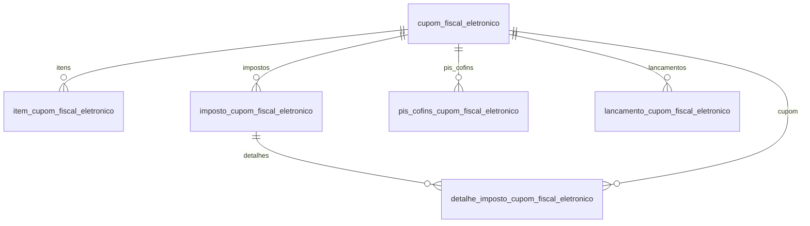

# Modelo — Cupom Fiscal Eletrônico (CF-e)

> Gerado por `src/model/gerar_docs_modelo.py` a partir de `src/model/modulos/cfe.yaml`, do catálogo e do perfil de colunas. **Não edite à mão.**

6 entidades. A coluna *Preench.* é o % de linhas com valor útil (nem nulo, nem em branco, nem zero, nem 1900-01-01; para colunas de código o zero conta como valor).

## Diagrama

## Entidades

| Entidade | Tabela | Linhas | Volume | Filtro obrigatório |
|---|---|---|---|---|
| [cupom_fiscal_eletronico](#cupom_fiscal_eletronico) | `efcupom_fiscal_eletronico` | 7.235.124 | grande | empresa; um de: periodo, codigo, chave_cfe, extrato |
| [item_cupom_fiscal_eletronico](#item_cupom_fiscal_eletronico) | `efcupom_fiscal_eletronico_estoque` | 12.416.469 | grande | empresa; um de: codigo_cfe, periodo |
| [imposto_cupom_fiscal_eletronico](#imposto_cupom_fiscal_eletronico) | `efcupom_fiscal_eletronico_impostos` | 7.623.014 | grande | empresa; um de: codigo_cfe, periodo |
| [detalhe_imposto_cupom_fiscal_eletronico](#detalhe_imposto_cupom_fiscal_eletronico) | `efcupom_fiscal_eletronico_impostos_detalhamento` | 7.744.304 | grande | empresa; um de: codigo_cfe, periodo |
| [pis_cofins_cupom_fiscal_eletronico](#pis_cofins_cupom_fiscal_eletronico) | `efcupom_fiscal_eletronico_pis_cofins` | 1.363.671 | grande | empresa; um de: codigo_cfe, periodo |
| [lancamento_cupom_fiscal_eletronico](#lancamento_cupom_fiscal_eletronico) | `efcupom_fiscal_eletronico_lancto` | 7.399.590 | grande | empresa; um de: codigo_cfe, periodo |

## cupom_fiscal_eletronico

**Cupons fiscais eletrônicos (CF-e SAT)** — tabela `efcupom_fiscal_eletronico` (7.235.124 linhas)

Cabeçalho de cada CF-e lançado na escrita fiscal: chave, data, extrato, equipamento SAT, situação e valor total. Cobre 40 empresas, de 2017-07 a 2026-01. Cancelamentos vêm como outro registro com extrato e chave de cancelamento preenchidos.

- **Chave:** `codi_emp, i_cfe`
- **Empresa:** `codi_emp`
- **Período:** `data_cfe` · exige um de: `periodo, codigo, chave_cfe, extrato`
- **Ordem padrão:** `data_cfe desc`, `i_cfe desc`

**Regras de negócio validadas:**

- Cancelamento: situação 2 tem extrato e chave de cancelamento em 12.083 de 12.090 CF-e, com valor total 0 e sem cliente; situação 0 nunca tem extrato de cancelamento (7.223.034 de 7.223.034). Para o que vale na apuração, filtre `situacao = 0`.
- Chave: os 7.235.124 CF-e têm chave de 44 posições e não há chave repetida por empresa (empresa 1017: 0 repetidas em 554.404).
- Fechamento (empresa 1017, 554.404 CF-e): valor_total do cabeçalho = valor_total do estoque_total em 100%; estoque_total = soma dos itens em 552.621 de 552.621; soma de impostos.valor_total = valor_total do cabeçalho em 552.621 de 552.621. Os 1.783 restantes são cancelados (valor 0, sem itens).
- origem_registro vale 7 em 99,99% dos CF-e e esse código não é documentado no comentário do banco; tipo_titulo é sempre 99 e conferido é sempre N: não servem para filtrar.

| Campo | Coluna | Tipo | Preench. | Domínio | Descrição (banco) |
|---|---|---|---|---|---|
| codigo | `i_cfe` | integer(4) |  |  | Código do CF-e |
| chave_cfe | `chave_cfe` | varchar(44) |  |  | Chave CF-e |
| data | `data_cfe` | date(4) |  |  | Data do CF-e |
| extrato | `extrato` | integer(4) |  |  | Extrato |
| sat | `sat` | integer(4) |  |  | Código do SAT CF-e |
| cliente_codigo | `codi_cli` | integer(4) |  |  | Código do cliente |
| tipo_titulo | `tipo_titulo` | tinyint(1) |  | tipo_titulo_cfe | Tipo do título (0=Duplicata/1=Cheque/2=Promissória/3=Recibo/4=Clientes/5=Documento Fiscal/99=Outros) |
| identificacao 🔒 | `identificacao` | varchar(255) |  |  | Identificação |
| situacao | `situacao` | integer(4) |  | situacao_cfe | Situação (0/1/2/4) |
| valor_total | `valor_total_cfe` | numeric(13) |  |  | Valor Total do CF-e |
| origem_registro | `origem_reg` | integer(4) |  | origem_registro_cfe | Origem do registro 0 - Sistema, 1 - Imp. Tabelas, 2 - Imp. Layout, 3- Imp. Tabelas Concorrentes |
| extrato_cancelamento | `extrato_cancelamento` | integer(4) |  |  | Número CF-e Cancelamento |
| chave_cancelamento | `chave_nfe_cancelamento` | varchar(44) |  |  | Chave CF-e Cancelamento |
| usuario | `codi_usu` | char(30) |  |  | Usuário |
| conferido | `conferido` | char(1) |  | sim_nao_texto | Conferido (S/N) |

**Vínculos (LEFT JOIN, acrescentam colunas legíveis):**

- `cliente` → `efclientes` por `codi_emp` = `codi_emp` e `codi_cli` = `codi_cli`; colunas: `cliente_nome` 🔒, `cliente_cnpj_cpf` 🔒
- `total` → `efcupom_fiscal_eletronico_estoque_total` por `codi_emp` = `codi_emp` e `i_cfe` = `i_cfe`; colunas: `total_produtos`, `total_desconto`, `total_acrescimo`

**Filhos (1:N):**

- `itens` → [item_cupom_fiscal_eletronico](#item_cupom_fiscal_eletronico)
- `impostos` → [imposto_cupom_fiscal_eletronico](#imposto_cupom_fiscal_eletronico)
- `pis_cofins` → [pis_cofins_cupom_fiscal_eletronico](#pis_cofins_cupom_fiscal_eletronico)
- `lancamentos` → [lancamento_cupom_fiscal_eletronico](#lancamento_cupom_fiscal_eletronico)

**Filtros:** `codigo` (eq/in), `chave_cfe` (eq), `data` (eq/entre/gte/lte), `extrato` (eq/in), `sat` (eq/in), `cliente_codigo` (eq/in), `situacao` (eq/in), `valor_total` (gte/lte/entre)

## item_cupom_fiscal_eletronico

**Itens dos CF-e (estoque)** — tabela `efcupom_fiscal_eletronico_estoque` (12.416.469 linhas)

Um item vendido por linha, com quantidade, valores e tributação de ICMS, PIS e COFINS. Colunas de combustível (bico, tanque, operação, modal), FECOEP/FECOP e quantidade tributável por unidade de medida só estão em usos específicos e foram omitidas.

- **Chave:** `codi_emp, i_cfe, i_estoque`
- **Empresa:** `codi_emp`
- **Período:** `cupom.data_cfe` · exige um de: `codigo_cfe, periodo`
- **Ordem padrão:** `i_cfe desc`, `i_estoque asc`

**Regras de negócio validadas:**

- Sem órfãos: os 702.017 itens da empresa 1017 têm o CF-e correspondente (0 sem cabeçalho); a soma de valor_total dos itens por CF-e é igual ao estoque_total em 552.621 de 552.621.
- Na empresa 1017 o ICMS é quase sempre CST 60 (701.433 de 702.017) e os dados de PIS/COFINS estão todos conferidos (dados_pis_cofins_ok = S).

| Campo | Coluna | Tipo | Preench. | Domínio | Descrição (banco) |
|---|---|---|---|---|---|
| codigo_cfe | `i_cfe` | integer(4) |  |  | Código do CF-e |
| sequencial | `i_estoque` | integer(4) |  |  | Sequencial do estoque |
| produto_codigo | `codi_pdi` | char(14) |  |  | Produto |
| unidade | `unidade` | char(6) |  |  | Unidade comercializada |
| quantidade | `quantidade` | numeric(13) |  |  | Quantidade |
| valor_unitario | `valor_unitario` | numeric(15) |  |  | Valor unitário |
| valor_produto | `valor_produto` | numeric(13) |  |  | Valor do produto |
| desconto | `desconto` | numeric(13) |  |  | Valor do desconto |
| acrescimo | `acrescimo` | numeric(13) |  |  | Valor do acréscimo |
| valor_total | `valor_total` | numeric(13) |  |  | Valor total |
| cfop | `codi_nat` | integer(4) |  |  | CFOP |
| cfop_versao | `versao_nat` | smallint(2) |  |  | Versão da CFOP |
| acumulador_codigo | `codi_acu` | integer(4) |  |  | Código do acumulador |
| cst_icms | `cst_icms` | integer(4) |  |  | Codigo da Situação Tributaria(ICMS) |
| base_icms | `base_calculo_icms` | numeric(13) |  |  | Base de cálculo do ICMS |
| aliquota_icms | `aliquota_icms` | numeric(5) |  |  | Alíquota do ICMS |
| valor_icms | `valor_icms` | numeric(13) |  |  | Valor do ICMS |
| cst_pis | `cst_pis` | integer(4) |  |  | CST do PIS |
| natureza_receita_pis | `natureza_receita_pis` | integer(4) |  |  | Natureza da receita do PIS |
| base_pis | `base_calculo_pis` | numeric(13) |  |  | Base de cálculo do PIS |
| aliquota_pis | `aliquota_pis` | numeric(7) |  |  | Alíquota do PIS |
| valor_pis | `valor_pis` | numeric(13) |  |  | Valor do PIS |
| cst_cofins | `cst_cofins` | integer(4) |  |  | CST da COFINS |
| natureza_receita_cofins | `natureza_receita_cofins` | integer(4) |  |  | Natureza da receita do COFINS |
| base_cofins | `base_calculo_cofins` | numeric(13) |  |  | Base de cálculo da COFINS |
| aliquota_cofins | `aliquota_cofins` | numeric(7) |  |  | Alíquota da COFINS |
| valor_cofins | `valor_cofins` | numeric(13) |  |  | Valor da COFINS |
| dados_pis_cofins_ok | `dados_piscofins_ok` | char(1) |  | sim_nao_texto | Dados referente ao PIS/COFINS OK (S/N) |
| codigo_cest | `codigo_cest` | char(7) |  |  | Código CEST |

**Vínculos (LEFT JOIN, acrescentam colunas legíveis):**

- `cupom` → `efcupom_fiscal_eletronico` por `codi_emp` = `codi_emp` e `i_cfe` = `i_cfe`; colunas: `cupom_data`, `cupom_chave`, `cupom_situacao`
- `produto` → `efprodutos` por `codi_emp` = `codi_emp` e `codi_pdi` = `codi_pdi`; colunas: `produto_descricao`, `produto_ncm`
- `acumulador` → `efacumulador` por `codi_emp` = `codi_emp` e `codi_acu` = `codi_acu`; colunas: `acumulador_nome`

**Filtros:** `codigo_cfe` (eq/in), `produto_codigo` (eq/in/prefixo), `cfop` (eq/in), `cst_icms` (eq/in), `cst_pis` (eq/in), `cst_cofins` (eq/in), `acumulador_codigo` (eq/in)

## imposto_cupom_fiscal_eletronico

**Impostos dos CF-e por acumulador** — tabela `efcupom_fiscal_eletronico_impostos` (7.623.014 linhas)

Resumo por acumulador de cada CF-e (valor do produto, desconto, acréscimo e total). Alimenta a apuração: a soma do valor_total por CF-e é igual ao valor do cabeçalho.

- **Chave:** `codi_emp, i_cfe, i_imposto`
- **Empresa:** `codi_emp`
- **Período:** `cupom.data_cfe` · exige um de: `codigo_cfe, periodo`
- **Ordem padrão:** `i_cfe desc`, `i_imposto asc`

**Regras de negócio validadas:**

- Soma de valor_total por CF-e = valor_total do cabeçalho em 552.621 de 552.621 CF-e vigentes da empresa 1017.

| Campo | Coluna | Tipo | Preench. | Domínio | Descrição (banco) |
|---|---|---|---|---|---|
| codigo_cfe | `i_cfe` | integer(4) |  |  | Código do CF-e |
| sequencial | `i_imposto` | integer(4) |  |  | Sequencial do imposto |
| acumulador_codigo | `codi_acu` | integer(4) |  |  | Código do acumulador |
| valor_produto | `valor_produto` | numeric(13) |  |  | Valor do produto |
| desconto | `desconto` | numeric(13) |  |  | Valor do desconto |
| acrescimo | `acrescimo` | numeric(13) |  |  | Valor do acréscimo |
| valor_total | `valor_total` | numeric(13) |  |  | Valor total |

**Vínculos (LEFT JOIN, acrescentam colunas legíveis):**

- `cupom` → `efcupom_fiscal_eletronico` por `codi_emp` = `codi_emp` e `i_cfe` = `i_cfe`; colunas: `cupom_data`, `cupom_chave`, `cupom_situacao`
- `acumulador` → `efacumulador` por `codi_emp` = `codi_emp` e `codi_acu` = `codi_acu`; colunas: `acumulador_nome`

**Filhos (1:N):**

- `detalhes` → [detalhe_imposto_cupom_fiscal_eletronico](#detalhe_imposto_cupom_fiscal_eletronico)

**Filtros:** `codigo_cfe` (eq/in), `acumulador_codigo` (eq/in)

## detalhe_imposto_cupom_fiscal_eletronico

**Detalhamento dos impostos do CF-e** — tabela `efcupom_fiscal_eletronico_impostos_detalhamento` (7.744.304 linhas)

Base, alíquota e valor por imposto (ICMS etc.), CST e CFOP de cada linha de imposto do CF-e.

- **Chave:** `codi_emp, i_cfe, i_imposto, i_detalhamento`
- **Empresa:** `codi_emp`
- **Período:** `cupom.data_cfe` · exige um de: `codigo_cfe, periodo`
- **Ordem padrão:** `i_cfe desc`, `i_imposto asc`, `i_detalhamento asc`

**Regras de negócio validadas:**

- Na empresa 1017 todo o detalhamento é de ICMS (codi_imp = 1; 554.530 linhas).

| Campo | Coluna | Tipo | Preench. | Domínio | Descrição (banco) |
|---|---|---|---|---|---|
| codigo_cfe | `i_cfe` | integer(4) |  |  | Código do CF-e |
| imposto_sequencial | `i_imposto` | integer(4) |  |  | Sequencial do imposto |
| sequencial | `i_detalhamento` | integer(4) |  |  | Sequencial do detalhamento |
| imposto_codigo | `codi_imp` | integer(4) |  | codigo_imposto | Código do imposto |
| valor_contabil | `valor_contabil` | numeric(13) |  |  | Valor contábil |
| base_calculo | `base_calculo` | numeric(13) |  |  | Base de cálculo |
| aliquota | `aliquota` | numeric(5) |  |  | Alíquota |
| valor_imposto | `valor_imposto` | numeric(13) |  |  | Valor do imposto |
| valor_isentas | `valor_isentas` | numeric(13) |  |  | Valor de isentas |
| valor_outros | `valor_outros` | numeric(13) |  |  | Valor de outros |
| cst | `cst` | integer(4) |  |  | CST |
| cfop | `codi_nat` | integer(4) |  |  | CFOP |
| cfop_versao | `versao_nat` | smallint(2) |  |  | Versão da CFOP |
| observacao_codigo | `codigo_observacao` | integer(4) |  |  | Observação |
| observacao | `descricao_observacao` | varchar(360) |  |  | Descrição da observação |

**Vínculos (LEFT JOIN, acrescentam colunas legíveis):**

- `cupom` → `efcupom_fiscal_eletronico` por `codi_emp` = `codi_emp` e `i_cfe` = `i_cfe`; colunas: `cupom_data`, `cupom_situacao`
- `imposto` → `geimposto` por `codi_emp` = `codi_emp` e `codi_imp` = `codi_imp`; colunas: `imposto_nome`, `imposto_sigla`

**Filtros:** `codigo_cfe` (eq/in), `imposto_codigo` (eq/in), `cst` (eq/in), `cfop` (eq/in)

## pis_cofins_cupom_fiscal_eletronico

**PIS/COFINS dos CF-e (resumo por CST)** — tabela `efcupom_fiscal_eletronico_pis_cofins` (1.363.671 linhas)

Resumo de PIS e COFINS por CST/natureza da receita/CFOP, usado pela apuração (a apuração lê esta tabela e a de itens). Cobre 1,36 milhão de linhas, bem menos que os itens (nem todo CF-e tem resumo).

- **Chave:** `codi_emp, i_cfe, i_pis_cofins`
- **Empresa:** `codi_emp`
- **Período:** `cupom.data_cfe` · exige um de: `codigo_cfe, periodo`
- **Ordem padrão:** `i_cfe desc`, `i_pis_cofins asc`

**Regras de negócio validadas:**

- Na empresa 1017, 148.571 linhas: CST 4 em 147.105 e CST 1 em 1.466.

| Campo | Coluna | Tipo | Preench. | Domínio | Descrição (banco) |
|---|---|---|---|---|---|
| codigo_cfe | `i_cfe` | integer(4) |  |  | Código do CF-e |
| sequencial | `i_pis_cofins` | integer(4) |  |  | Sequencial |
| cst | `cst` | integer(4) |  |  | CST |
| natureza_receita | `natureza_receita` | integer(4) |  |  | Natureza da receita |
| cfop | `codi_nat` | integer(4) |  |  | CFOP |
| cfop_versao | `versao_nat` | smallint(2) |  |  | Versão da CFOP |
| valor_contabil | `valor_contabil` | numeric(13) |  |  | Valor contábil |
| exclusoes | `exclusoes` | numeric(13) |  |  | Exclusões |
| base_calculo | `base_calculo` | numeric(13) |  |  | Base de cálculo |
| aliquota_pis | `aliquota_pis` | numeric(7) |  |  | Alíquota do PIS |
| aliquota_cofins | `aliquota_cofins` | numeric(7) |  |  | Alíquota da COFINS |
| quantidade_tributada | `quantidade_tributada` | numeric(13) |  |  | Quantidade tributada |
| valor_pis | `valor_pis` | numeric(13) |  |  | Valor do PIS |
| valor_cofins | `valor_cofins` | numeric(13) |  |  | Valor da COFINS |
| exclusao_cooperativa | `exclusao_cooperativa` | numeric(13) |  |  | Exclusão Cooperativa |
| percentual_reducao_bc | `percentual_reducao_bc` | numeric(5) |  |  | Percentual Redução Base Cálculo |
| codigo_recolhimento_pis | `codigo_recolhimento_pis` | char(6) |  |  | Código do Recolhimento do PIS |
| codigo_recolhimento_cofins | `codigo_recolhimento_cofins` | char(6) |  |  | Código do Recolhimento do COFINS |

**Vínculos (LEFT JOIN, acrescentam colunas legíveis):**

- `cupom` → `efcupom_fiscal_eletronico` por `codi_emp` = `codi_emp` e `i_cfe` = `i_cfe`; colunas: `cupom_data`, `cupom_situacao`

**Filtros:** `codigo_cfe` (eq/in), `cst` (eq/in), `cfop` (eq/in)

## lancamento_cupom_fiscal_eletronico

**Lançamentos contábeis dos CF-e** — tabela `efcupom_fiscal_eletronico_lancto` (7.399.590 linhas)

Liga cada CF-e ao lançamento contábil gerado (ctlancto). `empresa_cfe` é a empresa dona do CF-e; `codi_emp` é a empresa do lançamento.

- **Chave:** `codi_emp, i_cfe, nume_lan, fili_lan`
- **Empresa:** `codi_emp`
- **Período:** `cupom.data_cfe` · exige um de: `codigo_cfe, periodo`
- **Ordem padrão:** `i_cfe desc`, `nume_lan asc`

**Regras de negócio validadas:**

- Na empresa 1017 os 554.516 lançamentos têm fili_lan igual a codi_emp e tipo 1.

| Campo | Coluna | Tipo | Preench. | Domínio | Descrição (banco) |
|---|---|---|---|---|---|
| codigo_cfe | `i_cfe` | integer(4) |  |  | Código do CF-e |
| lancamento_numero | `nume_lan` | integer(4) |  |  | Número do lançamento |
| empresa_cfe | `fili_lan` | integer(4) |  |  | Empresa do CF-e |
| tipo | `tipo` | integer(4) |  | tipo_lancamento_cfe | Tipo do lançamento |

**Vínculos (LEFT JOIN, acrescentam colunas legíveis):**

- `cupom` → `efcupom_fiscal_eletronico` por `fili_lan` = `codi_emp` e `i_cfe` = `i_cfe`; colunas: `cupom_data`, `cupom_situacao`

**Filtros:** `codigo_cfe` (eq/in), `lancamento_numero` (eq/in)

## Domínios (significado dos códigos)

`confirmado`: **sim** = vem do comentário do banco e/ou foi conferido nos dados; **parcial** = parte dos valores; **não** = hipótese, não use como regra.

### status_empresa

Situação da empresa no cadastro (geempre.stat_emp)

Confirmado: sim

| Código | Significado |
|---|---|
| A | Ativa |
| I | Inativa |
| C | Em constituição |
| M | Ativo sem movimento |
| B | Em processo de baixa |
| E | Excluindo |

### motivo_inatividade

Motivo da inatividade (geempre.tipoi_emp). Só aparece em empresas inativas.

Confirmado: sim

| Código | Significado |
|---|---|
| 1 | Outros |
| 2 | Baixada |
| 3 | Transferida |
| 4 | Inadimplente |

### tipo_inscricao

Tipo da inscrição (CNPJ/CPF/CEI/CAEPF)

Confirmado: sim

| Código | Significado |
|---|---|
| 1 | CNPJ |
| 2 | CPF |
| 3 | CEI |
| 6 | CAEPF |

### regime_federal_empresa

Regime federal da folha (geempre.rfed_emp)

Confirmado: parcial

| Código | Significado |
|---|---|
| 1 | Normal |
| 2 | Microempresa |
| 3 | Empresa de pequeno porte |

### tipo_honorario_empresa

Como a empresa usa o módulo Honorários (geempre.honorario_tipo)

Confirmado: sim

| Código | Significado |
|---|---|
| E | Escritório (quem fatura) |
| C | Cliente |

### sim_nao_texto

Confirmado: sim

| Código | Significado |
|---|---|
| S | Sim |
| N | Não |

### sim_nao_numerico

Confirmado: sim

| Código | Significado |
|---|---|
| 1 | Sim |
| 0 | Não |

### situacao_cfe

Situação do CF-e (efcupom_fiscal_eletronico.situacao).

Confirmado: parcial

> O comentário do banco diz "Situação (0/1/2/4)" sem legenda. Nos dados só aparecem 0 (7.223.034) e 2 (12.090). Evidência de 2: 12.083 de 12.090 (99,9%) têm número de extrato e chave de cancelamento, todos com valor total 0 e sem cliente; já os de situação 0 nunca têm extrato de cancelamento. Logo 2 = cancelado e 0 = normal. 1 e 4 não ocorrem.

| Código | Significado |
|---|---|
| 0 | Normal |
| 1 | Desconhecido (não ocorre) |
| 2 | Cancelado |
| 4 | Desconhecido (não ocorre) |

### tipo_titulo_cfe

Confirmado: sim

> Todos os 7.235.124 CF-e têm 99 (Outros).

| Código | Significado |
|---|---|
| 0 | Duplicata |
| 1 | Cheque |
| 2 | Promissória |
| 3 | Recibo |
| 4 | Clientes |
| 5 | Documento Fiscal |
| 99 | Outros |

### origem_registro_cfe

Confirmado: parcial

> O comentário lista só 0 (Sistema), 1 (Imp. Tabelas), 2 (Imp. Layout) e 3 (Imp. Tabelas Concorrentes), mas 7.235.120 de 7.235.124 CF-e (99,99%) têm 7, que não consta no comentário (provável importação do arquivo do SAT; sem confirmação).

| Código | Significado |
|---|---|
| 0 | Sistema |
| 1 | Importação de tabelas |
| 2 | Importação de layout |
| 3 | Importação de tabelas concorrentes |
| 7 | Não documentado (provável importação do SAT) |

### codigo_imposto

Código do imposto (codi_imp), igual em todas as empresas (mesmo domínio do módulo fiscal).

Confirmado: sim

| Código | Significado |
|---|---|
| 1 | ICMS |
| 2 | IPI |
| 3 | ISS |
| 4 | PIS |
| 5 | COFINS |
| 8 | DIFALI |
| 9 | Substituição Tributária |
| 16 | IRRF |
| 18 | ISS Retido |
| 22 | PIS (Retido) |
| 23 | COFINS (Retido) |
| 24 | Contribuição Social (Retida) |
| 26 | INSS Retido |

### tipo_lancamento_cfe

Confirmado: parcial

> O comentário só diz "Tipo do lançamento". Na empresa 1017 todos os lançamentos são tipo 1.

| Código | Significado |
|---|---|
| 1 | Contabilização do CF-e (hipótese) |

