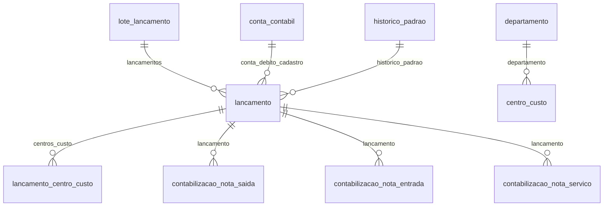

# Modelo — Contabilidade

> Gerado por `src/model/gerar_docs_modelo.py` a partir de `src/model/modulos/contabil.yaml`, do catálogo e do perfil de colunas. **Não edite à mão.**

11 entidades. A coluna *Preench.* é o % de linhas com valor útil (nem nulo, nem em branco, nem zero, nem 1900-01-01; para colunas de código o zero conta como valor).

## Diagrama

## Entidades

| Entidade | Tabela | Linhas | Volume | Filtro obrigatório |
|---|---|---|---|---|
| [conta_contabil](#conta_contabil) | `ctcontas` | 1.574.175 | grande | empresa |
| [historico_padrao](#historico_padrao) | `cthispad` | 266.424 | medio | empresa |
| [centro_custo](#centro_custo) | `ctccusto` | 1.383 | pequeno | empresa |
| [departamento](#departamento) | `ctdepto` | 1.372 | pequeno | empresa |
| [lancamento_padrao](#lancamento_padrao) | `ctlanctopadrao` | 522 | pequeno | empresa |
| [lote_lancamento](#lote_lancamento) | `ctlanctolote` | 12.642.297 | grande | empresa |
| [lancamento](#lancamento) | `ctlancto` | 13.712.713 | grande | empresa; um de: periodo, numero, lote_codigo, documento |
| [lancamento_centro_custo](#lancamento_centro_custo) | `ctclancto` | 46.687 | medio | empresa |
| [contabilizacao_nota_saida](#contabilizacao_nota_saida) | `efsaidas_lancto` | 418.808 | medio | empresa; um de: codigo_nota, numero_lancamento |
| [contabilizacao_nota_entrada](#contabilizacao_nota_entrada) | `efentradas_lancto` | 552.148 | medio | empresa; um de: codigo_nota, numero_lancamento |
| [contabilizacao_nota_servico](#contabilizacao_nota_servico) | `efservicos_lancto` | 1.381.415 | grande | empresa; um de: codigo_nota, numero_lancamento |

## conta_contabil

**Plano de contas** — tabela `ctcontas` (1.574.175 linhas)

Contas contábeis. ATENÇÃO: `empresa` aqui é a empresa DONA DO PLANO. Se a empresa consultada usa o plano de outra, informe a empresa do plano (ctlancto.codi_emp_plano). Só contas analíticas (tipo A) recebem lançamentos.

- **Chave:** `codi_emp, codi_cta`
- **Empresa:** `codi_emp`
- **Período:** `—`
- **Ordem padrão:** `clas_cta asc`

**Regras de negócio validadas:**

- clas_cta é a classificação hierárquica (ex.: 1.1.01...): contas sintéticas totalizam as analíticas cujo clas_cta começa pelo mesmo prefixo.
- Só contas analíticas (A) recebem lançamentos (13.267.083 lançamentos em contas A contra 33 em contas S — exceções de dado).

| Campo | Coluna | Tipo | Preench. | Domínio | Descrição (banco) |
|---|---|---|---|---|---|
| codigo | `codi_cta` | integer(4) | 100% |  | Codigo |
| classificacao | `clas_cta` | char(20) | 100% |  | Classificacao |
| nome | `nome_cta` | varchar(150) | 100% |  | Descricao |
| tipo | `tipo_cta` | char(1) | 100% | tipo_conta | Tipo (A=Analitico/S=Sintetico) |
| situacao | `situacao_cta` | char(1) | 100% | situacao_conta | Situacao (A-Ativa/I-Inativa) |
| data_cadastro | `data_cta` | date(4) | 100% |  | Data cadastro |
| data_inativacao | `datainativa_cta` | date(4) | 2% |  | Data da inativacao |
| grupo_dre | `grdre_cta` | integer(4) | 5% |  | Grupo DRE |
| grupo_dlpa | `dlpa_cta` | integer(4) | 1% |  | Grupo DLPA |
| grupo_doar | `doar_cta` | integer(4) | 1% |  | Grupo DOAR |
| grupo_dmpl | `dmpl_cta` | integer(4) | 1% |  | Grupo DMPL |
| grupo_dra | `dra_cta` | integer(4) | 0% |  | Grupo DRA |
| grupo_dsp | `dsp_cta` | integer(4) | 0% |  | Grupo DSP |
| grupo_ebitda | `ebitda_cta` | integer(4) | 0% |  | Grupo EBITDA |
| grupo_lcdpr | `lcdpr_cta` | integer(4) | 0% |  | Grupo LCDPR |

**Filtros:** `codigo` (eq/in), `classificacao` (eq/prefixo), `nome` (contem/prefixo), `tipo` (eq), `situacao` (eq)

## historico_padrao

**Históricos padrão** — tabela `cthispad` (266.424 linhas)

Textos-modelo de histórico, pertencentes ao plano (use a empresa do plano). 64% dos lançamentos não usam código de histórico e trazem o texto livre em chis_lan.

- **Chave:** `codi_emp, codi_his`
- **Empresa:** `codi_emp`
- **Período:** `—`
- **Ordem padrão:** `codi_his asc`

| Campo | Coluna | Tipo | Preench. | Domínio | Descrição (banco) |
|---|---|---|---|---|---|
| codigo | `codi_his` | integer(4) | 100% |  | Codigo |
| descricao | `desc_his` | varchar(100) | 100% |  | Descricao |

**Filtros:** `codigo` (eq/in), `descricao` (contem/prefixo)

## centro_custo

**Centros de custo** — tabela `ctccusto` (1.383 linhas)

- **Chave:** `codi_emp, codi_ccu`
- **Empresa:** `codi_emp`
- **Período:** `—`
- **Ordem padrão:** `codi_ccu asc`

| Campo | Coluna | Tipo | Preench. | Domínio | Descrição (banco) |
|---|---|---|---|---|---|
| codigo | `codi_ccu` | integer(4) | 100% |  | Codigo |
| descricao | `desc_ccu` | char(40) | 100% |  | Descricao |
| departamento_codigo | `codi_dep` | integer(4) | 100% |  | Departamento |
| data_cadastro | `data_ccu` | date(4) | 100% |  | Data cadastro |

**Vínculos (LEFT JOIN, acrescentam colunas legíveis):**

- `departamento` → `ctdepto` por `codi_emp` = `codi_emp` e `codi_dep` = `codi_dep`; colunas: `departamento_nome`

**Filtros:** `codigo` (eq/in), `descricao` (contem/prefixo)

## departamento

**Departamentos (contabilidade)** — tabela `ctdepto` (1.372 linhas)

- **Chave:** `codi_emp, codi_dep`
- **Empresa:** `codi_emp`
- **Período:** `—`
- **Ordem padrão:** `codi_dep asc`

| Campo | Coluna | Tipo | Preench. | Domínio | Descrição (banco) |
|---|---|---|---|---|---|
| codigo | `codi_dep` | integer(4) | 100% |  | Codigo |
| descricao | `desc_dep` | char(40) | 100% |  | Descricao |

**Filtros:** `codigo` (eq/in), `descricao` (contem/prefixo)

## lancamento_padrao

**Lançamentos padrão** — tabela `ctlanctopadrao` (522 linhas)

Modelos de lançamento (contas e histórico pré-definidos).

- **Chave:** `codi_emp, codi_pad`
- **Empresa:** `codi_emp`
- **Período:** `—`
- **Ordem padrão:** `codi_pad asc`

| Campo | Coluna | Tipo | Preench. | Domínio | Descrição (banco) |
|---|---|---|---|---|---|
| codigo | `codi_pad` | integer(4) | 100% |  | Codigo |
| descricao | `desc_pad` | char(50) | 100% |  | Descricao |
| conta_debito | `cdeb_pad` | integer(4) | 100% |  | Conta debito |
| conta_credito | `ccre_pad` | integer(4) | 100% |  | Conta credito |
| historico_codigo | `chis_pad` | integer(4) | 100% |  | Codigo do historico |
| tipo | `tipo_pad` | char(1) | 100% | tipo_lote | Tipo (D=Um debito para varios creditos/C=Um credito para varios debitos/X=Um debito para um credito/V=Varios debitos para varios creditos) |
| filial | `fili_pad` | integer(4) | 0% |  | Filial |

**Filtros:** `codigo` (eq/in), `descricao` (contem/prefixo)

## lote_lancamento

**Lotes de lançamento** — tabela `ctlanctolote` (12.642.297 linhas)

Todo lançamento pertence a um lote (nenhum lançamento sem lote). O equilíbrio contábil (débitos = créditos) vale POR LOTE: no tipo X há 1 débito e 1 crédito na mesma linha; nos tipos D, C e V as linhas têm um dos lados zerado.

- **Chave:** `codi_emp, codi_lote`
- **Empresa:** `codi_emp`
- **Período:** `—`
- **Ordem padrão:** `codi_lote desc`

| Campo | Coluna | Tipo | Preench. | Domínio | Descrição (banco) |
|---|---|---|---|---|---|
| codigo | `codi_lote` | integer(4) | 100% |  | Codigo |
| tipo | `tipo` | char(1) | 100% | tipo_lote | Tipo (D=Um debito para varios creditos/C=Um credito para varios debitos/X=Um debito para um credito/V=Varios debitos para varios creditos) |
| lancamento_padrao_codigo | `codi_pad` | integer(4) | 0% |  | Lancamento padrao |
| localizador | `localizador` | char(15) | 0% |  | Localizador |

**Filhos (1:N):**

- `lancamentos` → [lancamento](#lancamento)

**Filtros:** `codigo` (eq/in/entre), `tipo` (eq/in)

## lancamento

**Lançamentos contábeis** — tabela `ctlancto` (13.712.713 linhas)

Livro diário: uma linha por lançamento. Cada lançamento tem valor, conta a débito (cdeb_lan) e conta a crédito (ccre_lan); o valor 0 em um dos lados significa linha de lote com vários débitos ou créditos. Contas e histórico são do PLANO (codi_emp_plano), que pode ser de outra empresa.

- **Chave:** `codi_emp, nume_lan`
- **Empresa:** `codi_emp`
- **Período:** `data_lan` · exige um de: `periodo, numero, lote_codigo, documento`
- **Ordem padrão:** `data_lan asc`, `nume_lan asc`

**Regras de negócio validadas:**

- Equilíbrio: em cada lote, soma dos valores com débito = soma dos valores com crédito. Conferido nos 40.317 lotes da empresa 1430 (tipos X, V, C e D: 100% equilibrados; total de débitos = créditos = 248.988.467,04).
- vlor_lan nunca é negativo (0 negativos em 13,7 mi); 91 lançamentos têm valor 0.
- Conta e histórico: ligar pelo PLANO (plano_empresa = CODI_EMP_PLANO), não por codi_emp. A ligação com o histórico não aparece nos JOINs dos programas da Domínio (por isso o validador avisa 'sem relação no grafo'); ela se sustenta nos dados: 0 órfãos por plano, contra 781 de 781 por codi_emp nos lançamentos de plano alheio.
- Elo com a escrita fiscal: orig 5/6/7 ligam a efsaidas_lancto/efentradas_lancto/efservicos_lancto. REGRA ROBUSTA: o MAIOR lançamento ligado a uma nota é igual ao valor contábil dela (98,8% a 100% em 6 amostras de empresas e tipos de nota). A SOMA dos lançamentos ligados só fecha com o valor da nota quando a empresa contabiliza apenas o total (100% em saídas da empresa 1430; 65%, 33% e 64% em outras empresas), porque há lançamentos adicionais (impostos, retenções).
- Datas: há lançamentos com data absurda (143 acima de 2100, ex.: 9282-06-06) — erro de digitação nos dados; filtre por período.
- O texto do histórico fica em `historico` (chis_lan); o código de histórico padrão é opcional (64% dos lançamentos da empresa 1430 não usam).

| Campo | Coluna | Tipo | Preench. | Domínio | Descrição (banco) |
|---|---|---|---|---|---|
| numero | `nume_lan` | integer(4) | 100% |  | Numero |
| data | `data_lan` | date(4) | 100% |  | Data |
| valor | `vlor_lan` | numeric(14) | 100% |  | Valor |
| conta_debito | `cdeb_lan` | integer(4) | 97% |  | Debito |
| conta_credito | `ccre_lan` | integer(4) | 93% |  | Credito |
| plano_empresa | `codi_emp_plano` | integer(4) | 100% |  | Empresa do plano de contas |
| historico_codigo | `codi_his` | integer(4) | 82% |  | Codigo Historico |
| historico | `chis_lan` | varchar(1000) | 100% |  | Historico |
| lote_codigo | `codi_lote` | integer(4) | 100% |  | Lancamento em lote |
| lancamento_padrao_codigo | `codi_pad` | integer(4) | 0% |  | Lancamento padrao |
| origem | `orig_lan` | tinyint(1) | 100% | origem_lancamento | Origem (1=Normal, 2=Zer, 3=Pat, 4=Esc, 5=Sai, 6=Ent, 7=Ser, 8=Aju, 9=Acu, 10=Apu, 11=PgtGuia, 12=Cliente, 13=Folha, 14-19=Hono) |
| documento | `ndoc_lan` | integer(4) | 72% |  | Relacao com Escrita Fiscal |
| filial | `fili_lan` | integer(4) | 100% |  | Filial |
| data_original | `dorig_lan` | date(4) | 100% |  | Data Original |
| data_ocorrencia | `data_ocorrencia` | date(4) | 0% |  | Data de ocorrência |
| conciliado_debito | `conciliado_deb` | char(1) | 100% | sim_nao_texto | Lançamento conciliado a débito (S/N) |
| conciliado_credito | `conciliado_cre` | char(1) | 100% | sim_nao_texto | Lançamento conciliado a crédito (S/N) |
| usuario | `codi_usu` | char(30) | 100% |  | Usuario |
| origem_registro | `origem_reg` | tinyint(1) | 16% |  | Origem do registro 0 - Sistema, 1 - Imp. Tabelas, 2 - Imp. Layout, 3- Imp. Tabelas Concorrentes |
| cpf_titular_pagamento 🔒 | `cpf_titular_pagamento` | varchar(14) | 0% |  | Titular do pagamento |
| cpf_beneficiario_servico 🔒 | `cpf_beneficiario_servico` | varchar(11) | 0% |  | CPF Beneficiário do serviço |

**Vínculos (LEFT JOIN, acrescentam colunas legíveis):**

- `conta_debito_cadastro` → `ctcontas` por `CODI_EMP_PLANO` = `codi_emp` e `cdeb_lan` = `codi_cta`; colunas: `conta_debito_classificacao`, `conta_debito_nome`
- `conta_credito_cadastro` → `ctcontas` por `CODI_EMP_PLANO` = `codi_emp` e `ccre_lan` = `codi_cta`; colunas: `conta_credito_classificacao`, `conta_credito_nome`
- `historico_padrao` → `cthispad` por `CODI_EMP_PLANO` = `codi_emp` e `codi_his` = `codi_his`; colunas: `historico_padrao_descricao`
- `lote` → `ctlanctolote` por `codi_emp` = `codi_emp` e `codi_lote` = `codi_lote`; colunas: `lote_tipo`

**Filhos (1:N):**

- `centros_custo` → [lancamento_centro_custo](#lancamento_centro_custo)

**Filtros:** `numero` (eq/in/entre), `data` (entre/gte/lte), `conta` (eq/in), `conta_debito` (eq/in), `conta_credito` (eq/in), `valor` (eq/gte/lte/entre), `lote_codigo` (eq/in), `origem` (eq/in), `documento` (eq/in), `filial` (eq/in), `historico_codigo` (eq/in), `usuario` (eq)

## lancamento_centro_custo

**Rateio de lançamentos por centro de custo** — tabela `ctclancto` (46.687 linhas)

Distribuição de um lançamento entre centros de custo (apenas empresas que usam centro de custo).

- **Chave:** `codi_emp, nume_ccu, cdeb_ccu, ccre_ccu`
- **Empresa:** `codi_emp`
- **Período:** `data_ccu`
- **Ordem padrão:** `data_ccu asc`, `nume_ccu asc`

| Campo | Coluna | Tipo | Preench. | Domínio | Descrição (banco) |
|---|---|---|---|---|---|
| numero_lancamento | `nume_ccu` | integer(4) | 100% |  | Numero do lancamento |
| conta_debito_centro | `cdeb_ccu` | integer(4) | 53% |  | Conta debito do centro de custo |
| conta_credito_centro | `ccre_ccu` | integer(4) | 47% |  | Conta credito do centro de custo |
| conta_codigo | `codi_cta` | integer(4) | 100% |  | Conta contabil |
| data | `data_ccu` | date(4) | 100% |  | Data do lancamento |
| valor | `vlor_ccu` | numeric(13) | 100% |  | Valor do lancamento |
| filial | `fili_ccu` | integer(4) | 100% |  | Codigo da filial |
| lancamento_contabil | `nume_lan` | integer(4) | 0% |  | Numero Lancto. Contabil |

**Filtros:** `numero_lancamento` (eq/in), `data` (entre/gte/lte), `conta_codigo` (eq/in)

## contabilizacao_nota_saida

**Contabilização das notas de saída** — tabela `efsaidas_lancto` (418.808 linhas)

Liga cada nota de saída (efsaidas) aos lançamentos que a contabilizaram. `empresa` = empresa da NOTA; `empresa_lancamento` (fili_lan) = empresa em cujo livro o lançamento foi feito — difere em 17% das linhas (notas de filiais contabilizadas na matriz).

- **Chave:** `codi_emp, nume_lan, fili_lan, codi_sai`
- **Empresa:** `codi_emp`
- **Período:** `—` · exige um de: `codigo_nota, numero_lancamento`
- **Ordem padrão:** `codi_sai desc`, `nume_lan asc`

**Regras de negócio validadas:**

- O MAIOR lancamento_valor entre as linhas ligadas a uma nota de saída (cancelada='N') é igual a vcon_sai em 100% (empresa 1430) e 99,9% (empresa 879). NÃO assuma que a soma é igual: ela fecha em 100% na empresa 1430, mas em 65% na 879 (lançamentos adicionais de imposto/retenção).

| Campo | Coluna | Tipo | Preench. | Domínio | Descrição (banco) |
|---|---|---|---|---|---|
| codigo_nota | `codi_sai` | integer(4) | 100% |  | Codigo da nota |
| numero_lancamento | `nume_lan` | integer(4) | 100% |  | Numero do lancamento |
| empresa_lancamento | `fili_lan` | integer(4) | 100% |  | Empresa da nota |
| tipo | `tipo` | tinyint(1) | 100% | tipo_ligacao_documento | Tipo do lancamento |
| origem_lancamento | `origem_lancamento` | char(1) | 98% |  | Origem lançamento |

**Vínculos (LEFT JOIN, acrescentam colunas legíveis):**

- `lancamento` → `ctlancto` por `fili_lan` = `codi_emp` e `nume_lan` = `nume_lan`; colunas: `lancamento_data`, `lancamento_valor`, `lancamento_conta_debito`, `lancamento_conta_credito`

**Filtros:** `codigo_nota` (eq/in), `numero_lancamento` (eq/in)

## contabilizacao_nota_entrada

**Contabilização das notas de entrada** — tabela `efentradas_lancto` (552.148 linhas)

- **Chave:** `codi_emp, nume_lan, fili_lan, codi_ent`
- **Empresa:** `codi_emp`
- **Período:** `—` · exige um de: `codigo_nota, numero_lancamento`
- **Ordem padrão:** `codi_ent desc`, `nume_lan asc`

**Regras de negócio validadas:**

- O maior lancamento_valor ligado a uma nota de entrada é igual a vcon_ent em 99,9% (empresa 1430) e 100% (empresa 1047). A soma fecha em 95% (empresa 1430) mas só em 33% (empresa 1047).

| Campo | Coluna | Tipo | Preench. | Domínio | Descrição (banco) |
|---|---|---|---|---|---|
| codigo_nota | `codi_ent` | integer(4) | 100% |  | Codigo da nota |
| numero_lancamento | `nume_lan` | integer(4) | 100% |  | Numero do lancamento |
| empresa_lancamento | `fili_lan` | integer(4) | 100% |  | Empresa da nota |

**Vínculos (LEFT JOIN, acrescentam colunas legíveis):**

- `lancamento` → `ctlancto` por `fili_lan` = `codi_emp` e `nume_lan` = `nume_lan`; colunas: `lancamento_data`, `lancamento_valor`, `lancamento_conta_debito`, `lancamento_conta_credito`

**Filtros:** `codigo_nota` (eq/in), `numero_lancamento` (eq/in)

## contabilizacao_nota_servico

**Contabilização das notas de serviço** — tabela `efservicos_lancto` (1.381.415 linhas)

- **Chave:** `codi_emp, nume_lan, fili_lan, codi_ser`
- **Empresa:** `codi_emp`
- **Período:** `—` · exige um de: `codigo_nota, numero_lancamento`
- **Ordem padrão:** `codi_ser desc`, `nume_lan asc`

**Regras de negócio validadas:**

- O maior lancamento_valor ligado a uma nota de serviço é igual a vcon_ser em 99,9% (empresa 138) e 98,8% (empresa 603). A soma NÃO fecha (0% na empresa 138, 64% na 603): serviços costumam gerar vários lançamentos (receita, retenções).

| Campo | Coluna | Tipo | Preench. | Domínio | Descrição (banco) |
|---|---|---|---|---|---|
| codigo_nota | `codi_ser` | integer(4) | 100% |  | Codigo da nota |
| numero_lancamento | `nume_lan` | integer(4) | 100% |  | Numero do lancamento |
| empresa_lancamento | `fili_lan` | integer(4) | 100% |  | Empresa da nota |

**Vínculos (LEFT JOIN, acrescentam colunas legíveis):**

- `lancamento` → `ctlancto` por `fili_lan` = `codi_emp` e `nume_lan` = `nume_lan`; colunas: `lancamento_data`, `lancamento_valor`, `lancamento_conta_debito`, `lancamento_conta_credito`

**Filtros:** `codigo_nota` (eq/in), `numero_lancamento` (eq/in)

## Domínios (significado dos códigos)

`confirmado`: **sim** = vem do comentário do banco e/ou foi conferido nos dados; **parcial** = parte dos valores; **não** = hipótese, não use como regra.

### status_empresa

Situação da empresa no cadastro (geempre.stat_emp)

Confirmado: sim

| Código | Significado |
|---|---|
| A | Ativa |
| I | Inativa |
| C | Em constituição |
| M | Ativo sem movimento |
| B | Em processo de baixa |
| E | Excluindo |

### motivo_inatividade

Motivo da inatividade (geempre.tipoi_emp). Só aparece em empresas inativas.

Confirmado: sim

| Código | Significado |
|---|---|
| 1 | Outros |
| 2 | Baixada |
| 3 | Transferida |
| 4 | Inadimplente |

### tipo_inscricao

Tipo da inscrição (CNPJ/CPF/CEI/CAEPF)

Confirmado: sim

| Código | Significado |
|---|---|
| 1 | CNPJ |
| 2 | CPF |
| 3 | CEI |
| 6 | CAEPF |

### regime_federal_empresa

Regime federal da folha (geempre.rfed_emp)

Confirmado: parcial

| Código | Significado |
|---|---|
| 1 | Normal |
| 2 | Microempresa |
| 3 | Empresa de pequeno porte |

### tipo_honorario_empresa

Como a empresa usa o módulo Honorários (geempre.honorario_tipo)

Confirmado: sim

| Código | Significado |
|---|---|
| E | Escritório (quem fatura) |
| C | Cliente |

### sim_nao_texto

Confirmado: sim

| Código | Significado |
|---|---|
| S | Sim |
| N | Não |

### sim_nao_numerico

Confirmado: sim

| Código | Significado |
|---|---|
| 1 | Sim |
| 0 | Não |

### tipo_conta

Tipo da conta (ctcontas.tipo_cta)

Confirmado: sim

| Código | Significado |
|---|---|
| A | Analítica (recebe lançamentos) |
| S | Sintética (apenas totaliza) |

### situacao_conta

Confirmado: sim

| Código | Significado |
|---|---|
| A | Ativa |
| I | Inativa |

### tipo_lote

Forma do lote de lançamentos (ctlanctolote.tipo / ctlanctopadrao.tipo_pad)

Confirmado: sim

| Código | Significado |
|---|---|
| X | Um débito para um crédito |
| D | Um débito para vários créditos |
| C | Um crédito para vários débitos |
| V | Vários débitos para vários créditos |

### origem_lancamento

De onde veio o lançamento (ctlancto.orig_lan)

Confirmado: parcial

> Os códigos 1 a 19 vêm do comentário do banco; foram CONFIRMADOS pelos dados apenas 5, 6, 7, 10 e 11 (ligação 1:1 com as tabelas efsaidas_lancto, efentradas_lancto, efservicos_lancto, efsdoimp_lancto e efpagimp_lancto). O código 49 (54% de todos os lançamentos) NÃO está no comentário: 100% dele está ligado a EFCUPOM_FISCAL_ELETRONICO_LANCTO, logo é a contabilização de cupom fiscal eletrônico (CF-e) — conclusão por evidência, não documentada pelo banco. Os demais códigos (20, 39, 70, 34...) existem em volume relevante e seguem sem significado conhecido.

| Código | Significado |
|---|---|
| 1 | Normal (digitado/importado) |
| 2 | Zeramento (comentário; não confirmado) |
| 3 | Patrimônio (comentário; não confirmado) |
| 5 | Escrita fiscal - saídas (confirmado) |
| 6 | Escrita fiscal - entradas (confirmado) |
| 7 | Escrita fiscal - serviços (confirmado) |
| 10 | Apuração de impostos (confirmado) |
| 11 | Pagamento de guia (confirmado) |
| 13 | Folha (comentário; não confirmado) |
| 49 | Cupom fiscal eletrônico CF-e (inferido por evidência) |

### tipo_ligacao_documento

efsaidas_lancto.tipo (ligação nota x lançamento)

Confirmado: **não**

> O banco não descreve esta coluna. Nos dados: tipo 1 em 98% das ligações (410.252 com origem 'N', 1.253 com 'I', 7.361 sem origem) e tipo 0 em 0,1% (338 ligações). Não foi investigado o que diferencia os dois; não use o tipo como regra de negócio.

| Código | Significado |
|---|---|
| 1 | predominante (98%) |
| 0 | raro (0,1%) — significado desconhecido |

