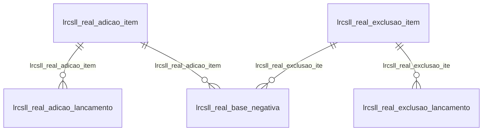

# Modelo — Contábil - csll (rascunho em lote)

> Gerado por `src/model/gerar_docs_modelo.py` a partir de `src/model/modulos/contabil_csll.yaml`, do catálogo e do perfil de colunas. **Não edite à mão.**

11 entidades. A coluna *Preench.* é o % de linhas com valor útil (nem nulo, nem em branco, nem zero, nem 1900-01-01; para colunas de código o zero conta como valor).

## Diagrama

## Entidades

| Entidade | Tabela | Linhas | Volume | Filtro obrigatório |
|---|---|---|---|---|
| [lrcsll_real_adicao_lancamento](#lrcsll_real_adicao_lancamento) | `LRCSLL_REAL_ADICAO_LANCAMENTO` | 2.569 | pequeno | empresa |
| [lrcsll_real_base_negativa](#lrcsll_real_base_negativa) | `LRCSLL_REAL_BASE_NEGATIVA` | 2.552 | pequeno | empresa |
| [lrcsll_real_deducao](#lrcsll_real_deducao) | `LRCSLL_REAL_DEDUCAO` | 346 | pequeno | empresa |
| [lrcsll_real_adicao_item](#lrcsll_real_adicao_item) | `LRCSLL_REAL_ADICAO_ITEM` | 310 | pequeno | empresa |
| [lrcsll_real_adicao](#lrcsll_real_adicao) | `LRCSLL_REAL_ADICAO` | 307 | pequeno | empresa |
| [lrcsll_estimado_deducao](#lrcsll_estimado_deducao) | `LRCSLL_ESTIMADO_DEDUCAO` | 152 | pequeno | empresa |
| [lrcsll_real_exclusao_lancamento](#lrcsll_real_exclusao_lancamento) | `LRCSLL_REAL_EXCLUSAO_LANCAMENTO` | 150 | pequeno | empresa |
| [lrcsll_real_exclusao](#lrcsll_real_exclusao) | `LRCSLL_REAL_EXCLUSAO` | 119 | pequeno | empresa |
| [lrcsll_real_exclusao_item](#lrcsll_real_exclusao_item) | `LRCSLL_REAL_EXCLUSAO_ITEM` | 119 | pequeno | empresa |
| [lrcsll_estimado_ganho](#lrcsll_estimado_ganho) | `LRCSLL_ESTIMADO_GANHO` | 2 | pequeno | empresa |
| [lrcsll_estimado_ganho_item](#lrcsll_estimado_ganho_item) | `LRCSLL_ESTIMADO_GANHO_ITEM` | 2 | pequeno | empresa |

## lrcsll_real_adicao_lancamento

**Lançamentos de Adições da Contribuição Social - Lancamentos Contábeis** — tabela `LRCSLL_REAL_ADICAO_LANCAMENTO` (2.569 linhas)

Lançamentos de Adições da Contribuição Social - Lancamentos Contábeis. 2.569 linhas no catálogo; chave: CODI_EMP, I_CSLL_REAL_ADICAO, I_ITEM, I_LANCAMENTO.

- **Chave:** `CODI_EMP, I_CSLL_REAL_ADICAO, I_ITEM, I_LANCAMENTO`
- **Empresa:** `CODI_EMP`
- **Período:** `DATA_LANCAMENTO`
- **Ordem padrão:** `DATA_LANCAMENTO desc`, `I_CSLL_REAL_ADICAO asc`, `I_ITEM asc`

**Regras de negócio validadas:**

- Medido em 2026-10-18: 2.569 linhas, 44 empresa(s), DATA_LANCAMENTO de 2013-01-31 a 2026-08-31.
- Vínculo lrcsll_real_adicao_item (LRCSLL_REAL_ADICAO_ITEM): 0 de 15 linhas sem registro relacionado (empresa 1022).

| Campo | Coluna | Tipo | Preench. | Domínio | Descrição (banco) |
|---|---|---|---|---|---|
| empresa | `codi_emp` | integer(4) |  |  | Empresa |
| codigo_do_lancamento_de_adicao_da_csll | `i_csll_real_adicao` | integer(4) |  |  | Código do Lançamento de Adição da CSLL |
| sequencial_da_adicao | `i_item` | integer(4) |  |  | Sequencial da adição |
| sequencial | `i_lancamento` | integer(4) |  |  | Sequencial |
| numero_lote_lancamento | `numero_lote` | integer(4) |  |  | Número lote/lançamento |
| data | `data_lancamento` | date(4) |  |  | Data |
| conta | `conta` | integer(4) |  |  | Conta |
| valor | `valor` | numeric(13) |  |  | Valor |
| valor_geral | `valor_geral` | numeric(13) |  |  | Valor - Geral |
| valor_rural | `valor_rural` | numeric(13) |  |  | Valor - Rural |
| codigo_do_historico | `codigo_historico` | integer(4) |  |  | Código do histórico |
| historico | `historico` | varchar(512) |  |  | Histórico |
| tipo_saldo_d_devedor_ou_c_credor | `tipo_saldo` | char(1) |  |  | Tipo Saldo:  D-Devedor ou C-Credor. |

**Vínculos (LEFT JOIN, acrescentam colunas legíveis):**

- `lrcsll_real_adicao_item` → `LRCSLL_REAL_ADICAO_ITEM` por `codi_emp` = `codi_emp` e `i_csll_real_adicao` = `i_csll_real_adicao` e `i_item` = `i_item`; colunas: `lrcsll_real_adicao_item_nome`

**Filtros:** `codigo_do_lancamento_de_adicao_da_csll` (eq/in), `sequencial_da_adicao` (eq/in), `sequencial` (eq/in), `data` (entre/gte/lte), `codigo_do_historico` (eq/in), `historico` (contem/prefixo), `tipo_saldo_d_devedor_ou_c_credor` (eq/in)

## lrcsll_real_base_negativa

**Base Negativa** — tabela `LRCSLL_REAL_BASE_NEGATIVA` (2.552 linhas)

Base Negativa. 2.552 linhas no catálogo; chave: CODI_EMP, I_CSLL_REAL_BASE_NEGATIVA.

- **Chave:** `CODI_EMP, I_CSLL_REAL_BASE_NEGATIVA`
- **Empresa:** `CODI_EMP`
- **Período:** `COMPETENCIA`
- **Ordem padrão:** `COMPETENCIA desc`, `I_CSLL_REAL_BASE_NEGATIVA asc`

**Regras de negócio validadas:**

- Medido em 2026-10-18: 2.552 linhas, 65 empresa(s), COMPETENCIA de 2018-03-01 a 2026-08-01.
- Colunas expostas nulas em 100% das linhas (3): scp, codigo_do_lancamento_de_adicao, codigo_do_lancamento_de_adicao_item.
- origem_do_lancamento_m_manual_s_sistema: todos os valores reais estão no comentário do banco (S=2.551, M=1).
- origem_do_lancamento_p_prejuizo_c_compen: todos os valores reais estão no comentário do banco (P=2.449, C=80, O=23).
- Vínculo geempre (geempre): 0 de 25 linhas sem registro relacionado (empresa 648).
- Vínculo gescp (GESCP): 25 de 25 linhas sem registro relacionado (empresa 648).
- Vínculo lrbase_negativa_parte_b (LRBASE_NEGATIVA_PARTE_B): 0 de 25 linhas sem registro relacionado (empresa 648).
- Vínculo lrcsll_real_adicao_item (LRCSLL_REAL_ADICAO_ITEM): 25 de 25 linhas sem registro relacionado (empresa 648).
- Vínculo lrcsll_real_exclusao_ite (LRCSLL_REAL_EXCLUSAO_ITEM): 25 de 25 linhas sem registro relacionado (empresa 648).

| Campo | Coluna | Tipo | Preench. | Domínio | Descrição (banco) |
|---|---|---|---|---|---|
| empresa | `codi_emp` | integer(4) |  |  | Empresa |
| codigo | `i_csll_real_base_negativa` | integer(4) |  |  | Código |
| competencia | `competencia` | date(4) |  |  | Competência |
| conta_base_negativa | `i_base_negativa` | integer(4) |  |  | Conta Base Negativa |
| historico | `historico` | varchar(50) |  |  | Histórico |
| debito | `valor_debito` | numeric(13) |  |  | Débito |
| credito | `valor_credito` | numeric(13) |  |  | Crédito |
| origem_do_lancamento_m_manual_s_sistema | `origem_lancamento` | char(1) |  | lrcsll_real_base_negativa_origem_do_lancamento_m_manual_s_sist | Origem do lançamento (M=Manual/ S=Sistema/ C=Cisão/ I=Incorporação) |
| scp | `i_scp` | integer(4) |  |  | SCP |
| origem_do_lancamento_p_prejuizo_c_compen | `tipo_lancamento` | char(1) |  | lrcsll_real_base_negativa_origem_do_lancamento_p_prejuizo_c_co | Origem do lançamento (P=Prejuízo/ C=Compensação/ O=Outros/ L=Liquid. Parc. IN 1687/17/ T=Pert. Lei 13.496/17) |
| codigo_do_lancamento_de_adicao | `i_csll_real_adicao` | integer(4) |  |  | Codigo do lançamento de adição |
| codigo_do_lancamento_de_adicao_item | `i_csll_real_adicao_item` | integer(4) |  |  | Codigo do lançamento de adição - Item |
| codigo_do_lancamento_de_exclusao | `i_csll_real_exclusao` | integer(4) |  |  | Codigo do lançamento de exclusão |
| codigo_do_lancamento_de_exclusao_item | `i_csll_real_exclusao_item` | integer(4) |  |  | Codigo do lançamento de exclusão - Item |
| tipo_atividade | `tipo_atividade` | char(1) |  |  | Codigo do lançamento de exclusão - Item |

**Vínculos (LEFT JOIN, acrescentam colunas legíveis):**

- `geempre` → `geempre` por `codi_emp` = `codi_emp`; colunas: `geempre_nome`
- `gescp` → `GESCP` por `codi_emp` = `codi_emp` e `i_scp` = `i_scp`; colunas: `gescp_nome`
- `lrbase_negativa_parte_b` → `LRBASE_NEGATIVA_PARTE_B` por `codi_emp` = `codi_emp` e `i_base_negativa` = `i_base_negativa_parte_b`; colunas: `lrbase_negativa_parte_b_nome`
- `lrcsll_real_adicao_item` → `LRCSLL_REAL_ADICAO_ITEM` por `codi_emp` = `codi_emp` e `i_csll_real_adicao` = `i_csll_real_adicao` e `i_csll_real_adicao_item` = `i_item`; colunas: `lrcsll_real_adicao_item_nome`
- `lrcsll_real_exclusao_ite` → `LRCSLL_REAL_EXCLUSAO_ITEM` por `codi_emp` = `codi_emp` e `i_csll_real_exclusao` = `i_csll_real_exclusao` e `i_csll_real_exclusao_item` = `i_item`; colunas: `lrcsll_real_exclusao_ite_nome`

**Filtros:** `codigo` (eq/in), `competencia` (entre/gte/lte), `conta_base_negativa` (eq/in), `historico` (contem/prefixo), `origem_do_lancamento_m_manual_s_sistema` (eq/in), `scp` (eq/in), `origem_do_lancamento_p_prejuizo_c_compen` (eq/in), `codigo_do_lancamento_de_adicao` (eq/in), `codigo_do_lancamento_de_adicao_item` (eq/in), `codigo_do_lancamento_de_exclusao` (eq/in), `codigo_do_lancamento_de_exclusao_item` (eq/in), `tipo_atividade` (eq/in)

## lrcsll_real_deducao

**Deduções da Contribuição Social (Real)** — tabela `LRCSLL_REAL_DEDUCAO` (346 linhas)

Deduções da Contribuição Social (Real). 346 linhas no catálogo; chave: CODI_EMP, I_CSLL_REAL_DEDUCAO.

- **Chave:** `CODI_EMP, I_CSLL_REAL_DEDUCAO`
- **Empresa:** `CODI_EMP`
- **Período:** `DATA_INICIO_SALDO`
- **Ordem padrão:** `DATA_INICIO_SALDO desc`, `I_CSLL_REAL_DEDUCAO asc`

**Regras de negócio validadas:**

- Medido em 2026-10-18: 346 linhas, 24 empresa(s), DATA_INICIO_SALDO de 2024-12-17 a 2026-09-25.
- Colunas expostas nulas em 100% das linhas (1): scp.
- Vínculo geempre (geempre): 0 de 8 linhas sem registro relacionado (empresa 758).
- Vínculo gescp (GESCP): 8 de 8 linhas sem registro relacionado (empresa 758).

| Campo | Coluna | Tipo | Preench. | Domínio | Descrição (banco) |
|---|---|---|---|---|---|
| empresa | `codi_emp` | integer(4) |  |  | Empresa |
| codigo | `i_csll_real_deducao` | integer(4) |  |  | Código |
| competencia | `competencia` | date(4) |  |  | Competência |
| pago_em_meses_anteriores | `valor_pago_em_mes_anterior` | numeric(13) |  |  | Pago em meses anteriores |
| orgaos_publicos_federais | `valor_orgao_publico_federal` | numeric(13) |  |  | Órgãos Públicos Federais |
| outras_pessoas_juridicas | `valor_outra_pessoa_juridica` | numeric(13) |  |  | Outras pessoas jurídicas |
| estados_e_municipios | `valor_estado_municipio` | numeric(13) |  |  | Estados e Municípios |
| administracao_publica | `valor_administracao_publica` | numeric(13) |  |  | Administração Pública |
| outras_deducoes | `valor_outra_deducao` | numeric(13) |  |  | Outras deduções |
| scp | `i_scp` | integer(4) |  |  | SCP |
| pago_no_exterior_sobre_lucros_rendimento | `valor_pago_exterior` | numeric(13) |  |  | Pago no exterior sobre lucros, rendimentos e ganhos de capital |
| parcelamento_formalizado_de_csll_sobre_a | `valor_parcelamento_formalizado` | numeric(13) |  |  | Parcelamento formalizado de CSLL sobre a base de cálculo estimada |
| compensacao_de_impostos_federais_de_peri | `valor_compensacao_imposto_federal_periodo_anterior` | numeric(13) |  |  | Compensação de impostos federais de períodos anteriores |
| ajuste_anual | `ajuste_anual` | integer(4) |  |  | Ajuste Anual |
| valor_deducao_perse_pgsc | `valor_deducao_perse_pgsc` | decimal(13) |  |  | Lei Perse e PGSC - Lei 14.148/21 |
| importar_retencoes_como_valor_pago_em_me | `retencoes_pago_meses_ant` | char(1) |  |  | Importar retenções como valor pago em meses anteriores |
| data_de_inicio_do_controle_de_saldo | `data_inicio_saldo` | date(4) |  |  | Data de início do controle de saldo. |
| desconsiderar_saldo_de_dezembro | `desconsiderar_saldo_dezembro` | char(1) |  |  | Desconsiderar saldo de Dezembro |

**Vínculos (LEFT JOIN, acrescentam colunas legíveis):**

- `geempre` → `geempre` por `codi_emp` = `codi_emp`; colunas: `geempre_nome`
- `gescp` → `GESCP` por `codi_emp` = `codi_emp` e `i_scp` = `i_scp`; colunas: `gescp_nome`

**Filtros:** `codigo` (eq/in), `competencia` (entre/gte/lte), `data_de_inicio_do_controle_de_saldo` (entre/gte/lte), `scp` (eq/in), `importar_retencoes_como_valor_pago_em_me` (eq/in), `desconsiderar_saldo_de_dezembro` (eq/in)

## lrcsll_real_adicao_item

**Lançamentos de Adições da Contribuição Social - Adições** — tabela `LRCSLL_REAL_ADICAO_ITEM` (310 linhas)

Lançamentos de Adições da Contribuição Social - Adições. 310 linhas no catálogo; chave: CODI_EMP, I_CSLL_REAL_ADICAO, I_ITEM.

- **Chave:** `CODI_EMP, I_CSLL_REAL_ADICAO, I_ITEM`
- **Empresa:** `CODI_EMP`
- **Período:** `—`
- **Ordem padrão:** `I_CSLL_REAL_ADICAO asc`, `I_ITEM asc`

**Regras de negócio validadas:**

- Medido em 2026-10-18: 310 linhas, 46 empresa(s).
- Vínculo lradicao (LRADICAO): 0 de 4 linhas sem registro relacionado (empresa 1011).

| Campo | Coluna | Tipo | Preench. | Domínio | Descrição (banco) |
|---|---|---|---|---|---|
| empresa | `codi_emp` | integer(4) |  |  | Empresa |
| codigo_do_lancamento_de_adicao_da_csll | `i_csll_real_adicao` | integer(4) |  |  | Código do Lançamento de Adição da CSLL |
| sequencial | `i_item` | integer(4) |  |  | Sequencial |
| adicao | `i_adicao` | integer(4) |  |  | Adição |
| descricao | `descricao` | varchar(520) |  |  | Descrição |
| valor | `valor` | numeric(13) |  |  | Valor |
| valor_geral | `valor_geral` | numeric(13) |  |  | Valor - Geral |
| valor_rural | `valor_rural` | numeric(13) |  |  | Valor - Rural |
| codigo_do_lancamento_de_adicao_da_irpj | `i_irpj_real_adicao` | integer(4) |  |  | Código do Lançamento de Adição da IRPJ |
| tipo_saldo_d_devedor_ou_c_credor | `tipo_saldo` | char(1) |  |  | Tipo Saldo:  D-Devedor ou C-Credor. |

**Vínculos (LEFT JOIN, acrescentam colunas legíveis):**

- `lradicao` → `LRADICAO` por `codi_emp` = `codi_emp` e `i_adicao` = `i_adicao`; colunas: `lradicao_nome`

**Filtros:** `codigo_do_lancamento_de_adicao_da_csll` (eq/in), `sequencial` (eq/in), `adicao` (eq/in), `descricao` (contem/prefixo), `codigo_do_lancamento_de_adicao_da_irpj` (eq/in), `tipo_saldo_d_devedor_ou_c_credor` (eq/in)

## lrcsll_real_adicao

**Lançamentos de Adições da Contribuição Social** — tabela `LRCSLL_REAL_ADICAO` (307 linhas)

Lançamentos de Adições da Contribuição Social. 307 linhas no catálogo; chave: CODI_EMP, I_CSLL_REAL_ADICAO.

- **Chave:** `CODI_EMP, I_CSLL_REAL_ADICAO`
- **Empresa:** `CODI_EMP`
- **Período:** `DATA_LANCAMENTO`
- **Ordem padrão:** `DATA_LANCAMENTO desc`, `I_CSLL_REAL_ADICAO asc`

**Regras de negócio validadas:**

- Medido em 2026-10-18: 307 linhas, 46 empresa(s), DATA_LANCAMENTO de 2013-01-31 a 2026-08-31.
- Colunas expostas nulas em 100% das linhas (3): scp, grupo_sistema_financeiro, grupo_sociedade_seguradora.
- Vínculo geempre (geempre): 0 de 4 linhas sem registro relacionado (empresa 1011).
- Vínculo gescp (GESCP): 4 de 4 linhas sem registro relacionado (empresa 1011).
- Vínculo lrtabela_grupo_csll_adic (LRTABELA_GRUPO_CSLL_ADICAO_SEGURADORA): 0 de 4 linhas sem registro relacionado (empresa 1011).

| Campo | Coluna | Tipo | Preench. | Domínio | Descrição (banco) |
|---|---|---|---|---|---|
| empresa | `codi_emp` | integer(4) |  |  | Empresa |
| codigo | `i_csll_real_adicao` | integer(4) |  |  | Código |
| data_do_lancamento | `data_lancamento` | date(4) |  |  | Data do lançamento |
| complemento | `complemento` | varchar(100) |  |  | Complemento |
| scp | `i_scp` | integer(4) |  |  | SCP |
| grupo_geral | `i_grupo_csll_adicao_geral` | integer(4) |  |  | Grupo - Geral |
| grupo_sistema_financeiro | `i_grupo_csll_adicao_sf` | integer(4) |  |  | Grupo - Sistema Financeiro |
| grupo_sociedade_seguradora | `i_grupo_csll_adicao_s` | integer(4) |  |  | Grupo - Sociedade Seguradora |
| tipo_de_lancamento_g_geral_r_rural | `tipo_lancamento` | char(1) |  |  | Tipo de lançamento(G=Geral, R=Rural) |

**Vínculos (LEFT JOIN, acrescentam colunas legíveis):**

- `geempre` → `geempre` por `codi_emp` = `codi_emp`; colunas: `geempre_nome`
- `gescp` → `GESCP` por `codi_emp` = `codi_emp` e `i_scp` = `i_scp`; colunas: `gescp_nome`
- `lrtabela_grupo_csll_adic` → `LRTABELA_GRUPO_CSLL_ADICAO_SEGURADORA` por `i_grupo_csll_adicao_s` = `i_grupo_csll_adicao_s`; colunas: `lrtabela_grupo_csll_adic_nome`

**Filtros:** `codigo` (eq/in), `data_do_lancamento` (entre/gte/lte), `complemento` (contem/prefixo), `scp` (eq/in), `grupo_geral` (eq/in), `grupo_sistema_financeiro` (eq/in), `grupo_sociedade_seguradora` (eq/in), `tipo_de_lancamento_g_geral_r_rural` (eq/in)

## lrcsll_estimado_deducao

**Deduções da Contribuição Social (Estimado)** — tabela `LRCSLL_ESTIMADO_DEDUCAO` (152 linhas)

Deduções da Contribuição Social (Estimado). 152 linhas no catálogo; chave: CODI_EMP, I_CSLL_ESTIMADO_DEDUCAO.

- **Chave:** `CODI_EMP, I_CSLL_ESTIMADO_DEDUCAO`
- **Empresa:** `CODI_EMP`
- **Período:** `DATA_INICIO_SALDO`
- **Ordem padrão:** `DATA_INICIO_SALDO desc`, `I_CSLL_ESTIMADO_DEDUCAO asc`

**Regras de negócio validadas:**

- Medido em 2026-10-18: 152 linhas, 14 empresa(s), DATA_INICIO_SALDO de 2024-12-17 a 2026-09-25.
- Colunas expostas nulas em 100% das linhas (1): scp.
- Vínculo geempre (geempre): 0 de 6 linhas sem registro relacionado (empresa 1385).
- Vínculo gescp (GESCP): 6 de 6 linhas sem registro relacionado (empresa 1385).

| Campo | Coluna | Tipo | Preench. | Domínio | Descrição (banco) |
|---|---|---|---|---|---|
| empresa | `codi_emp` | integer(4) |  |  | Empresa |
| codigo | `i_csll_estimado_deducao` | integer(4) |  |  | Código |
| competencia | `competencia` | date(4) |  |  | Competência |
| pago_em_meses_anteriores | `valor_pago_em_mes_anterior` | numeric(13) |  |  | Pago em meses anteriores |
| orgaos_publicos_federais | `valor_orgao_publico_federal` | numeric(13) |  |  | Órgãos Públicos Federais |
| outras_pessoas_juridicas | `valor_outra_pessoa_juridica` | numeric(13) |  |  | Outras pessoas jurídicas |
| estados_e_municipios | `valor_estado_municipio` | numeric(13) |  |  | Estados e Municípios |
| administracao_publica | `valor_administracao_publica` | numeric(13) |  |  | Administração Pública |
| outras_deducoes | `valor_outra_deducao` | numeric(13) |  |  | Outras deduções |
| scp | `i_scp` | integer(4) |  |  | SCP |
| pago_no_exterior_sobre_lucros_rendimento | `valor_pago_exterior` | numeric(13) |  |  | Pago no exterior sobre lucros, rendimentos e ganhos de capital |
| recuperacao_de_credito_de_csll | `valor_recuperacao_credito` | numeric(13) |  |  | Recuperação de crédito de CSLL |
| creditos_sobre_depreciacao_de_imobilizad | `valor_credito_depreciacao_imobilizado` | numeric(13) |  |  | Créditos sobre depreciação de imobilizado |
| compensacao_de_impostos_federais_de_peri | `valor_compensacao_imposto_federal_periodo_anterior` | numeric(13) |  |  | Compensação de impostos federais de períodos anteriores |
| valor_deducao_perse_pgsc | `valor_deducao_perse_pgsc` | decimal(13) |  |  | Lei Perse e PGSC - Lei 14.148/21 |
| data_de_inicio_do_controle_de_saldo | `data_inicio_saldo` | date(4) |  |  | Data de início do controle de saldo. |

**Vínculos (LEFT JOIN, acrescentam colunas legíveis):**

- `geempre` → `geempre` por `codi_emp` = `codi_emp`; colunas: `geempre_nome`
- `gescp` → `GESCP` por `codi_emp` = `codi_emp` e `i_scp` = `i_scp`; colunas: `gescp_nome`

**Filtros:** `codigo` (eq/in), `competencia` (entre/gte/lte), `data_de_inicio_do_controle_de_saldo` (entre/gte/lte), `scp` (eq/in)

## lrcsll_real_exclusao_lancamento

**Lançamentos de Exclusões da Contribuição Social - Lancamentos Contábeis** — tabela `LRCSLL_REAL_EXCLUSAO_LANCAMENTO` (150 linhas)

Lançamentos de Exclusões da Contribuição Social - Lancamentos Contábeis. 150 linhas no catálogo; chave: CODI_EMP, I_CSLL_REAL_EXCLUSAO, I_ITEM, I_LANCAMENTO.

- **Chave:** `CODI_EMP, I_CSLL_REAL_EXCLUSAO, I_ITEM, I_LANCAMENTO`
- **Empresa:** `CODI_EMP`
- **Período:** `DATA_LANCAMENTO`
- **Ordem padrão:** `DATA_LANCAMENTO desc`, `I_CSLL_REAL_EXCLUSAO asc`, `I_ITEM asc`

**Regras de negócio validadas:**

- Medido em 2026-10-18: 150 linhas, 8 empresa(s), DATA_LANCAMENTO de 2013-01-31 a 2026-06-30.
- Vínculo lrcsll_real_exclusao_ite (LRCSLL_REAL_EXCLUSAO_ITEM): 0 de 16 linhas sem registro relacionado (empresa 1548).

| Campo | Coluna | Tipo | Preench. | Domínio | Descrição (banco) |
|---|---|---|---|---|---|
| empresa | `codi_emp` | integer(4) |  |  | Empresa |
| codigo_do_lancamento_de_exclusao_da_csll | `i_csll_real_exclusao` | integer(4) |  |  | Código do Lançamento de Exclusão da CSLL |
| sequencial_da_exclusao | `i_item` | integer(4) |  |  | Sequencial da exclusão |
| sequencial | `i_lancamento` | integer(4) |  |  | Sequencial |
| numero_lote_lancamento | `numero_lote` | integer(4) |  |  | Número lote/lançamento |
| data | `data_lancamento` | date(4) |  |  | Data |
| conta | `conta` | integer(4) |  |  | Conta |
| valor | `valor` | numeric(13) |  |  | Valor |
| valor_geral | `valor_geral` | numeric(13) |  |  | Valor - Geral |
| valor_rural | `valor_rural` | numeric(13) |  |  | Valor - Rural |
| codigo_do_historico | `codigo_historico` | integer(4) |  |  | Código do histórico |
| historico | `historico` | varchar(512) |  |  | Histórico |
| tipo_saldo_d_devedor_ou_c_credor | `tipo_saldo` | char(1) |  |  | Tipo Saldo:  D-Devedor ou C-Credor. |

**Vínculos (LEFT JOIN, acrescentam colunas legíveis):**

- `lrcsll_real_exclusao_ite` → `LRCSLL_REAL_EXCLUSAO_ITEM` por `codi_emp` = `codi_emp` e `i_csll_real_exclusao` = `i_csll_real_exclusao` e `i_item` = `i_item`; colunas: `lrcsll_real_exclusao_ite_nome`

**Filtros:** `codigo_do_lancamento_de_exclusao_da_csll` (eq/in), `sequencial_da_exclusao` (eq/in), `sequencial` (eq/in), `data` (entre/gte/lte), `codigo_do_historico` (eq/in), `historico` (contem/prefixo), `tipo_saldo_d_devedor_ou_c_credor` (eq/in)

## lrcsll_real_exclusao

**Lançamentos de Exclusões da Contribuição Social** — tabela `LRCSLL_REAL_EXCLUSAO` (119 linhas)

Lançamentos de Exclusões da Contribuição Social. 119 linhas no catálogo; chave: CODI_EMP, I_CSLL_REAL_EXCLUSAO.

- **Chave:** `CODI_EMP, I_CSLL_REAL_EXCLUSAO`
- **Empresa:** `CODI_EMP`
- **Período:** `DATA_LANCAMENTO`
- **Ordem padrão:** `DATA_LANCAMENTO desc`, `I_CSLL_REAL_EXCLUSAO asc`

**Regras de negócio validadas:**

- Medido em 2026-10-18: 119 linhas, 9 empresa(s), DATA_LANCAMENTO de 2013-01-31 a 2026-06-30.
- Colunas expostas nulas em 100% das linhas (3): scp, grupo_sistema_financeiro, grupo_sociedade_seguradora.
- Vínculo geempre (geempre): 0 de 8 linhas sem registro relacionado (empresa 1619).
- Vínculo gescp (GESCP): 8 de 8 linhas sem registro relacionado (empresa 1619).
- Vínculo lrtabela_grupo_csll_excl (LRTABELA_GRUPO_CSLL_EXCLUSAO_SEGURADORA): 0 de 8 linhas sem registro relacionado (empresa 1619).

| Campo | Coluna | Tipo | Preench. | Domínio | Descrição (banco) |
|---|---|---|---|---|---|
| empresa | `codi_emp` | integer(4) |  |  | Empresa |
| codigo | `i_csll_real_exclusao` | integer(4) |  |  | Código |
| data_do_lancamento | `data_lancamento` | date(4) |  |  | Data do lançamento |
| complemento | `complemento` | varchar(100) |  |  | Complemento |
| scp | `i_scp` | integer(4) |  |  | SCP |
| grupo_geral | `i_grupo_csll_exclusao_geral` | integer(4) |  |  | Grupo - Geral |
| grupo_sistema_financeiro | `i_grupo_csll_exclusao_sf` | integer(4) |  |  | Grupo - Sistema Financeiro |
| grupo_sociedade_seguradora | `i_grupo_csll_exclusao_s` | integer(4) |  |  | Grupo - Sociedade Seguradora |
| tipo_de_lancamento_g_geral_r_rural | `tipo_lancamento` | char(1) |  |  | Tipo de lançamento(G=Geral, R=Rural) |

**Vínculos (LEFT JOIN, acrescentam colunas legíveis):**

- `geempre` → `geempre` por `codi_emp` = `codi_emp`; colunas: `geempre_nome`
- `gescp` → `GESCP` por `codi_emp` = `codi_emp` e `i_scp` = `i_scp`; colunas: `gescp_nome`
- `lrtabela_grupo_csll_excl` → `LRTABELA_GRUPO_CSLL_EXCLUSAO_SEGURADORA` por `i_grupo_csll_exclusao_s` = `i_grupo_csll_exclusao_s`; colunas: `lrtabela_grupo_csll_excl_nome`

**Filtros:** `codigo` (eq/in), `data_do_lancamento` (entre/gte/lte), `complemento` (contem/prefixo), `scp` (eq/in), `grupo_geral` (eq/in), `grupo_sistema_financeiro` (eq/in), `grupo_sociedade_seguradora` (eq/in), `tipo_de_lancamento_g_geral_r_rural` (eq/in)

## lrcsll_real_exclusao_item

**Lançamentos de Exclusões da Contribuição Social - Exclusões** — tabela `LRCSLL_REAL_EXCLUSAO_ITEM` (119 linhas)

Lançamentos de Exclusões da Contribuição Social - Exclusões. 119 linhas no catálogo; chave: CODI_EMP, I_CSLL_REAL_EXCLUSAO, I_ITEM.

- **Chave:** `CODI_EMP, I_CSLL_REAL_EXCLUSAO, I_ITEM`
- **Empresa:** `CODI_EMP`
- **Período:** `—`
- **Ordem padrão:** `I_CSLL_REAL_EXCLUSAO asc`, `I_ITEM asc`

**Regras de negócio validadas:**

- Medido em 2026-10-18: 119 linhas, 9 empresa(s).
- Vínculo lrexclusao (LREXCLUSAO): 0 de 8 linhas sem registro relacionado (empresa 1619).

| Campo | Coluna | Tipo | Preench. | Domínio | Descrição (banco) |
|---|---|---|---|---|---|
| empresa | `codi_emp` | integer(4) |  |  | Empresa |
| codigo_do_lancamento_de_exclusoes_da_csl | `i_csll_real_exclusao` | integer(4) |  |  | Código do Lançamento de Exclusões da CSLL |
| sequencial | `i_item` | integer(4) |  |  | Sequencial |
| exclusao | `i_exclusao` | integer(4) |  |  | Exclusão |
| descricao | `descricao` | varchar(520) |  |  | Descrição |
| valor | `valor` | numeric(13) |  |  | Valor |
| valor_geral | `valor_geral` | numeric(13) |  |  | Valor - Geral |
| valor_rural | `valor_rural` | numeric(13) |  |  | Valor - Rural |
| codigo_do_lancamento_de_exclusoes_da_irp | `i_irpj_real_exclusao` | integer(4) |  |  | Código do Lançamento de Exclusões da IRPJ |
| tipo_saldo_d_devedor_ou_c_credor | `tipo_saldo` | char(1) |  |  | Tipo Saldo:  D-Devedor ou C-Credor. |

**Vínculos (LEFT JOIN, acrescentam colunas legíveis):**

- `lrexclusao` → `LREXCLUSAO` por `codi_emp` = `codi_emp` e `i_exclusao` = `i_exclusao`; colunas: `lrexclusao_nome`

**Filtros:** `codigo_do_lancamento_de_exclusoes_da_csl` (eq/in), `sequencial` (eq/in), `exclusao` (eq/in), `descricao` (contem/prefixo), `codigo_do_lancamento_de_exclusoes_da_irp` (eq/in), `tipo_saldo_d_devedor_ou_c_credor` (eq/in)

## lrcsll_estimado_ganho

**Lançamentos de Ganhos da Contribuição Social** — tabela `LRCSLL_ESTIMADO_GANHO` (2 linhas)

Lançamentos de Ganhos da Contribuição Social. 2 linhas no catálogo; chave: CODI_EMP, I_CSLL_ESTIMADO_GANHO.

- **Chave:** `CODI_EMP, I_CSLL_ESTIMADO_GANHO`
- **Empresa:** `CODI_EMP`
- **Período:** `COMPETENCIA`
- **Ordem padrão:** `COMPETENCIA desc`, `I_CSLL_ESTIMADO_GANHO asc`

**Regras de negócio validadas:**

- Medido em 2026-10-18: 2 linhas, 1 empresa(s), COMPETENCIA de 2013-03-31 a 2013-10-31.
- Colunas expostas nulas em 100% das linhas (1): scp.
- Vínculo geempre (geempre): 0 de 2 linhas sem registro relacionado (empresa 9997).

| Campo | Coluna | Tipo | Preench. | Domínio | Descrição (banco) |
|---|---|---|---|---|---|
| empresa | `codi_emp` | integer(4) |  |  | Empresa |
| codigo | `i_csll_estimado_ganho` | integer(4) |  |  | Código |
| competencia | `competencia` | date(4) |  |  | Competência |
| scp | `i_scp` | integer(4) |  |  | SCP |

**Vínculos (LEFT JOIN, acrescentam colunas legíveis):**

- `geempre` → `geempre` por `codi_emp` = `codi_emp`; colunas: `geempre_nome`

**Filtros:** `codigo` (eq/in), `competencia` (entre/gte/lte), `scp` (eq/in)

## lrcsll_estimado_ganho_item

**Lançamentos de Ganhos da Contribuição Social - Ganhos** — tabela `LRCSLL_ESTIMADO_GANHO_ITEM` (2 linhas)

Lançamentos de Ganhos da Contribuição Social - Ganhos. 2 linhas no catálogo; chave: CODI_EMP, I_CSLL_ESTIMADO_GANHO, I_ITEM.

- **Chave:** `CODI_EMP, I_CSLL_ESTIMADO_GANHO, I_ITEM`
- **Empresa:** `CODI_EMP`
- **Período:** `—`
- **Ordem padrão:** `I_CSLL_ESTIMADO_GANHO asc`, `I_ITEM asc`

**Regras de negócio validadas:**

- Medido em 2026-10-18: 2 linhas, 1 empresa(s).
- Vínculo lrganho (LRGANHO): 0 de 2 linhas sem registro relacionado (empresa 9997).

| Campo | Coluna | Tipo | Preench. | Domínio | Descrição (banco) |
|---|---|---|---|---|---|
| empresa | `codi_emp` | integer(4) |  |  | Empresa |
| codigo_do_lancamento_de_ganho_da_csll | `i_csll_estimado_ganho` | integer(4) |  |  | Código do Lançamento de Ganho da CSLL |
| sequencial | `i_item` | integer(4) |  |  | Sequencial |
| ganho | `i_ganho` | integer(4) |  |  | Ganho |
| descricao | `descricao` | varchar(520) |  |  | Descrição |
| valor | `valor` | numeric(13) |  |  | Valor |

**Vínculos (LEFT JOIN, acrescentam colunas legíveis):**

- `lrganho` → `LRGANHO` por `codi_emp` = `codi_emp` e `i_ganho` = `i_ganho`; colunas: `lrganho_nome`

**Filtros:** `codigo_do_lancamento_de_ganho_da_csll` (eq/in), `sequencial` (eq/in), `ganho` (eq/in), `descricao` (contem/prefixo)

## Domínios (significado dos códigos)

`confirmado`: **sim** = vem do comentário do banco e/ou foi conferido nos dados; **parcial** = parte dos valores; **não** = hipótese, não use como regra.

### status_empresa

Situação da empresa no cadastro (geempre.stat_emp)

Confirmado: sim

| Código | Significado |
|---|---|
| A | Ativa |
| I | Inativa |
| C | Em constituição |
| M | Ativo sem movimento |
| B | Em processo de baixa |
| E | Excluindo |

### motivo_inatividade

Motivo da inatividade (geempre.tipoi_emp). Só aparece em empresas inativas.

Confirmado: sim

| Código | Significado |
|---|---|
| 1 | Outros |
| 2 | Baixada |
| 3 | Transferida |
| 4 | Inadimplente |

### tipo_inscricao

Tipo da inscrição (CNPJ/CPF/CEI/CAEPF)

Confirmado: sim

| Código | Significado |
|---|---|
| 1 | CNPJ |
| 2 | CPF |
| 3 | CEI |
| 6 | CAEPF |

### regime_federal_empresa

Regime federal da folha (geempre.rfed_emp)

Confirmado: parcial

| Código | Significado |
|---|---|
| 1 | Normal |
| 2 | Microempresa |
| 3 | Empresa de pequeno porte |

### tipo_honorario_empresa

Como a empresa usa o módulo Honorários (geempre.honorario_tipo)

Confirmado: sim

| Código | Significado |
|---|---|
| E | Escritório (quem fatura) |
| C | Cliente |

### sim_nao_texto

Confirmado: sim

| Código | Significado |
|---|---|
| S | Sim |
| N | Não |

### sim_nao_numerico

Confirmado: sim

| Código | Significado |
|---|---|
| 1 | Sim |
| 0 | Não |

### lrcsll_real_base_negativa_origem_do_lancamento_m_manual_s_sist

Confirmado: sim

> Todos os valores observados em LRCSLL_REAL_BASE_NEGATIVA.ORIGEM_LANCAMENTO estão no comentário do banco (2026-10-18). Distribuição: S=2.551, M=1.

| Código | Significado |
|---|---|
| M | Manual |
| S | Sistema |
| C | Cisão |
| I | Incorporação |

### lrcsll_real_base_negativa_origem_do_lancamento_p_prejuizo_c_co

Confirmado: sim

> Todos os valores observados em LRCSLL_REAL_BASE_NEGATIVA.TIPO_LANCAMENTO estão no comentário do banco (2026-10-18). Distribuição: P=2.449, C=80, O=23.

| Código | Significado |
|---|---|
| P | Prejuízo |
| C | Compensação |
| O | Outros |
| L | Liquid. Parc. IN 1687 |
| T | Pert. Lei 13.496 |

