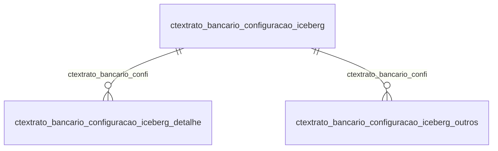

# Modelo — Contábil - extrato (rascunho em lote)

> Gerado por `src/model/gerar_docs_modelo.py` a partir de `src/model/modulos/contabil_extrato.yaml`, do catálogo e do perfil de colunas. **Não edite à mão.**

11 entidades. A coluna *Preench.* é o % de linhas com valor útil (nem nulo, nem em branco, nem zero, nem 1900-01-01; para colunas de código o zero conta como valor).

## Diagrama

## Entidades

| Entidade | Tabela | Linhas | Volume | Filtro obrigatório |
|---|---|---|---|---|
| [ctextrato_bancario_lancamento_item](#ctextrato_bancario_lancamento_item) | `CTEXTRATO_BANCARIO_LANCAMENTO_ITEM` | 25.400 | medio | empresa |
| [ctextrato_bancario_lancamento_item_lancto](#ctextrato_bancario_lancamento_item_lancto) | `CTEXTRATO_BANCARIO_LANCAMENTO_ITEM_LANCTO` | 19.292 | medio | empresa |
| [ctextrato_bancario_lancamento_iceberg](#ctextrato_bancario_lancamento_iceberg) | `CTEXTRATO_BANCARIO_LANCAMENTO_ICEBERG` | 5.992 | pequeno | empresa |
| [ctextrato_bancario_configuracao](#ctextrato_bancario_configuracao) | `CTEXTRATO_BANCARIO_CONFIGURACAO` | 1.611 | pequeno | empresa |
| [ctextrato_bancario_configuracao_iceberg_detalhe](#ctextrato_bancario_configuracao_iceberg_detalhe) | `CTEXTRATO_BANCARIO_CONFIGURACAO_ICEBERG_DETALHE` | 486 | pequeno | empresa |
| [ctextrato_bancario_lancamento](#ctextrato_bancario_lancamento) | `CTEXTRATO_BANCARIO_LANCAMENTO` | 208 | pequeno | empresa |
| [ctextrato_bancario_transacoes_iceberg](#ctextrato_bancario_transacoes_iceberg) | `CTEXTRATO_BANCARIO_TRANSACOES_ICEBERG` | 29 | pequeno | — |
| [ctextrato_bancario_configuracao_iceberg](#ctextrato_bancario_configuracao_iceberg) | `CTEXTRATO_BANCARIO_CONFIGURACAO_ICEBERG` | 26 | pequeno | empresa |
| [ctextrato_bancario_transacoes_iceberg_tarifa](#ctextrato_bancario_transacoes_iceberg_tarifa) | `CTEXTRATO_BANCARIO_TRANSACOES_ICEBERG_TARIFA` | 12 | pequeno | — |
| [ctextrato_bancario_lancamento_iceberg_lancto](#ctextrato_bancario_lancamento_iceberg_lancto) | `CTEXTRATO_BANCARIO_LANCAMENTO_ICEBERG_LANCTO` | 10 | pequeno | empresa |
| [ctextrato_bancario_configuracao_iceberg_outros](#ctextrato_bancario_configuracao_iceberg_outros) | `CTEXTRATO_BANCARIO_CONFIGURACAO_ICEBERG_OUTROS` | 1 | pequeno | empresa |

## ctextrato_bancario_lancamento_item

**Lançamento de extrato bancário - lançamentos** — tabela `CTEXTRATO_BANCARIO_LANCAMENTO_ITEM` (25.400 linhas)

Lançamento de extrato bancário - lançamentos. 25.400 linhas no catálogo; chave: CODI_EMP, I_LANCAMENTO, I_ITEM.

- **Chave:** `CODI_EMP, I_LANCAMENTO, I_ITEM`
- **Empresa:** `CODI_EMP`
- **Período:** `DATA_ITEM`
- **Ordem padrão:** `DATA_ITEM desc`, `I_LANCAMENTO asc`, `I_ITEM asc`

**Regras de negócio validadas:**

- Medido em 2026-10-18: 25.400 linhas, 28 empresa(s), DATA_ITEM de 2012-06-05 a 2026-07-31.
- tipo_d_soma_c_subtrai: todos os valores reais estão no comentário do banco (C=16.211, D=9.189).
- origem_m_manualmente_i_importacao: todos os valores reais estão no comentário do banco (I=25.400).
- versao_do_extrato_1_antigo_2_novo: todos os valores reais estão no comentário do banco (2=25.400).
- tipo_x_um_debito_para_um_credito_v_vario: todos os valores reais estão no comentário do banco (X=25.400).

| Campo | Coluna | Tipo | Preench. | Domínio | Descrição (banco) |
|---|---|---|---|---|---|
| empresa | `codi_emp` | integer(4) |  |  | Empresa |
| codigo_extrato | `i_lancamento` | integer(4) |  |  | Código extrato |
| sequencial_do_item | `i_item` | integer(4) |  |  | Sequencial do item |
| data | `data_item` | date(4) |  |  | Data |
| historico | `historico` | varchar(350) |  |  | Histórico |
| documento | `documento` | varchar(100) |  |  | Documento |
| valor | `valor` | numeric(13) |  |  | Valor |
| tipo_d_soma_c_subtrai | `tipo` | char(1) |  | ctextrato_bancario_lancamento_item_tipo_d_soma | Tipo (D=Soma/C=Subtrai) |
| origem_m_manualmente_i_importacao | `origem` | char(1) |  | ctextrato_bancario_lancamento_item_origem_m_ma | Origem (M=Manualmente/ I=Importação) |
| versao_do_extrato_1_antigo_2_novo | `versao` | tinyint(1) |  | ctextrato_bancario_lancamento_item_versao_do_e | Versão do extrato (1=Antigo/ 2=Novo) |
| origem_do_registro_0_sistema_1_imp_tabel | `origem_reg` | tinyint(1) |  |  | Origem do registro 0 - Sistema, 1 - Imp. Tabelas, 2 - Imp. Layout, 3- Imp. Tabelas Concorrentes |
| tipo_x_um_debito_para_um_credito_v_vario | `tipo_lancamento` | char(1) |  | ctextrato_bancario_lancamento_item_tipo_x_um_d | Tipo (X = Um débito para um crédito / V = Varios débitos para varios créditos) |
| codigo_da_filial | `filial` | integer(4) |  |  | Código da filial |

**Filtros:** `codigo_extrato` (eq/in), `sequencial_do_item` (eq/in), `data` (entre/gte/lte), `historico` (contem/prefixo), `documento` (contem/prefixo), `tipo_d_soma_c_subtrai` (eq/in), `origem_m_manualmente_i_importacao` (eq/in), `tipo_x_um_debito_para_um_credito_v_vario` (eq/in)

## ctextrato_bancario_lancamento_item_lancto

**Lançamento de extrato bancário - lançamentos contábeis** — tabela `CTEXTRATO_BANCARIO_LANCAMENTO_ITEM_LANCTO` (19.292 linhas)

Lançamento de extrato bancário - lançamentos contábeis. 19.292 linhas no catálogo; chave: CODI_EMP, I_LANCAMENTO, I_ITEM, NUME_LAN.

- **Chave:** `CODI_EMP, I_LANCAMENTO, I_ITEM, NUME_LAN`
- **Empresa:** `CODI_EMP`
- **Período:** `—`
- **Ordem padrão:** `I_LANCAMENTO asc`, `I_ITEM asc`

**Regras de negócio validadas:**

- Medido em 2026-10-18: 19.292 linhas, 18 empresa(s).
- tipo_de_lancamento_0_sistema_1_manual: todos os valores reais estão no comentário do banco (0=11.321, 1=7.971).

| Campo | Coluna | Tipo | Preench. | Domínio | Descrição (banco) |
|---|---|---|---|---|---|
| empresa | `codi_emp` | integer(4) |  |  | Empresa |
| codigo_extrato | `i_lancamento` | integer(4) |  |  | Código extrato |
| sequencial_do_item | `i_item` | integer(4) |  |  | Sequencial do item |
| numero_do_lancamento_contabil | `nume_lan` | integer(4) |  |  | Número do lançamento contábil |
| codigo_do_lote | `codi_lote` | integer(4) |  |  | Código do lote |
| tipo_de_lancamento_0_sistema_1_manual | `tipo` | tinyint(1) |  | ctextrato_bancario_lancamento_item_lancto_tipo_de_lan | Tipo de lançamento (0=Sistema/ 1=Manual) |

**Filtros:** `codigo_extrato` (eq/in), `sequencial_do_item` (eq/in), `numero_do_lancamento_contabil` (eq/in), `codigo_do_lote` (eq/in), `tipo_de_lancamento_0_sistema_1_manual` (eq/in)

## ctextrato_bancario_lancamento_iceberg

**Lançamento de extrato ICEBERG** — tabela `CTEXTRATO_BANCARIO_LANCAMENTO_ICEBERG` (5.992 linhas)

Lançamento de extrato ICEBERG. 5.992 linhas no catálogo; chave: CODI_EMP, CODI_EMP_LANCTO, I_EXTRATO_BANCARIO, I_EXTRATO_BANCARIO_ITEM.

- **Chave:** `CODI_EMP, CODI_EMP_LANCTO, I_EXTRATO_BANCARIO, I_EXTRATO_BANCARIO_ITEM`
- **Empresa:** `CODI_EMP`
- **Período:** `DATA_EXTRATO`
- **Ordem padrão:** `DATA_EXTRATO desc`, `CODI_EMP_LANCTO asc`, `I_EXTRATO_BANCARIO asc`

**Regras de negócio validadas:**

- Medido em 2026-10-18: 5.992 linhas, 1 empresa(s), DATA_EXTRATO de 2024-01-02 a 2025-08-21.
- Colunas expostas nulas em 100% das linhas (4): parceiro_de_conexao_open_banking, saldo_da_conta_apos_a_transacao, sequencial_do_json_que_atualizou_o_extra, identificador_da_transacao_por_client_id.
- situacao_da_transacao_apos_processamento: todos os valores reais estão no comentário do banco (1=5.992).
- Vínculo geempre (geempre): 0 de 5.992 linhas sem registro relacionado (empresa 1).

| Campo | Coluna | Tipo | Preench. | Domínio | Descrição (banco) |
|---|---|---|---|---|---|
| empresa | `codi_emp` | integer(4) |  |  | Empresa |
| codigo_da_empresa_do_lancamento | `codi_emp_lancto` | integer(4) |  |  | Código da empresa do lançamento |
| sequencial_do_extrato | `i_extrato_bancario` | integer(4) |  |  | Sequencial do extrato |
| sequencial | `i_extrato_bancario_item` | integer(4) |  |  | Sequencial |
| identificador_da_transacao_eventid | `id_transacao` | char(50) |  |  | Identificador da transação (eventId) |
| data_do_extrato | `data_extrato` | date(4) |  |  | Data do extrato |
| codigo_de_transacao | `codi_transacao` | decimal(20) |  |  | Código de transação |
| valor_do_extrato | `valor` | numeric(13) |  |  | Valor do extrato |
| codigo_do_lote_contabil | `codi_lote` | integer(4) |  |  | Código do lote contábil |
| inscricao_da_pessoa_envolvida_na_transac 🔒 | `inscricao` | char(20) |  |  | Inscrição da pessoa envolvida na transação |
| nome_da_pessoa_envolvida_na_transacao_ta | `nome` | char(150) |  |  | Nome da pessoa envolvida na transação, tarifa ou estabelecimento comercial |
| tipo_lancamento | `tipo_lancamento` | tinyint(1) |  |  | 1-Valor do extrato, 2-Valor original, 3-Multa, 4-Juros, 5-Desconto |
| codigo_de_identificacao_do_banco | `i_banco` | integer(4) |  |  | Codigo de identificacão do banco |
| c_credito_d_debito | `tipo_valor` | char(1) |  |  | C - Credito / D - Debito |
| c_0_pendente_contab_contabilizada_mesmo | `status` | integer(4) |  |  | 0=Pendente(Contab.)/Contabilizada/Mesmo Beneficiario/Desconsiderada / 4=Aguardando NF / 5=Pendente(Transacao) |
| desconsiderar_o_extrato_bancario_digital | `desconsiderar_extrato_bancario` | char(1) |  |  | Desconsiderar o extrato bancário digital na tela de lançamentos contábeis digital(S/N) |
| parceiro_de_conexao_open_banking | `partner` | varchar(100) |  |  | Parceiro de conexão Open Banking |
| saldo_da_conta_apos_a_transacao | `saldo` | numeric(13) |  |  | Saldo da conta após a transação |
| situacao_da_transacao_apos_processamento | `status_transacao_rota` | integer(4) |  | ctextrato_bancario_lancamento_iceberg_situacao_da_transaca | Situação da transação após processamento (1=Transação Original/2=Atualizada/3=Atualizada Apos Fechamento/4=Excluida Apos Fechamento/5=Atualizada Com Vinculo/6=Excluida Com Vinculo/7=Atualizada Apos Contabilização/8=Excluida Apos Contabilização) |
| sequencial_do_json_que_atualizou_o_extra | `codi_history` | integer(4) |  |  | Sequencial do JSON que atualizou o extrato |
| ordem_da_transacao_no_dia | `ordem_data_extrato` | integer(4) |  |  | Ordem da transação no dia. |
| identificador_da_transacao_por_client_id | `transaction_id` | varchar(50) |  |  | Identificador da transação por client_id (transaction.id) |

**Vínculos (LEFT JOIN, acrescentam colunas legíveis):**

- `geempre` → `geempre` por `codi_emp` = `codi_emp`; colunas: `geempre_nome`

**Filtros:** `codigo_da_empresa_do_lancamento` (eq/in), `sequencial_do_extrato` (eq/in), `sequencial` (eq/in), `data_do_extrato` (entre/gte/lte), `identificador_da_transacao_eventid` (contem/prefixo), `codigo_do_lote_contabil` (eq/in), `inscricao_da_pessoa_envolvida_na_transac` (eq/in), `nome_da_pessoa_envolvida_na_transacao_ta` (contem/prefixo), `tipo_lancamento` (eq/in), `codigo_de_identificacao_do_banco` (eq/in), `c_credito_d_debito` (eq/in), `desconsiderar_o_extrato_bancario_digital` (eq/in), `parceiro_de_conexao_open_banking` (contem/prefixo), `sequencial_do_json_que_atualizou_o_extra` (eq/in)

## ctextrato_bancario_configuracao

**Configuração para contabilizar extrato bancário** — tabela `CTEXTRATO_BANCARIO_CONFIGURACAO` (1.611 linhas)

Configuração para contabilizar extrato bancário. 1.611 linhas no catálogo; chave: CODI_EMP, I_CONFIGURACAO.

- **Chave:** `CODI_EMP, I_CONFIGURACAO`
- **Empresa:** `CODI_EMP`
- **Período:** `—`
- **Ordem padrão:** `I_CONFIGURACAO asc`

**Regras de negócio validadas:**

- Medido em 2026-10-18: 1.611 linhas, 54 empresa(s).
- Colunas expostas nulas em 100% das linhas (1): numero_do_documento.
- tipo_d_soma_c_subtrai_a_ambos: todos os valores reais estão no comentário do banco (A=988, C=436, D=187).
- tipo_do_filtro_do_naomero_do_documento_p: todos os valores reais estão no comentário do banco (C=1.611).
- Vínculo geempre (geempre): 0 de 14 linhas sem registro relacionado (empresa 10059).

| Campo | Coluna | Tipo | Preench. | Domínio | Descrição (banco) |
|---|---|---|---|---|---|
| empresa | `codi_emp` | integer(4) |  |  | Empresa |
| codigo | `i_configuracao` | integer(4) |  |  | Código |
| conta_contabil_do_banco | `codi_cta_banco` | integer(4) |  |  | Conta contábil do banco |
| parte_do_historico | `parte_historico` | varchar(100) |  |  | Parte do histórico |
| conta_de_contra_partida | `codi_cta_contra_partida` | integer(4) |  |  | Conta de contra partida |
| codigo_do_historico | `codi_his` | integer(4) |  |  | Código do histórico |
| historico | `historico` | varchar(512) |  |  | Histórico |
| tipo_d_soma_c_subtrai_a_ambos | `tipo` | char(1) |  | ctextrato_bancario_configuracao_tipo_d_soma | Tipo (D=Soma/C=Subtrai/A=Ambos) |
| numero_do_documento | `numero_documento` | varchar(100) |  |  | Número do documento |
| tipo_do_filtro_do_naomero_do_documento_p | `tipo_filtro_numero_documento` | varchar(1) |  | ctextrato_bancario_configuracao_tipo_do_fil | Tipo do Filtro do Número do Documento (P=Parcial/C=Completo) |

**Vínculos (LEFT JOIN, acrescentam colunas legíveis):**

- `geempre` → `geempre` por `codi_emp` = `codi_emp`; colunas: `geempre_nome`

**Filtros:** `codigo` (eq/in), `conta_contabil_do_banco` (eq/in), `parte_do_historico` (contem/prefixo), `conta_de_contra_partida` (eq/in), `codigo_do_historico` (eq/in), `historico` (contem/prefixo), `tipo_d_soma_c_subtrai_a_ambos` (eq/in), `numero_do_documento` (contem/prefixo), `tipo_do_filtro_do_naomero_do_documento_p` (eq/in)

## ctextrato_bancario_configuracao_iceberg_detalhe

**Configuração para Contabilizar Extrato Bancário Contabilidade Digital - Detalhe** — tabela `CTEXTRATO_BANCARIO_CONFIGURACAO_ICEBERG_DETALHE` (486 linhas)

Configuração para Contabilizar Extrato Bancário Contabilidade Digital - Detalhe. 486 linhas no catálogo; chave: CODI_EMP, CODI_TRANSACAO, I_DETALHE.

- **Chave:** `CODI_EMP, CODI_TRANSACAO, I_DETALHE`
- **Empresa:** `CODI_EMP`
- **Período:** `—`
- **Ordem padrão:** `CODI_TRANSACAO asc`, `I_DETALHE asc`

**Regras de negócio validadas:**

- Medido em 2026-10-18: 486 linhas, 1 empresa(s).
- tipo_de_inscricao_1_cnpj_2_cpf: todos os valores reais estão no comentário do banco (1=441, 2=45).
- Vínculo ctextrato_bancario_confi (CTEXTRATO_BANCARIO_CONFIGURACAO_ICEBERG): 0 de 486 linhas sem registro relacionado (empresa 1).

| Campo | Coluna | Tipo | Preench. | Domínio | Descrição (banco) |
|---|---|---|---|---|---|
| codigo_da_empresa | `codi_emp` | integer(4) |  |  | Código da empresa |
| codigo_da_transacao | `codi_transacao` | decimal(20) |  |  | Código da transação |
| sequencial_do_detalhe | `i_detalhe` | integer(4) |  |  | Sequencial do detalhe |
| tipo_de_inscricao_1_cnpj_2_cpf | `tipo_inscricao` | tinyint(1) |  | ctextrato_bancario_configuracao_iceberg_detalhe_tipo_de_ins | Tipo de inscrição (1=CNPJ/2=CPF) |
| numero_da_inscricao 🔒 | `inscricao` | varchar(14) |  |  | Número da inscrição |
| nome_do_participante | `nome` | varchar(150) |  |  | Nome do participante |
| codigo_da_conta_contabil | `codi_cta` | integer(4) |  |  | Código da conta contábil |
| codigo_do_historico | `codi_his` | integer(4) |  |  | Código do histórico |
| descricao_do_historico | `historico` | varchar(300) |  |  | Descrição do histórico |

**Vínculos (LEFT JOIN, acrescentam colunas legíveis):**

- `ctextrato_bancario_confi` → `CTEXTRATO_BANCARIO_CONFIGURACAO_ICEBERG` por `codi_emp` = `codi_emp` e `codi_transacao` = `codi_transacao`; colunas: `ctextrato_bancario_confi_nome`

**Filtros:** `codigo_da_transacao` (eq/in), `sequencial_do_detalhe` (eq/in), `tipo_de_inscricao_1_cnpj_2_cpf` (eq/in), `numero_da_inscricao` (eq/in), `nome_do_participante` (contem/prefixo), `codigo_da_conta_contabil` (eq/in), `codigo_do_historico` (eq/in), `descricao_do_historico` (contem/prefixo)

## ctextrato_bancario_lancamento

**Lançamento de extrato bancário** — tabela `CTEXTRATO_BANCARIO_LANCAMENTO` (208 linhas)

Lançamento de extrato bancário. 208 linhas no catálogo; chave: CODI_EMP, I_LANCAMENTO.

- **Chave:** `CODI_EMP, I_LANCAMENTO`
- **Empresa:** `CODI_EMP`
- **Período:** `COMPETENCIA`
- **Ordem padrão:** `COMPETENCIA desc`, `I_LANCAMENTO asc`

**Regras de negócio validadas:**

- Medido em 2026-10-18: 208 linhas, 30 empresa(s), COMPETENCIA de 2012-06-01 a 2026-07-01.
- natureza_do_saldo_inicial_p_positivo_n_n: todos os valores reais estão no comentário do banco (P=196, N=12).
- Vínculo geempre (geempre): 0 de 5 linhas sem registro relacionado (empresa 852).

| Campo | Coluna | Tipo | Preench. | Domínio | Descrição (banco) |
|---|---|---|---|---|---|
| empresa | `codi_emp` | integer(4) |  |  | Empresa |
| codigo | `i_lancamento` | integer(4) |  |  | Código |
| competencia | `competencia` | date(4) |  |  | Competência |
| conta_contabil_do_banco | `codi_cta` | integer(4) |  |  | Conta contábil do banco |
| saldo_inicial | `saldo_inicial` | numeric(13) |  |  | Saldo inicial |
| natureza_do_saldo_inicial_p_positivo_n_n | `natureza` | char(1) |  | ctextrato_bancario_lancamento_natureza_do_saldo_i | Natureza do saldo inicial (P=Positivo/ N=Negativo) |
| origem_do_registro_0_sistema_1_imp_tabel | `origem_reg` | tinyint(1) |  |  | Origem do registro 0 - Sistema, 1 - Imp. Tabelas, 2 - Imp. Layout, 3- Imp. Tabelas Concorrentes |

**Vínculos (LEFT JOIN, acrescentam colunas legíveis):**

- `geempre` → `geempre` por `codi_emp` = `codi_emp`; colunas: `geempre_nome`

**Filtros:** `codigo` (eq/in), `competencia` (entre/gte/lte), `conta_contabil_do_banco` (eq/in), `natureza_do_saldo_inicial_p_positivo_n_n` (eq/in)

## ctextrato_bancario_transacoes_iceberg

**Tipos de transações bancarias Contabilidade Digital** — tabela `CTEXTRATO_BANCARIO_TRANSACOES_ICEBERG` (29 linhas)

Tipos de transações bancarias Contabilidade Digital. 29 linhas no catálogo; chave: CODI_TRANSACAO.

- **Chave:** `CODI_TRANSACAO`
- **Empresa:** `não se aplica (tabela global)`
- **Período:** `—`
- **Ordem padrão:** `CODI_TRANSACAO asc`

**Regras de negócio validadas:**

- Medido em 2026-10-18: 29 linhas.
- tipo_de_valor_d_debito_c_credito: todos os valores reais estão no comentário do banco (C=16, D=13).

| Campo | Coluna | Tipo | Preench. | Domínio | Descrição (banco) |
|---|---|---|---|---|---|
| codigo_da_transacao | `codi_transacao` | decimal(20) |  |  | Código da transação |
| nome_da_transacao | `nome_transacao` | varchar(150) |  |  | Nome da transação |
| tipo_de_valor_d_debito_c_credito | `tipo_valor` | char(1) |  | ctextrato_bancario_transacoes_iceberg_tipo_de_val | Tipo de valor (D=Débito/C=Crédito) |
| detalhar_transacao_s_n | `detalhar` | char(1) |  |  | Detalhar transação (S/N) |
| modelo_em_formato_json | `modelo_json` | varchar(32000) |  |  | Modelo em formato JSON |

**Filtros:** `codigo_da_transacao` (eq/in), `nome_da_transacao` (contem/prefixo), `tipo_de_valor_d_debito_c_credito` (eq/in), `detalhar_transacao_s_n` (eq/in), `modelo_em_formato_json` (contem/prefixo)

## ctextrato_bancario_configuracao_iceberg

**Configuração para Contabilizar Extrato Bancário Contabilidade Digital** — tabela `CTEXTRATO_BANCARIO_CONFIGURACAO_ICEBERG` (26 linhas)

Configuração para Contabilizar Extrato Bancário Contabilidade Digital. 26 linhas no catálogo; chave: CODI_EMP, CODI_TRANSACAO.

- **Chave:** `CODI_EMP, CODI_TRANSACAO`
- **Empresa:** `CODI_EMP`
- **Período:** `—`
- **Ordem padrão:** `CODI_TRANSACAO asc`

**Regras de negócio validadas:**

- Medido em 2026-10-18: 26 linhas, 1 empresa(s).
- Vínculo geempre (geempre): 0 de 26 linhas sem registro relacionado (empresa 1).

| Campo | Coluna | Tipo | Preench. | Domínio | Descrição (banco) |
|---|---|---|---|---|---|
| codigo_da_empresa | `codi_emp` | integer(4) |  |  | Código da empresa |
| codigo_da_transacao | `codi_transacao` | decimal(20) |  |  | Código da transação |
| detalhar_transacao_s_n | `detalhar` | char(1) |  |  | Detalhar transação (S/N) |
| codigo_da_conta_contabil | `codi_cta` | integer(4) |  |  | Código da conta contábil |
| codigo_do_historico | `codi_his` | integer(4) |  |  | Código do histórico |
| descricao_do_historico | `historico` | varchar(300) |  |  | Descrição do histórico |
| coluna_para_ordenar_a_tela_de_configurac | `ordenacao` | numeric(13) |  |  | Coluna para ordenar a tela de configuração |

**Vínculos (LEFT JOIN, acrescentam colunas legíveis):**

- `geempre` → `geempre` por `codi_emp` = `codi_emp`; colunas: `geempre_nome`

**Filtros:** `codigo_da_transacao` (eq/in), `detalhar_transacao_s_n` (eq/in), `codigo_da_conta_contabil` (eq/in), `codigo_do_historico` (eq/in), `descricao_do_historico` (contem/prefixo)

## ctextrato_bancario_transacoes_iceberg_tarifa

**Tarifas de transações bancárias Contabilidade Digital** — tabela `CTEXTRATO_BANCARIO_TRANSACOES_ICEBERG_TARIFA` (12 linhas)

Tarifas de transações bancárias Contabilidade Digital. 12 linhas no catálogo; chave: CODI_TARIFA.

- **Chave:** `CODI_TARIFA`
- **Empresa:** `não se aplica (tabela global)`
- **Período:** `—`
- **Ordem padrão:** `CODI_TARIFA asc`

**Regras de negócio validadas:**

- Medido em 2026-10-18: 12 linhas.
- Colunas expostas nulas em 100% das linhas (1): codigo_da_transacao.

| Campo | Coluna | Tipo | Preench. | Domínio | Descrição (banco) |
|---|---|---|---|---|---|
| codigo_da_tarifa | `codi_tarifa` | integer(4) |  |  | Código da tarifa |
| nome_da_tarifa | `nome_tarifa` | varchar(150) |  |  | Nome da tarifa |
| codigo_da_transacao | `codi_transacao` | integer(4) |  |  | Código da transação |

**Filtros:** `codigo_da_tarifa` (eq/in), `nome_da_tarifa` (contem/prefixo), `codigo_da_transacao` (eq/in)

## ctextrato_bancario_lancamento_iceberg_lancto

**Lançamento de extrato ICEBERG - lançamentos contábeis** — tabela `CTEXTRATO_BANCARIO_LANCAMENTO_ICEBERG_LANCTO` (10 linhas)

Lançamento de extrato ICEBERG - lançamentos contábeis. 10 linhas no catálogo; chave: CODI_EMP, CODI_EMP_LANCTO, I_EXTRATO_BANCARIO, I_ITEM, NUME_LAN, CODI_LOTE.

- **Chave:** `CODI_EMP, CODI_EMP_LANCTO, I_EXTRATO_BANCARIO, I_ITEM, NUME_LAN, CODI_LOTE`
- **Empresa:** `CODI_EMP`
- **Período:** `—`
- **Ordem padrão:** `CODI_EMP_LANCTO asc`, `I_EXTRATO_BANCARIO asc`

**Regras de negócio validadas:**

- Medido em 2026-10-18: 10 linhas, 1 empresa(s).
- tipo_de_lancamento_d_soma_c_subtrai: todos os valores reais estão no comentário do banco (D=5, C=5).

| Campo | Coluna | Tipo | Preench. | Domínio | Descrição (banco) |
|---|---|---|---|---|---|
| empresa | `codi_emp` | integer(4) |  |  | Empresa |
| codigo_da_empresa_do_lancamento | `codi_emp_lancto` | integer(4) |  |  | Código da empresa do lançamento |
| codigo_extrato | `i_extrato_bancario` | integer(4) |  |  | Código extrato |
| sequencial_do_item | `i_item` | integer(4) |  |  | Sequencial do item |
| numero_do_lancamento_contabil | `nume_lan` | integer(4) |  |  | Número do lançamento contábil |
| codigo_do_lote | `codi_lote` | integer(4) |  |  | Código do Lote |
| valor_do_lancamento | `valor` | numeric(13) |  |  | Valor do lançamento |
| tipo_de_lancamento_d_soma_c_subtrai | `tipo_valor` | char(1) |  | ctextrato_bancario_lancamento_iceberg_lancto_tipo_de_lan | Tipo de lançamento (D=Soma/ C=Subtrai) |
| conta_de_contrapartida | `codi_cta` | integer(4) |  |  | Conta de contrapartida |
| codigo_do_historico | `codi_his` | integer(4) |  |  | Código do histórico |
| historico | `historico` | varchar(300) |  |  | Histórico |
| origem_contabilizacao_1_sistema_agente_c | `origem_reg` | integer(4) |  |  | Origem Contabilização - 1 = Sistema (Agente Comunicação) / 2 = Usuário (Contábil) |

**Filtros:** `codigo_da_empresa_do_lancamento` (eq/in), `codigo_extrato` (eq/in), `sequencial_do_item` (eq/in), `numero_do_lancamento_contabil` (eq/in), `codigo_do_lote` (eq/in), `tipo_de_lancamento_d_soma_c_subtrai` (eq/in), `conta_de_contrapartida` (eq/in), `codigo_do_historico` (eq/in), `historico` (contem/prefixo)

## ctextrato_bancario_configuracao_iceberg_outros

**Outras configurações de lançamentos - encargos** — tabela `CTEXTRATO_BANCARIO_CONFIGURACAO_ICEBERG_OUTROS` (1 linhas)

Outras configurações de lançamentos - encargos. 1 linhas no catálogo; chave: CODI_EMP, CODI_TRANSACAO.

- **Chave:** `CODI_EMP, CODI_TRANSACAO`
- **Empresa:** `CODI_EMP`
- **Período:** `—`
- **Ordem padrão:** `CODI_TRANSACAO asc`

**Regras de negócio validadas:**

- Medido em 2026-10-18: 1 linhas, 1 empresa(s).
- Colunas expostas nulas em 100% das linhas (9): codigo_da_conta_designada_a_juros, codigo_do_historico_designado_a_juros, juros_historico, codigo_da_conta_designada_a_multa, codigo_do_historico_designado_a_multa, multa_historico, codigo_da_conta_designada_a_desconto, codigo_do_historico_designado_a_desconto, desconto_historico.
- Vínculo ctextrato_bancario_confi (CTEXTRATO_BANCARIO_CONFIGURACAO_ICEBERG): 0 de 1 linhas sem registro relacionado (empresa 1).

| Campo | Coluna | Tipo | Preench. | Domínio | Descrição (banco) |
|---|---|---|---|---|---|
| empresa | `codi_emp` | integer(4) |  |  | Empresa |
| tipo_de_transacao | `codi_transacao` | decimal(20) |  |  | tipo de transação |
| codigo_da_conta_designada_a_juros | `juros_codi_cta` | integer(4) |  |  | codigo da conta designada a Juros |
| codigo_do_historico_designado_a_juros | `juros_codi_his` | integer(4) |  |  | codigo do historico designado a Juros |
| juros_historico | `juros_historico` | varchar(300) |  |  | codigo do historico designado a Juros |
| codigo_da_conta_designada_a_multa | `multa_codi_cta` | integer(4) |  |  | codigo da conta designada a Multa |
| codigo_do_historico_designado_a_multa | `multa_codi_his` | integer(4) |  |  | codigo do historico designado a Multa |
| multa_historico | `multa_historico` | varchar(300) |  |  | codigo do historico designado a Multa |
| codigo_da_conta_designada_a_desconto | `desconto_codi_cta` | integer(4) |  |  | codigo da conta designada a Desconto |
| codigo_do_historico_designado_a_desconto | `desconto_codi_his` | integer(4) |  |  | codigo do historico designado a Desconto |
| desconto_historico | `desconto_historico` | varchar(300) |  |  | codigo do historico designado a Desconto |

**Vínculos (LEFT JOIN, acrescentam colunas legíveis):**

- `ctextrato_bancario_confi` → `CTEXTRATO_BANCARIO_CONFIGURACAO_ICEBERG` por `codi_emp` = `codi_emp` e `codi_transacao` = `codi_transacao`; colunas: `ctextrato_bancario_confi_nome`

**Filtros:** `tipo_de_transacao` (eq/in), `codigo_da_conta_designada_a_juros` (eq/in), `codigo_do_historico_designado_a_juros` (eq/in), `juros_historico` (contem/prefixo), `codigo_da_conta_designada_a_multa` (eq/in), `codigo_do_historico_designado_a_multa` (eq/in), `multa_historico` (contem/prefixo), `codigo_da_conta_designada_a_desconto` (eq/in), `codigo_do_historico_designado_a_desconto` (eq/in), `desconto_historico` (contem/prefixo)

## Domínios (significado dos códigos)

`confirmado`: **sim** = vem do comentário do banco e/ou foi conferido nos dados; **parcial** = parte dos valores; **não** = hipótese, não use como regra.

### status_empresa

Situação da empresa no cadastro (geempre.stat_emp)

Confirmado: sim

| Código | Significado |
|---|---|
| A | Ativa |
| I | Inativa |
| C | Em constituição |
| M | Ativo sem movimento |
| B | Em processo de baixa |
| E | Excluindo |

### motivo_inatividade

Motivo da inatividade (geempre.tipoi_emp). Só aparece em empresas inativas.

Confirmado: sim

| Código | Significado |
|---|---|
| 1 | Outros |
| 2 | Baixada |
| 3 | Transferida |
| 4 | Inadimplente |

### tipo_inscricao

Tipo da inscrição (CNPJ/CPF/CEI/CAEPF)

Confirmado: sim

| Código | Significado |
|---|---|
| 1 | CNPJ |
| 2 | CPF |
| 3 | CEI |
| 6 | CAEPF |

### regime_federal_empresa

Regime federal da folha (geempre.rfed_emp)

Confirmado: parcial

| Código | Significado |
|---|---|
| 1 | Normal |
| 2 | Microempresa |
| 3 | Empresa de pequeno porte |

### tipo_honorario_empresa

Como a empresa usa o módulo Honorários (geempre.honorario_tipo)

Confirmado: sim

| Código | Significado |
|---|---|
| E | Escritório (quem fatura) |
| C | Cliente |

### sim_nao_texto

Confirmado: sim

| Código | Significado |
|---|---|
| S | Sim |
| N | Não |

### sim_nao_numerico

Confirmado: sim

| Código | Significado |
|---|---|
| 1 | Sim |
| 0 | Não |

### ctextrato_bancario_lancamento_item_tipo_d_soma

Confirmado: sim

> Todos os valores observados em CTEXTRATO_BANCARIO_LANCAMENTO_ITEM.TIPO estão no comentário do banco (2026-10-18). Distribuição: C=16.211, D=9.189.

| Código | Significado |
|---|---|
| D | Soma |
| C | Subtrai |

### ctextrato_bancario_lancamento_item_origem_m_ma

Confirmado: sim

> Todos os valores observados em CTEXTRATO_BANCARIO_LANCAMENTO_ITEM.ORIGEM estão no comentário do banco (2026-10-18). Distribuição: I=25.400.

| Código | Significado |
|---|---|
| M | Manualmente |
| I | Importação |

### ctextrato_bancario_lancamento_item_versao_do_e

Confirmado: sim

> Todos os valores observados em CTEXTRATO_BANCARIO_LANCAMENTO_ITEM.VERSAO estão no comentário do banco (2026-10-18). Distribuição: 2=25.400.

| Código | Significado |
|---|---|
| 1 | Antigo |
| 2 | Novo |

### ctextrato_bancario_lancamento_item_tipo_x_um_d

Confirmado: sim

> Todos os valores observados em CTEXTRATO_BANCARIO_LANCAMENTO_ITEM.TIPO_LANCAMENTO estão no comentário do banco (2026-10-18). Distribuição: X=25.400.

| Código | Significado |
|---|---|
| X | Um débito para um crédito |
| V | Varios débitos para varios créditos |

### ctextrato_bancario_lancamento_item_lancto_tipo_de_lan

Confirmado: sim

> Todos os valores observados em CTEXTRATO_BANCARIO_LANCAMENTO_ITEM_LANCTO.TIPO estão no comentário do banco (2026-10-18). Distribuição: 0=11.321, 1=7.971.

| Código | Significado |
|---|---|
| 0 | Sistema |
| 1 | Manual |

### ctextrato_bancario_lancamento_iceberg_situacao_da_transaca

Confirmado: sim

> Todos os valores observados em CTEXTRATO_BANCARIO_LANCAMENTO_ICEBERG.STATUS_TRANSACAO_ROTA estão no comentário do banco (2026-10-18). Distribuição: 1=5.992.

| Código | Significado |
|---|---|
| 1 | Transação Original |
| 2 | Atualizada |
| 3 | Atualizada Apos Fechamento |
| 4 | Excluida Apos Fechamento |
| 5 | Atualizada Com Vinculo |
| 6 | Excluida Com Vinculo |
| 7 | Atualizada Apos Contabilização |
| 8 | Excluida Apos Contabilização |

### ctextrato_bancario_configuracao_tipo_d_soma

Confirmado: sim

> Todos os valores observados em CTEXTRATO_BANCARIO_CONFIGURACAO.TIPO estão no comentário do banco (2026-10-18). Distribuição: A=988, C=436, D=187.

| Código | Significado |
|---|---|
| D | Soma |
| C | Subtrai |
| A | Ambos |

### ctextrato_bancario_configuracao_tipo_do_fil

Confirmado: sim

> Todos os valores observados em CTEXTRATO_BANCARIO_CONFIGURACAO.TIPO_FILTRO_NUMERO_DOCUMENTO estão no comentário do banco (2026-10-18). Distribuição: C=1.611.

| Código | Significado |
|---|---|
| P | Parcial |
| C | Completo |

### ctextrato_bancario_configuracao_iceberg_detalhe_tipo_de_ins

Confirmado: sim

> Todos os valores observados em CTEXTRATO_BANCARIO_CONFIGURACAO_ICEBERG_DETALHE.TIPO_INSCRICAO estão no comentário do banco (2026-10-18). Distribuição: 1=441, 2=45.

| Código | Significado |
|---|---|
| 1 | CNPJ |
| 2 | CPF |

### ctextrato_bancario_lancamento_natureza_do_saldo_i

Confirmado: sim

> Todos os valores observados em CTEXTRATO_BANCARIO_LANCAMENTO.NATUREZA estão no comentário do banco (2026-10-18). Distribuição: P=196, N=12.

| Código | Significado |
|---|---|
| P | Positivo |
| N | Negativo |

### ctextrato_bancario_transacoes_iceberg_tipo_de_val

Confirmado: sim

> Todos os valores observados em CTEXTRATO_BANCARIO_TRANSACOES_ICEBERG.TIPO_VALOR estão no comentário do banco (2026-10-18). Distribuição: C=16, D=13.

| Código | Significado |
|---|---|
| D | Débito |
| C | Crédito |

### ctextrato_bancario_lancamento_iceberg_lancto_tipo_de_lan

Confirmado: sim

> Todos os valores observados em CTEXTRATO_BANCARIO_LANCAMENTO_ICEBERG_LANCTO.TIPO_VALOR estão no comentário do banco (2026-10-18). Distribuição: D=5, C=5.

| Código | Significado |
|---|---|
| D | Soma |
| C | Subtrai |

