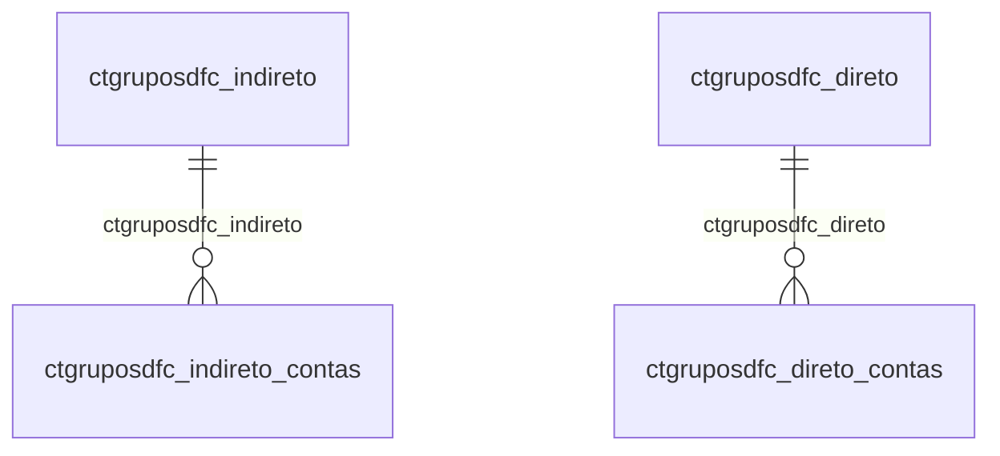

# Modelo — Contábil - gruposdfc (rascunho em lote)

> Gerado por `src/model/gerar_docs_modelo.py` a partir de `src/model/modulos/contabil_gruposdfc.yaml`, do catálogo e do perfil de colunas. **Não edite à mão.**

5 entidades. A coluna *Preench.* é o % de linhas com valor útil (nem nulo, nem em branco, nem zero, nem 1900-01-01; para colunas de código o zero conta como valor).

## Diagrama

## Entidades

| Entidade | Tabela | Linhas | Volume | Filtro obrigatório |
|---|---|---|---|---|
| [ctgruposdfc_indireto_contas](#ctgruposdfc_indireto_contas) | `CTGRUPOSDFC_INDIRETO_CONTAS` | 53.657 | medio | empresa |
| [ctgruposdfc_indireto](#ctgruposdfc_indireto) | `CTGRUPOSDFC_INDIRETO` | 4.271 | pequeno | empresa |
| [ctgruposdfc_direto_contas](#ctgruposdfc_direto_contas) | `CTGRUPOSDFC_DIRETO_CONTAS` | 2.554 | pequeno | empresa |
| [ctgruposdfc_direto](#ctgruposdfc_direto) | `CTGRUPOSDFC_DIRETO` | 2.323 | pequeno | empresa |
| [ctgruposdfc_conciliacao](#ctgruposdfc_conciliacao) | `CTGRUPOSDFC_CONCILIACAO` | 1.513 | pequeno | empresa |

## ctgruposdfc_indireto_contas

**Estrutura DFC - Metodo Indireto Contas** — tabela `CTGRUPOSDFC_INDIRETO_CONTAS` (53.657 linhas)

Estrutura DFC - Metodo Indireto Contas. 53.657 linhas no catálogo; chave: CODI_EMP, CODI_INDIRETO, CODI_CTA.

- **Chave:** `CODI_EMP, CODI_INDIRETO, CODI_CTA`
- **Empresa:** `CODI_EMP`
- **Período:** `—`
- **Ordem padrão:** `CODI_INDIRETO asc`, `CODI_CTA asc`

**Regras de negócio validadas:**

- Medido em 2026-10-18: 53.657 linhas, 71 empresa(s).
- Vínculo ctgruposdfc_indireto (CTGRUPOSDFC_INDIRETO): 0 de 298 linhas sem registro relacionado (empresa 1244).
- Vínculo ctcontas (ctcontas): 0 de 298 linhas sem registro relacionado (empresa 1244).

| Campo | Coluna | Tipo | Preench. | Domínio | Descrição (banco) |
|---|---|---|---|---|---|
| empresa | `codi_emp` | integer(4) |  |  | Empresa |
| codigo | `codi_indireto` | integer(4) |  |  | Codigo |
| codigo_da_conta | `codi_cta` | integer(4) |  |  | Codigo da conta |
| empresa_do_plano_de_contas | `codi_emp_plano` | integer(4) |  |  | Empresa do plano de contas |

**Vínculos (LEFT JOIN, acrescentam colunas legíveis):**

- `ctgruposdfc_indireto` → `CTGRUPOSDFC_INDIRETO` por `codi_emp` = `codi_emp` e `codi_indireto` = `codi_indireto`; colunas: `ctgruposdfc_indireto_nome`
- `ctcontas` → `ctcontas` por `codi_emp_plano` = `codi_emp` e `codi_cta` = `codi_cta`; colunas: `ctcontas_nome`

**Filtros:** `codigo` (eq/in), `codigo_da_conta` (eq/in), `empresa_do_plano_de_contas` (eq/in)

## ctgruposdfc_indireto

**Estrutura DFC - Metodo Indireto** — tabela `CTGRUPOSDFC_INDIRETO` (4.271 linhas)

Estrutura DFC - Metodo Indireto. 4.271 linhas no catálogo; chave: CODI_EMP, CODI_INDIRETO.

- **Chave:** `CODI_EMP, CODI_INDIRETO`
- **Empresa:** `CODI_EMP`
- **Período:** `—`
- **Ordem padrão:** `CODI_INDIRETO asc`

**Regras de negócio validadas:**

- Medido em 2026-10-18: 4.271 linhas, 125 empresa(s).
- atividade_1_operacionais_2_investimento: todos os valores reais estão no comentário do banco (1=2.769, 3=753, 2=749).
- natureza_a_analitica_s_sintetica_v_ativi: todos os valores reais estão no comentário do banco (A=2.927, S=969, V=375).
- tipo_l_lancamentos_p_saldo_periodo_d_tot: todos os valores reais estão no comentário do banco (P=1.682, L=933, nulo=599, S=498, T=246, D=186, J=125, C=2).
- Vínculo geempre (geempre): 0 de 32 linhas sem registro relacionado (empresa 753).

| Campo | Coluna | Tipo | Preench. | Domínio | Descrição (banco) |
|---|---|---|---|---|---|
| empresa | `codi_emp` | integer(4) |  |  | Empresa |
| codigo | `codi_indireto` | integer(4) |  |  | Codigo |
| ordem | `ordem` | integer(4) |  |  | Ordem |
| atividade_1_operacionais_2_investimento | `atividade` | integer(4) |  | ctgruposdfc_indireto_atividade_1_operacio | Atividade (1=Operacionais/2=Investimento/3=Financiamento) |
| descricao | `descricao` | varchar(128) |  |  | Descricao |
| natureza_a_analitica_s_sintetica_v_ativi | `natureza` | char(1) |  | ctgruposdfc_indireto_natureza_a_analitica | Natureza (A=Analitica/S=Sintetica/V=Atividade) |
| tipo_l_lancamentos_p_saldo_periodo_d_tot | `tipo` | char(1) |  | ctgruposdfc_indireto_tipo_l_lancamentos_p | Tipo (L=Lancamentos/ P=Saldo Periodo/ D=Total Debito/ J=Lucro-Prejuizo/ S=Sub-Total/ T=Total/ C=Total crédito/ A=Lucro antes do IR/ I=Inverter natureza do saldo/ E=Saldo-Exercício) |

**Vínculos (LEFT JOIN, acrescentam colunas legíveis):**

- `geempre` → `geempre` por `codi_emp` = `codi_emp`; colunas: `geempre_nome`

**Filtros:** `codigo` (eq/in), `descricao` (contem/prefixo), `natureza_a_analitica_s_sintetica_v_ativi` (eq/in), `tipo_l_lancamentos_p_saldo_periodo_d_tot` (eq/in)

## ctgruposdfc_direto_contas

**Estrutura DFC - Metodo Direto Contas** — tabela `CTGRUPOSDFC_DIRETO_CONTAS` (2.554 linhas)

Estrutura DFC - Metodo Direto Contas. 2.554 linhas no catálogo; chave: CODI_EMP, CODI_DIRETO, CODI_CTA.

- **Chave:** `CODI_EMP, CODI_DIRETO, CODI_CTA`
- **Empresa:** `CODI_EMP`
- **Período:** `—`
- **Ordem padrão:** `CODI_DIRETO asc`, `CODI_CTA asc`

**Regras de negócio validadas:**

- Medido em 2026-10-18: 2.554 linhas, 28 empresa(s).
- Vínculo ctgruposdfc_direto (CTGRUPOSDFC_DIRETO): 0 de 79 linhas sem registro relacionado (empresa 10055).
- Vínculo ctcontas (ctcontas): 0 de 79 linhas sem registro relacionado (empresa 10055).

| Campo | Coluna | Tipo | Preench. | Domínio | Descrição (banco) |
|---|---|---|---|---|---|
| empresa | `codi_emp` | integer(4) |  |  | Empresa |
| codigo | `codi_direto` | integer(4) |  |  | Codigo |
| codigo_da_conta | `codi_cta` | integer(4) |  |  | Codigo da conta |
| empresa_do_plano_de_contas | `codi_emp_plano` | integer(4) |  |  | Empresa do plano de contas |

**Vínculos (LEFT JOIN, acrescentam colunas legíveis):**

- `ctgruposdfc_direto` → `CTGRUPOSDFC_DIRETO` por `codi_emp` = `codi_emp` e `codi_direto` = `codi_direto`; colunas: `ctgruposdfc_direto_nome`
- `ctcontas` → `ctcontas` por `codi_emp_plano` = `codi_emp` e `codi_cta` = `codi_cta`; colunas: `ctcontas_nome`

**Filtros:** `codigo` (eq/in), `codigo_da_conta` (eq/in), `empresa_do_plano_de_contas` (eq/in)

## ctgruposdfc_direto

**Estrutura DFC - Metodo Direto** — tabela `CTGRUPOSDFC_DIRETO` (2.323 linhas)

Estrutura DFC - Metodo Direto. 2.323 linhas no catálogo; chave: CODI_EMP, CODI_DIRETO.

- **Chave:** `CODI_EMP, CODI_DIRETO`
- **Empresa:** `CODI_EMP`
- **Período:** `—`
- **Ordem padrão:** `CODI_DIRETO asc`

**Regras de negócio validadas:**

- Medido em 2026-10-18: 2.323 linhas, 101 empresa(s).
- atividade_1_operacionais_2_investimento: todos os valores reais estão no comentário do banco (1=1.111, 2=606, 3=606).
- natureza_a_analitica_s_sub_total_v_ativi: todos os valores reais estão no comentário do banco (A=1.515, S=505, V=303).
- Vínculo geempre (geempre): 0 de 23 linhas sem registro relacionado (empresa 607).

| Campo | Coluna | Tipo | Preench. | Domínio | Descrição (banco) |
|---|---|---|---|---|---|
| empresa | `codi_emp` | integer(4) |  |  | Empresa |
| codigo | `codi_direto` | integer(4) |  |  | Codigo |
| ordem | `ordem` | integer(4) |  |  | Ordem |
| atividade_1_operacionais_2_investimento | `atividade` | integer(4) |  | ctgruposdfc_direto_atividade_1_operaciona | Atividade (1=Operacionais/2=Investimento/3=Financiamento) |
| descricao | `descricao` | varchar(128) |  |  | Descricao |
| natureza_a_analitica_s_sub_total_v_ativi | `natureza` | char(1) |  | ctgruposdfc_direto_natureza_a_analitica_s | Natureza (A=Analitica/S=Sub-Total/V=Atividade) |

**Vínculos (LEFT JOIN, acrescentam colunas legíveis):**

- `geempre` → `geempre` por `codi_emp` = `codi_emp`; colunas: `geempre_nome`

**Filtros:** `codigo` (eq/in), `descricao` (contem/prefixo), `natureza_a_analitica_s_sub_total_v_ativi` (eq/in)

## ctgruposdfc_conciliacao

**Estrutura DFC - Conciliacao** — tabela `CTGRUPOSDFC_CONCILIACAO` (1.513 linhas)

Estrutura DFC - Conciliacao. 1.513 linhas no catálogo; chave: CODI_EMP, CODI_CONCILIACAO.

- **Chave:** `CODI_EMP, CODI_CONCILIACAO`
- **Empresa:** `CODI_EMP`
- **Período:** `—`
- **Ordem padrão:** `CODI_CONCILIACAO asc`

**Regras de negócio validadas:**

- Medido em 2026-10-18: 1.513 linhas, 89 empresa(s).
- natureza_a_analitica_s_sintetica_g_grupo: todos os valores reais estão no comentário do banco (A=1.157, S=178, G=178).
- tipo_j_lucro_prejuizo_p_saldo_periodo_s: todos os valores reais estão no comentário do banco (P=1.068, nulo=178, S=89, T=89, J=89).
- Vínculo geempre (geempre): 0 de 17 linhas sem registro relacionado (empresa 1372).

| Campo | Coluna | Tipo | Preench. | Domínio | Descrição (banco) |
|---|---|---|---|---|---|
| empresa | `codi_emp` | integer(4) |  |  | Empresa |
| codigo | `codi_conciliacao` | integer(4) |  |  | Codigo |
| ordem | `ordem` | integer(4) |  |  | Ordem |
| grupo | `grupo` | integer(4) |  |  | Grupo |
| descricao | `descricao` | varchar(128) |  |  | Descricao |
| natureza_a_analitica_s_sintetica_g_grupo | `natureza` | char(1) |  | ctgruposdfc_conciliacao_natureza_a_analitica_s_s | Natureza (A=Analitica/S=Sintetica/G=Grupo) |
| tipo_j_lucro_prejuizo_p_saldo_periodo_s | `tipo` | char(1) |  | ctgruposdfc_conciliacao_tipo_j_lucro_prejuizo_p_ | Tipo (J=Lucro-Prejuizo/P=Saldo Periodo/S=Sub-Total/T=Total/C=Total crédito/D=Total débito/ I=Inverter natureza do saldo) |

**Vínculos (LEFT JOIN, acrescentam colunas legíveis):**

- `geempre` → `geempre` por `codi_emp` = `codi_emp`; colunas: `geempre_nome`

**Filtros:** `codigo` (eq/in), `descricao` (contem/prefixo), `natureza_a_analitica_s_sintetica_g_grupo` (eq/in), `tipo_j_lucro_prejuizo_p_saldo_periodo_s` (eq/in)

## Domínios (significado dos códigos)

`confirmado`: **sim** = vem do comentário do banco e/ou foi conferido nos dados; **parcial** = parte dos valores; **não** = hipótese, não use como regra.

### status_empresa

Situação da empresa no cadastro (geempre.stat_emp)

Confirmado: sim

| Código | Significado |
|---|---|
| A | Ativa |
| I | Inativa |
| C | Em constituição |
| M | Ativo sem movimento |
| B | Em processo de baixa |
| E | Excluindo |

### motivo_inatividade

Motivo da inatividade (geempre.tipoi_emp). Só aparece em empresas inativas.

Confirmado: sim

| Código | Significado |
|---|---|
| 1 | Outros |
| 2 | Baixada |
| 3 | Transferida |
| 4 | Inadimplente |

### tipo_inscricao

Tipo da inscrição (CNPJ/CPF/CEI/CAEPF)

Confirmado: sim

| Código | Significado |
|---|---|
| 1 | CNPJ |
| 2 | CPF |
| 3 | CEI |
| 6 | CAEPF |

### regime_federal_empresa

Regime federal da folha (geempre.rfed_emp)

Confirmado: parcial

| Código | Significado |
|---|---|
| 1 | Normal |
| 2 | Microempresa |
| 3 | Empresa de pequeno porte |

### tipo_honorario_empresa

Como a empresa usa o módulo Honorários (geempre.honorario_tipo)

Confirmado: sim

| Código | Significado |
|---|---|
| E | Escritório (quem fatura) |
| C | Cliente |

### sim_nao_texto

Confirmado: sim

| Código | Significado |
|---|---|
| S | Sim |
| N | Não |

### sim_nao_numerico

Confirmado: sim

| Código | Significado |
|---|---|
| 1 | Sim |
| 0 | Não |

### ctgruposdfc_indireto_atividade_1_operacio

Confirmado: sim

> Todos os valores observados em CTGRUPOSDFC_INDIRETO.ATIVIDADE estão no comentário do banco (2026-10-18). Distribuição: 1=2.769, 3=753, 2=749.

| Código | Significado |
|---|---|
| 1 | Operacionais |
| 2 | Investimento |
| 3 | Financiamento |

### ctgruposdfc_indireto_natureza_a_analitica

Confirmado: sim

> Todos os valores observados em CTGRUPOSDFC_INDIRETO.NATUREZA estão no comentário do banco (2026-10-18). Distribuição: A=2.927, S=969, V=375.

| Código | Significado |
|---|---|
| A | Analitica |
| S | Sintetica |
| V | Atividade |

### ctgruposdfc_indireto_tipo_l_lancamentos_p

Confirmado: sim

> Todos os valores observados em CTGRUPOSDFC_INDIRETO.TIPO estão no comentário do banco (2026-10-18). Distribuição: P=1.682, L=933, nulo=599, S=498, T=246, D=186, J=125, C=2.

| Código | Significado |
|---|---|
| L | Lancamentos |
| P | Saldo Periodo |
| D | Total Debito |
| J | Lucro-Prejuizo |
| S | Sub-Total |
| T | Total |
| C | Total crédito |
| A | Lucro antes do IR |
| I | Inverter natureza do saldo |
| E | Saldo-Exercício |

### ctgruposdfc_direto_atividade_1_operaciona

Confirmado: sim

> Todos os valores observados em CTGRUPOSDFC_DIRETO.ATIVIDADE estão no comentário do banco (2026-10-18). Distribuição: 1=1.111, 2=606, 3=606.

| Código | Significado |
|---|---|
| 1 | Operacionais |
| 2 | Investimento |
| 3 | Financiamento |

### ctgruposdfc_direto_natureza_a_analitica_s

Confirmado: sim

> Todos os valores observados em CTGRUPOSDFC_DIRETO.NATUREZA estão no comentário do banco (2026-10-18). Distribuição: A=1.515, S=505, V=303.

| Código | Significado |
|---|---|
| A | Analitica |
| S | Sub-Total |
| V | Atividade |

### ctgruposdfc_conciliacao_natureza_a_analitica_s_s

Confirmado: sim

> Todos os valores observados em CTGRUPOSDFC_CONCILIACAO.NATUREZA estão no comentário do banco (2026-10-18). Distribuição: A=1.157, S=178, G=178.

| Código | Significado |
|---|---|
| A | Analitica |
| S | Sintetica |
| G | Grupo |

### ctgruposdfc_conciliacao_tipo_j_lucro_prejuizo_p_

Confirmado: sim

> Todos os valores observados em CTGRUPOSDFC_CONCILIACAO.TIPO estão no comentário do banco (2026-10-18). Distribuição: P=1.068, nulo=178, S=89, T=89, J=89.

| Código | Significado |
|---|---|
| J | Lucro-Prejuizo |
| P | Saldo Periodo |
| S | Sub-Total |
| T | Total |
| C | Total crédito |
| D | Total débito |
| I | Inverter natureza do saldo |

