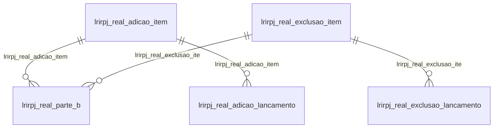

# Modelo — Contábil - irpj (rascunho em lote)

> Gerado por `src/model/gerar_docs_modelo.py` a partir de `src/model/modulos/contabil_irpj.yaml`, do catálogo e do perfil de colunas. **Não edite à mão.**

11 entidades. A coluna *Preench.* é o % de linhas com valor útil (nem nulo, nem em branco, nem zero, nem 1900-01-01; para colunas de código o zero conta como valor).

## Diagrama

## Entidades

| Entidade | Tabela | Linhas | Volume | Filtro obrigatório |
|---|---|---|---|---|
| [lrirpj_real_parte_b](#lrirpj_real_parte_b) | `LRIRPJ_REAL_PARTE_B` | 2.584 | pequeno | empresa |
| [lrirpj_real_adicao_lancamento](#lrirpj_real_adicao_lancamento) | `LRIRPJ_REAL_ADICAO_LANCAMENTO` | 2.568 | pequeno | empresa |
| [lrirpj_real_adicao](#lrirpj_real_adicao) | `LRIRPJ_REAL_ADICAO` | 566 | pequeno | empresa |
| [lrirpj_real_adicao_item](#lrirpj_real_adicao_item) | `LRIRPJ_REAL_ADICAO_ITEM` | 561 | pequeno | empresa |
| [lrirpj_real_deducao](#lrirpj_real_deducao) | `LRIRPJ_REAL_DEDUCAO` | 551 | pequeno | empresa |
| [lrirpj_estimado_deducao](#lrirpj_estimado_deducao) | `LRIRPJ_ESTIMADO_DEDUCAO` | 362 | pequeno | empresa |
| [lrirpj_incentivo_fiscal](#lrirpj_incentivo_fiscal) | `LRIRPJ_INCENTIVO_FISCAL` | 203 | pequeno | empresa |
| [lrirpj_real_exclusao_lancamento](#lrirpj_real_exclusao_lancamento) | `LRIRPJ_REAL_EXCLUSAO_LANCAMENTO` | 150 | pequeno | empresa |
| [lrirpj_real_exclusao](#lrirpj_real_exclusao) | `LRIRPJ_REAL_EXCLUSAO` | 119 | pequeno | empresa |
| [lrirpj_real_exclusao_item](#lrirpj_real_exclusao_item) | `LRIRPJ_REAL_EXCLUSAO_ITEM` | 119 | pequeno | empresa |
| [lrirpj_real_adicao_item_ajuste_anual](#lrirpj_real_adicao_item_ajuste_anual) | `LRIRPJ_REAL_ADICAO_ITEM_AJUSTE_ANUAL` | 6 | pequeno | empresa |

## lrirpj_real_parte_b

**Lançamentos da Parte B** — tabela `LRIRPJ_REAL_PARTE_B` (2.584 linhas)

Lançamentos da Parte B. 2.584 linhas no catálogo; chave: CODI_EMP, I_IRPJ_REAL_PARTE_B.

- **Chave:** `CODI_EMP, I_IRPJ_REAL_PARTE_B`
- **Empresa:** `CODI_EMP`
- **Período:** `COMPETENCIA`
- **Ordem padrão:** `COMPETENCIA desc`, `I_IRPJ_REAL_PARTE_B asc`

**Regras de negócio validadas:**

- Medido em 2026-10-18: 2.584 linhas, 66 empresa(s), COMPETENCIA de 2018-03-01 a 2026-08-01.
- Colunas expostas nulas em 100% das linhas (4): scp, codigo_do_lancamento_de_incentivo_fiscal, codigo_do_lancamento_de_adicao, codigo_do_lancamento_de_adicao_item.
- origem_do_lancamento_m_manual_s_sistema: todos os valores reais estão no comentário do banco (S=2.582, M=2).
- origem_do_lancamento_p_prejuizo_c_compen: todos os valores reais estão no comentário do banco (P=2.450, C=104, O=30).
- tipo_de_atividade_g_atividade_geral_r_at: todos os valores reais estão no comentário do banco (G=2.584).
- Vínculo geempre (geempre): 0 de 25 linhas sem registro relacionado (empresa 648).
- Vínculo gescp (GESCP): 25 de 25 linhas sem registro relacionado (empresa 648).
- Vínculo lrbase_negativa_parte_b (LRBASE_NEGATIVA_PARTE_B): 0 de 25 linhas sem registro relacionado (empresa 648).
- Vínculo lrirpj_real_adicao_item (LRIRPJ_REAL_ADICAO_ITEM): 25 de 25 linhas sem registro relacionado (empresa 648).
- Vínculo lrirpj_real_exclusao_ite (LRIRPJ_REAL_EXCLUSAO_ITEM): 25 de 25 linhas sem registro relacionado (empresa 648).

| Campo | Coluna | Tipo | Preench. | Domínio | Descrição (banco) |
|---|---|---|---|---|---|
| empresa | `codi_emp` | integer(4) |  |  | Empresa |
| codigo | `i_irpj_real_parte_b` | integer(4) |  |  | Código |
| competencia | `competencia` | date(4) |  |  | Competência |
| conta_parte_b | `i_parte_b` | integer(4) |  |  | Conta Parte B |
| historico | `historico` | varchar(50) |  |  | Histórico |
| mes_referencia | `mes_referencia` | date(4) |  |  | Mês referência |
| valor_a_corrigir | `valor_corrigir` | numeric(13) |  |  | Valor a corrigir |
| coeficiente | `coeficiente` | numeric(13) |  |  | Coeficiente |
| debito | `valor_debito` | numeric(13) |  |  | Débito |
| credito | `valor_credito` | numeric(13) |  |  | Crédito |
| origem_do_lancamento_m_manual_s_sistema | `origem_lancamento` | char(1) |  | lrirpj_real_parte_b_origem_do_lancamento_m_manu | Origem do lançamento (M=Manual/ S=Sistema/ C=Cisão/ I=Incorporação) |
| scp | `i_scp` | integer(4) |  |  | SCP |
| origem_do_lancamento_p_prejuizo_c_compen | `tipo_lancamento` | char(1) |  | lrirpj_real_parte_b_origem_do_lancamento_p_prej | Origem do lançamento (P=Prejuízo/ C=Compensação/ O=Outros/ L=Liquid. Parc. IN 1687/17/ T=Pert. Lei 13.496/17) |
| codigo_do_lancamento_de_incentivo_fiscal | `i_irpj_incentivo_fiscal` | integer(4) |  |  | Código do Lançamento de Incentivo Fiscal |
| codigo_do_lancamento_de_adicao | `i_irpj_real_adicao` | integer(4) |  |  | Código do Lançamento de Adição |
| codigo_do_lancamento_de_adicao_item | `i_irpj_real_adicao_item` | integer(4) |  |  | Código do Lançamento de Adição - Item |
| codigo_do_lancamento_de_exlcusao | `i_irpj_real_exclusao` | integer(4) |  |  | Código do Lançamento de Exlcusão |
| codigo_do_lancamento_de_exlcusao_item | `i_irpj_real_exclusao_item` | integer(4) |  |  | Código do Lançamento de Exlcusão - Item |
| tipo_de_atividade_g_atividade_geral_r_at | `tipo_atividade` | char(1) |  | lrirpj_real_parte_b_tipo_de_atividade_g_ativida | Tipo de atividade (G=Atividade geral/ R=Atividade rural/ A=Ambos) |
| ajuste_anual | `ajuste_anual` | integer(4) |  |  | Ajuste Anual |

**Vínculos (LEFT JOIN, acrescentam colunas legíveis):**

- `geempre` → `geempre` por `codi_emp` = `codi_emp`; colunas: `geempre_nome`
- `gescp` → `GESCP` por `codi_emp` = `codi_emp` e `i_scp` = `i_scp`; colunas: `gescp_nome`
- `lrbase_negativa_parte_b` → `LRBASE_NEGATIVA_PARTE_B` por `codi_emp` = `codi_emp` e `i_parte_b` = `i_base_negativa_parte_b`; colunas: `lrbase_negativa_parte_b_nome`
- `lrirpj_real_adicao_item` → `LRIRPJ_REAL_ADICAO_ITEM` por `codi_emp` = `codi_emp` e `i_irpj_real_adicao` = `i_irpj_real_adicao` e `i_irpj_real_adicao_item` = `i_item`; colunas: `lrirpj_real_adicao_item_nome`
- `lrirpj_real_exclusao_ite` → `LRIRPJ_REAL_EXCLUSAO_ITEM` por `codi_emp` = `codi_emp` e `i_irpj_real_exclusao` = `i_irpj_real_exclusao` e `i_irpj_real_exclusao_item` = `i_item`; colunas: `lrirpj_real_exclusao_ite_nome`

**Filtros:** `codigo` (eq/in), `competencia` (entre/gte/lte), `mes_referencia` (entre/gte/lte), `conta_parte_b` (eq/in), `historico` (contem/prefixo), `origem_do_lancamento_m_manual_s_sistema` (eq/in), `scp` (eq/in), `origem_do_lancamento_p_prejuizo_c_compen` (eq/in), `codigo_do_lancamento_de_incentivo_fiscal` (eq/in), `codigo_do_lancamento_de_adicao` (eq/in), `codigo_do_lancamento_de_adicao_item` (eq/in), `codigo_do_lancamento_de_exlcusao` (eq/in), `codigo_do_lancamento_de_exlcusao_item` (eq/in), `tipo_de_atividade_g_atividade_geral_r_at` (eq/in)

## lrirpj_real_adicao_lancamento

**Lançamentos de Adições do Imposto de Renda - Lancamentos Contábeis** — tabela `LRIRPJ_REAL_ADICAO_LANCAMENTO` (2.568 linhas)

Lançamentos de Adições do Imposto de Renda - Lancamentos Contábeis. 2.568 linhas no catálogo; chave: CODI_EMP, I_IRPJ_REAL_ADICAO, I_ITEM, I_LANCAMENTO.

- **Chave:** `CODI_EMP, I_IRPJ_REAL_ADICAO, I_ITEM, I_LANCAMENTO`
- **Empresa:** `CODI_EMP`
- **Período:** `DATA_LANCAMENTO`
- **Ordem padrão:** `DATA_LANCAMENTO desc`, `I_IRPJ_REAL_ADICAO asc`, `I_ITEM asc`

**Regras de negócio validadas:**

- Medido em 2026-10-18: 2.568 linhas, 44 empresa(s), DATA_LANCAMENTO de 2013-02-28 a 2026-08-31.
- Vínculo lrirpj_real_adicao_item (LRIRPJ_REAL_ADICAO_ITEM): 0 de 15 linhas sem registro relacionado (empresa 1022).

| Campo | Coluna | Tipo | Preench. | Domínio | Descrição (banco) |
|---|---|---|---|---|---|
| empresa | `codi_emp` | integer(4) |  |  | Empresa |
| codigo_do_lancamento_de_adicao_da_irpj | `i_irpj_real_adicao` | integer(4) |  |  | Código do Lançamento de Adição da IRPJ |
| sequencial_da_adicao | `i_item` | integer(4) |  |  | Sequencial da adição |
| sequencial | `i_lancamento` | integer(4) |  |  | Sequencial |
| numero_lote_lancamento | `numero_lote` | integer(4) |  |  | Número lote/lançamento |
| data | `data_lancamento` | date(4) |  |  | Data |
| conta | `conta` | integer(4) |  |  | Conta |
| valor | `valor` | numeric(13) |  |  | Valor |
| valor_geral | `valor_geral` | numeric(13) |  |  | Valor - Geral |
| valor_rural | `valor_rural` | numeric(13) |  |  | Valor - Rural |
| codigo_do_historico | `codigo_historico` | integer(4) |  |  | Código do histórico |
| historico | `historico` | varchar(512) |  |  | Histórico |
| tipo_saldo_d_devedor_ou_c_credor | `tipo_saldo` | char(1) |  |  | Tipo Saldo:  D-Devedor ou C-Credor. |

**Vínculos (LEFT JOIN, acrescentam colunas legíveis):**

- `lrirpj_real_adicao_item` → `LRIRPJ_REAL_ADICAO_ITEM` por `codi_emp` = `codi_emp` e `i_irpj_real_adicao` = `i_irpj_real_adicao` e `i_item` = `i_item`; colunas: `lrirpj_real_adicao_item_nome`

**Filtros:** `codigo_do_lancamento_de_adicao_da_irpj` (eq/in), `sequencial_da_adicao` (eq/in), `sequencial` (eq/in), `data` (entre/gte/lte), `codigo_do_historico` (eq/in), `historico` (contem/prefixo), `tipo_saldo_d_devedor_ou_c_credor` (eq/in)

## lrirpj_real_adicao

**Lançamentos de Adições do Imposto de Renda** — tabela `LRIRPJ_REAL_ADICAO` (566 linhas)

Lançamentos de Adições do Imposto de Renda. 566 linhas no catálogo; chave: CODI_EMP, I_IRPJ_REAL_ADICAO.

- **Chave:** `CODI_EMP, I_IRPJ_REAL_ADICAO`
- **Empresa:** `CODI_EMP`
- **Período:** `DATA_LANCAMENTO`
- **Ordem padrão:** `DATA_LANCAMENTO desc`, `I_IRPJ_REAL_ADICAO asc`

**Regras de negócio validadas:**

- Medido em 2026-10-18: 566 linhas, 60 empresa(s), DATA_LANCAMENTO de 2013-02-28 a 2026-08-31.
- Colunas expostas nulas em 100% das linhas (3): scp, grupo_sistema_financeiro, grupo_sociedade_seguradora.
- origem_do_lancamento_m_manual_s_sistema: todos os valores reais estão no comentário do banco (M=306, S=260).
- Vínculo geempre (geempre): 0 de 5 linhas sem registro relacionado (empresa 758).
- Vínculo gescp (GESCP): 5 de 5 linhas sem registro relacionado (empresa 758).
- Vínculo lrtabela_grupo_irpj_adic (LRTABELA_GRUPO_IRPJ_ADICAO_SEGURADORA): 0 de 5 linhas sem registro relacionado (empresa 758).

| Campo | Coluna | Tipo | Preench. | Domínio | Descrição (banco) |
|---|---|---|---|---|---|
| empresa | `codi_emp` | integer(4) |  |  | Empresa |
| codigo | `i_irpj_real_adicao` | integer(4) |  |  | Código |
| data_do_lancamento | `data_lancamento` | date(4) |  |  | Data do lançamento |
| complemento | `complemento` | varchar(100) |  |  | Complemento |
| origem_do_lancamento_m_manual_s_sistema | `origem_lancamento` | char(1) |  | lrirpj_real_adicao_origem_do_l | Origem do lançamento (M=Manual/ S=Sistema) |
| scp | `i_scp` | integer(4) |  |  | SCP |
| grupo_geral | `i_grupo_irpj_adicao_geral` | integer(4) |  |  | Grupo - Geral |
| grupo_sistema_financeiro | `i_grupo_irpj_adicao_sf` | integer(4) |  |  | Grupo - Sistema Financeiro |
| grupo_sociedade_seguradora | `i_grupo_irpj_adicao_s` | integer(4) |  |  | Grupo - Sociedade Seguradora |
| tipo_de_lancamento_g_geral_r_rural | `tipo_lancamento` | char(1) |  |  | Tipo de lançamento(G=Geral, R=Rural) |

**Vínculos (LEFT JOIN, acrescentam colunas legíveis):**

- `geempre` → `geempre` por `codi_emp` = `codi_emp`; colunas: `geempre_nome`
- `gescp` → `GESCP` por `codi_emp` = `codi_emp` e `i_scp` = `i_scp`; colunas: `gescp_nome`
- `lrtabela_grupo_irpj_adic` → `LRTABELA_GRUPO_IRPJ_ADICAO_SEGURADORA` por `i_grupo_irpj_adicao_s` = `i_grupo_irpj_adicao_s`; colunas: `lrtabela_grupo_irpj_adic_nome`

**Filtros:** `codigo` (eq/in), `data_do_lancamento` (entre/gte/lte), `complemento` (contem/prefixo), `origem_do_lancamento_m_manual_s_sistema` (eq/in), `scp` (eq/in), `grupo_geral` (eq/in), `grupo_sistema_financeiro` (eq/in), `grupo_sociedade_seguradora` (eq/in), `tipo_de_lancamento_g_geral_r_rural` (eq/in)

## lrirpj_real_adicao_item

**Lançamentos de Adições do Imposto de Renda - Adições** — tabela `LRIRPJ_REAL_ADICAO_ITEM` (561 linhas)

Lançamentos de Adições do Imposto de Renda - Adições. 561 linhas no catálogo; chave: CODI_EMP, I_IRPJ_REAL_ADICAO, I_ITEM.

- **Chave:** `CODI_EMP, I_IRPJ_REAL_ADICAO, I_ITEM`
- **Empresa:** `CODI_EMP`
- **Período:** `—`
- **Ordem padrão:** `I_IRPJ_REAL_ADICAO asc`, `I_ITEM asc`

**Regras de negócio validadas:**

- Medido em 2026-10-18: 561 linhas, 60 empresa(s).
- Vínculo lradicao (LRADICAO): 0 de 5 linhas sem registro relacionado (empresa 758).

| Campo | Coluna | Tipo | Preench. | Domínio | Descrição (banco) |
|---|---|---|---|---|---|
| empresa | `codi_emp` | integer(4) |  |  | Empresa |
| codigo_do_lancamento_de_adicao_da_irpj | `i_irpj_real_adicao` | integer(4) |  |  | Código do Lançamento de Adição da IRPJ |
| sequencial | `i_item` | integer(4) |  |  | Sequencial |
| adicao | `i_adicao` | integer(4) |  |  | Adição |
| descricao | `descricao` | varchar(520) |  |  | Descrição |
| valor | `valor` | numeric(13) |  |  | Valor |
| valor_geral | `valor_geral` | numeric(13) |  |  | Valor - Geral |
| valor_rural | `valor_rural` | numeric(13) |  |  | Valor - Rural |
| codigo_do_lancamento_de_adicao_da_csll | `i_csll_real_adicao` | integer(4) |  |  | Código do Lançamento de Adição da CSLL |
| tipo_saldo_d_devedor_ou_c_credor | `tipo_saldo` | char(1) |  |  | Tipo Saldo:  D-Devedor ou C-Credor. |

**Vínculos (LEFT JOIN, acrescentam colunas legíveis):**

- `lradicao` → `LRADICAO` por `codi_emp` = `codi_emp` e `i_adicao` = `i_adicao`; colunas: `lradicao_nome`

**Filtros:** `codigo_do_lancamento_de_adicao_da_irpj` (eq/in), `sequencial` (eq/in), `adicao` (eq/in), `descricao` (contem/prefixo), `codigo_do_lancamento_de_adicao_da_csll` (eq/in), `tipo_saldo_d_devedor_ou_c_credor` (eq/in)

## lrirpj_real_deducao

**Deduções do Imposto de Renda (Real)** — tabela `LRIRPJ_REAL_DEDUCAO` (551 linhas)

Deduções do Imposto de Renda (Real). 551 linhas no catálogo; chave: CODI_EMP, I_IRPJ_REAL_DEDUCAO.

- **Chave:** `CODI_EMP, I_IRPJ_REAL_DEDUCAO`
- **Empresa:** `CODI_EMP`
- **Período:** `DATA_INICIO_SALDO`
- **Ordem padrão:** `DATA_INICIO_SALDO desc`, `I_IRPJ_REAL_DEDUCAO asc`

**Regras de negócio validadas:**

- Medido em 2026-10-18: 551 linhas, 35 empresa(s), DATA_INICIO_SALDO de 2024-12-11 a 2026-09-29.
- Colunas expostas nulas em 100% das linhas (1): scp.
- Vínculo geempre (geempre): 0 de 12 linhas sem registro relacionado (empresa 1664).
- Vínculo gescp (GESCP): 12 de 12 linhas sem registro relacionado (empresa 1664).

| Campo | Coluna | Tipo | Preench. | Domínio | Descrição (banco) |
|---|---|---|---|---|---|
| empresa | `codi_emp` | integer(4) |  |  | Empresa |
| codigo | `i_irpj_real_deducao` | integer(4) |  |  | Código |
| competencia | `competencia` | date(4) |  |  | Competência |
| ir_pgo_em_meses_anteriores | `valor_ir_pago_em_mes_anterior` | numeric(13) |  |  | IR pgo em meses anteriores |
| irrf | `valor_irrf` | numeric(13) |  |  | IRRF |
| irrf_por_orgaos_publicos_federais | `valor_irrf_orgao_publico_federal` | numeric(13) |  |  | IRRF por Órgãos Públicos Federais |
| irrf_administracao_publica | `valor_irrf_administracao_publica` | numeric(13) |  |  | IRRF Administração Pública |
| outras_deducoes | `valor_outra_deducao` | numeric(13) |  |  | Outras deduções |
| scp | `i_scp` | integer(4) |  |  | SCP |
| pago_no_exterior_sobre_lucros_rendimento | `valor_pago_exterior` | numeric(13) |  |  | Pago no exterior sobre lucros, rendimentos e ganhos de capital |
| pago_incidente_sobre_ganhos_no_mercado_d | `valor_pago_incidente_sobre_ganhos` | numeric(13) |  |  | Pago incidente sobre ganhos no mercado de renda variável |
| parcelamento_formalizado_de_ir_sobre_a_b | `valor_parcelamento_formalizado` | numeric(13) |  |  | Parcelamento formalizado de IR sobre a base de cálculo estimada |
| compensacao_de_impostos_federais_de_peri | `valor_compensacao_imposto_federal_periodo_anterior` | numeric(13) |  |  | Compensação de impostos federais de períodos anteriores |
| ajuste_anual | `ajuste_anual` | integer(4) |  |  | Ajuste Anual |
| valor_deducao_perse_pgsc | `valor_deducao_perse_pgsc` | decimal(13) |  |  | Lei Perse e PGSC - Lei 14.148/21 |
| importar_retencoes_como_valor_pago_em_me | `retencoes_pago_meses_ant` | char(1) |  |  | Importar retenções como valor pago em meses anteriores |
| data_de_inicio_do_controle_de_saldo | `data_inicio_saldo` | date(4) |  |  | Data de início do controle de saldo. |
| valor_irrf_a_ser_desconsiderado_no_calcu | `valor_irrf_desconsiderar` | numeric(13) |  |  | Valor IRRF a ser desconsiderado no calculo |
| desconsiderar_saldo_de_dezembro | `desconsiderar_saldo_dezembro` | char(1) |  |  | Desconsiderar saldo de Dezembro |

**Vínculos (LEFT JOIN, acrescentam colunas legíveis):**

- `geempre` → `geempre` por `codi_emp` = `codi_emp`; colunas: `geempre_nome`
- `gescp` → `GESCP` por `codi_emp` = `codi_emp` e `i_scp` = `i_scp`; colunas: `gescp_nome`

**Filtros:** `codigo` (eq/in), `competencia` (entre/gte/lte), `data_de_inicio_do_controle_de_saldo` (entre/gte/lte), `scp` (eq/in), `importar_retencoes_como_valor_pago_em_me` (eq/in), `desconsiderar_saldo_de_dezembro` (eq/in)

## lrirpj_estimado_deducao

**Deduções do Imposto de Renda (Estimado)** — tabela `LRIRPJ_ESTIMADO_DEDUCAO` (362 linhas)

Deduções do Imposto de Renda (Estimado). 362 linhas no catálogo; chave: CODI_EMP, I_IRPJ_ESTIMADO_DEDUCAO.

- **Chave:** `CODI_EMP, I_IRPJ_ESTIMADO_DEDUCAO`
- **Empresa:** `CODI_EMP`
- **Período:** `DATA_INICIO_SALDO`
- **Ordem padrão:** `DATA_INICIO_SALDO desc`, `I_IRPJ_ESTIMADO_DEDUCAO asc`

**Regras de negócio validadas:**

- Medido em 2026-10-18: 362 linhas, 24 empresa(s), DATA_INICIO_SALDO de 2024-12-09 a 2026-09-29.
- Colunas expostas nulas em 100% das linhas (1): scp.
- Vínculo geempre (geempre): 0 de 13 linhas sem registro relacionado (empresa 1663).
- Vínculo gescp (GESCP): 13 de 13 linhas sem registro relacionado (empresa 1663).

| Campo | Coluna | Tipo | Preench. | Domínio | Descrição (banco) |
|---|---|---|---|---|---|
| empresa | `codi_emp` | integer(4) |  |  | Empresa |
| codigo | `i_irpj_estimado_deducao` | integer(4) |  |  | Código |
| competencia | `competencia` | date(4) |  |  | Competência |
| ir_pgo_em_meses_anteriores | `valor_ir_pago_em_mes_anterior` | numeric(13) |  |  | IR pgo em meses anteriores |
| irrf | `valor_irrf` | numeric(13) |  |  | IRRF |
| irrf_por_orgaos_publicos_federais | `valor_irrf_orgao_publico_federal` | numeric(13) |  |  | IRRF por Órgãos Públicos Federais |
| irrf_administracao_publica | `valor_irrf_administracao_publica` | numeric(13) |  |  | IRRF Administração Pública |
| outras_deducoes | `valor_outra_deducao` | numeric(13) |  |  | Outras deduções |
| scp | `i_scp` | integer(4) |  |  | SCP |
| pago_no_exterior_sobre_lucros_rendimento | `valor_pago_exterior` | numeric(13) |  |  | Pago no exterior sobre lucros, rendimentos e ganhos de capital |
| pago_incidente_sobre_ganhos_no_mercado_d | `valor_pago_incidente_sobre_ganhos` | numeric(13) |  |  | Pago incidente sobre ganhos no mercado de renda variável |
| compensacao_de_impostos_federais_de_peri | `valor_compensacao_imposto_federal_periodo_anterior` | numeric(13) |  |  | Compensação de impostos federais de períodos anteriores |
| valor_deducao_perse_pgsc | `valor_deducao_perse_pgsc` | decimal(13) |  |  | Lei Perse e PGSC - Lei 14.148/21 |
| data_de_inicio_do_controle_de_saldo | `data_inicio_saldo` | date(4) |  |  | Data de início do controle de saldo. |
| valor_irrf_a_ser_desconsiderado_no_calcu | `valor_irrf_desconsiderar` | numeric(13) |  |  | Valor IRRF a ser desconsiderado no calculo |

**Vínculos (LEFT JOIN, acrescentam colunas legíveis):**

- `geempre` → `geempre` por `codi_emp` = `codi_emp`; colunas: `geempre_nome`
- `gescp` → `GESCP` por `codi_emp` = `codi_emp` e `i_scp` = `i_scp`; colunas: `gescp_nome`

**Filtros:** `codigo` (eq/in), `competencia` (entre/gte/lte), `data_de_inicio_do_controle_de_saldo` (entre/gte/lte), `scp` (eq/in)

## lrirpj_incentivo_fiscal

**Lançamentos de Incentivos Fiscais** — tabela `LRIRPJ_INCENTIVO_FISCAL` (203 linhas)

Lançamentos de Incentivos Fiscais. 203 linhas no catálogo; chave: CODI_EMP, I_IRPJ_INCENTIVO_FISCAL.

- **Chave:** `CODI_EMP, I_IRPJ_INCENTIVO_FISCAL`
- **Empresa:** `CODI_EMP`
- **Período:** `COMPETENCIA`
- **Ordem padrão:** `COMPETENCIA desc`, `I_IRPJ_INCENTIVO_FISCAL asc`

**Regras de negócio validadas:**

- Medido em 2026-10-18: 203 linhas, 9 empresa(s), COMPETENCIA de 2013-01-01 a 2026-08-01.
- Colunas expostas nulas em 100% das linhas (1): scp.
- Vínculo geempre (geempre): 0 de 16 linhas sem registro relacionado (empresa 836).
- Vínculo gescp (GESCP): 16 de 16 linhas sem registro relacionado (empresa 836).
- Vínculo lrincentivo_fiscal (LRINCENTIVO_FISCAL): 0 de 16 linhas sem registro relacionado (empresa 836).

| Campo | Coluna | Tipo | Preench. | Domínio | Descrição (banco) |
|---|---|---|---|---|---|
| empresa | `codi_emp` | integer(4) |  |  | Empresa |
| codigo | `i_irpj_incentivo_fiscal` | integer(4) |  |  | Código |
| competencia | `competencia` | date(4) |  |  | Competência |
| incentivo_fiscal | `i_incentivo_fiscal` | integer(4) |  |  | Incentivo Fiscal |
| numero_de_refeicoes | `numero_refeicao` | integer(4) |  |  | Número de refeições |
| valor_base | `valor_base` | numeric(13) |  |  | Valor base |
| aliquota | `aliquota` | numeric(5) |  |  | Alíquota |
| total | `valor_total` | numeric(13) |  |  | Total |
| scp | `i_scp` | integer(4) |  |  | SCP |
| data_limite_que_sera_aproveitado | `aproveitar_ate` | date(4) |  |  | Data limite que será aproveitado |

**Vínculos (LEFT JOIN, acrescentam colunas legíveis):**

- `geempre` → `geempre` por `codi_emp` = `codi_emp`; colunas: `geempre_nome`
- `gescp` → `GESCP` por `codi_emp` = `codi_emp` e `i_scp` = `i_scp`; colunas: `gescp_nome`
- `lrincentivo_fiscal` → `LRINCENTIVO_FISCAL` por `codi_emp` = `codi_emp` e `i_incentivo_fiscal` = `i_incentivo_fiscal`; colunas: `lrincentivo_fiscal_nome`

**Filtros:** `codigo` (eq/in), `competencia` (entre/gte/lte), `data_limite_que_sera_aproveitado` (entre/gte/lte), `incentivo_fiscal` (eq/in), `scp` (eq/in)

## lrirpj_real_exclusao_lancamento

**Lançamentos de Exclusões do Imposto de Renda - Lancamentos Contábeis** — tabela `LRIRPJ_REAL_EXCLUSAO_LANCAMENTO` (150 linhas)

Lançamentos de Exclusões do Imposto de Renda - Lancamentos Contábeis. 150 linhas no catálogo; chave: CODI_EMP, I_IRPJ_REAL_EXCLUSAO, I_ITEM, I_LANCAMENTO.

- **Chave:** `CODI_EMP, I_IRPJ_REAL_EXCLUSAO, I_ITEM, I_LANCAMENTO`
- **Empresa:** `CODI_EMP`
- **Período:** `DATA_LANCAMENTO`
- **Ordem padrão:** `DATA_LANCAMENTO desc`, `I_IRPJ_REAL_EXCLUSAO asc`, `I_ITEM asc`

**Regras de negócio validadas:**

- Medido em 2026-10-18: 150 linhas, 8 empresa(s), DATA_LANCAMENTO de 2013-01-31 a 2026-06-30.
- Vínculo lrirpj_real_exclusao_ite (LRIRPJ_REAL_EXCLUSAO_ITEM): 0 de 16 linhas sem registro relacionado (empresa 1548).

| Campo | Coluna | Tipo | Preench. | Domínio | Descrição (banco) |
|---|---|---|---|---|---|
| empresa | `codi_emp` | integer(4) |  |  | Empresa |
| codigo_do_lancamento_de_exclusao_da_irpj | `i_irpj_real_exclusao` | integer(4) |  |  | Código do Lançamento de Exclusão da IRPJ |
| sequencial_da_exclusao | `i_item` | integer(4) |  |  | Sequencial da exclusão |
| sequencial | `i_lancamento` | integer(4) |  |  | Sequencial |
| numero_lote_lancamento | `numero_lote` | integer(4) |  |  | Número lote/lançamento |
| data | `data_lancamento` | date(4) |  |  | Data |
| conta | `conta` | integer(4) |  |  | Conta |
| valor | `valor` | numeric(13) |  |  | Valor |
| valor_geral | `valor_geral` | numeric(13) |  |  | Valor geral |
| valor_rural | `valor_rural` | numeric(13) |  |  | Valor rural |
| codigo_do_historico | `codigo_historico` | integer(4) |  |  | Código do histórico |
| historico | `historico` | varchar(512) |  |  | Histórico |
| tipo_saldo_d_devedor_ou_c_credor | `tipo_saldo` | char(1) |  |  | Tipo Saldo:  D-Devedor ou C-Credor. |

**Vínculos (LEFT JOIN, acrescentam colunas legíveis):**

- `lrirpj_real_exclusao_ite` → `LRIRPJ_REAL_EXCLUSAO_ITEM` por `codi_emp` = `codi_emp` e `i_irpj_real_exclusao` = `i_irpj_real_exclusao` e `i_item` = `i_item`; colunas: `lrirpj_real_exclusao_ite_nome`

**Filtros:** `codigo_do_lancamento_de_exclusao_da_irpj` (eq/in), `sequencial_da_exclusao` (eq/in), `sequencial` (eq/in), `data` (entre/gte/lte), `codigo_do_historico` (eq/in), `historico` (contem/prefixo), `tipo_saldo_d_devedor_ou_c_credor` (eq/in)

## lrirpj_real_exclusao

**Lançamentos de Exclusões do Imposto de Renda** — tabela `LRIRPJ_REAL_EXCLUSAO` (119 linhas)

Lançamentos de Exclusões do Imposto de Renda. 119 linhas no catálogo; chave: CODI_EMP, I_IRPJ_REAL_EXCLUSAO.

- **Chave:** `CODI_EMP, I_IRPJ_REAL_EXCLUSAO`
- **Empresa:** `CODI_EMP`
- **Período:** `DATA_LANCAMENTO`
- **Ordem padrão:** `DATA_LANCAMENTO desc`, `I_IRPJ_REAL_EXCLUSAO asc`

**Regras de negócio validadas:**

- Medido em 2026-10-18: 119 linhas, 9 empresa(s), DATA_LANCAMENTO de 2013-01-31 a 2026-06-30.
- Colunas expostas nulas em 100% das linhas (3): scp, grupo_sistema_financeiro, grupo_sociedade_seguradora.
- Vínculo geempre (geempre): 0 de 8 linhas sem registro relacionado (empresa 1619).
- Vínculo gescp (GESCP): 8 de 8 linhas sem registro relacionado (empresa 1619).
- Vínculo lrtabela_grupo_irpj_excl (LRTABELA_GRUPO_IRPJ_EXCLUSAO_SEGURADORA): 0 de 8 linhas sem registro relacionado (empresa 1619).

| Campo | Coluna | Tipo | Preench. | Domínio | Descrição (banco) |
|---|---|---|---|---|---|
| empresa | `codi_emp` | integer(4) |  |  | Empresa |
| codigo | `i_irpj_real_exclusao` | integer(4) |  |  | Código |
| data_do_lancamento | `data_lancamento` | date(4) |  |  | Data do lançamento |
| complemento | `complemento` | varchar(100) |  |  | Complemento |
| scp | `i_scp` | integer(4) |  |  | SCP |
| grupo_geral | `i_grupo_irpj_exclusao_geral` | integer(4) |  |  | Grupo - Geral |
| grupo_sistema_financeiro | `i_grupo_irpj_exclusao_sf` | integer(4) |  |  | Grupo - Sistema Financeiro |
| grupo_sociedade_seguradora | `i_grupo_irpj_exclusao_s` | integer(4) |  |  | Grupo - Sociedade Seguradora |
| tipo_de_lancamento_g_geral_r_rural | `tipo_lancamento` | char(1) |  |  | Tipo de lançamento(G=Geral, R=Rural) |

**Vínculos (LEFT JOIN, acrescentam colunas legíveis):**

- `geempre` → `geempre` por `codi_emp` = `codi_emp`; colunas: `geempre_nome`
- `gescp` → `GESCP` por `codi_emp` = `codi_emp` e `i_scp` = `i_scp`; colunas: `gescp_nome`
- `lrtabela_grupo_irpj_excl` → `LRTABELA_GRUPO_IRPJ_EXCLUSAO_SEGURADORA` por `i_grupo_irpj_exclusao_s` = `i_grupo_irpj_exclusao_s`; colunas: `lrtabela_grupo_irpj_excl_nome`

**Filtros:** `codigo` (eq/in), `data_do_lancamento` (entre/gte/lte), `complemento` (contem/prefixo), `scp` (eq/in), `grupo_geral` (eq/in), `grupo_sistema_financeiro` (eq/in), `grupo_sociedade_seguradora` (eq/in), `tipo_de_lancamento_g_geral_r_rural` (eq/in)

## lrirpj_real_exclusao_item

**Lançamentos de Exclusões do Imposto de Renda - Exclusões** — tabela `LRIRPJ_REAL_EXCLUSAO_ITEM` (119 linhas)

Lançamentos de Exclusões do Imposto de Renda - Exclusões. 119 linhas no catálogo; chave: CODI_EMP, I_IRPJ_REAL_EXCLUSAO, I_ITEM.

- **Chave:** `CODI_EMP, I_IRPJ_REAL_EXCLUSAO, I_ITEM`
- **Empresa:** `CODI_EMP`
- **Período:** `—`
- **Ordem padrão:** `I_IRPJ_REAL_EXCLUSAO asc`, `I_ITEM asc`

**Regras de negócio validadas:**

- Medido em 2026-10-18: 119 linhas, 9 empresa(s).
- Vínculo lrexclusao (LREXCLUSAO): 0 de 8 linhas sem registro relacionado (empresa 1619).

| Campo | Coluna | Tipo | Preench. | Domínio | Descrição (banco) |
|---|---|---|---|---|---|
| empresa | `codi_emp` | integer(4) |  |  | Empresa |
| codigo_do_lancamento_de_exclusoes_da_irp | `i_irpj_real_exclusao` | integer(4) |  |  | Código do Lançamento de Exclusões da IRPJ |
| sequencial | `i_item` | integer(4) |  |  | Sequencial |
| exclusao | `i_exclusao` | integer(4) |  |  | Exclusão |
| descricao | `descricao` | varchar(520) |  |  | Descrição |
| valor | `valor` | numeric(13) |  |  | Valor |
| valor_geral | `valor_geral` | numeric(13) |  |  | Valor - Geral |
| valor_rural | `valor_rural` | numeric(13) |  |  | Valor - Rural |
| codigo_do_lancamento_de_exclusoes_da_csl | `i_csll_real_exclusao` | integer(4) |  |  | Código do Lançamento de Exclusões da CSLL |
| tipo_saldo_d_devedor_ou_c_credor | `tipo_saldo` | char(1) |  |  | Tipo Saldo:  D-Devedor ou C-Credor. |

**Vínculos (LEFT JOIN, acrescentam colunas legíveis):**

- `lrexclusao` → `LREXCLUSAO` por `codi_emp` = `codi_emp` e `i_exclusao` = `i_exclusao`; colunas: `lrexclusao_nome`

**Filtros:** `codigo_do_lancamento_de_exclusoes_da_irp` (eq/in), `sequencial` (eq/in), `exclusao` (eq/in), `descricao` (contem/prefixo), `codigo_do_lancamento_de_exclusoes_da_csl` (eq/in), `tipo_saldo_d_devedor_ou_c_credor` (eq/in)

## lrirpj_real_adicao_item_ajuste_anual

**Lançamentos de Adições do Imposto de Renda - Adições - Ajuste Anual** — tabela `LRIRPJ_REAL_ADICAO_ITEM_AJUSTE_ANUAL` (6 linhas)

Lançamentos de Adições do Imposto de Renda - Adições - Ajuste Anual. 6 linhas no catálogo; chave: CODI_EMP, I_IRPJ_REAL_ADICAO, I_ITEM.

- **Chave:** `CODI_EMP, I_IRPJ_REAL_ADICAO, I_ITEM`
- **Empresa:** `CODI_EMP`
- **Período:** `—`
- **Ordem padrão:** `I_IRPJ_REAL_ADICAO asc`, `I_ITEM asc`

**Regras de negócio validadas:**

- Medido em 2026-10-18: 6 linhas, 6 empresa(s).
- Colunas expostas nulas em 100% das linhas (1): codigo_do_lancamento_de_adicao_da_csll.
- Vínculo lradicao (LRADICAO): 0 de 1 linhas sem registro relacionado (empresa 1420).

| Campo | Coluna | Tipo | Preench. | Domínio | Descrição (banco) |
|---|---|---|---|---|---|
| empresa | `codi_emp` | integer(4) |  |  | Empresa |
| codigo_do_lancamento_de_adicao_da_irpj | `i_irpj_real_adicao` | integer(4) |  |  | Código do Lançamento de Adição da IRPJ |
| sequencial | `i_item` | integer(4) |  |  | Sequencial |
| adicao | `i_adicao` | integer(4) |  |  | Adição |
| descricao | `descricao` | varchar(520) |  |  | Descrição |
| valor | `valor` | numeric(13) |  |  | Valor |
| valor_geral | `valor_geral` | numeric(13) |  |  | Valor - Geral |
| valor_rural | `valor_rural` | numeric(13) |  |  | Valor - Rural |
| codigo_do_lancamento_de_adicao_da_csll | `i_csll_real_adicao` | integer(4) |  |  | Código do Lançamento de Adição da CSLL |

**Vínculos (LEFT JOIN, acrescentam colunas legíveis):**

- `lradicao` → `LRADICAO` por `codi_emp` = `codi_emp` e `i_adicao` = `i_adicao`; colunas: `lradicao_nome`

**Filtros:** `codigo_do_lancamento_de_adicao_da_irpj` (eq/in), `sequencial` (eq/in), `adicao` (eq/in), `descricao` (contem/prefixo), `codigo_do_lancamento_de_adicao_da_csll` (eq/in)

## Domínios (significado dos códigos)

`confirmado`: **sim** = vem do comentário do banco e/ou foi conferido nos dados; **parcial** = parte dos valores; **não** = hipótese, não use como regra.

### status_empresa

Situação da empresa no cadastro (geempre.stat_emp)

Confirmado: sim

| Código | Significado |
|---|---|
| A | Ativa |
| I | Inativa |
| C | Em constituição |
| M | Ativo sem movimento |
| B | Em processo de baixa |
| E | Excluindo |

### motivo_inatividade

Motivo da inatividade (geempre.tipoi_emp). Só aparece em empresas inativas.

Confirmado: sim

| Código | Significado |
|---|---|
| 1 | Outros |
| 2 | Baixada |
| 3 | Transferida |
| 4 | Inadimplente |

### tipo_inscricao

Tipo da inscrição (CNPJ/CPF/CEI/CAEPF)

Confirmado: sim

| Código | Significado |
|---|---|
| 1 | CNPJ |
| 2 | CPF |
| 3 | CEI |
| 6 | CAEPF |

### regime_federal_empresa

Regime federal da folha (geempre.rfed_emp)

Confirmado: parcial

| Código | Significado |
|---|---|
| 1 | Normal |
| 2 | Microempresa |
| 3 | Empresa de pequeno porte |

### tipo_honorario_empresa

Como a empresa usa o módulo Honorários (geempre.honorario_tipo)

Confirmado: sim

| Código | Significado |
|---|---|
| E | Escritório (quem fatura) |
| C | Cliente |

### sim_nao_texto

Confirmado: sim

| Código | Significado |
|---|---|
| S | Sim |
| N | Não |

### sim_nao_numerico

Confirmado: sim

| Código | Significado |
|---|---|
| 1 | Sim |
| 0 | Não |

### lrirpj_real_parte_b_origem_do_lancamento_m_manu

Confirmado: sim

> Todos os valores observados em LRIRPJ_REAL_PARTE_B.ORIGEM_LANCAMENTO estão no comentário do banco (2026-10-18). Distribuição: S=2.582, M=2.

| Código | Significado |
|---|---|
| M | Manual |
| S | Sistema |
| C | Cisão |
| I | Incorporação |

### lrirpj_real_parte_b_origem_do_lancamento_p_prej

Confirmado: sim

> Todos os valores observados em LRIRPJ_REAL_PARTE_B.TIPO_LANCAMENTO estão no comentário do banco (2026-10-18). Distribuição: P=2.450, C=104, O=30.

| Código | Significado |
|---|---|
| P | Prejuízo |
| C | Compensação |
| O | Outros |
| L | Liquid. Parc. IN 1687 |
| T | Pert. Lei 13.496 |

### lrirpj_real_parte_b_tipo_de_atividade_g_ativida

Confirmado: sim

> Todos os valores observados em LRIRPJ_REAL_PARTE_B.TIPO_ATIVIDADE estão no comentário do banco (2026-10-18). Distribuição: G=2.584.

| Código | Significado |
|---|---|
| G | Atividade geral |
| R | Atividade rural |
| A | Ambos |

### lrirpj_real_adicao_origem_do_l

Confirmado: sim

> Todos os valores observados em LRIRPJ_REAL_ADICAO.ORIGEM_LANCAMENTO estão no comentário do banco (2026-10-18). Distribuição: M=306, S=260.

| Código | Significado |
|---|---|
| M | Manual |
| S | Sistema |

