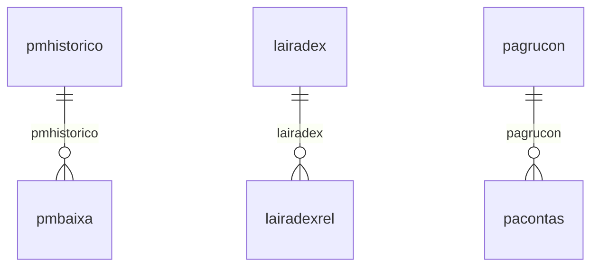

# Modelo — Contábil - nucleo (rascunho em lote)

> Gerado por `src/model/gerar_docs_modelo.py` a partir de `src/model/modulos/contabil_nucleo.yaml`, do catálogo e do perfil de colunas. **Não edite à mão.**

44 entidades. A coluna *Preench.* é o % de linhas com valor útil (nem nulo, nem em branco, nem zero, nem 1900-01-01; para colunas de código o zero conta como valor).

## Diagrama

## Entidades

| Entidade | Tabela | Linhas | Volume | Filtro obrigatório |
|---|---|---|---|---|
| [pmcalculo](#pmcalculo) | `PMCALCULO` | 142.997 | medio | empresa |
| [pmparametro](#pmparametro) | `PMPARAMETRO` | 817 | pequeno | empresa |
| [pmbaixa](#pmbaixa) | `PMBAIXA` | 240 | pequeno | empresa |
| [pmhistorico](#pmhistorico) | `PMHISTORICO` | 6 | pequeno | empresa |
| [pmconversao](#pmconversao) | `PMCONVERSAO` | 1 | pequeno | — |
| [ctlanctodmpl](#ctlanctodmpl) | `ctlanctodmpl` | 83.530 | medio | empresa |
| [ctplanocontas](#ctplanocontas) | `CTPLANOCONTAS` | 80.098 | medio | empresa |
| [ctgruposdva](#ctgruposdva) | `ctgruposdva` | 47.624 | medio | empresa |
| [ctbaklanctolote](#ctbaklanctolote) | `CTBAKLANCTOLOTE` | 39.403 | medio | empresa |
| [ctgruposdmpl](#ctgruposdmpl) | `ctgruposdmpl` | 23.905 | medio | empresa |
| [ctgruposdra](#ctgruposdra) | `CTGRUPOSDRA` | 21.168 | medio | empresa |
| [ctgruposdsp](#ctgruposdsp) | `CTGRUPOSDSP` | 21.120 | medio | empresa |
| [cttipolancto](#cttipolancto) | `cttipolancto` | 17.351 | medio | empresa |
| [ctcrateio](#ctcrateio) | `ctcrateio` | 6.049 | pequeno | empresa |
| [ctlanctodfc](#ctlanctodfc) | `CTLANCTODFC` | 5.878 | pequeno | empresa |
| [ctzeramento](#ctzeramento) | `ctzeramento` | 5.527 | pequeno | empresa |
| [ctbaklanctodmpl](#ctbaklanctodmpl) | `CTBAKLANCTODMPL` | 3.622 | pequeno | empresa |
| [ctcontacaixa](#ctcontacaixa) | `ctcontacaixa` | 2.651 | pequeno | empresa |
| [ctbalancosocial](#ctbalancosocial) | `ctbalancosocial` | 108 | pequeno | empresa |
| [ctbaklanctodfc](#ctbaklanctodfc) | `CTBAKLANCTODFC` | 57 | pequeno | empresa |
| [ctcoeficiente](#ctcoeficiente) | `CTCOEFICIENTE` | 27 | pequeno | — |
| [ctresumobal](#ctresumobal) | `ctresumobal` | 20 | pequeno | empresa |
| [ctabreviaturas](#ctabreviaturas) | `ctabreviaturas` | 2 | pequeno | empresa |
| [ctidiomas](#ctidiomas) | `CTIDIOMAS` | 1 | pequeno | — |
| [lairadex](#lairadex) | `lairadex` | 27.360 | medio | empresa |
| [lacsadex](#lacsadex) | `lacsadex` | 22.800 | medio | empresa |
| [lairgruposadex](#lairgruposadex) | `lairgruposadex` | 25 | pequeno | — |
| [lairparteb](#lairparteb) | `lairparteb` | 5 | pequeno | — |
| [lairincentivo](#lairincentivo) | `lairincentivo` | 5 | pequeno | — |
| [laparmto](#laparmto) | `laparmto` | 2 | pequeno | empresa |
| [lairadexrel](#lairadexrel) | `lairadexrel` | 1 | pequeno | empresa |
| [lacsaliquotas](#lacsaliquotas) | `lacsaliquotas` | 1 | pequeno | empresa |
| [lradicao](#lradicao) | `LRADICAO` | 166 | pequeno | empresa |
| [lrparametro](#lrparametro) | `LRPARAMETRO` | 84 | pequeno | empresa |
| [lrexclusao](#lrexclusao) | `LREXCLUSAO` | 29 | pequeno | empresa |
| [lrganho](#lrganho) | `LRGANHO` | 3 | pequeno | empresa |
| [lrconversao](#lrconversao) | `LRCONVERSAO` | 1 | pequeno | — |
| [pacalmes](#pacalmes) | `pacalmes` | 24 | pequeno | empresa |
| [pacontas](#pacontas) | `pacontas` | 4 | pequeno | empresa |
| [pabasicm](#pabasicm) | `pabasicm` | 4 | pequeno | empresa |
| [padadfat](#padadfat) | `padadfat` | 4 | pequeno | empresa |
| [pacfghistorico](#pacfghistorico) | `pacfghistorico` | 4 | pequeno | empresa |
| [pagrucon](#pagrucon) | `pagrucon` | 1 | pequeno | empresa |
| [paparmto](#paparmto) | `paparmto` | 1 | pequeno | empresa |

## pmcalculo

**Cálculo patrimonial** — tabela `PMCALCULO` (142.997 linhas)

Cálculo patrimonial. 142.997 linhas no catálogo; chave: CODI_EMP, I_CALCULO.

- **Chave:** `CODI_EMP, I_CALCULO`
- **Empresa:** `CODI_EMP`
- **Período:** `COMPETENCIA`
- **Ordem padrão:** `COMPETENCIA desc`, `I_CALCULO asc`

**Regras de negócio validadas:**

- Medido em 2026-10-18: 143.068 linhas, 247 empresa(s), COMPETENCIA de 2006-01-01 a 2026-09-01.
- Vínculo pmbem (PMBEM): 0 de 155 linhas sem registro relacionado (empresa 1001).

| Campo | Coluna | Tipo | Preench. | Domínio | Descrição (banco) |
|---|---|---|---|---|---|
| empresa | `codi_emp` | integer(4) |  |  | Empresa |
| codigo | `i_calculo` | integer(4) |  |  | Código |
| bem | `i_bem` | numeric(16) |  |  | Bem |
| competencia | `competencia` | date(4) |  |  | Competência |
| usuario_que_efetuou_o_calculo | `usuario` | varchar(128) |  |  | Usuário que efetuou o cálculo |

**Vínculos (LEFT JOIN, acrescentam colunas legíveis):**

- `pmbem` → `PMBEM` por `codi_emp` = `codi_emp` e `i_bem` = `i_bem`; colunas: `pmbem_nome`

**Filtros:** `codigo` (eq/in), `competencia` (entre/gte/lte), `usuario_que_efetuou_o_calculo` (contem/prefixo)

## pmparametro

**Parâmetros - Patrimônio** — tabela `PMPARAMETRO` (817 linhas)

Parâmetros - Patrimônio. 817 linhas no catálogo; chave: CODI_EMP.

- **Chave:** `CODI_EMP`
- **Empresa:** `CODI_EMP`
- **Período:** `FECHAMENTO_DATA`
- **Ordem padrão:** `FECHAMENTO_DATA desc`

**Regras de negócio validadas:**

- Medido em 2026-10-18: 817 linhas, 817 empresa(s), FECHAMENTO_DATA de 2017-01-01 a 2026-02-01.
- tipo_de_lancamento_contabil_baixa_b_ao_e: todos os valores reais estão no comentário do banco (B=515, I=302).
- tipo_de_lancamento_contabil_credito_pis: valores reais fora do comentário do banco (C=4); tratar o domínio como hipótese.
- tipo_de_lancamento_contabil_aquisicao_de: todos os valores reais estão no comentário do banco (I=798, B=19).
- tipo_de_lancamento_contabil_transferenci: todos os valores reais estão no comentário do banco (I=817).
- Vínculo geempre (geempre): 0 de 1 linhas sem registro relacionado (empresa 10102).

| Campo | Coluna | Tipo | Preench. | Domínio | Descrição (banco) |
|---|---|---|---|---|---|
| empresa | `codi_emp` | integer(4) |  |  | Empresa |
| periodo_inicial | `periodo_inicial` | date(4) |  |  | Período inicial |
| periodo_atual | `periodo_final` | date(4) |  |  | Período atual |
| mascara_do_codigo_do_bem | `mascara_codigo_bem` | char(16) |  |  | Máscara do código do bem |
| nao_atualizar_valores_para_bens_cadastra | `nao_atualizar_valor_data_anterior` | char(1) |  |  | Não atualizar valores para bens cadastrados com data anterior (S/N) |
| deduzir_valor_do_icms_da_valor_original | `deduzir_valor_icms_valor_original` | char(1) |  |  | Deduzir valor do ICMS da valor original (S/N) |
| deduzir_valor_do_pis_e_cofins_da_valor_o | `deduzir_valor_piscofins_valor_original` | char(1) |  |  | Deduzir valor do PIS e COFINS da valor original (S/N) |
| calcular_a_depreciacao_considerando_todo | `calcular_depreciacao_todos_dias` | char(1) |  |  | Calcular a depreciação considerando todos os dias do mês na competência que os bens foram adquiridos ou baixados (S/N) |
| calcular_a_depreciacao_societaria_s_n | `calcular_depreciacao_societaria` | char(1) |  |  | Calcular a depreciação societária (S/N) |
| competencia_inicial_do_calculo_societari | `calcular_depreciacao_societaria_inicio` | date(4) |  |  | Competência inicial do cálculo societário |
| gerar_lancamentos_contabeis_s_n | `gerar_lancamento_contabil` | char(1) |  |  | Gerar lançamentos contábeis (S/N) |
| empresa_onde_serao_gerados_os_lancamento | `empresa_lancamento_contabil` | integer(4) |  |  | Empresa onde serão gerados os lançamentos contábeis |
| gerar_lancamentos_contabeis_do_valor_de | `gerar_lancamento_contabil_aquisicao` | char(1) |  |  | Gerar lançamentos contábeis do valor de aquisição de novos bens (S/N) |
| gerar_lancamentos_contabeis_dos_valores | `gerar_lancamento_contabil_baixa` | char(1) |  |  | Gerar lançamentos contábeis dos valores de baixas (S/N) |
| gerar_lancamento_contabil_transferencia | `gerar_lancamento_contabil_transferencia_conta` | char(1) |  |  | Gerar lançamentos contábeis dos valores de transferência de conta patrimonial (S/N) |
| gerar_lancamentos_a_partir_de_contas_pat | `gerar_lancamento_contabil_conta_ccu` | char(1) |  |  | Gerar lançamentos a partir de contas patrimoniais e centros de custos (S/N) |
| gerar_lancamentos_por_centros_de_custos | `gerar_lancamento_contabil_ccu_bem` | char(1) |  |  | Gerar lançamentos por centros de custos conforme informado no cadastro do bem (S/N) |
| tipo_de_lancamento_contabil_baixa_b_ao_e | `tipo_lancamento_baixa` | char(1) |  | pmparametro_tipo_de_lancamento_contabil_ | Tipo de lançamento contábil - Baixa (B=Ao efetuar a baixa/ I=Na integração contábil) |
| tipo_de_lancamento_contabil_credito_pis | `tipo_lancamento_credito_piscofins` | char(1) |  | pmparametro_tipo_de_lancamento_contabil_ | Tipo de lançamento contábil - Crédito PIS/COFINS (B=Por bem/ C=Por competência) |
| tipo_de_lancamento_contabil_aquisicao_de | `tipo_lancamento_aquisicao` | char(1) |  | pmparametro_tipo_de_lancamento_contabil_ | Tipo de lançamento contábil - Aquisição de novos bens (B=Ao cadastrar o bem/ I=Na integração contábil) |
| tipo_de_lancamento_contabil_transferenci | `tipo_lancamento_transferencia_conta` | char(1) |  | pmparametro_tipo_de_lancamento_contabil_ | Tipo de lançamento contábil - Transferência de conta patrimonial (B=Ao transferir o bem/ I=Na integração contábil) |
| conta_contabil_pis_a_recuperar | `conta_pis_recuperar` | integer(4) |  |  | Conta contábil - PIS a recuperar |
| historico_contabil_pis_a_recuperar | `historico_pis_recuperar` | integer(4) |  |  | Histórico contábil - PIS a recuperar |
| conta_contabil_cofins_a_recuperar | `conta_cofins_recuperar` | integer(4) |  |  | Conta contábil - COFINS a recuperar |
| historico_contabil_cofins_a_recuperar | `historico_cofins_recuperar` | integer(4) |  |  | Histórico contábil - COFINS a recuperar |
| data_do_fechamento | `fechamento_data` | date(4) |  |  | Data do fechamento |
| deduzir_a_depreciacao_fiscal_acumulada_d | `deduzir_dep_fiscal_dep_societaria_sem_avaliacao` | char(1) |  |  | Deduzir a depreciação fiscal acumulada da base de cálculo da depreciação societária para bens sem avaliação (S/N) |
| gerar_lancamentos_em_subcontas_conforme | `gerar_lancamento_contabil_subconta_diferenca_depreciacao_fiscal_societaria` | char(1) |  |  | Gerar lançamentos em subcontas conforme Lei nº 12.973/2014 quando houver diferença entre depreciação fiscal e societária |
| gerar_o_sped_contabil_razao_auxiliar 🔒 | `gerar_sped_contabil_razao_auxiliar` | char(1) |  |  | Gerar o SPED Contábil - Razão Auxiliar |
| gerar_lancamento_contabil_aquisicao_valo | `gerar_lancamento_contabil_aquisicao_valor` | char(1) |  |  | Gerar lançamentos contábeis do valor de aquisição de novos bens (Valor Aquisição/Valor Original) |
| possui_sociedade_em_conta_de_participaca | `sociedade_em_conta_participacao_par` | char(1) |  |  | Possui Sociedade em Conta de Participação - SCP |
| possui_bens_mantidos_para_venda | `possui_bens_mantidos_para_venda` | char(1) |  |  | Possui bens mantidos para venda |
| gerar_lanaamentos_contabeis_dos_valores | `gerar_lancamentos_valores_bens_mantidos_para_venda` | char(1) |  |  | Gerar lançamentos contábeis dos valores dos bens mantidos para venda |
| b_por_bem_i_na_integraaao_contabil | `tipo_lancamento_bem_mantido_para_venda` | char(1) |  |  | B - POR BEM, I - Na integração contábil |

**Vínculos (LEFT JOIN, acrescentam colunas legíveis):**

- `geempre` → `geempre` por `codi_emp` = `codi_emp`; colunas: `geempre_nome`

**Filtros:** `periodo_inicial` (entre/gte/lte), `periodo_atual` (entre/gte/lte), `competencia_inicial_do_calculo_societari` (entre/gte/lte), `data_do_fechamento` (entre/gte/lte), `mascara_do_codigo_do_bem` (eq/in), `nao_atualizar_valores_para_bens_cadastra` (eq/in), `deduzir_valor_do_icms_da_valor_original` (eq/in), `deduzir_valor_do_pis_e_cofins_da_valor_o` (eq/in), `calcular_a_depreciacao_considerando_todo` (eq/in), `calcular_a_depreciacao_societaria_s_n` (eq/in), `gerar_lancamentos_contabeis_s_n` (eq/in), `gerar_lancamentos_contabeis_do_valor_de` (eq/in), `gerar_lancamentos_contabeis_dos_valores` (eq/in), `gerar_lancamento_contabil_transferencia` (eq/in)

## pmbaixa

**Baixas - Parcial e total** — tabela `PMBAIXA` (240 linhas)

Baixas - Parcial e total. 240 linhas no catálogo; chave: CODI_EMP, I_BAIXA.

- **Chave:** `CODI_EMP, I_BAIXA`
- **Empresa:** `CODI_EMP`
- **Período:** `DATA_BAIXA`
- **Ordem padrão:** `DATA_BAIXA desc`, `I_BAIXA asc`

**Regras de negócio validadas:**

- Medido em 2026-10-18: 240 linhas, 48 empresa(s), DATA_BAIXA de 2018-01-01 a 2026-07-30.
- baixa_p_parcial_t_total: todos os valores reais estão no comentário do banco (T=230, P=10).
- tipo_da_baixa_ot_ot_outras_saidas_imobil: todos os valores reais estão no comentário do banco (OT=208, AT=31, PE=1).
- documento_fiscal_emitente_t_terceiros_p: todos os valores reais estão no comentário do banco (nulo=236, P=4).
- baixa_por_v_valor_q_quantidade: todos os valores reais estão no comentário do banco (V=236, Q=4).
- Vínculo efclientes (efclientes): 1 de 1 linhas sem registro relacionado (empresa 728).
- Vínculo efespecies (efespecies): 0 de 1 linhas sem registro relacionado (empresa 728).
- Vínculo efprodutos (efprodutos): 0 de 1 linhas sem registro relacionado (empresa 728).
- Vínculo pmbem (PMBEM): 0 de 1 linhas sem registro relacionado (empresa 728).
- Vínculo pmhistorico (PMHISTORICO): 1 de 1 linhas sem registro relacionado (empresa 728).

| Campo | Coluna | Tipo | Preench. | Domínio | Descrição (banco) |
|---|---|---|---|---|---|
| empresa | `codi_emp` | integer(4) |  |  | Empresa |
| codigo | `i_baixa` | integer(4) |  |  | Código |
| bem | `i_bem` | numeric(16) |  |  | Bem |
| data_da_baixa | `data_baixa` | date(4) |  |  | Data da baixa |
| baixa_p_parcial_t_total | `baixa` | char(1) |  | pmbaixa_baixa_p_parcial_t_total | Baixa (P=Parcial/ T=Total) |
| valor_da_venda | `valor_venda` | numeric(13) |  |  | Valor da venda |
| valor_da_baixa_fiscal | `valor_baixa` | numeric(13) |  |  | Valor da baixa fiscal |
| valor_da_baixa_icms | `valor_baixa_icms` | numeric(13) |  |  | Valor da baixa ICMS |
| saldo_fiscal_atual | `valor_saldo_atual` | numeric(13) |  |  | Saldo Fiscal atual |
| icms_a_ser_creditado | `valor_icms_creditado` | numeric(13) |  |  | ICMS a ser creditado |
| depreciacao_acumulada_fiscal_posicao_do | `valor_depreciacao_fiscal_acumulada_bem` | numeric(13) |  |  | Depreciação acumulada fiscal - Posição do bem |
| depreciacao_acumulada_fiscal_dados_da_ba | `valor_depreciacao_fiscal_acumulada_baixa` | numeric(13) |  |  | Depreciação acumulada fiscal - Dados da baixa |
| depreciacao_acumulada_societaria_posicao | `valor_depreciacao_societaria_acumulada_bem` | numeric(13) |  |  | Depreciação acumulada societária - Posição do bem |
| depreciacao_acumulada_societaria_dados_d | `valor_depreciacao_societaria_acumulada_baixa` | numeric(13) |  |  | Depreciação acumulada societária - Dados da baixa |
| ganho_perda_capital | `valor_ganho_perda_capital` | numeric(13) |  |  | Ganho/perda capital |
| tipo_da_baixa_ot_ot_outras_saidas_imobil | `tipo_baixa` | char(2) |  | pmbaixa_tipo_da_baixa_ot_ot_outras_ | Tipo da baixa (OT=OT - Outras Saídas Imobilizado/ AT=AT - Alienação ou Transferência/ PE=PE - Perecimento Extravio ou Deterioração) |
| codigo_do_historico | `i_historico` | integer(4) |  |  | Código do histórico |
| historico | `historico` | varchar(512) |  |  | Histórico |
| conta_contabil_da_baixa | `conta_contabil` | integer(4) |  |  | Conta contábil da baixa |
| documento_fiscal_numero | `fiscal_numero` | numeric(15) |  |  | Documento fiscal - Número |
| documento_fiscal_serie | `fiscal_serie` | char(7) |  |  | Documento fiscal - Série |
| documento_fiscal_data_de_emissao | `fiscal_data_emissao` | date(4) |  |  | Documento fiscal - Data de emissão |
| documento_fiscal_especie | `fiscal_modelo` | integer(4) |  |  | Documento fiscal - Espécie |
| documento_fiscal_chave_nfe | `fiscal_chave_nfe` | char(44) |  |  | Documento fiscal - Chave NFe |
| documento_fiscal_cliente | `fiscal_codi_cli` | integer(4) |  |  | Documento fiscal - Cliente |
| documento_fiscal_emitente_t_terceiros_p | `fiscal_emitente` | char(1) |  | pmbaixa_documento_fiscal_emitente_t | Documento fiscal - Emitente (T=Terceiros/ P=Próprio) |
| documento_fiscal_produto | `fiscal_codi_pdi` | char(14) |  |  | Documento fiscal - Produto |
| documento_fiscal_sequencial_do_item | `fiscal_sequencial_item` | integer(4) |  |  | Documento fiscal - Sequencial do ítem |
| saldo_societario_atual | `valor_saldo_societario_atual` | numeric(13) |  |  | Saldo Societário atual |
| valor_original_avaliado | `valor_original_avaliado` | numeric(13) |  |  | Valor original/avaliado |
| valor_da_baixa_societaria | `valor_baixa_societario` | numeric(13) |  |  | Valor da baixa societária |
| baixa_por_v_valor_q_quantidade | `baixa_por` | char(1) |  | pmbaixa_baixa_por_v_valor_q_quantid | Baixa por(V=Valor/Q=Quantidade) |
| quantidade_atual | `quantidade_atual` | numeric(12) |  |  | Quantidade atual |
| quantidade_a_ser_baixada | `quantidade_baixa` | numeric(12) |  |  | Quantidade a ser baixada |
| valor_da_baixa_icms_creditado | `valor_baixa_icms_creditado` | numeric(12) |  |  | Valor da baixa ICMS creditado |
| valor_total_da_baixa_icms | `valor_baixa_icms_total` | numeric(12) |  |  | Valor total da baixa ICMS |
| total_do_credito_de_icms | `valor_total_credito_icms` | numeric(12) |  |  | Total do crédito de ICMS |
| bem_vinculado_a_avaliacao_do_valor_justo | `bem_vinculado_avaliacao_valor_justo` | char(1) |  |  | Bem vinculado à avaliação do valor justo |
| baixa_agrupada_s_n | `baixa_agrupada` | char(1) |  |  | Baixa agrupada (S/N) |
| gerar_quantidade_de_documento_fiscal | `fiscal_quantidade` | numeric(13) |  |  | Gerar quantidade de documento fiscal |

**Vínculos (LEFT JOIN, acrescentam colunas legíveis):**

- `efclientes` → `efclientes` por `codi_emp` = `codi_emp` e `fiscal_codi_cli` = `codi_cli`; colunas: `efclientes_nome`
- `efespecies` → `efespecies` por `fiscal_modelo` = `codi_esp`; colunas: `efespecies_nome`
- `efprodutos` → `efprodutos` por `fiscal_codi_pdi` = `codi_pdi` e `codi_emp` = `codi_emp`; colunas: `efprodutos_nome`
- `pmbem` → `PMBEM` por `codi_emp` = `codi_emp` e `i_bem` = `i_bem`; colunas: `pmbem_nome`
- `pmhistorico` → `PMHISTORICO` por `codi_emp` = `codi_emp` e `i_historico` = `i_historico`; colunas: `pmhistorico_nome`

**Filtros:** `codigo` (eq/in), `data_da_baixa` (entre/gte/lte), `documento_fiscal_data_de_emissao` (entre/gte/lte), `baixa_p_parcial_t_total` (eq/in), `tipo_da_baixa_ot_ot_outras_saidas_imobil` (eq/in), `codigo_do_historico` (eq/in), `historico` (contem/prefixo), `documento_fiscal_serie` (eq/in), `documento_fiscal_chave_nfe` (contem/prefixo), `documento_fiscal_cliente` (eq/in), `documento_fiscal_emitente_t_terceiros_p` (eq/in), `documento_fiscal_produto` (eq/in), `baixa_por_v_valor_q_quantidade` (eq/in), `bem_vinculado_a_avaliacao_do_valor_justo` (eq/in)

## pmhistorico

**Históricos** — tabela `PMHISTORICO` (6 linhas)

Históricos. 6 linhas no catálogo; chave: CODI_EMP, I_HISTORICO.

- **Chave:** `CODI_EMP, I_HISTORICO`
- **Empresa:** `CODI_EMP`
- **Período:** `—`
- **Ordem padrão:** `I_HISTORICO asc`

**Regras de negócio validadas:**

- Medido em 2026-10-18: 6 linhas, 4 empresa(s).
- tipo_1_geral_2_baixa_total_3_baixa_parci: todos os valores reais estão no comentário do banco (1=3, 2=2, 3=1).
- Vínculo geempre (geempre): 0 de 1 linhas sem registro relacionado (empresa 613).

| Campo | Coluna | Tipo | Preench. | Domínio | Descrição (banco) |
|---|---|---|---|---|---|
| empresa | `codi_emp` | integer(4) |  |  | Empresa |
| codigo | `i_historico` | integer(4) |  |  | Código |
| tipo_1_geral_2_baixa_total_3_baixa_parci | `tipo` | tinyint(1) |  | pmhistorico_tipo_1_geral_2_baixa_total_3_baixa_parc | Tipo (1=Geral/ 2=Baixa total/ 3=Baixa parcial/ 4=Transferências de contas patrimoniais/ 5=Transferências de centros de custos/ 6=Aquisicao Bem / 7=Transferências de bens entre matriz/filiais) |
| descricao | `historico` | varchar(512) |  |  | Descrição |
| origem_do_registro_0_sistema_1_imp_tabel | `origem_reg` | tinyint(1) |  |  | Origem do registro 0 - Sistema, 1 - Imp. Tabelas, 2 - Imp. Layout, 3- Imp. Tabelas Concorrentes |

**Vínculos (LEFT JOIN, acrescentam colunas legíveis):**

- `geempre` → `geempre` por `codi_emp` = `codi_emp`; colunas: `geempre_nome`

**Filtros:** `codigo` (eq/in), `tipo_1_geral_2_baixa_total_3_baixa_parci` (eq/in), `descricao` (contem/prefixo)

## pmconversao

**Conversão do Patrimônio** — tabela `PMCONVERSAO` (1 linhas)

Conversão do Patrimônio. 1 linhas no catálogo; chave: STATUS, USUARIO, CONNECTION_ID.

- **Chave:** `STATUS, USUARIO, CONNECTION_ID`
- **Empresa:** `não se aplica (tabela global)`
- **Período:** `—`
- **Ordem padrão:** `STATUS asc`

**Regras de negócio validadas:**

- Medido em 2026-10-18: 1 linhas.
- Colunas expostas nulas em 100% das linhas (1): identificador_da_conexao.
- indica_como_esta_o_processo_de_conversao: todos os valores reais estão no comentário do banco (2=1).

| Campo | Coluna | Tipo | Preench. | Domínio | Descrição (banco) |
|---|---|---|---|---|---|
| indica_como_esta_o_processo_de_conversao | `status` | tinyint(1) |  | pmconversao_indica_como_esta_o_process | Indica como esta o processo de conversão (0=Não definido/ 1=Dados convertidos/ 2=Atualizou sem converter/ 3=Convertendo) |
| usuario | `usuario` | varchar(128) |  |  | Usuário |
| identificador_da_conexao | `connection_id` | integer(4) |  |  | Identificador da conexao |

**Filtros:** `indica_como_esta_o_processo_de_conversao` (eq/in), `usuario` (contem/prefixo)

## ctlanctodmpl

**Lancamento DMPL** — tabela `ctlanctodmpl` (83.530 linhas)

Lancamento DMPL. 83.530 linhas no catálogo; chave: codi_emp, nume_lan, i_tipolancto.

- **Chave:** `codi_emp, nume_lan, i_tipolancto`
- **Empresa:** `codi_emp`
- **Período:** `—`
- **Ordem padrão:** `nume_lan asc`, `i_tipolancto asc`

**Regras de negócio validadas:**

- Medido em 2026-10-18: 83.547 linhas, 997 empresa(s).

| Campo | Coluna | Tipo | Preench. | Domínio | Descrição (banco) |
|---|---|---|---|---|---|
| empresa | `codi_emp` | integer(4) |  |  | Empresa |
| numero_lancamento | `nume_lan` | integer(4) |  |  | Numero lancamento |
| codigo_tipo_lancamento | `i_tipolancto` | integer(4) |  |  | Codigo tipo lancamento |
| valor | `valor` | numeric(13) |  |  | Valor |

**Filtros:** `numero_lancamento` (eq/in), `codigo_tipo_lancamento` (eq/in)

## ctplanocontas

**Contas Contabeis Auxiliar - Cadastro** — tabela `CTPLANOCONTAS` (80.098 linhas)

Contas Contabeis Auxiliar - Cadastro. 80.098 linhas no catálogo; chave: CODI_EMP, CODI_CTA, I_PLANOCONTAS.

- **Chave:** `CODI_EMP, CODI_CTA, I_PLANOCONTAS`
- **Empresa:** `CODI_EMP`
- **Período:** `DATA_CTA`
- **Ordem padrão:** `DATA_CTA desc`, `CODI_CTA asc`, `I_PLANOCONTAS asc`

**Regras de negócio validadas:**

- Medido em 2026-10-18: 80.416 linhas, 36 empresa(s), DATA_CTA de 1999-01-01 a 2026-10-15.
- Colunas expostas nulas em 100% das linhas (4): grupo_dsp, grupo_dsp_ato_c_cooperado_n_nao_cooperad, grupo_ebitda, grupo_lcdpr.
- codigo_do_plano_de_contas_1_antigo_2_nov: todos os valores reais estão no comentário do banco (1=40.208, 2=40.208).
- tipo_a_analitico_s_sintetico: todos os valores reais estão no comentário do banco (A=65.146, S=15.270).
- situacao_a_ativa_i_inativa: todos os valores reais estão no comentário do banco (A=78.662, I=1.754).
- grupo_dsp_ato_c_cooperado_n_nao_cooperad: coluna sem nenhum valor preenchido; o domínio do comentário do banco não pôde ser verificado.
- Vínculo geempre (geempre): 0 de 1.038 linhas sem registro relacionado (empresa 10003).

| Campo | Coluna | Tipo | Preench. | Domínio | Descrição (banco) |
|---|---|---|---|---|---|
| empresa | `codi_emp` | integer(4) |  |  | Empresa |
| codigo | `codi_cta` | integer(4) |  |  | Codigo |
| codigo_do_plano_de_contas_1_antigo_2_nov | `i_planocontas` | integer(4) |  | ctplanocontas_codigo_do_plano | Codigo do plano de contas (1-Antigo/2-Novo) |
| descricao | `nome_cta` | char(60) |  |  | Descricao |
| classificacao | `clas_cta` | char(20) |  |  | Classificacao |
| tipo_a_analitico_s_sintetico | `tipo_cta` | char(1) |  | ctplanocontas_tipo_a_analitic | Tipo (A=Analitico/S=Sintetico) |
| grupo_dre | `grdre_cta` | integer(4) |  |  | Grupo DRE |
| grupo_dlpa | `dlpa_cta` | integer(4) |  |  | Grupo DLPA |
| grupo_doar | `doar_cta` | integer(4) |  |  | Grupo DOAR |
| origem_do_registro_0_sistema_1_imp_tabel | `origem_reg` | tinyint(1) |  |  | Origem do registro 0 - Sistema, 1 - Imp. Tabelas, 2 - Imp. Layout, 3- Imp. Tabelas Concorrentes, 4 - Iceberg |
| grupo_dmpl | `dmpl_cta` | integer(4) |  |  | Grupo DMPL |
| data_cadastro | `data_cta` | date(4) |  |  | Data cadastro |
| situacao_a_ativa_i_inativa | `situacao_cta` | char(1) |  | ctplanocontas_situacao_a_ativ | Situacao (A-Ativa/I-Inativa) |
| data_da_inativacao | `datainativa_cta` | date(4) |  |  | Data da inativacao |
| grupo_dra | `dra_cta` | integer(4) |  |  | Grupo DRA |
| grupo_dsp | `dsp_cta` | integer(4) |  |  | Grupo DSP |
| grupo_dsp_ato_c_cooperado_n_nao_cooperad | `dsp_ato_cta` | char(1) |  | ctplanocontas_grupo_dsp_ato_c | Grupo DSP - Ato (C=Cooperado/ N=Não cooperado/ A=Ambos) |
| grupo_carne_leao | `carne_leao_cta` | tinyint(1) |  |  | Grupo Carnê Leão |
| grupo_ebitda | `ebitda_cta` | integer(4) |  |  | Grupo EBITDA |
| grupo_lcdpr | `lcdpr_cta` | integer(4) |  |  | Grupo LCDPR |

**Vínculos (LEFT JOIN, acrescentam colunas legíveis):**

- `geempre` → `geempre` por `codi_emp` = `codi_emp`; colunas: `geempre_nome`

**Filtros:** `codigo` (eq/in), `codigo_do_plano_de_contas_1_antigo_2_nov` (eq/in), `data_cadastro` (entre/gte/lte), `data_da_inativacao` (entre/gte/lte), `descricao` (contem/prefixo), `classificacao` (eq/in), `tipo_a_analitico_s_sintetico` (eq/in), `situacao_a_ativa_i_inativa` (eq/in), `grupo_dsp_ato_c_cooperado_n_nao_cooperad` (eq/in)

## ctgruposdva

**ESTRUTURA DO DVA** — tabela `ctgruposdva` (47.624 linhas)

ESTRUTURA DO DVA. 47.624 linhas no catálogo; chave: codi_emp, codigo.

- **Chave:** `codi_emp, codigo`
- **Empresa:** `codi_emp`
- **Período:** `—`
- **Ordem padrão:** `codigo asc`

**Regras de negócio validadas:**

- Medido em 2026-10-18: 47.624 linhas, 1.323 empresa(s).
- naturaza_s_sintetica_a_analitica_t_sub_t: todos os valores reais estão no comentário do banco (A=30.425, S=11.907, T=3.969, L=1.323).
- tipo_v_va_a_distribuir_d_distribuicao_va: todos os valores reais estão no comentário do banco (D=25.133, V=22.491).
- saldo_d_total_debito_c_total_credito_p_s: todos os valores reais estão no comentário do banco (P=35.717, nulo=11.907).
- Vínculo geempre (geempre): 0 de 36 linhas sem registro relacionado (empresa 1145).

| Campo | Coluna | Tipo | Preench. | Domínio | Descrição (banco) |
|---|---|---|---|---|---|
| empresa | `codi_emp` | integer(4) |  |  | EMPRESA |
| codigo | `codigo` | integer(4) |  |  | CODIGO |
| classificacao | `classificacao` | char(20) |  |  | CLASSIFICACAO |
| descricao | `descricao` | varchar(100) |  |  | DESCRICAO |
| naturaza_s_sintetica_a_analitica_t_sub_t | `natureza` | char(1) |  | ctgruposdva_naturaza_s_sintetica_a_analitica_ | NATURAZA (S=SINTETICA/A=ANALITICA/T=SUB-TOTAL/L=LUCRO-PREJUIZO) |
| tipo_v_va_a_distribuir_d_distribuicao_va | `tipo` | char(1) |  | ctgruposdva_tipo_v_va_a_distribuir_d_distribu | TIPO (V=VA A DISTRIBUIR/D=DISTRIBUICAO VA) |
| contas | `contas` | varchar(800) |  |  | CONTAS |
| saldo_d_total_debito_c_total_credito_p_s | `saldo` | char(1) |  | ctgruposdva_saldo_d_total_debito_c_total_cred | Saldo (D=Total Débito/ C=Total Crédito/ P=Saldo Período/ E=Saldo Exercício) |

**Vínculos (LEFT JOIN, acrescentam colunas legíveis):**

- `geempre` → `geempre` por `codi_emp` = `codi_emp`; colunas: `geempre_nome`

**Filtros:** `codigo` (eq/in), `classificacao` (eq/in), `descricao` (contem/prefixo), `naturaza_s_sintetica_a_analitica_t_sub_t` (eq/in), `tipo_v_va_a_distribuir_d_distribuicao_va` (eq/in), `contas` (contem/prefixo), `saldo_d_total_debito_c_total_credito_p_s` (eq/in)

## ctbaklanctolote

**Lançamento em lote eliminados** — tabela `CTBAKLANCTOLOTE` (39.403 linhas)

Lançamento em lote eliminados. 39.403 linhas no catálogo; chave: CODI_EMP, CODI_LOTE.

- **Chave:** `CODI_EMP, CODI_LOTE`
- **Empresa:** `CODI_EMP`
- **Período:** `—`
- **Ordem padrão:** `CODI_LOTE asc`

**Regras de negócio validadas:**

- Medido em 2026-10-18: 39.405 linhas, 688 empresa(s).
- Colunas expostas nulas em 100% das linhas (1): lancamento_padrao.
- tipo_d_um_debito_para_varios_creditos_c: todos os valores reais estão no comentário do banco (X=31.612, V=7.749, C=44).

| Campo | Coluna | Tipo | Preench. | Domínio | Descrição (banco) |
|---|---|---|---|---|---|
| empresa | `codi_emp` | integer(4) |  |  | Empresa |
| codigo | `codi_lote` | integer(4) |  |  | Codigo |
| tipo_d_um_debito_para_varios_creditos_c | `tipo` | char(1) |  | ctbaklanctolote_tipo_d_um_debito_par | Tipo (D=Um debito para varios creditos/C=Um credito para varios debitos/X=Um debito para um credito/V=Varios debitos para varios creditos) |
| lancamento_padrao | `codi_pad` | integer(4) |  |  | Lancamento padrao |

**Filtros:** `codigo` (eq/in), `tipo_d_um_debito_para_varios_creditos_c` (eq/in), `lancamento_padrao` (eq/in)

## ctgruposdmpl

**Estrutura do DMPL** — tabela `ctgruposdmpl` (23.905 linhas)

Estrutura do DMPL. 23.905 linhas no catálogo; chave: codi_emp, i_grupo.

- **Chave:** `codi_emp, i_grupo`
- **Empresa:** `codi_emp`
- **Período:** `—`
- **Ordem padrão:** `i_grupo asc`

**Regras de negócio validadas:**

- Medido em 2026-10-18: 23.905 linhas, 1.324 empresa(s).
- tipo_g_grupo_s_subgrupo: todos os valores reais estão no comentário do banco (S=17.229, G=6.676).
- Vínculo geempre (geempre): 0 de 18 linhas sem registro relacionado (empresa 892).

| Campo | Coluna | Tipo | Preench. | Domínio | Descrição (banco) |
|---|---|---|---|---|---|
| empresa | `codi_emp` | integer(4) |  |  | Empresa |
| codigo_grupo | `i_grupo` | integer(4) |  |  | Codigo grupo |
| sequencial | `sequencial` | integer(4) |  |  | Sequencial |
| descricao | `descricao` | char(30) |  |  | Descricao |
| tipo_g_grupo_s_subgrupo | `tipo` | char(1) |  | ctgruposdmpl_tipo_g_grupo_s_subgrupo | Tipo (G=Grupo/S=SubGrupo) |
| possui_subgrupo_s_n | `possui_subgrupo` | char(1) |  |  | Possui subgrupo (S/N) |

**Vínculos (LEFT JOIN, acrescentam colunas legíveis):**

- `geempre` → `geempre` por `codi_emp` = `codi_emp`; colunas: `geempre_nome`

**Filtros:** `codigo_grupo` (eq/in), `descricao` (contem/prefixo), `tipo_g_grupo_s_subgrupo` (eq/in), `possui_subgrupo_s_n` (eq/in)

## ctgruposdra

**Estrutura DRA** — tabela `CTGRUPOSDRA` (21.168 linhas)

Estrutura DRA. 21.168 linhas no catálogo; chave: CODI_EMP, CODIGO.

- **Chave:** `CODI_EMP, CODIGO`
- **Empresa:** `CODI_EMP`
- **Período:** `—`
- **Ordem padrão:** `CODIGO asc`

**Regras de negócio validadas:**

- Medido em 2026-10-18: 21.168 linhas, 1.323 empresa(s).
- operacao_c_contas_t_total: todos os valores reais estão no comentário do banco (C=15.876, T=5.292).
- soma_c_acima_b_abaixo_g_geral: todos os valores reais estão no comentário do banco (nulo=15.876, B=5.292).
- tipo_t_saldo_total_d_total_debito_c_tota: todos os valores reais estão no comentário do banco (T=21.168).
- Vínculo geempre (geempre): 0 de 16 linhas sem registro relacionado (empresa 889).

| Campo | Coluna | Tipo | Preench. | Domínio | Descrição (banco) |
|---|---|---|---|---|---|
| empresa | `codi_emp` | integer(4) |  |  | Empresa |
| codigo | `codigo` | integer(4) |  |  | Codigo |
| sequencia_dos_grupos | `sequencia` | integer(4) |  |  | Sequencia dos grupos |
| descricao | `descricao` | varchar(100) |  |  | Descricao |
| operacao_c_contas_t_total | `operacao` | char(1) |  | ctgruposdra_operacao_c_contas_t_total | Operacao (C=Contas/ T=Total) |
| soma_c_acima_b_abaixo_g_geral | `soma` | char(1) |  | ctgruposdra_soma_c_acima_b_abaixo_g_geral | Soma (C=Acima/ B=Abaixo/ G=Geral) |
| grupos | `grupos` | integer(4) |  |  | Grupos |
| tipo_t_saldo_total_d_total_debito_c_tota | `tipo` | char(1) |  | ctgruposdra_tipo_t_saldo_total_d_total_debito_c_ | Tipo (T=Saldo total / D=Total débito / C=Total crédito) |

**Vínculos (LEFT JOIN, acrescentam colunas legíveis):**

- `geempre` → `geempre` por `codi_emp` = `codi_emp`; colunas: `geempre_nome`

**Filtros:** `codigo` (eq/in), `descricao` (contem/prefixo), `operacao_c_contas_t_total` (eq/in), `soma_c_acima_b_abaixo_g_geral` (eq/in), `tipo_t_saldo_total_d_total_debito_c_tota` (eq/in)

## ctgruposdsp

**Estrutura DSP** — tabela `CTGRUPOSDSP` (21.120 linhas)

Estrutura DSP. 21.120 linhas no catálogo; chave: CODI_EMP, CODIGO.

- **Chave:** `CODI_EMP, CODIGO`
- **Empresa:** `CODI_EMP`
- **Período:** `—`
- **Ordem padrão:** `CODIGO asc`

**Regras de negócio validadas:**

- Medido em 2026-10-18: 21.120 linhas, 1.320 empresa(s).
- operacao_c_contas_t_total_i_contas_inver: todos os valores reais estão no comentário do banco (C=14.520, T=6.600).
- configuracao_i_inicia_sub_total_f_fecha: todos os valores reais estão no comentário do banco (nulo=19.800, I=1.320).
- Vínculo geempre (geempre): 0 de 16 linhas sem registro relacionado (empresa 1145).

| Campo | Coluna | Tipo | Preench. | Domínio | Descrição (banco) |
|---|---|---|---|---|---|
| empresa | `codi_emp` | integer(4) |  |  | Empresa |
| codigo | `codigo` | integer(4) |  |  | Código |
| sequencia | `sequencia` | integer(4) |  |  | Sequencia |
| descricao | `descricao` | varchar(60) |  |  | Descrição |
| operacao_c_contas_t_total_i_contas_inver | `operacao` | char(1) |  | ctgruposdsp_operacao_c_contas_t_total_i_contas_i | OPERAÇÃO (C=CONTAS/ T=TOTAL / I=CONTAS - INVERTER NATUREZA DO SALDO) |
| configuracao_i_inicia_sub_total_f_fecha | `configuracao` | char(1) |  | ctgruposdsp_configuracao_i_inicia_sub_total_f_fe | Configuração (I=Inicia Sub Total/ F=Fecha Sub Total) |
| soma_grupos_abaixo_s_n | `soma_abaixo` | char(1) |  |  | Soma grupos abaixo (S/N) |
| soma_grupos_abaixo_quantidade | `soma_abaixo_quantidade` | integer(4) |  |  | Soma grupos abaixo - Quantidade |

**Vínculos (LEFT JOIN, acrescentam colunas legíveis):**

- `geempre` → `geempre` por `codi_emp` = `codi_emp`; colunas: `geempre_nome`

**Filtros:** `codigo` (eq/in), `descricao` (contem/prefixo), `operacao_c_contas_t_total_i_contas_inver` (eq/in), `configuracao_i_inicia_sub_total_f_fecha` (eq/in), `soma_grupos_abaixo_s_n` (eq/in)

## cttipolancto

**Tipo de lancamento - Cadastro** — tabela `cttipolancto` (17.351 linhas)

Tipo de lancamento - Cadastro. 17.351 linhas no catálogo; chave: codi_emp, i_tipolancto.

- **Chave:** `codi_emp, i_tipolancto`
- **Empresa:** `codi_emp`
- **Período:** `—`
- **Ordem padrão:** `i_tipolancto asc`

**Regras de negócio validadas:**

- Medido em 2026-10-18: 17.351 linhas, 1.324 empresa(s).
- Vínculo geempre (geempre): 0 de 13 linhas sem registro relacionado (empresa 1152).

| Campo | Coluna | Tipo | Preench. | Domínio | Descrição (banco) |
|---|---|---|---|---|---|
| empresa | `codi_emp` | integer(4) |  |  | Empresa |
| codigo_tipo_lancamento | `i_tipolancto` | integer(4) |  |  | Codigo tipo lancamento |
| descricao | `descricao` | char(40) |  |  | Descricao |
| origem_do_registro_0_sistema_1_imp_tabel | `origem_reg` | tinyint(1) |  |  | Origem do registro 0 - Sistema, 1 - Imp. Tabelas, 2 - Imp. Layout, 3- Imp. Tabelas Concorrentes |

**Vínculos (LEFT JOIN, acrescentam colunas legíveis):**

- `geempre` → `geempre` por `codi_emp` = `codi_emp`; colunas: `geempre_nome`

**Filtros:** `codigo_tipo_lancamento` (eq/in), `descricao` (contem/prefixo)

## ctcrateio

**Centro de Custos - Cadastro - Rateio** — tabela `ctcrateio` (6.049 linhas)

Centro de Custos - Cadastro - Rateio. 6.049 linhas no catálogo; chave: codi_emp, codi_ccu, codi_cta, fili_rat.

- **Chave:** `codi_emp, codi_ccu, codi_cta, fili_rat`
- **Empresa:** `codi_emp`
- **Período:** `—`
- **Ordem padrão:** `codi_ccu asc`, `codi_cta asc`

**Regras de negócio validadas:**

- Medido em 2026-10-18: 6.049 linhas, 3 empresa(s).
- Vínculo ctcontas (ctcontas): 0 de 396 linhas sem registro relacionado (empresa 641).
- Vínculo ctccusto (ctccusto): 0 de 396 linhas sem registro relacionado (empresa 641).

| Campo | Coluna | Tipo | Preench. | Domínio | Descrição (banco) |
|---|---|---|---|---|---|
| empresa | `codi_emp` | integer(4) |  |  | Empresa |
| centro_de_custo | `codi_ccu` | integer(4) |  |  | Centro de Custo |
| conta_contabil | `codi_cta` | integer(4) |  |  | Conta Contabil |
| filial | `fili_rat` | integer(4) |  |  | Filial |
| percentual | `perc_rat` | numeric(5) |  |  | Percentual |
| empresa_do_plano | `codi_emp_plano` | integer(4) |  |  | Empresa do plano |

**Vínculos (LEFT JOIN, acrescentam colunas legíveis):**

- `ctcontas` → `ctcontas` por `codi_emp_plano` = `codi_emp` e `codi_cta` = `codi_cta`; colunas: `ctcontas_nome`
- `ctccusto` → `ctccusto` por `codi_emp` = `codi_emp` e `codi_ccu` = `codi_ccu`; colunas: `ctccusto_nome`

**Filtros:** `centro_de_custo` (eq/in), `conta_contabil` (eq/in), `filial` (eq/in), `empresa_do_plano` (eq/in)

## ctlanctodfc

**Fluxo de caixa** — tabela `CTLANCTODFC` (5.878 linhas)

Fluxo de caixa. 5.878 linhas no catálogo; chave: CODI_EMP, CODI_LOTE, SEQUENCIAL.

- **Chave:** `CODI_EMP, CODI_LOTE, SEQUENCIAL`
- **Empresa:** `CODI_EMP`
- **Período:** `—`
- **Ordem padrão:** `CODI_LOTE asc`, `SEQUENCIAL asc`

**Regras de negócio validadas:**

- Medido em 2026-10-18: 5.879 linhas, 30 empresa(s).
- Vínculo ctgruposdfc_direto (CTGRUPOSDFC_DIRETO): 7 de 7 linhas sem registro relacionado (empresa 1529).
- Vínculo ctgruposdfc_indireto (CTGRUPOSDFC_INDIRETO): 0 de 7 linhas sem registro relacionado (empresa 1529).

| Campo | Coluna | Tipo | Preench. | Domínio | Descrição (banco) |
|---|---|---|---|---|---|
| empresa | `codi_emp` | integer(4) |  |  | Empresa |
| codigo_do_lote | `codi_lote` | integer(4) |  |  | Codigo do lote |
| sequencial | `sequencial` | integer(4) |  |  | Sequencial |
| codigo_direto | `codi_direto` | integer(4) |  |  | Codigo direto |
| codigo_indireto | `codi_indireto` | integer(4) |  |  | Codigo indireto |
| valor | `valor` | numeric(13) |  |  | Valor |
| filial | `filial` | integer(4) |  |  | Filial |

**Vínculos (LEFT JOIN, acrescentam colunas legíveis):**

- `ctgruposdfc_direto` → `CTGRUPOSDFC_DIRETO` por `codi_emp` = `codi_emp` e `codi_direto` = `codi_direto`; colunas: `ctgruposdfc_direto_nome`
- `ctgruposdfc_indireto` → `CTGRUPOSDFC_INDIRETO` por `codi_emp` = `codi_emp` e `codi_indireto` = `codi_indireto`; colunas: `ctgruposdfc_indireto_nome`

**Filtros:** `codigo_do_lote` (eq/in), `sequencial` (eq/in), `codigo_direto` (eq/in), `codigo_indireto` (eq/in)

## ctzeramento

**Contas para zeramento** — tabela `ctzeramento` (5.527 linhas)

Contas para zeramento. 5.527 linhas no catálogo; chave: codi_emp, codi_cta.

- **Chave:** `codi_emp, codi_cta`
- **Empresa:** `codi_emp`
- **Período:** `—`
- **Ordem padrão:** `codi_cta asc`

**Regras de negócio validadas:**

- Medido em 2026-10-18: 5.527 linhas, 1.385 empresa(s).
- Vínculo geempre (geempre): 0 de 2 linhas sem registro relacionado (empresa 1511).

| Campo | Coluna | Tipo | Preench. | Domínio | Descrição (banco) |
|---|---|---|---|---|---|
| empresa | `codi_emp` | integer(4) |  |  | Empresa |
| conta | `codi_cta` | integer(4) |  |  | Conta |
| classificacao | `clas_cta` | char(20) |  |  | Classificacao |

**Vínculos (LEFT JOIN, acrescentam colunas legíveis):**

- `geempre` → `geempre` por `codi_emp` = `codi_emp`; colunas: `geempre_nome`

**Filtros:** `conta` (eq/in), `classificacao` (eq/in)

## ctbaklanctodmpl

**Lancamento DMPL eliminados** — tabela `CTBAKLANCTODMPL` (3.622 linhas)

Lancamento DMPL eliminados. 3.622 linhas no catálogo; chave: CODI_EMP, NUME_LAN, I_TIPOLANCTO.

- **Chave:** `CODI_EMP, NUME_LAN, I_TIPOLANCTO`
- **Empresa:** `CODI_EMP`
- **Período:** `—`
- **Ordem padrão:** `NUME_LAN asc`, `I_TIPOLANCTO asc`

**Regras de negócio validadas:**

- Medido em 2026-10-18: 3.614 linhas, 382 empresa(s).

| Campo | Coluna | Tipo | Preench. | Domínio | Descrição (banco) |
|---|---|---|---|---|---|
| empresa | `codi_emp` | integer(4) |  |  | Empresa |
| numero_lancamento | `nume_lan` | integer(4) |  |  | Numero lancamento |
| codigo_tipo_lancamento | `i_tipolancto` | integer(4) |  |  | Codigo tipo lancamento |
| valor | `valor` | numeric(13) |  |  | Valor |

**Filtros:** `numero_lancamento` (eq/in), `codigo_tipo_lancamento` (eq/in)

## ctcontacaixa

**Parametros - Cadastro - Contas caixa** — tabela `ctcontacaixa` (2.651 linhas)

Parametros - Cadastro - Contas caixa. 2.651 linhas no catálogo; chave: codi_emp, codi_cta.

- **Chave:** `codi_emp, codi_cta`
- **Empresa:** `codi_emp`
- **Período:** `—`
- **Ordem padrão:** `codi_cta asc`

**Regras de negócio validadas:**

- Medido em 2026-10-18: 2.651 linhas, 1.356 empresa(s).
- Colunas expostas nulas em 100% das linhas (1): tipo_da_conta_1_conta_bancaria_2_dinheir.
- Vínculo geempre (geempre): 0 de 2 linhas sem registro relacionado (empresa 1653).

| Campo | Coluna | Tipo | Preench. | Domínio | Descrição (banco) |
|---|---|---|---|---|---|
| empresa | `codi_emp` | integer(4) |  |  | Empresa |
| conta | `codi_cta` | integer(4) |  |  | Conta |
| esta_selecionada_s_n | `sele_cta` | char(1) |  |  | Esta Selecionada(S/N) |
| tipo_da_conta_1_conta_bancaria_2_dinheir | `tipo_conta_caixa` | integer(4) |  |  | Tipo da conta[1=Conta bancária / 2=Dinheiro/Espécie / 3=Numerários em Trânsito / 4=Não gerar no LCDPR] |

**Vínculos (LEFT JOIN, acrescentam colunas legíveis):**

- `geempre` → `geempre` por `codi_emp` = `codi_emp`; colunas: `geempre_nome`

**Filtros:** `conta` (eq/in), `esta_selecionada_s_n` (eq/in), `tipo_da_conta_1_conta_bancaria_2_dinheir` (eq/in)

## ctbalancosocial

**Balanco Social - Estrutura** — tabela `ctbalancosocial` (108 linhas)

Balanco Social - Estrutura. 108 linhas no catálogo; chave: codi_emp, codi_soc.

- **Chave:** `codi_emp, codi_soc`
- **Empresa:** `codi_emp`
- **Período:** `—`
- **Ordem padrão:** `codi_soc asc`

**Regras de negócio validadas:**

- Medido em 2026-10-18: 108 linhas, 2 empresa(s).
- tipo_da_descricao_c_conta_v_variavel_i_i: todos os valores reais estão no comentário do banco (C=54, I=18, V=16, D=14, T=6).
- Vínculo geempre (geempre): 0 de 54 linhas sem registro relacionado (empresa 1076).

| Campo | Coluna | Tipo | Preench. | Domínio | Descrição (banco) |
|---|---|---|---|---|---|
| codi_emp | `codi_emp` | integer(4) |  |  | codi_emp |
| codigo_do_item | `codi_soc` | integer(4) |  |  | Codigo do item |
| sequencial | `sequ_soc` | integer(4) |  |  | Sequencial |
| descricao | `desc_soc` | varchar(120) |  |  | Descricao |
| tipo_da_descricao_c_conta_v_variavel_i_i | `tipo_soc` | char(1) |  | ctbalancosocial_tipo_da_descricao_c_conta | Tipo da descricao(C=Conta/V=Variavel/I=Informar/T=Total/D=Titulo) |
| codigo_das_contas | `ccta_soc` | varchar(1000) |  |  | Codigo das contas |
| base_para_percentual | `base_soc` | char(3) |  |  | Base para percentual |
| codigo_da_variavel | `vari_soc` | integer(4) |  |  | Codigo da variavel |
| indicador | `indi_soc` | tinyint(1) |  |  | Indicador |

**Vínculos (LEFT JOIN, acrescentam colunas legíveis):**

- `geempre` → `geempre` por `codi_emp` = `codi_emp`; colunas: `geempre_nome`

**Filtros:** `codigo_do_item` (eq/in), `descricao` (contem/prefixo), `tipo_da_descricao_c_conta_v_variavel_i_i` (eq/in), `codigo_das_contas` (contem/prefixo), `base_para_percentual` (eq/in)

## ctbaklanctodfc

**Fluxo de caixa eliminados** — tabela `CTBAKLANCTODFC` (57 linhas)

Fluxo de caixa eliminados. 57 linhas no catálogo; chave: CODI_EMP, CODI_LOTE, SEQUENCIAL.

- **Chave:** `CODI_EMP, CODI_LOTE, SEQUENCIAL`
- **Empresa:** `CODI_EMP`
- **Período:** `—`
- **Ordem padrão:** `CODI_LOTE asc`, `SEQUENCIAL asc`

**Regras de negócio validadas:**

- Medido em 2026-10-18: 57 linhas, 2 empresa(s).
- Colunas expostas nulas em 100% das linhas (1): codigo_indireto.

| Campo | Coluna | Tipo | Preench. | Domínio | Descrição (banco) |
|---|---|---|---|---|---|
| empresa | `codi_emp` | integer(4) |  |  | Empresa |
| codigo_do_lote | `codi_lote` | integer(4) |  |  | Codigo do lote |
| sequencial | `sequencial` | integer(4) |  |  | Sequencial |
| codigo_direto | `codi_direto` | integer(4) |  |  | Codigo direto |
| codigo_indireto | `codi_indireto` | integer(4) |  |  | Codigo indireto |
| valor | `valor` | numeric(13) |  |  | Valor |
| filial | `filial` | integer(4) |  |  | Filial |

**Filtros:** `codigo_do_lote` (eq/in), `sequencial` (eq/in), `codigo_direto` (eq/in), `codigo_indireto` (eq/in)

## ctcoeficiente

**Coeficientes de análises** — tabela `CTCOEFICIENTE` (27 linhas)

Coeficientes de análises. 27 linhas no catálogo; chave: I_COEFICIENTE.

- **Chave:** `I_COEFICIENTE`
- **Empresa:** `não se aplica (tabela global)`
- **Período:** `—`
- **Ordem padrão:** `I_COEFICIENTE asc`

**Regras de negócio validadas:**

- Medido em 2026-10-18: 27 linhas.

| Campo | Coluna | Tipo | Preench. | Domínio | Descrição (banco) |
|---|---|---|---|---|---|
| codigo | `i_coeficiente` | integer(4) |  |  | Código |
| descricao_do_grupo | `descricao_grupo` | varchar(100) |  |  | Descrição do grupo |
| descricao_do_coeficiente_de_analise | `descricao_coeficiente` | varchar(100) |  |  | Descrição do coeficiente de análise |
| ordem | `ordem` | integer(4) |  |  | Ordem |

**Filtros:** `codigo` (eq/in), `descricao_do_grupo` (contem/prefixo), `descricao_do_coeficiente_de_analise` (contem/prefixo)

## ctresumobal

**Resumo do Balancete** — tabela `ctresumobal` (20 linhas)

Resumo do Balancete. 20 linhas no catálogo; chave: codi_emp, ordem.

- **Chave:** `codi_emp, ordem`
- **Empresa:** `codi_emp`
- **Período:** `—`
- **Ordem padrão:** `ordem asc`

**Regras de negócio validadas:**

- Medido em 2026-10-18: 20 linhas, 6 empresa(s).
- Vínculo geempre (geempre): 0 de 4 linhas sem registro relacionado (empresa 9997).

| Campo | Coluna | Tipo | Preench. | Domínio | Descrição (banco) |
|---|---|---|---|---|---|
| empresa | `codi_emp` | integer(4) |  |  | Empresa |
| ordem | `ordem` | tinyint(1) |  |  | Ordem |
| classificacao | `clas_cta` | char(20) |  |  | Classificacao |
| natureza | `natureza` | char(1) |  |  | Natureza |
| resultado | `resultado` | char(1) |  |  | Resultado |

**Vínculos (LEFT JOIN, acrescentam colunas legíveis):**

- `geempre` → `geempre` por `codi_emp` = `codi_emp`; colunas: `geempre_nome`

**Filtros:** `ordem` (eq/in), `classificacao` (eq/in), `natureza` (eq/in), `resultado` (eq/in)

## ctabreviaturas

**Cadastro de Abreviaturas** — tabela `ctabreviaturas` (2 linhas)

Cadastro de Abreviaturas. 2 linhas no catálogo; chave: codi_emp, sequencial.

- **Chave:** `codi_emp, sequencial`
- **Empresa:** `codi_emp`
- **Período:** `—`
- **Ordem padrão:** `sequencial asc`

**Regras de negócio validadas:**

- Medido em 2026-10-18: 2 linhas, 1 empresa(s).
- Vínculo geempre (geempre): 0 de 2 linhas sem registro relacionado (empresa 430).

| Campo | Coluna | Tipo | Preench. | Domínio | Descrição (banco) |
|---|---|---|---|---|---|
| empresa | `codi_emp` | integer(4) |  |  | Empresa |
| sequencial | `sequencial` | integer(4) |  |  | Sequencial |
| abreviatura | `abreviatura` | char(20) |  |  | Abreviatura |
| descricao | `descricao` | char(200) |  |  | Descricao |

**Vínculos (LEFT JOIN, acrescentam colunas legíveis):**

- `geempre` → `geempre` por `codi_emp` = `codi_emp`; colunas: `geempre_nome`

**Filtros:** `sequencial` (eq/in), `abreviatura` (eq/in), `descricao` (contem/prefixo)

## ctidiomas

**Idiomas** — tabela `CTIDIOMAS` (1 linhas)

Idiomas. 1 linhas no catálogo; chave: I_IDIOMAS.

- **Chave:** `I_IDIOMAS`
- **Empresa:** `não se aplica (tabela global)`
- **Período:** `—`
- **Ordem padrão:** `I_IDIOMAS asc`

**Regras de negócio validadas:**

- Medido em 2026-10-18: 1 linhas.
- Colunas expostas nulas em 100% das linhas (8): demonstracao_do_resultado_do_exercicio, demonstracao_do_resultado_abrangente, total_guia_colunas, lucro_do_exercicio, prejuizo_do_exercicio, lucro_por_acao_quota, prejuizo_por_acao_quota, resultado_abrangente_total_do_exercicio.

| Campo | Coluna | Tipo | Preench. | Domínio | Descrição (banco) |
|---|---|---|---|---|---|
| codigo | `i_idiomas` | integer(4) |  |  | Codigo |
| nome | `nome` | varchar(80) |  |  | Nome |
| diario | `diario` | varchar(40) |  |  | Diario |
| razao 🔒 | `razao` | varchar(40) |  |  | Razao |
| balancete | `balancete` | varchar(40) |  |  | Balancete |
| balanco | `balanco` | varchar(40) |  |  | Balanco |
| plano_de_contas | `plano_contas` | varchar(40) |  |  | Plano de contas |
| empresa | `empresa` | varchar(40) |  |  | Empresa |
| cnpj 🔒 | `cnpj` | varchar(40) |  |  | CNPJ |
| cpf 🔒 | `cpf` | varchar(40) |  |  | CPF |
| cei | `cei` | varchar(40) |  |  | CEI |
| periodo | `periodo` | varchar(40) |  |  | Periodo |
| folha | `folha` | varchar(40) |  |  | Folha |
| pagina | `pagina` | varchar(40) |  |  | Pagina |
| consolidado | `consolidado` | varchar(40) |  |  | Consolidado |
| numero_do_livro | `numero_livro` | varchar(40) |  |  | Numero do livro |
| emissao | `emissao` | varchar(40) |  |  | Emissao |
| hora | `hora` | varchar(40) |  |  | Hora |
| inscricao_na_junta 🔒 | `inscricao_junta` | varchar(40) |  |  | Inscricao na junta |
| data_da_inscricao_na_junta 🔒 | `data_insc_junta` | varchar(40) |  |  | Data da inscricao na junta |
| balanco_encerrado_em | `balanco_encerrado` | varchar(40) |  |  | Balanco encerrado em |
| codigo_c | `codigo` | varchar(40) |  |  | Codigo |
| classificacao | `classificacao` | varchar(40) |  |  | Classificacao |
| descricao | `descricao` | varchar(40) |  |  | Descricao |
| saldo_atual | `saldo_atual` | varchar(40) |  |  | Saldo atual |
| saldo_anterior | `saldo_anterior` | varchar(40) |  |  | Saldo anterior |
| saldo_exercicio | `saldo_exercicio` | varchar(40) |  |  | Saldo exercicio |
| credito | `credito` | varchar(40) |  |  | Credito |
| debito | `debito` | varchar(40) |  |  | Debito |
| historico | `historico` | varchar(40) |  |  | Historico |
| conta_contra_partida | `conta_contra_part` | varchar(40) |  |  | Conta contra partida |
| numero_lancamento | `numero_lancto` | varchar(40) |  |  | Numero lancamento |
| numero | `numero` | varchar(40) |  |  | Numero |
| data | `campo_data` | varchar(40) |  |  | Data |
| valor | `valor` | varchar(40) |  |  | Valor |
| saldo | `saldo` | varchar(40) |  |  | Saldo |
| grau | `grau` | varchar(40) |  |  | Grau |
| resumo_do_balancete | `resumo_balancete` | varchar(40) |  |  | Resumo do Balancete |
| transporte | `transporte` | varchar(40) |  |  | Transporte |
| total_do_mes | `total_mes` | varchar(40) |  |  | Total do Mes |
| total_do_dia | `total_dia` | varchar(40) |  |  | Total do Dia |
| total_da_conta | `total_conta` | varchar(40) |  |  | Total da Conta |
| contas_devedoras | `contas_devedoras` | varchar(40) |  |  | Contas Devedoras |
| contas_credoras | `contas_credoras` | varchar(40) |  |  | Contas Credoras |
| resultado_do_mes | `resultado_mes` | varchar(40) |  |  | Resultado do Mes |
| resultado_do_exercicio | `resultado_exercicio` | varchar(40) |  |  | Resultado do Exercicio |
| lote | `lote` | varchar(40) |  |  | Lote |
| centro_de_custos | `centro_custos` | varchar(40) |  |  | Centro de custos |
| conta | `conta` | varchar(40) |  |  | Conta |
| total_guia_totalizadores | `total` | varchar(40) |  |  | Total (guia totalizadores) |
| empresas_consolidadas | `empresas` | varchar(40) |  |  | Empresas Consolidadas |
| tipo_s_sintetico_a_nalitico | `tipo` | varchar(40) |  |  | Tipo (S=Sintético, A=nalítico) |
| demonstracao_do_resultado_do_exercicio | `dem_resultado_exercicio` | varchar(40) |  |  | Demonstração do resultado do exercício |
| demonstracao_do_resultado_abrangente | `dem_resultado_abrangente` | varchar(40) |  |  | Demonstração do resultado abrangente |
| total_guia_colunas | `total_coluna` | varchar(40) |  |  | Total (guia colunas) |
| lucro_do_exercicio | `lucro_exercicio` | varchar(40) |  |  | Lucro do exercício |
| prejuizo_do_exercicio | `prejuizo_exercicio` | varchar(40) |  |  | Prejuízo do exercício |
| lucro_por_acao_quota | `lucro_acao_quota` | varchar(40) |  |  | Lucro por ação/quota |
| prejuizo_por_acao_quota | `prejuizo_acao_quota` | varchar(40) |  |  | Prejuízo por ação/quota |
| resultado_abrangente_total_do_exercicio | `resultado_abrangente_total` | varchar(40) |  |  | Resultado abrangente total do exercício |

**Filtros:** `codigo` (eq/in), `nome` (contem/prefixo), `diario` (contem/prefixo), `razao` (contem/prefixo), `balancete` (contem/prefixo), `balanco` (contem/prefixo), `plano_de_contas` (contem/prefixo), `empresa` (contem/prefixo), `cnpj` (contem/prefixo), `cpf` (contem/prefixo), `cei` (contem/prefixo), `periodo` (contem/prefixo), `folha` (contem/prefixo), `pagina` (contem/prefixo)

## lairadex

**Adicoes e Exclusoes do IR - Cadastro** — tabela `lairadex` (27.360 linhas)

Adicoes e Exclusoes do IR - Cadastro. 27.360 linhas no catálogo; chave: codi_aei, codi_emp.

- **Chave:** `codi_aei, codi_emp`
- **Empresa:** `codi_emp`
- **Período:** `—`
- **Ordem padrão:** `codi_aei asc`

**Regras de negócio validadas:**

- Medido em 2026-10-18: 27.360 linhas, 1.140 empresa(s).
- Vínculo geempre (geempre): 0 de 24 linhas sem registro relacionado (empresa 630).

| Campo | Coluna | Tipo | Preench. | Domínio | Descrição (banco) |
|---|---|---|---|---|---|
| codigo_adicao_ou_exclusao | `codi_aei` | integer(4) |  |  | Codigo Adicao ou Exclusao |
| empresa | `codi_emp` | integer(4) |  |  | Empresa |
| descricao | `desc_aei` | char(140) |  |  | Descricao |
| tipo_a_adicao_e_exclusao | `adex_aei` | char(1) |  |  | Tipo (A=Adicao, E=Exclusao) |
| regime_1_real_2_estimado_3_presumido | `regi_aei` | tinyint(1) |  |  | Regime (1=Real, 2=Estimado, 3=Presumido) |
| conta_padrao_1_sim_2_nao | `padr_aei` | tinyint(1) |  |  | Conta Padrao (1=Sim, 2=Nao) |
| conta_da_contabilidade | `codi_ctb` | integer(4) |  |  | Conta da Contabilidade |
| origem_l_lancado_c_contabilidade | `orig_aei` | char(1) |  |  | Origem (L=Lancado, C=Contabilidade) |
| grupo | `codi_gru` | integer(4) |  |  | Grupo |
| origem_do_registro_0_sistema_1_imp_tabel | `origem_reg` | tinyint(1) |  |  | Origem do registro 0 - Sistema, 1 - Imp. Tabelas, 2 - Imp. Layout, 3- Imp. Tabelas Concorrentes |

**Vínculos (LEFT JOIN, acrescentam colunas legíveis):**

- `geempre` → `geempre` por `codi_emp` = `codi_emp`; colunas: `geempre_nome`

**Filtros:** `codigo_adicao_ou_exclusao` (eq/in), `descricao` (contem/prefixo), `tipo_a_adicao_e_exclusao` (eq/in), `conta_da_contabilidade` (eq/in), `origem_l_lancado_c_contabilidade` (eq/in), `grupo` (eq/in)

## lacsadex

**Adicoes e Exclusoes da CS - Cadastro** — tabela `lacsadex` (22.800 linhas)

Adicoes e Exclusoes da CS - Cadastro. 22.800 linhas no catálogo; chave: codi_aec, codi_emp.

- **Chave:** `codi_aec, codi_emp`
- **Empresa:** `codi_emp`
- **Período:** `—`
- **Ordem padrão:** `codi_aec asc`

**Regras de negócio validadas:**

- Medido em 2026-10-18: 22.800 linhas, 1.140 empresa(s).
- Vínculo geempre (geempre): 0 de 20 linhas sem registro relacionado (empresa 630).

| Campo | Coluna | Tipo | Preench. | Domínio | Descrição (banco) |
|---|---|---|---|---|---|
| codigo_da_adicao_e_exclusao | `codi_aec` | integer(4) |  |  | Codigo da Adicao e Exclusao |
| empresa | `codi_emp` | integer(4) |  |  | Empresa |
| descricao | `desc_aec` | char(140) |  |  | Descricao |
| origem_do_dado_l_lancado_c_contabilidade | `orig_aec` | char(1) |  |  | Origem do Dado (L=Lancado, C=Contabilidade) |
| adicao_a_exclusao_e_ganhos_g | `adex_aec` | char(1) |  |  | Adicao = A, Exclusao = E, Ganhos = G |
| regime_1_real_2_estimado_3_presumido | `regi_aec` | tinyint(1) |  |  | Regime (1=Real, 2=Estimado, 3=Presumido) |
| adicao_ou_exclusao_padrao_1_sim_2_nao | `padr_aec` | tinyint(1) |  |  | Adicao ou Exclusao Padrao (1=Sim, 2=Nao) |
| origem_do_registro_0_sistema_1_imp_tabel | `origem_reg` | tinyint(1) |  |  | Origem do registro 0 - Sistema, 1 - Imp. Tabelas, 2 - Imp. Layout, 3- Imp. Tabelas Concorrentes |

**Vínculos (LEFT JOIN, acrescentam colunas legíveis):**

- `geempre` → `geempre` por `codi_emp` = `codi_emp`; colunas: `geempre_nome`

**Filtros:** `codigo_da_adicao_e_exclusao` (eq/in), `descricao` (contem/prefixo), `origem_do_dado_l_lancado_c_contabilidade` (eq/in), `adicao_a_exclusao_e_ganhos_g` (eq/in)

## lairgruposadex

**Adicoes e Exclusoes do IR - Cadastro - Grupos** — tabela `lairgruposadex` (25 linhas)

Adicoes e Exclusoes do IR - Cadastro - Grupos. 25 linhas no catálogo; chave: codi_gru.

- **Chave:** `codi_gru`
- **Empresa:** `não se aplica (tabela global)`
- **Período:** `—`
- **Ordem padrão:** `codi_gru asc`

**Regras de negócio validadas:**

- Medido em 2026-10-18: 25 linhas.

| Campo | Coluna | Tipo | Preench. | Domínio | Descrição (banco) |
|---|---|---|---|---|---|
| grupo | `codi_gru` | integer(4) |  |  | Grupo |
| descricao | `desc_gru` | char(140) |  |  | Descricao |
| tipo_a_adicao_e_exclusao | `tipo_gru` | char(1) |  |  | Tipo (A=Adicao, E=Exclusao) |

**Filtros:** `grupo` (eq/in), `descricao` (contem/prefixo), `tipo_a_adicao_e_exclusao` (eq/in)

## lairparteb

**Contas da Parte B - Cadastro** — tabela `lairparteb` (5 linhas)

Contas da Parte B - Cadastro. 5 linhas no catálogo; chave: codi_pab.

- **Chave:** `codi_pab`
- **Empresa:** `não se aplica (tabela global)`
- **Período:** `—`
- **Ordem padrão:** `codi_pab asc`

**Regras de negócio validadas:**

- Medido em 2026-10-18: 5 linhas.

| Campo | Coluna | Tipo | Preench. | Domínio | Descrição (banco) |
|---|---|---|---|---|---|
| codigo_parte_b | `codi_pab` | integer(4) |  |  | Codigo Parte B |
| descricao | `desc_pab` | char(140) |  |  | Descricao |
| prejuizo_0_sim_1_nao | `prej_pab` | tinyint(1) |  |  | Prejuizo  (0=Sim, 1=Nao) |
| origem_do_registro_0_sistema_1_imp_tabel | `origem_reg` | tinyint(1) |  |  | Origem do registro 0 - Sistema, 1 - Imp. Tabelas, 2 - Imp. Layout, 3- Imp. Tabelas Concorrentes |

**Filtros:** `codigo_parte_b` (eq/in), `descricao` (contem/prefixo)

## lairincentivo

**Incentivos Fiscais - Cadastro** — tabela `lairincentivo` (5 linhas)

Incentivos Fiscais - Cadastro. 5 linhas no catálogo; chave: codi_inc.

- **Chave:** `codi_inc`
- **Empresa:** `não se aplica (tabela global)`
- **Período:** `—`
- **Ordem padrão:** `codi_inc asc`

**Regras de negócio validadas:**

- Medido em 2026-10-18: 5 linhas.

| Campo | Coluna | Tipo | Preench. | Domínio | Descrição (banco) |
|---|---|---|---|---|---|
| incentivo | `codi_inc` | integer(4) |  |  | Incentivo |
| descricao | `desc_inc` | char(140) |  |  | Descricao |
| padrao_1_sim_2_nao | `padr_inc` | tinyint(1) |  |  | Padrao (1=Sim, 2=Nao) |
| origem_do_registro_0_sistema_1_imp_tabel | `origem_reg` | tinyint(1) |  |  | Origem do registro 0 - Sistema, 1 - Imp. Tabelas, 2 - Imp. Layout, 3- Imp. Tabelas Concorrentes |

**Filtros:** `incentivo` (eq/in), `descricao` (contem/prefixo)

## laparmto

**Parametros - Lalur** — tabela `laparmto` (2 linhas)

Parametros - Lalur. 2 linhas no catálogo; chave: codi_emp.

- **Chave:** `codi_emp`
- **Empresa:** `codi_emp`
- **Período:** `—`
- **Ordem padrão:** 

**Regras de negócio validadas:**

- Medido em 2026-10-18: 2 linhas, 2 empresa(s).
- Vínculo geempre (geempre): 0 de 1 linhas sem registro relacionado (empresa 9999).

| Campo | Coluna | Tipo | Preench. | Domínio | Descrição (banco) |
|---|---|---|---|---|---|
| empresa | `codi_emp` | integer(4) |  |  | Empresa |
| aliquota_da_cs | `aliqcs_par` | numeric(5) |  |  | Aliquota da CS |
| nao_usado | `aplucro_par` | tinyint(1) |  |  | Nao usado |
| conta_do_lucro_da_contabilidade | `ctlucro_par` | integer(4) |  |  | Conta do Lucro da Contabilidade |
| mes | `mes_par` | integer(4) |  |  | Mes |
| ano | `ano_par` | integer(4) |  |  | Ano |
| limite_para_compensacao_de_prejuizos_ant | `limt_par` | tinyint(1) |  |  | Limite para compensacao de prejuizos anteriores |
| origem_do_registro_0_sistema_1_imp_tabel | `origem_reg` | tinyint(1) |  |  | Origem do registro 0 - Sistema, 1 - Imp. Tabelas, 2 - Imp. Layout, 3- Imp. Tabelas Concorrentes |
| conta_do_prejuizo_da_contabilidade | `ctpreju_par` | integer(4) |  |  | Conta do Prejuizo da Contabilidade |
| pessoa_juridica_sujeita_a_aliquota_da_cs | `csll15_par` | char(1) |  |  | Pessoa juridica sujeita a aliquota da csll de 15% a partir de maio de 2008 |

**Vínculos (LEFT JOIN, acrescentam colunas legíveis):**

- `geempre` → `geempre` por `codi_emp` = `codi_emp`; colunas: `geempre_nome`

**Filtros:** `pessoa_juridica_sujeita_a_aliquota_da_cs` (eq/in)

## lairadexrel

**Adicoes e Exclusoes do IR - Cadastro - Relacionamento** — tabela `lairadexrel` (1 linhas)

Adicoes e Exclusoes do IR - Cadastro - Relacionamento. 1 linhas no catálogo; chave: codi_emp, codi_aei, codi_rae.

- **Chave:** `codi_emp, codi_aei, codi_rae`
- **Empresa:** `codi_emp`
- **Período:** `—`
- **Ordem padrão:** `codi_aei asc`, `codi_rae asc`

**Regras de negócio validadas:**

- Medido em 2026-10-18: 1 linhas, 1 empresa(s).
- Vínculo lairadex (lairadex): 0 de 1 linhas sem registro relacionado (empresa 9999).

| Campo | Coluna | Tipo | Preench. | Domínio | Descrição (banco) |
|---|---|---|---|---|---|
| empsa | `codi_emp` | integer(4) |  |  | Empsa |
| codigo_adicao_ou_exclusao | `codi_aei` | integer(4) |  |  | Codigo Adicao ou Exclusao |
| codigo_relacionamento | `codi_rae` | integer(4) |  |  | Codigo Relacionamento |
| descricao | `desc_rae` | char(140) |  |  | Descricao |
| origem_l_lancado_c_contabilidade_b_parte | `orig_rae` | char(1) |  |  | Origem (L=Lancado, C=Contabilidade, B=Parte B) |
| conta_da_contabilidade | `codi_cta` | integer(4) |  |  | Conta da Contabilidade |
| codigo_da_contab_parte_b | `codi_pab` | integer(4) |  |  | Codigo da contab parte B |

**Vínculos (LEFT JOIN, acrescentam colunas legíveis):**

- `lairadex` → `lairadex` por `codi_aei` = `codi_aei` e `codi_emp` = `codi_emp`; colunas: `lairadex_nome`

**Filtros:** `codigo_adicao_ou_exclusao` (eq/in), `codigo_relacionamento` (eq/in), `descricao` (contem/prefixo), `origem_l_lancado_c_contabilidade_b_parte` (eq/in), `conta_da_contabilidade` (eq/in), `codigo_da_contab_parte_b` (eq/in)

## lacsaliquotas

**Aliquotas para CS** — tabela `lacsaliquotas` (1 linhas)

Aliquotas para CS. 1 linhas no catálogo; chave: codi_emp, data.

- **Chave:** `codi_emp, data`
- **Empresa:** `codi_emp`
- **Período:** `data`
- **Ordem padrão:** `data desc`

**Regras de negócio validadas:**

- Medido em 2026-10-18: 1 linhas, 1 empresa(s), data de 2005-01-01 a 2005-01-01.
- Vínculo geempre (geempre): 0 de 1 linhas sem registro relacionado (empresa 9999).

| Campo | Coluna | Tipo | Preench. | Domínio | Descrição (banco) |
|---|---|---|---|---|---|
| empresa | `codi_emp` | integer(4) |  |  | Empresa |
| data_que_inicia | `data` | date(4) |  |  | Data que inicia |
| valor | `aliquota` | numeric(5) |  |  | Valor |
| aliquota_de_receita_de_servico | `aliquotars` | numeric(5) |  |  | Aliquota de receita de servico |

**Vínculos (LEFT JOIN, acrescentam colunas legíveis):**

- `geempre` → `geempre` por `codi_emp` = `codi_emp`; colunas: `geempre_nome`

**Filtros:** `data_que_inicia` (eq/in)

## lradicao

**Cadastro de Adições** — tabela `LRADICAO` (166 linhas)

Cadastro de Adições. 166 linhas no catálogo; chave: CODI_EMP, I_ADICAO.

- **Chave:** `CODI_EMP, I_ADICAO`
- **Empresa:** `CODI_EMP`
- **Período:** `—`
- **Ordem padrão:** `I_ADICAO asc`

**Regras de negócio validadas:**

- Medido em 2026-10-18: 166 linhas, 85 empresa(s).
- Colunas expostas nulas em 100% das linhas (9): grupo_da_contribuicao_social_sistema_fin, grupo_do_irpj_sistema_financeiro, grupo_do_lucro_da_exploracao, conta_da_parte_b, grupo_da_contribuicao_social_sociedade_s, grupo_da_irpj_sociedade_seguradora, grupo_da_contribuicao_social_rural, grupo_do_irpj_rural, conta_da_base_negativa.
- adicionar_ao_imposto_c_contribuicao_soci: todos os valores reais estão no comentário do banco (I=85, A=80, C=1).
- Vínculo geempre (geempre): 0 de 2 linhas sem registro relacionado (empresa 123).
- Vínculo lrtabela_grupo_csll_adic (LRTABELA_GRUPO_CSLL_ADICAO_SISTEMA_FINANCEIRO): 0 de 2 linhas sem registro relacionado (empresa 123).
- Vínculo lrtabela_grupo_irpj_adic (LRTABELA_GRUPO_IRPJ_ADICAO_SISTEMA_FINANCEIRO): 0 de 2 linhas sem registro relacionado (empresa 123).
- Vínculo lrtabela_grupo_adicao_lu (LRTABELA_GRUPO_ADICAO_LUCRO_EXPLORACAO): 0 de 2 linhas sem registro relacionado (empresa 123).

| Campo | Coluna | Tipo | Preench. | Domínio | Descrição (banco) |
|---|---|---|---|---|---|
| empresa | `codi_emp` | integer(4) |  |  | Empresa |
| codigo | `i_adicao` | integer(4) |  |  | Código |
| descricao | `descricao` | varchar(100) |  |  | Descrição |
| adicionar_ao_imposto_c_contribuicao_soci | `adicionar_imposto` | char(1) |  | lradicao_adicionar_ao_imposto_c_contrib | Adicionar ao imposto (C=Contribuição Social/ I=IRPJ/ A=Ambos) |
| lucro_da_exploracao_s_n | `lucro_exploracao` | char(1) |  |  | Lucro da Exploração (S/N) |
| origem_do_registro_0_sistema_1_imp_tabel | `origem_reg` | tinyint(1) |  |  | Origem do registro 0 - Sistema, 1 - Imp. Tabelas, 2 - Imp. Layout, 3- Imp. Tabelas Concorrentes |
| grupo_da_contribuicao_social_geral | `i_grupo_csll_adicao_geral` | integer(4) |  |  | Grupo da Contribuição Social - Geral |
| grupo_da_contribuicao_social_sistema_fin | `i_grupo_csll_adicao_sf` | integer(4) |  |  | Grupo da Contribuição Social - Sistema Financeiro |
| grupo_do_irpj_geral | `i_grupo_irpj_adicao_geral` | integer(4) |  |  | Grupo do IRPJ - Geral |
| grupo_do_irpj_sistema_financeiro | `i_grupo_irpj_adicao_sf` | integer(4) |  |  | Grupo do IRPJ - Sistema Financeiro |
| grupo_do_lucro_da_exploracao | `i_grupo_adicao_lucro_exploracao` | integer(4) |  |  | Grupo do Lucro da Exploração |
| registrar_automaticamente_na_parte_b_os | `registrar_automaticamente_parte_b` | char(1) |  |  | Registrar automaticamente na Parte B os lançamentos com esta adição |
| conta_da_parte_b | `parte_b_conta` | integer(4) |  |  | Conta da Parte B |
| historico_da_parte_b | `parte_b_historico` | varchar(250) |  |  | Histórico da Parte B |
| grupo_da_contribuicao_social_sociedade_s | `i_grupo_csll_adicao_s` | integer(4) |  |  | Grupo da Contribuição Social - Sociedade Seguradora |
| grupo_da_irpj_sociedade_seguradora | `i_grupo_irpj_adicao_s` | integer(4) |  |  | Grupo da IRPJ - Sociedade Seguradora |
| grupo_da_contribuicao_social_rural | `i_grupo_csll_adicao_rural` | integer(4) |  |  | Grupo da Contribuição Social - Rural |
| grupo_do_irpj_rural | `i_grupo_irpj_adicao_rural` | integer(4) |  |  | Grupo do IRPJ - Rural |
| registrar_automaticamente_na_base_negati | `registrar_automaticamente_base_negativa` | char(1) |  |  | Registrar automaticamente na Base Negativa os lançamentos com esta adição |
| conta_da_base_negativa | `base_negativa_conta` | integer(4) |  |  | Conta da Base Negativa |
| historico_da_base_negativa | `base_negativa_historico` | varchar(250) |  |  | Historico da base negativa |

**Vínculos (LEFT JOIN, acrescentam colunas legíveis):**

- `geempre` → `geempre` por `codi_emp` = `codi_emp`; colunas: `geempre_nome`
- `lrtabela_grupo_csll_adic` → `LRTABELA_GRUPO_CSLL_ADICAO_SISTEMA_FINANCEIRO` por `i_grupo_csll_adicao_sf` = `i_grupo_csll_adicao_sf`; colunas: `lrtabela_grupo_csll_adic_nome`
- `lrtabela_grupo_irpj_adic` → `LRTABELA_GRUPO_IRPJ_ADICAO_SISTEMA_FINANCEIRO` por `i_grupo_irpj_adicao_sf` = `i_grupo_irpj_adicao_sf`; colunas: `lrtabela_grupo_irpj_adic_nome`
- `lrtabela_grupo_adicao_lu` → `LRTABELA_GRUPO_ADICAO_LUCRO_EXPLORACAO` por `i_grupo_adicao_lucro_exploracao` = `i_grupo_adicao_lucro_exploracao`; colunas: `lrtabela_grupo_adicao_lu_nome`

**Filtros:** `codigo` (eq/in), `descricao` (contem/prefixo), `adicionar_ao_imposto_c_contribuicao_soci` (eq/in), `lucro_da_exploracao_s_n` (eq/in), `grupo_da_contribuicao_social_geral` (eq/in), `grupo_da_contribuicao_social_sistema_fin` (eq/in), `grupo_do_irpj_geral` (eq/in), `grupo_do_irpj_sistema_financeiro` (eq/in), `grupo_do_lucro_da_exploracao` (eq/in), `registrar_automaticamente_na_parte_b_os` (eq/in), `historico_da_parte_b` (contem/prefixo), `grupo_da_contribuicao_social_sociedade_s` (eq/in), `grupo_da_irpj_sociedade_seguradora` (eq/in), `grupo_da_contribuicao_social_rural` (eq/in)

## lrparametro

**Parâmetros** — tabela `LRPARAMETRO` (84 linhas)

Parâmetros. 84 linhas no catálogo; chave: CODI_EMP.

- **Chave:** `CODI_EMP`
- **Empresa:** `CODI_EMP`
- **Período:** `FECHAMENTO_DATA`
- **Ordem padrão:** `FECHAMENTO_DATA desc`

**Regras de negócio validadas:**

- Medido em 2026-10-18: 84 linhas, 84 empresa(s), FECHAMENTO_DATA de 2019-08-01 a 2026-08-01.
- Vínculo geempre (geempre): 0 de 1 linhas sem registro relacionado (empresa 10107).

| Campo | Coluna | Tipo | Preench. | Domínio | Descrição (banco) |
|---|---|---|---|---|---|
| empresa | `codi_emp` | integer(4) |  |  | Empresa |
| data_do_fechamento | `fechamento_data` | date(4) |  |  | Data do fechamento |
| ano_de_trabalho | `ano_trabalho` | date(4) |  |  | Ano de trabalho |
| imprimir_assinatura_parte_a_livro_lalur | `assinatura_parte_a_livro` | char(1) |  |  | Imprimir assinatura Parte A Livro Lalur |
| imprimir_assinatura_apuracao_da_csll | `assinatura_apuracao_csll` | char(1) |  |  | Imprimir assinatura Apuração da CSLL |
| imprimir_assinatura_termo_de_abertura_e | `assinatura_termo` | char(1) |  |  | Imprimir assinatura Termo de Abertura e Encerramento |
| assinatura_esquerda | `assinatura_esquerda` | varchar(1000) |  |  | Assinatura esquerda |
| assinatura_direita | `assinatura_direita` | varchar(1000) |  |  | Assinatura direita |

**Vínculos (LEFT JOIN, acrescentam colunas legíveis):**

- `geempre` → `geempre` por `codi_emp` = `codi_emp`; colunas: `geempre_nome`

**Filtros:** `data_do_fechamento` (entre/gte/lte), `ano_de_trabalho` (entre/gte/lte), `imprimir_assinatura_parte_a_livro_lalur` (eq/in), `imprimir_assinatura_apuracao_da_csll` (eq/in), `imprimir_assinatura_termo_de_abertura_e` (eq/in), `assinatura_esquerda` (contem/prefixo), `assinatura_direita` (contem/prefixo)

## lrexclusao

**Cadastro de Exclusões** — tabela `LREXCLUSAO` (29 linhas)

Cadastro de Exclusões. 29 linhas no catálogo; chave: CODI_EMP, I_EXCLUSAO.

- **Chave:** `CODI_EMP, I_EXCLUSAO`
- **Empresa:** `CODI_EMP`
- **Período:** `—`
- **Ordem padrão:** `I_EXCLUSAO asc`

**Regras de negócio validadas:**

- Medido em 2026-10-18: 29 linhas, 17 empresa(s).
- Colunas expostas nulas em 100% das linhas (7): grupo_da_contribuicao_social_sistema_fin, grupo_do_irpj_sistema_financeiro, grupo_do_lucro_da_exploracao, grupo_da_contribuicao_social_sociedade_s, grupo_da_irpj_sociedade_seguradora, grupo_da_contribuicao_social_rural, grupo_do_irpj_rural.
- adicionar_ao_imposto_c_contribuicao_soci: todos os valores reais estão no comentário do banco (A=20, I=8, C=1).
- Vínculo geempre (geempre): 0 de 1 linhas sem registro relacionado (empresa 1507).
- Vínculo lrtabela_grupo_csll_excl (LRTABELA_GRUPO_CSLL_EXCLUSAO_SISTEMA_FINANCEIRO): 0 de 1 linhas sem registro relacionado (empresa 1507).
- Vínculo lrtabela_grupo_irpj_excl (LRTABELA_GRUPO_IRPJ_EXCLUSAO_SISTEMA_FINANCEIRO): 0 de 1 linhas sem registro relacionado (empresa 1507).
- Vínculo lrtabela_grupo_exclusao (LRTABELA_GRUPO_EXCLUSAO_LUCRO_EXPLORACAO): 0 de 1 linhas sem registro relacionado (empresa 1507).

| Campo | Coluna | Tipo | Preench. | Domínio | Descrição (banco) |
|---|---|---|---|---|---|
| empresa | `codi_emp` | integer(4) |  |  | Empresa |
| codigo | `i_exclusao` | integer(4) |  |  | Código |
| descricao | `descricao` | varchar(1000) |  |  | Descrição |
| adicionar_ao_imposto_c_contribuicao_soci | `excluir_imposto` | char(1) |  | lrexclusao_adicionar_ao_imposto_c_contr | Adicionar ao imposto (C=Contribuição Social/ I=IRPJ/ A=Ambos) |
| lucro_da_exploracao_s_n | `lucro_exploracao` | char(1) |  |  | Lucro da Exploração (S/N) |
| origem_do_registro_0_sistema_1_imp_tabel | `origem_reg` | tinyint(1) |  |  | Origem do registro 0 - Sistema, 1 - Imp. Tabelas, 2 - Imp. Layout, 3- Imp. Tabelas Concorrentes |
| grupo_da_contribuicao_social_geral | `i_grupo_csll_exclusao_geral` | integer(4) |  |  | Grupo da Contribuição Social - Geral |
| grupo_da_contribuicao_social_sistema_fin | `i_grupo_csll_exclusao_sf` | integer(4) |  |  | Grupo da Contribuição Social - Sistema Financeiro |
| grupo_do_irpj_geral | `i_grupo_irpj_exclusao_geral` | integer(4) |  |  | Grupo do IRPJ - Geral |
| grupo_do_irpj_sistema_financeiro | `i_grupo_irpj_exclusao_sf` | integer(4) |  |  | Grupo do IRPJ - Sistema Financeiro |
| grupo_do_lucro_da_exploracao | `i_grupo_exclusao_lucro_exploracao` | integer(4) |  |  | Grupo do Lucro da Exploração |
| registrar_automaticamente_na_parte_b_os | `registrar_automaticamente_parte_b` | char(1) |  |  | Registrar automaticamente na Parte B os lançamentos com esta adição |
| conta_da_parte_b | `parte_b_conta` | integer(4) |  |  | Conta da Parte B |
| historico_da_parte_b | `parte_b_historico` | varchar(250) |  |  | Histórico da Parte B |
| definir_o_percentual_limite_para_importa | `definir_percentual_limite_importacao_saldo_contas` | char(1) |  |  | Definir o percentual limite para importação dos saldos das contas |
| limite_para_importacao | `limite_importacao` | numeric(4) |  |  | Limite para importação |
| grupo_da_contribuicao_social_sociedade_s | `i_grupo_csll_exclusao_s` | integer(4) |  |  | Grupo da Contribuição Social - Sociedade Seguradora |
| grupo_da_irpj_sociedade_seguradora | `i_grupo_irpj_exclusao_s` | integer(4) |  |  | Grupo da IRPJ - Sociedade Seguradora |
| grupo_da_contribuicao_social_rural | `i_grupo_csll_exclusao_rural` | integer(4) |  |  | Grupo da Contribuição Social - Rural |
| grupo_do_irpj_rural | `i_grupo_irpj_exclusao_rural` | integer(4) |  |  | Grupo do IRPJ - Rural |
| registrar_automaticamente_na_base_negati | `registrar_automaticamente_base_negativa` | char(1) |  |  | Registrar automaticamente na Base Negativa os lançamentos com esta adição |
| conta_da_base_negativa | `base_negativa_conta` | integer(4) |  |  | Conta da Base Negativa |
| historico_da_base_negativa | `base_negativa_historico` | varchar(250) |  |  | Historico da base negativa |

**Vínculos (LEFT JOIN, acrescentam colunas legíveis):**

- `geempre` → `geempre` por `codi_emp` = `codi_emp`; colunas: `geempre_nome`
- `lrtabela_grupo_csll_excl` → `LRTABELA_GRUPO_CSLL_EXCLUSAO_SISTEMA_FINANCEIRO` por `i_grupo_csll_exclusao_sf` = `i_grupo_csll_exclusao_sf`; colunas: `lrtabela_grupo_csll_excl_nome`
- `lrtabela_grupo_irpj_excl` → `LRTABELA_GRUPO_IRPJ_EXCLUSAO_SISTEMA_FINANCEIRO` por `i_grupo_irpj_exclusao_sf` = `i_grupo_irpj_exclusao_sf`; colunas: `lrtabela_grupo_irpj_excl_nome`
- `lrtabela_grupo_exclusao` → `LRTABELA_GRUPO_EXCLUSAO_LUCRO_EXPLORACAO` por `i_grupo_exclusao_lucro_exploracao` = `i_grupo_exclusao_lucro_exploracao`; colunas: `lrtabela_grupo_exclusao_nome`

**Filtros:** `codigo` (eq/in), `descricao` (contem/prefixo), `adicionar_ao_imposto_c_contribuicao_soci` (eq/in), `lucro_da_exploracao_s_n` (eq/in), `grupo_da_contribuicao_social_geral` (eq/in), `grupo_da_contribuicao_social_sistema_fin` (eq/in), `grupo_do_irpj_geral` (eq/in), `grupo_do_irpj_sistema_financeiro` (eq/in), `grupo_do_lucro_da_exploracao` (eq/in), `registrar_automaticamente_na_parte_b_os` (eq/in), `historico_da_parte_b` (contem/prefixo), `definir_o_percentual_limite_para_importa` (eq/in), `grupo_da_contribuicao_social_sociedade_s` (eq/in), `grupo_da_irpj_sociedade_seguradora` (eq/in)

## lrganho

**Cadastro de Ganhos** — tabela `LRGANHO` (3 linhas)

Cadastro de Ganhos. 3 linhas no catálogo; chave: CODI_EMP, I_GANHO.

- **Chave:** `CODI_EMP, I_GANHO`
- **Empresa:** `CODI_EMP`
- **Período:** `—`
- **Ordem padrão:** `I_GANHO asc`

**Regras de negócio validadas:**

- Medido em 2026-10-18: 3 linhas, 1 empresa(s).
- Vínculo geempre (geempre): 0 de 3 linhas sem registro relacionado (empresa 9997).

| Campo | Coluna | Tipo | Preench. | Domínio | Descrição (banco) |
|---|---|---|---|---|---|
| empresa | `codi_emp` | integer(4) |  |  | Empresa |
| codigo | `i_ganho` | integer(4) |  |  | Código |
| descricao | `descricao` | varchar(140) |  |  | Descrição |
| origem_do_registro_0_sistema_1_imp_tabel | `origem_reg` | tinyint(1) |  |  | Origem do registro 0 - Sistema, 1 - Imp. Tabelas, 2 - Imp. Layout, 3- Imp. Tabelas Concorrentes |

**Vínculos (LEFT JOIN, acrescentam colunas legíveis):**

- `geempre` → `geempre` por `codi_emp` = `codi_emp`; colunas: `geempre_nome`

**Filtros:** `codigo` (eq/in), `descricao` (contem/prefixo)

## lrconversao

**Conversão do Lalur** — tabela `LRCONVERSAO` (1 linhas)

Conversão do Lalur. 1 linhas no catálogo; chave: STATUS, USUARIO, CONNECTION_ID.

- **Chave:** `STATUS, USUARIO, CONNECTION_ID`
- **Empresa:** `não se aplica (tabela global)`
- **Período:** `—`
- **Ordem padrão:** `STATUS asc`

**Regras de negócio validadas:**

- Medido em 2026-10-18: 1 linhas.
- Colunas expostas nulas em 100% das linhas (1): identificador_da_conexao.
- indica_como_esta_o_processo_de_conversao: todos os valores reais estão no comentário do banco (2=1).

| Campo | Coluna | Tipo | Preench. | Domínio | Descrição (banco) |
|---|---|---|---|---|---|
| indica_como_esta_o_processo_de_conversao | `status` | tinyint(1) |  | lrconversao_indica_como_esta_o_processo_de_ | Indica como esta o processo de conversão (0=Não definido/ 1=Dados convertidos/ 2=Atualizou sem converter/ 3=Convertendo) |
| usuario | `usuario` | varchar(128) |  |  | Usuário |
| identificador_da_conexao | `connection_id` | integer(4) |  |  | Identificador da conexao |

**Filtros:** `indica_como_esta_o_processo_de_conversao` (eq/in), `usuario` (contem/prefixo)

## pacalmes

**Calculo Mensal do Patrimonio** — tabela `pacalmes` (24 linhas)

Calculo Mensal do Patrimonio. 24 linhas no catálogo; chave: codi_emp, codi_bem, data_cal, tipo_cal.

- **Chave:** `codi_emp, codi_bem, data_cal, tipo_cal`
- **Empresa:** `codi_emp`
- **Período:** `data_cal`
- **Ordem padrão:** `data_cal desc`, `codi_bem asc`, `tipo_cal asc`

**Regras de negócio validadas:**

- Medido em 2026-10-18: 24 linhas, 1 empresa(s), data_cal de 2005-01-01 a 2005-04-01.
- Vínculo pabens (pabens): 0 de 24 linhas sem registro relacionado (empresa 9999).

| Campo | Coluna | Tipo | Preench. | Domínio | Descrição (banco) |
|---|---|---|---|---|---|
| empresa | `codi_emp` | integer(4) |  |  | Empresa |
| bem | `codi_bem` | numeric(16) |  |  | Bem |
| competencia_do_calculo | `data_cal` | date(4) |  |  | Competencia do calculo |
| tipo | `tipo_cal` | tinyint(1) |  |  | Tipo |
| valor_em_moeda | `val_moe` | numeric(13) |  |  | Valor em moeda |
| valor_em_indice | `val_ind` | numeric(13) |  |  | Valor em indice |
| depreciacao_em_moeda | `dep_moe` | numeric(13) |  |  | Depreciacao em moeda |
| depreciacao_em_indice | `dep_ind` | numeric(13) |  |  | Depreciacao em indice |
| valor_em_moeda_2_para_o_tipo_10_correcao | `val_moe2` | numeric(13) |  |  | Valor em moeda 2 (para o tipo 10 - correcao da depreciao no mes) |
| val_moe3 | `val_moe3` | numeric(13) |  |  | Valor em moeda 2 (para o tipo 10 - correcao da depreciao acumulada) |
| centro_de_custo | `codi_ccu` | integer(4) |  |  | Centro de custo |
| conta_patrimonial | `codi_cta` | integer(4) |  |  | Conta patrimonial |

**Vínculos (LEFT JOIN, acrescentam colunas legíveis):**

- `pabens` → `pabens` por `codi_emp` = `codi_emp` e `codi_bem` = `codi_bem`; colunas: `pabens_nome`

**Filtros:** `bem` (eq/in), `competencia_do_calculo` (eq/in), `tipo` (eq/in), `centro_de_custo` (eq/in), `conta_patrimonial` (eq/in)

## pacontas

**Contas patrimoniais - Cadastro** — tabela `pacontas` (4 linhas)

Contas patrimoniais - Cadastro. 4 linhas no catálogo; chave: codi_emp, codi_cta.

- **Chave:** `codi_emp, codi_cta`
- **Empresa:** `codi_emp`
- **Período:** `dt_parou_corr`
- **Ordem padrão:** `dt_parou_corr desc`, `codi_cta asc`

**Regras de negócio validadas:**

- Medido em 2026-10-18: 4 linhas, 1 empresa(s), dt_parou_corr de 1995-01-01 a 1995-01-01.
- Colunas expostas nulas em 100% das linhas (9): historico_da_correcao_monetaria, historico_da_correcao_da_depreciacao_acu, historico_da_correcao_da_depreciacao_do, conta_do_custo_da_alienacao, historico_do_custo_da_alienacao, conta_caixa_da_baixa, conta_receita_da_baixa, historico_da_baixa, historico_da_depreciacao_acumulada.
- natureza_da_conta_d_devedora_c_credora: todos os valores reais estão no comentário do banco (D=4).
- Vínculo geempre (geempre): 0 de 4 linhas sem registro relacionado (empresa 9999).
- Vínculo pagrucon (pagrucon): 0 de 4 linhas sem registro relacionado (empresa 9999).

| Campo | Coluna | Tipo | Preench. | Domínio | Descrição (banco) |
|---|---|---|---|---|---|
| empresa | `codi_emp` | integer(4) |  |  | Empresa |
| codigo | `codi_cta` | integer(4) |  |  | Codigo |
| descricao | `desc_cta` | char(40) |  |  | Descricao |
| taxa_de_depreciacao | `txdepre_cta` | numeric(9) |  |  | Taxa de depreciacao |
| natureza_da_conta_d_devedora_c_credora | `debcre_cta` | char(1) |  | pacontas_natureza_da_conta_d_d | Natureza da conta (D - devedora/C - credora) |
| sofre_correcao_monetaria_s_n | `corr_cta` | char(1) |  |  | Sofre correcao monetaria (S/N) |
| incorpora_correcao_de_outra_conta_s_n | `rececorr_cta` | char(1) |  |  | Incorpora correcao de outra conta (S/N) |
| conta_origem_da_correcao | `ctaori_cta` | integer(4) |  |  | Conta origem da correcao |
| grupo_contabil | `codi_grc` | integer(4) |  |  | Grupo contabil |
| conta_da_correcao_monetaria | `cta_cor_mon_cta` | integer(4) |  |  | Conta da correcao monetaria |
| conta_na_contabilidade | `ctacont_cta` | integer(4) |  |  | Conta na contabilidade |
| conta_da_correcao_da_depreciacao_acumula | `cta_cor_dep_acum` | integer(4) |  |  | Conta da correcao da depreciacao acumulada |
| conta_da_depreciacao_do_periodo | `cta_dep_per` | integer(4) |  |  | Conta da depreciacao do periodo |
| conta_credito_da_depreciacao | `cta_cre_dep` | integer(4) |  |  | Conta credito da depreciacao |
| coluna_nao_utilizada | `dmes1_cta` | tinyint(1) |  |  | Coluna nao utilizada |
| dmes2_cta | `dmes2_cta` | tinyint(1) |  |  | Coluna nao utilizada |
| dmes3_cta | `dmes3_cta` | tinyint(1) |  |  | Coluna nao utilizada |
| dmes4_cta | `dmes4_cta` | tinyint(1) |  |  | Coluna nao utilizada |
| dmes5_cta | `dmes5_cta` | tinyint(1) |  |  | Coluna nao utilizada |
| dmes6_cta | `dmes6_cta` | tinyint(1) |  |  | Coluna nao utilizada |
| dmes7_cta | `dmes7_cta` | tinyint(1) |  |  | Coluna nao utilizada |
| dmes8_cta | `dmes8_cta` | tinyint(1) |  |  | Coluna nao utilizada |
| dmes9_cta | `dmes9_cta` | tinyint(1) |  |  | Coluna nao utilizada |
| dmes10_cta | `dmes10_cta` | tinyint(1) |  |  | Coluna nao utilizada |
| dmes11_cta | `dmes11_cta` | tinyint(1) |  |  | Coluna nao utilizada |
| dmes12_cta | `dmes12_cta` | tinyint(1) |  |  | Coluna nao utilizada |
| conta_da_correcao_da_depreciacao_do_peri | `cta_cor_dep_per` | integer(4) |  |  | Conta da correcao da depreciacao do periodo |
| data_do_fim_da_correcao | `dt_parou_corr` | date(4) |  |  | Data do fim da correcao |
| historico_da_correcao_monetaria | `his_cor_mon_cta` | integer(4) |  |  | Historico da Correcao Monetaria |
| historico_da_correcao_da_depreciacao_acu | `his_cor_dep_acum` | integer(4) |  |  | Historico da Correcao da Depreciacao Acumulada |
| historico_da_correcao_da_depreciacao_do | `his_cor_dep_per` | integer(4) |  |  | Historico da Correcao da Depreciacao do Periodo |
| historico_da_depreciacao_do_periodo | `his_dep_per` | integer(4) |  |  | Historico da Depreciacao do Periodo |
| origem_do_registro_0_sistema_1_imp_tabel | `origem_reg` | tinyint(1) |  |  | Origem do registro 0 - Sistema, 1 - Imp. Tabelas, 2 - Imp. Layout, 3- Imp. Tabelas Concorrentes |
| conta_do_custo_da_alienacao | `cta_alienacao` | integer(4) |  |  | Conta do custo da alienacao |
| historico_do_custo_da_alienacao | `his_alienacao` | integer(4) |  |  | Historico do custo da alienacao |
| conta_caixa_da_baixa | `cta_caixa` | integer(4) |  |  | Conta caixa da baixa |
| conta_receita_da_baixa | `cta_receita` | integer(4) |  |  | Conta receita da baixa |
| historico_da_baixa | `his_baixa` | integer(4) |  |  | Historico da baixa |
| historico_da_depreciacao_acumulada | `his_dep_acu` | integer(4) |  |  | Historico da depreciacao acumulada |

**Vínculos (LEFT JOIN, acrescentam colunas legíveis):**

- `geempre` → `geempre` por `codi_emp` = `codi_emp`; colunas: `geempre_nome`
- `pagrucon` → `pagrucon` por `codi_emp` = `codi_emp` e `codi_grc` = `codi_grc`; colunas: `pagrucon_nome`

**Filtros:** `codigo` (eq/in), `data_do_fim_da_correcao` (entre/gte/lte), `descricao` (contem/prefixo), `natureza_da_conta_d_devedora_c_credora` (eq/in), `sofre_correcao_monetaria_s_n` (eq/in), `incorpora_correcao_de_outra_conta_s_n` (eq/in), `grupo_contabil` (eq/in)

## pabasicm

**CIAP - Valores do ICMS** — tabela `pabasicm` (4 linhas)

CIAP - Valores do ICMS. 4 linhas no catálogo; chave: codi_emp, codi_bem, data_bic.

- **Chave:** `codi_emp, codi_bem, data_bic`
- **Empresa:** `codi_emp`
- **Período:** `data_bic`
- **Ordem padrão:** `data_bic desc`, `codi_bem asc`

**Regras de negócio validadas:**

- Medido em 2026-10-18: 4 linhas, 1 empresa(s), data_bic de 2005-01-01 a 2005-04-01.
- Vínculo pabens (pabens): 0 de 4 linhas sem registro relacionado (empresa 9999).

| Campo | Coluna | Tipo | Preench. | Domínio | Descrição (banco) |
|---|---|---|---|---|---|
| empresa | `codi_emp` | integer(4) |  |  | Empresa |
| bem | `codi_bem` | numeric(16) |  |  | Bem |
| competencia | `data_bic` | date(4) |  |  | Competencia |
| valor_do_estorno | `vest_bic` | numeric(12) |  |  | Valor do estorno |
| estorno_acumulado | `eacm_bic` | numeric(12) |  |  | Estorno acumulado |
| fator | `fato_bic` | numeric(12) |  |  | Fator |

**Vínculos (LEFT JOIN, acrescentam colunas legíveis):**

- `pabens` → `pabens` por `codi_emp` = `codi_emp` e `codi_bem` = `codi_bem`; colunas: `pabens_nome`

**Filtros:** `bem` (eq/in), `competencia` (eq/in)

## padadfat

**Dados do Faturamento inf. no Calculo Mensal do Patrimonio** — tabela `padadfat` (4 linhas)

Dados do Faturamento inf. no Calculo Mensal do Patrimonio. 4 linhas no catálogo; chave: codi_emp, data_dfa.

- **Chave:** `codi_emp, data_dfa`
- **Empresa:** `codi_emp`
- **Período:** `data_dfa`
- **Ordem padrão:** `data_dfa desc`

**Regras de negócio validadas:**

- Medido em 2026-10-18: 4 linhas, 1 empresa(s), data_dfa de 2005-01-01 a 2005-04-01.
- Vínculo geempre (geempre): 0 de 4 linhas sem registro relacionado (empresa 9999).

| Campo | Coluna | Tipo | Preench. | Domínio | Descrição (banco) |
|---|---|---|---|---|---|
| empresa | `codi_emp` | integer(4) |  |  | Empresa |
| data | `data_dfa` | date(4) |  |  | Data |
| total_saidas | `stri_dfa` | numeric(12) |  |  | Total saidas |
| saidas_isentas | `sise_dfa` | numeric(12) |  |  | Saidas isentas |
| fator | `fato_dfa` | numeric(9) |  |  | Fator |
| saidas_tributadas | `saidastrib_dfa` | numeric(12) |  |  | Saidas tributadas |

**Vínculos (LEFT JOIN, acrescentam colunas legíveis):**

- `geempre` → `geempre` por `codi_emp` = `codi_emp`; colunas: `geempre_nome`

**Filtros:** `data` (eq/in)

## pacfghistorico

**Configuracao de historico** — tabela `pacfghistorico` (4 linhas)

Configuracao de historico. 4 linhas no catálogo; chave: codi_emp, i_tipo.

- **Chave:** `codi_emp, i_tipo`
- **Empresa:** `codi_emp`
- **Período:** `—`
- **Ordem padrão:** `i_tipo asc`

**Regras de negócio validadas:**

- Medido em 2026-10-18: 4 linhas, 1 empresa(s).
- tipo_1_correcao_do_periodo_2_depreciacao: todos os valores reais estão no comentário do banco (2=1, 1=1, 4=1, 3=1).
- Vínculo geempre (geempre): 0 de 4 linhas sem registro relacionado (empresa 9999).

| Campo | Coluna | Tipo | Preench. | Domínio | Descrição (banco) |
|---|---|---|---|---|---|
| empresa | `codi_emp` | integer(4) |  |  | Empresa |
| tipo_1_correcao_do_periodo_2_depreciacao | `i_tipo` | integer(4) |  | pacfghistorico_tipo_1_correcao_do_perio | Tipo (1=Correcao do periodo/2=Depreciacao do periodo/3=Correcao da depreciacao acumulada/4=Correcao da depreciacao do periodo/5=Baixa) |
| historico | `historico` | varchar(100) |  |  | Historico |
| origem_do_registro_0_sistema_1_imp_tabel | `origem_reg` | tinyint(1) |  |  | Origem do registro 0 - Sistema, 1 - Imp. Tabelas, 2 - Imp. Layout, 3- Imp. Tabelas Concorrentes |

**Vínculos (LEFT JOIN, acrescentam colunas legíveis):**

- `geempre` → `geempre` por `codi_emp` = `codi_emp`; colunas: `geempre_nome`

**Filtros:** `tipo_1_correcao_do_periodo_2_depreciacao` (eq/in), `historico` (contem/prefixo)

## pagrucon

**Grupos Contabeis - Cadastro** — tabela `pagrucon` (1 linhas)

Grupos Contabeis - Cadastro. 1 linhas no catálogo; chave: codi_emp, codi_grc.

- **Chave:** `codi_emp, codi_grc`
- **Empresa:** `codi_emp`
- **Período:** `—`
- **Ordem padrão:** `codi_grc asc`

**Regras de negócio validadas:**

- Medido em 2026-10-18: 1 linhas, 1 empresa(s).
- Vínculo geempre (geempre): 0 de 1 linhas sem registro relacionado (empresa 9999).

| Campo | Coluna | Tipo | Preench. | Domínio | Descrição (banco) |
|---|---|---|---|---|---|
| empresa | `codi_emp` | integer(4) |  |  | Empresa |
| codigo | `codi_grc` | integer(4) |  |  | Codigo |
| descricao | `desc_grc` | char(40) |  |  | Descricao |
| origem_do_registro_0_sistema_1_imp_tabel | `origem_reg` | tinyint(1) |  |  | Origem do registro 0 - Sistema, 1 - Imp. Tabelas, 2 - Imp. Layout, 3- Imp. Tabelas Concorrentes |

**Vínculos (LEFT JOIN, acrescentam colunas legíveis):**

- `geempre` → `geempre` por `codi_emp` = `codi_emp`; colunas: `geempre_nome`

**Filtros:** `codigo` (eq/in), `descricao` (contem/prefixo)

## paparmto

**Parametros** — tabela `paparmto` (1 linhas)

Parametros. 1 linhas no catálogo; chave: codi_emp.

- **Chave:** `codi_emp`
- **Empresa:** `codi_emp`
- **Período:** `dini_par`
- **Ordem padrão:** `dini_par desc`

**Regras de negócio validadas:**

- Medido em 2026-10-18: 1 linhas, 1 empresa(s), dini_par de 2005-01-01 a 2005-01-01.
- Colunas expostas nulas em 100% das linhas (14): empresa_para_gerar_lancamentos_contabeis, data_inicio_da_correcao_pelo_indexador_d, codigo_do_ajuste_para_credito_do_pis, codigo_do_ajuste_para_credito_do_cofins, codigo_do_ajuste_para_credito_do_pis_sob, ajuste_cofins_a, codigo_do_acumulador_para_credito_do_pis, codigo_do_acumulador_para_credito_do_cof, acumulador_pis_a, acumulador_cofins_a, competencia_inicial_da_obrigatoriedade, data_final_da_correcao_pelo_indexador_do ....
- calculado_mes_01_1_sim_2_nao: todos os valores reais estão no comentário do banco (1=1).
- calculado_mes_02_1_sim_2_nao: todos os valores reais estão no comentário do banco (1=1).
- calculado_mes_03_1_sim_2_nao: todos os valores reais estão no comentário do banco (1=1).
- calculado_mes_04_1_sim_2_nao: todos os valores reais estão no comentário do banco (1=1).
- calculado_mes_05_1_sim_2_nao: valores reais fora do comentário do banco (0=1); tratar o domínio como hipótese.
- calculado_mes_06_1_sim_2_nao: valores reais fora do comentário do banco (0=1); tratar o domínio como hipótese.
- calculado_mes_07_1_sim_2_nao: valores reais fora do comentário do banco (0=1); tratar o domínio como hipótese.
- calculado_mes_08_1_sim_2_nao: valores reais fora do comentário do banco (0=1); tratar o domínio como hipótese.
- calculado_mes_09_1_sim_2_nao: valores reais fora do comentário do banco (0=1); tratar o domínio como hipótese.
- calculado_mes_10_1_sim_2_nao: valores reais fora do comentário do banco (0=1); tratar o domínio como hipótese.
- calculado_mes_11_1_sim_2_nao: valores reais fora do comentário do banco (0=1); tratar o domínio como hipótese.
- calculado_mes_12_1_sim_2_nao: valores reais fora do comentário do banco (0=1); tratar o domínio como hipótese.
- Vínculo geempre (geempre): 0 de 1 linhas sem registro relacionado (empresa 9999).
- Vínculo efajustes (efajustes): 1 de 1 linhas sem registro relacionado (empresa 9999).

| Campo | Coluna | Tipo | Preench. | Domínio | Descrição (banco) |
|---|---|---|---|---|---|
| empresa | `codi_emp` | integer(4) |  |  | Empresa |
| data_do_proximo_periodo_depois_do_fecham | `dini_par` | date(4) |  |  | Data do proximo periodo depois do fechamento |
| mascara_do_bem | `masc_bem_par` | char(16) |  |  | Mascara do bem |
| coluna_nao_utilizada | `masc_aje_par` | char(1) |  |  | Coluna nao utilizada |
| calculado_mes_01_1_sim_2_nao | `calmes01` | tinyint(1) |  | paparmto_calculado_mes_01_1_sim_2_nao | Calculado mes 01 (1 - Sim/2 - Nao) |
| calculado_mes_02_1_sim_2_nao | `calmes02` | tinyint(1) |  | paparmto_calculado_mes_02_1_sim_2_nao | Calculado mes 02 (1 - Sim/2 - Nao) |
| calculado_mes_03_1_sim_2_nao | `calmes03` | tinyint(1) |  | paparmto_calculado_mes_03_1_sim_2_nao | Calculado mes 03 (1 - Sim/2 - Nao) |
| calculado_mes_04_1_sim_2_nao | `calmes04` | tinyint(1) |  | paparmto_calculado_mes_04_1_sim_2_nao | Calculado mes 04 (1 - Sim/2 - Nao) |
| calculado_mes_05_1_sim_2_nao | `calmes05` | tinyint(1) |  | paparmto_calculado_mes_05_1_sim_2_nao | Calculado mes 05 (1 - Sim/2 - Nao) |
| calculado_mes_06_1_sim_2_nao | `calmes06` | tinyint(1) |  | paparmto_calculado_mes_06_1_sim_2_nao | Calculado mes 06 (1 - Sim/2 - Nao) |
| calculado_mes_07_1_sim_2_nao | `calmes07` | tinyint(1) |  | paparmto_calculado_mes_07_1_sim_2_nao | Calculado mes 07 (1 - Sim/2 - Nao) |
| calculado_mes_08_1_sim_2_nao | `calmes08` | tinyint(1) |  | paparmto_calculado_mes_08_1_sim_2_nao | Calculado mes 08 (1 - Sim/2 - Nao) |
| calculado_mes_09_1_sim_2_nao | `calmes09` | tinyint(1) |  | paparmto_calculado_mes_09_1_sim_2_nao | Calculado mes 09 (1 - Sim/2 - Nao) |
| calculado_mes_10_1_sim_2_nao | `calmes10` | tinyint(1) |  | paparmto_calculado_mes_10_1_sim_2_nao | Calculado mes 10 (1 - Sim/2 - Nao) |
| calculado_mes_11_1_sim_2_nao | `calmes11` | tinyint(1) |  | paparmto_calculado_mes_11_1_sim_2_nao | Calculado mes 11 (1 - Sim/2 - Nao) |
| calculado_mes_12_1_sim_2_nao | `calmes12` | tinyint(1) |  | paparmto_calculado_mes_12_1_sim_2_nao | Calculado mes 12 (1 - Sim/2 - Nao) |
| data_do_inicio_do_calcula_da_empresa | `demp_par` | date(4) |  |  | Data do inicio do calcula da empresa |
| empresa_para_gerar_lancamentos_contabeis | `codmat_par` | integer(4) |  |  | Empresa para gerar lancamentos contabeis |
| indexador_para_credito_do_icms | `index_par` | char(8) |  |  | Indexador para credito do ICMS |
| data_inicio_da_correcao_pelo_indexador_d | `dcor_par` | date(4) |  |  | Data inicio da correcao pelo Indexador do credito de ICMS |
| icms_par | `icms_par` | tinyint(1) |  |  | Credito de ICMS a partir de (1 - 08/2000 / 2 -  01/2001) |
| calcula_icms_conforme_por_rata_die | `pro_rata_die_par` | char(1) |  |  | Calcula ICMS conforme POR RATA DIE |
| calcula_credito_de_pis_cofins_s_n | `calcula_piscofins` | char(1) |  |  | Calcula credito de PIS/COFINS (S/N) |
| codigo_do_ajuste_para_credito_do_pis | `ajuste_pis` | integer(4) |  |  | Codigo do ajuste para credito do PIS |
| codigo_do_ajuste_para_credito_do_cofins | `ajuste_cofins` | integer(4) |  |  | Codigo do ajuste para credito do COFINS |
| deduzir_valor_do_icms_do_valor_original | `deduzir_valor_original_par` | char(1) |  |  | Deduzir valor do ICMS do valor original(S/N) |
| gera_lancamentos_contabeis_por_centro_de | `gera_lancamentos_ccu_par` | char(1) |  |  | Gera lancamentos contabeis por centro de custos(S/N) |
| atualiza_valores_para_data_anterior_s_n | `atualizar_valores_par` | char(1) |  |  | Atualiza valores para data anterior(S/N) |
| calcula_credito_de_pis_cofins_sobre_o_va | `calcula_piscofins_a` | char(1) |  |  | Calcula credito de PIS/COFINS sobre o valor da aquisicao (S/N) |
| codigo_do_ajuste_para_credito_do_pis_sob | `ajuste_pis_a` | integer(4) |  |  | Codigo do ajuste para credito do PIS sobre aquisicao |
| ajuste_cofins_a | `ajuste_cofins_a` | integer(4) |  |  | Codigo do ajuste para credito do COFINS sobre aquisicao |
| codigo_do_acumulador_para_credito_do_pis | `acumulador_pis_d` | integer(4) |  |  | Código do acumulador para crédito do PIS sobre depreciação |
| codigo_do_acumulador_para_credito_do_cof | `acumulador_cofins_d` | integer(4) |  |  | Código do acumulador para crédito do COFINS sobre depreciação |
| acumulador_pis_a | `acumulador_pis_a` | integer(4) |  |  | Código do acumulador para crédito do PIS sobre aquisição |
| acumulador_cofins_a | `acumulador_cofins_a` | integer(4) |  |  | Código do acumulador para crédito do COFINS sobre aquisição |
| gerar_informacoes_de_credito_de_icms_s_n | `gera_credito_icms_par` | char(1) |  |  | Gerar informacoes de credito de ICMS (S/N) |
| competencia_inicial_da_obrigatoriedade | `inicio_obrigatoriedade_par` | date(4) |  |  | Competencia inicial da obrigatoriedade |
| calcular_credito_sobre_depreciacao_s_n | `calcular_credito_depreciacao_par` | char(1) |  |  | Calcular credito sobre depreciacao (S/N) |
| calcular_credito_sobre_valor_de_aquisica | `calcular_credito_aquisicao_par` | char(1) |  |  | Calcular credito sobre valor de aquisicao (S/N) |
| conta_pis_a_recuperar | `conta_pis_recuperar_par` | integer(4) |  |  | Conta PIS a recuperar |
| historico_pis_a_recuperar | `historico_pis_recuperar_par` | integer(4) |  |  | Historico PIS a recuperar |
| conta_cofins_a_recuperar | `conta_cofins_recuperar_par` | integer(4) |  |  | Conta COFINS a recuperar |
| historico_cofins_a_recuperar | `historico_cofins_recuperar_par` | integer(4) |  |  | Historico COFINS a recuperar |
| data_final_da_correcao_pelo_indexador_do | `dcor_final_par` | date(4) |  |  | Data final da correcao pelo Indexador do credito de ICMS |
| codigo_do_acumulador_para_cobranca_do_ir | `acumulador_irpj_ganho_capital` | integer(4) |  |  | Código do acumulador para cobrança do IRPJ sobre ganho de capital |
| calcula_credito_sobre_valor_de_aquisicao | `calcula_credito_aquisicao_mp_540` | char(1) |  |  | Calcula crédito sobre valor de aquisição conforme MP 540/11 |
| debito_icms_importacao_codigo_do_ajuste | `debito_icms_codigo_ajuste_par` | integer(4) |  |  | Débito ICMS - Importação - Código do ajuste na Escrita Fiscal |

**Vínculos (LEFT JOIN, acrescentam colunas legíveis):**

- `geempre` → `geempre` por `codi_emp` = `codi_emp`; colunas: `geempre_nome`
- `efajustes` → `efajustes` por `codi_emp` = `codi_emp` e `debito_icms_codigo_ajuste_par` = `codi_aju`; colunas: `efajustes_nome`

**Filtros:** `data_do_proximo_periodo_depois_do_fecham` (entre/gte/lte), `data_do_inicio_do_calcula_da_empresa` (entre/gte/lte), `data_inicio_da_correcao_pelo_indexador_d` (entre/gte/lte), `competencia_inicial_da_obrigatoriedade` (entre/gte/lte), `data_final_da_correcao_pelo_indexador_do` (entre/gte/lte), `mascara_do_bem` (eq/in), `coluna_nao_utilizada` (eq/in), `empresa_para_gerar_lancamentos_contabeis` (eq/in), `indexador_para_credito_do_icms` (eq/in), `calcula_icms_conforme_por_rata_die` (eq/in), `calcula_credito_de_pis_cofins_s_n` (eq/in), `deduzir_valor_do_icms_do_valor_original` (eq/in), `gera_lancamentos_contabeis_por_centro_de` (eq/in), `atualiza_valores_para_data_anterior_s_n` (eq/in)

## Domínios (significado dos códigos)

`confirmado`: **sim** = vem do comentário do banco e/ou foi conferido nos dados; **parcial** = parte dos valores; **não** = hipótese, não use como regra.

### status_empresa

Situação da empresa no cadastro (geempre.stat_emp)

Confirmado: sim

| Código | Significado |
|---|---|
| A | Ativa |
| I | Inativa |
| C | Em constituição |
| M | Ativo sem movimento |
| B | Em processo de baixa |
| E | Excluindo |

### motivo_inatividade

Motivo da inatividade (geempre.tipoi_emp). Só aparece em empresas inativas.

Confirmado: sim

| Código | Significado |
|---|---|
| 1 | Outros |
| 2 | Baixada |
| 3 | Transferida |
| 4 | Inadimplente |

### tipo_inscricao

Tipo da inscrição (CNPJ/CPF/CEI/CAEPF)

Confirmado: sim

| Código | Significado |
|---|---|
| 1 | CNPJ |
| 2 | CPF |
| 3 | CEI |
| 6 | CAEPF |

### regime_federal_empresa

Regime federal da folha (geempre.rfed_emp)

Confirmado: parcial

| Código | Significado |
|---|---|
| 1 | Normal |
| 2 | Microempresa |
| 3 | Empresa de pequeno porte |

### tipo_honorario_empresa

Como a empresa usa o módulo Honorários (geempre.honorario_tipo)

Confirmado: sim

| Código | Significado |
|---|---|
| E | Escritório (quem fatura) |
| C | Cliente |

### sim_nao_texto

Confirmado: sim

| Código | Significado |
|---|---|
| S | Sim |
| N | Não |

### sim_nao_numerico

Confirmado: sim

| Código | Significado |
|---|---|
| 1 | Sim |
| 0 | Não |

### pmparametro_tipo_de_lancamento_contabil_

Confirmado: sim

> Todos os valores observados em PMPARAMETRO.TIPO_LANCAMENTO_TRANSFERENCIA_CONTA estão no comentário do banco (2026-10-18). Distribuição: I=817.

| Código | Significado |
|---|---|
| B | Ao transferir o bem |
| I | Na integração contábil |

### pmbaixa_baixa_p_parcial_t_total

Confirmado: sim

> Todos os valores observados em PMBAIXA.BAIXA estão no comentário do banco (2026-10-18). Distribuição: T=230, P=10.

| Código | Significado |
|---|---|
| P | Parcial |
| T | Total |

### pmbaixa_tipo_da_baixa_ot_ot_outras_

Confirmado: sim

> Todos os valores observados em PMBAIXA.TIPO_BAIXA estão no comentário do banco (2026-10-18). Distribuição: OT=208, AT=31, PE=1.

| Código | Significado |
|---|---|
| OT | OT - Outras Saídas Imobilizado |
| AT | AT - Alienação ou Transferência |
| PE | PE - Perecimento Extravio ou Deterioração |

### pmbaixa_documento_fiscal_emitente_t

Confirmado: sim

> Todos os valores observados em PMBAIXA.FISCAL_EMITENTE estão no comentário do banco (2026-10-18). Distribuição: nulo=236, P=4.

| Código | Significado |
|---|---|
| T | Terceiros |
| P | Próprio |

### pmbaixa_baixa_por_v_valor_q_quantid

Confirmado: sim

> Todos os valores observados em PMBAIXA.BAIXA_POR estão no comentário do banco (2026-10-18). Distribuição: V=236, Q=4.

| Código | Significado |
|---|---|
| V | Valor |
| Q | Quantidade |

### pmhistorico_tipo_1_geral_2_baixa_total_3_baixa_parc

Confirmado: sim

> Todos os valores observados em PMHISTORICO.TIPO estão no comentário do banco (2026-10-18). Distribuição: 1=3, 2=2, 3=1.

| Código | Significado |
|---|---|
| 1 | Geral |
| 2 | Baixa total |
| 3 | Baixa parcial |
| 4 | Transferências de contas patrimoniais |
| 5 | Transferências de centros de custos |
| 6 | Aquisicao Bem |
| 7 | Transferências de bens entre matriz |

### pmconversao_indica_como_esta_o_process

Confirmado: sim

> Todos os valores observados em PMCONVERSAO.STATUS estão no comentário do banco (2026-10-18). Distribuição: 2=1.

| Código | Significado |
|---|---|
| 0 | Não definido |
| 1 | Dados convertidos |
| 2 | Atualizou sem converter |
| 3 | Convertendo |

### ctplanocontas_codigo_do_plano

Confirmado: sim

> Todos os valores observados em CTPLANOCONTAS.I_PLANOCONTAS estão no comentário do banco (2026-10-18). Distribuição: 1=40.208, 2=40.208.

| Código | Significado |
|---|---|
| 1 | Antigo |
| 2 | Novo |

### ctplanocontas_tipo_a_analitic

Confirmado: sim

> Todos os valores observados em CTPLANOCONTAS.TIPO_CTA estão no comentário do banco (2026-10-18). Distribuição: A=65.146, S=15.270.

| Código | Significado |
|---|---|
| A | Analitico |
| S | Sintetico |

### ctplanocontas_situacao_a_ativ

Confirmado: sim

> Todos os valores observados em CTPLANOCONTAS.SITUACAO_CTA estão no comentário do banco (2026-10-18). Distribuição: A=78.662, I=1.754.

| Código | Significado |
|---|---|
| A | Ativa |
| I | Inativa |

### ctplanocontas_grupo_dsp_ato_c

Confirmado: parcial

> Coluna CTPLANOCONTAS.DSP_ATO_CTA só tem valores nulos na data da medição (2026-10-18): sem evidência para confirmar o comentário do banco.

| Código | Significado |
|---|---|
| C | Cooperado |
| N | Não cooperado |
| A | Ambos |

### ctgruposdva_naturaza_s_sintetica_a_analitica_

Confirmado: sim

> Todos os valores observados em ctgruposdva.natureza estão no comentário do banco (2026-10-18). Distribuição: A=30.425, S=11.907, T=3.969, L=1.323.

| Código | Significado |
|---|---|
| S | SINTETICA |
| A | ANALITICA |
| T | SUB-TOTAL |
| L | LUCRO-PREJUIZO |

### ctgruposdva_tipo_v_va_a_distribuir_d_distribu

Confirmado: sim

> Todos os valores observados em ctgruposdva.tipo estão no comentário do banco (2026-10-18). Distribuição: D=25.133, V=22.491.

| Código | Significado |
|---|---|
| V | VA A DISTRIBUIR |
| D | DISTRIBUICAO VA |

### ctgruposdva_saldo_d_total_debito_c_total_cred

Confirmado: sim

> Todos os valores observados em ctgruposdva.SALDO estão no comentário do banco (2026-10-18). Distribuição: P=35.717, nulo=11.907.

| Código | Significado |
|---|---|
| D | Total Débito |
| C | Total Crédito |
| P | Saldo Período |
| E | Saldo Exercício |

### ctbaklanctolote_tipo_d_um_debito_par

Confirmado: sim

> Todos os valores observados em CTBAKLANCTOLOTE.TIPO estão no comentário do banco (2026-10-18). Distribuição: X=31.612, V=7.749, C=44.

| Código | Significado |
|---|---|
| D | Um debito para varios creditos |
| C | Um credito para varios debitos |
| X | Um debito para um credito |
| V | Varios debitos para varios creditos |

### ctgruposdmpl_tipo_g_grupo_s_subgrupo

Confirmado: sim

> Todos os valores observados em ctgruposdmpl.tipo estão no comentário do banco (2026-10-18). Distribuição: S=17.229, G=6.676.

| Código | Significado |
|---|---|
| G | Grupo |
| S | SubGrupo |

### ctgruposdra_operacao_c_contas_t_total

Confirmado: sim

> Todos os valores observados em CTGRUPOSDRA.OPERACAO estão no comentário do banco (2026-10-18). Distribuição: C=15.876, T=5.292.

| Código | Significado |
|---|---|
| C | Contas |
| T | Total |

### ctgruposdra_soma_c_acima_b_abaixo_g_geral

Confirmado: sim

> Todos os valores observados em CTGRUPOSDRA.SOMA estão no comentário do banco (2026-10-18). Distribuição: nulo=15.876, B=5.292.

| Código | Significado |
|---|---|
| C | Acima |
| B | Abaixo |
| G | Geral |

### ctgruposdra_tipo_t_saldo_total_d_total_debito_c_

Confirmado: sim

> Todos os valores observados em CTGRUPOSDRA.TIPO estão no comentário do banco (2026-10-18). Distribuição: T=21.168.

| Código | Significado |
|---|---|
| T | Saldo total |
| D | Total débito |
| C | Total crédito |

### ctgruposdsp_operacao_c_contas_t_total_i_contas_i

Confirmado: sim

> Todos os valores observados em CTGRUPOSDSP.OPERACAO estão no comentário do banco (2026-10-18). Distribuição: C=14.520, T=6.600.

| Código | Significado |
|---|---|
| C | CONTAS |
| T | TOTAL |
| I | CONTAS - INVERTER NATUREZA DO SALDO |

### ctgruposdsp_configuracao_i_inicia_sub_total_f_fe

Confirmado: sim

> Todos os valores observados em CTGRUPOSDSP.CONFIGURACAO estão no comentário do banco (2026-10-18). Distribuição: nulo=19.800, I=1.320.

| Código | Significado |
|---|---|
| I | Inicia Sub Total |
| F | Fecha Sub Total |

### ctbalancosocial_tipo_da_descricao_c_conta

Confirmado: sim

> Todos os valores observados em ctbalancosocial.tipo_soc estão no comentário do banco (2026-10-18). Distribuição: C=54, I=18, V=16, D=14, T=6.

| Código | Significado |
|---|---|
| C | Conta |
| V | Variavel |
| I | Informar |
| T | Total |
| D | Titulo |

### lradicao_adicionar_ao_imposto_c_contrib

Confirmado: sim

> Todos os valores observados em LRADICAO.ADICIONAR_IMPOSTO estão no comentário do banco (2026-10-18). Distribuição: I=85, A=80, C=1.

| Código | Significado |
|---|---|
| C | Contribuição Social |
| I | IRPJ |
| A | Ambos |

### lrexclusao_adicionar_ao_imposto_c_contr

Confirmado: sim

> Todos os valores observados em LREXCLUSAO.EXCLUIR_IMPOSTO estão no comentário do banco (2026-10-18). Distribuição: A=20, I=8, C=1.

| Código | Significado |
|---|---|
| C | Contribuição Social |
| I | IRPJ |
| A | Ambos |

### lrconversao_indica_como_esta_o_processo_de_

Confirmado: sim

> Todos os valores observados em LRCONVERSAO.STATUS estão no comentário do banco (2026-10-18). Distribuição: 2=1.

| Código | Significado |
|---|---|
| 0 | Não definido |
| 1 | Dados convertidos |
| 2 | Atualizou sem converter |
| 3 | Convertendo |

### pacontas_natureza_da_conta_d_d

Confirmado: sim

> Todos os valores observados em pacontas.debcre_cta estão no comentário do banco (2026-10-18). Distribuição: D=4.

| Código | Significado |
|---|---|
| D | devedora |
| C | credora |

### pacfghistorico_tipo_1_correcao_do_perio

Confirmado: sim

> Todos os valores observados em pacfghistorico.i_tipo estão no comentário do banco (2026-10-18). Distribuição: 2=1, 1=1, 4=1, 3=1.

| Código | Significado |
|---|---|
| 1 | Correcao do periodo |
| 2 | Depreciacao do periodo |
| 3 | Correcao da depreciacao acumulada |
| 4 | Correcao da depreciacao do periodo |
| 5 | Baixa |

### paparmto_calculado_mes_01_1_sim_2_nao

Confirmado: sim

> Todos os valores observados em paparmto.calmes01 estão no comentário do banco (2026-10-18). Distribuição: 1=1.

| Código | Significado |
|---|---|
| 1 | Sim |
| 2 | Nao |

### paparmto_calculado_mes_02_1_sim_2_nao

Confirmado: sim

> Todos os valores observados em paparmto.calmes02 estão no comentário do banco (2026-10-18). Distribuição: 1=1.

| Código | Significado |
|---|---|
| 1 | Sim |
| 2 | Nao |

### paparmto_calculado_mes_03_1_sim_2_nao

Confirmado: sim

> Todos os valores observados em paparmto.calmes03 estão no comentário do banco (2026-10-18). Distribuição: 1=1.

| Código | Significado |
|---|---|
| 1 | Sim |
| 2 | Nao |

### paparmto_calculado_mes_04_1_sim_2_nao

Confirmado: sim

> Todos os valores observados em paparmto.calmes04 estão no comentário do banco (2026-10-18). Distribuição: 1=1.

| Código | Significado |
|---|---|
| 1 | Sim |
| 2 | Nao |

### paparmto_calculado_mes_05_1_sim_2_nao

Confirmado: parcial

> Valores em paparmto.calmes05 fora do comentário do banco: 0=1. Distribuição: 0=1 (2026-10-18).

| Código | Significado |
|---|---|
| 1 | Sim |
| 2 | Nao |

### paparmto_calculado_mes_06_1_sim_2_nao

Confirmado: parcial

> Valores em paparmto.calmes06 fora do comentário do banco: 0=1. Distribuição: 0=1 (2026-10-18).

| Código | Significado |
|---|---|
| 1 | Sim |
| 2 | Nao |

### paparmto_calculado_mes_07_1_sim_2_nao

Confirmado: parcial

> Valores em paparmto.calmes07 fora do comentário do banco: 0=1. Distribuição: 0=1 (2026-10-18).

| Código | Significado |
|---|---|
| 1 | Sim |
| 2 | Nao |

### paparmto_calculado_mes_08_1_sim_2_nao

Confirmado: parcial

> Valores em paparmto.calmes08 fora do comentário do banco: 0=1. Distribuição: 0=1 (2026-10-18).

| Código | Significado |
|---|---|
| 1 | Sim |
| 2 | Nao |

### paparmto_calculado_mes_09_1_sim_2_nao

Confirmado: parcial

> Valores em paparmto.calmes09 fora do comentário do banco: 0=1. Distribuição: 0=1 (2026-10-18).

| Código | Significado |
|---|---|
| 1 | Sim |
| 2 | Nao |

### paparmto_calculado_mes_10_1_sim_2_nao

Confirmado: parcial

> Valores em paparmto.calmes10 fora do comentário do banco: 0=1. Distribuição: 0=1 (2026-10-18).

| Código | Significado |
|---|---|
| 1 | Sim |
| 2 | Nao |

### paparmto_calculado_mes_11_1_sim_2_nao

Confirmado: parcial

> Valores em paparmto.calmes11 fora do comentário do banco: 0=1. Distribuição: 0=1 (2026-10-18).

| Código | Significado |
|---|---|
| 1 | Sim |
| 2 | Nao |

### paparmto_calculado_mes_12_1_sim_2_nao

Confirmado: parcial

> Valores em paparmto.calmes12 fora do comentário do banco: 0=1. Distribuição: 0=1 (2026-10-18).

| Código | Significado |
|---|---|
| 1 | Sim |
| 2 | Nao |

