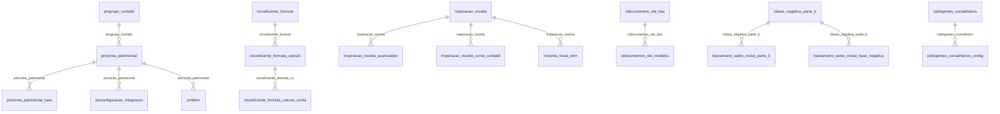

# Modelo — Contábil - outros (rascunho em lote)

> Gerado por `src/model/gerar_docs_modelo.py` a partir de `src/model/modulos/contabil_outros.yaml`, do catálogo e do perfil de colunas. **Não edite à mão.**

65 entidades. A coluna *Preench.* é o % de linhas com valor útil (nem nulo, nem em branco, nem zero, nem 1900-01-01; para colunas de código o zero conta como valor).

## Diagrama

## Entidades

| Entidade | Tabela | Linhas | Volume | Filtro obrigatório |
|---|---|---|---|---|
| [ctlanctolote_livro_rural](#ctlanctolote_livro_rural) | `CTLANCTOLOTE_LIVRO_RURAL` | 875.048 | medio | empresa |
| [ctatendimento_lancto_catalogo](#ctatendimento_lancto_catalogo) | `CTATENDIMENTO_LANCTO_CATALOGO` | 80.534 | medio | empresa |
| [ctatendimento_plano_contas_controle_websocket](#ctatendimento_plano_contas_controle_websocket) | `CTATENDIMENTO_PLANO_CONTAS_CONTROLE_WEBSOCKET` | 1 | pequeno | — |
| [ctgruposdmpl_tipolancto](#ctgruposdmpl_tipolancto) | `ctgruposdmpl_tipolancto` | 70.335 | medio | empresa |
| [ctgrupo_ebitda](#ctgrupo_ebitda) | `CTGRUPO_EBITDA` | 14.390 | medio | empresa |
| [ctconciliacao_bancaria](#ctconciliacao_bancaria) | `CTCONCILIACAO_BANCARIA` | 9.625 | pequeno | empresa |
| [ctconciliacao_conta](#ctconciliacao_conta) | `CTCONCILIACAO_CONTA` | 29 | pequeno | empresa |
| [ctconciliacao_bancaria_iceberg](#ctconciliacao_bancaria_iceberg) | `CTCONCILIACAO_BANCARIA_ICEBERG` | 5 | pequeno | empresa |
| [ctnatureza_conta](#ctnatureza_conta) | `ctnatureza_conta` | 7.829 | pequeno | empresa |
| [ctnatureza_conta_bc_geral](#ctnatureza_conta_bc_geral) | `CTNATUREZA_CONTA_BC_GERAL` | 8 | pequeno | — |
| [pmconta_patrimonial_taxa](#pmconta_patrimonial_taxa) | `PMCONTA_PATRIMONIAL_TAXA` | 6.610 | pequeno | empresa |
| [pmconta_patrimonial](#pmconta_patrimonial) | `PMCONTA_PATRIMONIAL` | 6.528 | pequeno | empresa |
| [lropcao_calculo](#lropcao_calculo) | `LROPCAO_CALCULO` | 2.896 | pequeno | empresa |
| [ctdere_codtrib](#ctdere_codtrib) | `CTDERE_CODTRIB` | 1.405 | pequeno | — |
| [lrparcela_imposto](#lrparcela_imposto) | `LRPARCELA_IMPOSTO` | 1.222 | pequeno | empresa |
| [ctcoeficiente_formula_calculo_conta](#ctcoeficiente_formula_calculo_conta) | `CTCOEFICIENTE_FORMULA_CALCULO_CONTA` | 1.097 | pequeno | empresa |
| [ctcoeficiente_formula_calculo](#ctcoeficiente_formula_calculo) | `CTCOEFICIENTE_FORMULA_CALCULO` | 93 | pequeno | — |
| [ctcoeficiente_formula](#ctcoeficiente_formula) | `CTCOEFICIENTE_FORMULA` | 77 | pequeno | — |
| [pmgrupo_contabil](#pmgrupo_contabil) | `PMGRUPO_CONTABIL` | 1.058 | pequeno | empresa |
| [pmparametro_vigencia](#pmparametro_vigencia) | `PMPARAMETRO_VIGENCIA` | 824 | pequeno | empresa |
| [lroperacao_receita_acumulador](#lroperacao_receita_acumulador) | `LROPERACAO_RECEITA_ACUMULADOR` | 800 | pequeno | empresa |
| [lroperacao_receita](#lroperacao_receita) | `LROPERACAO_RECEITA` | 141 | pequeno | empresa |
| [lroperacao_receita_conta_contabil](#lroperacao_receita_conta_contabil) | `LROPERACAO_RECEITA_CONTA_CONTABIL` | 1 | pequeno | empresa |
| [lrreceita_bruta_item](#lrreceita_bruta_item) | `LRRECEITA_BRUTA_ITEM` | 787 | pequeno | empresa |
| [lrreceita_bruta](#lrreceita_bruta) | `LRRECEITA_BRUTA` | 466 | pequeno | empresa |
| [ctdescricao_final](#ctdescricao_final) | `ctdescricao_final` | 517 | pequeno | empresa |
| [lradicao_conta](#lradicao_conta) | `LRADICAO_CONTA` | 477 | pequeno | empresa |
| [pmbaixa_lancto](#pmbaixa_lancto) | `PMBAIXA_LANCTO` | 425 | pequeno | empresa |
| [ctselecao_scp](#ctselecao_scp) | `CTSELECAO_SCP` | 418 | pequeno | empresa |
| [ctselecao_scp_opcao](#ctselecao_scp_opcao) | `CTSELECAO_SCP_OPCAO` | 58 | pequeno | empresa |
| [ctselecao_conta_redutora](#ctselecao_conta_redutora) | `CTSELECAO_CONTA_REDUTORA` | 37 | pequeno | empresa |
| [ctlista_bancos_banco_central](#ctlista_bancos_banco_central) | `CTLISTA_BANCOS_BANCO_CENTRAL` | 416 | pequeno | — |
| [ctdocumentos_ole](#ctdocumentos_ole) | `ctdocumentos_ole` | 385 | pequeno | — |
| [ctdocumentos_ole_modelos](#ctdocumentos_ole_modelos) | `ctdocumentos_ole_modelos` | 13 | pequeno | — |
| [ctdocumentos_ole_tipo](#ctdocumentos_ole_tipo) | `ctdocumentos_ole_tipo` | 5 | pequeno | — |
| [ctgruposdlpa_valor](#ctgruposdlpa_valor) | `CTGRUPOSDLPA_VALOR` | 350 | pequeno | empresa |
| [lrintegracao_contabil_lancto](#lrintegracao_contabil_lancto) | `LRINTEGRACAO_CONTABIL_LANCTO` | 199 | pequeno | empresa |
| [lrbase_negativa_parte_b](#lrbase_negativa_parte_b) | `LRBASE_NEGATIVA_PARTE_B` | 183 | pequeno | empresa |
| [lrparametro_vigencia](#lrparametro_vigencia) | `LRPARAMETRO_VIGENCIA` | 164 | pequeno | empresa |
| [lrparametro_saldo_inicial_parte_b](#lrparametro_saldo_inicial_parte_b) | `LRPARAMETRO_SALDO_INICIAL_PARTE_B` | 16 | pequeno | empresa |
| [lrparametro_saldo_inicial_base_negativa](#lrparametro_saldo_inicial_base_negativa) | `LRPARAMETRO_SALDO_INICIAL_BASE_NEGATIVA` | 8 | pequeno | empresa |
| [pmcomplemento_historico_contabil](#pmcomplemento_historico_contabil) | `PMCOMPLEMENTO_HISTORICO_CONTABIL` | 156 | pequeno | empresa |
| [ctocupacao_padrao_carne_leao](#ctocupacao_padrao_carne_leao) | `CTOCUPACAO_PADRAO_CARNE_LEAO` | 135 | pequeno | — |
| [lrpagamento_imposto](#lrpagamento_imposto) | `LRPAGAMENTO_IMPOSTO` | 49 | pequeno | empresa |
| [lrpagamento_imposto_lancto](#lrpagamento_imposto_lancto) | `LRPAGAMENTO_IMPOSTO_LANCTO` | 23 | pequeno | empresa |
| [ctdirigentes_conselheiros](#ctdirigentes_conselheiros) | `CTDIRIGENTES_CONSELHEIROS` | 46 | pequeno | empresa |
| [ctdirigentes_conselheiros_config](#ctdirigentes_conselheiros_config) | `CTDIRIGENTES_CONSELHEIROS_CONFIG` | 46 | pequeno | empresa |
| [ctcmv_apuracao_estoque](#ctcmv_apuracao_estoque) | `CTCMV_APURACAO_ESTOQUE` | 36 | pequeno | empresa |
| [ctcmv_apuracao_lancto](#ctcmv_apuracao_lancto) | `CTCMV_APURACAO_LANCTO` | 35 | pequeno | empresa |
| [ctcmv_apuracao](#ctcmv_apuracao) | `CTCMV_APURACAO` | 6 | pequeno | empresa |
| [lrexclusao_conta](#lrexclusao_conta) | `LREXCLUSAO_CONTA` | 32 | pequeno | empresa |
| [ctorigem_lancamento](#ctorigem_lancamento) | `CTORIGEM_LANCAMENTO` | 29 | pequeno | — |
| [lrincentivo_fiscal](#lrincentivo_fiscal) | `LRINCENTIVO_FISCAL` | 17 | pequeno | empresa |
| [pmconfiguracao_integracao_conta](#pmconfiguracao_integracao_conta) | `PMCONFIGURACAO_INTEGRACAO_CONTA` | 14 | pequeno | empresa |
| [pmconfiguracao_integracao](#pmconfiguracao_integracao) | `PMCONFIGURACAO_INTEGRACAO` | 6 | pequeno | empresa |
| [pminformacao_calculo_credito_icms](#pminformacao_calculo_credito_icms) | `PMINFORMACAO_CALCULO_CREDITO_ICMS` | 8 | pequeno | empresa |
| [pmtabela_bem_historico_tipo](#pmtabela_bem_historico_tipo) | `PMTABELA_BEM_HISTORICO_TIPO` | 6 | pequeno | — |
| [ctscp_selecionada](#ctscp_selecionada) | `CTSCP_SELECIONADA` | 6 | pequeno | empresa |
| [ctlanctopadrao_contas](#ctlanctopadrao_contas) | `ctlanctopadrao_contas` | 3 | pequeno | empresa |
| [laparmto_anos](#laparmto_anos) | `laparmto_anos` | 2 | pequeno | empresa |
| [lrganho_conta](#lrganho_conta) | `LRGANHO_CONTA` | 1 | pequeno | empresa |
| [ctrelacao_empresas_conglomerado_economico](#ctrelacao_empresas_conglomerado_economico) | `CTRELACAO_EMPRESAS_CONGLOMERADO_ECONOMICO` | 1 | pequeno | empresa |
| [ctlivro_caixa_produtor_rural_leiaute](#ctlivro_caixa_produtor_rural_leiaute) | `CTLIVRO_CAIXA_PRODUTOR_RURAL_LEIAUTE` | 1 | pequeno | — |
| [pmbem](#pmbem) | `PMBEM` | 4.353 | pequeno | empresa |
| [pabens](#pabens) | `pabens` | 2 | pequeno | empresa |

## ctlanctolote_livro_rural

**Informação de o lote deve ser considerado no livro rural** — tabela `CTLANCTOLOTE_LIVRO_RURAL` (875.048 linhas)

Informação de o lote deve ser considerado no livro rural. 875.048 linhas no catálogo; chave: CODI_EMP, CODI_LOTE.

- **Chave:** `CODI_EMP, CODI_LOTE`
- **Empresa:** `CODI_EMP`
- **Período:** `—`
- **Ordem padrão:** `CODI_LOTE asc`

**Regras de negócio validadas:**

- Medido em 2026-10-18: 875.538 linhas, 992 empresa(s).

| Campo | Coluna | Tipo | Preench. | Domínio | Descrição (banco) |
|---|---|---|---|---|---|
| codigo_da_empresa | `codi_emp` | integer(4) |  |  | Código da empresa |
| codigo_do_lote | `codi_lote` | integer(4) |  |  | Código do lote |
| gerar_lancamento_dos_livros_rurais | `gerar_lancamentos_livro_rural` | char(1) |  |  | Gerar lancamento dos livros rurais |

**Filtros:** `codigo_do_lote` (eq/in), `gerar_lancamento_dos_livros_rurais` (eq/in)

## ctatendimento_lancto_catalogo

**Catálogo de lancamentos - Domínio Atendimento** — tabela `CTATENDIMENTO_LANCTO_CATALOGO` (80.534 linhas)

Catálogo de lancamentos - Domínio Atendimento. 80.534 linhas no catálogo; chave: I_CATALOGO, SEQUENCIAL.

- **Chave:** `I_CATALOGO, SEQUENCIAL`
- **Empresa:** `CODI_EMP`
- **Período:** `DATA_LANCAMENTO`
- **Ordem padrão:** `DATA_LANCAMENTO desc`, `I_CATALOGO asc`, `SEQUENCIAL asc`

**Regras de negócio validadas:**

- Medido em 2026-10-18: 80.534 linhas, 11 empresa(s), DATA_LANCAMENTO de 2023-09-01 a 2026-04-30.
- Colunas expostas nulas em 100% das linhas (1): origem_do_xml_1_baixado_automaticamente.
- baixa_do_arquivo_0_download_do_xml_ainda: todos os valores reais estão no comentário do banco (1=80.534).
- importacao_do_arquivo_0_lancamento_ainda: todos os valores reais estão no comentário do banco (0=47.751, 1=32.783).
- importacao_do_arquivo_0_arquivo_nao_noti: todos os valores reais estão no comentário do banco (0=80.534).
- origem_do_xml_1_baixado_automaticamente: coluna sem nenhum valor preenchido; o domínio do comentário do banco não pôde ser verificado.
- exclusao_do_xml_0_nao_excluido_1_excluid: todos os valores reais estão no comentário do banco (1=80.534).
- exclusao_manual_0_nao_1_sim: todos os valores reais estão no comentário do banco (0=40.273, 1=40.261).

| Campo | Coluna | Tipo | Preench. | Domínio | Descrição (banco) |
|---|---|---|---|---|---|
| codigo_do_catalogo | `i_catalogo` | integer(4) |  |  | Código do catálogo |
| codigo_sequencial_do_site | `sequencial` | integer(4) |  |  | Código sequencial do site |
| empresa | `codi_emp` | integer(4) |  |  | Empresa |
| data_de_lancamentos | `data_lancamento` | date(4) |  |  | Data de lançamentos |
| conta_debito | `conta_debito` | integer(4) |  |  | Conta debito |
| conta_credito | `conta_credito` | integer(4) |  |  | Conta credito |
| valor_lancamento | `valor` | numeric(14) |  |  | Valor lançamento |
| historico | `historico` | varchar(1000) |  |  | Historico |
| filial | `filial` | integer(4) |  |  | Filial |
| baixa_do_arquivo_0_download_do_xml_ainda | `baixado` | smallint(2) |  | ctatendimento_lancto_catalogo_baixa_do_ar | Baixa do arquivo (0=Download do XML ainda não realizado/1=Download do XML já realizado) |
| importacao_do_arquivo_0_lancamento_ainda | `importado` | smallint(2) |  | ctatendimento_lancto_catalogo_importacao_ | Importação do arquivo (0=Lancamento ainda não importado/1=Lancamento já importado) |
| importacao_do_arquivo_0_arquivo_nao_noti | `notificado` | smallint(2) |  | ctatendimento_lancto_catalogo_importacao_ | Importação do arquivo (0=Arquivo não notificado para o usuário da Contabilidade/1=Arquivo já notificado para o usuário da Contabilidade) |
| data_que_o_xml_foi_baixado | `data_baixado` | date(4) |  |  | Data que o xml foi baixado |
| origem_do_xml_1_baixado_automaticamente | `origem_xml` | smallint(2) |  | ctatendimento_lancto_catalogo_origem_do_x | Origem do XML (1=Baixado automaticamente/2=Baixado pelo utilitários) |
| exclusao_do_xml_0_nao_excluido_1_excluid | `xml_excluido` | smallint(2) |  | ctatendimento_lancto_catalogo_exclusao_do | Exclusão do XML (0=Não excluído/1=Excluído) |
| exclusao_manual_0_nao_1_sim | `xml_excluido_manualmente` | smallint(2) |  | ctatendimento_lancto_catalogo_exclusao_ma | Exclusão manual (0=Não/1=Sim) |
| codigo_historico | `codigo_historico` | integer(4) |  |  | Código Historico |

**Filtros:** `codigo_do_catalogo` (eq/in), `codigo_sequencial_do_site` (eq/in), `data_de_lancamentos` (entre/gte/lte), `data_que_o_xml_foi_baixado` (entre/gte/lte), `historico` (contem/prefixo), `codigo_historico` (eq/in)

## ctatendimento_plano_contas_controle_websocket

**Gerencia os retornos da integração com a Conta Azul no agente de comunicação, incluindo envios, avisos, erros e suporte a reenvio.** — tabela `CTATENDIMENTO_PLANO_CONTAS_CONTROLE_WEBSOCKET` (1 linhas)

Gerencia os retornos da integração com a Conta Azul no agente de comunicação, incluindo envios, avisos, erros e suporte a reenvio.. 1 linhas no catálogo; chave: DATA_PACOTE.

- **Chave:** `DATA_PACOTE`
- **Empresa:** `não se aplica (tabela global)`
- **Período:** `—`
- **Ordem padrão:** `DATA_PACOTE asc`

**Regras de negócio validadas:**

- Medido em 2026-10-18: 1 linhas.
- Colunas expostas nulas em 100% das linhas (1): data_do_pacote.

| Campo | Coluna | Tipo | Preench. | Domínio | Descrição (banco) |
|---|---|---|---|---|---|
| data_do_pacote | `data_pacote` | timestamp(8) |  |  | Data do pacote |

**Filtros:** `data_do_pacote` (eq/in)

## ctgruposdmpl_tipolancto

**Estrutura do DMPL - Tipo Lancamento** — tabela `ctgruposdmpl_tipolancto` (70.335 linhas)

Estrutura do DMPL - Tipo Lancamento. 70.335 linhas no catálogo; chave: codi_emp, i_grupo, i_tipolancto.

- **Chave:** `codi_emp, i_grupo, i_tipolancto`
- **Empresa:** `codi_emp`
- **Período:** `—`
- **Ordem padrão:** `i_grupo asc`, `i_tipolancto asc`

**Regras de negócio validadas:**

- Medido em 2026-10-18: 70.335 linhas, 1.324 empresa(s).
- Vínculo ctgruposdmpl (ctgruposdmpl): 0 de 53 linhas sem registro relacionado (empresa 641).
- Vínculo cttipolancto (cttipolancto): 0 de 53 linhas sem registro relacionado (empresa 641).

| Campo | Coluna | Tipo | Preench. | Domínio | Descrição (banco) |
|---|---|---|---|---|---|
| empresa | `codi_emp` | integer(4) |  |  | Empresa |
| grupo | `i_grupo` | integer(4) |  |  | Grupo |
| tipo_de_lancamento | `i_tipolancto` | integer(4) |  |  | Tipo de lancamento |
| padrao_s_n | `padrao` | char(1) |  |  | Padrao (S/N) |

**Vínculos (LEFT JOIN, acrescentam colunas legíveis):**

- `ctgruposdmpl` → `ctgruposdmpl` por `codi_emp` = `codi_emp` e `i_grupo` = `i_grupo`; colunas: `ctgruposdmpl_nome`
- `cttipolancto` → `cttipolancto` por `codi_emp` = `codi_emp` e `i_tipolancto` = `i_tipolancto`; colunas: `cttipolancto_nome`

**Filtros:** `grupo` (eq/in), `tipo_de_lancamento` (eq/in), `padrao_s_n` (eq/in)

## ctgrupo_ebitda

**Estrutura EBITDA** — tabela `CTGRUPO_EBITDA` (14.390 linhas)

Estrutura EBITDA. 14.390 linhas no catálogo; chave: CODI_EMP, I_EBITDA.

- **Chave:** `CODI_EMP, I_EBITDA`
- **Empresa:** `CODI_EMP`
- **Período:** `—`
- **Ordem padrão:** `I_EBITDA asc`

**Regras de negócio validadas:**

- Medido em 2026-10-18: 14.390 linhas, 1.308 empresa(s).
- operacaio_c_contas_i_contas_inverter_nat: todos os valores reais estão no comentário do banco (C=6.542, T=6.540, I=1.308).
- configuracao_i_inicia_sub_total_f_fecha: todos os valores reais estão no comentário do banco (nulo=13.082, I=1.308).
- Vínculo geempre (geempre): 0 de 11 linhas sem registro relacionado (empresa 123).

| Campo | Coluna | Tipo | Preench. | Domínio | Descrição (banco) |
|---|---|---|---|---|---|
| empresa | `codi_emp` | integer(4) |  |  | Empresa |
| codigo | `i_ebitda` | integer(4) |  |  | Código |
| sequencia | `sequencia` | integer(4) |  |  | Sequencia |
| descricao | `descricao` | varchar(60) |  |  | Descrição |
| operacaio_c_contas_i_contas_inverter_nat | `operacao` | char(1) |  | ctgrupo_ebitda_operacaio_c_contas_i_contas_inver | Operaçãio (C=Contas/ I=Contas - Inverter natureza do saldo/ T=Total) |
| configuracao_i_inicia_sub_total_f_fecha | `configuracao` | char(1) |  | ctgrupo_ebitda_configuracao_i_inicia_sub_total_f | Configuração (I=Inicia Sub Total/ F=Fecha Sub Total) |
| soma_grupos_abaixo_s_n | `soma_grupo` | char(1) |  |  | Soma grupos abaixo (S/N) |
| soma_grupos_abaixo_quantos | `soma_grupo_abaixo` | integer(4) |  |  | Soma grupos abaixo - Quantos |

**Vínculos (LEFT JOIN, acrescentam colunas legíveis):**

- `geempre` → `geempre` por `codi_emp` = `codi_emp`; colunas: `geempre_nome`

**Filtros:** `codigo` (eq/in), `descricao` (contem/prefixo), `operacaio_c_contas_i_contas_inverter_nat` (eq/in), `configuracao_i_inicia_sub_total_f_fecha` (eq/in), `soma_grupos_abaixo_s_n` (eq/in)

## ctconciliacao_bancaria

**Conciliação bancária** — tabela `CTCONCILIACAO_BANCARIA` (9.625 linhas)

Conciliação bancária. 9.625 linhas no catálogo; chave: CODI_EMP, I_CONCILIACAO, I_CONCILIACAO_ITEM.

- **Chave:** `CODI_EMP, I_CONCILIACAO, I_CONCILIACAO_ITEM`
- **Empresa:** `CODI_EMP`
- **Período:** `—`
- **Ordem padrão:** `I_CONCILIACAO asc`, `I_CONCILIACAO_ITEM asc`

**Regras de negócio validadas:**

- Medido em 2026-10-18: 9.623 linhas, 19 empresa(s).

| Campo | Coluna | Tipo | Preench. | Domínio | Descrição (banco) |
|---|---|---|---|---|---|
| empresa | `codi_emp` | integer(4) |  |  | Empresa |
| codigo | `i_conciliacao` | integer(4) |  |  | Código |
| sequencial_da_conciliacao | `i_conciliacao_item` | integer(4) |  |  | Sequencial da conciliação |
| codigo_do_lancamento_de_extrato | `i_lancamento` | integer(4) |  |  | Código do lançamento de extrato |
| codigo_do_lancamento_de_extrato_sequenci | `i_item` | integer(4) |  |  | Código do lançamento de extrato - sequencial do item |
| numero_do_lancamento_contabil | `nume_lan` | integer(4) |  |  | Número do lançamento contábil |
| conciliado_a_debito_s_n | `conciliado_deb` | char(1) |  |  | Conciliado a débito (S/N) |
| conciliado_a_credito_s_n | `conciliado_cre` | char(1) |  |  | Conciliado a crédito (S/N) |

**Filtros:** `codigo` (eq/in), `sequencial_da_conciliacao` (eq/in), `codigo_do_lancamento_de_extrato` (eq/in), `codigo_do_lancamento_de_extrato_sequenci` (eq/in), `conciliado_a_debito_s_n` (eq/in), `conciliado_a_credito_s_n` (eq/in)

## ctconciliacao_conta

**Conciliação de contas** — tabela `CTCONCILIACAO_CONTA` (29 linhas)

Conciliação de contas. 29 linhas no catálogo; chave: CODI_EMP, CODI_CTA.

- **Chave:** `CODI_EMP, CODI_CTA`
- **Empresa:** `CODI_EMP`
- **Período:** `CONCILIADA_ATE`
- **Ordem padrão:** `CONCILIADA_ATE desc`, `CODI_CTA asc`

**Regras de negócio validadas:**

- Medido em 2026-10-18: 29 linhas, 13 empresa(s), CONCILIADA_ATE de 2016-12-31 a 2024-07-31.
- Vínculo geempre (geempre): 0 de 1 linhas sem registro relacionado (empresa 1446).
- Vínculo ctcontas (ctcontas): 0 de 1 linhas sem registro relacionado (empresa 1446).

| Campo | Coluna | Tipo | Preench. | Domínio | Descrição (banco) |
|---|---|---|---|---|---|
| empresa | `codi_emp` | integer(4) |  |  | Empresa |
| conta_contabil | `codi_cta` | integer(4) |  |  | Conta contábil |
| empresa_do_plano_de_contas | `codi_emp_plano` | integer(4) |  |  | Empresa do plano de contas |
| conciliada_ate | `conciliada_ate` | date(4) |  |  | Conciliada até |

**Vínculos (LEFT JOIN, acrescentam colunas legíveis):**

- `geempre` → `geempre` por `codi_emp` = `codi_emp`; colunas: `geempre_nome`
- `ctcontas` → `ctcontas` por `codi_emp_plano` = `codi_emp` e `codi_cta` = `codi_cta`; colunas: `ctcontas_nome`

**Filtros:** `conta_contabil` (eq/in), `conciliada_ate` (entre/gte/lte), `empresa_do_plano_de_contas` (eq/in)

## ctconciliacao_bancaria_iceberg

**Conciliação bancária automática Contabilidade Digital** — tabela `CTCONCILIACAO_BANCARIA_ICEBERG` (5 linhas)

Conciliação bancária automática Contabilidade Digital. 5 linhas no catálogo; chave: CODI_EMP, I_CONCILIACAO, I_CONCILIACAO_ITEM.

- **Chave:** `CODI_EMP, I_CONCILIACAO, I_CONCILIACAO_ITEM`
- **Empresa:** `CODI_EMP`
- **Período:** `—`
- **Ordem padrão:** `I_CONCILIACAO asc`, `I_CONCILIACAO_ITEM asc`

**Regras de negócio validadas:**

- Medido em 2026-10-18: 5 linhas, 1 empresa(s).

| Campo | Coluna | Tipo | Preench. | Domínio | Descrição (banco) |
|---|---|---|---|---|---|
| codigo_da_empresa | `codi_emp` | integer(4) |  |  | Código da empresa |
| codigo_da_conciliacao | `i_conciliacao` | integer(4) |  |  | Código da conciliação |
| item_da_conciliacao | `i_conciliacao_item` | integer(4) |  |  | Item da conciliação |
| codigo_do_extrato_bancario | `i_extrato_bancario` | integer(4) |  |  | Código do extrato bancário |
| numero_do_lancamento | `nume_lan` | integer(4) |  |  | Número do lançamento |
| conciliado_debito_s_n | `conciliado_deb` | char(1) |  |  | Conciliado débito (S/N) |
| conciliado_credito_s_n | `conciliado_cre` | char(1) |  |  | Conciliado crédito (S/N) |

**Filtros:** `codigo_da_conciliacao` (eq/in), `item_da_conciliacao` (eq/in), `codigo_do_extrato_bancario` (eq/in), `conciliado_debito_s_n` (eq/in), `conciliado_credito_s_n` (eq/in)

## ctnatureza_conta

**NATUZA DAS CONTAS** — tabela `ctnatureza_conta` (7.829 linhas)

NATUZA DAS CONTAS. 7.829 linhas no catálogo; chave: codi_emp, ordem.

- **Chave:** `codi_emp, ordem`
- **Empresa:** `codi_emp`
- **Período:** `—`
- **Ordem padrão:** `ordem asc`

**Regras de negócio validadas:**

- Medido em 2026-10-18: 7.829 linhas, 1.427 empresa(s).
- natureza_c_credora_d_devedora: todos os valores reais estão no comentário do banco (D=4.948, C=2.881).
- grupo_a_ativo_p_passivo_l_patrimonio_liq: todos os valores reais estão no comentário do banco (R=4.244, A=1.433, P=1.426, O=634, L=50, C=42).
- Vínculo geempre (geempre): 0 de 5 linhas sem registro relacionado (empresa 475).

| Campo | Coluna | Tipo | Preench. | Domínio | Descrição (banco) |
|---|---|---|---|---|---|
| empresa | `codi_emp` | integer(4) |  |  | EMPRESA |
| ordem | `ordem` | tinyint(1) |  |  | ORDEM |
| classificacao | `clas_cta` | char(20) |  |  | CLASSIFICACAO |
| natureza_c_credora_d_devedora | `natureza` | char(1) |  | ctnatureza_conta_natureza_c_credora_d_devedora | NATUREZA (C=CREDORA/D=DEVEDORA) |
| grupo_a_ativo_p_passivo_l_patrimonio_liq | `grupo` | char(1) |  | ctnatureza_conta_grupo_a_ativo_p_passivo_l_patrim | GRUPO (A=ATIVO/P=PASSIVO/L=PATRIMONIO LIQUIDO/R=CONTAS DE RESULTADO/C=CONTAS DE COMPENSACAO/O=OUTRAS) |

**Vínculos (LEFT JOIN, acrescentam colunas legíveis):**

- `geempre` → `geempre` por `codi_emp` = `codi_emp`; colunas: `geempre_nome`

**Filtros:** `ordem` (eq/in), `classificacao` (eq/in), `natureza_c_credora_d_devedora` (eq/in), `grupo_a_ativo_p_passivo_l_patrimonio_liq` (eq/in)

## ctnatureza_conta_bc_geral

**Natureza das Contas Banco Central** — tabela `CTNATUREZA_CONTA_BC_GERAL` (8 linhas)

Natureza das Contas Banco Central. 8 linhas no catálogo; chave: I_NATUREZA.

- **Chave:** `I_NATUREZA`
- **Empresa:** `não se aplica (tabela global)`
- **Período:** `—`
- **Ordem padrão:** `I_NATUREZA asc`

**Regras de negócio validadas:**

- Medido em 2026-10-18: 8 linhas.
- natureza_da_conta_c_credora_d_devedora: todos os valores reais estão no comentário do banco (D=4, C=4).
- grupo_da_conta_a_ativo_p_passivo_l_patri: todos os valores reais estão no comentário do banco (R=2, A=2, C=2, P=1, L=1).

| Campo | Coluna | Tipo | Preench. | Domínio | Descrição (banco) |
|---|---|---|---|---|---|
| codigo_da_tabela | `i_natureza` | integer(4) |  |  | Codigo da tabela |
| classificacao_da_conta | `clas_cta` | char(20) |  |  | Classificacao da conta |
| natureza_da_conta_c_credora_d_devedora | `natureza` | char(1) |  | ctnatureza_conta_bc_geral_natureza_da_cont | Natureza da conta (C=Credora/D=Devedora) |
| grupo_da_conta_a_ativo_p_passivo_l_patri | `grupo` | char(1) |  | ctnatureza_conta_bc_geral_grupo_da_conta_a | Grupo da conta (A=Ativo/P=Passivo/L=Patrimonio Liquido/R=Contas de Resultado/C=Contas de Compensacao/O=Outras) |

**Filtros:** `codigo_da_tabela` (eq/in), `classificacao_da_conta` (eq/in), `natureza_da_conta_c_credora_d_devedora` (eq/in), `grupo_da_conta_a_ativo_p_passivo_l_patri` (eq/in)

## pmconta_patrimonial_taxa

**Contas Patrimoniais - Taxas variáveis de depreciação** — tabela `PMCONTA_PATRIMONIAL_TAXA` (6.610 linhas)

Contas Patrimoniais - Taxas variáveis de depreciação. 6.610 linhas no catálogo; chave: CODI_EMP, I_CONTA_PATRIMONIAL, SEQUENCIAL.

- **Chave:** `CODI_EMP, I_CONTA_PATRIMONIAL, SEQUENCIAL`
- **Empresa:** `CODI_EMP`
- **Período:** `VIGENCIA`
- **Ordem padrão:** `VIGENCIA desc`, `I_CONTA_PATRIMONIAL asc`, `SEQUENCIAL asc`

**Regras de negócio validadas:**

- Medido em 2026-10-18: 6.610 linhas, 921 empresa(s), VIGENCIA de 1900-01-01 a 2026-05-01.
- Vínculo pmconta_patrimonial (PMCONTA_PATRIMONIAL): 0 de 8 linhas sem registro relacionado (empresa 1546).

| Campo | Coluna | Tipo | Preench. | Domínio | Descrição (banco) |
|---|---|---|---|---|---|
| empresa | `codi_emp` | integer(4) |  |  | Empresa |
| conta_patrimonial | `i_conta_patrimonial` | integer(4) |  |  | Conta patrimonial |
| sequencial | `sequencial` | integer(4) |  |  | Sequencial |
| a_partir_de | `vigencia` | date(4) |  |  | A partir de |
| taxa_de_depreciacao_fiscal | `taxa_depreciacao_fiscal` | numeric(7) |  |  | Taxa de depreciação fiscal |

**Vínculos (LEFT JOIN, acrescentam colunas legíveis):**

- `pmconta_patrimonial` → `PMCONTA_PATRIMONIAL` por `codi_emp` = `codi_emp` e `i_conta_patrimonial` = `i_conta_patrimonial`; colunas: `pmconta_patrimonial_nome`

**Filtros:** `conta_patrimonial` (eq/in), `sequencial` (eq/in), `a_partir_de` (entre/gte/lte)

## pmconta_patrimonial

**Contas Patrimoniais** — tabela `PMCONTA_PATRIMONIAL` (6.528 linhas)

Contas Patrimoniais. 6.528 linhas no catálogo; chave: CODI_EMP, I_CONTA_PATRIMONIAL.

- **Chave:** `CODI_EMP, I_CONTA_PATRIMONIAL`
- **Empresa:** `CODI_EMP`
- **Período:** `—`
- **Ordem padrão:** `I_CONTA_PATRIMONIAL asc`

**Regras de negócio validadas:**

- Medido em 2026-10-18: 6.528 linhas, 921 empresa(s).
- Colunas expostas nulas em 100% das linhas (1): credito_icms_de_periodos_anteriores_codi.
- natureza_da_conta_d_devedora_c_credora: todos os valores reais estão no comentário do banco (D=6.528).
- Vínculo efajustes (efajustes): 8 de 8 linhas sem registro relacionado (empresa 1547).
- Vínculo geempre (geempre): 0 de 8 linhas sem registro relacionado (empresa 1547).
- Vínculo pmgrupo_contabil (PMGRUPO_CONTABIL): 0 de 8 linhas sem registro relacionado (empresa 1547).

| Campo | Coluna | Tipo | Preench. | Domínio | Descrição (banco) |
|---|---|---|---|---|---|
| empresa | `codi_emp` | integer(4) |  |  | Empresa |
| codigo | `i_conta_patrimonial` | integer(4) |  |  | Código |
| descricao | `descricao` | varchar(40) |  |  | Descrição |
| taxa_ddepreciacao_fiscal | `taxa_depreciacao_fiscal` | numeric(7) |  |  | Taxa ddepreciação fiscal |
| natureza_da_conta_d_devedora_c_credora | `natureza_conta` | char(1) |  | pmconta_patrimonial_natureza_da_conta_d_devedora_c | Natureza da conta (D=Devedora/ C=Credora) |
| grupo_contabil | `i_grupo_contabil` | integer(4) |  |  | Grupo contábil |
| calcular_correcao_monetaria_1995 | `calcular_correcao_monetaria_1995` | char(1) |  |  | Calcular correção monetária até 31/12/1995 |
| conta_contabil_patrimonial | `conta_patrimonial` | integer(4) |  |  | Conta contábil - Patrimonial |
| conta_contabil_aquisicao | `conta_aquisicao` | integer(4) |  |  | Conta contábil - Aquisição |
| historico_contabil_aquisicao | `historico_aquisicao` | integer(4) |  |  | Histórico contábil - Aquisição |
| conta_contabil_avaliacao_valor_nao_recup | `conta_debito_avaliacao` | integer(4) |  |  | Conta contábil - Avaliação - Valor não recuperável - Débito |
| conta_credito_avaliacao | `conta_credito_avaliacao` | integer(4) |  |  | Conta contábil - Avaliação - Valor não recuperável - Crédito |
| historico_avaliacao_valor_nao_recuperave | `historico_avaliacao` | integer(4) |  |  | Histórico - Avaliação - Valor não recuperável |
| conta_contabil_depreciacao_acumulada | `conta_depreciacao_acumulada` | integer(4) |  |  | Conta contábil - Depreciação acumulada |
| historico_contabil_depreciacao_acumulada | `historico_depreciacao_acumulada` | integer(4) |  |  | Histórico contábil - Depreciação acumulada |
| conta_contabil_depreciacao_do_periodo | `conta_depreciacao_periodo` | integer(4) |  |  | Conta contábil - Depreciação do período |
| historico_contabil_depreciacao_do_period | `historico_depreciacao_periodo` | integer(4) |  |  | Histórico contábil - Depreciação do período |
| conta_contabil_baixa_caixa | `conta_baixa_caixa` | integer(4) |  |  | Conta contábil - Baixa - Caixa |
| conta_contabil_baixa_receita_da_alienaca | `conta_baixa_receita_alienacao` | integer(4) |  |  | Conta contábil - Baixa - Receita da alienação |
| historico_contabil_baixa_receita_da_alie | `historico_baixa_receita_alienacao` | integer(4) |  |  | Histórico contábil - Baixa - Receita da alienação |
| conta_contabil_baixa_custo_da_alienacao | `conta_baixa_custo_alienacao` | integer(4) |  |  | Conta contábil - Baixa - Custo da alienação |
| historico_contabil_baixa_custo_da_aliena | `historico_baixa_custo_alienacao` | integer(4) |  |  | Histórico contábil - Baixa - Custo da alienação |
| conta_contabil_credito_de_icms_provisao | `conta_credito_icms_recuperar` | integer(4) |  |  | Conta contábil - Crédito de ICMS - Provisão - ICMS a recuperar |
| historico_contabil_credito_de_icms_provi | `historico_credito_icms_recuperar` | integer(4) |  |  | Histórico contábil - Crédito de ICMS - Provisão - ICMS a recuperar |
| conta_contabil_credito_de_icms_estorno_c | `conta_credito_icms_custo_perda` | integer(4) |  |  | Conta contábil - Crédito de ICMS - Estorno - Custo ou perda |
| historico_contabil_credito_de_icms_estor | `historico_credito_icms_custo_perda` | integer(4) |  |  | Histórico contábil - Crédito de ICMS - Estorno - Custo ou perda |
| credito_icms_ativo_imobilizado_codigo_do | `credito_icms_ativo_imobilizado_codigo_ajuste` | integer(4) |  |  | Crédito ICMS ativo imobilizado - Código do ajuste |
| origem_do_registro_0_sistema_1_imp_tabel | `origem_reg` | tinyint(1) |  |  | Origem do registro 0 - Sistema, 1 - Imp. Tabelas, 2 - Imp. Layout, 3- Imp. Tabelas Concorrentes |
| conta_contabil_avaliacao_ajuste_de_avali | `conta_debito_avaliacao_ajuste` | integer(4) |  |  | Conta contábil - Avaliação - Ajuste de avaliação patrimonial - Débito |
| conta_credito_avaliacao_ajuste | `conta_credito_avaliacao_ajuste` | integer(4) |  |  | Conta contábil - Avaliação - Ajuste de avaliação patrimonial - Crédito |
| historico_avaliacao_ajuste | `historico_avaliacao_ajuste` | integer(4) |  |  | Histórico - Avaliação/valor não recuperável |
| credito_icms_de_periodos_anteriores_codi | `credito_icms_periodo_anterior_codigo_ajuste` | integer(4) |  |  | Crédito ICMS de períodos anteriores - Código do ajuste |
| conta_debito_da_provisao_do_credito_de_i | `conta_debito_icms_recuperar` | integer(4) |  |  | Conta débito da provisão do crédito de ICMS a recuperar |
| conta_debito_do_estorno_do_credito_de_ic | `conta_debito_icms_custo_perda` | integer(4) |  |  | Conta débito do estorno do crédito de ICMS |
| conta_credito_icms_recuperar_longo_prazo | `conta_credito_icms_recuperar_longo_prazo` | integer(4) |  |  | Conta contábil - Crédito de ICMS - Provisão - ICMS a recuperar - Longo Prazo |
| conta_debito_icms_recuperar_longo_prazo | `conta_debito_icms_recuperar_longo_prazo` | integer(4) |  |  | Conta débito da provisão do crédito de ICMS a recuperar - Longo Prazo |
| historico_provisao_credito_icms_recupera | `historico_provisao_credito_icms_recuperar_longo_prazo` | integer(4) |  |  | Histórico contábil - Crédito de ICMS - Provisão - ICMS a recuperar - Longo Prazo |
| historico_contabil_credito_de_icms_trans | `historico_transferencia_credito_icms_recuperar_longo_prazo` | integer(4) |  |  | Histórico contábil - Crédito de ICMS - Transferência - ICMS a recuperar - Longo Prazo |
| subconta_depreciacao_acumulada | `subconta_depreciacao_acumulada` | integer(4) |  |  | Subconta - Depreciação acumulada |
| conta_contabil_avaliacao_a_valor_justo_g | `subconta_debito_avaliacao_valor_justo_ganho` | integer(4) |  |  | Conta contábil - Avaliação a valor justo - Ganho - Débito |
| conta_credito_avaliacao_valor_justo_ganh | `conta_credito_avaliacao_valor_justo_ganho` | integer(4) |  |  | Conta contábil - Avaliação a valor justo - Ganho - Crédito |
| historico_avaliacao_a_valor_justo_ganho | `historico_avaliacao_valor_justo_ganho` | integer(4) |  |  | Histórico - Avaliação a valor justo - Ganho |
| conta_contabil_avaliacao_a_valor_justo_p | `conta_debito_avaliacao_valor_justo_perda` | integer(4) |  |  | Conta contábil - Avaliação a valor justo - Perda - Débito |
| subconta_credito_avaliacao_valor_justo_p | `subconta_credito_avaliacao_valor_justo_perda` | integer(4) |  |  | Conta contábil - Avaliação a valor justo - Perda - Crédito |
| historico_avaliacao_a_valor_justo_perda | `historico_avaliacao_valor_justo_perda` | integer(4) |  |  | Histórico - Avaliação a valor justo - Perda |
| conta_contabil_bens_mantidos_para_venda | `conta_bem_mantido_venda` | integer(4) |  |  | Conta contábil - Bens mantidos para venda |
| historico_contabil_bens_mantidos_para_ve | `historico_bem_mantido_venda` | integer(4) |  |  | Histórico contábil - Bens mantidos para venda |

**Vínculos (LEFT JOIN, acrescentam colunas legíveis):**

- `efajustes` → `efajustes` por `codi_emp` = `codi_emp` e `credito_icms_ativo_imobilizado_codigo_ajuste` = `codi_aju`; colunas: `efajustes_nome`
- `geempre` → `geempre` por `codi_emp` = `codi_emp`; colunas: `geempre_nome`
- `pmgrupo_contabil` → `PMGRUPO_CONTABIL` por `codi_emp` = `codi_emp` e `i_grupo_contabil` = `i_grupo_contabil`; colunas: `pmgrupo_contabil_nome`

**Filtros:** `codigo` (eq/in), `descricao` (contem/prefixo), `natureza_da_conta_d_devedora_c_credora` (eq/in), `grupo_contabil` (eq/in), `calcular_correcao_monetaria_1995` (eq/in), `credito_icms_ativo_imobilizado_codigo_do` (eq/in), `credito_icms_de_periodos_anteriores_codi` (eq/in)

## lropcao_calculo

**Opções de Cálculo** — tabela `LROPCAO_CALCULO` (2.896 linhas)

Opções de Cálculo. 2.896 linhas no catálogo; chave: CODI_EMP, I_OPCAO_CALCULO.

- **Chave:** `CODI_EMP, I_OPCAO_CALCULO`
- **Empresa:** `CODI_EMP`
- **Período:** `COMPETENCIA`
- **Ordem padrão:** `COMPETENCIA desc`, `I_OPCAO_CALCULO asc`

**Regras de negócio validadas:**

- Medido em 2026-10-18: 2.896 linhas, 77 empresa(s), COMPETENCIA de 2013-01-01 a 2026-09-01.
- Colunas expostas nulas em 100% das linhas (1): scp.
- opcao_r_real_e_estimado: todos os valores reais estão no comentário do banco (R=2.859, E=35, nulo=2).
- Vínculo geempre (geempre): 0 de 36 linhas sem registro relacionado (empresa 1365).
- Vínculo gescp (GESCP): 36 de 36 linhas sem registro relacionado (empresa 1365).

| Campo | Coluna | Tipo | Preench. | Domínio | Descrição (banco) |
|---|---|---|---|---|---|
| empresa | `codi_emp` | integer(4) |  |  | Empresa |
| codigo | `i_opcao_calculo` | integer(4) |  |  | Código |
| competencia | `competencia` | date(4) |  |  | Competência |
| opcao_r_real_e_estimado | `opcao` | char(1) |  | lropcao_calculo_opcao_r_real_e_estimado | Opção (R=Real/ E=Estimado) |
| scp | `i_scp` | integer(4) |  |  | SCP |

**Vínculos (LEFT JOIN, acrescentam colunas legíveis):**

- `geempre` → `geempre` por `codi_emp` = `codi_emp`; colunas: `geempre_nome`
- `gescp` → `GESCP` por `codi_emp` = `codi_emp` e `i_scp` = `i_scp`; colunas: `gescp_nome`

**Filtros:** `codigo` (eq/in), `competencia` (entre/gte/lte), `opcao_r_real_e_estimado` (eq/in), `scp` (eq/in)

## ctdere_codtrib

**Catalogo oficial de codigos de tributacao (codTrib) da Tabela 11 da DeRE** — tabela `CTDERE_CODTRIB` (1.405 linhas)

Catalogo oficial de codigos de tributacao (codTrib) da Tabela 11 da DeRE. 1.405 linhas no catálogo; chave: CODI_TRIB.

- **Chave:** `CODI_TRIB`
- **Empresa:** `não se aplica (tabela global)`
- **Período:** `—`
- **Ordem padrão:** `CODI_TRIB asc`

**Regras de negócio validadas:**

- Medido em 2026-10-18: 1.405 linhas.
- tipo_do_registro_f_folha_selecionavel_a: todos os valores reais estão no comentário do banco (F=744, A=661).

| Campo | Coluna | Tipo | Preench. | Domínio | Descrição (banco) |
|---|---|---|---|---|---|
| identificador_interno_do_codigo_de_tribu | `codi_trib` | integer(4) |  |  | Identificador interno do codigo de tributacao |
| codigo_de_tributacao_codtrib_divulgado_p | `codtrib` | varchar(20) |  |  | Codigo de tributacao (codTrib) divulgado pela Receita Federal |
| titulo_do_codigo_de_tributacao | `titulo` | varchar(250) |  |  | Titulo do codigo de tributacao |
| descricao_do_codigo_de_tributacao | `descricao` | varchar(1000) |  |  | Descricao do codigo de tributacao |
| dispositivo_legal_do_codigo_de_tributaca | `dispositivo_legal` | varchar(60) |  |  | Dispositivo legal do codigo de tributacao |
| tipo_do_registro_f_folha_selecionavel_a | `tipo_registro` | char(1) |  | ctdere_codtrib_tipo_do_reg | Tipo do registro (F-Folha, selecionavel / A-Agrupamento, apenas hierarquia) |

**Filtros:** `identificador_interno_do_codigo_de_tribu` (eq/in), `codigo_de_tributacao_codtrib_divulgado_p` (eq/in), `titulo_do_codigo_de_tributacao` (contem/prefixo), `descricao_do_codigo_de_tributacao` (contem/prefixo), `dispositivo_legal_do_codigo_de_tributaca` (contem/prefixo), `tipo_do_registro_f_folha_selecionavel_a` (eq/in)

## lrparcela_imposto

**Parcela dos impostos do Lalur** — tabela `LRPARCELA_IMPOSTO` (1.222 linhas)

Parcela dos impostos do Lalur. 1.222 linhas no catálogo; chave: CODI_EMP, COMPETENCIA, IMPOSTO, TIPO_CALCULO, I_PARCELA, NUMERO_PARCELA, AJUSTE_ANUAL.

- **Chave:** `CODI_EMP, COMPETENCIA, IMPOSTO, TIPO_CALCULO, I_PARCELA, NUMERO_PARCELA, AJUSTE_ANUAL`
- **Empresa:** `CODI_EMP`
- **Período:** `VENCIMENTO`
- **Ordem padrão:** `VENCIMENTO desc`, `COMPETENCIA asc`, `IMPOSTO asc`

**Regras de negócio validadas:**

- Medido em 2026-10-18: 1.222 linhas, 40 empresa(s), VENCIMENTO de 2013-02-28 a 2026-10-30.
- Colunas expostas nulas em 100% das linhas (1): scp.
- imposto_c_contribuicao_social_i_irpj: todos os valores reais estão no comentário do banco (C=632, I=590).
- tipo_de_calculo_r_real_e_estimado: todos os valores reais estão no comentário do banco (E=815, R=407).
- Vínculo geempre (geempre): 0 de 15 linhas sem registro relacionado (empresa 1556).

| Campo | Coluna | Tipo | Preench. | Domínio | Descrição (banco) |
|---|---|---|---|---|---|
| empresa | `codi_emp` | integer(4) |  |  | Empresa |
| competencia | `competencia` | date(4) |  |  | Competência |
| imposto_c_contribuicao_social_i_irpj | `imposto` | char(1) |  | lrparcela_imposto_imposto_c_contribuic | Imposto (C=Contribuição Social/ I=IRPJ) |
| tipo_de_calculo_r_real_e_estimado | `tipo_calculo` | char(1) |  | lrparcela_imposto_tipo_de_calculo_r_re | Tipo de cálculo (R=Real/ E=Estimado) |
| sequencial_da_parcela | `i_parcela` | integer(4) |  |  | Sequencial da parcela |
| numero_da_parcela | `numero_parcela` | integer(4) |  |  | Número da parcela |
| ajuste_anual | `ajuste_anual` | integer(4) |  |  | Ajuste Anual |
| codigo_de_recolhimento | `codigo_recolhimento` | varchar(6) |  |  | Código de recolhimento |
| vencimento | `vencimento` | date(4) |  |  | Vencimento |
| valor | `valor` | numeric(13) |  |  | Valor |
| imposto_parcelado_s_n | `imposto_parcelado` | char(1) |  |  | Imposto parcelado (S/N) |
| scp | `i_scp` | integer(4) |  |  | SCP |

**Vínculos (LEFT JOIN, acrescentam colunas legíveis):**

- `geempre` → `geempre` por `codi_emp` = `codi_emp`; colunas: `geempre_nome`

**Filtros:** `competencia` (eq/in), `imposto_c_contribuicao_social_i_irpj` (eq/in), `tipo_de_calculo_r_real_e_estimado` (eq/in), `sequencial_da_parcela` (eq/in), `numero_da_parcela` (eq/in), `ajuste_anual` (eq/in), `vencimento` (entre/gte/lte), `codigo_de_recolhimento` (eq/in), `imposto_parcelado_s_n` (eq/in), `scp` (eq/in)

## ctcoeficiente_formula_calculo_conta

**Coeficientes de análises - Fórmula - Cálculo - Contas** — tabela `CTCOEFICIENTE_FORMULA_CALCULO_CONTA` (1.097 linhas)

Coeficientes de análises - Fórmula - Cálculo - Contas. 1.097 linhas no catálogo; chave: I_COEFICIENTE, I_FORMULA, I_CALCULO, I_CONTA, CODI_EMP.

- **Chave:** `I_COEFICIENTE, I_FORMULA, I_CALCULO, I_CONTA, CODI_EMP`
- **Empresa:** `CODI_EMP`
- **Período:** `—`
- **Ordem padrão:** `I_COEFICIENTE asc`, `I_FORMULA asc`

**Regras de negócio validadas:**

- Medido em 2026-10-18: 1.097 linhas, 32 empresa(s).
- Vínculo ctcoeficiente_formula_ca (CTCOEFICIENTE_FORMULA_CALCULO): 0 de 36 linhas sem registro relacionado (empresa 9999).
- Vínculo geempre (geempre): 0 de 36 linhas sem registro relacionado (empresa 9999).
- Vínculo ctcontas (ctcontas): 0 de 36 linhas sem registro relacionado (empresa 9999).

| Campo | Coluna | Tipo | Preench. | Domínio | Descrição (banco) |
|---|---|---|---|---|---|
| coeficiente | `i_coeficiente` | integer(4) |  |  | Coeficiente |
| formula | `i_formula` | integer(4) |  |  | Fórmula |
| calculo | `i_calculo` | integer(4) |  |  | Cálculo |
| codigo | `i_conta` | integer(4) |  |  | Código |
| empresa | `codi_emp` | integer(4) |  |  | Empresa |
| empresa_do_plano_de_contas | `codi_emp_plano` | integer(4) |  |  | Empresa do plano de contas |
| conta_contabil | `codi_cta` | integer(4) |  |  | Conta contábil |

**Vínculos (LEFT JOIN, acrescentam colunas legíveis):**

- `ctcoeficiente_formula_ca` → `CTCOEFICIENTE_FORMULA_CALCULO` por `i_coeficiente` = `i_coeficiente` e `i_formula` = `i_formula` e `i_calculo` = `i_calculo`; colunas: `ctcoeficiente_formula_ca_nome`
- `geempre` → `geempre` por `codi_emp` = `codi_emp`; colunas: `geempre_nome`
- `ctcontas` → `ctcontas` por `codi_emp_plano` = `codi_emp` e `codi_cta` = `codi_cta`; colunas: `ctcontas_nome`

**Filtros:** `coeficiente` (eq/in), `formula` (eq/in), `calculo` (eq/in), `codigo` (eq/in), `empresa_do_plano_de_contas` (eq/in), `conta_contabil` (eq/in)

## ctcoeficiente_formula_calculo

**Coeficientes de análises - Fórmula - Cálculo** — tabela `CTCOEFICIENTE_FORMULA_CALCULO` (93 linhas)

Coeficientes de análises - Fórmula - Cálculo. 93 linhas no catálogo; chave: I_COEFICIENTE, I_FORMULA, I_CALCULO.

- **Chave:** `I_COEFICIENTE, I_FORMULA, I_CALCULO`
- **Empresa:** `não se aplica (tabela global)`
- **Período:** `—`
- **Ordem padrão:** `I_COEFICIENTE asc`, `I_FORMULA asc`

**Regras de negócio validadas:**

- Medido em 2026-10-18: 93 linhas.
- Vínculo ctcoeficiente_formula (CTCOEFICIENTE_FORMULA): 0 de 93 linhas sem registro relacionado.

| Campo | Coluna | Tipo | Preench. | Domínio | Descrição (banco) |
|---|---|---|---|---|---|
| coeficiente | `i_coeficiente` | integer(4) |  |  | Coeficiente |
| formula | `i_formula` | integer(4) |  |  | Fórmula |
| codigo | `i_calculo` | integer(4) |  |  | Código |
| opracao | `operacao` | char(1) |  |  | Opração |
| descricao | `descricao` | varchar(100) |  |  | Descrição |
| final_de_linha_s_n | `final_linha` | char(1) |  |  | Final de linha (S/N) |
| ordem | `ordem` | integer(4) |  |  | Ordem |

**Vínculos (LEFT JOIN, acrescentam colunas legíveis):**

- `ctcoeficiente_formula` → `CTCOEFICIENTE_FORMULA` por `i_coeficiente` = `i_coeficiente` e `i_formula` = `i_formula`; colunas: `ctcoeficiente_formula_nome`

**Filtros:** `coeficiente` (eq/in), `formula` (eq/in), `codigo` (eq/in), `opracao` (eq/in), `descricao` (contem/prefixo), `final_de_linha_s_n` (eq/in)

## ctcoeficiente_formula

**Coeficientes de análises - Fórmula** — tabela `CTCOEFICIENTE_FORMULA` (77 linhas)

Coeficientes de análises - Fórmula. 77 linhas no catálogo; chave: I_COEFICIENTE, I_FORMULA.

- **Chave:** `I_COEFICIENTE, I_FORMULA`
- **Empresa:** `não se aplica (tabela global)`
- **Período:** `—`
- **Ordem padrão:** `I_COEFICIENTE asc`, `I_FORMULA asc`

**Regras de negócio validadas:**

- Medido em 2026-10-18: 77 linhas.
- Vínculo ctcoeficiente (CTCOEFICIENTE): 0 de 77 linhas sem registro relacionado.

| Campo | Coluna | Tipo | Preench. | Domínio | Descrição (banco) |
|---|---|---|---|---|---|
| coeficiente_de_analise | `i_coeficiente` | integer(4) |  |  | Coeficiente de análise |
| codigo | `i_formula` | integer(4) |  |  | Código |
| operacao | `operacao` | char(1) |  |  | Operação |
| texto_prefixo | `texto_prefixo` | varchar(50) |  |  | Texto prefixo |
| descricao | `descricao` | varchar(100) |  |  | Descrição |
| valor_fixo | `valor_fixo` | numeric(13) |  |  | Valor fixo |
| texto_sufixo | `texto_sufixo` | varchar(50) |  |  | Texto sufixo |
| exibir_operacao_s_n | `exibir_operacao` | char(1) |  |  | Exibir operação (S/N) |
| final_de_linha_s_n | `final_linha` | char(1) |  |  | Final de linha (S/N) |
| ordem | `ordem` | integer(4) |  |  | Ordem |
| descricao_do_relatorio | `descricao_relatorio` | varchar(100) |  |  | Descrição do relatorio |

**Vínculos (LEFT JOIN, acrescentam colunas legíveis):**

- `ctcoeficiente` → `CTCOEFICIENTE` por `i_coeficiente` = `i_coeficiente`; colunas: `ctcoeficiente_nome`

**Filtros:** `coeficiente_de_analise` (eq/in), `codigo` (eq/in), `operacao` (eq/in), `texto_prefixo` (contem/prefixo), `descricao` (contem/prefixo), `texto_sufixo` (contem/prefixo), `exibir_operacao_s_n` (eq/in), `final_de_linha_s_n` (eq/in), `descricao_do_relatorio` (contem/prefixo)

## pmgrupo_contabil

**Grupos Contábeis** — tabela `PMGRUPO_CONTABIL` (1.058 linhas)

Grupos Contábeis. 1.058 linhas no catálogo; chave: CODI_EMP, I_GRUPO_CONTABIL.

- **Chave:** `CODI_EMP, I_GRUPO_CONTABIL`
- **Empresa:** `CODI_EMP`
- **Período:** `—`
- **Ordem padrão:** `I_GRUPO_CONTABIL asc`

**Regras de negócio validadas:**

- Medido em 2026-10-18: 1.058 linhas, 871 empresa(s).
- Vínculo geempre (geempre): 0 de 1 linhas sem registro relacionado (empresa 421).

| Campo | Coluna | Tipo | Preench. | Domínio | Descrição (banco) |
|---|---|---|---|---|---|
| empresa | `codi_emp` | integer(4) |  |  | Empresa |
| codigo | `i_grupo_contabil` | integer(4) |  |  | Código |
| descricao | `descricao` | varchar(40) |  |  | Descrição |
| origem_do_registro_0_sistema_1_imp_tabel | `origem_reg` | tinyint(1) |  |  | Origem do registro 0 - Sistema, 1 - Imp. Tabelas, 2 - Imp. Layout, 3- Imp. Tabelas Concorrentes |

**Vínculos (LEFT JOIN, acrescentam colunas legíveis):**

- `geempre` → `geempre` por `codi_emp` = `codi_emp`; colunas: `geempre_nome`

**Filtros:** `codigo` (eq/in), `descricao` (contem/prefixo)

## pmparametro_vigencia

**Parâmetros - Patrimônio - Vigência** — tabela `PMPARAMETRO_VIGENCIA` (824 linhas)

Parâmetros - Patrimônio - Vigência. 824 linhas no catálogo; chave: CODI_EMP, VIGENCIA.

- **Chave:** `CODI_EMP, VIGENCIA`
- **Empresa:** `CODI_EMP`
- **Período:** `VIGENCIA`
- **Ordem padrão:** `VIGENCIA desc`

**Regras de negócio validadas:**

- Medido em 2026-10-18: 824 linhas, 817 empresa(s), VIGENCIA de 2006-01-01 a 2026-05-01.
- Colunas expostas nulas em 100% das linhas (6): codigo_do_indice_do_credito_de_icms, calcular_debito_de_icms_importacao_codig, indice_debito_de_icms_importacao, codigo_de_recolhimento_pis, codigo_de_recolhimento_cofins, debito_icms_codigo_ajuste_diferencial_al.
- priodicidade_m_mensal_q_quinzenal: todos os valores reais estão no comentário do banco (M=824).

| Campo | Coluna | Tipo | Preench. | Domínio | Descrição (banco) |
|---|---|---|---|---|---|
| empresa | `codi_emp` | integer(4) |  |  | Empresa |
| vigencia | `vigencia` | date(4) |  |  | Vigência |
| descricao | `descricao` | varchar(80) |  |  | Descrição |
| calcular_credito_de_icms_s_n | `calcular_credito_icms` | char(1) |  |  | Calcular crédito de ICMS (S/N) |
| gerar_informacoes_de_credito_de_icms_par | `gerar_credito_icms_sped_fiscal` | char(1) |  |  | Gerar informações de crédito de ICMS para o SPED Fiscal (S/N) |
| calcular_conforme_pro_rata_die_s_n | `calcular_conforme_pro_rata_die` | char(1) |  |  | Calcular conforme Pro Rata Die (S/N) |
| utilizar_indexador_s_n | `utilizar_indexador` | char(1) |  |  | Utilizar indexador (S/N) |
| codigo_do_indice_do_credito_de_icms | `i_indice_credito_icms` | integer(4) |  |  | Código do índice do crédito de ICMS |
| priodicidade_m_mensal_q_quinzenal | `periodicidade_credito_icms` | char(1) |  | pmparametro_vigencia_priodicidade_m_mens | Priodicidade (M=Mensal/ Q=Quinzenal) |
| calcular_debito_de_icms_importacao_s_n | `calcular_debito_icms_importacao` | char(1) |  |  | Calcular débito de ICMS - Importação (S/N) |
| calcular_debito_de_icms_importacao_codig | `debito_icms_codigo_ajuste` | integer(4) |  |  | Calcular débito de ICMS - Importação - Código do ajuste na Escrita Fiscal |
| calcular_credito_de_pis_cofins_sobre_dep | `calcular_credito_piscofins_depreciacao` | char(1) |  |  | Calcular crédito de PIS/COFINS sobre depreciação (S/N) |
| calcular_credito_de_pis_cofins_sobre_val | `calcular_credito_piscofins_aquisicao` | char(1) |  |  | Calcular crédito de PIS/COFINS sobre valor de aquisição (S/N) |
| calcular_credito_piscofins_aquisicao_mp | `calcular_credito_piscofins_aquisicao_mp` | char(1) |  |  | Calcular crédito de PIS/COFINS sobre valor de aquisição conforme MP 540/11 (S/N) |
| integrar_o_valor_dos_ganhos_de_capital_p | `integrar_ganhos_capital_irpj` | char(1) |  |  | Integrar o valor dos ganhos de capital para cálculo do IRPJ (S/N) |
| integrar_ganhos_capital_csll | `integrar_ganhos_capital_csll` | char(1) |  |  | Integrar o valor dos ganhos de capital para cálculo da Contribuição Social (S/N) |
| ganho_de_capital_codigo_do_acumulador | `ganhos_capital_codigo_acumulador` | integer(4) |  |  | Ganho de Capital - Código do acumulador |
| indice_debito_de_icms_importacao | `i_indice_debito_icms_importacao` | integer(4) |  |  | Índice Débito de ICMS Importação |
| deduzir_o_valor_total_do_cradito_de_icms | `deduzir_valor_credito_icms_do_pis_cofins` | char(1) |  |  | Deduzir o valor total do crédito de ICMS da base de cálculo do crédito de PIS e COFINS |
| possui_mais_de_um_codigo_de_recolhimento | `possui_codigo_recolhimento_pis_cofins` | char(1) |  |  | Possui mais de um código de recolhimento para os impostos PIS e COFINS |
| informar_codigo_de_recolhimento | `informar_codigo_recolhimento_pis_cofins` | char(1) |  |  | Informar código de recolhimento |
| codigo_de_recolhimento_pis | `codigo_recolhimento_pis` | varchar(6) |  |  | Código de recolhimento PIS |
| codigo_de_recolhimento_cofins | `codigo_recolhimento_cofins` | varchar(6) |  |  | Código de recolhimento COFINS |
| considerar_o_valor_dos_dias_anteriores_a | `considerar_valor_dias_anteriores_aquisicao_valor_nao_creditavel` | varchar(1) |  |  | Considerar o valor dos dias anteriores a data de aquisição dos bens como valor não creditável |
| realizar_o_lancamento_de_transferencia_d | `realizar_lancamento_transferencia_parcelas_longo_prazo_icms` | varchar(1) |  |  | Realizar o lançamento de transferência das parcelas do longo prazo para o curto prazo na integração contábil |
| nao_considerar_como_calculado_o_credito | `considerar_icms_calculado_competencia_baixa_bens` | char(1) |  |  | Não considerar como calculado o crédito de ICMS na competência da baixa dos bens |
| t_ate_o_termino_do_exercicio_seguinte_a | `periodo_curto_prazo` | char(1) |  |  | T-Até o término do exercício seguinte a data de aquisição do bem/A-12 meses a partir da data de aquisição do bem |
| calcular_debito_de_icms_diferencial_de_a | `calcular_debito_icms_diferencial_aliquota` | char(1) |  |  | Calcular débito de ICMS - Diferencial de alíquota(S/N) |
| debito_icms_codigo_ajuste_diferencial_al | `debito_icms_codigo_ajuste_diferencial_aliquota` | integer(4) |  |  | Calcular débito de ICMS - Diferencial de alíquota - Código do ajuste na Escrita Fiscal |
| postergar_parcela_mensal_do_credito_de_i | `postergar_parcela_icms_sem_saidas_lancadas` | char(1) |  |  | Postergar parcela mensal do crédito de ICMS |
| calcular_cradito_de_pis_cofins_sobre_val | `calcular_credito_piscofins_aquisicao_baixa_parcial` | char(1) |  |  | Calcular crédito de PIS/COFINS sobre valor de aquisição com baixa parcial(S/N) |
| deduzir_parcela_do_credito_de_icms_da_ba | `deduzir_parcela_credito_icms_do_pis_cofins` | char(1) |  |  | Deduzir parcela do crédito de ICMS da base de cálculo do crédito de PIS e COFINS sobre a depreciação |
| deduzir_parcela_do_icms_nao_recuperavel | `deduzir_parcela_icms_nao_recuperavel_pis_cofins` | char(1) |  |  | Deduzir parcela do ICMS Não Recuperável da base de cálculo do crédito de PIS e COFINS sobre a depreciação |

**Filtros:** `vigencia` (eq/in), `descricao` (contem/prefixo), `calcular_credito_de_icms_s_n` (eq/in), `gerar_informacoes_de_credito_de_icms_par` (eq/in), `calcular_conforme_pro_rata_die_s_n` (eq/in), `utilizar_indexador_s_n` (eq/in), `codigo_do_indice_do_credito_de_icms` (eq/in), `priodicidade_m_mensal_q_quinzenal` (eq/in), `calcular_debito_de_icms_importacao_s_n` (eq/in), `calcular_debito_de_icms_importacao_codig` (eq/in), `calcular_credito_de_pis_cofins_sobre_dep` (eq/in), `calcular_credito_de_pis_cofins_sobre_val` (eq/in), `calcular_credito_piscofins_aquisicao_mp` (eq/in), `integrar_o_valor_dos_ganhos_de_capital_p` (eq/in)

## lroperacao_receita_acumulador

**Cadastro Operações de Receita - Acumuladores da Escrita Fiscal** — tabela `LROPERACAO_RECEITA_ACUMULADOR` (800 linhas)

Cadastro Operações de Receita - Acumuladores da Escrita Fiscal. 800 linhas no catálogo; chave: CODI_EMP, I_OPERACAO_RECEITA, I_ACUMULADOR.

- **Chave:** `CODI_EMP, I_OPERACAO_RECEITA, I_ACUMULADOR`
- **Empresa:** `CODI_EMP`
- **Período:** `—`
- **Ordem padrão:** `I_OPERACAO_RECEITA asc`, `I_ACUMULADOR asc`

**Regras de negócio validadas:**

- Medido em 2026-10-18: 800 linhas, 51 empresa(s).
- Vínculo efacumulador (EFACUMULADOR): 0 de 6 linhas sem registro relacionado (empresa 1385).
- Vínculo lroperacao_receita (LROPERACAO_RECEITA): 0 de 6 linhas sem registro relacionado (empresa 1385).

| Campo | Coluna | Tipo | Preench. | Domínio | Descrição (banco) |
|---|---|---|---|---|---|
| empresa | `codi_emp` | integer(4) |  |  | Empresa |
| operacoes_de_receita | `i_operacao_receita` | integer(4) |  |  | Operações de Receita |
| sequencial | `i_acumulador` | integer(4) |  |  | Sequencial |
| amulador_da_escrita_fiscal | `codi_acu` | integer(4) |  |  | Amulador da Escrita Fiscal |
| empresa_filial | `i_empresa` | integer(4) |  |  | Empresa/Filial |

**Vínculos (LEFT JOIN, acrescentam colunas legíveis):**

- `efacumulador` → `EFACUMULADOR` por `i_empresa` = `codi_emp` e `codi_acu` = `codi_acu`; colunas: `efacumulador_nome`
- `lroperacao_receita` → `LROPERACAO_RECEITA` por `codi_emp` = `codi_emp` e `i_operacao_receita` = `i_operacao_receita`; colunas: `lroperacao_receita_nome`

**Filtros:** `operacoes_de_receita` (eq/in), `sequencial` (eq/in), `amulador_da_escrita_fiscal` (eq/in), `empresa_filial` (eq/in)

## lroperacao_receita

**Cadastro Operações de Receita** — tabela `LROPERACAO_RECEITA` (141 linhas)

Cadastro Operações de Receita. 141 linhas no catálogo; chave: CODI_EMP, I_OPERACAO_RECEITA.

- **Chave:** `CODI_EMP, I_OPERACAO_RECEITA`
- **Empresa:** `CODI_EMP`
- **Período:** `—`
- **Ordem padrão:** `I_OPERACAO_RECEITA asc`

**Regras de negócio validadas:**

- Medido em 2026-10-18: 141 linhas, 59 empresa(s).
- tipode_receita_v_vendas_s_servicos_n_nao: todos os valores reais estão no comentário do banco (V=61, S=55, N=25).
- Vínculo geempre (geempre): 0 de 2 linhas sem registro relacionado (empresa 758).

| Campo | Coluna | Tipo | Preench. | Domínio | Descrição (banco) |
|---|---|---|---|---|---|
| empresa | `codi_emp` | integer(4) |  |  | Empresa |
| codigo | `i_operacao_receita` | integer(4) |  |  | Código |
| descricao | `descricao` | varchar(140) |  |  | Descrição |
| empresa_filial | `i_empresa` | integer(4) |  |  | Empresa/Filial |
| tipode_receita_v_vendas_s_servicos_n_nao | `tipo_receita` | char(1) |  | lroperacao_receita_tipode_receita_v_ven | Tipode receita (V=Vendas/ S=Serviços/ N=Não operacional) |
| aliquota_csll | `aliquota_csll` | numeric(5) |  |  | Alíquota CSLL |
| aliquota_irpj | `aliquota_irpj` | numeric(5) |  |  | Alíquota IRPJ |
| origem_do_registro_0_sistema_1_imp_tabel | `origem_reg` | tinyint(1) |  |  | Origem do registro 0 - Sistema, 1 - Imp. Tabelas, 2 - Imp. Layout, 3- Imp. Tabelas Concorrentes |

**Vínculos (LEFT JOIN, acrescentam colunas legíveis):**

- `geempre` → `geempre` por `codi_emp` = `codi_emp`; colunas: `geempre_nome`

**Filtros:** `codigo` (eq/in), `descricao` (contem/prefixo), `empresa_filial` (eq/in), `tipode_receita_v_vendas_s_servicos_n_nao` (eq/in)

## lroperacao_receita_conta_contabil

**Contas contábeis da operação de receita** — tabela `LROPERACAO_RECEITA_CONTA_CONTABIL` (1 linhas)

Contas contábeis da operação de receita. 1 linhas no catálogo; chave: CODI_EMP, I_OPERACAO_RECEITA, I_SEQUENCIAL_CONTA.

- **Chave:** `CODI_EMP, I_OPERACAO_RECEITA, I_SEQUENCIAL_CONTA`
- **Empresa:** `CODI_EMP`
- **Período:** `—`
- **Ordem padrão:** `I_OPERACAO_RECEITA asc`, `I_SEQUENCIAL_CONTA asc`

**Regras de negócio validadas:**

- Medido em 2026-10-18: 1 linhas, 1 empresa(s).
- Vínculo lroperacao_receita (LROPERACAO_RECEITA): 0 de 1 linhas sem registro relacionado (empresa 591).

| Campo | Coluna | Tipo | Preench. | Domínio | Descrição (banco) |
|---|---|---|---|---|---|
| codigo_da_empresa | `codi_emp` | integer(4) |  |  | Código da empresa |
| operacoes_de_receita | `i_operacao_receita` | integer(4) |  |  | Operações de Receita |
| sequencial | `i_sequencial_conta` | integer(4) |  |  | Sequencial |
| conta_contabil | `codi_cta` | integer(4) |  |  | Conta contábil |

**Vínculos (LEFT JOIN, acrescentam colunas legíveis):**

- `lroperacao_receita` → `LROPERACAO_RECEITA` por `codi_emp` = `codi_emp` e `i_operacao_receita` = `i_operacao_receita`; colunas: `lroperacao_receita_nome`

**Filtros:** `operacoes_de_receita` (eq/in), `sequencial` (eq/in), `conta_contabil` (eq/in)

## lrreceita_bruta_item

**Receita Bruta** — tabela `LRRECEITA_BRUTA_ITEM` (787 linhas)

Receita Bruta. 787 linhas no catálogo; chave: CODI_EMP, I_RECEITA_BRUTA, I_ITEM.

- **Chave:** `CODI_EMP, I_RECEITA_BRUTA, I_ITEM`
- **Empresa:** `CODI_EMP`
- **Período:** `—`
- **Ordem padrão:** `I_RECEITA_BRUTA asc`, `I_ITEM asc`

**Regras de negócio validadas:**

- Medido em 2026-10-18: 787 linhas, 26 empresa(s).
- Vínculo lroperacao_receita (LROPERACAO_RECEITA): 0 de 24 linhas sem registro relacionado (empresa 801).

| Campo | Coluna | Tipo | Preench. | Domínio | Descrição (banco) |
|---|---|---|---|---|---|
| empresa | `codi_emp` | integer(4) |  |  | Empresa |
| codigo_receita_bruta | `i_receita_bruta` | integer(4) |  |  | Código Receita Bruta |
| sequencial | `i_item` | integer(4) |  |  | Sequencial |
| codigo_operacao_de_receita | `i_operacao_receita` | integer(4) |  |  | Código Operação de Receita |
| receita_bruta | `valor_receita` | numeric(13) |  |  | Receita Bruta |
| aliquota_csll | `aliquota_csll` | numeric(5) |  |  | Alíquota CSLL |
| base_de_calculo_csll | `base_calculo_csll` | numeric(13) |  |  | Base de cálculo CSLL |
| aliquota_irpj | `aliquota_irpj` | numeric(5) |  |  | Alíquota IRPJ |
| base_de_calculo_irpj | `base_calculo_irpj` | numeric(13) |  |  | Base de cálculo IRPJ |
| valor_de_juros_multa_e_outros | `valor_juros_multa_outra` | numeric(13) |  |  | Valor de juros, multa e outros |
| aliquota_de_juros_multa_e_outros | `aliquota_juros_multa_outra` | numeric(5) |  |  | Aliquota de juros, multa e outros |
| base_de_calculo_de_juros_multa_e_outros | `base_calculo_juros_multa_outra` | numeric(13) |  |  | Base de calculo de juros, multa e outros |
| receita | `receita` | numeric(13) |  |  | Receita |
| deducao | `deducao` | numeric(13) |  |  | Dedução |

**Vínculos (LEFT JOIN, acrescentam colunas legíveis):**

- `lroperacao_receita` → `LROPERACAO_RECEITA` por `codi_emp` = `codi_emp` e `i_operacao_receita` = `i_operacao_receita`; colunas: `lroperacao_receita_nome`

**Filtros:** `codigo_receita_bruta` (eq/in), `sequencial` (eq/in), `codigo_operacao_de_receita` (eq/in)

## lrreceita_bruta

**Receita Bruta** — tabela `LRRECEITA_BRUTA` (466 linhas)

Receita Bruta. 466 linhas no catálogo; chave: CODI_EMP, I_RECEITA_BRUTA.

- **Chave:** `CODI_EMP, I_RECEITA_BRUTA`
- **Empresa:** `CODI_EMP`
- **Período:** `COMPETENCIA`
- **Ordem padrão:** `COMPETENCIA desc`, `I_RECEITA_BRUTA asc`

**Regras de negócio validadas:**

- Medido em 2026-10-18: 466 linhas, 26 empresa(s), COMPETENCIA de 2013-01-01 a 2026-09-01.
- Colunas expostas nulas em 100% das linhas (1): scp.
- Vínculo geempre (geempre): 0 de 13 linhas sem registro relacionado (empresa 1548).
- Vínculo gescp (GESCP): 13 de 13 linhas sem registro relacionado (empresa 1548).

| Campo | Coluna | Tipo | Preench. | Domínio | Descrição (banco) |
|---|---|---|---|---|---|
| empresa | `codi_emp` | integer(4) |  |  | Empresa |
| codigo | `i_receita_bruta` | integer(4) |  |  | Código |
| competencia | `competencia` | date(4) |  |  | Competência |
| scp | `i_scp` | integer(4) |  |  | SCP |

**Vínculos (LEFT JOIN, acrescentam colunas legíveis):**

- `geempre` → `geempre` por `codi_emp` = `codi_emp`; colunas: `geempre_nome`
- `gescp` → `GESCP` por `codi_emp` = `codi_emp` e `i_scp` = `i_scp`; colunas: `gescp_nome`

**Filtros:** `codigo` (eq/in), `competencia` (entre/gte/lte), `scp` (eq/in)

## ctdescricao_final

**Descricao final para demonstrativos** — tabela `ctdescricao_final` (517 linhas)

Descricao final para demonstrativos. 517 linhas no catálogo; chave: i_demonstrativo, CODI_EMP.

- **Chave:** `i_demonstrativo, CODI_EMP`
- **Empresa:** `CODI_EMP`
- **Período:** `—`
- **Ordem padrão:** `i_demonstrativo asc`

**Regras de negócio validadas:**

- Medido em 2026-10-18: 517 linhas, 87 empresa(s).
- codigo_do_demonstrativo_1_dre_2_dlpa_3_d: todos os valores reais estão no comentário do banco (5=87, 2=86, 6=86, 1=86, 4=86, 3=86).

| Campo | Coluna | Tipo | Preench. | Domínio | Descrição (banco) |
|---|---|---|---|---|---|
| codigo_do_demonstrativo_1_dre_2_dlpa_3_d | `i_demonstrativo` | integer(4) |  | ctdescricao_final_codigo_do_demo | Codigo do demonstrativo (1=DRE/2=DLPA/3=DMPL/4=DOAR/5=Balanco/6=DVA/7=DFC/8=DRA/9=DSP) |
| empresa | `codi_emp` | integer(4) |  |  | Empresa |
| descricao | `descricao` | varchar(800) |  |  | Descricao |

**Filtros:** `codigo_do_demonstrativo_1_dre_2_dlpa_3_d` (eq/in), `descricao` (contem/prefixo)

## lradicao_conta

**Cadastro de Adições - Contas contábeis** — tabela `LRADICAO_CONTA` (477 linhas)

Cadastro de Adições - Contas contábeis. 477 linhas no catálogo; chave: CODI_EMP, I_ADICAO, I_CONTA.

- **Chave:** `CODI_EMP, I_ADICAO, I_CONTA`
- **Empresa:** `CODI_EMP`
- **Período:** `—`
- **Ordem padrão:** `I_ADICAO asc`, `I_CONTA asc`

**Regras de negócio validadas:**

- Medido em 2026-10-18: 477 linhas, 77 empresa(s).
- Vínculo lradicao (LRADICAO): 0 de 6 linhas sem registro relacionado (empresa 1555).

| Campo | Coluna | Tipo | Preench. | Domínio | Descrição (banco) |
|---|---|---|---|---|---|
| empresa | `codi_emp` | integer(4) |  |  | Empresa |
| adicao | `i_adicao` | integer(4) |  |  | Adição |
| sequencial | `i_conta` | integer(4) |  |  | Sequencial |
| conta_contabil | `codi_cta` | integer(4) |  |  | Conta contábil |

**Vínculos (LEFT JOIN, acrescentam colunas legíveis):**

- `lradicao` → `LRADICAO` por `codi_emp` = `codi_emp` e `i_adicao` = `i_adicao`; colunas: `lradicao_nome`

**Filtros:** `adicao` (eq/in), `sequencial` (eq/in), `conta_contabil` (eq/in)

## pmbaixa_lancto

**Baixas - Parcial e total - Lançamentos Contábeis** — tabela `PMBAIXA_LANCTO` (425 linhas)

Baixas - Parcial e total - Lançamentos Contábeis. 425 linhas no catálogo; chave: CODI_EMP, I_BAIXA, EMPRESA_LAN, NUME_LAN.

- **Chave:** `CODI_EMP, I_BAIXA, EMPRESA_LAN, NUME_LAN`
- **Empresa:** `CODI_EMP`
- **Período:** `—`
- **Ordem padrão:** `I_BAIXA asc`, `EMPRESA_LAN asc`

**Regras de negócio validadas:**

- Medido em 2026-10-18: 425 linhas, 34 empresa(s).

| Campo | Coluna | Tipo | Preench. | Domínio | Descrição (banco) |
|---|---|---|---|---|---|
| empresa | `codi_emp` | integer(4) |  |  | Empresa |
| baixa | `i_baixa` | integer(4) |  |  | Baixa |
| empresa_do_lancamento_contabil | `empresa_lan` | integer(4) |  |  | Empresa do lançamento contábil |
| numero_do_lancamento_contabil | `nume_lan` | integer(4) |  |  | Número do lançamento contábil |
| empresa_que_originou_o_lancamento_contab | `fili_lan` | integer(4) |  |  | Empresa que originou o lançamento contábil |
| codigo_do_lote | `codi_lote` | integer(4) |  |  | Código do lote |

**Filtros:** `baixa` (eq/in), `empresa_do_lancamento_contabil` (eq/in), `numero_do_lancamento_contabil` (eq/in), `codigo_do_lote` (eq/in)

## ctselecao_scp

**Seleção de Sociedade em Conta de Participação - SCP** — tabela `CTSELECAO_SCP` (418 linhas)

Seleção de Sociedade em Conta de Participação - SCP. 418 linhas no catálogo; chave: CODI_EMP, I_SEQUENCIAL, USUARIO.

- **Chave:** `CODI_EMP, I_SEQUENCIAL, USUARIO`
- **Empresa:** `CODI_EMP`
- **Período:** `—`
- **Ordem padrão:** `I_SEQUENCIAL asc`, `USUARIO asc`

**Regras de negócio validadas:**

- Medido em 2026-10-18: 417 linhas, 394 empresa(s).
- Vínculo geempre (geempre): 0 de 1 linhas sem registro relacionado (empresa 123).
- Vínculo gescp (GESCP): 0 de 1 linhas sem registro relacionado (empresa 123).

| Campo | Coluna | Tipo | Preench. | Domínio | Descrição (banco) |
|---|---|---|---|---|---|
| empresa | `codi_emp` | integer(4) |  |  | Empresa |
| sequencial | `i_sequencial` | integer(4) |  |  | Sequencial |
| usuario | `usuario` | varchar(128) |  |  | Usuário |
| empresa_do_scp | `filial` | integer(4) |  |  | Empresa do SCP |
| scp | `i_scp` | integer(4) |  |  | SCP |

**Vínculos (LEFT JOIN, acrescentam colunas legíveis):**

- `geempre` → `geempre` por `codi_emp` = `codi_emp`; colunas: `geempre_nome`
- `gescp` → `GESCP` por `filial` = `codi_emp` e `i_scp` = `i_scp`; colunas: `gescp_nome`

**Filtros:** `sequencial` (eq/in), `usuario` (eq/in), `scp` (eq/in)

## ctselecao_scp_opcao

**Seleção de SCP - Grupo Opções** — tabela `CTSELECAO_SCP_OPCAO` (58 linhas)

Seleção de SCP - Grupo Opções. 58 linhas no catálogo; chave: CODI_EMP, USUARIO.

- **Chave:** `CODI_EMP, USUARIO`
- **Empresa:** `CODI_EMP`
- **Período:** `—`
- **Ordem padrão:** `USUARIO asc`

**Regras de negócio validadas:**

- Medido em 2026-10-18: 58 linhas, 6 empresa(s).
- Vínculo geempre (geempre): 0 de 10 linhas sem registro relacionado (empresa 612).

| Campo | Coluna | Tipo | Preench. | Domínio | Descrição (banco) |
|---|---|---|---|---|---|
| empresa | `codi_emp` | integer(4) |  |  | Empresa |
| usuario | `usuario` | varchar(128) |  |  | Usuário |
| nao_listar_scps_inativas | `nao_listar_scp_inativa` | char(1) |  |  | Não listar SCPs inativas |

**Vínculos (LEFT JOIN, acrescentam colunas legíveis):**

- `geempre` → `geempre` por `codi_emp` = `codi_emp`; colunas: `geempre_nome`

**Filtros:** `usuario` (eq/in), `nao_listar_scps_inativas` (eq/in)

## ctselecao_conta_redutora

**Seleção de contas redutoras para o acompanhamento de lançamentos** — tabela `CTSELECAO_CONTA_REDUTORA` (37 linhas)

Seleção de contas redutoras para o acompanhamento de lançamentos. 37 linhas no catálogo; chave: CODI_EMP, I_CONTA, CODI_CTA.

- **Chave:** `CODI_EMP, I_CONTA, CODI_CTA`
- **Empresa:** `CODI_EMP`
- **Período:** `—`
- **Ordem padrão:** `I_CONTA asc`, `CODI_CTA asc`

**Regras de negócio validadas:**

- Medido em 2026-10-18: 37 linhas, 4 empresa(s).

| Campo | Coluna | Tipo | Preench. | Domínio | Descrição (banco) |
|---|---|---|---|---|---|
| codigo_da_empresa | `codi_emp` | integer(4) |  |  | Codigo da empresa |
| sequencial_da_conta_redutora | `i_conta` | integer(4) |  |  | Sequencial da conta redutora |
| codigo_da_conta_contabil | `codi_cta` | integer(4) |  |  | Codigo da conta contabil |

**Filtros:** `sequencial_da_conta_redutora` (eq/in), `codigo_da_conta_contabil` (eq/in)

## ctlista_bancos_banco_central

**Bancos** — tabela `CTLISTA_BANCOS_BANCO_CENTRAL` (416 linhas)

Bancos. 416 linhas no catálogo; chave: I_BANCO.

- **Chave:** `I_BANCO`
- **Empresa:** `não se aplica (tabela global)`
- **Período:** `—`
- **Ordem padrão:** `I_BANCO asc`

**Regras de negócio validadas:**

- Medido em 2026-10-18: 416 linhas.

| Campo | Coluna | Tipo | Preench. | Domínio | Descrição (banco) |
|---|---|---|---|---|---|
| sequencial_do_banco | `i_banco` | integer(4) |  |  | Sequencial do banco |
| codigo_do_banco | `codigo_banco` | integer(4) |  |  | Código do banco |
| descricao_do_banco | `descricao_banco` | varchar(100) |  |  | Descrição do banco |

**Filtros:** `sequencial_do_banco` (eq/in), `codigo_do_banco` (eq/in), `descricao_do_banco` (contem/prefixo)

## ctdocumentos_ole

**Documentos OLEs** — tabela `ctdocumentos_ole` (385 linhas)

Documentos OLEs. 385 linhas no catálogo; chave: i_ole.

- **Chave:** `i_ole`
- **Empresa:** `não se aplica (tabela global)`
- **Período:** `—`
- **Ordem padrão:** `i_ole asc`

**Regras de negócio validadas:**

- Medido em 2026-10-18: 385 linhas.

| Campo | Coluna | Tipo | Preench. | Domínio | Descrição (banco) |
|---|---|---|---|---|---|
| codigo | `i_ole` | integer(4) |  |  | Codigo |
| c_1_office_2_openoffice | `editor` | integer(4) |  |  | 1- Office, 2-OpenOffice |

**Filtros:** `codigo` (eq/in)

## ctdocumentos_ole_modelos

**Modelos de Documento** — tabela `ctdocumentos_ole_modelos` (13 linhas)

Modelos de Documento. 13 linhas no catálogo; chave: i_modelo, i_tipo.

- **Chave:** `i_modelo, i_tipo`
- **Empresa:** `não se aplica (tabela global)`
- **Período:** `—`
- **Ordem padrão:** `i_modelo asc`, `i_tipo asc`

**Regras de negócio validadas:**

- Medido em 2026-10-18: 13 linhas.
- Vínculo ctdocumentos_ole_tipo (ctdocumentos_ole_tipo): 0 de 13 linhas sem registro relacionado.

| Campo | Coluna | Tipo | Preench. | Domínio | Descrição (banco) |
|---|---|---|---|---|---|
| codigo | `i_modelo` | integer(4) |  |  | Codigo |
| tipo | `i_tipo` | integer(4) |  |  | Tipo |
| descricao | `descricao` | char(100) |  |  | Descricao |
| codigo_padrao | `padrao` | char(10) |  |  | Codigo padrao |
| c_1_office_2_openoffice | `editor` | integer(4) |  |  | 1- Office, 2-OpenOffice |

**Vínculos (LEFT JOIN, acrescentam colunas legíveis):**

- `ctdocumentos_ole_tipo` → `ctdocumentos_ole_tipo` por `i_tipo` = `i_tipo`; colunas: `ctdocumentos_ole_tipo_nome`

**Filtros:** `codigo` (eq/in), `tipo` (eq/in), `descricao` (contem/prefixo), `codigo_padrao` (eq/in)

## ctdocumentos_ole_tipo

**Tipos de Documentos** — tabela `ctdocumentos_ole_tipo` (5 linhas)

Tipos de Documentos. 5 linhas no catálogo; chave: i_tipo.

- **Chave:** `i_tipo`
- **Empresa:** `não se aplica (tabela global)`
- **Período:** `—`
- **Ordem padrão:** `i_tipo asc`

**Regras de negócio validadas:**

- Medido em 2026-10-18: 5 linhas.

| Campo | Coluna | Tipo | Preench. | Domínio | Descrição (banco) |
|---|---|---|---|---|---|
| codigo | `i_tipo` | integer(4) |  |  | Codigo |
| descricao | `descricao` | char(100) |  |  | Descricao |

**Filtros:** `codigo` (eq/in), `descricao` (contem/prefixo)

## ctgruposdlpa_valor

**Estrutura do DLPA - Valores informados** — tabela `CTGRUPOSDLPA_VALOR` (350 linhas)

Estrutura do DLPA - Valores informados. 350 linhas no catálogo; chave: CODI_EMP, CODIGO, I_VALOR.

- **Chave:** `CODI_EMP, CODIGO, I_VALOR`
- **Empresa:** `CODI_EMP`
- **Período:** `COMPETENCIA`
- **Ordem padrão:** `COMPETENCIA desc`, `CODIGO asc`, `I_VALOR asc`

**Regras de negócio validadas:**

- Medido em 2026-10-18: 350 linhas, 154 empresa(s), COMPETENCIA de 2016-12-01 a 2201-12-01.
- Vínculo ctgruposdlpa (ctgruposdlpa): 0 de 2 linhas sem registro relacionado (empresa 1366).

| Campo | Coluna | Tipo | Preench. | Domínio | Descrição (banco) |
|---|---|---|---|---|---|
| empresa | `codi_emp` | integer(4) |  |  | Empresa |
| codigo_da_estrutura_dlpa | `codigo` | integer(4) |  |  | Código da estrutura DLPA |
| sequencial | `i_valor` | integer(4) |  |  | Sequencial |
| periodo | `competencia` | date(4) |  |  | Periodo |
| valor | `valor` | numeric(16) |  |  | Valor |

**Vínculos (LEFT JOIN, acrescentam colunas legíveis):**

- `ctgruposdlpa` → `ctgruposdlpa` por `codi_emp` = `codi_emp` e `codigo` = `codigo`; colunas: `ctgruposdlpa_nome`

**Filtros:** `codigo_da_estrutura_dlpa` (eq/in), `sequencial` (eq/in), `periodo` (entre/gte/lte)

## lrintegracao_contabil_lancto

**Integração Contábil Lalur - Lançamentos Contábeis** — tabela `LRINTEGRACAO_CONTABIL_LANCTO` (199 linhas)

Integração Contábil Lalur - Lançamentos Contábeis. 199 linhas no catálogo; chave: CODI_EMP, I_LANCAMENTO, EMPRESA_LAN, NUME_LAN.

- **Chave:** `CODI_EMP, I_LANCAMENTO, EMPRESA_LAN, NUME_LAN`
- **Empresa:** `CODI_EMP`
- **Período:** `COMPETENCIA`
- **Ordem padrão:** `COMPETENCIA desc`, `I_LANCAMENTO asc`, `EMPRESA_LAN asc`

**Regras de negócio validadas:**

- Medido em 2026-10-18: 199 linhas, 18 empresa(s), COMPETENCIA de 2013-01-01 a 2024-12-01.
- Colunas expostas nulas em 100% das linhas (1): scp.
- Vínculo geempre (geempre): 0 de 6 linhas sem registro relacionado (empresa 606).
- Vínculo gescp (GESCP): 6 de 6 linhas sem registro relacionado (empresa 606).

| Campo | Coluna | Tipo | Preench. | Domínio | Descrição (banco) |
|---|---|---|---|---|---|
| empresa | `codi_emp` | integer(4) |  |  | Empresa |
| sequencial | `i_lancamento` | integer(4) |  |  | Sequencial |
| empresa_do_lancamento_contabil | `empresa_lan` | integer(4) |  |  | Empresa do lançamento contábil |
| numero_do_lancamento_contabil | `nume_lan` | integer(4) |  |  | Número do lançamento contábil |
| competencia | `competencia` | date(4) |  |  | Competência |
| empresa_que_originou_o_lancamento_contab | `fili_lan` | integer(4) |  |  | Empresa que originou o lançamento contábil |
| codigo_do_lote | `codi_lote` | integer(4) |  |  | Código do lote |
| scp | `i_scp` | integer(4) |  |  | SCP |

**Vínculos (LEFT JOIN, acrescentam colunas legíveis):**

- `geempre` → `geempre` por `codi_emp` = `codi_emp`; colunas: `geempre_nome`
- `gescp` → `GESCP` por `codi_emp` = `codi_emp` e `i_scp` = `i_scp`; colunas: `gescp_nome`

**Filtros:** `sequencial` (eq/in), `empresa_do_lancamento_contabil` (eq/in), `numero_do_lancamento_contabil` (eq/in), `competencia` (entre/gte/lte), `codigo_do_lote` (eq/in), `scp` (eq/in)

## lrbase_negativa_parte_b

**Cadastro de Base Negativa e Parte B** — tabela `LRBASE_NEGATIVA_PARTE_B` (183 linhas)

Cadastro de Base Negativa e Parte B. 183 linhas no catálogo; chave: CODI_EMP, I_BASE_NEGATIVA_PARTE_B.

- **Chave:** `CODI_EMP, I_BASE_NEGATIVA_PARTE_B`
- **Empresa:** `CODI_EMP`
- **Período:** `DATA_CADASTRO`
- **Ordem padrão:** `DATA_CADASTRO desc`, `I_BASE_NEGATIVA_PARTE_B asc`

**Regras de negócio validadas:**

- Medido em 2026-10-18: 183 linhas, 74 empresa(s), DATA_CADASTRO de 2013-01-01 a 2026-04-07.
- conta_b_base_negativa_p_parte_b: todos os valores reais estão no comentário do banco (P=108, B=75).
- compensar: todos os valores reais estão no comentário do banco (1=179, 2=4).
- Vínculo geempre (geempre): 0 de 2 linhas sem registro relacionado (empresa 1019).
- Vínculo lrtabela_padrao_rfb_part (LRTABELA_PADRAO_RFB_PARTE_B): 0 de 2 linhas sem registro relacionado (empresa 1019).

| Campo | Coluna | Tipo | Preench. | Domínio | Descrição (banco) |
|---|---|---|---|---|---|
| empresa | `codi_emp` | integer(4) |  |  | Empresa |
| codigo | `i_base_negativa_parte_b` | integer(4) |  |  | Código |
| descricao | `descricao` | varchar(140) |  |  | Descrição |
| conta_b_base_negativa_p_parte_b | `conta` | char(1) |  | lrbase_negativa_parte_b_conta_b_base_n | Conta (B=Base Negativa/ P=Parte B) |
| compensar | `compensar` | tinyint(1) |  | lrbase_negativa_parte_b_compensar_1_pr | Compensar (1=Prejuízo operacional geral/ 2=Prejuízo não operacional geral/ 3=Prejuízo de atividade rural/ 4=Não compensar) |
| data_de_cadastro | `data_cadastro` | date(4) |  |  | Data de cadastro |
| origem_do_registro_0_sistema_1_imp_tabel | `origem_reg` | tinyint(1) |  |  | Origem do registro 0 - Sistema, 1 - Imp. Tabelas, 2 - Imp. Layout, 3- Imp. Tabelas Concorrentes |
| considerar_o_saldo_desta_conta_por_lanca | `considerar_saldo_desta_conta_por_lancamento` | char(1) |  |  | Considerar o saldo desta conta por lançamento |
| identificador_sped_ecf | `identificador_sped_ecf` | varchar(30) |  |  | Identificador SPED ECF |
| codigo_padrao_rfb_parte_b | `tipo_conta_sped_ecf` | integer(4) |  |  | Codigo padrao rfb parte B |

**Vínculos (LEFT JOIN, acrescentam colunas legíveis):**

- `geempre` → `geempre` por `codi_emp` = `codi_emp`; colunas: `geempre_nome`
- `lrtabela_padrao_rfb_part` → `LRTABELA_PADRAO_RFB_PARTE_B` por `tipo_conta_sped_ecf` = `codigo`; colunas: `lrtabela_padrao_rfb_part_nome`

**Filtros:** `codigo` (eq/in), `data_de_cadastro` (entre/gte/lte), `descricao` (contem/prefixo), `conta_b_base_negativa_p_parte_b` (eq/in), `considerar_o_saldo_desta_conta_por_lanca` (eq/in), `identificador_sped_ecf` (contem/prefixo), `codigo_padrao_rfb_parte_b` (eq/in)

## lrparametro_vigencia

**Parâmetros Lalur - Vigência** — tabela `LRPARAMETRO_VIGENCIA` (164 linhas)

Parâmetros Lalur - Vigência. 164 linhas no catálogo; chave: CODI_EMP, VIGENCIA.

- **Chave:** `CODI_EMP, VIGENCIA`
- **Empresa:** `CODI_EMP`
- **Período:** `VIGENCIA`
- **Ordem padrão:** `VIGENCIA desc`

**Regras de negócio validadas:**

- Medido em 2026-10-18: 164 linhas, 84 empresa(s), VIGENCIA de 2013-01-01 a 2026-01-01.
- tipo_de_atividade_g_atividade_geral_r_at: todos os valores reais estão no comentário do banco (G=164).
- imposto_csll_forma_de_vencimento_1_corri: todos os valores reais estão no comentário do banco (5=164).
- imposto_irpj_forma_de_vencimento_1_corri: todos os valores reais estão no comentário do banco (5=164).

| Campo | Coluna | Tipo | Preench. | Domínio | Descrição (banco) |
|---|---|---|---|---|---|
| empresa | `codi_emp` | integer(4) |  |  | Empresa |
| vigencia | `vigencia` | date(4) |  |  | Vigência |
| descricao | `descricao` | varchar(80) |  |  | Descrição |
| tipo_de_calculo_1_anual_balanco_de_reduc | `tipo_calculo` | tinyint(1) |  |  | Tipo de cálculo (1=Anual/Balanço de Redução e Suspensão/ 2=Trimestral/ 3=Anual/Recolhimento por estimativa/ 4=Não enquadrada) |
| tipo_de_atividade_g_atividade_geral_r_at | `tipo_atividade` | char(1) |  | lrparametro_vigencia_tipo_de_atividade_g_ativ | Tipo de atividade (G=Atividade geral/ R=Atividade rural/ A=Ambos) |
| calcular_lucro_estimado_s_n | `calcular_lucro_estimado` | char(1) |  |  | Calcular lucro Estimado (S/N) |
| optar_sempre_pelo_menor_valor_a_recolher | `optar_menor_calculo_real_estimado` | char(1) |  |  | Optar sempre pelo menor valor a recolher entre os cálculos Real e Estimado (S/N) |
| apurar_lucro_prejuizo_nao_operacional_s | `apurar_lucro_prejuizo_nao_operacional` | char(1) |  |  | Apurar lucro/prejuízo não operacional (S/N) |
| conta_lucro_operacional_gera | `conta_lucro_operacional_geral` | integer(4) |  |  | Conta - Lucro operacional gera |
| conta_prejuizo_operacional_geral | `conta_prejuizo_operacional_geral` | integer(4) |  |  | Conta - Prejuízo operacional geral |
| conta_lucro_nao_operacional_geral | `conta_lucro_nao_operacional_geral` | integer(4) |  |  | Conta - Lucro não operacional geral |
| conta_prejuizo_nao_operacional_geral | `conta_prejuizo_nao_operacional_geral` | integer(4) |  |  | Conta - Prejuízo não operacional geral |
| conta_lucro_operacional_rural | `conta_lucro_operacional_rural` | integer(4) |  |  | Conta - Lucro operacional rural |
| conta_lucro_nao_operacional_rural | `conta_prejuizo_operacional_rural` | integer(4) |  |  | Conta - Lucro não operacional rural |
| lancar_adicoes_e_exclusoes_detalhando_os | `lancar_adicao_exclusao_detalhando_lancto` | char(1) |  |  | Lançar adições e exclusões detalhando os lançamentos contábeis (S/N) |
| calcular_lucro_da_exploracao_s_n | `calcular_lucro_exploracao` | char(1) |  |  | Calcular Lucro da Exploração (S/N) |
| calcular_bonus_da_adimplencia_fiscal_s_n | `calcular_bonus_adimplencia_fiscal` | char(1) |  |  | Calcular Bônus da Adimplência Fiscal (S/N) |
| possui_sociedade_em_conta_de_participaca | `possui_scp` | char(1) |  |  | Possui Sociedade em Conta de Participação - SCP (S/N) |
| registrar_automaticamente_na_base_negati | `registrar_auto_base_negativa_parte_b_prejuizo` | char(1) |  |  | Registrar automaticamente na Base Negativa e Parte B os prejuízos apurados (S/N) |
| realizar_o_calculo_considerando_somente | `realizar_calculo_adicao_exclusao_na_competencia` | char(1) |  |  | Realizar o cálculo considerando somente as adições e exclusões lançadas na competência do cálculo (S/N) |
| adicao_contribuicao_social_como_adicao_p | `i_adicao_csll_para_irpj` | integer(4) |  |  | Adição - Contribuição Social como adição para o cálculo do IRPJ |
| gerar_lancamentos_contabeis_s_n | `gerar_lancamento_contabil` | char(1) |  |  | Gerar lançamentos contábeis (S/N) |
| impostos_csll_recolher_conta_debito | `imposto_csll_recolher_conta_debito` | integer(4) |  |  | Impostos CSLL - Recolher - conta débito |
| impostos_csll_recolher_conta_credito | `imposto_csll_recolher_conta_credito` | integer(4) |  |  | Impostos CSLL - Recolher - conta crédito |
| impostos_csll_recolher_historico | `imposto_csll_recolher_historico` | integer(4) |  |  | Impostos CSLL - Recolher - histórico |
| impostos_csll_recuperar_conta_debito | `imposto_csll_recuperar_conta_debito` | integer(4) |  |  | Impostos CSLL - Recuperar - conta débito |
| impostos_csll_recuperar_conta_credito | `imposto_csll_recuperar_conta_credito` | integer(4) |  |  | Impostos CSLL - Recuperar - conta crédito |
| impostos_csll_recuperar_historico | `imposto_csll_recuperar_historico` | integer(4) |  |  | Impostos CSLL - Recuperar - histórico |
| impostos_irpj_recolher_conta_debito | `imposto_irpj_recolher_conta_debito` | integer(4) |  |  | Impostos IRPJ - Recolher - conta débito |
| impostos_irpj_recolher_conta_credito | `imposto_irpj_recolher_conta_credito` | integer(4) |  |  | Impostos IRPJ - Recolher - conta crédito |
| impostos_irpj_recolher_historico | `imposto_irpj_recolher_historico` | integer(4) |  |  | Impostos IRPJ - Recolher - histórico |
| impostos_irpj_recuperar_conta_debito | `imposto_irpj_recuperar_conta_debito` | integer(4) |  |  | Impostos IRPJ - Recuperar - conta débito |
| impostos_irpj_recuperar_conta_credito | `imposto_irpj_recuperar_conta_credito` | integer(4) |  |  | Impostos IRPJ - Recuperar - conta crédito |
| impostos_irpj_recuperar_historico | `imposto_irpj_recuperar_historico` | integer(4) |  |  | Impostos IRPJ - Recuperar - histórico |
| pagamentos_csll_principal_conta_debito | `pagamento_csll_principal_conta_debito` | integer(4) |  |  | Pagamentos CSLL - Principal - conta débito |
| pagamentos_csll_principal_conta_credito | `pagamento_csll_principal_conta_credito` | integer(4) |  |  | Pagamentos CSLL - Principal - conta crédito |
| pagamentos_csll_principal_historico | `pagamento_csll_principal_historico` | integer(4) |  |  | Pagamentos CSLL - Principal - histórico |
| pagamentos_csll_juros_conta_debito | `pagamento_csll_juros_conta_debito` | integer(4) |  |  | Pagamentos CSLL - Juros - conta débito |
| pagamentos_csll_juros_conta_credito | `pagamento_csll_juros_conta_credito` | integer(4) |  |  | Pagamentos CSLL - Juros - conta crédito |
| pagamentos_csll_juros_historico | `pagamento_csll_juros_historico` | integer(4) |  |  | Pagamentos CSLL - Juros - histórico |
| pagamentos_csll_multa_conta_debito | `pagamento_csll_multa_conta_debito` | integer(4) |  |  | Pagamentos CSLL - Multa - conta débito |
| pagamentos_csll_multa_conta_credito | `pagamento_csll_multa_conta_credito` | integer(4) |  |  | Pagamentos CSLL - Multa - conta crédito |
| pagamentos_csll_multa_historico | `pagamento_csll_multa_historico` | integer(4) |  |  | Pagamentos CSLL - Multa - histórico |
| pagamentos_irpj_principal_conta_debito | `pagamento_irpj_principal_conta_debito` | integer(4) |  |  | Pagamentos IRPJ - Principal - conta débito |
| pagamentos_irpj_principal_conta_credito | `pagamento_irpj_principal_conta_credito` | integer(4) |  |  | Pagamentos IRPJ - Principal - conta crédito |
| pagamentos_irpj_principal_historico | `pagamento_irpj_principal_historico` | integer(4) |  |  | Pagamentos IRPJ - Principal - histórico |
| pagamentos_irpj_juros_conta_debito | `pagamento_irpj_juros_conta_debito` | integer(4) |  |  | Pagamentos IRPJ - Juros - conta débito |
| pagamentos_irpj_juros_conta_credito | `pagamento_irpj_juros_conta_credito` | integer(4) |  |  | Pagamentos IRPJ - Juros - conta crédito |
| pagamentos_irpj_juros_historico | `pagamento_irpj_juros_historico` | integer(4) |  |  | Pagamentos IRPJ - Juros - histórico |
| pagamentos_irpj_multa_conta_debito | `pagamento_irpj_multa_conta_debito` | integer(4) |  |  | Pagamentos IRPJ - Multa - conta débito |
| pagamentos_irpj_multa_conta_credito | `pagamento_irpj_multa_conta_credito` | integer(4) |  |  | Pagamentos IRPJ - Multa - conta crédito |
| pagamentos_irpj_multa_historico | `pagamento_irpj_multa_historico` | integer(4) |  |  | Pagamentos IRPJ - Multa - histórico |
| imposto_csll_codigo_de_recolhimento | `csll_codigo_recolhimento` | varchar(6) |  |  | Imposto CSLL - Código de recolhimento |
| imposto_csll_aliquota_do_imposto | `csll_aliquota_imposto` | integer(4) |  |  | Imposto CSLL - Alíquota do imposto |
| imposto_csll_forma_de_vencimento_1_corri | `csll_forma_vencimento` | tinyint(1) |  | lrparametro_vigencia_imposto_csll_forma_de_ve | Imposto CSLL - Forma de vencimento (1=Corridos direto/ 2=Corridos antecipados/ 3=Corridos adiados/ 4=Úteis/ 5=Último dia útil) |
| imposto_csll_dia_do_vencimento | `csll_dia_vencimento` | integer(4) |  |  | Imposto CSLL - Dia do vencimento |
| imposto_csll_considerar_feriados_municip | `csll_considerar_feriado_municipal` | char(1) |  |  | Imposto CSLL - Considerar feriados municipais para o vencimento do imposto (S/N) |
| imposto_irpj_codigo_de_recolhimento | `irpj_codigo_recolhimento` | varchar(6) |  |  | Imposto IRPJ - Código de recolhimento |
| imposto_irpj_aliquota_do_imposto | `irpj_aliquota_imposto` | numeric(5) |  |  | Imposto IRPJ - Alíquota do imposto |
| imposto_irpj_forma_de_vencimento_1_corri | `irpj_forma_vencimento` | tinyint(1) |  | lrparametro_vigencia_imposto_irpj_forma_de_ve | Imposto IRPJ - Forma de vencimento (1=Corridos direto/ 2=Corridos antecipados/ 3=Corridos adiados/ 4=Úteis/ 5=Último dia útil) |

**Filtros:** `vigencia` (eq/in), `descricao` (contem/prefixo), `tipo_de_calculo_1_anual_balanco_de_reduc` (eq/in), `tipo_de_atividade_g_atividade_geral_r_at` (eq/in), `calcular_lucro_estimado_s_n` (eq/in), `optar_sempre_pelo_menor_valor_a_recolher` (eq/in), `apurar_lucro_prejuizo_nao_operacional_s` (eq/in), `lancar_adicoes_e_exclusoes_detalhando_os` (eq/in), `calcular_lucro_da_exploracao_s_n` (eq/in), `calcular_bonus_da_adimplencia_fiscal_s_n` (eq/in), `possui_sociedade_em_conta_de_participaca` (eq/in), `registrar_automaticamente_na_base_negati` (eq/in), `realizar_o_calculo_considerando_somente` (eq/in), `adicao_contribuicao_social_como_adicao_p` (eq/in)

## lrparametro_saldo_inicial_parte_b

**Parâmetros Lalur - Saldo inicial Parte B** — tabela `LRPARAMETRO_SALDO_INICIAL_PARTE_B` (16 linhas)

Parâmetros Lalur - Saldo inicial Parte B. 16 linhas no catálogo; chave: CODI_EMP, I_SALDO.

- **Chave:** `CODI_EMP, I_SALDO`
- **Empresa:** `CODI_EMP`
- **Período:** `—`
- **Ordem padrão:** `I_SALDO asc`

**Regras de negócio validadas:**

- Medido em 2026-10-18: 16 linhas, 16 empresa(s).
- Colunas expostas nulas em 100% das linhas (1): scp.
- tipo_c_credor_d_devedor: todos os valores reais estão no comentário do banco (C=15, D=1).
- Vínculo geempre (geempre): 0 de 1 linhas sem registro relacionado (empresa 123).
- Vínculo gescp (GESCP): 1 de 1 linhas sem registro relacionado (empresa 123).
- Vínculo lrbase_negativa_parte_b (LRBASE_NEGATIVA_PARTE_B): 0 de 1 linhas sem registro relacionado (empresa 123).

| Campo | Coluna | Tipo | Preench. | Domínio | Descrição (banco) |
|---|---|---|---|---|---|
| empresa | `codi_emp` | integer(4) |  |  | Empresa |
| sequencial | `i_saldo` | integer(4) |  |  | Sequencial |
| scp | `i_scp` | integer(4) |  |  | SCP |
| conta_parte_b | `i_parte_b` | integer(4) |  |  | Conta parte B |
| valor | `valor` | numeric(13) |  |  | Valor |
| historico | `historico` | varchar(250) |  |  | Histórico |
| tipo_c_credor_d_devedor | `tipo` | char(1) |  | lrparametro_saldo_inicial_parte_b_tipo_c_cred | Tipo (C = Credor / D = Devedor) |

**Vínculos (LEFT JOIN, acrescentam colunas legíveis):**

- `geempre` → `geempre` por `codi_emp` = `codi_emp`; colunas: `geempre_nome`
- `gescp` → `GESCP` por `codi_emp` = `codi_emp` e `i_scp` = `i_scp`; colunas: `gescp_nome`
- `lrbase_negativa_parte_b` → `LRBASE_NEGATIVA_PARTE_B` por `codi_emp` = `codi_emp` e `i_parte_b` = `i_base_negativa_parte_b`; colunas: `lrbase_negativa_parte_b_nome`

**Filtros:** `sequencial` (eq/in), `scp` (eq/in), `conta_parte_b` (eq/in), `historico` (contem/prefixo), `tipo_c_credor_d_devedor` (eq/in)

## lrparametro_saldo_inicial_base_negativa

**Parâmetros Lalur - Saldo inicial Base Negativa CSLL** — tabela `LRPARAMETRO_SALDO_INICIAL_BASE_NEGATIVA` (8 linhas)

Parâmetros Lalur - Saldo inicial Base Negativa CSLL. 8 linhas no catálogo; chave: CODI_EMP, I_SALDO.

- **Chave:** `CODI_EMP, I_SALDO`
- **Empresa:** `CODI_EMP`
- **Período:** `—`
- **Ordem padrão:** `I_SALDO asc`

**Regras de negócio validadas:**

- Medido em 2026-10-18: 8 linhas, 8 empresa(s).
- Colunas expostas nulas em 100% das linhas (1): scp.
- tipo_c_credor_d_devedor: todos os valores reais estão no comentário do banco (C=8).
- Vínculo geempre (geempre): 0 de 1 linhas sem registro relacionado (empresa 604).
- Vínculo gescp (GESCP): 1 de 1 linhas sem registro relacionado (empresa 604).
- Vínculo lrbase_negativa_parte_b (LRBASE_NEGATIVA_PARTE_B): 0 de 1 linhas sem registro relacionado (empresa 604).

| Campo | Coluna | Tipo | Preench. | Domínio | Descrição (banco) |
|---|---|---|---|---|---|
| empresa | `codi_emp` | integer(4) |  |  | Empresa |
| sequencial | `i_saldo` | integer(4) |  |  | Sequencial |
| scp | `i_scp` | integer(4) |  |  | SCP |
| conta_base_negativa | `i_base_negativa` | integer(4) |  |  | Conta Base Negativa |
| valor | `valor` | numeric(13) |  |  | Valor |
| historico | `historico` | varchar(250) |  |  | Histórico |
| tipo_c_credor_d_devedor | `tipo` | char(1) |  | lrparametro_saldo_inicial_base_negativa_tipo_c_cred | Tipo (C = Credor / D = Devedor) |

**Vínculos (LEFT JOIN, acrescentam colunas legíveis):**

- `geempre` → `geempre` por `codi_emp` = `codi_emp`; colunas: `geempre_nome`
- `gescp` → `GESCP` por `codi_emp` = `codi_emp` e `i_scp` = `i_scp`; colunas: `gescp_nome`
- `lrbase_negativa_parte_b` → `LRBASE_NEGATIVA_PARTE_B` por `codi_emp` = `codi_emp` e `i_base_negativa` = `i_base_negativa_parte_b`; colunas: `lrbase_negativa_parte_b_nome`

**Filtros:** `sequencial` (eq/in), `scp` (eq/in), `conta_base_negativa` (eq/in), `historico` (contem/prefixo), `tipo_c_credor_d_devedor` (eq/in)

## pmcomplemento_historico_contabil

**Complemento de Históricos Contábeis** — tabela `PMCOMPLEMENTO_HISTORICO_CONTABIL` (156 linhas)

Complemento de Históricos Contábeis. 156 linhas no catálogo; chave: CODI_EMP, I_TIPO.

- **Chave:** `CODI_EMP, I_TIPO`
- **Empresa:** `CODI_EMP`
- **Período:** `—`
- **Ordem padrão:** `I_TIPO asc`

**Regras de negócio validadas:**

- Medido em 2026-10-18: 156 linhas, 61 empresa(s).
- tipo_1_depreciacao_fiscal_2_depreciacao: todos os valores reais estão no comentário do banco (1=57, 2=55, 3=33, 5=10, 4=1).
- Vínculo geempre (geempre): 0 de 3 linhas sem registro relacionado (empresa 10051).

| Campo | Coluna | Tipo | Preench. | Domínio | Descrição (banco) |
|---|---|---|---|---|---|
| empresa | `codi_emp` | integer(4) |  |  | Empresa |
| tipo_1_depreciacao_fiscal_2_depreciacao | `i_tipo` | tinyint(1) |  | pmcomplemento_historico_contabil_tipo_1_depreci | TIPO (1=DEPRECIAÇÃO FISCAL/ 2=DEPRECIAÇÃO SOCIETÁRIA/ 3=BAIXA/ 4=TRANSFERÊNCIA DE CONTA PATRIMONIAL/ 5= AQUISIÇÃO DE BENS) |
| descricao | `historico` | varchar(500) |  |  | Descrição |
| origem_do_registro_0_sistema_1_imp_tabel | `origem_reg` | tinyint(1) |  |  | Origem do registro 0 - Sistema, 1 - Imp. Tabelas, 2 - Imp. Layout, 3- Imp. Tabelas Concorrentes |

**Vínculos (LEFT JOIN, acrescentam colunas legíveis):**

- `geempre` → `geempre` por `codi_emp` = `codi_emp`; colunas: `geempre_nome`

**Filtros:** `tipo_1_depreciacao_fiscal_2_depreciacao` (eq/in), `descricao` (contem/prefixo)

## ctocupacao_padrao_carne_leao

**Parametro Contabilidade** — tabela `CTOCUPACAO_PADRAO_CARNE_LEAO` (135 linhas)

Parametro Contabilidade. 135 linhas no catálogo; chave: I_OCUPACAO.

- **Chave:** `I_OCUPACAO`
- **Empresa:** `não se aplica (tabela global)`
- **Período:** `—`
- **Ordem padrão:** `I_OCUPACAO asc`

**Regras de negócio validadas:**

- Medido em 2026-10-18: 135 linhas.

| Campo | Coluna | Tipo | Preench. | Domínio | Descrição (banco) |
|---|---|---|---|---|---|
| sequencial | `i_ocupacao` | integer(4) |  |  | Sequencial |
| codigo_da_ocupacao | `codigo` | integer(4) |  |  | Código da Ocupação |
| ocupacao_padrao_do_carne_leao | `descricao` | varchar(255) |  |  | Ocupação Padrão do Carne Leão |

**Filtros:** `sequencial` (eq/in), `codigo_da_ocupacao` (eq/in), `ocupacao_padrao_do_carne_leao` (contem/prefixo)

## lrpagamento_imposto

**Pagamento de impostos do Lalur** — tabela `LRPAGAMENTO_IMPOSTO` (49 linhas)

Pagamento de impostos do Lalur. 49 linhas no catálogo; chave: CODI_EMP, COMPETENCIA, IMPOSTO, TIPO_CALCULO, I_PARCELA, NUMERO_PARCELA, I_PAGAMENTO, AJUSTE_ANUAL.

- **Chave:** `CODI_EMP, COMPETENCIA, IMPOSTO, TIPO_CALCULO, I_PARCELA, NUMERO_PARCELA, I_PAGAMENTO, AJUSTE_ANUAL`
- **Empresa:** `CODI_EMP`
- **Período:** `DATA_PAGAMENTO`
- **Ordem padrão:** `DATA_PAGAMENTO desc`, `COMPETENCIA asc`, `IMPOSTO asc`

**Regras de negócio validadas:**

- Medido em 2026-10-18: 49 linhas, 7 empresa(s), DATA_PAGAMENTO de 2013-02-28 a 2025-01-31.
- imposto_c_contribuicao_social_i_irpj: todos os valores reais estão no comentário do banco (C=25, I=24).
- tipo_de_calculo_r_real_e_estimado: todos os valores reais estão no comentário do banco (R=28, E=21).

| Campo | Coluna | Tipo | Preench. | Domínio | Descrição (banco) |
|---|---|---|---|---|---|
| empresa | `codi_emp` | integer(4) |  |  | Empresa |
| competencia | `competencia` | date(4) |  |  | Competência |
| imposto_c_contribuicao_social_i_irpj | `imposto` | char(1) |  | lrpagamento_imposto_imposto_c_contribui | Imposto (C=Contribuição Social/ I=IRPJ) |
| tipo_de_calculo_r_real_e_estimado | `tipo_calculo` | char(1) |  | lrpagamento_imposto_tipo_de_calculo_r_r | Tipo de cálculo (R=Real/ E=Estimado) |
| sequencial_da_parcela | `i_parcela` | integer(4) |  |  | Sequencial da parcela |
| numero_da_parcela | `numero_parcela` | integer(4) |  |  | Número da parcela |
| sequencial | `i_pagamento` | integer(4) |  |  | Sequencial |
| ajuste_anual | `ajuste_anual` | integer(4) |  |  | Ajuste Anual |
| data_de_pagamento | `data_pagamento` | date(4) |  |  | Data de pagamento |
| valor_liquido_do_pagamento | `valor` | numeric(13) |  |  | Valor líquido do pagamento |
| valor_bruto_do_pagamento | `valor_pago` | numeric(13) |  |  | Valor bruto do pagamento |
| valor_de_juros | `valor_juros` | numeric(13) |  |  | Valor de juros |
| valor_de_multa | `valor_multa` | numeric(13) |  |  | Valor de multa |
| valor_compensado | `valor_compensado` | numeric(13) |  |  | Valor compensado |
| valor_pago_a_maior | `valor_pago_maior` | numeric(13) |  |  | Valor pago a maior. |

**Filtros:** `competencia` (eq/in), `imposto_c_contribuicao_social_i_irpj` (eq/in), `tipo_de_calculo_r_real_e_estimado` (eq/in), `sequencial_da_parcela` (eq/in), `numero_da_parcela` (eq/in), `sequencial` (eq/in), `ajuste_anual` (eq/in), `data_de_pagamento` (entre/gte/lte)

## lrpagamento_imposto_lancto

**Pagamento de impostos do Lalur - Lancamentos Contabeis** — tabela `LRPAGAMENTO_IMPOSTO_LANCTO` (23 linhas)

Pagamento de impostos do Lalur - Lancamentos Contabeis. 23 linhas no catálogo; chave: CODI_EMP, COMPETENCIA, IMPOSTO, TIPO_CALCULO, I_PARCELA, NUMERO_PARCELA, I_PAGAMENTO, EMPRESA_LAN, NUME_LAN, AJUSTE_ANUAL.

- **Chave:** `CODI_EMP, COMPETENCIA, IMPOSTO, TIPO_CALCULO, I_PARCELA, NUMERO_PARCELA, I_PAGAMENTO, EMPRESA_LAN, NUME_LAN, AJUSTE_ANUAL`
- **Empresa:** `CODI_EMP`
- **Período:** `COMPETENCIA`
- **Ordem padrão:** `COMPETENCIA desc`, `IMPOSTO asc`, `TIPO_CALCULO asc`

**Regras de negócio validadas:**

- Medido em 2026-10-18: 23 linhas, 3 empresa(s), COMPETENCIA de 2013-01-01 a 2023-08-01.
- imposto_c_contribuicao_social_i_irpj: todos os valores reais estão no comentário do banco (C=12, I=11).
- tipo_de_calculo_r_real_e_estimado: todos os valores reais estão no comentário do banco (E=15, R=8).
- tipo_do_lancamento_contabil_s_sistema_u: todos os valores reais estão no comentário do banco (S=23).
- Vínculo geempre (geempre): 0 de 2 linhas sem registro relacionado (empresa 1365).

| Campo | Coluna | Tipo | Preench. | Domínio | Descrição (banco) |
|---|---|---|---|---|---|
| empresa | `codi_emp` | integer(4) |  |  | Empresa |
| competencia | `competencia` | date(4) |  |  | Competência |
| imposto_c_contribuicao_social_i_irpj | `imposto` | char(1) |  | lrpagamento_imposto_lancto_imposto_c_c | Imposto (C=Contribuição Social/ I=IRPJ) |
| tipo_de_calculo_r_real_e_estimado | `tipo_calculo` | char(1) |  | lrpagamento_imposto_lancto_tipo_de_cal | Tipo de cálculo (R=Real/ E=Estimado) |
| sequencial_da_parcela | `i_parcela` | integer(4) |  |  | Sequencial da parcela |
| numero_da_parcela | `numero_parcela` | integer(4) |  |  | Número da parcela |
| sequencial_do_pagamento | `i_pagamento` | integer(4) |  |  | Sequencial do pagamento |
| empresa_do_lancamento_contabil | `empresa_lan` | integer(4) |  |  | Empresa do lancamento contabil |
| numero_do_lancamento_contabil | `nume_lan` | integer(4) |  |  | Numero do lancamento contabil |
| ajuste_anual | `ajuste_anual` | integer(4) |  |  | Ajuste Anual |
| empresa_que_originou_o_lancamento_contab | `fili_lan` | integer(4) |  |  | Empresa que originou o lancamento contabil |
| codigo_do_lote | `codi_lote` | integer(4) |  |  | Codigo do lote |
| tipo_do_lancamento_contabil_s_sistema_u | `tipo_lancamento` | char(1) |  | lrpagamento_imposto_lancto_tipo_do_lan | Tipo do lancamento contabil (S=Sistema/U=Usuario) |

**Vínculos (LEFT JOIN, acrescentam colunas legíveis):**

- `geempre` → `geempre` por `fili_lan` = `codi_emp`; colunas: `geempre_nome`

**Filtros:** `competencia` (eq/in), `imposto_c_contribuicao_social_i_irpj` (eq/in), `tipo_de_calculo_r_real_e_estimado` (eq/in), `sequencial_da_parcela` (eq/in), `numero_da_parcela` (eq/in), `sequencial_do_pagamento` (eq/in), `empresa_do_lancamento_contabil` (eq/in), `numero_do_lancamento_contabil` (eq/in), `ajuste_anual` (eq/in), `codigo_do_lote` (eq/in), `tipo_do_lancamento_contabil_s_sistema_u` (eq/in)

## ctdirigentes_conselheiros

**Dirigentes e Conselheiros** — tabela `CTDIRIGENTES_CONSELHEIROS` (46 linhas)

Dirigentes e Conselheiros. 46 linhas no catálogo; chave: CODI_EMP, I_DIRIGENTE_CONSELHEIRO.

- **Chave:** `CODI_EMP, I_DIRIGENTE_CONSELHEIRO`
- **Empresa:** `CODI_EMP`
- **Período:** `—`
- **Ordem padrão:** `I_DIRIGENTE_CONSELHEIRO asc`

**Regras de negócio validadas:**

- Medido em 2026-10-18: 46 linhas, 33 empresa(s).
- Vínculo geempre (geempre): 0 de 1 linhas sem registro relacionado (empresa 699).

| Campo | Coluna | Tipo | Preench. | Domínio | Descrição (banco) |
|---|---|---|---|---|---|
| empresa | `codi_emp` | integer(4) |  |  | Empresa |
| codigo | `i_dirigente_conselheiro` | integer(4) |  |  | Codigo |
| cpf 🔒 | `cpf` | varchar(11) |  |  | CPF |
| nome | `nome` | varchar(100) |  |  | Nome |

**Vínculos (LEFT JOIN, acrescentam colunas legíveis):**

- `geempre` → `geempre` por `codi_emp` = `codi_emp`; colunas: `geempre_nome`

**Filtros:** `codigo` (eq/in), `cpf` (eq/in), `nome` (contem/prefixo)

## ctdirigentes_conselheiros_config

**Configuracao de dirigentes e conselheiros** — tabela `CTDIRIGENTES_CONSELHEIROS_CONFIG` (46 linhas)

Configuracao de dirigentes e conselheiros. 46 linhas no catálogo; chave: CODI_EMP, I_DIRIGENTE_CONSELHEIRO, I_CONFIGURACAO.

- **Chave:** `CODI_EMP, I_DIRIGENTE_CONSELHEIRO, I_CONFIGURACAO`
- **Empresa:** `CODI_EMP`
- **Período:** `DATA_INICIO`
- **Ordem padrão:** `DATA_INICIO desc`, `I_DIRIGENTE_CONSELHEIRO asc`, `I_CONFIGURACAO asc`

**Regras de negócio validadas:**

- Medido em 2026-10-18: 46 linhas, 33 empresa(s), DATA_INICIO de 2017-01-01 a 2025-01-01.
- Colunas expostas nulas em 100% das linhas (1): data_saida.
- Vínculo ctdirigentes_conselheiro (CTDIRIGENTES_CONSELHEIROS): 0 de 1 linhas sem registro relacionado (empresa 699).

| Campo | Coluna | Tipo | Preench. | Domínio | Descrição (banco) |
|---|---|---|---|---|---|
| codi_emp | `codi_emp` | integer(4) |  |  |  |
| i_dirigente_conselheiro | `i_dirigente_conselheiro` | integer(4) |  |  |  |
| i_configuracao | `i_configuracao` | integer(4) |  |  |  |
| scp_0_socio_ostensivo | `i_scp` | integer(4) |  |  | SCP (0=Socio Ostensivo) |
| qualificacao | `qualificacao` | integer(4) |  |  | Qualificacao 10-17 |
| data_inicio | `data_inicio` | date(4) |  |  | Data inicio |
| data_saida | `data_saida` | date(4) |  |  | Data saida |

**Vínculos (LEFT JOIN, acrescentam colunas legíveis):**

- `ctdirigentes_conselheiro` → `CTDIRIGENTES_CONSELHEIROS` por `codi_emp` = `codi_emp` e `i_dirigente_conselheiro` = `i_dirigente_conselheiro`; colunas: `ctdirigentes_conselheiro_nome`

**Filtros:** `i_dirigente_conselheiro` (eq/in), `i_configuracao` (eq/in), `data_inicio` (entre/gte/lte), `data_saida` (entre/gte/lte), `scp_0_socio_ostensivo` (eq/in)

## ctcmv_apuracao_estoque

**CMV - Apuração do Custo das Mercadorias Vendidas - Estoque** — tabela `CTCMV_APURACAO_ESTOQUE` (36 linhas)

CMV - Apuração do Custo das Mercadorias Vendidas - Estoque. 36 linhas no catálogo; chave: CODI_EMP, I_APURACAO, I_ESTOQUE.

- **Chave:** `CODI_EMP, I_APURACAO, I_ESTOQUE`
- **Empresa:** `CODI_EMP`
- **Período:** `—`
- **Ordem padrão:** `I_APURACAO asc`, `I_ESTOQUE asc`

**Regras de negócio validadas:**

- Medido em 2026-10-18: 36 linhas, 6 empresa(s).

| Campo | Coluna | Tipo | Preench. | Domínio | Descrição (banco) |
|---|---|---|---|---|---|
| empresa | `codi_emp` | integer(4) |  |  | Empresa |
| codigo_apuracao | `i_apuracao` | integer(4) |  |  | Código apuração |
| sequencial | `i_estoque` | integer(4) |  |  | Sequencial |
| conta_contabil | `codi_cta` | integer(4) |  |  | Conta contábil |
| valor_estoque_inicial | `valor_estoque_inicial` | numeric(13) |  |  | Valor estoque inicial |
| valor_compras | `valor_compra` | numeric(13) |  |  | Valor compras |
| valor_estoque_final | `valor_estoque_final` | numeric(13) |  |  | Valor estoque final |
| valor_cmv | `valor_cmv` | numeric(13) |  |  | Valor CMV |

**Filtros:** `codigo_apuracao` (eq/in), `sequencial` (eq/in), `conta_contabil` (eq/in)

## ctcmv_apuracao_lancto

**CMV - Apuração do Custo das Mercadorias Vendidas - Lançamentos Contábeis** — tabela `CTCMV_APURACAO_LANCTO` (35 linhas)

CMV - Apuração do Custo das Mercadorias Vendidas - Lançamentos Contábeis. 35 linhas no catálogo; chave: CODI_EMP, I_APURACAO, EMPRESA_LAN, NUME_LAN.

- **Chave:** `CODI_EMP, I_APURACAO, EMPRESA_LAN, NUME_LAN`
- **Empresa:** `CODI_EMP`
- **Período:** `—`
- **Ordem padrão:** `I_APURACAO asc`, `EMPRESA_LAN asc`

**Regras de negócio validadas:**

- Medido em 2026-10-18: 35 linhas, 5 empresa(s).

| Campo | Coluna | Tipo | Preench. | Domínio | Descrição (banco) |
|---|---|---|---|---|---|
| empresa | `codi_emp` | integer(4) |  |  | Empresa |
| codigo_apuracao | `i_apuracao` | integer(4) |  |  | Código apuração |
| empresa_do_lancamento_contabil | `empresa_lan` | integer(4) |  |  | Empresa do lançamento contábil |
| numero_do_lancamento_contabil | `nume_lan` | integer(4) |  |  | Número do lançamento contábil |
| empresa_que_originou_o_lancamento_contab | `fili_lan` | integer(4) |  |  | Empresa que originou o lançamento contábil |
| codigo_do_lote | `codi_lote` | integer(4) |  |  | Código do lote |

**Filtros:** `codigo_apuracao` (eq/in), `empresa_do_lancamento_contabil` (eq/in), `numero_do_lancamento_contabil` (eq/in), `codigo_do_lote` (eq/in)

## ctcmv_apuracao

**CMV - Apuração do Custo das Mercadorias Vendidas** — tabela `CTCMV_APURACAO` (6 linhas)

CMV - Apuração do Custo das Mercadorias Vendidas. 6 linhas no catálogo; chave: CODI_EMP, I_APURACAO.

- **Chave:** `CODI_EMP, I_APURACAO`
- **Empresa:** `CODI_EMP`
- **Período:** `ESTOQUE_INICIAL`
- **Ordem padrão:** `ESTOQUE_INICIAL desc`, `I_APURACAO asc`

**Regras de negócio validadas:**

- Medido em 2026-10-18: 6 linhas, 6 empresa(s), ESTOQUE_INICIAL de 2015-01-01 a 2015-01-01.
- estoque_final_na_escrita_fiscal_p_saldo: todos os valores reais estão no comentário do banco (P=3, M=3).
- periodo_m_mensal_t_trimestral_a_anual: todos os valores reais estão no comentário do banco (M=6).
- Vínculo geempre (geempre): 0 de 1 linhas sem registro relacionado (empresa 10105).

| Campo | Coluna | Tipo | Preench. | Domínio | Descrição (banco) |
|---|---|---|---|---|---|
| empresa | `codi_emp` | integer(4) |  |  | Empresa |
| codigo | `i_apuracao` | integer(4) |  |  | Código |
| filial | `codi_emp_filial` | integer(4) |  |  | Filial |
| data_estoque_inicial | `estoque_inicial` | date(4) |  |  | Data estoque inicial |
| data_estoque_final | `estoque_final` | date(4) |  |  | Data estoque final |
| estoque_final_na_escrita_fiscal_p_saldo | `tipo_saldo_estoque` | char(1) |  | ctcmv_apuracao_estoque_fina | Estoque final na Escrita Fiscal (P=Saldo do produto/ M=Saldo do movimento) |
| periodo_m_mensal_t_trimestral_a_anual | `periodo` | char(1) |  | ctcmv_apuracao_periodo_m_me | Período (M=Mensal / T=Trimestral / A=Anual) |
| trimestre | `trimestre` | integer(4) |  |  | Trimestre |

**Vínculos (LEFT JOIN, acrescentam colunas legíveis):**

- `geempre` → `geempre` por `codi_emp` = `codi_emp`; colunas: `geempre_nome`

**Filtros:** `codigo` (eq/in), `data_estoque_inicial` (entre/gte/lte), `data_estoque_final` (entre/gte/lte), `filial` (eq/in), `estoque_final_na_escrita_fiscal_p_saldo` (eq/in), `periodo_m_mensal_t_trimestral_a_anual` (eq/in)

## lrexclusao_conta

**Cadastro de Exclusões - Contas contábeis** — tabela `LREXCLUSAO_CONTA` (32 linhas)

Cadastro de Exclusões - Contas contábeis. 32 linhas no catálogo; chave: CODI_EMP, I_EXCLUSAO, I_CONTA.

- **Chave:** `CODI_EMP, I_EXCLUSAO, I_CONTA`
- **Empresa:** `CODI_EMP`
- **Período:** `—`
- **Ordem padrão:** `I_EXCLUSAO asc`, `I_CONTA asc`

**Regras de negócio validadas:**

- Medido em 2026-10-18: 32 linhas, 16 empresa(s).
- Vínculo lrexclusao (LREXCLUSAO): 0 de 1 linhas sem registro relacionado (empresa 1711).

| Campo | Coluna | Tipo | Preench. | Domínio | Descrição (banco) |
|---|---|---|---|---|---|
| empresa | `codi_emp` | integer(4) |  |  | Empresa |
| exclusao | `i_exclusao` | integer(4) |  |  | Exclusão |
| sequencial | `i_conta` | integer(4) |  |  | Sequencial |
| conta_contabil | `codi_cta` | integer(4) |  |  | Conta contábil |

**Vínculos (LEFT JOIN, acrescentam colunas legíveis):**

- `lrexclusao` → `LREXCLUSAO` por `codi_emp` = `codi_emp` e `i_exclusao` = `i_exclusao`; colunas: `lrexclusao_nome`

**Filtros:** `exclusao` (eq/in), `sequencial` (eq/in), `conta_contabil` (eq/in)

## ctorigem_lancamento

**Origem dos lançamentos da contabilidade** — tabela `CTORIGEM_LANCAMENTO` (29 linhas)

Origem dos lançamentos da contabilidade. 29 linhas no catálogo; chave: I_ORIGEM.

- **Chave:** `I_ORIGEM`
- **Empresa:** `não se aplica (tabela global)`
- **Período:** `—`
- **Ordem padrão:** `I_ORIGEM asc`

**Regras de negócio validadas:**

- Medido em 2026-10-18: 29 linhas.

| Campo | Coluna | Tipo | Preench. | Domínio | Descrição (banco) |
|---|---|---|---|---|---|
| codigo_da_origem | `i_origem` | integer(4) |  |  | Código da origem |
| descricao | `descricao` | varchar(60) |  |  | Descrição |

**Filtros:** `codigo_da_origem` (eq/in), `descricao` (contem/prefixo)

## lrincentivo_fiscal

**Cadastro de Incentivos Fiscais** — tabela `LRINCENTIVO_FISCAL` (17 linhas)

Cadastro de Incentivos Fiscais. 17 linhas no catálogo; chave: CODI_EMP, I_INCENTIVO_FISCAL.

- **Chave:** `CODI_EMP, I_INCENTIVO_FISCAL`
- **Empresa:** `CODI_EMP`
- **Período:** `—`
- **Ordem padrão:** `I_INCENTIVO_FISCAL asc`

**Regras de negócio validadas:**

- Medido em 2026-10-18: 17 linhas, 13 empresa(s).
- informar_por_n_numero_de_refeicoes_v_val: todos os valores reais estão no comentário do banco (V=13, N=4).
- limite_aproveitamento: valores reais fora do comentário do banco (3=1); tratar o domínio como hipótese.
- Vínculo geempre (geempre): 0 de 1 linhas sem registro relacionado (empresa 604).

| Campo | Coluna | Tipo | Preench. | Domínio | Descrição (banco) |
|---|---|---|---|---|---|
| empresa | `codi_emp` | integer(4) |  |  | Empresa |
| codigo | `i_incentivo_fiscal` | integer(4) |  |  | Código |
| descricao | `descricao` | varchar(140) |  |  | Descrição |
| pat_s_n | `pat` | char(1) |  |  | PAT (S/N) |
| informar_por_n_numero_de_refeicoes_v_val | `informar_por` | char(1) |  | lrincentivo_fiscal_informar_por_n_nume | Informar por (N=Número de refeições/ V=Valor) |
| aliquota | `aliquota` | tinyint(1) |  |  | Alíquota |
| limite_aproveitamento | `limite_aproveitamento` | tinyint(1) |  | lrincentivo_fiscal_limite_de_aproveita | LIMITE DE APROVEITAMENTO (1=1%/ 2=2% 3=3%/ 4=4% / 100=100%) |
| aproveitar_o_valor_excedido_nos_periodos | `aproveitar_periodo_subsequente` | char(1) |  |  | Aproveitar o valor excedido nos períodos subsequentes (S/N) |
| origem_do_registro_0_sistema_1_imp_tabel | `origem_reg` | tinyint(1) |  |  | Origem do registro 0 - Sistema, 1 - Imp. Tabelas, 2 - Imp. Layout, 3- Imp. Tabelas Concorrentes |
| tipo | `tipo` | integer(4) |  |  | Tipo |

**Vínculos (LEFT JOIN, acrescentam colunas legíveis):**

- `geempre` → `geempre` por `codi_emp` = `codi_emp`; colunas: `geempre_nome`

**Filtros:** `codigo` (eq/in), `descricao` (contem/prefixo), `pat_s_n` (eq/in), `informar_por_n_numero_de_refeicoes_v_val` (eq/in), `aproveitar_o_valor_excedido_nos_periodos` (eq/in), `tipo` (eq/in)

## pmconfiguracao_integracao_conta

**Configurar Integração por Centro de Custos - Contas** — tabela `PMCONFIGURACAO_INTEGRACAO_CONTA` (14 linhas)

Configurar Integração por Centro de Custos - Contas. 14 linhas no catálogo; chave: CODI_EMP, I_CONFIGURACAO, I_CENTRO_CUSTO.

- **Chave:** `CODI_EMP, I_CONFIGURACAO, I_CENTRO_CUSTO`
- **Empresa:** `CODI_EMP`
- **Período:** `—`
- **Ordem padrão:** `I_CONFIGURACAO asc`, `I_CENTRO_CUSTO asc`

**Regras de negócio validadas:**

- Medido em 2026-10-18: 14 linhas, 1 empresa(s).
- Vínculo ctccusto (ctccusto): 0 de 14 linhas sem registro relacionado (empresa 1644).

| Campo | Coluna | Tipo | Preench. | Domínio | Descrição (banco) |
|---|---|---|---|---|---|
| empresa | `codi_emp` | integer(4) |  |  | Empresa |
| codigo | `i_configuracao` | integer(4) |  |  | Código |
| centro_de_custo | `i_centro_custo` | integer(4) |  |  | Centro de custo |
| conta_patrimonial | `conta_contabil_patrimonial` | integer(4) |  |  | Conta patrimonial |
| aquisicao_conta_caixa | `conta_aquisicao` | integer(4) |  |  | Aquisição - Conta caixa |
| aquisicao_historico | `historico_aquisicao` | integer(4) |  |  | Aquisição - Histórico |
| avaliacao_valor_nao_recuperavel_conta_de | `conta_debito_avaliacao` | integer(4) |  |  | Avaliação - valor não recuperável - Conta débito |
| avaliacao_valor_nao_recuperavel_conta_cr | `conta_credito_avaliacao` | integer(4) |  |  | Avaliação - valor não recuperável - Conta crédito |
| avaliacao_valor_nao_recuperavel_historic | `historico_avaliacao` | integer(4) |  |  | Avaliação - valor não recuperável - Histórico |
| depreciacao_acumulada_conta_contabil | `conta_depreciacao_acumulada` | integer(4) |  |  | Depreciação acumulada - Conta contábil |
| depreciacao_acumulada_historico | `historico_depreciacao_acumulada` | integer(4) |  |  | Depreciação acumulada - Histórico |
| depreciacao_do_periodo_conta_contabil | `conta_depreciacao_periodo` | integer(4) |  |  | Depreciação do período - Conta contábil |
| depreciacao_do_periodo_historico | `historico_depreciacao_periodo` | integer(4) |  |  | Depreciação do período - Histórico |
| baixas_conta_caixa | `conta_baixa_caixa` | integer(4) |  |  | Baixas - Conta caixa |
| baixas_conta_receita_da_alienacao | `conta_baixa_receita_alienacao` | integer(4) |  |  | Baixas - Conta receita da alienação |
| baixas_historico_receita_da_alienacao | `historico_baixa_receita_alienacao` | integer(4) |  |  | Baixas - Histórico receita da alienação |
| baixas_conta_custo_da_alienacao | `conta_baixa_custo_alienacao` | integer(4) |  |  | Baixas - Conta custo da alienação |
| baixas_historico_custo_da_alienacao | `historico_baixa_custo_alienacao` | integer(4) |  |  | Baixas - Histórico custo da alienação |
| provisao_do_credito_de_icms_conta_icms_a | `conta_credito_icms_recuperar` | integer(4) |  |  | Provisão do crédito de ICMS - Conta ICMS a recuperar |
| provisao_do_credito_de_icms_historico | `historico_credito_icms_recuperar` | integer(4) |  |  | Provisão do crédito de ICMS - Histórico |
| estorno_do_credito_de_icms_conta_custo_o | `conta_credito_icms_custo_perda` | integer(4) |  |  | Estorno do crédito de ICMS - Conta custo ou perda |
| estorno_do_credito_de_icms_historico | `historico_credito_icms_custo_perda` | integer(4) |  |  | Estorno do crédito de ICMS - Histórico |
| impostos_a_recuperar_sobre_valor_de_aqui | `conta_pis_recuperar` | integer(4) |  |  | Impostos a recuperar sobre valor de aquisição - PIS a recuperar |
| historico_pis_recuperar | `historico_pis_recuperar` | integer(4) |  |  | Impostos a recuperar sobre valor de aquisição - Histórico PIS a recuperar |
| conta_cofins_recuperar | `conta_cofins_recuperar` | integer(4) |  |  | Impostos a recuperar sobre valor de aquisição - COFINS a recuperar |
| historico_cofins_recuperar | `historico_cofins_recuperar` | integer(4) |  |  | Impostos a recuperar sobre valor de aquisição - Histórico COFINS a recuperar |
| avaliacao_ajuste_de_avaliacao_patrimonia | `conta_debito_avaliacao_ajuste` | integer(4) |  |  | Avaliação - Ajuste de avaliação patrimonial - Conta débito |
| conta_credito_avaliacao_ajuste | `conta_credito_avaliacao_ajuste` | integer(4) |  |  | Avaliação - Ajuste de avaliação patrimonial - Conta crédito |
| historico_avaliacao_ajuste | `historico_avaliacao_ajuste` | integer(4) |  |  | Avaliação - Ajuste de avaliação patrimonial - Histórico |
| conta_debito_da_provisao_do_credito_de_i | `conta_debito_icms_recuperar` | integer(4) |  |  | Conta débito da provisão do crédito de ICMS a recuperar |
| conta_debito_do_estorno_do_credito_de_ic | `conta_debito_icms_custo_perda` | integer(4) |  |  | Conta débito do estorno do crédito de ICMS |
| conta_credito_icms_recuperar_longo_prazo | `conta_credito_icms_recuperar_longo_prazo` | integer(4) |  |  | Provisão do crédito de ICMS - Conta ICMS a recuperar - Longo Prazo |
| conta_debito_icms_recuperar_longo_prazo | `conta_debito_icms_recuperar_longo_prazo` | integer(4) |  |  | Conta débito da provisão do crédito de ICMS a recuperar - Longo Prazo |
| provisao_do_credito_de_icms_historico_lo | `historico_provisao_credito_icms_recuperar_longo_prazo` | integer(4) |  |  | Provisão do crédito de ICMS - Histórico - Longo Prazo |
| transferencia_do_credito_de_icms_histori | `historico_transferencia_credito_icms_recuperar_longo_prazo` | integer(4) |  |  | Transferência do crédito de ICMS - Histórico - Longo Prazo |
| subconta_depreciacao_acumulada | `subconta_depreciacao_acumulada` | integer(4) |  |  | Subconta - Depreciação acumulada |
| avaliacao_a_valor_justo_ganho_conta_debi | `subconta_debito_avaliacao_valor_justo_ganho` | integer(4) |  |  | Avaliação a valor justo - Ganho - Conta Débito |
| avaliacao_a_valor_justo_ganho_conta_cred | `conta_credito_avaliacao_valor_justo_ganho` | integer(4) |  |  | Avaliação a valor justo - Ganho - Conta Crédito |
| historico_avaliacao_a_valor_justo_ganho | `historico_avaliacao_valor_justo_ganho` | integer(4) |  |  | Histórico - Avaliação a valor justo - Ganho |
| avaliacao_a_valor_justo_perda_conta_debi | `conta_debito_avaliacao_valor_justo_perda` | integer(4) |  |  | Avaliação a valor justo - Perda - Conta Débito |
| avaliacao_a_valor_justo_perda_conta_cred | `subconta_credito_avaliacao_valor_justo_perda` | integer(4) |  |  | Avaliação a valor justo - Perda - Conta Crédito |
| historico_avaliacao_a_valor_justo_perda | `historico_avaliacao_valor_justo_perda` | integer(4) |  |  | Histórico - Avaliação a valor justo - Perda |

**Vínculos (LEFT JOIN, acrescentam colunas legíveis):**

- `ctccusto` → `ctccusto` por `codi_emp` = `codi_emp` e `i_centro_custo` = `codi_ccu`; colunas: `ctccusto_nome`

**Filtros:** `codigo` (eq/in), `centro_de_custo` (eq/in)

## pmconfiguracao_integracao

**Configurar Integração por Centro de Custos** — tabela `PMCONFIGURACAO_INTEGRACAO` (6 linhas)

Configurar Integração por Centro de Custos. 6 linhas no catálogo; chave: CODI_EMP, I_CONFIGURACAO.

- **Chave:** `CODI_EMP, I_CONFIGURACAO`
- **Empresa:** `CODI_EMP`
- **Período:** `—`
- **Ordem padrão:** `I_CONFIGURACAO asc`

**Regras de negócio validadas:**

- Medido em 2026-10-18: 6 linhas, 1 empresa(s).
- Vínculo pmconta_patrimonial (PMCONTA_PATRIMONIAL): 0 de 6 linhas sem registro relacionado (empresa 1644).

| Campo | Coluna | Tipo | Preench. | Domínio | Descrição (banco) |
|---|---|---|---|---|---|
| empresa | `codi_emp` | integer(4) |  |  | Empresa |
| codigo | `i_configuracao` | integer(4) |  |  | Código |
| conta_patrimonial | `i_conta_patrimonial` | integer(4) |  |  | Conta patrimonial |

**Vínculos (LEFT JOIN, acrescentam colunas legíveis):**

- `pmconta_patrimonial` → `PMCONTA_PATRIMONIAL` por `codi_emp` = `codi_emp` e `i_conta_patrimonial` = `i_conta_patrimonial`; colunas: `pmconta_patrimonial_nome`

**Filtros:** `codigo` (eq/in), `conta_patrimonial` (eq/in)

## pminformacao_calculo_credito_icms

**Informações para Cálculo do Crédito de ICMS** — tabela `PMINFORMACAO_CALCULO_CREDITO_ICMS` (8 linhas)

Informações para Cálculo do Crédito de ICMS. 8 linhas no catálogo; chave: CODI_EMP, COMPETENCIA, MENSAL_QUINZENAL.

- **Chave:** `CODI_EMP, COMPETENCIA, MENSAL_QUINZENAL`
- **Empresa:** `CODI_EMP`
- **Período:** `COMPETENCIA`
- **Ordem padrão:** `COMPETENCIA desc`, `MENSAL_QUINZENAL asc`

**Regras de negócio validadas:**

- Medido em 2026-10-18: 8 linhas, 2 empresa(s), COMPETENCIA de 2012-01-01 a 2013-04-01.
- mansal_ou_quinzenal_0_mensal_1_primeira: todos os valores reais estão no comentário do banco (0=8).
- Vínculo geempre (geempre): 0 de 4 linhas sem registro relacionado (empresa 9999).

| Campo | Coluna | Tipo | Preench. | Domínio | Descrição (banco) |
|---|---|---|---|---|---|
| empresa | `codi_emp` | integer(4) |  |  | Empresa |
| competencia | `competencia` | date(4) |  |  | Competência |
| mansal_ou_quinzenal_0_mensal_1_primeira | `mensal_quinzenal` | tinyint(1) |  | pminformacao_calculo_credito_icms_mansal_ou_q | Mansal ou quinzenal (0=Mensal/ 1=Primeira quinzena/ 2=Segunda quinzena) |
| total_de_saidas | `valor_total_saida` | numeric(13) |  |  | Total de saídas |
| saidas_tributadas | `valor_saida_tributada` | numeric(13) |  |  | Saídas tributadas |
| saidas_isentas | `valor_saida_isenta` | numeric(13) |  |  | Saídas isentas |
| coeficiente_de_credito | `valor_coeficiente_credito` | numeric(15) |  |  | Coeficiente de crédito |

**Vínculos (LEFT JOIN, acrescentam colunas legíveis):**

- `geempre` → `geempre` por `codi_emp` = `codi_emp`; colunas: `geempre_nome`

**Filtros:** `competencia` (eq/in), `mansal_ou_quinzenal_0_mensal_1_primeira` (eq/in)

## pmtabela_bem_historico_tipo

**Tabela Tipo para Históricos do Bem** — tabela `PMTABELA_BEM_HISTORICO_TIPO` (6 linhas)

Tabela Tipo para Históricos do Bem. 6 linhas no catálogo; chave: I_TIPO.

- **Chave:** `I_TIPO`
- **Empresa:** `não se aplica (tabela global)`
- **Período:** `—`
- **Ordem padrão:** `I_TIPO asc`

**Regras de negócio validadas:**

- Medido em 2026-10-18: 6 linhas.

| Campo | Coluna | Tipo | Preench. | Domínio | Descrição (banco) |
|---|---|---|---|---|---|
| codigo | `i_tipo` | integer(4) |  |  | Código |
| descricao | `descricao` | varchar(255) |  |  | Descrição |

**Filtros:** `codigo` (eq/in), `descricao` (contem/prefixo)

## ctscp_selecionada

**SCP selecionada** — tabela `CTSCP_SELECIONADA` (6 linhas)

SCP selecionada. 6 linhas no catálogo; chave: CODI_EMP.

- **Chave:** `CODI_EMP`
- **Empresa:** `CODI_EMP`
- **Período:** `—`
- **Ordem padrão:** 

**Regras de negócio validadas:**

- Medido em 2026-10-18: 6 linhas, 6 empresa(s).
- Vínculo gescp (GESCP): 1 de 1 linhas sem registro relacionado (empresa 990).
- Vínculo geempre (geempre): 0 de 1 linhas sem registro relacionado (empresa 990).

| Campo | Coluna | Tipo | Preench. | Domínio | Descrição (banco) |
|---|---|---|---|---|---|
| empresa | `codi_emp` | integer(4) |  |  | Empresa |
| empresa_do_scp | `filial` | integer(4) |  |  | Empresa do SCP |
| scp_selecionada | `i_scp` | integer(4) |  |  | SCP selecionada |

**Vínculos (LEFT JOIN, acrescentam colunas legíveis):**

- `gescp` → `GESCP` por `filial` = `codi_emp` e `i_scp` = `i_scp`; colunas: `gescp_nome`
- `geempre` → `geempre` por `codi_emp` = `codi_emp`; colunas: `geempre_nome`

**Filtros:** `scp_selecionada` (eq/in)

## ctlanctopadrao_contas

**Lancamentos Padroes em Lote - Contas** — tabela `ctlanctopadrao_contas` (3 linhas)

Lancamentos Padroes em Lote - Contas. 3 linhas no catálogo; chave: codi_emp, codi_pad, sequencial.

- **Chave:** `codi_emp, codi_pad, sequencial`
- **Empresa:** `codi_emp`
- **Período:** `—`
- **Ordem padrão:** `codi_pad asc`, `sequencial asc`

**Regras de negócio validadas:**

- Medido em 2026-10-18: 3 linhas, 1 empresa(s).
- Vínculo ctlanctopadrao (ctlanctopadrao): 0 de 3 linhas sem registro relacionado (empresa 430).

| Campo | Coluna | Tipo | Preench. | Domínio | Descrição (banco) |
|---|---|---|---|---|---|
| empresa | `codi_emp` | integer(4) |  |  | Empresa |
| lancamento_padrao | `codi_pad` | integer(4) |  |  | Lancamento Padrao |
| sequencial | `sequencial` | integer(4) |  |  | Sequencial |
| credito | `credito` | integer(4) |  |  | Credito |
| debito | `debito` | integer(4) |  |  | Debito |
| historico | `historico` | integer(4) |  |  | Historico |

**Vínculos (LEFT JOIN, acrescentam colunas legíveis):**

- `ctlanctopadrao` → `ctlanctopadrao` por `codi_emp` = `codi_emp` e `codi_pad` = `codi_pad`; colunas: `ctlanctopadrao_nome`

**Filtros:** `lancamento_padrao` (eq/in), `sequencial` (eq/in)

## laparmto_anos

**Parametros - Lalur - Anos** — tabela `laparmto_anos` (2 linhas)

Parametros - Lalur - Anos. 2 linhas no catálogo; chave: codi_emp, ano_par.

- **Chave:** `codi_emp, ano_par`
- **Empresa:** `codi_emp`
- **Período:** `—`
- **Ordem padrão:** `ano_par asc`

**Regras de negócio validadas:**

- Medido em 2026-10-18: 2 linhas, 2 empresa(s).
- Vínculo geempre (geempre): 0 de 1 linhas sem registro relacionado (empresa 9999).

| Campo | Coluna | Tipo | Preench. | Domínio | Descrição (banco) |
|---|---|---|---|---|---|
| empresa | `codi_emp` | integer(4) |  |  | Empresa |
| ano | `ano_par` | integer(4) |  |  | Ano |
| tipo_do_calculo_1_anual_com_susp_e_reduc | `tipo_par` | tinyint(1) |  |  | Tipo do calculo( 1=Anual com Susp. e Reducao, 2=Trim., 3=Anual ) |

**Vínculos (LEFT JOIN, acrescentam colunas legíveis):**

- `geempre` → `geempre` por `codi_emp` = `codi_emp`; colunas: `geempre_nome`

**Filtros:** `ano` (eq/in), `tipo_do_calculo_1_anual_com_susp_e_reduc` (eq/in)

## lrganho_conta

**Cadastro de Ganhos - Contas Contábeis** — tabela `LRGANHO_CONTA` (1 linhas)

Cadastro de Ganhos - Contas Contábeis. 1 linhas no catálogo; chave: CODI_EMP, I_GANHO, I_CONTA.

- **Chave:** `CODI_EMP, I_GANHO, I_CONTA`
- **Empresa:** `CODI_EMP`
- **Período:** `—`
- **Ordem padrão:** `I_GANHO asc`, `I_CONTA asc`

**Regras de negócio validadas:**

- Medido em 2026-10-18: 1 linhas, 1 empresa(s).
- Vínculo lrganho (LRGANHO): 0 de 1 linhas sem registro relacionado (empresa 9997).

| Campo | Coluna | Tipo | Preench. | Domínio | Descrição (banco) |
|---|---|---|---|---|---|
| empresa | `codi_emp` | integer(4) |  |  | Empresa |
| ganho | `i_ganho` | integer(4) |  |  | Ganho |
| sequencial | `i_conta` | integer(4) |  |  | Sequencial |
| conta_contabil | `codi_cta` | integer(4) |  |  | Conta contábil |

**Vínculos (LEFT JOIN, acrescentam colunas legíveis):**

- `lrganho` → `LRGANHO` por `codi_emp` = `codi_emp` e `i_ganho` = `i_ganho`; colunas: `lrganho_nome`

**Filtros:** `ganho` (eq/in), `sequencial` (eq/in), `conta_contabil` (eq/in)

## ctrelacao_empresas_conglomerado_economico

**Empresas do Conglomerado Econômico** — tabela `CTRELACAO_EMPRESAS_CONGLOMERADO_ECONOMICO` (1 linhas)

Empresas do Conglomerado Econômico. 1 linhas no catálogo; chave: CODI_EMP, I_EMPRESA_CONGLOMERADO_ECONOMICO.

- **Chave:** `CODI_EMP, I_EMPRESA_CONGLOMERADO_ECONOMICO`
- **Empresa:** `CODI_EMP`
- **Período:** `—`
- **Ordem padrão:** `I_EMPRESA_CONGLOMERADO_ECONOMICO asc`

**Regras de negócio validadas:**

- Medido em 2026-10-18: 1 linhas, 1 empresa(s).
- Colunas expostas nulas em 100% das linhas (1): codigo_de_empresa_consolidada.
- Vínculo geempre (geempre): 0 de 1 linhas sem registro relacionado (empresa 46).
- Vínculo gepais (gepais): 0 de 1 linhas sem registro relacionado (empresa 46).
- Vínculo gemunicipio (gemunicipio): 0 de 1 linhas sem registro relacionado (empresa 46).

| Campo | Coluna | Tipo | Preench. | Domínio | Descrição (banco) |
|---|---|---|---|---|---|
| empresa | `codi_emp` | integer(4) |  |  | Empresa |
| sequencial_conglomerado_economico | `i_empresa_conglomerado_economico` | integer(4) |  |  | Sequencial conglomerado economico |
| identificador_ecd | `identificador_ecd` | integer(4) |  |  | Identificador ECD |
| cnpj_empresa 🔒 | `cnpj` | varchar(14) |  |  | CNPJ Empresa |
| nome_empresarial_conglomerado_economico | `nome_empresarial` | varchar(255) |  |  | Nome empresarial conglomerado economico |
| municipio | `codigo_municipio` | integer(4) |  |  | Municipio |
| uf | `uf` | char(2) |  |  | UF |
| pais | `codigo_pais` | integer(4) |  |  | Pais |
| codigo_de_empresa_consolidada | `codi_emp_consolidada` | integer(4) |  |  | Código de empresa consolidada |

**Vínculos (LEFT JOIN, acrescentam colunas legíveis):**

- `geempre` → `geempre` por `codi_emp` = `codi_emp`; colunas: `geempre_nome`
- `gepais` → `gepais` por `codigo_pais` = `codigo_pais`; colunas: `gepais_nome`
- `gemunicipio` → `gemunicipio` por `codigo_municipio` = `codigo_municipio`; colunas: `gemunicipio_nome`

**Filtros:** `sequencial_conglomerado_economico` (eq/in), `cnpj_empresa` (eq/in), `nome_empresarial_conglomerado_economico` (contem/prefixo), `municipio` (eq/in), `uf` (eq/in), `pais` (eq/in), `codigo_de_empresa_consolidada` (eq/in)

## ctlivro_caixa_produtor_rural_leiaute

**Leiautes produtor rural** — tabela `CTLIVRO_CAIXA_PRODUTOR_RURAL_LEIAUTE` (1 linhas)

Leiautes produtor rural. 1 linhas no catálogo; chave: I_LEIAUTE.

- **Chave:** `I_LEIAUTE`
- **Empresa:** `não se aplica (tabela global)`
- **Período:** `DATA_VIGENCIA`
- **Ordem padrão:** `DATA_VIGENCIA desc`, `I_LEIAUTE asc`

**Regras de negócio validadas:**

- Medido em 2026-10-18: 1 linhas, DATA_VIGENCIA de 2019-01-01 a 2019-01-01.

| Campo | Coluna | Tipo | Preench. | Domínio | Descrição (banco) |
|---|---|---|---|---|---|
| codigo_do_leiaute | `i_leiaute` | integer(4) |  |  | Código do Leiaute |
| data_de_vigencia_do_leiaute | `data_vigencia` | date(4) |  |  | Data de vigencia do Leiaute |
| versao_do_leiaute | `codigo_versao_leiaute` | varchar(10) |  |  | Versão do Leiaute |

**Filtros:** `codigo_do_leiaute` (eq/in), `data_de_vigencia_do_leiaute` (entre/gte/lte), `versao_do_leiaute` (eq/in)

## pmbem

**Bens** — tabela `PMBEM` (4.353 linhas)

Bens. 4.353 linhas no catálogo; chave: CODI_EMP, I_BEM.

- **Chave:** `CODI_EMP, I_BEM`
- **Empresa:** `CODI_EMP`
- **Período:** `DATA_AQUISICAO`
- **Ordem padrão:** `DATA_AQUISICAO desc`, `I_BEM asc`

**Regras de negócio validadas:**

- Medido em 2026-10-18: 4.354 linhas, 261 empresa(s), DATA_AQUISICAO de 2001-09-12 a 2026-09-23.
- Colunas expostas nulas em 100% das linhas (2): calculo_societario_depreciacao_acumulada, mes_de_inicio_efetivo_de_suas_atividades.
- tipo_b_bem_adquirido_c_componente_adquir: todos os valores reais estão no comentário do banco (B=4.343, E=10, C=1).
- classificacao_i_bem_individual_r_bem_res: todos os valores reais estão no comentário do banco (I=4.345, R=8, A=1).
- documento_fiscal_emitente_t_terceiros_p: todos os valores reais estão no comentário do banco (nulo=4.133, T=221).
- Vínculo ctccusto (ctccusto): 0 de 4 linhas sem registro relacionado (empresa 1012).
- Vínculo efespecies (efespecies): 0 de 4 linhas sem registro relacionado (empresa 1012).
- Vínculo efprodutos (efprodutos): 0 de 4 linhas sem registro relacionado (empresa 1012).
- Vínculo geempre (geempre): 0 de 4 linhas sem registro relacionado (empresa 1012).
- Vínculo pmconta_patrimonial (PMCONTA_PATRIMONIAL): 0 de 4 linhas sem registro relacionado (empresa 1012).
- Vínculo effornece (effornece): 4 de 4 linhas sem registro relacionado (empresa 1012).

| Campo | Coluna | Tipo | Preench. | Domínio | Descrição (banco) |
|---|---|---|---|---|---|
| empresa | `codi_emp` | integer(4) |  |  | Empresa |
| codigo | `i_bem` | numeric(16) |  |  | Código |
| identificaor | `identificador` | varchar(60) |  |  | Identificaor |
| nome | `nome` | varchar(100) |  |  | Nome |
| data_da_aquisicao | `data_aquisicao` | date(4) |  |  | Data da aquisição |
| data_da_baixa | `data_baixa` | date(4) |  |  | Data da baixa |
| conta_patrimonial | `i_conta_patrimonial` | integer(4) |  |  | Conta patrimonial |
| centro_de_custo | `i_centro_custo` | integer(4) |  |  | Centro de custo |
| historico | `historico` | varchar(512) |  |  | Histórico |
| tipo_b_bem_adquirido_c_componente_adquir | `tipo` | char(1) |  | pmbem_tipo_b_bem_adquirido_c_componente_adquir | Tipo (B=Bem adquirido/ C=Componente adquirido/ E=Bem transferido /O=Componente transferido) |
| classificacao_i_bem_individual_r_bem_res | `classificacao` | char(1) |  | pmbem_classificacao_i_bem_individual_r_bem_res | Classificação (I=Bem individual/ R=Bem Resultante/ A=Imobilizado em Andamento/ C=Imobilizado concluído) |
| vinculado_a | `i_bem_vinculado` | numeric(16) |  |  | Vinculado a |
| oriundo_do_ativo_circulante_s_n | `oriundo_ativo_circulante` | char(1) |  |  | Oriundo do ativo circulante (S/N) |
| funcao | `funcao` | varchar(512) |  |  | Função |
| valor_aquisicicao | `valor_aquisicao` | numeric(13) |  |  | Valor aquisicição |
| aliquota_icms | `aliquota_icms` | numeric(5) |  |  | Alíquota ICMS |
| valor_icms | `valor_icms` | numeric(13) |  |  | Valor ICMS |
| valor_icms_substituicao_tributaria | `valor_icms_st` | numeric(13) |  |  | Valor ICMS - Substituição Tributária |
| valor_icms_diferencial_aliquota | `valor_icms_difali` | numeric(13) |  |  | Valor ICMS - Diferencial Alíquota |
| valor_icms_sobre_frete | `valor_icms_frete` | numeric(13) |  |  | Valor ICMS sobre frete |
| valor_total_do_credito_do_icms | `valor_total_credito_icms` | numeric(13) |  |  | Valor total do Crédito do ICMS |
| aliquota_pis | `aliquota_pis` | numeric(5) |  |  | Alíquota PIS |
| valor_do_credito_do_pis | `valor_credito_pis` | numeric(13) |  |  | Valor do crédito do PIS |
| aliquota_cofins | `aliquota_cofins` | numeric(5) |  |  | Alíquota COFINS |
| valor_do_credito_do_cofins | `valor_credito_cofins` | numeric(13) |  |  | Valor do crédito do COFINS |
| valor_original | `valor_original` | numeric(13) |  |  | Valor original |
| correcao_monetarioa_acumulada | `valor_correcao_monetaria_acumulada` | numeric(13) |  |  | Correção monetárioa acumulada |
| valor_residual | `valor_residual` | numeric(13) |  |  | Valor residual |
| base_de_calculo_da_depreciacao | `base_calculo_depreciacao` | numeric(13) |  |  | Base de cálculo da depreciação |
| calcular_credito_de_icms_s_n | `calcular_credito_icms` | char(1) |  |  | Calcular crédito de ICMS (S/N) |
| calcular_credito_de_pis_e_cofins_s_n | `calcular_credito_piscofins` | char(1) |  |  | Calcular crédito de PIS e COFINS (S/N) |
| depreciar_bem_s_n | `depreciar` | char(1) |  |  | Depreciar bem (S/N) |
| calculo_fiscal_depreciar_100_no_mes_de_i | `calculo_fiscal_depreciar_100_inicio` | char(1) |  |  | Cálculo Fiscal - Depreciar 100% no mês de início da depreciação (S/N) |
| calculo_fiscal_data_inicio | `calculo_fiscal_data_inicio` | date(4) |  |  | Cálculo Fiscal - Data início |
| calculo_fiscal_informar_depreciacao_acum | `calculo_fiscal_informar_depreciacao_ate` | char(1) |  |  | Cálculo Fiscal - Informar depreciação acumulada até (S/N) |
| calculo_fiscal_depreciacao_acumulada_ate | `calculo_fiscal_depreciacao_ate` | date(4) |  |  | Cálculo Fiscal - Depreciação acumulada até |
| calculo_fiscal_valor_da_depreciacao_acum | `calculo_fiscal_valor_depreciacao` | numeric(13) |  |  | Cálculo Fiscal - Valor da depreciação acumulada |
| calculo_fiscal_taxa_alternativa | `calculo_fiscal_taxa_alternativa` | numeric(7) |  |  | Cálculo Fiscal - Taxa alternativa |
| calculo_societario_data_inicio | `calculo_societaria_data_inicio` | date(4) |  |  | Cálculo Societário - Data início |
| calculo_societario_informar_depreciacao | `calculo_societaria_informar_depreciacao_ate` | char(1) |  |  | Cálculo Societário - Informar depreciação acumulada até (S/N) |
| calculo_societario_depreciacao_acumulada | `calculo_societaria_depreciacao_ate` | date(4) |  |  | Cálculo Societário - Depreciação acumulada até |
| calculo_societario_valor_da_depreciacao | `calculo_societaria_valor_depreciacao` | numeric(13) |  |  | Cálculo Societário - Valor da depreciação acumulada |
| calculo_societario_taxa_inicial | `calculo_societaria_taxa_inicial` | numeric(7) |  |  | Cálculo Societário - Taxa inicial |
| documento_fiscal_numero | `fiscal_numero` | numeric(15) |  |  | Documento fiscal - Número |
| documento_fiscal_serie | `fiscal_serie` | char(7) |  |  | Documento fiscal - Série |
| documento_fiscal_data_de_emissao | `fiscal_data_emissao` | date(4) |  |  | Documento fiscal - Data de emissão |
| documento_fiscal_especie | `fiscal_modelo` | integer(4) |  |  | Documento fiscal - Espécie |
| documento_fiscal_chave_nfe | `fiscal_chave_nfe` | char(44) |  |  | Documento fiscal - Chave NFe |
| documento_fiscal_fornecedor | `fiscal_codi_for` | integer(4) |  |  | Documento fiscal - Fornecedor |
| documento_fiscal_emitente_t_terceiros_p | `fiscal_emitente` | char(1) |  | pmbem_documento_fiscal_emitente_t_terceiros_p | Documento fiscal - Emitente (T=Terceiros/ P=Próprio) |
| documento_fiscal_produto | `fiscal_codi_pdi` | char(14) |  |  | Documento fiscal - Produto |
| documento_fiscal_sequencial_do_item | `fiscal_sequencial_item` | integer(4) |  |  | Documento fiscal - Sequencial do ítem |
| apropriar_credito_somente_no_bem_resulta | `apropriar_credito_bem_resultante` | char(1) |  |  | Apropriar crédito somente no bem resultante (S/N) |
| credito_de_icms_pro_cargas_s_n | `credito_icms_pro_cargas` | char(1) |  |  | Crédito de ICMS Pró Cargas (S/N) |
| bem_produzido_e_qdquirido_no_estado_com | `produzido_adquirido_estado` | char(1) |  |  | Bem produzido e qdquirido no Estado com apropriação do crédito de ICMS em 1/42 ou 1/36 conforme Decreto 49.382/2012 (S/N) |
| utilizar_o_credito_de_icms_no_mes_de_ini | `credito_icms_mes_inicio_efetivo` | char(1) |  |  | Utilizar o crédito de ICMS no mês de início efetivo das atividades (S/N) |
| mes_de_inicio_efetivo_de_suas_atividades | `credito_icms_mes_inicio_efetivo_inicio` | date(4) |  |  | Mês de início efetivo de suas atividades |
| debito_icms_operacao_importacao | `debito_icms_operacao_importacao` | char(1) |  |  | Recolher o débito do ICMS deste bem em 1/48 - Operações de importação (S/N) |
| pis_e_cofins_calcular_com_base_nos_encar | `pis_cofins_calcular_base_depreciacao` | char(1) |  |  | PIS e COFINS - Calcular com base nos encargos de depreciação (S/N) |
| pis_e_cofins_calcular_com_base_no_valor | `pis_cofins_calcular_base_aquisicao` | char(1) |  |  | PIS e COFINS - Calcular com base no valor de aquisição (S/N) |

**Vínculos (LEFT JOIN, acrescentam colunas legíveis):**

- `ctccusto` → `ctccusto` por `codi_emp` = `codi_emp` e `i_centro_custo` = `codi_ccu`; colunas: `ctccusto_nome`
- `efespecies` → `efespecies` por `fiscal_modelo` = `codi_esp`; colunas: `efespecies_nome`
- `efprodutos` → `efprodutos` por `fiscal_codi_pdi` = `codi_pdi` e `codi_emp` = `codi_emp`; colunas: `efprodutos_nome`
- `geempre` → `geempre` por `codi_emp` = `codi_emp`; colunas: `geempre_nome`
- `pmconta_patrimonial` → `PMCONTA_PATRIMONIAL` por `codi_emp` = `codi_emp` e `i_conta_patrimonial` = `i_conta_patrimonial`; colunas: `pmconta_patrimonial_nome`
- `effornece` → `effornece` por `codi_emp` = `codi_emp` e `fiscal_ct_codi_for` = `codi_for`; colunas: `effornece_nome`

**Filtros:** `codigo` (eq/in), `data_da_aquisicao` (entre/gte/lte), `data_da_baixa` (entre/gte/lte), `calculo_fiscal_data_inicio` (entre/gte/lte), `calculo_fiscal_depreciacao_acumulada_ate` (entre/gte/lte), `calculo_societario_data_inicio` (entre/gte/lte), `calculo_societario_depreciacao_acumulada` (entre/gte/lte), `documento_fiscal_data_de_emissao` (entre/gte/lte), `mes_de_inicio_efetivo_de_suas_atividades` (entre/gte/lte), `identificaor` (contem/prefixo), `nome` (contem/prefixo), `conta_patrimonial` (eq/in), `centro_de_custo` (eq/in), `historico` (contem/prefixo)

## pabens

**Bens - Cadastro** — tabela `pabens` (2 linhas)

Bens - Cadastro. 2 linhas no catálogo; chave: codi_emp, codi_bem.

- **Chave:** `codi_emp, codi_bem`
- **Empresa:** `codi_emp`
- **Período:** `data_baixa`
- **Ordem padrão:** `data_baixa desc`, `codi_bem asc`

**Regras de negócio validadas:**

- Medido em 2026-10-18: 2 linhas, 1 empresa(s).
- Colunas expostas nulas em 100% das linhas (14): historico, agregado_a, data_da_baixa, serie_do_documento_fiscal, data_de_emissao_do_documento_fiscal, especie_do_documento_fiscal, chave_nfe_do_documento_fiscal, fornecedor_do_documento_fiscal, emitente_do_documento_fiscal_t_terceiro, sequencial_do_item_do_documento_fiscal, produto, tipo_do_credito_9_maq_equip_e_out_bens_i ....
- tipo_b_bem_c_componente: todos os valores reais estão no comentário do banco (B=2).
- classificacao_i_bem_individual_r_bem_res: todos os valores reais estão no comentário do banco (I=2).
- emitente_do_documento_fiscal_t_terceiro: coluna sem nenhum valor preenchido; o domínio do comentário do banco não pôde ser verificado.
- origem_do_bem_n_nacional_i_importado: todos os valores reais estão no comentário do banco (N=2).
- especie_1_edificacoes_e_benfeitorias_em: coluna sem nenhum valor preenchido; o domínio do comentário do banco não pôde ser verificado.
- tipo_de_utilizacao_1_producao_de_bens_de: todos os valores reais estão no comentário do banco (9=2).
- Vínculo pacontas (pacontas): 0 de 2 linhas sem registro relacionado (empresa 9999).
- Vínculo efprodutos (efprodutos): 0 de 2 linhas sem registro relacionado (empresa 9999).
- Vínculo efespecies (efespecies): 0 de 2 linhas sem registro relacionado (empresa 9999).
- Vínculo effornece (effornece): 2 de 2 linhas sem registro relacionado (empresa 9999).

| Campo | Coluna | Tipo | Preench. | Domínio | Descrição (banco) |
|---|---|---|---|---|---|
| empresa | `codi_emp` | integer(4) |  |  | Empresa |
| codigo | `codi_bem` | numeric(16) |  |  | Codigo |
| descricao | `desc_bem` | varchar(80) |  |  | Descricao |
| aquisicao | `dat_aqui_bem` | date(4) |  |  | Aquisicao |
| fornecedor | `fornece_bem` | char(30) |  |  | Fornecedor |
| documento_de_origem | `doc_ori_bem` | char(30) |  |  | Documento de origem |
| conta_patrimonial | `codi_cta` | integer(4) |  |  | Conta patrimonial |
| centro_de_custo | `codi_ccu` | integer(4) |  |  | Centro de custo |
| taxa_alternativa_1_usa_da_conta | `tx_dep_alter` | numeric(6) |  |  | Taxa alternativa (-1 - usa da conta) |
| valor_original_em_moeda | `vl_orig_moe` | numeric(13) |  |  | Valor original em moeda |
| valor_original_em_indice | `vl_orig_ind` | numeric(13) |  |  | Valor original em indice |
| valor_avaliado | `vl_avaliado` | numeric(13) |  |  | Valor avaliado |
| correcao_monetaria_acumulada | `cor_mon_acum` | numeric(13) |  |  | Correcao monetaria acumulada |
| depreciacao_acumulada_em_indice | `dep_acum_ind` | numeric(13) |  |  | Depreciacao acumulada em indice |
| depreciacao_acumulada_em_moeda | `dep_acum_moe` | numeric(13) |  |  | Depreciacao acumulada em moeda |
| historico | `historico` | varchar(80) |  |  | Historico |
| agregado_a | `agregado_a` | numeric(16) |  |  | Agregado a |
| entradas_valor_em_moeda | `ent_val_moe` | numeric(13) |  |  | Entradas - Valor em moeda |
| entradas_valor_em_indice | `ent_val_ind` | numeric(13) |  |  | Entradas - Valor em indice |
| entradas_depreciacao_em_moeda | `ent_dep_moe` | numeric(13) |  |  | Entradas - depreciacao em moeda |
| entradas_depreciacao_em_indice | `ent_dep_ind` | numeric(13) |  |  | Entradas - depreciacao em indice |
| saidas_valor_em_moeda | `sai_val_moe` | numeric(13) |  |  | Saidas - Valor em moeda |
| saidas_valor_em_indice | `sai_val_ind` | numeric(13) |  |  | Saidas - valor em indice |
| saidas_depreciacao_em_moeda | `sai_dep_moe` | numeric(13) |  |  | Saidas  - depreciacao em moeda |
| saidas_depreciacao_em_indice | `sai_dep_ind` | numeric(13) |  |  | Saidas - depreciacao em indice |
| valor_total_do_credito_de_icms | `val_icms_cre` | numeric(13) |  |  | Valor Total do Credito de ICMS |
| data_de_inicio_da_depreciacao | `dat_ini_dep` | date(4) |  |  | Data de inicio da depreciacao |
| data_da_baixa | `data_baixa` | date(4) |  |  | Data da baixa |
| deprecia_bem_s_n | `deprecia_bem` | char(1) |  |  | Deprecia bem (S/N) |
| origem_do_registro_0_sistema_1_imp_tabel | `origem_reg` | tinyint(1) |  |  | Origem do registro 0 - Sistema, 1 - Imp. Tabelas, 2 - Imp. Layout, 3- Imp. Tabelas Concorrentes |
| identificador | `ident_bem` | char(20) |  |  | Identificador |
| calcula_credito_de_pis_cofins_s_n | `calcula_piscofins` | char(1) |  |  | Calcula credito de PIS/COFINS (S/N) |
| credio_pro_cargas_s_n | `credito_procargas_bem` | char(1) |  |  | Credio Pro Cargas (S/N) |
| valor_da_aquisicao | `valor_aquisicao_bem` | numeric(13) |  |  | Valor da aquisicao |
| calcula_credito_de_pis_cofins_sobre_aqui | `calcula_piscofins_a` | char(1) |  |  | Calcula credito de PIS/COFINS sobre aquisicao (S/N) |
| periodo_de_calculo_do_pis_cofins | `periodo_calculo` | integer(4) |  |  | Periodo de calculo do PIS/COFINS |
| tipo_b_bem_c_componente | `tipo_bem` | char(1) |  | pabens_tipo_b_bem_c_componente | Tipo (B=Bem/ C=Componente) |
| classificacao_i_bem_individual_r_bem_res | `classificacao_bem` | char(1) |  | pabens_classificacao_i_bem_individual_r_bem | Classificacao (I=Bem individual/ R=Bem resultante/ A=Imobilizado em andamento/ C=Imobilizado concluido) |
| oriundo_do_ativo_circulante_s_n | `oriundo_ativo_circulante_bem` | char(1) |  |  | Oriundo do ativo circulante (S/N) |
| funcao | `funcao_bem` | varchar(512) |  |  | Funcao |
| aproveitar_credito_somente_no_bem_result | `aproveitar_cred_resultante_bem` | char(1) |  |  | Aproveitar credito somente no bem resultante (S/N) |
| numero_do_documento_fiscal | `fiscal_numero_bem` | numeric(15) |  |  | Numero do documento fiscal |
| aliquota | `aliquota_bem` | numeric(6) |  |  | Aliquota |
| serie_do_documento_fiscal | `fiscal_serie_bem` | char(7) |  |  | Serie do documento fiscal |
| data_de_emissao_do_documento_fiscal | `fiscal_data_emissao_bem` | date(4) |  |  | Data de emissao do documento fiscal |
| especie_do_documento_fiscal | `fiscal_modelo_bem` | integer(4) |  |  | Espécie do documento fiscal |
| chave_nfe_do_documento_fiscal | `fiscal_chave_nfe_bem` | char(44) |  |  | Chave NFe do documento fiscal |
| fornecedor_do_documento_fiscal | `fiscal_codi_for_bem` | integer(4) |  |  | Fornecedor do documento fiscal |
| emitente_do_documento_fiscal_t_terceiro | `fiscal_emitente_bem` | char(1) |  | pabens_emitente_do_documento_fiscal_t_terce | Emitente do documento fiscal (T=Terceiro/ P=Proprio) |
| sequencial_do_item_do_documento_fiscal | `fiscal_sequencial_item_bem` | integer(4) |  |  | Sequencial do item do documento fiscal |
| produto | `fiscal_codi_pdi` | char(14) |  |  | Produto |
| origem_do_bem_n_nacional_i_importado | `origem_bem` | char(1) |  | pabens_origem_do_bem_n_nacional_i_importado | Origem do bem (N=Nacional/ I=Importado) |
| tipo_do_credito_9_maq_equip_e_out_bens_i | `tipo_credito_bem` | tinyint(1) |  |  | Tipo do credito (9=Maq. equip. e out. bens incorporados ao ativo imob. (credito sobre encargos de dep.)/ 10=Maq. equip. e out. bens incorporados ao ativo imob. (credito com base no valor de aqui.)/ 11=Amortizacao de edif. e benf. em imoveis) |
| especie_1_edificacoes_e_benfeitorias_em | `especie_bem` | tinyint(1) |  | pabens_especie_1_edificacoes_e_benfeitorias | Especie (1=Edificacoes e Benfeitorias em Imoveis Proprios/ 2=Edificacoes e Benfeitorias em Imoveis de Terceiros/ 3=Instalacoes/ 4=Maquinas/ 5=Equipamentos/ 6=Veiculos/ 99=Outras Situacoes) |
| tipo_de_utilizacao_1_producao_de_bens_de | `tipo_utilizacao_bem` | tinyint(1) |  | pabens_tipo_de_utilizacao_1_producao_de_ben | Tipo de utilizacao (1=Producao de Bens Destinados a Venda/ 2=Prestacao de Servicos/ 3=Locacao a Terceiros/ 9=Outros) |
| cst | `codigo_cst_bem` | integer(4) |  |  | CST |
| aliquota_pis | `aliquota_pis_bem` | numeric(5) |  |  | Aliquota PIS |
| credito_pis | `credito_pis_bem` | numeric(13) |  |  | Credito PIS |
| aliquota_cofins | `aliquota_cofins_bem` | numeric(5) |  |  | Aliquota COFINS |
| credito_cofins_bem | `credito_cofins_bem` | numeric(13) |  |  | Credito PIS |

**Vínculos (LEFT JOIN, acrescentam colunas legíveis):**

- `pacontas` → `pacontas` por `codi_emp` = `codi_emp` e `codi_cta` = `codi_cta`; colunas: `pacontas_nome`
- `efprodutos` → `efprodutos` por `fiscal_codi_pdi` = `codi_pdi` e `codi_emp` = `codi_emp`; colunas: `efprodutos_nome`
- `efespecies` → `efespecies` por `fiscal_modelo_bem` = `codi_esp`; colunas: `efespecies_nome`
- `effornece` → `effornece` por `codi_emp` = `codi_emp` e `fiscal_codi_for_bem` = `codi_for`; colunas: `effornece_nome`

**Filtros:** `codigo` (eq/in), `aquisicao` (entre/gte/lte), `data_de_inicio_da_depreciacao` (entre/gte/lte), `data_da_baixa` (entre/gte/lte), `data_de_emissao_do_documento_fiscal` (entre/gte/lte), `descricao` (contem/prefixo), `fornecedor` (contem/prefixo), `documento_de_origem` (contem/prefixo), `conta_patrimonial` (eq/in), `centro_de_custo` (eq/in), `historico` (contem/prefixo), `deprecia_bem_s_n` (eq/in), `identificador` (eq/in), `calcula_credito_de_pis_cofins_s_n` (eq/in)

## Domínios (significado dos códigos)

`confirmado`: **sim** = vem do comentário do banco e/ou foi conferido nos dados; **parcial** = parte dos valores; **não** = hipótese, não use como regra.

### status_empresa

Situação da empresa no cadastro (geempre.stat_emp)

Confirmado: sim

| Código | Significado |
|---|---|
| A | Ativa |
| I | Inativa |
| C | Em constituição |
| M | Ativo sem movimento |
| B | Em processo de baixa |
| E | Excluindo |

### motivo_inatividade

Motivo da inatividade (geempre.tipoi_emp). Só aparece em empresas inativas.

Confirmado: sim

| Código | Significado |
|---|---|
| 1 | Outros |
| 2 | Baixada |
| 3 | Transferida |
| 4 | Inadimplente |

### tipo_inscricao

Tipo da inscrição (CNPJ/CPF/CEI/CAEPF)

Confirmado: sim

| Código | Significado |
|---|---|
| 1 | CNPJ |
| 2 | CPF |
| 3 | CEI |
| 6 | CAEPF |

### regime_federal_empresa

Regime federal da folha (geempre.rfed_emp)

Confirmado: parcial

| Código | Significado |
|---|---|
| 1 | Normal |
| 2 | Microempresa |
| 3 | Empresa de pequeno porte |

### tipo_honorario_empresa

Como a empresa usa o módulo Honorários (geempre.honorario_tipo)

Confirmado: sim

| Código | Significado |
|---|---|
| E | Escritório (quem fatura) |
| C | Cliente |

### sim_nao_texto

Confirmado: sim

| Código | Significado |
|---|---|
| S | Sim |
| N | Não |

### sim_nao_numerico

Confirmado: sim

| Código | Significado |
|---|---|
| 1 | Sim |
| 0 | Não |

### ctatendimento_lancto_catalogo_baixa_do_ar

Confirmado: sim

> Todos os valores observados em CTATENDIMENTO_LANCTO_CATALOGO.BAIXADO estão no comentário do banco (2026-10-18). Distribuição: 1=80.534.

| Código | Significado |
|---|---|
| 0 | Download do XML ainda não realizado |
| 1 | Download do XML já realizado |

### ctatendimento_lancto_catalogo_importacao_

Confirmado: sim

> Todos os valores observados em CTATENDIMENTO_LANCTO_CATALOGO.NOTIFICADO estão no comentário do banco (2026-10-18). Distribuição: 0=80.534.

| Código | Significado |
|---|---|
| 0 | Arquivo não notificado para o usuário da Contabilidade |
| 1 | Arquivo já notificado para o usuário da Contabilidade |

### ctatendimento_lancto_catalogo_origem_do_x

Confirmado: parcial

> Coluna CTATENDIMENTO_LANCTO_CATALOGO.ORIGEM_XML só tem valores nulos na data da medição (2026-10-18): sem evidência para confirmar o comentário do banco.

| Código | Significado |
|---|---|
| 1 | Baixado automaticamente |
| 2 | Baixado pelo utilitários |

### ctatendimento_lancto_catalogo_exclusao_do

Confirmado: sim

> Todos os valores observados em CTATENDIMENTO_LANCTO_CATALOGO.XML_EXCLUIDO estão no comentário do banco (2026-10-18). Distribuição: 1=80.534.

| Código | Significado |
|---|---|
| 0 | Não excluído |
| 1 | Excluído |

### ctatendimento_lancto_catalogo_exclusao_ma

Confirmado: sim

> Todos os valores observados em CTATENDIMENTO_LANCTO_CATALOGO.XML_EXCLUIDO_MANUALMENTE estão no comentário do banco (2026-10-18). Distribuição: 0=40.273, 1=40.261.

| Código | Significado |
|---|---|
| 0 | Não |
| 1 | Sim |

### ctgrupo_ebitda_operacaio_c_contas_i_contas_inver

Confirmado: sim

> Todos os valores observados em CTGRUPO_EBITDA.OPERACAO estão no comentário do banco (2026-10-18). Distribuição: C=6.542, T=6.540, I=1.308.

| Código | Significado |
|---|---|
| C | Contas |
| I | Contas - Inverter natureza do saldo |
| T | Total |

### ctgrupo_ebitda_configuracao_i_inicia_sub_total_f

Confirmado: sim

> Todos os valores observados em CTGRUPO_EBITDA.CONFIGURACAO estão no comentário do banco (2026-10-18). Distribuição: nulo=13.082, I=1.308.

| Código | Significado |
|---|---|
| I | Inicia Sub Total |
| F | Fecha Sub Total |

### ctnatureza_conta_natureza_c_credora_d_devedora

Confirmado: sim

> Todos os valores observados em ctnatureza_conta.natureza estão no comentário do banco (2026-10-18). Distribuição: D=4.948, C=2.881.

| Código | Significado |
|---|---|
| C | CREDORA |
| D | DEVEDORA |

### ctnatureza_conta_grupo_a_ativo_p_passivo_l_patrim

Confirmado: sim

> Todos os valores observados em ctnatureza_conta.grupo estão no comentário do banco (2026-10-18). Distribuição: R=4.244, A=1.433, P=1.426, O=634, L=50, C=42.

| Código | Significado |
|---|---|
| A | ATIVO |
| P | PASSIVO |
| L | PATRIMONIO LIQUIDO |
| R | CONTAS DE RESULTADO |
| C | CONTAS DE COMPENSACAO |
| O | OUTRAS |

### ctnatureza_conta_bc_geral_natureza_da_cont

Confirmado: sim

> Todos os valores observados em CTNATUREZA_CONTA_BC_GERAL.NATUREZA estão no comentário do banco (2026-10-18). Distribuição: D=4, C=4.

| Código | Significado |
|---|---|
| C | Credora |
| D | Devedora |

### ctnatureza_conta_bc_geral_grupo_da_conta_a

Confirmado: sim

> Todos os valores observados em CTNATUREZA_CONTA_BC_GERAL.GRUPO estão no comentário do banco (2026-10-18). Distribuição: R=2, A=2, C=2, P=1, L=1.

| Código | Significado |
|---|---|
| A | Ativo |
| P | Passivo |
| L | Patrimonio Liquido |
| R | Contas de Resultado |
| C | Contas de Compensacao |
| O | Outras |

### pmconta_patrimonial_natureza_da_conta_d_devedora_c

Confirmado: sim

> Todos os valores observados em PMCONTA_PATRIMONIAL.NATUREZA_CONTA estão no comentário do banco (2026-10-18). Distribuição: D=6.528.

| Código | Significado |
|---|---|
| D | Devedora |
| C | Credora |

### lropcao_calculo_opcao_r_real_e_estimado

Confirmado: sim

> Todos os valores observados em LROPCAO_CALCULO.OPCAO estão no comentário do banco (2026-10-18). Distribuição: R=2.859, E=35, nulo=2.

| Código | Significado |
|---|---|
| R | Real |
| E | Estimado |

### ctdere_codtrib_tipo_do_reg

Confirmado: sim

> Todos os valores observados em CTDERE_CODTRIB.TIPO_REGISTRO estão no comentário do banco (2026-10-18). Distribuição: F=744, A=661.

| Código | Significado |
|---|---|
| F | Folha, selecionavel |
| A | Agrupamento, apenas hierarquia |

### lrparcela_imposto_imposto_c_contribuic

Confirmado: sim

> Todos os valores observados em LRPARCELA_IMPOSTO.IMPOSTO estão no comentário do banco (2026-10-18). Distribuição: C=632, I=590.

| Código | Significado |
|---|---|
| C | Contribuição Social |
| I | IRPJ |

### lrparcela_imposto_tipo_de_calculo_r_re

Confirmado: sim

> Todos os valores observados em LRPARCELA_IMPOSTO.TIPO_CALCULO estão no comentário do banco (2026-10-18). Distribuição: E=815, R=407.

| Código | Significado |
|---|---|
| R | Real |
| E | Estimado |

### pmparametro_vigencia_priodicidade_m_mens

Confirmado: sim

> Todos os valores observados em PMPARAMETRO_VIGENCIA.PERIODICIDADE_CREDITO_ICMS estão no comentário do banco (2026-10-18). Distribuição: M=824.

| Código | Significado |
|---|---|
| M | Mensal |
| Q | Quinzenal |

### lroperacao_receita_tipode_receita_v_ven

Confirmado: sim

> Todos os valores observados em LROPERACAO_RECEITA.TIPO_RECEITA estão no comentário do banco (2026-10-18). Distribuição: V=61, S=55, N=25.

| Código | Significado |
|---|---|
| V | Vendas |
| S | Serviços |
| N | Não operacional |

### ctdescricao_final_codigo_do_demo

Confirmado: sim

> Todos os valores observados em ctdescricao_final.i_demonstrativo estão no comentário do banco (2026-10-18). Distribuição: 5=87, 2=86, 6=86, 1=86, 4=86, 3=86.

| Código | Significado |
|---|---|
| 1 | DRE |
| 2 | DLPA |
| 3 | DMPL |
| 4 | DOAR |
| 5 | Balanco |
| 6 | DVA |
| 7 | DFC |
| 8 | DRA |
| 9 | DSP |

### lrbase_negativa_parte_b_conta_b_base_n

Confirmado: sim

> Todos os valores observados em LRBASE_NEGATIVA_PARTE_B.CONTA estão no comentário do banco (2026-10-18). Distribuição: P=108, B=75.

| Código | Significado |
|---|---|
| B | Base Negativa |
| P | Parte B |

### lrbase_negativa_parte_b_compensar_1_pr

Confirmado: sim

> Todos os valores observados em LRBASE_NEGATIVA_PARTE_B.COMPENSAR estão no comentário do banco (2026-10-18). Distribuição: 1=179, 2=4.

| Código | Significado |
|---|---|
| 1 | Prejuízo operacional geral |
| 2 | Prejuízo não operacional geral |
| 3 | Prejuízo de atividade rural |
| 4 | Não compensar |

### lrparametro_vigencia_tipo_de_atividade_g_ativ

Confirmado: sim

> Todos os valores observados em LRPARAMETRO_VIGENCIA.TIPO_ATIVIDADE estão no comentário do banco (2026-10-18). Distribuição: G=164.

| Código | Significado |
|---|---|
| G | Atividade geral |
| R | Atividade rural |
| A | Ambos |

### lrparametro_vigencia_imposto_csll_forma_de_ve

Confirmado: sim

> Todos os valores observados em LRPARAMETRO_VIGENCIA.CSLL_FORMA_VENCIMENTO estão no comentário do banco (2026-10-18). Distribuição: 5=164.

| Código | Significado |
|---|---|
| 1 | Corridos direto |
| 2 | Corridos antecipados |
| 3 | Corridos adiados |
| 4 | Úteis |
| 5 | Último dia útil |

### lrparametro_vigencia_imposto_irpj_forma_de_ve

Confirmado: sim

> Todos os valores observados em LRPARAMETRO_VIGENCIA.IRPJ_FORMA_VENCIMENTO estão no comentário do banco (2026-10-18). Distribuição: 5=164.

| Código | Significado |
|---|---|
| 1 | Corridos direto |
| 2 | Corridos antecipados |
| 3 | Corridos adiados |
| 4 | Úteis |
| 5 | Último dia útil |

### lrparametro_saldo_inicial_parte_b_tipo_c_cred

Confirmado: sim

> Todos os valores observados em LRPARAMETRO_SALDO_INICIAL_PARTE_B.TIPO estão no comentário do banco (2026-10-18). Distribuição: C=15, D=1.

| Código | Significado |
|---|---|
| C | Credor |
| D | Devedor |

### lrparametro_saldo_inicial_base_negativa_tipo_c_cred

Confirmado: sim

> Todos os valores observados em LRPARAMETRO_SALDO_INICIAL_BASE_NEGATIVA.TIPO estão no comentário do banco (2026-10-18). Distribuição: C=8.

| Código | Significado |
|---|---|
| C | Credor |
| D | Devedor |

### pmcomplemento_historico_contabil_tipo_1_depreci

Confirmado: sim

> Todos os valores observados em PMCOMPLEMENTO_HISTORICO_CONTABIL.I_TIPO estão no comentário do banco (2026-10-18). Distribuição: 1=57, 2=55, 3=33, 5=10, 4=1.

| Código | Significado |
|---|---|
| 1 | DEPRECIAÇÃO FISCAL |
| 2 | DEPRECIAÇÃO SOCIETÁRIA |
| 3 | BAIXA |
| 4 | TRANSFERÊNCIA DE CONTA PATRIMONIAL |
| 5 | AQUISIÇÃO DE BENS |

### lrpagamento_imposto_imposto_c_contribui

Confirmado: sim

> Todos os valores observados em LRPAGAMENTO_IMPOSTO.IMPOSTO estão no comentário do banco (2026-10-18). Distribuição: C=25, I=24.

| Código | Significado |
|---|---|
| C | Contribuição Social |
| I | IRPJ |

### lrpagamento_imposto_tipo_de_calculo_r_r

Confirmado: sim

> Todos os valores observados em LRPAGAMENTO_IMPOSTO.TIPO_CALCULO estão no comentário do banco (2026-10-18). Distribuição: R=28, E=21.

| Código | Significado |
|---|---|
| R | Real |
| E | Estimado |

### lrpagamento_imposto_lancto_imposto_c_c

Confirmado: sim

> Todos os valores observados em LRPAGAMENTO_IMPOSTO_LANCTO.IMPOSTO estão no comentário do banco (2026-10-18). Distribuição: C=12, I=11.

| Código | Significado |
|---|---|
| C | Contribuição Social |
| I | IRPJ |

### lrpagamento_imposto_lancto_tipo_de_cal

Confirmado: sim

> Todos os valores observados em LRPAGAMENTO_IMPOSTO_LANCTO.TIPO_CALCULO estão no comentário do banco (2026-10-18). Distribuição: E=15, R=8.

| Código | Significado |
|---|---|
| R | Real |
| E | Estimado |

### lrpagamento_imposto_lancto_tipo_do_lan

Confirmado: sim

> Todos os valores observados em LRPAGAMENTO_IMPOSTO_LANCTO.TIPO_LANCAMENTO estão no comentário do banco (2026-10-18). Distribuição: S=23.

| Código | Significado |
|---|---|
| S | Sistema |
| U | Usuario |

### ctcmv_apuracao_estoque_fina

Confirmado: sim

> Todos os valores observados em CTCMV_APURACAO.TIPO_SALDO_ESTOQUE estão no comentário do banco (2026-10-18). Distribuição: P=3, M=3.

| Código | Significado |
|---|---|
| P | Saldo do produto |
| M | Saldo do movimento |

### ctcmv_apuracao_periodo_m_me

Confirmado: sim

> Todos os valores observados em CTCMV_APURACAO.PERIODO estão no comentário do banco (2026-10-18). Distribuição: M=6.

| Código | Significado |
|---|---|
| M | Mensal |
| T | Trimestral |
| A | Anual |

### lrincentivo_fiscal_informar_por_n_nume

Confirmado: sim

> Todos os valores observados em LRINCENTIVO_FISCAL.INFORMAR_POR estão no comentário do banco (2026-10-18). Distribuição: V=13, N=4.

| Código | Significado |
|---|---|
| N | Número de refeições |
| V | Valor |

### lrincentivo_fiscal_limite_de_aproveita

Confirmado: parcial

> Valores em LRINCENTIVO_FISCAL.LIMITE_APROVEITAMENTO fora do comentário do banco: 3=1. Distribuição: 4=15, 1=1, 3=1 (2026-10-18).

| Código | Significado |
|---|---|
| 1 | 1% |
| 2 | 2% 3=3% |
| 4 | 4% |
| 100 | 100% |

### pminformacao_calculo_credito_icms_mansal_ou_q

Confirmado: sim

> Todos os valores observados em PMINFORMACAO_CALCULO_CREDITO_ICMS.MENSAL_QUINZENAL estão no comentário do banco (2026-10-18). Distribuição: 0=8.

| Código | Significado |
|---|---|
| 0 | Mensal |
| 1 | Primeira quinzena |
| 2 | Segunda quinzena |

### pmbem_tipo_b_bem_adquirido_c_componente_adquir

Confirmado: sim

> Todos os valores observados em PMBEM.TIPO estão no comentário do banco (2026-10-18). Distribuição: B=4.343, E=10, C=1.

| Código | Significado |
|---|---|
| B | Bem adquirido |
| C | Componente adquirido |
| E | Bem transferido |
| O | Componente transferido |

### pmbem_classificacao_i_bem_individual_r_bem_res

Confirmado: sim

> Todos os valores observados em PMBEM.CLASSIFICACAO estão no comentário do banco (2026-10-18). Distribuição: I=4.345, R=8, A=1.

| Código | Significado |
|---|---|
| I | Bem individual |
| R | Bem Resultante |
| A | Imobilizado em Andamento |
| C | Imobilizado concluído |

### pmbem_documento_fiscal_emitente_t_terceiros_p

Confirmado: sim

> Todos os valores observados em PMBEM.FISCAL_EMITENTE estão no comentário do banco (2026-10-18). Distribuição: nulo=4.133, T=221.

| Código | Significado |
|---|---|
| T | Terceiros |
| P | Próprio |

### pabens_tipo_b_bem_c_componente

Confirmado: sim

> Todos os valores observados em pabens.TIPO_BEM estão no comentário do banco (2026-10-18). Distribuição: B=2.

| Código | Significado |
|---|---|
| B | Bem |
| C | Componente |

### pabens_classificacao_i_bem_individual_r_bem

Confirmado: sim

> Todos os valores observados em pabens.CLASSIFICACAO_BEM estão no comentário do banco (2026-10-18). Distribuição: I=2.

| Código | Significado |
|---|---|
| I | Bem individual |
| R | Bem resultante |
| A | Imobilizado em andamento |
| C | Imobilizado concluido |

### pabens_emitente_do_documento_fiscal_t_terce

Confirmado: parcial

> Coluna pabens.FISCAL_EMITENTE_BEM só tem valores nulos na data da medição (2026-10-18): sem evidência para confirmar o comentário do banco.

| Código | Significado |
|---|---|
| T | Terceiro |
| P | Proprio |

### pabens_origem_do_bem_n_nacional_i_importado

Confirmado: sim

> Todos os valores observados em pabens.ORIGEM_BEM estão no comentário do banco (2026-10-18). Distribuição: N=2.

| Código | Significado |
|---|---|
| N | Nacional |
| I | Importado |

### pabens_especie_1_edificacoes_e_benfeitorias

Confirmado: parcial

> Coluna pabens.ESPECIE_BEM só tem valores nulos na data da medição (2026-10-18): sem evidência para confirmar o comentário do banco.

| Código | Significado |
|---|---|
| 1 | Edificacoes e Benfeitorias em Imoveis Proprios |
| 2 | Edificacoes e Benfeitorias em Imoveis de Terceiros |
| 3 | Instalacoes |
| 4 | Maquinas |
| 5 | Equipamentos |
| 6 | Veiculos |
| 99 | Outras Situacoes |

### pabens_tipo_de_utilizacao_1_producao_de_ben

Confirmado: sim

> Todos os valores observados em pabens.TIPO_UTILIZACAO_BEM estão no comentário do banco (2026-10-18). Distribuição: 9=2.

| Código | Significado |
|---|---|
| 1 | Producao de Bens Destinados a Venda |
| 2 | Prestacao de Servicos |
| 3 | Locacao a Terceiros |
| 9 | Outros |

