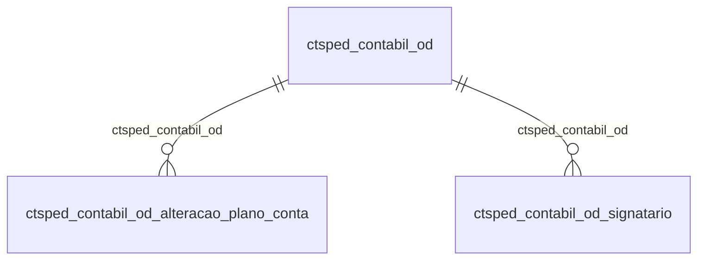

# Modelo — Contábil - sped (rascunho em lote)

> Gerado por `src/model/gerar_docs_modelo.py` a partir de `src/model/modulos/contabil_sped.yaml`, do catálogo e do perfil de colunas. **Não edite à mão.**

22 entidades. A coluna *Preench.* é o % de linhas com valor útil (nem nulo, nem em branco, nem zero, nem 1900-01-01; para colunas de código o zero conta como valor).

## Diagrama

## Entidades

| Entidade | Tabela | Linhas | Volume | Filtro obrigatório |
|---|---|---|---|---|
| [ctsped_ecf_od_y570](#ctsped_ecf_od_y570) | `CTSPED_ECF_OD_Y570` | 18.290 | medio | empresa |
| [ctsped_ecf_od_l200](#ctsped_ecf_od_l200) | `CTSPED_ECF_OD_L200` | 8.546 | pequeno | empresa |
| [ctsped_contabil_od_alteracao_plano_conta_anterior](#ctsped_contabil_od_alteracao_plano_conta_anterior) | `CTSPED_CONTABIL_OD_ALTERACAO_PLANO_CONTA_ANTERIOR` | 7.023 | pequeno | empresa |
| [ctsped_ecf_od_y600](#ctsped_ecf_od_y600) | `CTSPED_ECF_OD_Y600` | 6.663 | pequeno | empresa |
| [ctsped_ecf_od_m410](#ctsped_ecf_od_m410) | `CTSPED_ECF_OD_M410` | 5.083 | pequeno | empresa |
| [ctsped_contabil_od_alteracao_plano_conta](#ctsped_contabil_od_alteracao_plano_conta) | `CTSPED_CONTABIL_OD_ALTERACAO_PLANO_CONTA` | 4.293 | pequeno | empresa |
| [ctsped_ecf_od_m410_origem_importacao](#ctsped_ecf_od_m410_origem_importacao) | `CTSPED_ECF_OD_M410_ORIGEM_IMPORTACAO` | 4.250 | pequeno | empresa |
| [ctsped_ecf_od_y800](#ctsped_ecf_od_y800) | `CTSPED_ECF_OD_Y800` | 2.531 | pequeno | empresa |
| [ctsped_ecf_od_y720](#ctsped_ecf_od_y720) | `CTSPED_ECF_OD_Y720` | 2.531 | pequeno | empresa |
| [ctsped_ecf_od_w100](#ctsped_ecf_od_w100) | `CTSPED_ECF_OD_W100` | 2.531 | pequeno | empresa |
| [ctsped_ecf_od_y672](#ctsped_ecf_od_y672) | `CTSPED_ECF_OD_Y672` | 2.121 | pequeno | empresa |
| [ctsped_contabil_od](#ctsped_contabil_od) | `CTSPED_CONTABIL_OD` | 2.033 | pequeno | empresa |
| [ctsped_ecf_od_x360](#ctsped_ecf_od_x360) | `CTSPED_ECF_OD_X360` | 1.144 | pequeno | empresa |
| [ctsped_ecf_od_m010](#ctsped_ecf_od_m010) | `CTSPED_ECF_OD_M010` | 520 | pequeno | empresa |
| [ctsped_contabil_od_signatario](#ctsped_contabil_od_signatario) | `CTSPED_CONTABIL_OD_SIGNATARIO` | 329 | pequeno | empresa |
| [ctsped_ecf_od_y540](#ctsped_ecf_od_y540) | `CTSPED_ECF_OD_Y540` | 262 | pequeno | empresa |
| [ctsped_ecf_od_y671](#ctsped_ecf_od_y671) | `CTSPED_ECF_OD_Y671` | 237 | pequeno | empresa |
| [ctsped_ecf_od_y612](#ctsped_ecf_od_y612) | `CTSPED_ECF_OD_Y612` | 128 | pequeno | empresa |
| [ctsped_ecf_od_x450_registro](#ctsped_ecf_od_x450_registro) | `CTSPED_ECF_OD_X450_REGISTRO` | 96 | pequeno | empresa |
| [ctsped_ecf_od_y620](#ctsped_ecf_od_y620) | `CTSPED_ECF_OD_Y620` | 16 | pequeno | empresa |
| [ctsped_ecf_od_x430](#ctsped_ecf_od_x430) | `CTSPED_ECF_OD_X430` | 6 | pequeno | empresa |
| [ctsped_ecf_od_x450](#ctsped_ecf_od_x450) | `CTSPED_ECF_OD_X450` | 6 | pequeno | empresa |

## ctsped_ecf_od_y570

**SPED ECF - Outros Dados - Registro Y570** — tabela `CTSPED_ECF_OD_Y570` (18.290 linhas)

SPED ECF - Outros Dados - Registro Y570. 18.290 linhas no catálogo; chave: CODI_EMP, I_OUTROS_DADOS, I_DEMONSTRATIVO_IR_CSLL.

- **Chave:** `CODI_EMP, I_OUTROS_DADOS, I_DEMONSTRATIVO_IR_CSLL`
- **Empresa:** `CODI_EMP`
- **Período:** `—`
- **Ordem padrão:** `I_OUTROS_DADOS asc`, `I_DEMONSTRATIVO_IR_CSLL asc`

**Regras de negócio validadas:**

- Medido em 2026-10-18: 18.290 linhas, 349 empresa(s).

| Campo | Coluna | Tipo | Preench. | Domínio | Descrição (banco) |
|---|---|---|---|---|---|
| empresa | `codi_emp` | integer(4) |  |  | Empresa |
| sequencial_outros_dados | `i_outros_dados` | integer(4) |  |  | Sequencial Outros Dados |
| sequencial_interno | `i_demonstrativo_ir_csll` | integer(4) |  |  | Sequencial Interno |
| cnpj 🔒 | `cnpj` | varchar(14) |  |  | CNPJ |
| nome_empresarial | `nome_empresarial` | varchar(150) |  |  | Nome empresarial |
| orgao_publico | `orgao_publico` | char(1) |  |  | Órgão público |
| codigo_da_receita | `i_receita` | integer(4) |  |  | Código da receita |
| rendimento_bruto_receita | `valor_rendimento_bruto_receita` | numeric(14) |  |  | Rendimento bruto/receita |
| ir_retido_na_fonte | `valor_ir_retido_fonte` | numeric(14) |  |  | IR retido na fonte |
| csll_retida_na_fonte | `valor_csll_retida_fonte` | numeric(14) |  |  | CSLL retida na fonte |

**Filtros:** `sequencial_outros_dados` (eq/in), `sequencial_interno` (eq/in), `cnpj` (eq/in), `nome_empresarial` (contem/prefixo), `orgao_publico` (eq/in), `codigo_da_receita` (eq/in)

## ctsped_ecf_od_l200

**SPED ECF - Outros Dados - Registro L200** — tabela `CTSPED_ECF_OD_L200` (8.546 linhas)

SPED ECF - Outros Dados - Registro L200. 8.546 linhas no catálogo; chave: CODI_EMP, I_OUTROS_DADOS, COMPETENCIA.

- **Chave:** `CODI_EMP, I_OUTROS_DADOS, COMPETENCIA`
- **Empresa:** `CODI_EMP`
- **Período:** `COMPETENCIA`
- **Ordem padrão:** `COMPETENCIA desc`, `I_OUTROS_DADOS asc`

**Regras de negócio validadas:**

- Medido em 2026-10-18: 8.546 linhas, 443 empresa(s), COMPETENCIA de 2017-01-01 a 2025-12-31.

| Campo | Coluna | Tipo | Preench. | Domínio | Descrição (banco) |
|---|---|---|---|---|---|
| empresa | `codi_emp` | integer(4) |  |  | Empresa |
| sequencial | `i_outros_dados` | integer(4) |  |  | Sequencial |
| competencia | `competencia` | date(4) |  |  | Competência |
| metodo_de_avaliacao_do_estoque_final_0_n | `metodo_avaliacao_estoque_final` | integer(4) |  |  | MÉTODO DE AVALIAÇÃO DO ESTOQUE FINAL (0=NENHUM / 1=CUSTO MÉDIO PONDERADO / 2=PEPS (PRIMEIRO QUE ENTRA, PRIMEIRO QUE SAI) / 3=ARBITRAMENTO - ART. 296, INC. I E II, DO RIR/99 / 4=CUSTO ESPECÍFICO / 5=VALOR REALIZÁVEL LÍQUIDO / 6=INVENTÁRIO PERIÓDICO / |

**Filtros:** `sequencial` (eq/in), `competencia` (eq/in)

## ctsped_contabil_od_alteracao_plano_conta_anterior

**SPED Contábil - Outros Dados - Alteração plano de contas anterior** — tabela `CTSPED_CONTABIL_OD_ALTERACAO_PLANO_CONTA_ANTERIOR` (7.023 linhas)

SPED Contábil - Outros Dados - Alteração plano de contas anterior. 7.023 linhas no catálogo; chave: CODI_EMP, I_OUTROS_DADOS, I_CONTA, I_CONTA_ANTERIOR.

- **Chave:** `CODI_EMP, I_OUTROS_DADOS, I_CONTA, I_CONTA_ANTERIOR`
- **Empresa:** `CODI_EMP`
- **Período:** `—`
- **Ordem padrão:** `I_OUTROS_DADOS asc`, `I_CONTA asc`

**Regras de negócio validadas:**

- Medido em 2026-10-18: 7.023 linhas, 112 empresa(s).
- natureza_c_credora_d_devedora: todos os valores reais estão no comentário do banco (D=4.549, C=2.474).

| Campo | Coluna | Tipo | Preench. | Domínio | Descrição (banco) |
|---|---|---|---|---|---|
| empresa | `codi_emp` | integer(4) |  |  | Empresa |
| sequencial_dos_outros_dados | `i_outros_dados` | integer(4) |  |  | Sequencial dos outros dados |
| sequencial_da_tabela_pai | `i_conta` | integer(4) |  |  | Sequencial da tabela pai |
| sequencial | `i_conta_anterior` | integer(4) |  |  | Sequencial |
| conta_contabil_anterior | `codi_cta_anterior` | varchar(70) |  |  | Conta contábil anterior |
| classificacao_anterior | `classificacao_anterior` | varchar(35) |  |  | Classificação anterior |
| saldo | `saldo` | numeric(14) |  |  | Saldo |
| natureza_c_credora_d_devedora | `natureza` | char(1) |  | ctsped_contabil_od_alteracao_plano_conta_anterior_natureza_c_ | Natureza (C=CREDORA/D=DEVEDORA) |
| codigo_centro_de_custo | `codi_ccu_anterior` | varchar(20) |  |  | Código Centro de Custo |
| codigo_centro_de_custo_atual | `codi_ccu_atual` | varchar(20) |  |  | Código Centro de Custo Atual |

**Filtros:** `sequencial_dos_outros_dados` (eq/in), `sequencial_da_tabela_pai` (eq/in), `sequencial` (eq/in), `conta_contabil_anterior` (contem/prefixo), `classificacao_anterior` (contem/prefixo), `natureza_c_credora_d_devedora` (eq/in), `codigo_centro_de_custo` (eq/in), `codigo_centro_de_custo_atual` (eq/in)

## ctsped_ecf_od_y600

**SPED ECF - Outros Dados - Registro Y600** — tabela `CTSPED_ECF_OD_Y600` (6.663 linhas)

SPED ECF - Outros Dados - Registro Y600. 6.663 linhas no catálogo; chave: CODI_EMP, I_OUTROS_DADOS, I_SOCIO_TITULAR.

- **Chave:** `CODI_EMP, I_OUTROS_DADOS, I_SOCIO_TITULAR`
- **Empresa:** `CODI_EMP`
- **Período:** `DATA`
- **Ordem padrão:** `DATA desc`, `I_OUTROS_DADOS asc`, `I_SOCIO_TITULAR asc`

**Regras de negócio validadas:**

- Medido em 2026-10-18: 6.663 linhas, 577 empresa(s), DATA de 1900-01-01 a 2025-12-17.
- tipo_s_socio_a_administrador_r_represent: todos os valores reais estão no comentário do banco (S=6.627, E=19, A=17).
- Vínculo gesocios (gesocios): 0 de 6 linhas sem registro relacionado (empresa 1408).

| Campo | Coluna | Tipo | Preench. | Domínio | Descrição (banco) |
|---|---|---|---|---|---|
| empresa | `codi_emp` | integer(4) |  |  | Empresa |
| sequencial_outros_dados | `i_outros_dados` | integer(4) |  |  | Sequencial Outros Dados |
| sequencial_interno | `i_socio_titular` | integer(4) |  |  | Sequencial Interno |
| data | `data` | date(4) |  |  | Data |
| codigo_do_socio | `i_socio` | integer(4) |  |  | Código do sócio |
| tipo_s_socio_a_administrador_r_represent | `tipo` | char(1) |  | ctsped_ecf_od_y600_tipo_s_socio_a | Tipo (S - Sócio/A - Administrador/R - Representante Legal/E - Empresário) |
| qualificacao | `qualificacao` | integer(4) |  |  | Qualificação |
| remuneracao | `valor_remuneracao` | numeric(14) |  |  | Remuneração |
| lucros_dividendos | `valor_lucro_dividendo` | numeric(14) |  |  | Lucros/Dividendos |
| juros_capital_proprio | `valor_juros_capital_proprio` | numeric(14) |  |  | Juros capital próprio |
| demais_rendimentos | `valor_demais_rendimentos` | numeric(14) |  |  | Demais rendimentos |
| irrf | `valor_irrf` | numeric(14) |  |  | IRRF |
| cpf_cnpj 🔒 | `cpf_cnpj` | varchar(14) |  |  | CPF/CNPJ |
| data_ingresso | `data_ingresso` | date(4) |  |  | Data ingresso |
| data_saida | `data_saida` | date(4) |  |  | Data saída |
| participacao | `participacao` | numeric(15) |  |  | Participação % |
| capital_votante | `capital_votante` | numeric(5) |  |  | Capital votante % |
| indicador_de_qualificacao | `tipo_indicador_qualificacao` | varchar(2) |  |  | Indicador de qualificação |

**Vínculos (LEFT JOIN, acrescentam colunas legíveis):**

- `gesocios` → `gesocios` por `i_socio` = `i_socio`; colunas: `gesocios_nome`

**Filtros:** `sequencial_outros_dados` (eq/in), `sequencial_interno` (eq/in), `data` (entre/gte/lte), `data_ingresso` (entre/gte/lte), `data_saida` (entre/gte/lte), `codigo_do_socio` (eq/in), `tipo_s_socio_a_administrador_r_represent` (eq/in), `cpf_cnpj` (eq/in), `indicador_de_qualificacao` (eq/in)

## ctsped_ecf_od_m410

**SPED ECF - Outros Dados - Registro M410** — tabela `CTSPED_ECF_OD_M410` (5.083 linhas)

SPED ECF - Outros Dados - Registro M410. 5.083 linhas no catálogo; chave: CODI_EMP, I_OUTROS_DADOS, COMPETENCIA, SEQUENCIAL, TIPO_CONTA.

- **Chave:** `CODI_EMP, I_OUTROS_DADOS, COMPETENCIA, SEQUENCIAL, TIPO_CONTA`
- **Empresa:** `CODI_EMP`
- **Período:** `COMPETENCIA`
- **Ordem padrão:** `COMPETENCIA desc`, `I_OUTROS_DADOS asc`, `SEQUENCIAL asc`

**Regras de negócio validadas:**

- Medido em 2026-10-18: 5.083 linhas, 62 empresa(s), COMPETENCIA de 2018-03-01 a 2025-12-31.
- Colunas expostas nulas em 100% das linhas (1): codigo_da_parte_b_ou_base_negativa.
- tipo_da_conta_b_base_negativa_p_parte_b: todos os valores reais estão no comentário do banco (P=2.551, B=2.532).
- indicador_do_lancamento_db_debito_cr_cre: todos os valores reais estão no comentário do banco (PF=2.501, BC=2.486, DB=96).

| Campo | Coluna | Tipo | Preench. | Domínio | Descrição (banco) |
|---|---|---|---|---|---|
| empresa | `codi_emp` | integer(4) |  |  | Empresa |
| sequencial_outros_dados | `i_outros_dados` | integer(4) |  |  | Sequencial Outros Dados |
| competencia | `competencia` | date(4) |  |  | Competência |
| sequencial_interno | `sequencial` | integer(4) |  |  | Sequencial Interno |
| tipo_da_conta_b_base_negativa_p_parte_b | `tipo_conta` | char(1) |  | ctsped_ecf_od_m410_tipo_da_conta_ | Tipo da Conta (B=Base Negativa / P=Parte B) |
| historico | `historico` | varchar(40) |  |  | Histórico |
| lanc_realizacao_de_valores_cuja_tributac | `lancar_realizacao_valor_tributacao_diferida` | char(1) |  |  | Lanç. realização de valores cuja tributação tenha sido diferida |
| codigo_da_parte_b_ou_base_negativa | `i_base_negativa_parte_b` | integer(4) |  |  | Código da parte b ou base negativa |
| valor | `valor` | numeric(14) |  |  | Valor |
| indicador_do_lancamento_db_debito_cr_cre | `indicador_lancamento` | char(2) |  | ctsped_ecf_od_m410_indicador_do_l | Indicador do lançamento (DB-Débito / CR-Crédito / PF-Prejuízo do exercício / BC-Base de cálculo negativa da CSLL) |
| identificador_sped_ecf | `identificador_sped_ecf` | varchar(30) |  |  | Identificador SPED ECF |
| codigo_conta_contra_partida | `conta_contrapartida` | integer(4) |  |  | Código conta contra partida |

**Filtros:** `sequencial_outros_dados` (eq/in), `competencia` (eq/in), `sequencial_interno` (eq/in), `tipo_da_conta_b_base_negativa_p_parte_b` (eq/in), `historico` (contem/prefixo), `lanc_realizacao_de_valores_cuja_tributac` (eq/in), `codigo_da_parte_b_ou_base_negativa` (eq/in), `indicador_do_lancamento_db_debito_cr_cre` (eq/in), `identificador_sped_ecf` (contem/prefixo)

## ctsped_contabil_od_alteracao_plano_conta

**SPED Contábil - Outros Dados - Alteração plano de contas** — tabela `CTSPED_CONTABIL_OD_ALTERACAO_PLANO_CONTA` (4.293 linhas)

SPED Contábil - Outros Dados - Alteração plano de contas. 4.293 linhas no catálogo; chave: CODI_EMP, I_OUTROS_DADOS, I_CONTA.

- **Chave:** `CODI_EMP, I_OUTROS_DADOS, I_CONTA`
- **Empresa:** `CODI_EMP`
- **Período:** `—`
- **Ordem padrão:** `I_OUTROS_DADOS asc`, `I_CONTA asc`

**Regras de negócio validadas:**

- Medido em 2026-10-18: 4.293 linhas, 112 empresa(s).
- Vínculo ctsped_contabil_od (CTSPED_CONTABIL_OD): 0 de 23 linhas sem registro relacionado (empresa 963).

| Campo | Coluna | Tipo | Preench. | Domínio | Descrição (banco) |
|---|---|---|---|---|---|
| empresa | `codi_emp` | integer(4) |  |  | Empresa |
| sequencial_dos_outros_dados | `i_outros_dados` | integer(4) |  |  | Sequencial dos outros dados |
| sequencial | `i_conta` | integer(4) |  |  | Sequencial |
| conta_contabil | `codi_cta` | integer(4) |  |  | Conta contábil |

**Vínculos (LEFT JOIN, acrescentam colunas legíveis):**

- `ctsped_contabil_od` → `CTSPED_CONTABIL_OD` por `codi_emp` = `codi_emp` e `i_outros_dados` = `i_outros_dados`; colunas: `ctsped_contabil_od_nome`

**Filtros:** `sequencial_dos_outros_dados` (eq/in), `sequencial` (eq/in), `conta_contabil` (eq/in)

## ctsped_ecf_od_m410_origem_importacao

**Tabela de origem da importação registros M410** — tabela `CTSPED_ECF_OD_M410_ORIGEM_IMPORTACAO` (4.250 linhas)

Tabela de origem da importação registros M410. 4.250 linhas no catálogo; chave: CODI_EMP, MES_COMPETENCIA, ANO_COMPETENCIA, TIPO_IMPORTACAO, PERIODICIDADE.

- **Chave:** `CODI_EMP, MES_COMPETENCIA, ANO_COMPETENCIA, TIPO_IMPORTACAO, PERIODICIDADE`
- **Empresa:** `CODI_EMP`
- **Período:** `—`
- **Ordem padrão:** `MES_COMPETENCIA asc`, `ANO_COMPETENCIA asc`

**Regras de negócio validadas:**

- Medido em 2026-10-18: 4.250 linhas, 60 empresa(s).
- Vínculo geempre (geempre): 0 de 78 linhas sem registro relacionado (empresa 1420).

| Campo | Coluna | Tipo | Preench. | Domínio | Descrição (banco) |
|---|---|---|---|---|---|
| codigo_empresa | `codi_emp` | integer(4) |  |  | Código Empresa |
| mes_competencia_da_origem | `mes_competencia` | integer(4) |  |  | Mes competencia da origem. |
| ano_competencia_da_origem | `ano_competencia` | integer(4) |  |  | Ano competência da origem. |
| a_lacs_u_lalur | `tipo_importacao` | char(1) |  |  | A = Lacs / U = Lalur |
| a_anual_m_mensal_t_trimestral | `periodicidade` | char(1) |  |  | A = Anual / M = Mensal / T = Trimestral |
| importar_prejuizos_e_outros_m_origem_man | `origem_importacao` | varchar(50) |  |  | Importar prejuízos e outros(M = Origem Manual /A = Origem Automatica |

**Vínculos (LEFT JOIN, acrescentam colunas legíveis):**

- `geempre` → `geempre` por `codi_emp` = `codi_emp`; colunas: `geempre_nome`

**Filtros:** `mes_competencia_da_origem` (eq/in), `ano_competencia_da_origem` (eq/in), `a_lacs_u_lalur` (eq/in), `a_anual_m_mensal_t_trimestral` (eq/in), `importar_prejuizos_e_outros_m_origem_man` (contem/prefixo)

## ctsped_ecf_od_y800

**SPED ECF - Outros Dados - Registro Y800** — tabela `CTSPED_ECF_OD_Y800` (2.531 linhas)

SPED ECF - Outros Dados - Registro Y800. 2.531 linhas no catálogo; chave: CODI_EMP, I_OUTROS_DADOS.

- **Chave:** `CODI_EMP, I_OUTROS_DADOS`
- **Empresa:** `CODI_EMP`
- **Período:** `—`
- **Ordem padrão:** `I_OUTROS_DADOS asc`

**Regras de negócio validadas:**

- Medido em 2026-10-18: 2.531 linhas, 612 empresa(s).

| Campo | Coluna | Tipo | Preench. | Domínio | Descrição (banco) |
|---|---|---|---|---|---|
| empresa | `codi_emp` | integer(4) |  |  | Empresa |
| sequencial_outros_dados | `i_outros_dados` | integer(4) |  |  | Sequencial Outros Dados |
| anexar_arquivo_externo | `anexar_arquivo_externo` | char(1) |  |  | Anexar arquivo externo |
| caminho_do_arquivo | `caminho_arquivo` | varchar(1024) |  |  | Caminho do arquivo |
| memoria_de_calculo_incorporacao | `memoria_calculo_incorporacao` | char(1) |  |  | Memória de cálculo - Incorporação |
| caminho_do_arquivo_da_memoria_de_calculo | `caminho_memoria_calculo_incorporacao` | varchar(1024) |  |  | Caminho do arquivo da Memória de cálculo - Incorporação |
| laudo_de_avaliacao_a_valor_justo | `laudo_avaliacao_valor_justo` | char(1) |  |  | Laudo de avaliação a valor justo |
| caminho_do_arquivo_do_laudo_de_avaliacao | `caminho_laudo_avaliacao_valor_justo` | varchar(1024) |  |  | Caminho do arquivo do Laudo de avaliação a valor justo |

**Filtros:** `sequencial_outros_dados` (eq/in), `anexar_arquivo_externo` (eq/in), `caminho_do_arquivo` (contem/prefixo), `memoria_de_calculo_incorporacao` (eq/in), `caminho_do_arquivo_da_memoria_de_calculo` (contem/prefixo), `laudo_de_avaliacao_a_valor_justo` (eq/in), `caminho_do_arquivo_do_laudo_de_avaliacao` (contem/prefixo)

## ctsped_ecf_od_y720

**SPED ECF - Outros Dados - Registro Y720** — tabela `CTSPED_ECF_OD_Y720` (2.531 linhas)

SPED ECF - Outros Dados - Registro Y720. 2.531 linhas no catálogo; chave: CODI_EMP, I_OUTROS_DADOS.

- **Chave:** `CODI_EMP, I_OUTROS_DADOS`
- **Empresa:** `CODI_EMP`
- **Período:** `DATA_FINAL_PERIODO_APURACAO_LUCRO_LIQUIDO`
- **Ordem padrão:** `DATA_FINAL_PERIODO_APURACAO_LUCRO_LIQUIDO desc`, `I_OUTROS_DADOS asc`

**Regras de negócio validadas:**

- Medido em 2026-10-18: 2.531 linhas, 612 empresa(s), DATA_FINAL_PERIODO_APURACAO_LUCRO_LIQUIDO de 1900-01-01 a 2024-12-31.

| Campo | Coluna | Tipo | Preench. | Domínio | Descrição (banco) |
|---|---|---|---|---|---|
| empresa | `codi_emp` | integer(4) |  |  | Empresa |
| sequencial_outros_dados | `i_outros_dados` | integer(4) |  |  | Sequencial Outros Dados |
| gerar_informacoes_de_periodos_anteriores | `gerar_informacao_periodo_anterior` | char(1) |  |  | Gerar informações de períodos anteriores |
| valor_lucro_liquido_do_ultimo_periodo_de | `valor_lucro_liquido_pela_taxa_selic` | numeric(14) |  |  | Valor lucro líquido do último período de apuração antes do IR e da CSLL atualizado pela taxa Selic |
| data_final_do_periodo_de_apuracao_do_luc | `data_final_periodo_apuracao_lucro_liquido` | date(4) |  |  | Data final do período de apuração do lucro líquido informado |
| receita_bruta_do_periodo_anterior | `valor_receita_bruta_periodo_anterior` | numeric(14) |  |  | Receita Bruta do período anterior |
| houve_termo_de_intimacao_pela_rfb_para_e | `houve_termo_intimacao_rfb_entrega_deste_ecf` | char(1) |  |  | Houve termo de intimação pela RFB para entrega desta ECF |
| a_transmissao_desta_ecf_esta_dentro_do_p | `transmissao_desta_ecf_dentro_prazo_previsto_intimacao` | char(1) |  |  | A transmissão desta ECF está dentro do prazo previsto na intimação |

**Filtros:** `sequencial_outros_dados` (eq/in), `data_final_do_periodo_de_apuracao_do_luc` (entre/gte/lte), `gerar_informacoes_de_periodos_anteriores` (eq/in), `houve_termo_de_intimacao_pela_rfb_para_e` (eq/in), `a_transmissao_desta_ecf_esta_dentro_do_p` (eq/in)

## ctsped_ecf_od_w100

**SPED ECF - Outros Dados - Registro W100** — tabela `CTSPED_ECF_OD_W100` (2.531 linhas)

SPED ECF - Outros Dados - Registro W100. 2.531 linhas no catálogo; chave: CODI_EMP, I_OUTROS_DADOS.

- **Chave:** `CODI_EMP, I_OUTROS_DADOS`
- **Empresa:** `CODI_EMP`
- **Período:** `DATA_INICIO_PERIODO_SOCIETARIO`
- **Ordem padrão:** `DATA_INICIO_PERIODO_SOCIETARIO desc`, `I_OUTROS_DADOS asc`

**Regras de negócio validadas:**

- Medido em 2026-10-18: 2.531 linhas, 612 empresa(s).
- Colunas expostas nulas em 100% das linhas (2): data_de_inicio_periodo_societario, data_final_periodo_societario.
- modalidade_1_entidade_substituta_2_preen: todos os valores reais estão no comentário do banco (1=2.531).
- idioma_en_ingles_es_espanhol_pt_portugue: todos os valores reais estão no comentário do banco (EN=2.531).
- Vínculo cttabela_sped_ecf_jurisd (CTTABELA_SPED_ECF_JURISDICAO): 0 de 3 linhas sem registro relacionado (empresa 965).
- Vínculo cttabela_sped_ecf_tipo_m (CTTABELA_SPED_ECF_TIPO_MOEDA): 0 de 3 linhas sem registro relacionado (empresa 965).

| Campo | Coluna | Tipo | Preench. | Domínio | Descrição (banco) |
|---|---|---|---|---|---|
| empresa | `codi_emp` | integer(4) |  |  | Empresa |
| sequencial_outros_dados | `i_outros_dados` | integer(4) |  |  | Sequencial Outros Dados |
| nome_do_grupo_multinacional | `nome_grupo_multinacional` | varchar(250) |  |  | Nome do grupo multinacional |
| a_pj_e_controladora_final_s_n | `a_pj_controladora_final` | char(1) |  |  | A PJ é controladora final (S/N) |
| nome_da_controladora_final | `nome_controladora_final` | varchar(250) |  |  | Nome da controladora final |
| jurisdicao_da_controladora_final | `i_jurisdicao_controladora_final` | integer(4) |  |  | Jurisdição da controladora final |
| tin_da_controladora_final | `tin_controladora_final` | varchar(250) |  |  | TIN da controladora final |
| responsavel_pela_declaracao | `responsavel_declaracao` | integer(4) |  |  | Responsável pela declaração |
| modalidade_1_entidade_substituta_2_preen | `modalidade` | integer(4) |  | ctsped_ecf_od_w100_modalidade_1_e | Modalidade (1-Entidade substituta / 2-Preenchimento local) |
| nome_da_entidade_substituta_local | `nome_entidade_substitutiva` | varchar(250) |  |  | Nome da  entidade substituta/local |
| jurisdicao_entidade_substituta_local | `i_jurisdicao_entidade_substitutiva` | integer(4) |  |  | Jurisdição entidade substituta/local |
| tin_da_entidade_substituta | `tin_entidade_substitutiva` | varchar(250) |  |  | TIN da entidade substituta |
| data_de_inicio_periodo_societario | `data_inicio_periodo_societario` | date(4) |  |  | Data de início período societário |
| data_final_periodo_societario | `data_final_periodo_societario` | date(4) |  |  | Data final período societário |
| moeda | `i_tipo_moeda` | integer(4) |  |  | Moeda |
| idioma_en_ingles_es_espanhol_pt_portugue | `idioma` | char(2) |  | ctsped_ecf_od_w100_idioma_en_ingl | Idioma (EN-Inglês / ES-Espanhol / PT-Português) |

**Vínculos (LEFT JOIN, acrescentam colunas legíveis):**

- `cttabela_sped_ecf_jurisd` → `CTTABELA_SPED_ECF_JURISDICAO` por `i_jurisdicao_entidade_substitutiva` = `i_jurisdicao`; colunas: `cttabela_sped_ecf_jurisd_nome`
- `cttabela_sped_ecf_tipo_m` → `CTTABELA_SPED_ECF_TIPO_MOEDA` por `i_tipo_moeda` = `i_tipo_moeda`; colunas: `cttabela_sped_ecf_tipo_m_nome`

**Filtros:** `sequencial_outros_dados` (eq/in), `data_de_inicio_periodo_societario` (entre/gte/lte), `data_final_periodo_societario` (entre/gte/lte), `nome_do_grupo_multinacional` (contem/prefixo), `a_pj_e_controladora_final_s_n` (eq/in), `nome_da_controladora_final` (contem/prefixo), `jurisdicao_da_controladora_final` (eq/in), `tin_da_controladora_final` (contem/prefixo), `nome_da_entidade_substituta_local` (contem/prefixo), `jurisdicao_entidade_substituta_local` (eq/in), `tin_da_entidade_substituta` (contem/prefixo), `moeda` (eq/in), `idioma_en_ingles_es_espanhol_pt_portugue` (eq/in)

## ctsped_ecf_od_y672

**SPED ECF - Outros Dados - Registro Y672** — tabela `CTSPED_ECF_OD_Y672` (2.121 linhas)

SPED ECF - Outros Dados - Registro Y672. 2.121 linhas no catálogo; chave: CODI_EMP, I_OUTROS_DADOS.

- **Chave:** `CODI_EMP, I_OUTROS_DADOS`
- **Empresa:** `CODI_EMP`
- **Período:** `—`
- **Ordem padrão:** `I_OUTROS_DADOS asc`

**Regras de negócio validadas:**

- Medido em 2026-10-18: 2.121 linhas, 552 empresa(s).

| Campo | Coluna | Tipo | Preench. | Domínio | Descrição (banco) |
|---|---|---|---|---|---|
| empresa | `codi_emp` | integer(4) |  |  | Empresa |
| sequencial_outros_dados | `i_outros_dados` | integer(4) |  |  | Sequencial Outros Dados |
| regime_de_apuracao_das_receitas | `regime_apuracao_receita` | integer(4) |  |  | Regime de apuração das receitas |
| metodo_de_avaliacao_de_estoques | `metodo_avaliacao_estoque` | integer(4) |  |  | Método de avaliação de estoques |

**Filtros:** `sequencial_outros_dados` (eq/in)

## ctsped_contabil_od

**SPED Contábil - Outros Dados** — tabela `CTSPED_CONTABIL_OD` (2.033 linhas)

SPED Contábil - Outros Dados. 2.033 linhas no catálogo; chave: CODI_EMP, I_OUTROS_DADOS.

- **Chave:** `CODI_EMP, I_OUTROS_DADOS`
- **Empresa:** `CODI_EMP`
- **Período:** `DATA_ARQUIVAMENTO_ATOS_CONSTITUTIVOS`
- **Ordem padrão:** `DATA_ARQUIVAMENTO_ATOS_CONSTITUTIVOS desc`, `I_OUTROS_DADOS asc`

**Regras de negócio validadas:**

- Medido em 2026-10-18: 2.033 linhas, 524 empresa(s), DATA_ARQUIVAMENTO_ATOS_CONSTITUTIVOS de 1968-01-29 a 2025-10-09.
- Vínculo geempre (geempre): 0 de 3 linhas sem registro relacionado (empresa 637).
- Vínculo gescp (GESCP): 0 de 3 linhas sem registro relacionado (empresa 637).

| Campo | Coluna | Tipo | Preench. | Domínio | Descrição (banco) |
|---|---|---|---|---|---|
| empresa | `codi_emp` | integer(4) |  |  | Empresa |
| sequencial_dos_outros_dados | `i_outros_dados` | integer(4) |  |  | Sequencial dos outros dados |
| competencia | `competencia` | date(4) |  |  | Competência |
| empresa_scp | `codi_emp_i_scp` | integer(4) |  |  | Empresa - SCP |
| scp | `i_scp` | integer(4) |  |  | SCP |
| indicador_de_situacao_especial | `indicador_situacao_especial` | char(1) |  |  | Indicador de situação especial |
| situacao_especial | `situacao_especial` | integer(4) |  |  | Situação especial |
| indicador_de_inicio_de_periodo | `indicador_inicio_periodo` | integer(4) |  |  | Indicador de início de período |
| indicador_de_existencia_de_nire | `indicador_existencia_nire` | integer(4) |  |  | Indicador de existência de NIRE |
| finalidade_da_escrituracao | `finalidade_escrituracao` | integer(4) |  |  | Finalidade da escrituração |
| hash_da_escrituracao_substituida | `hash_escrituracao_substituida` | char(128) |  |  | Hash da escrituração substituída |
| nire_da_escrituracao_substituida | `nire_escrituracao_substituida` | numeric(13) |  |  | NIRE da escrituração substituída |
| indicador_de_empresa_de_grande_porte | `indicador_empresa_grande_porte` | integer(4) |  |  | Indicador de empresa de grande porte |
| data_do_arquivamento_dos_atos_constituti | `data_arquivamento_atos_constitutivos` | date(4) |  |  | Data do arquivamento dos atos constitutivos |
| data_de_encerramento_do_exercicio_social | `data_encerramento_exercicio_social` | date(4) |  |  | Data de encerramento do exercício social |
| informar_data_de_arquivamento_do_ato_de | `informar_data_arquivamento_ato_conversao` | char(1) |  |  | Informar data de arquivamento do ato de conversão da sociedade simples em sociedade empresária |
| data_de_arquivamento_do_ato_de_conversao | `data_arquivamento_ato_conversao` | date(4) |  |  | Data de arquivamento do ato de conversão da sociedade simples em sociedade empresária |
| gerar_somente_contas_com_movimento | `gerar_somente_contas_movimento` | char(1) |  |  | Gerar somente contas com movimento |
| gera_lancamentos_por_centro_de_custo | `gera_lancamentos_centro_custo` | char(1) |  |  | Gera lançamentos por centro de custo |
| nao_gerar_o_registro_i051_com_o_plano_de | `nao_gerar_registro_i051` | char(1) |  |  | Não gerar o registro I051 com o Plano de Contas Referencial |
| plano_de_contas_referencial | `plano_contas_referencial` | integer(4) |  |  | Plano de Contas Referencial |
| gera_as_contas_contabeis_por | `gerar_contas_contabeis_por` | integer(4) |  |  | Gera as contas contábeis por |
| numero_do_livro | `numero_livro` | integer(4) |  |  | Número do livro |
| possui_auditoria_independente | `possui_auditoria_independente` | char(1) |  |  | Possui auditoria independente |
| nome_do_auditor | `nome_auditor` | char(128) |  |  | Nome do auditor |
| registro_do_auditor_na_cvm | `registro_auditor_cvm` | char(128) |  |  | Registro do auditor na CVM |
| gerar_balanco_patrimonial | `gerar_balanco_patrimonial` | char(1) |  |  | Gerar Balanço patrimonial |
| gerar_balanco_patrimonial_grau_maximo | `gerar_balanco_patrimonial_grau_maximo` | integer(4) |  |  | Gerar Balanço patrimonial - Grau máximo |
| gerar_demonstrativo_do_resultado_do_exer | `gerar_dre` | char(1) |  |  | Gerar Demonstrativo do Resultado do Exercício (DRE) |
| gerar_dlpa | `gerar_dlpa` | char(1) |  |  | Gerar DLPA |
| gerar_dmpl | `gerar_dmpl` | char(1) |  |  | Gerar DMPL |
| gerar_dra | `gerar_dra` | char(1) |  |  | Gerar DRA |
| gerar_dva | `gerar_dva` | char(1) |  |  | Gerar DVA |
| gerar_doar | `gerar_doar` | char(1) |  |  | Gerar DOAR |
| gerar_dfc | `gerar_dfc` | char(1) |  |  | Gerar DFC |
| gerar_notas_explicativas | `gerar_notas_explicativas` | char(1) |  |  | Gerar Notas Explicativas |
| gerar_arquivo_s_externo_s | `gerar_arquivo_externo` | char(1) |  |  | Gerar Arquivo(s) Externo(s) |
| gerar_arquivo_s_externo_s_caminho | `gerar_arquivo_externo_caminho` | char(4096) |  |  | Gerar Arquivo(s) Externo(s) - Caminho |
| gerar_os_registros_anuais_quando_houver | `gerar_registros_anuais` | char(1) |  |  | Gerar os registros anuais quando houver mais de um zeramento no período de geração do arquivo |
| nao_gerar_as_contas_contabeis_com_saldo | `nao_gerar_contas_saldo_zero_balanco` | char(1) |  |  | Não gerar as contas contábeis com saldo inicial e atual zero no Balanço Patrimonial |
| considerar_o_sado_anterior_lancado_no_pr | `considerar_saldo_anterior_lancado_exercicio` | char(1) |  |  | Considerar o sado anterior lançado no próprio exercício para os demonstrativos |
| nao_gerar_o_registro_i050_com_o_plano_de | `ef_geral_gerar_i050_plano_contas` | char(1) |  |  | Não gerar o registro I050 com o Plano de Contas |
| ef_geral_numero_do_livro | `ef_geral_numero_livro` | integer(4) |  |  | EF - Geral - Número do Livro |
| ef_geral_nome_do_livro | `ef_geral_nome_livro` | varchar(80) |  |  | EF - Geral - Nome do Livro |
| ef_escrituracao_principal_numero | `ef_escrituracao_principal_numero_livro` | integer(4) |  |  | EF - Escrituração principal - Número |
| ef_escrituracao_principal_nome | `ef_escrituracao_principal_nome` | varchar(80) |  |  | EF - Escrituração principal - Nome |
| ef_escrituracao_principal_tipo_0_digital | `ef_escrituracao_principal_tipo` | integer(4) |  |  | EF - Escrituração principal - Tipo (0-Digital (Informado no SPED) / 1-Outros) |
| forma_que_as_contas_foram_geradas_no_per | `forma_conta_foi_gerada_periodo_anterior` | integer(4) |  |  | Forma que as contas foram geradas no período anterior |
| gerar_coeficiente_de_analise | `gerar_coeficiente_analise` | char(1) |  |  | Gerar Coeficiente de análise |
| gerar_balanco_patrimonial_em_rtf | `gerar_balanco_rtf` | char(1) |  |  | Gerar balanço patrimonial em RTF |
| gerar_dre_em_rtf | `gerar_dre_rtf` | char(1) |  |  | Gerar DRE em RTF |
| pm_geral_nao_gerar_i050_plano_contas | `pm_geral_nao_gerar_i050_plano_contas` | char(1) |  |  | Não gerar o registro I050 com o Plano de Contas |
| pm_geral_numero_do_livro | `pm_geral_numero_livro` | integer(4) |  |  | PM - Geral - Número do Livro |
| pm_geral_nome_do_livro | `pm_geral_nome_livro` | varchar(80) |  |  | PM - Geral - Nome do Livro |
| pm_escrituracao_principal_numero | `pm_escrituracao_principal_numero_livro` | integer(4) |  |  | PM - Escrituração principal - Número |
| pm_escrituracao_principal_nome | `pm_escrituracao_principal_nome` | varchar(80) |  |  | PM - Escrituração principal - Nome |
| pm_escrituracao_principal_tipo_0_digital | `pm_escrituracao_principal_tipo` | integer(4) |  |  | PM - Escrituração principal - Tipo (0-Digital (Informado no SPED) / 1-Outros) |
| ef_sped_contabil_contas_a_pagar_e_recebe | `ef_sped_contabil_cr_cp_gerar_i050_plano_contas` | char(1) |  |  | EF - SPED Contábil - Contas a pagar e receber - Não gerar o registro I050 com Plano de Contas |
| ef_sped_cp_cr_numero_livro | `ef_sped_cp_cr_numero_livro` | integer(4) |  |  | EF - SPED Contábil - Contas a pagar e receber - Número do Livro |
| ef_sped_cp_cr_nome_livro | `ef_sped_cp_cr_nome_livro` | varchar(80) |  |  | EF - SPED Contábil - Contas a pagar e receber - Nome do Livro |

**Vínculos (LEFT JOIN, acrescentam colunas legíveis):**

- `geempre` → `geempre` por `codi_emp` = `codi_emp`; colunas: `geempre_nome`
- `gescp` → `GESCP` por `codi_emp_i_scp` = `codi_emp` e `i_scp` = `i_scp`; colunas: `gescp_nome`

**Filtros:** `sequencial_dos_outros_dados` (eq/in), `competencia` (entre/gte/lte), `data_do_arquivamento_dos_atos_constituti` (entre/gte/lte), `data_de_encerramento_do_exercicio_social` (entre/gte/lte), `data_de_arquivamento_do_ato_de_conversao` (entre/gte/lte), `empresa_scp` (eq/in), `scp` (eq/in), `indicador_de_situacao_especial` (eq/in), `situacao_especial` (eq/in), `hash_da_escrituracao_substituida` (contem/prefixo), `informar_data_de_arquivamento_do_ato_de` (eq/in), `gerar_somente_contas_com_movimento` (eq/in), `gera_lancamentos_por_centro_de_custo` (eq/in), `nao_gerar_o_registro_i051_com_o_plano_de` (eq/in)

## ctsped_ecf_od_x360

**SPED ECF - Outros Dados - Informações Econômicas** — tabela `CTSPED_ECF_OD_X360` (1.144 linhas)

SPED ECF - Outros Dados - Informações Econômicas. 1.144 linhas no catálogo; chave: CODI_EMP, I_OUTROS_DADOS, COMPETENCIA.

- **Chave:** `CODI_EMP, I_OUTROS_DADOS, COMPETENCIA`
- **Empresa:** `CODI_EMP`
- **Período:** `COMPETENCIA`
- **Ordem padrão:** `COMPETENCIA desc`, `I_OUTROS_DADOS asc`

**Regras de negócio validadas:**

- Medido em 2026-10-18: 1.144 linhas, 468 empresa(s), COMPETENCIA de 2020-01-01 a 2025-01-01.

| Campo | Coluna | Tipo | Preench. | Domínio | Descrição (banco) |
|---|---|---|---|---|---|
| empresa | `codi_emp` | integer(4) |  |  | Empresa |
| sequencial | `i_outros_dados` | integer(4) |  |  | Sequencial |
| data_de_competencia | `competencia` | date(4) |  |  | Data de competência |
| tipo_de_arquivo_local | `tipo_arquivo_local` | varchar(2) |  |  | Tipo de Arquivo Local |
| ajustes_em_funcao_das_regras_de_preco_de | `regra_preco_transferencia` | varchar(1) |  |  | Ajustes em função das regras de preço de transferência |
| houve_reestruturacao | `houve_reestruturacao` | varchar(1) |  |  | Houve reestruturação |
| houve_transferencia_de_intangiveis | `houve_transferencia_intangivel` | varchar(1) |  |  | Houve transferência de intangíveis" |

**Filtros:** `sequencial` (eq/in), `data_de_competencia` (eq/in), `tipo_de_arquivo_local` (eq/in), `ajustes_em_funcao_das_regras_de_preco_de` (eq/in), `houve_reestruturacao` (eq/in), `houve_transferencia_de_intangiveis` (eq/in)

## ctsped_ecf_od_m010

**SPED ECF - Outros Dados - Registro M010** — tabela `CTSPED_ECF_OD_M010` (520 linhas)

SPED ECF - Outros Dados - Registro M010. 520 linhas no catálogo; chave: CODI_EMP, I_OUTROS_DADOS, I_BASE_NEGATIVA_PARTE_B, TIPO_CONTA.

- **Chave:** `CODI_EMP, I_OUTROS_DADOS, I_BASE_NEGATIVA_PARTE_B, TIPO_CONTA`
- **Empresa:** `CODI_EMP`
- **Período:** `DATA_CRIACAO`
- **Ordem padrão:** `DATA_CRIACAO desc`, `I_OUTROS_DADOS asc`, `I_BASE_NEGATIVA_PARTE_B asc`

**Regras de negócio validadas:**

- Medido em 2026-10-18: 520 linhas, 64 empresa(s), DATA_CRIACAO de 2017-12-31 a 2025-12-31.
- tipo_da_conta_b_base_negativa_p_parte_b: todos os valores reais estão no comentário do banco (P=289, B=231).
- indicador_do_saldo_inicial_d_prejuizos_o: todos os valores reais estão no comentário do banco (D=518, C=2).

| Campo | Coluna | Tipo | Preench. | Domínio | Descrição (banco) |
|---|---|---|---|---|---|
| empresa | `codi_emp` | integer(4) |  |  | Empresa |
| sequencial_outros_dados | `i_outros_dados` | integer(4) |  |  | Sequencial Outros Dados |
| codigo_da_parte_b_ou_base_negativa | `i_base_negativa_parte_b` | integer(4) |  |  | Código da parte b ou base negativa |
| tipo_da_conta_b_base_negativa_p_parte_b | `tipo_conta` | char(1) |  | ctsped_ecf_od_m010_tipo_da_conta_ | Tipo da Conta (B=Base Negativa / P=Parte B) |
| data_de_criacao | `data_criacao` | date(4) |  |  | Data de criação |
| saldo_inicial | `saldo_inicial` | numeric(14) |  |  | Saldo inicial |
| descricao_da_parte_b_ou_base_negativa | `descricao` | varchar(140) |  |  | Descrição da parte b ou base negativa |
| indicador_do_saldo_inicial_d_prejuizos_o | `indicador_saldo_inicial` | char(1) |  | ctsped_ecf_od_m010_indicador_do_s | Indicador do Saldo inicial (D-Prejuízos ou valores que reduzam o lucro real ou a base de cálculo da contribuição social em períodos subsequent / C-Valores que aumentam o lucro real ou a base de cálculo da contribuição social em períodos subsequentes) |
| identificador_sped_ecf | `identificador_sped_ecf` | varchar(30) |  |  | Identificador SPED ECF |
| codigo_padrao_rfb_parte_b | `tipo_conta_rfb_parte_b` | integer(4) |  |  | Codigo padrao RFB parte B |
| descricao_codigo_padrao_rfb_parte_b | `descricao_tipo_conta_rfb_parte_b` | varchar(1000) |  |  | Descrição Codigo padrao RFB parte B |

**Filtros:** `sequencial_outros_dados` (eq/in), `codigo_da_parte_b_ou_base_negativa` (eq/in), `tipo_da_conta_b_base_negativa_p_parte_b` (eq/in), `data_de_criacao` (entre/gte/lte), `descricao_da_parte_b_ou_base_negativa` (contem/prefixo), `indicador_do_saldo_inicial_d_prejuizos_o` (eq/in), `identificador_sped_ecf` (contem/prefixo), `codigo_padrao_rfb_parte_b` (eq/in), `descricao_codigo_padrao_rfb_parte_b` (contem/prefixo)

## ctsped_contabil_od_signatario

**SPED Contábil - Outros Dados - Signatários** — tabela `CTSPED_CONTABIL_OD_SIGNATARIO` (329 linhas)

SPED Contábil - Outros Dados - Signatários. 329 linhas no catálogo; chave: CODI_EMP, I_OUTROS_DADOS, I_SIGNATARIO.

- **Chave:** `CODI_EMP, I_OUTROS_DADOS, I_SIGNATARIO`
- **Empresa:** `CODI_EMP`
- **Período:** `DATA_VALIDADE_CRC`
- **Ordem padrão:** `DATA_VALIDADE_CRC desc`, `I_OUTROS_DADOS asc`, `I_SIGNATARIO asc`

**Regras de negócio validadas:**

- Medido em 2026-10-18: 329 linhas, 181 empresa(s), DATA_VALIDADE_CRC de 2024-12-31 a 2026-08-16.
- Vínculo ctsped_contabil_od (CTSPED_CONTABIL_OD): 0 de 1 linhas sem registro relacionado (empresa 982).

| Campo | Coluna | Tipo | Preench. | Domínio | Descrição (banco) |
|---|---|---|---|---|---|
| empresa | `codi_emp` | integer(4) |  |  | Empresa |
| sequencial_dos_outros_dados | `i_outros_dados` | integer(4) |  |  | Sequencial dos outros dados |
| sequencial_do_signatario | `i_signatario` | integer(4) |  |  | Sequencial do signatário |
| nome_do_signatario | `nome_signatario` | varchar(200) |  |  | Nome do signatário |
| cpf 🔒 | `cpf` | varchar(11) |  |  | CPF |
| qualificacao | `qualificacao` | integer(4) |  |  | Qualificação |
| telefone 🔒 | `telefone` | varchar(14) |  |  | Telefone |
| e_mail 🔒 | `email` | varchar(60) |  |  | E-mail |
| crc | `crc` | varchar(15) |  |  | CRC |
| sequencial_do_crc | `sequencial_crc` | varchar(20) |  |  | Sequencial do CRC |
| data_de_validade_do_crc | `data_validade_crc` | date(4) |  |  | Data de validade do CRC |
| uf_crc | `uf_crc` | varchar(2) |  |  | UF CRC |

**Vínculos (LEFT JOIN, acrescentam colunas legíveis):**

- `ctsped_contabil_od` → `CTSPED_CONTABIL_OD` por `codi_emp` = `codi_emp` e `i_outros_dados` = `i_outros_dados`; colunas: `ctsped_contabil_od_nome`

**Filtros:** `sequencial_dos_outros_dados` (eq/in), `sequencial_do_signatario` (eq/in), `data_de_validade_do_crc` (entre/gte/lte), `nome_do_signatario` (contem/prefixo), `cpf` (eq/in), `telefone` (eq/in), `e_mail` (contem/prefixo), `crc` (eq/in), `sequencial_do_crc` (eq/in), `uf_crc` (eq/in)

## ctsped_ecf_od_y540

**SPED ECF - Outros Dados - Registro Y540** — tabela `CTSPED_ECF_OD_Y540` (262 linhas)

SPED ECF - Outros Dados - Registro Y540. 262 linhas no catálogo; chave: CODI_EMP, I_OUTROS_DADOS, I_RECEITA_VENDA.

- **Chave:** `CODI_EMP, I_OUTROS_DADOS, I_RECEITA_VENDA`
- **Empresa:** `CODI_EMP`
- **Período:** `—`
- **Ordem padrão:** `I_OUTROS_DADOS asc`, `I_RECEITA_VENDA asc`

**Regras de negócio validadas:**

- Medido em 2026-10-18: 262 linhas, 156 empresa(s).
- Vínculo gecnae20 (gecnae20): 0 de 2 linhas sem registro relacionado (empresa 576).

| Campo | Coluna | Tipo | Preench. | Domínio | Descrição (banco) |
|---|---|---|---|---|---|
| empresa | `codi_emp` | integer(4) |  |  | Empresa |
| sequencial_outros_dados | `i_outros_dados` | integer(4) |  |  | Sequencial Outros Dados |
| sequencial_interno | `i_receita_venda` | integer(4) |  |  | Sequencial Interno |
| cnpj 🔒 | `cnpj` | varchar(14) |  |  | CNPJ |
| receita_de_vendas | `valor_receita_venda` | numeric(14) |  |  | Receita de vendas |
| cnae | `i_cnae20` | char(15) |  |  | CNAE |

**Vínculos (LEFT JOIN, acrescentam colunas legíveis):**

- `gecnae20` → `gecnae20` por `i_cnae20` = `i_cnae20`; colunas: `gecnae20_nome`

**Filtros:** `sequencial_outros_dados` (eq/in), `sequencial_interno` (eq/in), `cnpj` (eq/in), `cnae` (eq/in)

## ctsped_ecf_od_y671

**SPED ECF - Outros Dados - Registro Y671** — tabela `CTSPED_ECF_OD_Y671` (237 linhas)

SPED ECF - Outros Dados - Registro Y671. 237 linhas no catálogo; chave: CODI_EMP, I_OUTROS_DADOS.

- **Chave:** `CODI_EMP, I_OUTROS_DADOS`
- **Empresa:** `CODI_EMP`
- **Período:** `—`
- **Ordem padrão:** `I_OUTROS_DADOS asc`

**Regras de negócio validadas:**

- Medido em 2026-10-18: 237 linhas, 66 empresa(s).
- Colunas expostas nulas em 100% das linhas (2): alteracao_capital, opcao_pela_escrituracao_no_ativo_da_base.

| Campo | Coluna | Tipo | Preench. | Domínio | Descrição (banco) |
|---|---|---|---|---|---|
| empresa | `codi_emp` | integer(4) |  |  | Empresa |
| sequencial_outros_dados | `i_outros_dados` | integer(4) |  |  | Sequencial Outros Dados |
| alteracao_capital | `alteracao_capital` | char(1) |  |  | Alteração de capital na forma dos art. 22 e 23 da lei n 2.249/1995 |
| opcao_pela_escrituracao_no_ativo_da_base | `opcao_escrituracao` | char(1) |  |  | Opção pela escrituração, no ativo, da base de cálculo negativa da CSLL |

**Filtros:** `sequencial_outros_dados` (eq/in), `alteracao_capital` (eq/in), `opcao_pela_escrituracao_no_ativo_da_base` (eq/in)

## ctsped_ecf_od_y612

**SPED ECF - Outros Dados - Registro Y612** — tabela `CTSPED_ECF_OD_Y612` (128 linhas)

SPED ECF - Outros Dados - Registro Y612. 128 linhas no catálogo; chave: CODI_EMP, I_OUTROS_DADOS, I_RENDIMENTOS.

- **Chave:** `CODI_EMP, I_OUTROS_DADOS, I_RENDIMENTOS`
- **Empresa:** `CODI_EMP`
- **Período:** `DATA`
- **Ordem padrão:** `DATA desc`, `I_OUTROS_DADOS asc`, `I_RENDIMENTOS asc`

**Regras de negócio validadas:**

- Medido em 2026-10-18: 128 linhas, 33 empresa(s), DATA de 2017-01-01 a 2025-01-01.
- tipo_s_socio_a_administrador_r_represent: todos os valores reais estão no comentário do banco (S=128).
- Vínculo ctdirigentes_conselheiro (CTDIRIGENTES_CONSELHEIROS): 0 de 3 linhas sem registro relacionado (empresa 1047).

| Campo | Coluna | Tipo | Preench. | Domínio | Descrição (banco) |
|---|---|---|---|---|---|
| empresa | `codi_emp` | integer(4) |  |  | Empresa |
| sequencial_outros_dados | `i_outros_dados` | integer(4) |  |  | Sequencial Outros Dados |
| sequencial_interno | `i_rendimentos` | integer(4) |  |  | Sequencial Interno |
| data | `data` | date(4) |  |  | Data |
| tipo_s_socio_a_administrador_r_represent | `tipo` | char(1) |  | ctsped_ecf_od_y612_tipo_s_socio_a | Tipo (S - Sócio/A - Administrador/R - Representante Legal/E - Empresário) |
| qualificacao | `qualificacao` | integer(4) |  |  | Qualificação |
| rendimentos_do_trabalho | `valor_rendimento_trabalho` | numeric(14) |  |  | Rendimentos do trabalho |
| demais_rendimentos | `valor_demais_rendimentos` | numeric(14) |  |  | Demais rendimentos |
| irrf | `valor_irrf` | numeric(14) |  |  | IRRF |
| vinculo_com_ctdirigentes_conselheiros | `i_dirigente_conselheiro` | integer(4) |  |  | Vinculo com CTDIRIGENTES_CONSELHEIROS |

**Vínculos (LEFT JOIN, acrescentam colunas legíveis):**

- `ctdirigentes_conselheiro` → `CTDIRIGENTES_CONSELHEIROS` por `codi_emp` = `codi_emp` e `i_dirigente_conselheiro` = `i_dirigente_conselheiro`; colunas: `ctdirigentes_conselheiro_nome`

**Filtros:** `sequencial_outros_dados` (eq/in), `sequencial_interno` (eq/in), `data` (entre/gte/lte), `tipo_s_socio_a_administrador_r_represent` (eq/in), `vinculo_com_ctdirigentes_conselheiros` (eq/in)

## ctsped_ecf_od_x450_registro

**SPED ECF - Outros Dados - Registro X450 - Registros filhos** — tabela `CTSPED_ECF_OD_X450_REGISTRO` (96 linhas)

SPED ECF - Outros Dados - Registro X450 - Registros filhos. 96 linhas no catálogo; chave: CODI_EMP, I_OUTROS_DADOS, I_PAGAMENTO_REMESSA_SERVICO, COMPETENCIA, REGISTRO, CODIGO, VIGENCIA.

- **Chave:** `CODI_EMP, I_OUTROS_DADOS, I_PAGAMENTO_REMESSA_SERVICO, COMPETENCIA, REGISTRO, CODIGO, VIGENCIA`
- **Empresa:** `CODI_EMP`
- **Período:** `COMPETENCIA`
- **Ordem padrão:** `COMPETENCIA desc`, `I_OUTROS_DADOS asc`, `I_PAGAMENTO_REMESSA_SERVICO asc`

**Regras de negócio validadas:**

- Medido em 2026-10-18: 96 linhas, 6 empresa(s), COMPETENCIA de 2024-01-01 a 2025-01-01.

| Campo | Coluna | Tipo | Preench. | Domínio | Descrição (banco) |
|---|---|---|---|---|---|
| empresa | `codi_emp` | integer(4) |  |  | Empresa |
| sequencial | `i_outros_dados` | integer(4) |  |  | Sequencial |
| pagamento_remessa_servico | `i_pagamento_remessa_servico` | integer(4) |  |  | Pagamento/Remessa/Serviço |
| competencia | `competencia` | date(4) |  |  | Competência |
| registro | `registro` | varchar(4) |  |  | Registro |
| codigo_do_registro | `codigo` | numeric(8) |  |  | Código do registro |
| vigencia_do_registro | `vigencia` | date(4) |  |  | Vigência do registro |
| valor | `valor` | numeric(14) |  |  | Valor |

**Filtros:** `sequencial` (eq/in), `pagamento_remessa_servico` (eq/in), `competencia` (eq/in), `registro` (eq/in), `codigo_do_registro` (eq/in), `vigencia_do_registro` (eq/in)

## ctsped_ecf_od_y620

**SPED ECF - Outros Dados - Registro Y620** — tabela `CTSPED_ECF_OD_Y620` (16 linhas)

SPED ECF - Outros Dados - Registro Y620. 16 linhas no catálogo; chave: CODI_EMP, I_OUTROS_DADOS, I_PARTICIPACAO.

- **Chave:** `CODI_EMP, I_OUTROS_DADOS, I_PARTICIPACAO`
- **Empresa:** `CODI_EMP`
- **Período:** `DATA_EVENTO`
- **Ordem padrão:** `DATA_EVENTO desc`, `I_OUTROS_DADOS asc`, `I_PARTICIPACAO asc`

**Regras de negócio validadas:**

- Medido em 2026-10-18: 16 linhas, 11 empresa(s), DATA_EVENTO de 2019-08-21 a 2025-07-01.
- tipo_de_relacionamento_1_controle_2_cont: todos os valores reais estão no comentário do banco (1=13, 3=3).
- Vínculo gepais (gepais): 0 de 1 linhas sem registro relacionado (empresa 1619).

| Campo | Coluna | Tipo | Preench. | Domínio | Descrição (banco) |
|---|---|---|---|---|---|
| empresa | `codi_emp` | integer(4) |  |  | Empresa |
| sequencial_outros_dados | `i_outros_dados` | integer(4) |  |  | Sequencial Outros Dados |
| sequencial_interno | `i_participacao` | integer(4) |  |  | Sequencial Interno |
| data_do_evento | `data_evento` | date(4) |  |  | Data do evento |
| tipo_de_relacionamento_1_controle_2_cont | `tipo_relacionamento` | integer(4) |  | ctsped_ecf_od_y620_tipo_de_relaci | Tipo de relacionamento (1-Controle / 2-Controle Conjunto / 3-Influência Significativa / 4-Outras causas para aplicar MEP / 5-Exclusão do MEP) |
| pais | `codigo_pais` | integer(4) |  |  | País |
| cnpj_da_coligada 🔒 | `cnpj_coligada` | varchar(14) |  |  | CNPJ da coligada |
| nome_empresarial | `nome_empresarial` | varchar(255) |  |  | Nome empresarial |
| valor_da_participacao_em_reais | `valor_participacao_real` | numeric(14) |  |  | Valor da participação em Reais |
| valor_da_participacao_em_moeda_original | `valor_participacao_moeda_original` | numeric(14) |  |  | Valor da participação em moeda original |
| percentual_no_capital_total | `valor_percentual_capital_total` | numeric(8) |  |  | Percentual no capital total |
| percentual_no_capital_votante | `valor_percentual_capital_volante` | numeric(8) |  |  | Percentual no capital votante |
| resultado_da_equivalencia_patrimonial | `valor_resultado_equivalencia_patrimonial` | numeric(14) |  |  | Resultado da equivalência patrimonial |
| data_da_primeira_aquisicao | `data_primeira_aquisicao` | date(4) |  |  | Data da primeira aquisição |
| registrado_em_cartorio | `registrado_cartorio` | char(1) |  |  | Registrado em cartório |
| numero_do_registro | `numero_registro` | varchar(255) |  |  | Número do registro |
| nome_do_cartorio | `nome_cartorio` | varchar(255) |  |  | Nome do cartório |
| valor_justo | `valor_justo` | char(1) |  |  | Valor justo |
| numero_da_avaliacao_do_valor_justo | `numero_avaliacao_valor_justo` | varchar(255) |  |  | Número da avaliação do valor justo |

**Vínculos (LEFT JOIN, acrescentam colunas legíveis):**

- `gepais` → `gepais` por `codigo_pais` = `codigo_pais`; colunas: `gepais_nome`

**Filtros:** `sequencial_outros_dados` (eq/in), `sequencial_interno` (eq/in), `data_do_evento` (entre/gte/lte), `data_da_primeira_aquisicao` (entre/gte/lte), `tipo_de_relacionamento_1_controle_2_cont` (eq/in), `pais` (eq/in), `cnpj_da_coligada` (eq/in), `nome_empresarial` (contem/prefixo), `registrado_em_cartorio` (eq/in), `numero_do_registro` (contem/prefixo), `nome_do_cartorio` (contem/prefixo), `valor_justo` (eq/in), `numero_da_avaliacao_do_valor_justo` (contem/prefixo)

## ctsped_ecf_od_x430

**SPED ECF - Outros Dados - Registro X430** — tabela `CTSPED_ECF_OD_X430` (6 linhas)

SPED ECF - Outros Dados - Registro X430. 6 linhas no catálogo; chave: CODI_EMP, I_OUTROS_DADOS, I_RENDIMENTO_SERVICO.

- **Chave:** `CODI_EMP, I_OUTROS_DADOS, I_RENDIMENTO_SERVICO`
- **Empresa:** `CODI_EMP`
- **Período:** `—`
- **Ordem padrão:** `I_OUTROS_DADOS asc`, `I_RENDIMENTO_SERVICO asc`

**Regras de negócio validadas:**

- Medido em 2026-10-18: 6 linhas, 5 empresa(s).
- Vínculo gepais (gepais): 0 de 1 linhas sem registro relacionado (empresa 1633).

| Campo | Coluna | Tipo | Preench. | Domínio | Descrição (banco) |
|---|---|---|---|---|---|
| empresa | `codi_emp` | integer(4) |  |  | Empresa |
| sequencial_outros_dados | `i_outros_dados` | integer(4) |  |  | Sequencial Outros Dados |
| sequencial_interno | `i_rendimento_servico` | integer(4) |  |  | Sequencial Interno |
| pais | `codigo_pais` | integer(4) |  |  | País |
| servicos_de_assistencia_tecnica_cientifi | `valor_assistencia_tecnica` | numeric(14) |  |  | Serviços de assistência técnica, científica, administrativa e assemelhados com transferência de tecnologia |
| servicos_tecnicos_e_de_assistencia_sem_t | `valor_assistencia_tecnica_brasil` | numeric(14) |  |  | Serviços técnicos e de assistência sem transferência de tecnologia prestados no Brasil |
| valor_assistencia_tecnica_exterior | `valor_assistencia_tecnica_exterior` | numeric(14) |  |  | Serviços técnicos e de assistência sem transferência de tecnologia prestados no exterior |
| juros_sobre_o_capital_proprio | `valor_juros_capital_proprio` | numeric(14) |  |  | Juros sobre o capital próprio |
| demais_juros | `valor_demais_juros` | numeric(14) |  |  | Demais juros |
| dividendos | `valor_dividendo` | numeric(14) |  |  | Dividendos |

**Vínculos (LEFT JOIN, acrescentam colunas legíveis):**

- `gepais` → `gepais` por `codigo_pais` = `codigo_pais`; colunas: `gepais_nome`

**Filtros:** `sequencial_outros_dados` (eq/in), `sequencial_interno` (eq/in), `pais` (eq/in)

## ctsped_ecf_od_x450

**SPED ECF - Outros Dados - Registro X450** — tabela `CTSPED_ECF_OD_X450` (6 linhas)

SPED ECF - Outros Dados - Registro X450. 6 linhas no catálogo; chave: CODI_EMP, I_OUTROS_DADOS, I_PAGAMENTO_REMESSA_SERVICO.

- **Chave:** `CODI_EMP, I_OUTROS_DADOS, I_PAGAMENTO_REMESSA_SERVICO`
- **Empresa:** `CODI_EMP`
- **Período:** `—`
- **Ordem padrão:** `I_OUTROS_DADOS asc`, `I_PAGAMENTO_REMESSA_SERVICO asc`

**Regras de negócio validadas:**

- Medido em 2026-10-18: 6 linhas, 6 empresa(s).
- Vínculo gepais (gepais): 0 de 1 linhas sem registro relacionado (empresa 98).

| Campo | Coluna | Tipo | Preench. | Domínio | Descrição (banco) |
|---|---|---|---|---|---|
| empresa | `codi_emp` | integer(4) |  |  | Empresa |
| sequencial_outros_dados | `i_outros_dados` | integer(4) |  |  | Sequencial Outros Dados |
| sequencial_interno | `i_pagamento_remessa_servico` | integer(4) |  |  | Sequencial Interno |
| pais | `codigo_pais` | integer(4) |  |  | País |
| servicos_de_assistencia_tecnica_cientifi | `valor_assistencia_tecnica` | numeric(14) |  |  | Serviços de assistência técnica, científica, administrativa e assemelhados com transferência de tecnologia |
| servicos_tecnicos_e_de_assistencia_sem_t | `valor_assistencia_tecnica_brasil` | numeric(14) |  |  | Serviços técnicos e de assistência sem transferência de tecnologia prestados no Brasil |
| valor_assistencia_tecnica_exterior | `valor_assistencia_tecnica_exterior` | numeric(14) |  |  | Serviços técnicos e de assistência sem transferência de tecnologia prestados no exterior |
| juros_sobre_o_capital_proprio_pagos_a_pe | `valor_juros_pessoa_fisica` | numeric(14) |  |  | Juros sobre o capital próprio pagos a pessoa física |
| valor_juros_pessoa_juridica | `valor_juros_pessoa_juridica` | numeric(14) |  |  | Juros sobre o capital próprio pagos a pessoa jurídica |
| demais_juros | `valor_demais_juros` | numeric(14) |  |  | Demais juros |
| dividendos_pagos_a_pessoa_fisica | `valor_dividendo_pessoa_fisica` | numeric(14) |  |  | Dividendos pagos a pessoa física |
| dividendos_pagos_a_pessoa_juridica | `valor_dividendo_pessoa_juridica` | numeric(14) |  |  | Dividendos pagos a pessoa jurídica |

**Vínculos (LEFT JOIN, acrescentam colunas legíveis):**

- `gepais` → `gepais` por `codigo_pais` = `codigo_pais`; colunas: `gepais_nome`

**Filtros:** `sequencial_outros_dados` (eq/in), `sequencial_interno` (eq/in), `pais` (eq/in)

## Domínios (significado dos códigos)

`confirmado`: **sim** = vem do comentário do banco e/ou foi conferido nos dados; **parcial** = parte dos valores; **não** = hipótese, não use como regra.

### status_empresa

Situação da empresa no cadastro (geempre.stat_emp)

Confirmado: sim

| Código | Significado |
|---|---|
| A | Ativa |
| I | Inativa |
| C | Em constituição |
| M | Ativo sem movimento |
| B | Em processo de baixa |
| E | Excluindo |

### motivo_inatividade

Motivo da inatividade (geempre.tipoi_emp). Só aparece em empresas inativas.

Confirmado: sim

| Código | Significado |
|---|---|
| 1 | Outros |
| 2 | Baixada |
| 3 | Transferida |
| 4 | Inadimplente |

### tipo_inscricao

Tipo da inscrição (CNPJ/CPF/CEI/CAEPF)

Confirmado: sim

| Código | Significado |
|---|---|
| 1 | CNPJ |
| 2 | CPF |
| 3 | CEI |
| 6 | CAEPF |

### regime_federal_empresa

Regime federal da folha (geempre.rfed_emp)

Confirmado: parcial

| Código | Significado |
|---|---|
| 1 | Normal |
| 2 | Microempresa |
| 3 | Empresa de pequeno porte |

### tipo_honorario_empresa

Como a empresa usa o módulo Honorários (geempre.honorario_tipo)

Confirmado: sim

| Código | Significado |
|---|---|
| E | Escritório (quem fatura) |
| C | Cliente |

### sim_nao_texto

Confirmado: sim

| Código | Significado |
|---|---|
| S | Sim |
| N | Não |

### sim_nao_numerico

Confirmado: sim

| Código | Significado |
|---|---|
| 1 | Sim |
| 0 | Não |

### ctsped_contabil_od_alteracao_plano_conta_anterior_natureza_c_

Confirmado: sim

> Todos os valores observados em CTSPED_CONTABIL_OD_ALTERACAO_PLANO_CONTA_ANTERIOR.NATUREZA estão no comentário do banco (2026-10-18). Distribuição: D=4.549, C=2.474.

| Código | Significado |
|---|---|
| C | CREDORA |
| D | DEVEDORA |

### ctsped_ecf_od_y600_tipo_s_socio_a

Confirmado: sim

> Todos os valores observados em CTSPED_ECF_OD_Y600.TIPO estão no comentário do banco (2026-10-18). Distribuição: S=6.627, E=19, A=17.

| Código | Significado |
|---|---|
| S | Sócio |
| A | Administrador |
| R | Representante Legal |
| E | Empresário |

### ctsped_ecf_od_m410_tipo_da_conta_

Confirmado: sim

> Todos os valores observados em CTSPED_ECF_OD_M410.TIPO_CONTA estão no comentário do banco (2026-10-18). Distribuição: P=2.551, B=2.532.

| Código | Significado |
|---|---|
| B | Base Negativa |
| P | Parte B |

### ctsped_ecf_od_m410_indicador_do_l

Confirmado: sim

> Todos os valores observados em CTSPED_ECF_OD_M410.INDICADOR_LANCAMENTO estão no comentário do banco (2026-10-18). Distribuição: PF=2.501, BC=2.486, DB=96.

| Código | Significado |
|---|---|
| DB | Débito |
| CR | Crédito |
| PF | Prejuízo do exercício |
| BC | Base de cálculo negativa da CSLL |

### ctsped_ecf_od_w100_modalidade_1_e

Confirmado: sim

> Todos os valores observados em CTSPED_ECF_OD_W100.MODALIDADE estão no comentário do banco (2026-10-18). Distribuição: 1=2.531.

| Código | Significado |
|---|---|
| 1 | Entidade substituta |
| 2 | Preenchimento local |

### ctsped_ecf_od_w100_idioma_en_ingl

Confirmado: sim

> Todos os valores observados em CTSPED_ECF_OD_W100.IDIOMA estão no comentário do banco (2026-10-18). Distribuição: EN=2.531.

| Código | Significado |
|---|---|
| EN | Inglês |
| ES | Espanhol |
| PT | Português |

### ctsped_ecf_od_m010_tipo_da_conta_

Confirmado: sim

> Todos os valores observados em CTSPED_ECF_OD_M010.TIPO_CONTA estão no comentário do banco (2026-10-18). Distribuição: P=289, B=231.

| Código | Significado |
|---|---|
| B | Base Negativa |
| P | Parte B |

### ctsped_ecf_od_m010_indicador_do_s

Confirmado: sim

> Todos os valores observados em CTSPED_ECF_OD_M010.INDICADOR_SALDO_INICIAL estão no comentário do banco (2026-10-18). Distribuição: D=518, C=2.

| Código | Significado |
|---|---|
| D | Prejuízos ou valores que reduzam o lucro real ou a base de cálculo da contribuição social em períodos subsequent |
| C | Valores que aumentam o lucro real ou a base de cálculo da contribuição social em períodos subsequentes |

### ctsped_ecf_od_y612_tipo_s_socio_a

Confirmado: sim

> Todos os valores observados em CTSPED_ECF_OD_Y612.TIPO estão no comentário do banco (2026-10-18). Distribuição: S=128.

| Código | Significado |
|---|---|
| S | Sócio |
| A | Administrador |
| R | Representante Legal |
| E | Empresário |

### ctsped_ecf_od_y620_tipo_de_relaci

Confirmado: sim

> Todos os valores observados em CTSPED_ECF_OD_Y620.TIPO_RELACIONAMENTO estão no comentário do banco (2026-10-18). Distribuição: 1=13, 3=3.

| Código | Significado |
|---|---|
| 1 | Controle |
| 2 | Controle Conjunto |
| 3 | Influência Significativa |
| 4 | Outras causas para aplicar MEP |
| 5 | Exclusão do MEP |

