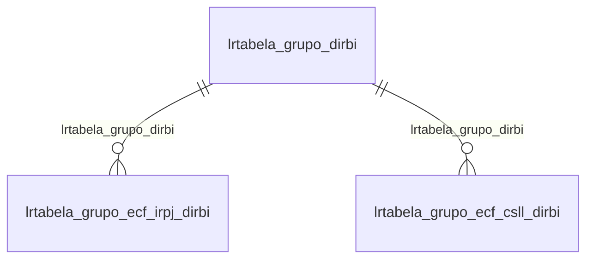

# Modelo — Contábil - tabela (rascunho em lote)

> Gerado por `src/model/gerar_docs_modelo.py` a partir de `src/model/modulos/contabil_tabela.yaml`, do catálogo e do perfil de colunas. **Não edite à mão.**

39 entidades. A coluna *Preench.* é o % de linhas com valor útil (nem nulo, nem em branco, nem zero, nem 1900-01-01; para colunas de código o zero conta como valor).

## Diagrama

## Entidades

| Entidade | Tabela | Linhas | Volume | Filtro obrigatório |
|---|---|---|---|---|
| [lrtabela_grupo_irpj_adicao_geral_vigencia](#lrtabela_grupo_irpj_adicao_geral_vigencia) | `LRTABELA_GRUPO_IRPJ_ADICAO_GERAL_VIGENCIA` | 1.014 | pequeno | — |
| [lrtabela_grupo_csll_adicao_geral_vigencia](#lrtabela_grupo_csll_adicao_geral_vigencia) | `LRTABELA_GRUPO_CSLL_ADICAO_GERAL_VIGENCIA` | 908 | pequeno | — |
| [lrtabela_grupo_irpj_exclusao_geral_vigencia](#lrtabela_grupo_irpj_exclusao_geral_vigencia) | `LRTABELA_GRUPO_IRPJ_EXCLUSAO_GERAL_VIGENCIA` | 720 | pequeno | — |
| [lrtabela_grupo_csll_exclusao_geral_vigencia](#lrtabela_grupo_csll_exclusao_geral_vigencia) | `LRTABELA_GRUPO_CSLL_EXCLUSAO_GERAL_VIGENCIA` | 638 | pequeno | — |
| [lrtabela_grupo_irpj_adicao_geral](#lrtabela_grupo_irpj_adicao_geral) | `LRTABELA_GRUPO_IRPJ_ADICAO_GERAL` | 500 | pequeno | — |
| [lrtabela_grupo_irpj_adicao_sistema_financeiro_vigencia](#lrtabela_grupo_irpj_adicao_sistema_financeiro_vigencia) | `LRTABELA_GRUPO_IRPJ_ADICAO_SISTEMA_FINANCEIRO_VIGENCIA` | 485 | pequeno | — |
| [lrtabela_grupo_csll_adicao_sistema_financeiro_vigencia](#lrtabela_grupo_csll_adicao_sistema_financeiro_vigencia) | `LRTABELA_GRUPO_CSLL_ADICAO_SISTEMA_FINANCEIRO_VIGENCIA` | 460 | pequeno | — |
| [lrtabela_grupo_csll_adicao_geral](#lrtabela_grupo_csll_adicao_geral) | `LRTABELA_GRUPO_CSLL_ADICAO_GERAL` | 457 | pequeno | — |
| [lrtabela_grupo_irpj_exclusao_sistema_financeiro_vigencia](#lrtabela_grupo_irpj_exclusao_sistema_financeiro_vigencia) | `LRTABELA_GRUPO_IRPJ_EXCLUSAO_SISTEMA_FINANCEIRO_VIGENCIA` | 457 | pequeno | — |
| [lrtabela_grupo_csll_exclusao_sistema_financeiro_vigencia](#lrtabela_grupo_csll_exclusao_sistema_financeiro_vigencia) | `LRTABELA_GRUPO_CSLL_EXCLUSAO_SISTEMA_FINANCEIRO_VIGENCIA` | 437 | pequeno | — |
| [lrtabela_grupo_irpj_adicao_seguradora_vigencia](#lrtabela_grupo_irpj_adicao_seguradora_vigencia) | `LRTABELA_GRUPO_IRPJ_ADICAO_SEGURADORA_VIGENCIA` | 420 | pequeno | — |
| [lrtabela_grupo_csll_adicao_seguradora_vigencia](#lrtabela_grupo_csll_adicao_seguradora_vigencia) | `LRTABELA_GRUPO_CSLL_ADICAO_SEGURADORA_VIGENCIA` | 414 | pequeno | — |
| [lrtabela_grupo_irpj_exclusao_geral](#lrtabela_grupo_irpj_exclusao_geral) | `LRTABELA_GRUPO_IRPJ_EXCLUSAO_GERAL` | 355 | pequeno | — |
| [lrtabela_grupo_csll_exclusao_geral](#lrtabela_grupo_csll_exclusao_geral) | `LRTABELA_GRUPO_CSLL_EXCLUSAO_GERAL` | 322 | pequeno | — |
| [lrtabela_grupo_irpj_exclusao_seguradora_vigencia](#lrtabela_grupo_irpj_exclusao_seguradora_vigencia) | `LRTABELA_GRUPO_IRPJ_EXCLUSAO_SEGURADORA_VIGENCIA` | 291 | pequeno | — |
| [lrtabela_grupo_irpj_exclusao_sistema_financeiro](#lrtabela_grupo_irpj_exclusao_sistema_financeiro) | `LRTABELA_GRUPO_IRPJ_EXCLUSAO_SISTEMA_FINANCEIRO` | 268 | pequeno | — |
| [lrtabela_grupo_csll_exclusao_seguradora_vigencia](#lrtabela_grupo_csll_exclusao_seguradora_vigencia) | `LRTABELA_GRUPO_CSLL_EXCLUSAO_SEGURADORA_VIGENCIA` | 265 | pequeno | — |
| [lrtabela_grupo_irpj_adicao_sistema_financeiro](#lrtabela_grupo_irpj_adicao_sistema_financeiro) | `LRTABELA_GRUPO_IRPJ_ADICAO_SISTEMA_FINANCEIRO` | 264 | pequeno | — |
| [lrtabela_grupo_csll_exclusao_sistema_financeiro](#lrtabela_grupo_csll_exclusao_sistema_financeiro) | `LRTABELA_GRUPO_CSLL_EXCLUSAO_SISTEMA_FINANCEIRO` | 260 | pequeno | — |
| [lrtabela_grupo_csll_adicao_sistema_financeiro](#lrtabela_grupo_csll_adicao_sistema_financeiro) | `LRTABELA_GRUPO_CSLL_ADICAO_SISTEMA_FINANCEIRO` | 253 | pequeno | — |
| [lrtabela_grupo_irpj_adicao_seguradora](#lrtabela_grupo_irpj_adicao_seguradora) | `LRTABELA_GRUPO_IRPJ_ADICAO_SEGURADORA` | 227 | pequeno | — |
| [lrtabela_grupo_csll_adicao_seguradora](#lrtabela_grupo_csll_adicao_seguradora) | `LRTABELA_GRUPO_CSLL_ADICAO_SEGURADORA` | 226 | pequeno | — |
| [lrtabela_grupo_irpj_exclusao_seguradora](#lrtabela_grupo_irpj_exclusao_seguradora) | `LRTABELA_GRUPO_IRPJ_EXCLUSAO_SEGURADORA` | 157 | pequeno | — |
| [lrtabela_grupo_csll_exclusao_seguradora](#lrtabela_grupo_csll_exclusao_seguradora) | `LRTABELA_GRUPO_CSLL_EXCLUSAO_SEGURADORA` | 147 | pequeno | — |
| [lrtabela_padrao_rfb_parte_b](#lrtabela_padrao_rfb_parte_b) | `LRTABELA_PADRAO_RFB_PARTE_B` | 122 | pequeno | — |
| [lrtabela_grupo_ecf_irpj_dirbi](#lrtabela_grupo_ecf_irpj_dirbi) | `LRTABELA_GRUPO_ECF_IRPJ_DIRBI` | 39 | pequeno | — |
| [lrtabela_grupo_ecf_csll_dirbi](#lrtabela_grupo_ecf_csll_dirbi) | `LRTABELA_GRUPO_ECF_CSLL_DIRBI` | 21 | pequeno | — |
| [lrtabela_grupo_adicao_lucro_exploracao](#lrtabela_grupo_adicao_lucro_exploracao) | `LRTABELA_GRUPO_ADICAO_LUCRO_EXPLORACAO` | 14 | pequeno | — |
| [lrtabela_grupo_exclusao_lucro_exploracao](#lrtabela_grupo_exclusao_lucro_exploracao) | `LRTABELA_GRUPO_EXCLUSAO_LUCRO_EXPLORACAO` | 14 | pequeno | — |
| [lrtabela_grupo_adicao_lucro_exploracao_vigencia](#lrtabela_grupo_adicao_lucro_exploracao_vigencia) | `LRTABELA_GRUPO_ADICAO_LUCRO_EXPLORACAO_VIGENCIA` | 14 | pequeno | — |
| [lrtabela_grupo_exclusao_lucro_exploracao_vigencia](#lrtabela_grupo_exclusao_lucro_exploracao_vigencia) | `LRTABELA_GRUPO_EXCLUSAO_LUCRO_EXPLORACAO_VIGENCIA` | 14 | pequeno | — |
| [lrtabela_grupo_dirbi](#lrtabela_grupo_dirbi) | `LRTABELA_GRUPO_DIRBI` | 10 | pequeno | — |
| [cttabela_sped_ecf_natureza_operacao](#cttabela_sped_ecf_natureza_operacao) | `CTTABELA_SPED_ECF_NATUREZA_OPERACAO` | 343 | pequeno | — |
| [cttabela_sped_ecf_jurisdicao](#cttabela_sped_ecf_jurisdicao) | `CTTABELA_SPED_ECF_JURISDICAO` | 247 | pequeno | — |
| [cttabela_x300_cnc](#cttabela_x300_cnc) | `CTTABELA_X300_CNC` | 227 | pequeno | — |
| [cttabela_sped_ecf_tipo_moeda](#cttabela_sped_ecf_tipo_moeda) | `CTTABELA_SPED_ECF_TIPO_MOEDA` | 162 | pequeno | — |
| [cttabela_diops_od_registro](#cttabela_diops_od_registro) | `CTTABELA_DIOPS_OD_REGISTRO` | 121 | pequeno | — |
| [cttabela_sped_ecf_receita](#cttabela_sped_ecf_receita) | `CTTABELA_SPED_ECF_RECEITA` | 39 | pequeno | — |
| [cttabela_natureza_subconta_correlata](#cttabela_natureza_subconta_correlata) | `CTTABELA_NATUREZA_SUBCONTA_CORRELATA` | 26 | pequeno | — |

## lrtabela_grupo_irpj_adicao_geral_vigencia

**TABELA DESCRICAO DO GRUPO IRPJ ADICAO GERAL POR VIGENCIA** — tabela `LRTABELA_GRUPO_IRPJ_ADICAO_GERAL_VIGENCIA` (1.014 linhas)

TABELA DESCRICAO DO GRUPO IRPJ ADICAO GERAL POR VIGENCIA. 1.014 linhas no catálogo; chave: I_GRUPO_IRPJ_ADICAO_GERAL, VIGENCIA.

- **Chave:** `I_GRUPO_IRPJ_ADICAO_GERAL, VIGENCIA`
- **Empresa:** `não se aplica (tabela global)`
- **Período:** `VIGENCIA`
- **Ordem padrão:** `VIGENCIA desc`, `I_GRUPO_IRPJ_ADICAO_GERAL asc`

**Regras de negócio validadas:**

- Medido em 2026-10-18: 1.014 linhas, VIGENCIA de 1900-01-01 a 2026-01-01.

| Campo | Coluna | Tipo | Preench. | Domínio | Descrição (banco) |
|---|---|---|---|---|---|
| codigo_sequencial_com_referencia_a_tabel | `i_grupo_irpj_adicao_geral` | integer(4) |  |  | Código sequencial com referencia a tabela LRTABELA_GRUPO_IRPJ_ADICAO_GERAL |
| vigencia_da_descricao | `vigencia` | date(4) |  |  | Vigencia da descrição |
| descricao_utilizada_na_vigencia | `descricao` | varchar(512) |  |  | Descrição utilizada na vigencia |
| importar_adicoes_e_exclusoes_de_parte_b | `importa_adicao_exclusao_parte_b` | char(1) |  |  | Importar adições e exclusões de parte B |
| importar_somente_contas_de_relacionament | `importa_contas_parte_b` | char(1) |  |  | Importar somente contas de relacionamento com parte B |
| guarda_o_tipo_de_relacionamento | `tipo_importacao` | char(15) |  |  | GUARDA O TIPO DE RELACIONAMENTO |

**Filtros:** `codigo_sequencial_com_referencia_a_tabel` (eq/in), `vigencia_da_descricao` (eq/in), `descricao_utilizada_na_vigencia` (contem/prefixo), `importar_adicoes_e_exclusoes_de_parte_b` (eq/in), `importar_somente_contas_de_relacionament` (eq/in), `guarda_o_tipo_de_relacionamento` (eq/in)

## lrtabela_grupo_csll_adicao_geral_vigencia

**TABELA DESCRICAO DO GRUPO CSLL ADICAO GERAL POR VIGENCIA** — tabela `LRTABELA_GRUPO_CSLL_ADICAO_GERAL_VIGENCIA` (908 linhas)

TABELA DESCRICAO DO GRUPO CSLL ADICAO GERAL POR VIGENCIA. 908 linhas no catálogo; chave: I_GRUPO_CSLL_ADICAO_GERAL, VIGENCIA.

- **Chave:** `I_GRUPO_CSLL_ADICAO_GERAL, VIGENCIA`
- **Empresa:** `não se aplica (tabela global)`
- **Período:** `VIGENCIA`
- **Ordem padrão:** `VIGENCIA desc`, `I_GRUPO_CSLL_ADICAO_GERAL asc`

**Regras de negócio validadas:**

- Medido em 2026-10-18: 908 linhas, VIGENCIA de 1900-01-01 a 2026-01-01.

| Campo | Coluna | Tipo | Preench. | Domínio | Descrição (banco) |
|---|---|---|---|---|---|
| codigo_sequencial_com_referencia_a_tabel | `i_grupo_csll_adicao_geral` | integer(4) |  |  | Código sequencial com referencia a tabela LRTABELA_GRUPO_CSLL_ADICAO_GERAL |
| vigencia_da_descricao | `vigencia` | date(4) |  |  | Vigencia da descrição |
| descricao_utilizada_na_vigencia | `descricao` | varchar(512) |  |  | Descrição utilizada na vigencia |
| importar_adicoes_e_exclusoes_de_parte_b | `importa_adicao_exclusao_parte_b` | char(1) |  |  | Importar adições e exclusões de parte B |
| importar_somente_contas_de_relacionament | `importa_contas_parte_b` | char(1) |  |  | Importar somente contas de relacionamento com parte B |
| guarda_o_tipo_de_relacionamento | `tipo_importacao` | char(15) |  |  | GUARDA O TIPO DE RELACIONAMENTO |

**Filtros:** `codigo_sequencial_com_referencia_a_tabel` (eq/in), `vigencia_da_descricao` (eq/in), `descricao_utilizada_na_vigencia` (contem/prefixo), `importar_adicoes_e_exclusoes_de_parte_b` (eq/in), `importar_somente_contas_de_relacionament` (eq/in), `guarda_o_tipo_de_relacionamento` (eq/in)

## lrtabela_grupo_irpj_exclusao_geral_vigencia

**TABELA DESCRICAO DO GRUPO IRPJ EXCLUSAO GERAL POR VIGENCIA** — tabela `LRTABELA_GRUPO_IRPJ_EXCLUSAO_GERAL_VIGENCIA` (720 linhas)

TABELA DESCRICAO DO GRUPO IRPJ EXCLUSAO GERAL POR VIGENCIA. 720 linhas no catálogo; chave: I_GRUPO_IRPJ_EXCLUSAO_GERAL, VIGENCIA.

- **Chave:** `I_GRUPO_IRPJ_EXCLUSAO_GERAL, VIGENCIA`
- **Empresa:** `não se aplica (tabela global)`
- **Período:** `VIGENCIA`
- **Ordem padrão:** `VIGENCIA desc`, `I_GRUPO_IRPJ_EXCLUSAO_GERAL asc`

**Regras de negócio validadas:**

- Medido em 2026-10-18: 720 linhas, VIGENCIA de 1900-01-01 a 2025-01-01.

| Campo | Coluna | Tipo | Preench. | Domínio | Descrição (banco) |
|---|---|---|---|---|---|
| codigo_sequencial_com_referencia_a_tabel | `i_grupo_irpj_exclusao_geral` | integer(4) |  |  | Código sequencial com referencia a tabela LRTABELA_GRUPO_IRPJ_EXCLUSAO_GERAL |
| vigencia_da_descricao | `vigencia` | date(4) |  |  | Vigencia da descrição |
| descricao_utilizada_na_vigencia | `descricao` | varchar(512) |  |  | Descrição utilizada na vigencia |
| importar_adicoes_e_exclusoes_de_parte_b | `importa_adicao_exclusao_parte_b` | char(1) |  |  | Importar adições e exclusões de parte B |
| importar_somente_contas_de_relacionament | `importa_contas_parte_b` | char(1) |  |  | Importar somente contas de relacionamento com parte B |
| guarda_o_tipo_de_relacionamento | `tipo_importacao` | char(15) |  |  | GUARDA O TIPO DE RELACIONAMENTO |

**Filtros:** `codigo_sequencial_com_referencia_a_tabel` (eq/in), `vigencia_da_descricao` (eq/in), `descricao_utilizada_na_vigencia` (contem/prefixo), `importar_adicoes_e_exclusoes_de_parte_b` (eq/in), `importar_somente_contas_de_relacionament` (eq/in), `guarda_o_tipo_de_relacionamento` (eq/in)

## lrtabela_grupo_csll_exclusao_geral_vigencia

**TABELA DESCRICAO DO GRUPO CSLL EXCLUSAO GERAL POR VIGENCIA** — tabela `LRTABELA_GRUPO_CSLL_EXCLUSAO_GERAL_VIGENCIA` (638 linhas)

TABELA DESCRICAO DO GRUPO CSLL EXCLUSAO GERAL POR VIGENCIA. 638 linhas no catálogo; chave: I_GRUPO_CSLL_EXCLUSAO_GERAL, VIGENCIA.

- **Chave:** `I_GRUPO_CSLL_EXCLUSAO_GERAL, VIGENCIA`
- **Empresa:** `não se aplica (tabela global)`
- **Período:** `VIGENCIA`
- **Ordem padrão:** `VIGENCIA desc`, `I_GRUPO_CSLL_EXCLUSAO_GERAL asc`

**Regras de negócio validadas:**

- Medido em 2026-10-18: 638 linhas, VIGENCIA de 1900-01-01 a 2025-01-01.

| Campo | Coluna | Tipo | Preench. | Domínio | Descrição (banco) |
|---|---|---|---|---|---|
| codigo_sequencial_com_referencia_a_tabel | `i_grupo_csll_exclusao_geral` | integer(4) |  |  | Código sequencial com referencia a tabela LRTABELA_GRUPO_CSLL_EXCLUSAO_GERAL |
| vigencia_da_descricao | `vigencia` | date(4) |  |  | Vigencia da descrição |
| descricao_utilizada_na_vigencia | `descricao` | varchar(512) |  |  | Descrição utilizada na vigencia |
| importar_adicoes_e_exclusoes_de_parte_b | `importa_adicao_exclusao_parte_b` | char(1) |  |  | Importar adições e exclusões de parte B |
| importar_somente_contas_de_relacionament | `importa_contas_parte_b` | char(1) |  |  | Importar somente contas de relacionamento com parte B |
| guarda_o_tipo_de_relacionamento | `tipo_importacao` | char(15) |  |  | GUARDA O TIPO DE RELACIONAMENTO |

**Filtros:** `codigo_sequencial_com_referencia_a_tabel` (eq/in), `vigencia_da_descricao` (eq/in), `descricao_utilizada_na_vigencia` (contem/prefixo), `importar_adicoes_e_exclusoes_de_parte_b` (eq/in), `importar_somente_contas_de_relacionament` (eq/in), `guarda_o_tipo_de_relacionamento` (eq/in)

## lrtabela_grupo_irpj_adicao_geral

**Tabela grupos de Adições da IRPJ - Geral** — tabela `LRTABELA_GRUPO_IRPJ_ADICAO_GERAL` (500 linhas)

Tabela grupos de Adições da IRPJ - Geral. 500 linhas no catálogo; chave: I_GRUPO_IRPJ_ADICAO_GERAL.

- **Chave:** `I_GRUPO_IRPJ_ADICAO_GERAL`
- **Empresa:** `não se aplica (tabela global)`
- **Período:** `VALIDADE_INICIO`
- **Ordem padrão:** `VALIDADE_INICIO desc`, `I_GRUPO_IRPJ_ADICAO_GERAL asc`

**Regras de negócio validadas:**

- Medido em 2026-10-18: 500 linhas, VALIDADE_INICIO de 2015-01-01 a 2026-01-01.

| Campo | Coluna | Tipo | Preench. | Domínio | Descrição (banco) |
|---|---|---|---|---|---|
| codigo | `i_grupo_irpj_adicao_geral` | integer(4) |  |  | Código |
| codigo_sped_ecf_geral | `codigo_ecf_geral` | varchar(10) |  |  | Código SPED ECF Geral |
| codigo_sped_ecf_rural | `codigo_ecf_rural` | varchar(10) |  |  | Código SPED ECF Rural |
| descricao | `descricao` | varchar(512) |  |  | Descrição |
| inicio_validade | `validade_inicio` | date(4) |  |  | Ínicio validade |
| fim_validade | `validade_fim` | date(4) |  |  | Fim validade |
| importar_somente_contas_de_relacionament | `importa_contas_parte_b` | char(1) |  |  | Importar somente contas de relacionamento com parte B |

**Filtros:** `codigo` (eq/in), `inicio_validade` (entre/gte/lte), `fim_validade` (entre/gte/lte), `codigo_sped_ecf_geral` (eq/in), `codigo_sped_ecf_rural` (eq/in), `descricao` (contem/prefixo), `importar_somente_contas_de_relacionament` (eq/in)

## lrtabela_grupo_irpj_adicao_sistema_financeiro_vigencia

**TABELA DESCRICAO DO GRUPO IRPJ ADICAO SISTEMA FINANCEIRO POR VIGENCIA** — tabela `LRTABELA_GRUPO_IRPJ_ADICAO_SISTEMA_FINANCEIRO_VIGENCIA` (485 linhas)

TABELA DESCRICAO DO GRUPO IRPJ ADICAO SISTEMA FINANCEIRO POR VIGENCIA. 485 linhas no catálogo; chave: I_GRUPO_IRPJ_ADICAO_SF, VIGENCIA.

- **Chave:** `I_GRUPO_IRPJ_ADICAO_SF, VIGENCIA`
- **Empresa:** `não se aplica (tabela global)`
- **Período:** `VIGENCIA`
- **Ordem padrão:** `VIGENCIA desc`, `I_GRUPO_IRPJ_ADICAO_SF asc`

**Regras de negócio validadas:**

- Medido em 2026-10-18: 485 linhas, VIGENCIA de 1900-01-01 a 2026-01-01.

| Campo | Coluna | Tipo | Preench. | Domínio | Descrição (banco) |
|---|---|---|---|---|---|
| codigo_sequencial_com_referencia_a_tabel | `i_grupo_irpj_adicao_sf` | integer(4) |  |  | Código sequencial com referencia a tabela LRTABELA_GRUPO_IRPJ_ADICAO_SISTEMA_FINANCEIRO |
| vigencia_da_descricao | `vigencia` | date(4) |  |  | Vigencia da descrição |
| descricao_utilizada_na_vigencia | `descricao` | varchar(512) |  |  | Descrição utilizada na vigencia |
| importar_adicoes_e_exclusoes_de_parte_b | `importa_adicao_exclusao_parte_b` | char(1) |  |  | Importar adições e exclusões de parte B |
| importar_somente_contas_de_relacionament | `importa_contas_parte_b` | char(1) |  |  | Importar somente contas de relacionamento com parte B |
| guarda_o_tipo_de_relacionamento | `tipo_importacao` | char(15) |  |  | GUARDA O TIPO DE RELACIONAMENTO |

**Filtros:** `codigo_sequencial_com_referencia_a_tabel` (eq/in), `vigencia_da_descricao` (eq/in), `descricao_utilizada_na_vigencia` (contem/prefixo), `importar_adicoes_e_exclusoes_de_parte_b` (eq/in), `importar_somente_contas_de_relacionament` (eq/in), `guarda_o_tipo_de_relacionamento` (eq/in)

## lrtabela_grupo_csll_adicao_sistema_financeiro_vigencia

**TABELA DESCRICAO DO GRUPO CSLL ADICAO SISTEMA FINANCEIRO POR VIGENCIA** — tabela `LRTABELA_GRUPO_CSLL_ADICAO_SISTEMA_FINANCEIRO_VIGENCIA` (460 linhas)

TABELA DESCRICAO DO GRUPO CSLL ADICAO SISTEMA FINANCEIRO POR VIGENCIA. 460 linhas no catálogo; chave: I_GRUPO_CSLL_ADICAO_SF, VIGENCIA.

- **Chave:** `I_GRUPO_CSLL_ADICAO_SF, VIGENCIA`
- **Empresa:** `não se aplica (tabela global)`
- **Período:** `VIGENCIA`
- **Ordem padrão:** `VIGENCIA desc`, `I_GRUPO_CSLL_ADICAO_SF asc`

**Regras de negócio validadas:**

- Medido em 2026-10-18: 460 linhas, VIGENCIA de 1900-01-01 a 2026-01-01.

| Campo | Coluna | Tipo | Preench. | Domínio | Descrição (banco) |
|---|---|---|---|---|---|
| codigo_sequencial_com_referencia_a_tabel | `i_grupo_csll_adicao_sf` | integer(4) |  |  | Código sequencial com referencia a tabela LRTABELA_GRUPO_CSLL_ADICAO_SISTEMA_FINANCEIRO |
| vigencia_da_descricao | `vigencia` | date(4) |  |  | Vigencia da descrição |
| descricao_utilizada_na_vigencia | `descricao` | varchar(512) |  |  | Descrição utilizada na vigencia |
| importar_adicoes_e_exclusoes_de_parte_b | `importa_adicao_exclusao_parte_b` | char(1) |  |  | Importar adições e exclusões de parte B |
| importar_somente_contas_de_relacionament | `importa_contas_parte_b` | char(1) |  |  | Importar somente contas de relacionamento com parte B |
| guarda_o_tipo_de_relacionamento | `tipo_importacao` | char(15) |  |  | GUARDA O TIPO DE RELACIONAMENTO |

**Filtros:** `codigo_sequencial_com_referencia_a_tabel` (eq/in), `vigencia_da_descricao` (eq/in), `descricao_utilizada_na_vigencia` (contem/prefixo), `importar_adicoes_e_exclusoes_de_parte_b` (eq/in), `importar_somente_contas_de_relacionament` (eq/in), `guarda_o_tipo_de_relacionamento` (eq/in)

## lrtabela_grupo_csll_adicao_geral

**Tabela grupos de Adições da CSLL - Geral** — tabela `LRTABELA_GRUPO_CSLL_ADICAO_GERAL` (457 linhas)

Tabela grupos de Adições da CSLL - Geral. 457 linhas no catálogo; chave: I_GRUPO_CSLL_ADICAO_GERAL.

- **Chave:** `I_GRUPO_CSLL_ADICAO_GERAL`
- **Empresa:** `não se aplica (tabela global)`
- **Período:** `VALIDADE_INICIO`
- **Ordem padrão:** `VALIDADE_INICIO desc`, `I_GRUPO_CSLL_ADICAO_GERAL asc`

**Regras de negócio validadas:**

- Medido em 2026-10-18: 457 linhas, VALIDADE_INICIO de 2015-01-01 a 2026-01-01.

| Campo | Coluna | Tipo | Preench. | Domínio | Descrição (banco) |
|---|---|---|---|---|---|
| codigo | `i_grupo_csll_adicao_geral` | integer(4) |  |  | Código |
| codigo_sped_ecf_geral | `codigo_ecf_geral` | varchar(10) |  |  | Código SPED ECF Geral |
| codigo_sped_ecf_rural | `codigo_ecf_rural` | varchar(10) |  |  | Código SPED ECF Rural |
| descricao | `descricao` | varchar(512) |  |  | Descrição |
| inicio_validade | `validade_inicio` | date(4) |  |  | Ínicio validade |
| fim_validade | `validade_fim` | date(4) |  |  | Fim validade |
| importar_somente_contas_de_relacionament | `importa_contas_parte_b` | char(1) |  |  | Importar somente contas de relacionamento com parte B |

**Filtros:** `codigo` (eq/in), `inicio_validade` (entre/gte/lte), `fim_validade` (entre/gte/lte), `codigo_sped_ecf_geral` (eq/in), `codigo_sped_ecf_rural` (eq/in), `descricao` (contem/prefixo), `importar_somente_contas_de_relacionament` (eq/in)

## lrtabela_grupo_irpj_exclusao_sistema_financeiro_vigencia

**TABELA DESCRICAO DO GRUPO IRPJ EXCLUSAO SISTEMA FINANCEIRO POR VIGENCIA** — tabela `LRTABELA_GRUPO_IRPJ_EXCLUSAO_SISTEMA_FINANCEIRO_VIGENCIA` (457 linhas)

TABELA DESCRICAO DO GRUPO IRPJ EXCLUSAO SISTEMA FINANCEIRO POR VIGENCIA. 457 linhas no catálogo; chave: I_GRUPO_IRPJ_EXCLUSAO_SF, VIGENCIA.

- **Chave:** `I_GRUPO_IRPJ_EXCLUSAO_SF, VIGENCIA`
- **Empresa:** `não se aplica (tabela global)`
- **Período:** `VIGENCIA`
- **Ordem padrão:** `VIGENCIA desc`, `I_GRUPO_IRPJ_EXCLUSAO_SF asc`

**Regras de negócio validadas:**

- Medido em 2026-10-18: 457 linhas, VIGENCIA de 1900-01-01 a 2025-01-01.

| Campo | Coluna | Tipo | Preench. | Domínio | Descrição (banco) |
|---|---|---|---|---|---|
| codigo_sequencial_com_referencia_a_tabel | `i_grupo_irpj_exclusao_sf` | integer(4) |  |  | Código sequencial com referencia a tabela LRTABELA_GRUPO_IRPJ_EXCLUSAO_SISTEMA_FINANCEIRO |
| vigencia_da_descricao | `vigencia` | date(4) |  |  | Vigencia da descrição |
| descricao_utilizada_na_vigencia | `descricao` | varchar(512) |  |  | Descrição utilizada na vigencia |
| importar_adicoes_e_exclusoes_de_parte_b | `importa_adicao_exclusao_parte_b` | char(1) |  |  | Importar adições e exclusões de parte B |
| importar_somente_contas_de_relacionament | `importa_contas_parte_b` | char(1) |  |  | Importar somente contas de relacionamento com parte B |
| guarda_o_tipo_de_relacionamento | `tipo_importacao` | char(15) |  |  | GUARDA O TIPO DE RELACIONAMENTO |

**Filtros:** `codigo_sequencial_com_referencia_a_tabel` (eq/in), `vigencia_da_descricao` (eq/in), `descricao_utilizada_na_vigencia` (contem/prefixo), `importar_adicoes_e_exclusoes_de_parte_b` (eq/in), `importar_somente_contas_de_relacionament` (eq/in), `guarda_o_tipo_de_relacionamento` (eq/in)

## lrtabela_grupo_csll_exclusao_sistema_financeiro_vigencia

**TABELA DESCRICAO DO GRUPO CSLL EXCLUSAO SISTEMA FINANCEIRO POR VIGENCIA** — tabela `LRTABELA_GRUPO_CSLL_EXCLUSAO_SISTEMA_FINANCEIRO_VIGENCIA` (437 linhas)

TABELA DESCRICAO DO GRUPO CSLL EXCLUSAO SISTEMA FINANCEIRO POR VIGENCIA. 437 linhas no catálogo; chave: I_GRUPO_CSLL_EXCLUSAO_SF, VIGENCIA.

- **Chave:** `I_GRUPO_CSLL_EXCLUSAO_SF, VIGENCIA`
- **Empresa:** `não se aplica (tabela global)`
- **Período:** `VIGENCIA`
- **Ordem padrão:** `VIGENCIA desc`, `I_GRUPO_CSLL_EXCLUSAO_SF asc`

**Regras de negócio validadas:**

- Medido em 2026-10-18: 437 linhas, VIGENCIA de 1900-01-01 a 2025-01-01.

| Campo | Coluna | Tipo | Preench. | Domínio | Descrição (banco) |
|---|---|---|---|---|---|
| codigo_sequencial_com_referencia_a_tabel | `i_grupo_csll_exclusao_sf` | integer(4) |  |  | Código sequencial com referencia a tabela LRTABELA_GRUPO_CSLL_EXCLUSAO_SISTEMA_FINANCEIRO |
| vigencia_da_descricao | `vigencia` | date(4) |  |  | Vigencia da descrição |
| descricao_utilizada_na_vigencia | `descricao` | varchar(512) |  |  | Descrição utilizada na vigencia |
| importar_adicoes_e_exclusoes_de_parte_b | `importa_adicao_exclusao_parte_b` | char(1) |  |  | Importar adições e exclusões de parte B |
| importar_somente_contas_de_relacionament | `importa_contas_parte_b` | char(1) |  |  | Importar somente contas de relacionamento com parte B |
| guarda_o_tipo_de_relacionamento | `tipo_importacao` | char(15) |  |  | GUARDA O TIPO DE RELACIONAMENTO |

**Filtros:** `codigo_sequencial_com_referencia_a_tabel` (eq/in), `vigencia_da_descricao` (eq/in), `descricao_utilizada_na_vigencia` (contem/prefixo), `importar_adicoes_e_exclusoes_de_parte_b` (eq/in), `importar_somente_contas_de_relacionament` (eq/in), `guarda_o_tipo_de_relacionamento` (eq/in)

## lrtabela_grupo_irpj_adicao_seguradora_vigencia

**TABELA DESCRICAO DO GRUPO IRPJ ADICAO SEGURADORA POR VIGENCIA** — tabela `LRTABELA_GRUPO_IRPJ_ADICAO_SEGURADORA_VIGENCIA` (420 linhas)

TABELA DESCRICAO DO GRUPO IRPJ ADICAO SEGURADORA POR VIGENCIA. 420 linhas no catálogo; chave: I_GRUPO_IRPJ_ADICAO_S, VIGENCIA.

- **Chave:** `I_GRUPO_IRPJ_ADICAO_S, VIGENCIA`
- **Empresa:** `não se aplica (tabela global)`
- **Período:** `VIGENCIA`
- **Ordem padrão:** `VIGENCIA desc`, `I_GRUPO_IRPJ_ADICAO_S asc`

**Regras de negócio validadas:**

- Medido em 2026-10-18: 420 linhas, VIGENCIA de 1900-01-01 a 2026-01-01.

| Campo | Coluna | Tipo | Preench. | Domínio | Descrição (banco) |
|---|---|---|---|---|---|
| codigo_sequencial_com_referencia_a_tabel | `i_grupo_irpj_adicao_s` | integer(4) |  |  | Código sequencial com referencia a tabela LRTABELA_GRUPO_IRPJ_ADICAO_SEGURADORA |
| vigencia_da_descricao | `vigencia` | date(4) |  |  | Vigencia da descrição |
| descricao_utilizada_na_vigencia | `descricao` | varchar(512) |  |  | Descrição utilizada na vigencia |
| importar_adicoes_e_exclusoes_de_parte_b | `importa_adicao_exclusao_parte_b` | char(1) |  |  | Importar adições e exclusões de parte B |
| importar_somente_contas_de_relacionament | `importa_contas_parte_b` | char(1) |  |  | Importar somente contas de relacionamento com parte B |
| guarda_o_tipo_de_relacionamento | `tipo_importacao` | char(15) |  |  | GUARDA O TIPO DE RELACIONAMENTO |

**Filtros:** `codigo_sequencial_com_referencia_a_tabel` (eq/in), `vigencia_da_descricao` (eq/in), `descricao_utilizada_na_vigencia` (contem/prefixo), `importar_adicoes_e_exclusoes_de_parte_b` (eq/in), `importar_somente_contas_de_relacionament` (eq/in), `guarda_o_tipo_de_relacionamento` (eq/in)

## lrtabela_grupo_csll_adicao_seguradora_vigencia

**TABELA DESCRICAO DO GRUPO CSLL ADICAO SEGURADORA POR VIGENCIA** — tabela `LRTABELA_GRUPO_CSLL_ADICAO_SEGURADORA_VIGENCIA` (414 linhas)

TABELA DESCRICAO DO GRUPO CSLL ADICAO SEGURADORA POR VIGENCIA. 414 linhas no catálogo; chave: I_GRUPO_CSLL_ADICAO_S, VIGENCIA.

- **Chave:** `I_GRUPO_CSLL_ADICAO_S, VIGENCIA`
- **Empresa:** `não se aplica (tabela global)`
- **Período:** `VIGENCIA`
- **Ordem padrão:** `VIGENCIA desc`, `I_GRUPO_CSLL_ADICAO_S asc`

**Regras de negócio validadas:**

- Medido em 2026-10-18: 414 linhas, VIGENCIA de 1900-01-01 a 2026-01-01.

| Campo | Coluna | Tipo | Preench. | Domínio | Descrição (banco) |
|---|---|---|---|---|---|
| codigo_sequencial_com_referencia_a_tabel | `i_grupo_csll_adicao_s` | integer(4) |  |  | Código sequencial com referencia a tabela LRTABELA_GRUPO_CSLL_ADICAO_SEGURADORA |
| vigencia_da_descricao | `vigencia` | date(4) |  |  | Vigencia da descrição |
| descricao_utilizada_na_vigencia | `descricao` | varchar(512) |  |  | Descrição utilizada na vigencia |
| importar_adicoes_e_exclusoes_de_parte_b | `importa_adicao_exclusao_parte_b` | char(1) |  |  | Importar adições e exclusões de parte B |
| importar_somente_contas_de_relacionament | `importa_contas_parte_b` | char(1) |  |  | Importar somente contas de relacionamento com parte B |
| guarda_o_tipo_de_relacionamento | `tipo_importacao` | char(15) |  |  | GUARDA O TIPO DE RELACIONAMENTO |

**Filtros:** `codigo_sequencial_com_referencia_a_tabel` (eq/in), `vigencia_da_descricao` (eq/in), `descricao_utilizada_na_vigencia` (contem/prefixo), `importar_adicoes_e_exclusoes_de_parte_b` (eq/in), `importar_somente_contas_de_relacionament` (eq/in), `guarda_o_tipo_de_relacionamento` (eq/in)

## lrtabela_grupo_irpj_exclusao_geral

**Tabela grupos de Exclusões da IRPJ - Geral** — tabela `LRTABELA_GRUPO_IRPJ_EXCLUSAO_GERAL` (355 linhas)

Tabela grupos de Exclusões da IRPJ - Geral. 355 linhas no catálogo; chave: I_GRUPO_IRPJ_EXCLUSAO_GERAL.

- **Chave:** `I_GRUPO_IRPJ_EXCLUSAO_GERAL`
- **Empresa:** `não se aplica (tabela global)`
- **Período:** `VALIDADE_INICIO`
- **Ordem padrão:** `VALIDADE_INICIO desc`, `I_GRUPO_IRPJ_EXCLUSAO_GERAL asc`

**Regras de negócio validadas:**

- Medido em 2026-10-18: 355 linhas, VALIDADE_INICIO de 2015-01-01 a 2025-01-01.

| Campo | Coluna | Tipo | Preench. | Domínio | Descrição (banco) |
|---|---|---|---|---|---|
| codigo | `i_grupo_irpj_exclusao_geral` | integer(4) |  |  | Código |
| codigo_sped_ecf_geral | `codigo_ecf_geral` | varchar(10) |  |  | Código SPED ECF Geral |
| codigo_sped_ecf_rural | `codigo_ecf_rural` | varchar(10) |  |  | Código SPED ECF Rural |
| descricao | `descricao` | varchar(512) |  |  | Descrição |
| inicio_validade | `validade_inicio` | date(4) |  |  | Ínicio validade |
| fim_validade | `validade_fim` | date(4) |  |  | Fim validade |
| importar_somente_contas_de_relacionament | `importa_contas_parte_b` | char(1) |  |  | Importar somente contas de relacionamento com parte B |

**Filtros:** `codigo` (eq/in), `inicio_validade` (entre/gte/lte), `fim_validade` (entre/gte/lte), `codigo_sped_ecf_geral` (eq/in), `codigo_sped_ecf_rural` (eq/in), `descricao` (contem/prefixo), `importar_somente_contas_de_relacionament` (eq/in)

## lrtabela_grupo_csll_exclusao_geral

**Tabela grupos de Exclusões da CSLL - Geral** — tabela `LRTABELA_GRUPO_CSLL_EXCLUSAO_GERAL` (322 linhas)

Tabela grupos de Exclusões da CSLL - Geral. 322 linhas no catálogo; chave: I_GRUPO_CSLL_EXCLUSAO_GERAL.

- **Chave:** `I_GRUPO_CSLL_EXCLUSAO_GERAL`
- **Empresa:** `não se aplica (tabela global)`
- **Período:** `VALIDADE_INICIO`
- **Ordem padrão:** `VALIDADE_INICIO desc`, `I_GRUPO_CSLL_EXCLUSAO_GERAL asc`

**Regras de negócio validadas:**

- Medido em 2026-10-18: 322 linhas, VALIDADE_INICIO de 2015-01-01 a 2025-01-01.

| Campo | Coluna | Tipo | Preench. | Domínio | Descrição (banco) |
|---|---|---|---|---|---|
| codigo | `i_grupo_csll_exclusao_geral` | integer(4) |  |  | Código |
| codigo_sped_ecf_geral | `codigo_ecf_geral` | varchar(10) |  |  | Código SPED ECF Geral |
| codigo_sped_ecf_rural | `codigo_ecf_rural` | varchar(10) |  |  | Código SPED ECF Rural |
| descricao | `descricao` | varchar(512) |  |  | Descrição |
| inicio_validade | `validade_inicio` | date(4) |  |  | Ínicio validade |
| fim_validade | `validade_fim` | date(4) |  |  | Fim validade |
| importar_somente_contas_de_relacionament | `importa_contas_parte_b` | char(1) |  |  | Importar somente contas de relacionamento com parte B |

**Filtros:** `codigo` (eq/in), `inicio_validade` (entre/gte/lte), `fim_validade` (entre/gte/lte), `codigo_sped_ecf_geral` (eq/in), `codigo_sped_ecf_rural` (eq/in), `descricao` (contem/prefixo), `importar_somente_contas_de_relacionament` (eq/in)

## lrtabela_grupo_irpj_exclusao_seguradora_vigencia

**TABELA DESCRICAO DO GRUPO IRPJ EXCLUSAO SEGURADORA POR VIGENCIA** — tabela `LRTABELA_GRUPO_IRPJ_EXCLUSAO_SEGURADORA_VIGENCIA` (291 linhas)

TABELA DESCRICAO DO GRUPO IRPJ EXCLUSAO SEGURADORA POR VIGENCIA. 291 linhas no catálogo; chave: I_GRUPO_IRPJ_EXCLUSAO_S, VIGENCIA.

- **Chave:** `I_GRUPO_IRPJ_EXCLUSAO_S, VIGENCIA`
- **Empresa:** `não se aplica (tabela global)`
- **Período:** `VIGENCIA`
- **Ordem padrão:** `VIGENCIA desc`, `I_GRUPO_IRPJ_EXCLUSAO_S asc`

**Regras de negócio validadas:**

- Medido em 2026-10-18: 291 linhas, VIGENCIA de 1900-01-01 a 2025-01-01.

| Campo | Coluna | Tipo | Preench. | Domínio | Descrição (banco) |
|---|---|---|---|---|---|
| codigo_sequencial_com_referencia_a_tabel | `i_grupo_irpj_exclusao_s` | integer(4) |  |  | Código sequencial com referencia a tabela LRTABELA_GRUPO_IRPJ_EXCLUSAO_SEGURADORA |
| vigencia_da_descricao | `vigencia` | date(4) |  |  | Vigencia da descrição |
| descricao_utilizada_na_vigencia | `descricao` | varchar(512) |  |  | Descrição utilizada na vigencia |
| importar_adicoes_e_exclusoes_de_parte_b | `importa_adicao_exclusao_parte_b` | char(1) |  |  | Importar adições e exclusões de parte B |
| importar_somente_contas_de_relacionament | `importa_contas_parte_b` | char(1) |  |  | Importar somente contas de relacionamento com parte B |
| guarda_o_tipo_de_relacionamento | `tipo_importacao` | char(15) |  |  | GUARDA O TIPO DE RELACIONAMENTO |

**Filtros:** `codigo_sequencial_com_referencia_a_tabel` (eq/in), `vigencia_da_descricao` (eq/in), `descricao_utilizada_na_vigencia` (contem/prefixo), `importar_adicoes_e_exclusoes_de_parte_b` (eq/in), `importar_somente_contas_de_relacionament` (eq/in), `guarda_o_tipo_de_relacionamento` (eq/in)

## lrtabela_grupo_irpj_exclusao_sistema_financeiro

**Tabela grupos de Exclusões da IRPJ - Sistema Financeiro** — tabela `LRTABELA_GRUPO_IRPJ_EXCLUSAO_SISTEMA_FINANCEIRO` (268 linhas)

Tabela grupos de Exclusões da IRPJ - Sistema Financeiro. 268 linhas no catálogo; chave: I_GRUPO_IRPJ_EXCLUSAO_SF.

- **Chave:** `I_GRUPO_IRPJ_EXCLUSAO_SF`
- **Empresa:** `não se aplica (tabela global)`
- **Período:** `VALIDADE_INICIO`
- **Ordem padrão:** `VALIDADE_INICIO desc`, `I_GRUPO_IRPJ_EXCLUSAO_SF asc`

**Regras de negócio validadas:**

- Medido em 2026-10-18: 268 linhas, VALIDADE_INICIO de 2015-01-01 a 2025-01-01.

| Campo | Coluna | Tipo | Preench. | Domínio | Descrição (banco) |
|---|---|---|---|---|---|
| codigo | `i_grupo_irpj_exclusao_sf` | integer(4) |  |  | Código |
| codigo_sped_ecf | `codigo_ecf` | varchar(10) |  |  | Código SPED ECF |
| descricao | `descricao` | varchar(512) |  |  | Descrição |
| inicio_validade | `validade_inicio` | date(4) |  |  | Ínicio validade |
| fim_validade | `validade_fim` | date(4) |  |  | Fim validade |
| importar_somente_contas_de_relacionament | `importa_contas_parte_b` | char(1) |  |  | Importar somente contas de relacionamento com parte B |

**Filtros:** `codigo` (eq/in), `inicio_validade` (entre/gte/lte), `fim_validade` (entre/gte/lte), `codigo_sped_ecf` (eq/in), `descricao` (contem/prefixo), `importar_somente_contas_de_relacionament` (eq/in)

## lrtabela_grupo_csll_exclusao_seguradora_vigencia

**TABELA DESCRICAO DO GRUPO CSLL EXCLUSAO SEGURADORA POR VIGENCIA** — tabela `LRTABELA_GRUPO_CSLL_EXCLUSAO_SEGURADORA_VIGENCIA` (265 linhas)

TABELA DESCRICAO DO GRUPO CSLL EXCLUSAO SEGURADORA POR VIGENCIA. 265 linhas no catálogo; chave: I_GRUPO_CSLL_EXCLUSAO_S, VIGENCIA.

- **Chave:** `I_GRUPO_CSLL_EXCLUSAO_S, VIGENCIA`
- **Empresa:** `não se aplica (tabela global)`
- **Período:** `VIGENCIA`
- **Ordem padrão:** `VIGENCIA desc`, `I_GRUPO_CSLL_EXCLUSAO_S asc`

**Regras de negócio validadas:**

- Medido em 2026-10-18: 265 linhas, VIGENCIA de 1900-01-01 a 2025-01-01.

| Campo | Coluna | Tipo | Preench. | Domínio | Descrição (banco) |
|---|---|---|---|---|---|
| codigo_sequencial_com_referencia_a_tabel | `i_grupo_csll_exclusao_s` | integer(4) |  |  | Código sequencial com referencia a tabela LRTABELA_GRUPO_CSLL_EXCLUSAO_SEGURADORA |
| vigencia_da_descricao | `vigencia` | date(4) |  |  | Vigencia da descrição |
| descricao_utilizada_na_vigencia | `descricao` | varchar(512) |  |  | Descrição utilizada na vigencia |
| importar_adicoes_e_exclusoes_de_parte_b | `importa_adicao_exclusao_parte_b` | char(1) |  |  | Importar adições e exclusões de parte B |
| importar_somente_contas_de_relacionament | `importa_contas_parte_b` | char(1) |  |  | Importar somente contas de relacionamento com parte B |
| guarda_o_tipo_de_relacionamento | `tipo_importacao` | char(15) |  |  | GUARDA O TIPO DE RELACIONAMENTO |

**Filtros:** `codigo_sequencial_com_referencia_a_tabel` (eq/in), `vigencia_da_descricao` (eq/in), `descricao_utilizada_na_vigencia` (contem/prefixo), `importar_adicoes_e_exclusoes_de_parte_b` (eq/in), `importar_somente_contas_de_relacionament` (eq/in), `guarda_o_tipo_de_relacionamento` (eq/in)

## lrtabela_grupo_irpj_adicao_sistema_financeiro

**Tabela grupos de Adições da IRPJ - Sistema Financeiro** — tabela `LRTABELA_GRUPO_IRPJ_ADICAO_SISTEMA_FINANCEIRO` (264 linhas)

Tabela grupos de Adições da IRPJ - Sistema Financeiro. 264 linhas no catálogo; chave: I_GRUPO_IRPJ_ADICAO_SF.

- **Chave:** `I_GRUPO_IRPJ_ADICAO_SF`
- **Empresa:** `não se aplica (tabela global)`
- **Período:** `VALIDADE_INICIO`
- **Ordem padrão:** `VALIDADE_INICIO desc`, `I_GRUPO_IRPJ_ADICAO_SF asc`

**Regras de negócio validadas:**

- Medido em 2026-10-18: 264 linhas, VALIDADE_INICIO de 2015-01-01 a 2026-01-01.

| Campo | Coluna | Tipo | Preench. | Domínio | Descrição (banco) |
|---|---|---|---|---|---|
| codigo | `i_grupo_irpj_adicao_sf` | integer(4) |  |  | Código |
| codigo_sped_ecf | `codigo_ecf` | varchar(10) |  |  | Código SPED ECF |
| descricao | `descricao` | varchar(512) |  |  | Descrição |
| inicio_validade | `validade_inicio` | date(4) |  |  | Ínicio validade |
| fim_validade | `validade_fim` | date(4) |  |  | Fim validade |
| importar_somente_contas_de_relacionament | `importa_contas_parte_b` | char(1) |  |  | Importar somente contas de relacionamento com parte B |

**Filtros:** `codigo` (eq/in), `inicio_validade` (entre/gte/lte), `fim_validade` (entre/gte/lte), `codigo_sped_ecf` (eq/in), `descricao` (contem/prefixo), `importar_somente_contas_de_relacionament` (eq/in)

## lrtabela_grupo_csll_exclusao_sistema_financeiro

**Tabela grupos de Exclusão da CSLL - Sistema Financeiro** — tabela `LRTABELA_GRUPO_CSLL_EXCLUSAO_SISTEMA_FINANCEIRO` (260 linhas)

Tabela grupos de Exclusão da CSLL - Sistema Financeiro. 260 linhas no catálogo; chave: I_GRUPO_CSLL_EXCLUSAO_SF.

- **Chave:** `I_GRUPO_CSLL_EXCLUSAO_SF`
- **Empresa:** `não se aplica (tabela global)`
- **Período:** `VALIDADE_INICIO`
- **Ordem padrão:** `VALIDADE_INICIO desc`, `I_GRUPO_CSLL_EXCLUSAO_SF asc`

**Regras de negócio validadas:**

- Medido em 2026-10-18: 260 linhas, VALIDADE_INICIO de 2015-01-01 a 2025-01-01.

| Campo | Coluna | Tipo | Preench. | Domínio | Descrição (banco) |
|---|---|---|---|---|---|
| codigo | `i_grupo_csll_exclusao_sf` | integer(4) |  |  | Código |
| codigo_sped_ecf | `codigo_ecf` | varchar(10) |  |  | Código SPED ECF |
| descricao | `descricao` | varchar(512) |  |  | Descrição |
| inicio_validade | `validade_inicio` | date(4) |  |  | Ínicio validade |
| fim_validade | `validade_fim` | date(4) |  |  | Fim validade |
| importar_somente_contas_de_relacionament | `importa_contas_parte_b` | char(1) |  |  | Importar somente contas de relacionamento com parte B |

**Filtros:** `codigo` (eq/in), `inicio_validade` (entre/gte/lte), `fim_validade` (entre/gte/lte), `codigo_sped_ecf` (eq/in), `descricao` (contem/prefixo), `importar_somente_contas_de_relacionament` (eq/in)

## lrtabela_grupo_csll_adicao_sistema_financeiro

**Tabela grupos de Adições da CSLL - Sistema Financeiro** — tabela `LRTABELA_GRUPO_CSLL_ADICAO_SISTEMA_FINANCEIRO` (253 linhas)

Tabela grupos de Adições da CSLL - Sistema Financeiro. 253 linhas no catálogo; chave: I_GRUPO_CSLL_ADICAO_SF.

- **Chave:** `I_GRUPO_CSLL_ADICAO_SF`
- **Empresa:** `não se aplica (tabela global)`
- **Período:** `VALIDADE_INICIO`
- **Ordem padrão:** `VALIDADE_INICIO desc`, `I_GRUPO_CSLL_ADICAO_SF asc`

**Regras de negócio validadas:**

- Medido em 2026-10-18: 253 linhas, VALIDADE_INICIO de 2015-01-01 a 2026-01-01.

| Campo | Coluna | Tipo | Preench. | Domínio | Descrição (banco) |
|---|---|---|---|---|---|
| codigo | `i_grupo_csll_adicao_sf` | integer(4) |  |  | Código |
| codigo_sped_ecf | `codigo_ecf` | varchar(10) |  |  | Código SPED ECF |
| descricao | `descricao` | varchar(512) |  |  | Descrição |
| inicio_validade | `validade_inicio` | date(4) |  |  | Ínicio validade |
| fim_validade | `validade_fim` | date(4) |  |  | Fim validade |
| importar_somente_contas_de_relacionament | `importa_contas_parte_b` | char(1) |  |  | Importar somente contas de relacionamento com parte B |

**Filtros:** `codigo` (eq/in), `inicio_validade` (entre/gte/lte), `fim_validade` (entre/gte/lte), `codigo_sped_ecf` (eq/in), `descricao` (contem/prefixo), `importar_somente_contas_de_relacionament` (eq/in)

## lrtabela_grupo_irpj_adicao_seguradora

**Tabela grupos de Adições da IRPJ - Seguradoras ou Entidades Abertas de Previdência Complementar** — tabela `LRTABELA_GRUPO_IRPJ_ADICAO_SEGURADORA` (227 linhas)

Tabela grupos de Adições da IRPJ - Seguradoras ou Entidades Abertas de Previdência Complementar. 227 linhas no catálogo; chave: I_GRUPO_IRPJ_ADICAO_S.

- **Chave:** `I_GRUPO_IRPJ_ADICAO_S`
- **Empresa:** `não se aplica (tabela global)`
- **Período:** `VALIDADE_INICIO`
- **Ordem padrão:** `VALIDADE_INICIO desc`, `I_GRUPO_IRPJ_ADICAO_S asc`

**Regras de negócio validadas:**

- Medido em 2026-10-18: 227 linhas, VALIDADE_INICIO de 2015-01-01 a 2026-01-01.

| Campo | Coluna | Tipo | Preench. | Domínio | Descrição (banco) |
|---|---|---|---|---|---|
| codigo | `i_grupo_irpj_adicao_s` | integer(4) |  |  | Código |
| codigo_sped_ecf | `codigo_ecf` | varchar(10) |  |  | Código SPED ECF |
| descricao | `descricao` | varchar(512) |  |  | Descrição |
| inicio_validade | `validade_inicio` | date(4) |  |  | Ínicio validade |
| fim_validade | `validade_fim` | date(4) |  |  | Fim validade |
| importar_somente_contas_de_relacionament | `importa_contas_parte_b` | char(1) |  |  | Importar somente contas de relacionamento com parte B |

**Filtros:** `codigo` (eq/in), `inicio_validade` (entre/gte/lte), `fim_validade` (entre/gte/lte), `codigo_sped_ecf` (eq/in), `descricao` (contem/prefixo), `importar_somente_contas_de_relacionament` (eq/in)

## lrtabela_grupo_csll_adicao_seguradora

**Tabela grupos de Adições da CSLL - Seguradoras ou Entidades Abertas de Previdência Complementar** — tabela `LRTABELA_GRUPO_CSLL_ADICAO_SEGURADORA` (226 linhas)

Tabela grupos de Adições da CSLL - Seguradoras ou Entidades Abertas de Previdência Complementar. 226 linhas no catálogo; chave: I_GRUPO_CSLL_ADICAO_S.

- **Chave:** `I_GRUPO_CSLL_ADICAO_S`
- **Empresa:** `não se aplica (tabela global)`
- **Período:** `VALIDADE_INICIO`
- **Ordem padrão:** `VALIDADE_INICIO desc`, `I_GRUPO_CSLL_ADICAO_S asc`

**Regras de negócio validadas:**

- Medido em 2026-10-18: 226 linhas, VALIDADE_INICIO de 2015-01-01 a 2026-01-01.

| Campo | Coluna | Tipo | Preench. | Domínio | Descrição (banco) |
|---|---|---|---|---|---|
| codigo | `i_grupo_csll_adicao_s` | integer(4) |  |  | Código |
| codigo_sped_ecf | `codigo_ecf` | varchar(10) |  |  | Código SPED ECF |
| descricao | `descricao` | varchar(512) |  |  | Descrição |
| inicio_validade | `validade_inicio` | date(4) |  |  | Ínicio validade |
| fim_validade | `validade_fim` | date(4) |  |  | Fim validade |
| importar_somente_contas_de_relacionament | `importa_contas_parte_b` | char(1) |  |  | Importar somente contas de relacionamento com parte B |

**Filtros:** `codigo` (eq/in), `inicio_validade` (entre/gte/lte), `fim_validade` (entre/gte/lte), `codigo_sped_ecf` (eq/in), `descricao` (contem/prefixo), `importar_somente_contas_de_relacionament` (eq/in)

## lrtabela_grupo_irpj_exclusao_seguradora

**Tabela grupos de Exclusões da IRPJ - Seguradoras ou Entidades Abertas de Previdência Complementar** — tabela `LRTABELA_GRUPO_IRPJ_EXCLUSAO_SEGURADORA` (157 linhas)

Tabela grupos de Exclusões da IRPJ - Seguradoras ou Entidades Abertas de Previdência Complementar. 157 linhas no catálogo; chave: I_GRUPO_IRPJ_EXCLUSAO_S.

- **Chave:** `I_GRUPO_IRPJ_EXCLUSAO_S`
- **Empresa:** `não se aplica (tabela global)`
- **Período:** `VALIDADE_INICIO`
- **Ordem padrão:** `VALIDADE_INICIO desc`, `I_GRUPO_IRPJ_EXCLUSAO_S asc`

**Regras de negócio validadas:**

- Medido em 2026-10-18: 157 linhas, VALIDADE_INICIO de 2015-01-01 a 2025-01-01.

| Campo | Coluna | Tipo | Preench. | Domínio | Descrição (banco) |
|---|---|---|---|---|---|
| codigo | `i_grupo_irpj_exclusao_s` | integer(4) |  |  | Código |
| codigo_sped_ecf | `codigo_ecf` | varchar(10) |  |  | Código SPED ECF |
| descricao | `descricao` | varchar(512) |  |  | Descrição |
| inicio_validade | `validade_inicio` | date(4) |  |  | Ínicio validade |
| fim_validade | `validade_fim` | date(4) |  |  | Fim validade |
| importar_somente_contas_de_relacionament | `importa_contas_parte_b` | char(1) |  |  | Importar somente contas de relacionamento com parte B |

**Filtros:** `codigo` (eq/in), `inicio_validade` (entre/gte/lte), `fim_validade` (entre/gte/lte), `codigo_sped_ecf` (eq/in), `descricao` (contem/prefixo), `importar_somente_contas_de_relacionament` (eq/in)

## lrtabela_grupo_csll_exclusao_seguradora

**Tabela grupos de Exclusão da CSLL - Seguradoras ou Entidades Abertas de Previdência Complementar** — tabela `LRTABELA_GRUPO_CSLL_EXCLUSAO_SEGURADORA` (147 linhas)

Tabela grupos de Exclusão da CSLL - Seguradoras ou Entidades Abertas de Previdência Complementar. 147 linhas no catálogo; chave: I_GRUPO_CSLL_EXCLUSAO_S.

- **Chave:** `I_GRUPO_CSLL_EXCLUSAO_S`
- **Empresa:** `não se aplica (tabela global)`
- **Período:** `VALIDADE_INICIO`
- **Ordem padrão:** `VALIDADE_INICIO desc`, `I_GRUPO_CSLL_EXCLUSAO_S asc`

**Regras de negócio validadas:**

- Medido em 2026-10-18: 147 linhas, VALIDADE_INICIO de 2015-01-01 a 2025-01-01.

| Campo | Coluna | Tipo | Preench. | Domínio | Descrição (banco) |
|---|---|---|---|---|---|
| codigo | `i_grupo_csll_exclusao_s` | integer(4) |  |  | Código |
| codigo_sped_ecf | `codigo_ecf` | varchar(10) |  |  | Código SPED ECF |
| descricao | `descricao` | varchar(512) |  |  | Descrição |
| inicio_validade | `validade_inicio` | date(4) |  |  | Ínicio validade |
| fim_validade | `validade_fim` | date(4) |  |  | Fim validade |
| importar_somente_contas_de_relacionament | `importa_contas_parte_b` | char(1) |  |  | Importar somente contas de relacionamento com parte B |

**Filtros:** `codigo` (eq/in), `inicio_validade` (entre/gte/lte), `fim_validade` (entre/gte/lte), `codigo_sped_ecf` (eq/in), `descricao` (contem/prefixo), `importar_somente_contas_de_relacionament` (eq/in)

## lrtabela_padrao_rfb_parte_b

**Tabela Padrão RFB - Parte B/Base Negativa** — tabela `LRTABELA_PADRAO_RFB_PARTE_B` (122 linhas)

Tabela Padrão RFB - Parte B/Base Negativa. 122 linhas no catálogo; chave: CODIGO.

- **Chave:** `CODIGO`
- **Empresa:** `não se aplica (tabela global)`
- **Período:** `VALIDADE_INICIO`
- **Ordem padrão:** `VALIDADE_INICIO desc`, `CODIGO asc`

**Regras de negócio validadas:**

- Medido em 2026-10-18: 122 linhas, VALIDADE_INICIO de 2018-01-01 a 2024-01-01.
- Colunas expostas nulas em 100% das linhas (1): final_da_validade.
- tributo_i_irpj_c_csll_a_ambos: todos os valores reais estão no comentário do banco (A=116, I=4, C=2).

| Campo | Coluna | Tipo | Preench. | Domínio | Descrição (banco) |
|---|---|---|---|---|---|
| sequencial | `codigo` | integer(4) |  |  | Sequencial |
| descricao | `descricao` | varchar(1000) |  |  | Descrição |
| inicio_da_validade | `validade_inicio` | date(4) |  |  | Inicio da validade |
| final_da_validade | `validade_fim` | date(4) |  |  | Final da validade |
| tributo_i_irpj_c_csll_a_ambos | `tributo` | char(1) |  | lrtabela_padrao_rfb_parte_b_tributo_i_i | Tributo(I=IRPJ/C=CSLL/A=AMBOS) |

**Filtros:** `sequencial` (eq/in), `inicio_da_validade` (entre/gte/lte), `final_da_validade` (entre/gte/lte), `descricao` (contem/prefixo), `tributo_i_irpj_c_csll_a_ambos` (eq/in)

## lrtabela_grupo_ecf_irpj_dirbi

**Tabela Agrupamento IRPJ DIRBI** — tabela `LRTABELA_GRUPO_ECF_IRPJ_DIRBI` (39 linhas)

Tabela Agrupamento IRPJ DIRBI. 39 linhas no catálogo; chave: I_GRUPO_DIRBI, CODIGO_ECF, TIPO_GRUPO.

- **Chave:** `I_GRUPO_DIRBI, CODIGO_ECF, TIPO_GRUPO`
- **Empresa:** `não se aplica (tabela global)`
- **Período:** `DATA_INICIO_VIGENCIA`
- **Ordem padrão:** `DATA_INICIO_VIGENCIA desc`, `I_GRUPO_DIRBI asc`, `CODIGO_ECF asc`

**Regras de negócio validadas:**

- Medido em 2026-10-18: 39 linhas.
- Colunas expostas nulas em 100% das linhas (2): data_inicio_de_vigencia_do_mapeamento, data_fim_de_vigencia_do_mapeamento.
- Vínculo lrtabela_grupo_dirbi (LRTABELA_GRUPO_DIRBI): 0 de 39 linhas sem registro relacionado.

| Campo | Coluna | Tipo | Preench. | Domínio | Descrição (banco) |
|---|---|---|---|---|---|
| codigo_grupo_dirbi | `i_grupo_dirbi` | integer(4) |  |  | Código Grupo DIRBI |
| codigo_ecf | `codigo_ecf` | varchar(10) |  |  | Código ECF |
| tipo_grupo_ecf | `tipo_grupo` | varchar(2) |  |  | Tipo Grupo ECF |
| data_inicio_de_vigencia_do_mapeamento | `data_inicio_vigencia` | date(4) |  |  | Data início de vigência do mapeamento |
| data_fim_de_vigencia_do_mapeamento | `data_fim_vigencia` | date(4) |  |  | Data fim de vigência do mapeamento |

**Vínculos (LEFT JOIN, acrescentam colunas legíveis):**

- `lrtabela_grupo_dirbi` → `LRTABELA_GRUPO_DIRBI` por `i_grupo_dirbi` = `i_grupo_dirbi`; colunas: `lrtabela_grupo_dirbi_nome`

**Filtros:** `codigo_grupo_dirbi` (eq/in), `codigo_ecf` (eq/in), `tipo_grupo_ecf` (eq/in), `data_inicio_de_vigencia_do_mapeamento` (entre/gte/lte), `data_fim_de_vigencia_do_mapeamento` (entre/gte/lte)

## lrtabela_grupo_ecf_csll_dirbi

**Tabela Agrupamento CSLL DIRBI** — tabela `LRTABELA_GRUPO_ECF_CSLL_DIRBI` (21 linhas)

Tabela Agrupamento CSLL DIRBI. 21 linhas no catálogo; chave: I_GRUPO_DIRBI, CODIGO_ECF, TIPO_GRUPO.

- **Chave:** `I_GRUPO_DIRBI, CODIGO_ECF, TIPO_GRUPO`
- **Empresa:** `não se aplica (tabela global)`
- **Período:** `DATA_INICIO_VIGENCIA`
- **Ordem padrão:** `DATA_INICIO_VIGENCIA desc`, `I_GRUPO_DIRBI asc`, `CODIGO_ECF asc`

**Regras de negócio validadas:**

- Medido em 2026-10-18: 21 linhas.
- Colunas expostas nulas em 100% das linhas (1): data_inicio_de_vigencia_do_mapeamento.
- Vínculo lrtabela_grupo_dirbi (LRTABELA_GRUPO_DIRBI): 0 de 21 linhas sem registro relacionado.

| Campo | Coluna | Tipo | Preench. | Domínio | Descrição (banco) |
|---|---|---|---|---|---|
| codigo_grupo_dirbi | `i_grupo_dirbi` | integer(4) |  |  | Código Grupo DIRBI |
| codigo_ecf | `codigo_ecf` | varchar(10) |  |  | Código ECF |
| tipo_grupo_ecf | `tipo_grupo` | varchar(2) |  |  | Tipo Grupo ECF |
| data_inicio_de_vigencia_do_mapeamento | `data_inicio_vigencia` | date(4) |  |  | Data início de vigência do mapeamento |
| data_fim_de_vigencia_do_mapeamento | `data_fim_vigencia` | date(4) |  |  | Data fim de vigência do mapeamento |

**Vínculos (LEFT JOIN, acrescentam colunas legíveis):**

- `lrtabela_grupo_dirbi` → `LRTABELA_GRUPO_DIRBI` por `i_grupo_dirbi` = `i_grupo_dirbi`; colunas: `lrtabela_grupo_dirbi_nome`

**Filtros:** `codigo_grupo_dirbi` (eq/in), `codigo_ecf` (eq/in), `tipo_grupo_ecf` (eq/in), `data_inicio_de_vigencia_do_mapeamento` (entre/gte/lte), `data_fim_de_vigencia_do_mapeamento` (entre/gte/lte)

## lrtabela_grupo_adicao_lucro_exploracao

**Tabela grupos de Adições do Lucro da Exploração** — tabela `LRTABELA_GRUPO_ADICAO_LUCRO_EXPLORACAO` (14 linhas)

Tabela grupos de Adições do Lucro da Exploração. 14 linhas no catálogo; chave: I_GRUPO_ADICAO_LUCRO_EXPLORACAO.

- **Chave:** `I_GRUPO_ADICAO_LUCRO_EXPLORACAO`
- **Empresa:** `não se aplica (tabela global)`
- **Período:** `VALIDADE_INICIO`
- **Ordem padrão:** `VALIDADE_INICIO desc`, `I_GRUPO_ADICAO_LUCRO_EXPLORACAO asc`

**Regras de negócio validadas:**

- Medido em 2026-10-18: 14 linhas, VALIDADE_INICIO de 2015-01-01 a 2018-01-01.

| Campo | Coluna | Tipo | Preench. | Domínio | Descrição (banco) |
|---|---|---|---|---|---|
| codigo | `i_grupo_adicao_lucro_exploracao` | integer(4) |  |  | Código |
| descricao | `descricao` | varchar(512) |  |  | Descrição |
| codigo_sped_ecf | `codigo_ecf` | varchar(10) |  |  | Código SPED ECF |
| inicio_validade | `validade_inicio` | date(4) |  |  | Ínicio validade |
| fim_validade | `validade_fim` | date(4) |  |  | Fim validade |

**Filtros:** `codigo` (eq/in), `inicio_validade` (entre/gte/lte), `fim_validade` (entre/gte/lte), `descricao` (contem/prefixo), `codigo_sped_ecf` (eq/in)

## lrtabela_grupo_exclusao_lucro_exploracao

**Tabela grupos de Exclusões do Lucro da Exploração** — tabela `LRTABELA_GRUPO_EXCLUSAO_LUCRO_EXPLORACAO` (14 linhas)

Tabela grupos de Exclusões do Lucro da Exploração. 14 linhas no catálogo; chave: I_GRUPO_EXCLUSAO_LUCRO_EXPLORACAO.

- **Chave:** `I_GRUPO_EXCLUSAO_LUCRO_EXPLORACAO`
- **Empresa:** `não se aplica (tabela global)`
- **Período:** `VALIDADE_INICIO`
- **Ordem padrão:** `VALIDADE_INICIO desc`, `I_GRUPO_EXCLUSAO_LUCRO_EXPLORACAO asc`

**Regras de negócio validadas:**

- Medido em 2026-10-18: 14 linhas, VALIDADE_INICIO de 2015-01-01 a 2018-01-01.

| Campo | Coluna | Tipo | Preench. | Domínio | Descrição (banco) |
|---|---|---|---|---|---|
| codigo | `i_grupo_exclusao_lucro_exploracao` | integer(4) |  |  | Código |
| descricao | `descricao` | varchar(512) |  |  | Descrição |
| codigo_sped_ecf | `codigo_ecf` | varchar(10) |  |  | Código SPED ECF |
| inicio_validade | `validade_inicio` | date(4) |  |  | Ínicio validade |
| fim_validade | `validade_fim` | date(4) |  |  | Fim validade |

**Filtros:** `codigo` (eq/in), `inicio_validade` (entre/gte/lte), `fim_validade` (entre/gte/lte), `descricao` (contem/prefixo), `codigo_sped_ecf` (eq/in)

## lrtabela_grupo_adicao_lucro_exploracao_vigencia

**TABELA DESCRICAO DO GRUPO ADICAO LUCRO EXPLORACAO POR VIGENCIA** — tabela `LRTABELA_GRUPO_ADICAO_LUCRO_EXPLORACAO_VIGENCIA` (14 linhas)

TABELA DESCRICAO DO GRUPO ADICAO LUCRO EXPLORACAO POR VIGENCIA. 14 linhas no catálogo; chave: I_GRUPO_ADICAO_LUCRO_EXPLORACAO, VIGENCIA.

- **Chave:** `I_GRUPO_ADICAO_LUCRO_EXPLORACAO, VIGENCIA`
- **Empresa:** `não se aplica (tabela global)`
- **Período:** `VIGENCIA`
- **Ordem padrão:** `VIGENCIA desc`, `I_GRUPO_ADICAO_LUCRO_EXPLORACAO asc`

**Regras de negócio validadas:**

- Medido em 2026-10-18: 14 linhas, VIGENCIA de 1900-01-01 a 2018-01-01.

| Campo | Coluna | Tipo | Preench. | Domínio | Descrição (banco) |
|---|---|---|---|---|---|
| codigo_sequencial_com_referencia_a_tabel | `i_grupo_adicao_lucro_exploracao` | integer(4) |  |  | Código sequencial com referencia a tabela LRTABELA_GRUPO_ADICAO_LUCRO_EXPLORACAO |
| vigencia_da_descricao | `vigencia` | date(4) |  |  | Vigencia da descrição |
| descricao_utilizada_na_vigencia | `descricao` | varchar(512) |  |  | Descrição utilizada na vigencia |

**Filtros:** `codigo_sequencial_com_referencia_a_tabel` (eq/in), `vigencia_da_descricao` (eq/in), `descricao_utilizada_na_vigencia` (contem/prefixo)

## lrtabela_grupo_exclusao_lucro_exploracao_vigencia

**TABELA DESCRICAO DO GRUPO EXCLUSAO LUCRO EXPLORACAO POR VIGENCIA** — tabela `LRTABELA_GRUPO_EXCLUSAO_LUCRO_EXPLORACAO_VIGENCIA` (14 linhas)

TABELA DESCRICAO DO GRUPO EXCLUSAO LUCRO EXPLORACAO POR VIGENCIA. 14 linhas no catálogo; chave: I_GRUPO_EXCLUSAO_LUCRO_EXPLORACAO, VIGENCIA.

- **Chave:** `I_GRUPO_EXCLUSAO_LUCRO_EXPLORACAO, VIGENCIA`
- **Empresa:** `não se aplica (tabela global)`
- **Período:** `VIGENCIA`
- **Ordem padrão:** `VIGENCIA desc`, `I_GRUPO_EXCLUSAO_LUCRO_EXPLORACAO asc`

**Regras de negócio validadas:**

- Medido em 2026-10-18: 14 linhas, VIGENCIA de 1900-01-01 a 2018-01-01.

| Campo | Coluna | Tipo | Preench. | Domínio | Descrição (banco) |
|---|---|---|---|---|---|
| codigo_sequencial_com_referencia_a_tabel | `i_grupo_exclusao_lucro_exploracao` | integer(4) |  |  | Código sequencial com referencia a tabela LRTABELA_GRUPO_EXCLUSAO_LUCRO_EXPLORACAO |
| vigencia_da_descricao | `vigencia` | date(4) |  |  | Vigencia da descrição |
| descricao_utilizada_na_vigencia | `descricao` | varchar(512) |  |  | Descrição utilizada na vigencia |

**Filtros:** `codigo_sequencial_com_referencia_a_tabel` (eq/in), `vigencia_da_descricao` (eq/in), `descricao_utilizada_na_vigencia` (contem/prefixo)

## lrtabela_grupo_dirbi

**Tabela Grupo DIRBI** — tabela `LRTABELA_GRUPO_DIRBI` (10 linhas)

Tabela Grupo DIRBI. 10 linhas no catálogo; chave: I_GRUPO_DIRBI.

- **Chave:** `I_GRUPO_DIRBI`
- **Empresa:** `não se aplica (tabela global)`
- **Período:** `—`
- **Ordem padrão:** `I_GRUPO_DIRBI asc`

**Regras de negócio validadas:**

- Medido em 2026-10-18: 10 linhas.

| Campo | Coluna | Tipo | Preench. | Domínio | Descrição (banco) |
|---|---|---|---|---|---|
| codigo_grupo_dirbi | `i_grupo_dirbi` | integer(4) |  |  | Código Grupo DIRBI |
| descricao_grupo_dirbi | `descricao` | varchar(100) |  |  | Descrição Grupo DIRBI |

**Filtros:** `codigo_grupo_dirbi` (eq/in), `descricao_grupo_dirbi` (contem/prefixo)

## cttabela_sped_ecf_natureza_operacao

**SPED ECF - Tabela de natureza da operação** — tabela `CTTABELA_SPED_ECF_NATUREZA_OPERACAO` (343 linhas)

SPED ECF - Tabela de natureza da operação. 343 linhas no catálogo; chave: I_NATUREZA_OPERACAO, DATA_INICIO.

- **Chave:** `I_NATUREZA_OPERACAO, DATA_INICIO`
- **Empresa:** `não se aplica (tabela global)`
- **Período:** `DATA_FIM`
- **Ordem padrão:** `DATA_FIM desc`, `I_NATUREZA_OPERACAO asc`, `DATA_INICIO asc`

**Regras de negócio validadas:**

- Medido em 2026-10-18: 343 linhas, DATA_FIM de 2022-12-31 a 2022-12-31.

| Campo | Coluna | Tipo | Preench. | Domínio | Descrição (banco) |
|---|---|---|---|---|---|
| codigo_da_natureza | `i_natureza_operacao` | integer(4) |  |  | Código da natureza |
| data_de_inicio | `data_inicio` | date(4) |  |  | Data de início |
| nome_da_natureza | `nome` | varchar(512) |  |  | Nome da natureza |
| data_de_fim | `data_fim` | date(4) |  |  | Data de fim |

**Filtros:** `codigo_da_natureza` (eq/in), `data_de_inicio` (eq/in), `data_de_fim` (entre/gte/lte), `nome_da_natureza` (contem/prefixo)

## cttabela_sped_ecf_jurisdicao

**SPED ECF - Tabela de Jurisdição** — tabela `CTTABELA_SPED_ECF_JURISDICAO` (247 linhas)

SPED ECF - Tabela de Jurisdição. 247 linhas no catálogo; chave: I_JURISDICAO.

- **Chave:** `I_JURISDICAO`
- **Empresa:** `não se aplica (tabela global)`
- **Período:** `—`
- **Ordem padrão:** `I_JURISDICAO asc`

**Regras de negócio validadas:**

- Medido em 2026-10-18: 247 linhas.

| Campo | Coluna | Tipo | Preench. | Domínio | Descrição (banco) |
|---|---|---|---|---|---|
| sequencial | `i_jurisdicao` | integer(4) |  |  | Sequencial |
| sigla | `sigla` | char(2) |  |  | Sigla |
| nome | `nome` | varchar(512) |  |  | Nome |

**Filtros:** `sequencial` (eq/in), `sigla` (eq/in), `nome` (contem/prefixo)

## cttabela_x300_cnc

**SPED ECF - Tabela de codigos CNC do registro X300** — tabela `CTTABELA_X300_CNC` (227 linhas)

SPED ECF - Tabela de codigos CNC do registro X300. 227 linhas no catálogo; chave: I_SEQUENCIAL_CNC.

- **Chave:** `I_SEQUENCIAL_CNC`
- **Empresa:** `não se aplica (tabela global)`
- **Período:** `VALIDADE_INICIAL`
- **Ordem padrão:** `VALIDADE_INICIAL desc`, `I_SEQUENCIAL_CNC asc`

**Regras de negócio validadas:**

- Medido em 2026-10-18: 227 linhas, VALIDADE_INICIAL de 2014-01-01 a 2014-02-03.

| Campo | Coluna | Tipo | Preench. | Domínio | Descrição (banco) |
|---|---|---|---|---|---|
| sequencial | `i_sequencial_cnc` | integer(4) |  |  | Sequencial |
| codigo | `codigo_cnc` | integer(4) |  |  | Código |
| descricao | `descricao` | varchar(512) |  |  | Descrição |
| validade_inicial | `validade_inicial` | date(4) |  |  | Validade Inicial |
| validade_final | `validade_final` | date(4) |  |  | Validade Final |

**Filtros:** `sequencial` (eq/in), `validade_inicial` (entre/gte/lte), `validade_final` (entre/gte/lte), `codigo` (eq/in), `descricao` (contem/prefixo)

## cttabela_sped_ecf_tipo_moeda

**SPED ECF - Tabela Tipos de Moedas** — tabela `CTTABELA_SPED_ECF_TIPO_MOEDA` (162 linhas)

SPED ECF - Tabela Tipos de Moedas. 162 linhas no catálogo; chave: I_TIPO_MOEDA.

- **Chave:** `I_TIPO_MOEDA`
- **Empresa:** `não se aplica (tabela global)`
- **Período:** `—`
- **Ordem padrão:** `I_TIPO_MOEDA asc`

**Regras de negócio validadas:**

- Medido em 2026-10-18: 162 linhas.

| Campo | Coluna | Tipo | Preench. | Domínio | Descrição (banco) |
|---|---|---|---|---|---|
| sequencial | `i_tipo_moeda` | integer(4) |  |  | Sequencial |
| sigla | `sigla` | char(3) |  |  | Sigla |
| nome | `nome` | varchar(512) |  |  | Nome |

**Filtros:** `sequencial` (eq/in), `sigla` (eq/in), `nome` (contem/prefixo)

## cttabela_diops_od_registro

**DIOPs - Outros Dados - Tabela com colunas dos registros de valor** — tabela `CTTABELA_DIOPS_OD_REGISTRO` (121 linhas)

DIOPs - Outros Dados - Tabela com colunas dos registros de valor. 121 linhas no catálogo; chave: REGISTRO, CODIGO, VIGENCIA.

- **Chave:** `REGISTRO, CODIGO, VIGENCIA`
- **Empresa:** `não se aplica (tabela global)`
- **Período:** `VIGENCIA`
- **Ordem padrão:** `VIGENCIA desc`, `REGISTRO asc`, `CODIGO asc`

**Regras de negócio validadas:**

- Medido em 2026-10-18: 121 linhas, VIGENCIA de 2016-01-01 a 2022-01-01.
- tipo_1_titulo_2_valor_3_calculado_4_valo: todos os valores reais estão no comentário do banco (2=118, 1=3).

| Campo | Coluna | Tipo | Preench. | Domínio | Descrição (banco) |
|---|---|---|---|---|---|
| registro | `registro` | varchar(50) |  |  | Registro |
| codigo_do_registro | `codigo` | numeric(8) |  |  | Código do registro |
| vigencia_do_registro | `vigencia` | date(4) |  |  | Vigência do registro |
| descricao | `descricao` | varchar(512) |  |  | Descrição |
| tipo_1_titulo_2_valor_3_calculado_4_valo | `tipo` | integer(4) |  | cttabela_diops_od_registro_tipo_1_titul | Tipo (1=Título / 2=Valor / 3=Calculado / 4=Valor de outro registro / 5=Fórmula condicional com valor de outro registro / 6=Valor conta desabilitada / 7=Fórmula condicional com valor de outro registro habilitado) |
| formula | `formula` | varchar(512) |  |  | Fórmula |

**Filtros:** `registro` (eq/in), `codigo_do_registro` (eq/in), `vigencia_do_registro` (eq/in), `descricao` (contem/prefixo), `tipo_1_titulo_2_valor_3_calculado_4_valo` (eq/in), `formula` (contem/prefixo)

## cttabela_sped_ecf_receita

**SPED ECF - Tabela de receitas** — tabela `CTTABELA_SPED_ECF_RECEITA` (39 linhas)

SPED ECF - Tabela de receitas. 39 linhas no catálogo; chave: I_RECEITA.

- **Chave:** `I_RECEITA`
- **Empresa:** `não se aplica (tabela global)`
- **Período:** `—`
- **Ordem padrão:** `I_RECEITA asc`

**Regras de negócio validadas:**

- Medido em 2026-10-18: 39 linhas.

| Campo | Coluna | Tipo | Preench. | Domínio | Descrição (banco) |
|---|---|---|---|---|---|
| codigo_da_receita | `i_receita` | integer(4) |  |  | Código da receita |
| nome_da_receita | `nome` | varchar(512) |  |  | Nome da receita |
| orgao_publico | `orgao_publico` | char(1) |  |  | Órgão público |
| irrf | `irrf` | char(1) |  |  | IRRF |
| csll | `csll` | char(1) |  |  | CSLL |

**Filtros:** `codigo_da_receita` (eq/in), `nome_da_receita` (contem/prefixo), `orgao_publico` (eq/in), `irrf` (eq/in), `csll` (eq/in)

## cttabela_natureza_subconta_correlata

**Natureza Subconta Correlata** — tabela `CTTABELA_NATUREZA_SUBCONTA_CORRELATA` (26 linhas)

Natureza Subconta Correlata. 26 linhas no catálogo; chave: CODIGO.

- **Chave:** `CODIGO`
- **Empresa:** `não se aplica (tabela global)`
- **Período:** `—`
- **Ordem padrão:** `CODIGO asc`

**Regras de negócio validadas:**

- Medido em 2026-10-18: 26 linhas.

| Campo | Coluna | Tipo | Preench. | Domínio | Descrição (banco) |
|---|---|---|---|---|---|
| codigo | `codigo` | integer(4) |  |  | Código |
| descricao | `descricao` | varchar(100) |  |  | Descrição |

**Filtros:** `codigo` (eq/in), `descricao` (contem/prefixo)

## Domínios (significado dos códigos)

`confirmado`: **sim** = vem do comentário do banco e/ou foi conferido nos dados; **parcial** = parte dos valores; **não** = hipótese, não use como regra.

### status_empresa

Situação da empresa no cadastro (geempre.stat_emp)

Confirmado: sim

| Código | Significado |
|---|---|
| A | Ativa |
| I | Inativa |
| C | Em constituição |
| M | Ativo sem movimento |
| B | Em processo de baixa |
| E | Excluindo |

### motivo_inatividade

Motivo da inatividade (geempre.tipoi_emp). Só aparece em empresas inativas.

Confirmado: sim

| Código | Significado |
|---|---|
| 1 | Outros |
| 2 | Baixada |
| 3 | Transferida |
| 4 | Inadimplente |

### tipo_inscricao

Tipo da inscrição (CNPJ/CPF/CEI/CAEPF)

Confirmado: sim

| Código | Significado |
|---|---|
| 1 | CNPJ |
| 2 | CPF |
| 3 | CEI |
| 6 | CAEPF |

### regime_federal_empresa

Regime federal da folha (geempre.rfed_emp)

Confirmado: parcial

| Código | Significado |
|---|---|
| 1 | Normal |
| 2 | Microempresa |
| 3 | Empresa de pequeno porte |

### tipo_honorario_empresa

Como a empresa usa o módulo Honorários (geempre.honorario_tipo)

Confirmado: sim

| Código | Significado |
|---|---|
| E | Escritório (quem fatura) |
| C | Cliente |

### sim_nao_texto

Confirmado: sim

| Código | Significado |
|---|---|
| S | Sim |
| N | Não |

### sim_nao_numerico

Confirmado: sim

| Código | Significado |
|---|---|
| 1 | Sim |
| 0 | Não |

### lrtabela_padrao_rfb_parte_b_tributo_i_i

Confirmado: sim

> Todos os valores observados em LRTABELA_PADRAO_RFB_PARTE_B.TRIBUTO estão no comentário do banco (2026-10-18). Distribuição: A=116, I=4, C=2.

| Código | Significado |
|---|---|
| I | IRPJ |
| C | CSLL |
| A | AMBOS |

### cttabela_diops_od_registro_tipo_1_titul

Confirmado: sim

> Todos os valores observados em CTTABELA_DIOPS_OD_REGISTRO.TIPO estão no comentário do banco (2026-10-18). Distribuição: 2=118, 1=3.

| Código | Significado |
|---|---|
| 1 | Título |
| 2 | Valor |
| 3 | Calculado |
| 4 | Valor de outro registro |
| 5 | Fórmula condicional com valor de outro registro |
| 6 | Valor conta desabilitada |
| 7 | Fórmula condicional com valor de outro registro habilitado |

