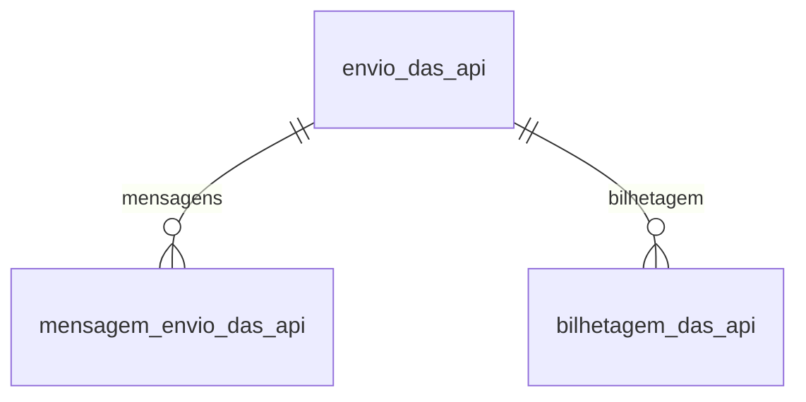

# Modelo — DAS e PGDAS-D por API (Integra Contador)

> Gerado por `src/model/gerar_docs_modelo.py` a partir de `src/model/modulos/das_api.yaml`, do catálogo e do perfil de colunas. **Não edite à mão.**

3 entidades. A coluna *Preench.* é o % de linhas com valor útil (nem nulo, nem em branco, nem zero, nem 1900-01-01; para colunas de código o zero conta como valor).

## Diagrama

## Entidades

| Entidade | Tabela | Linhas | Volume | Filtro obrigatório |
|---|---|---|---|---|
| [envio_das_api](#envio_das_api) | `efdas_api_envio_arquivos` | 13.225 | medio | empresa |
| [mensagem_envio_das_api](#mensagem_envio_das_api) | `efdas_api_envio_arquivos_mensagem` | 18.635 | medio | empresa; um de: envio |
| [bilhetagem_das_api](#bilhetagem_das_api) | `efdas_api_bilhetagem` | 13.225 | medio | empresa |

## envio_das_api

**Envios à API do DAS/PGDAS-D** — tabela `efdas_api_envio_arquivos` (13.225 linhas)

Um registro por chamada à API: transmissão da declaração, emissão da guia DAS ou outro serviço, com situação e número da guia. 13.320 envios, 257 empresas, competências de 2024-04 a 2026-09 (envios de 2024-05 a 2026-10). O JSON trocado não é exposto.

- **Chave:** `CODI_EMP, I_ENVIO`
- **Empresa:** `CODI_EMP`
- **Período:** `COMPETENCIA`
- **Ordem padrão:** `COMPETENCIA desc`, `I_ENVIO desc`

**Regras de negócio validadas:**

- Situação x mensagem (por envio): situação 0 só tem mensagem de código 0 (950); 1 só 200 (11.155); 2 só 400 (967) ou 403 (126); 3 só 500 (121); 4 só 401 (1). Todo envio tem mensagem (0 sem).
- Número da guia DAS: só em envios de tipo 2 com sucesso (3.505 de 5.490) e sempre com 17 posições; os outros 1.985 envios de emissão bem-sucedidos não trazem número. Os envios de transmissão (tipo 1) nunca trazem.
- Retificação: 3.312 empresa/competências tiveram 1 transmissão com sucesso, 500 tiveram 2, 109 tiveram 3, 37 tiveram 4 e 59 tiveram 7 (o máximo é 9). A partir da segunda, todas são retificadoras (tipo 2): 1.334 de 1.334.
- Valor diferente do que o sistema calculou: S em 273 envios, N em 2.478 e vazio em 10.569 (só preenchido nas emissões).
- Integridade: 0 mensagens e 0 bilhetagens sem o envio correspondente; há 1 bilhetagem por envio (13.320 de 13.320).

| Campo | Coluna | Tipo | Preench. | Domínio | Descrição (banco) |
|---|---|---|---|---|---|
| envio | `i_envio` | integer(4) |  |  | Código sequencial de envio dos arquivos |
| competencia | `competencia` | date(4) |  |  | Competência |
| tipo_envio | `tipo_envio` | integer(4) |  | tipo_envio_das_api | Tipo de envio |
| situacao | `situacao` | integer(4) |  | situacao_envio_das_api | Situação processo |
| tipo_declaracao | `tipo_declaracao` | integer(4) |  | tipo_declaracao_das_api | Tipo de declaração |
| data_envio | `data_envio` | date(4) |  |  | Data de envio |
| horario_envio | `horario_envio` | time(8) |  |  | Hora de envio |
| numero_das | `numero_das` | char(20) |  |  | Numero da guia DAS |
| valor_diferente_do_sistema | `valor_diferente_sistema` | char(1) |  | sim_nao_texto | Valor diferente do enviado pelo sistema |
| nome_arquivo | `nome_arquivo` | varchar(100) |  |  | Nome do arquivo |

**Vínculos (LEFT JOIN, acrescentam colunas legíveis):**

- `empresa` → `geempre` por `CODI_EMP` = `codi_emp`; colunas: `empresa_nome`

**Filhos (1:N):**

- `mensagens` → [mensagem_envio_das_api](#mensagem_envio_das_api)
- `bilhetagem` → [bilhetagem_das_api](#bilhetagem_das_api)

**Filtros:** `envio` (eq/in), `competencia` (eq/entre/gte/lte), `tipo_envio` (eq/in), `situacao` (eq/in), `data_envio` (eq/entre/gte/lte), `numero_das` (eq)

## mensagem_envio_das_api

**Mensagens de retorno da API do DAS** — tabela `efdas_api_envio_arquivos_mensagem` (18.635 linhas)

Mensagens devolvidas pela API em cada envio (código, título e descrição). 18.777 linhas; 16.612 são "Sucesso-PGDASD" (200).

- **Chave:** `CODI_EMP, I_ENVIO, SEQUENCIAL_MENSAGEM`
- **Empresa:** `CODI_EMP`
- **Período:** `—` · exige um de: `envio`
- **Ordem padrão:** `I_ENVIO desc`, `SEQUENCIAL_MENSAGEM asc`

**Regras de negócio validadas:**

- Códigos: 200 Sucesso-PGDASD 16.612 · 400 Bad Request 967 · 0 (sem título) 950 · 403 Acesso negado (ICGERENCIADOR-032) 126 · 500 Erro no servidor 121 · 401 Unauthorized 1.

| Campo | Coluna | Tipo | Preench. | Domínio | Descrição (banco) |
|---|---|---|---|---|---|
| envio | `i_envio` | integer(4) |  |  | Código sequencial de envio dos arquivos |
| sequencial | `sequencial_mensagem` | integer(4) |  |  |  |
| codigo | `codigo_mensagem` | integer(4) |  |  | Código da mensagem de retorno |
| titulo | `titulo_mensagem` | varchar(100) |  |  | Titulo da mensagem de retorno |
| descricao | `descricao_mensagem` | varchar(500) |  |  | Descrição do titulo |

**Filtros:** `envio` (eq/in), `codigo` (eq/in)

## bilhetagem_das_api

**Bilhetagem (custo) das chamadas à API do DAS** — tabela `efdas_api_bilhetagem` (13.225 linhas)

Registra cada chamada com o contador que a fez, a hora e se a operação gerou custo. 13.320 linhas, uma por envio.

- **Chave:** `CODI_EMP, I_ENVIO, CODI_CON, SEQUENCIAL_BILHETAGEM`
- **Empresa:** `CODI_EMP`
- **Período:** `DATA_HORA_REQUISICAO`
- **Ordem padrão:** `DATA_HORA_REQUISICAO desc`

**Regras de negócio validadas:**

- Gerou custo (S) em 11.281 chamadas e não (N) em 2.039. Por tipo: 1 (transmissão) S 5.494 / N 1.870; 2 (emissão da guia) S 5.499 / N 137; 3 S 288 / N 32. A hipótese de que as chamadas sem custo são as recusadas pela API não foi testada.

| Campo | Coluna | Tipo | Preench. | Domínio | Descrição (banco) |
|---|---|---|---|---|---|
| envio | `i_envio` | integer(4) |  |  | Código sequencial de envio dos arquivos |
| contador_codigo | `codi_con` | integer(4) |  |  | Código do contador |
| sequencial | `sequencial_bilhetagem` | integer(4) |  |  |  |
| requisicao_em | `data_hora_requisicao` | timestamp(8) |  |  | Data/Hora da requisição |
| tipo_envio | `tipo_envio` | integer(4) |  | tipo_envio_das_api | Tipo de serviço realizado |
| gerou_custo | `gerou_custo` | char(1) |  | sim_nao_texto | Operação gerou custo |

**Filtros:** `envio` (eq/in), `requisicao_em` (entre/gte/lte), `tipo_envio` (eq/in), `gerou_custo` (eq)

## Domínios (significado dos códigos)

`confirmado`: **sim** = vem do comentário do banco e/ou foi conferido nos dados; **parcial** = parte dos valores; **não** = hipótese, não use como regra.

### status_empresa

Situação da empresa no cadastro (geempre.stat_emp)

Confirmado: sim

| Código | Significado |
|---|---|
| A | Ativa |
| I | Inativa |
| C | Em constituição |
| M | Ativo sem movimento |
| B | Em processo de baixa |
| E | Excluindo |

### motivo_inatividade

Motivo da inatividade (geempre.tipoi_emp). Só aparece em empresas inativas.

Confirmado: sim

| Código | Significado |
|---|---|
| 1 | Outros |
| 2 | Baixada |
| 3 | Transferida |
| 4 | Inadimplente |

### tipo_inscricao

Tipo da inscrição (CNPJ/CPF/CEI/CAEPF)

Confirmado: sim

| Código | Significado |
|---|---|
| 1 | CNPJ |
| 2 | CPF |
| 3 | CEI |
| 6 | CAEPF |

### regime_federal_empresa

Regime federal da folha (geempre.rfed_emp)

Confirmado: parcial

| Código | Significado |
|---|---|
| 1 | Normal |
| 2 | Microempresa |
| 3 | Empresa de pequeno porte |

### tipo_honorario_empresa

Como a empresa usa o módulo Honorários (geempre.honorario_tipo)

Confirmado: sim

| Código | Significado |
|---|---|
| E | Escritório (quem fatura) |
| C | Cliente |

### sim_nao_texto

Confirmado: sim

| Código | Significado |
|---|---|
| S | Sim |
| N | Não |

### sim_nao_numerico

Confirmado: sim

| Código | Significado |
|---|---|
| 1 | Sim |
| 0 | Não |

### tipo_envio_das_api

O que foi pedido à API (efdas_api_envio_arquivos.tipo_envio / efdas_api_bilhetagem.tipo_envio)

Confirmado: parcial

> O comentário do banco diz só "Tipo de envio". Pelos dados: 2 é o único tipo que tem número de guia DAS (3.505 de 5.490 envios bem-sucedidos desse tipo, sempre com 17 posições) e 3 e 1 nunca têm: 1 = transmissão da declaração (PGDAS-D) (7.364 envios); 2 = emissão da guia DAS (5.636); 3 = outro serviço sem guia, provavelmente consulta (320). Por evidência, não documentado.

| Código | Significado |
|---|---|
| 1 | Transmissão da declaração PGDAS-D (por evidência) |
| 2 | Emissão da guia DAS (por evidência) |
| 3 | Outro serviço |
| provavelmente consulta (hipótese) | None |

### situacao_envio_das_api

Situação do envio (efdas_api_envio_arquivos.situacao)

Confirmado: parcial

> O comentário diz só "Situação processo". Pelos dados, a situação coincide 1 para 1 com o código HTTP da mensagem de retorno: 0 = só mensagem de código 0 (sem retorno ainda; 950 envios), 1 = código 200 "Sucesso-PGDASD" (11.155), 2 = código 400 "Bad Request" (967) ou 403 "Acesso negado" (126) = recusado, 3 = código 500 "Erro no servidor" (121), 4 = código 401 "Unauthorized" (1). Conclusão por evidência.

| Código | Significado |
|---|---|
| 0 | Aguardando retorno |
| 1 | Sucesso |
| 2 | Recusado pela API (400/403) |
| 3 | Erro no servidor (500) |
| 4 | Não autorizado (401) |

### tipo_declaracao_das_api

Tipo da declaração PGDAS-D (efdas_api_envio_arquivos.tipo_declaracao)

Confirmado: parcial

> O comentário diz só "Tipo de declaração". Todos os 1.334 envios bem-sucedidos de declaração a partir do segundo na mesma empresa e competência têm 2, e o primeiro tem 1 em 3.990 de 4.043 (98,7%): 1 = declaração original, 2 = retificadora (por evidência).

| Código | Significado |
|---|---|
| 1 | Original (por evidência) |
| 2 | Retificadora (por evidência) |

