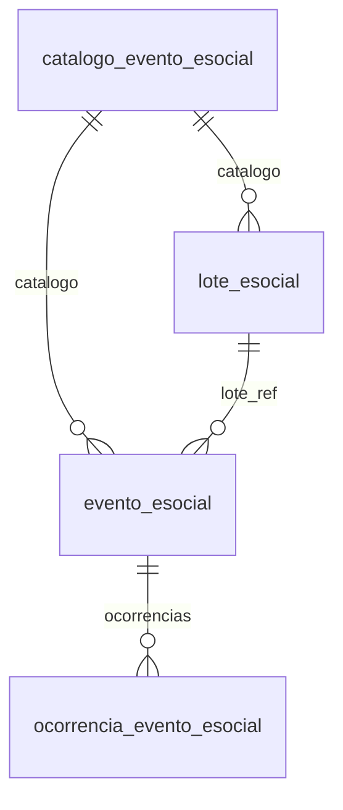

# Modelo — eSocial (envio de eventos)

> Gerado por `src/model/gerar_docs_modelo.py` a partir de `src/model/modulos/esocial.yaml`, do catálogo e do perfil de colunas. **Não edite à mão.**

4 entidades. A coluna *Preench.* é o % de linhas com valor útil (nem nulo, nem em branco, nem zero, nem 1900-01-01; para colunas de código o zero conta como valor).

## Diagrama

## Entidades

| Entidade | Tabela | Linhas | Volume | Filtro obrigatório |
|---|---|---|---|---|
| [evento_esocial](#evento_esocial) | `foesocial_dados_eventos` | 912.947 | grande | empresa |
| [catalogo_evento_esocial](#catalogo_evento_esocial) | `foesocial_eventos` | 44 | pequeno | — |
| [lote_esocial](#lote_esocial) | `foesocial_lotes` | 210.737 | medio | empresa |
| [ocorrencia_evento_esocial](#ocorrencia_evento_esocial) | `foesocial_dados_eventos_ocorrencias` | 82.751 | medio | empresa; um de: envio |

## evento_esocial

**Eventos do eSocial (fila de envio e retorno)** — tabela `foesocial_dados_eventos` (912.947 linhas)

Um registro por evento gerado para envio ao eSocial: qual evento (S-xxxx), o item a que se refere, tipo de envio, ID, recibo e resposta do ambiente nacional, validação e ajustes. 913 mil linhas, 888 empresas, de 2018-08 a hoje. O XML do evento não é exposto. Atenção: `descricao_resposta` e `nis_empregado` podem conter dados pessoais.

- **Chave:** `codi_emp, i_dados_eventos`
- **Empresa:** `codi_emp`
- **Período:** `DATA_CRIACAO_REGISTRO`
- **Ordem padrão:** `i_dados_eventos desc`

**Regras de negócio validadas:**

- Recibo x validação: 912.966 de 913.041 registros (99,99%) têm número de recibo, validado = 1, aguardando_ajuste = 0 e código de resposta. Os 75 restantes não têm recibo nem validação; 73 estão aguardando ajuste e 2 não.
- Resposta: 201 em 879.954 registros e 202 em 32.635 (ambos 'Sucesso.'); 401 (conteúdo do evento inválido) em 420 e 411 (assinante inválido) em 17. Nos 40 maiores clientes, 202 sempre tem ocorrência registrada e 201 nunca tem: 202 = sucesso com advertência (por evidência).
- Eventos por grupo do catálogo: iniciais e tabelas 584.307 · periódicos 242.657 · não periódicos 86.077. Mais frequentes: S-1299 (fechamento) 26.643, S-1200 (remuneração) e S-1210 (pagamentos); S-1298 (reabertura) 4.712.
- `item_codigo_esocial` é o código do objeto dentro da empresa a que o evento se refere (nas amostras: 1, 2, 3... para S-1200/S-1210, vazio para S-1298/S-1299). A leitura é uma inferência dos padrões, não vem documentada.
- Integridade (3 maiores empresas, 78.357 registros): todo registro tem o lote correspondente (0 sem lote) e o evento do lote é o mesmo do registro em 100%. O catálogo cobre todos os registros (0 sem evento no catálogo) e o ID de envio é único (913.041 IDs distintos).
- Tipo de envio: inclusão 831.695, exclusão 35.385, alteração 33.449 e retificação 12.512; validação feita pelo sistema em 908.316 e manual/conversão/importação em 4.725.

| Campo | Coluna | Tipo | Preench. | Domínio | Descrição (banco) |
|---|---|---|---|---|---|
| codigo | `i_dados_eventos` | integer(4) |  |  | Código do registro de envio. |
| lote | `i_lote` | integer(4) |  |  | Código do lote. |
| evento_codigo | `i_evento_esocial` | integer(4) |  |  | Código do evento do eSocial. |
| item_codigo_esocial | `codigo_esocial` | varchar(30) |  |  | Código do eSocial |
| tipo_envio | `tipo_envio` | smallint(2) |  | tipo_envio_esocial | Tipo de envio. (1=Inclusão/2=Alteração/3=Exclusão/4=Retificação) |
| tabela_origem | `tabela_dados` | varchar(128) |  |  | Nome da tabela de dados que gerou o registro. |
| chave_origem | `chave_tabela_dados` | varchar(256) |  |  | Chave do registro da tabela de dados. |
| id_envio | `id` | varchar(70) |  |  | ID de envio ao eSocial. |
| numero_recibo | `numero_recibo` | varchar(50) |  |  | Número do recibo. |
| resposta_codigo | `i_resposta` | integer(4) |  | resposta_esocial | Código da resposta para o evento. |
| descricao_resposta 🔒 | `descricao_resposta` | varchar(1000) |  |  | Descrição da resposta para o evento. |
| validado | `validado` | smallint(2) |  | sim_nao_numerico | Evento validado. (0=Não/1=Sim) |
| aguardando_ajuste | `aguardando_ajuste` | smallint(2) |  | sim_nao_numerico | Quando invalidado, indica se o evento necessita de ajuste antes de ser reenviado. (0=Não/1=Sim) |
| tipo_validacao | `tipo_validacao` | smallint(2) |  | tipo_validacao_esocial | Tipo de validação. (1=Sistema/2=Manual/3=Conversão/4=Importação) |
| advertencia_ajustada | `advertencia_ajustada` | smallint(2) |  | sim_nao_numerico | Registro validado com advertência ajustado pelo usuário. (0=Não/1=Sim) |
| reenviar | `reenviar` | smallint(2) |  | sim_nao_numerico | Evento marcado para reenviar. (0=Não/1=Sim) |
| xml_alterado | `xml_alterado` | smallint(2) |  | sim_nao_numerico | Indica se o XML foi alterado pelo usuario. 0=Nao/1=Sim |
| inclusao_duplicada | `inclusao_duplicada` | smallint(2) |  | sim_nao_numerico | Registro duplicado (retorno 537) |
| competencia_calculo | `competencia_calculo` | date(4) |  |  | Competência para gerar os dados do cálculo. |
| data_alteracao | `data_alteracao` | date(4) |  |  | Preencher com a data de alteração quando for um evento de alteração. Exemplo: 2205, 2206, 2306. |
| concluido_em | `data_hora_conclusao` | timestamp(8) |  |  | Data/hora da conclusão do evento. |
| criado_em | `data_criacao_registro` | timestamp(8) |  |  | Data de inserção do registro no banco de dados. |
| alterado_em | `data_alteracao_registro` | timestamp(8) |  |  | Data da última alteração do registro no banco de dados. |
| versao_leiaute | `versao_leiaute` | varchar(12) |  |  | Versão do leiaute do eSocial que foi gerado o evento. |
| versao_sistema | `versao_sistema` | varchar(50) |  |  | Versão do sistema no momento da inserção/alteração do registro. |
| nis_empregado 🔒 | `nis_empregado` | char(11) |  |  | Numero do NIS do empregado no momento do envio para o eSocial. |
| evento_excluido | `i_evento_esocial_excluido` | integer(4) |  |  | Código evento esocial excluido no evento 3000. |
| recibo_excluido | `numero_recibo_excluido` | varchar(50) |  |  | Numero do recibo excluido no evento 3000. |

**Vínculos (LEFT JOIN, acrescentam colunas legíveis):**

- `catalogo` → `foesocial_eventos` por `I_EVENTO_ESOCIAL` = `i_evento_esocial`; colunas: `evento_descricao`, `evento_grupo`
- `lote_ref` → `foesocial_lotes` por `codi_emp` = `codi_emp` e `I_LOTE` = `i_lote`; colunas: `lote_status`

> 🔒 **Privacidade:** A descrição da resposta pode citar CPF de trabalhadores; o NIS do empregado é dado pessoal.

**Filhos (1:N):**

- `ocorrencias` → [ocorrencia_evento_esocial](#ocorrencia_evento_esocial)

**Filtros:** `codigo` (eq/in), `lote` (eq/in), `evento_codigo` (eq/in), `tipo_envio` (eq/in), `resposta_codigo` (eq/in), `validado` (eq), `aguardando_ajuste` (eq), `numero_recibo` (eq), `competencia_calculo` (eq/entre/gte/lte), `criado_em` (entre/gte/lte)

## catalogo_evento_esocial

**Catálogo dos eventos do eSocial** — tabela `foesocial_eventos` (44 linhas)

Os 44 eventos tratados pela Domínio (S-1000 ... S-3500) com grupo, ordem de envio e se são gerados automaticamente. Tabela global.

- **Chave:** `i_evento_esocial`
- **Empresa:** `não se aplica (tabela global)`
- **Período:** `—`
- **Ordem padrão:** `i_evento_esocial asc`

**Regras de negócio validadas:**

- 44 eventos: 11 iniciais/tabelas (1000 a 1080 e 2100), 11 periódicos (1200 a 1300) e 22 não periódicos (2190 a 2501, 3000 e 3500). O código é o número do evento (1200 = S-1200 Remuneração; 1210 = S-1210 Pagamentos; 1299 = S-1299 Fechamento).
- 26 dos 44 eventos têm validar_sem_recibo = 1 (o comentário do banco: validar sem recibo quando o retorno for o código 537, registro duplicado), entre eles S-1200, S-1210, S-1299, S-2200, S-2299 e S-3000.

| Campo | Coluna | Tipo | Preench. | Domínio | Descrição (banco) |
|---|---|---|---|---|---|
| evento_codigo | `i_evento_esocial` | integer(4) |  |  | Código do evento do e-Social |
| descricao | `descricao` | varchar(50) |  |  | Descrição do evento do e-Social |
| grupo | `grupo` | smallint(2) |  | grupo_evento_esocial | Grupo (1=Iniciais e Tabelas/2=Não periódicos/3=Periódicos) |
| ordem_envio | `ordem` | smallint(2) |  |  | Ordem de envio do evento para o eSocial. |
| gerar_automatico | `gerar_automatico` | smallint(2) |  | sim_nao_numerico | Gerar automaticamento quando antecessor for validado. |
| validar_sem_recibo | `validar_sem_recibo` | smallint(2) |  | sim_nao_numerico | Validar sem recibo quando retornar código 537 |

**Filtros:** `evento_codigo` (eq/in), `grupo` (eq/in), `descricao` (contem)

## lote_esocial

**Lotes de envio ao eSocial** — tabela `foesocial_lotes` (210.737 linhas)

Cada lote reúne eventos do mesmo tipo de uma empresa para transmissão. 210.827 lotes, 916 empresas, de 2018-08 a hoje.

- **Chave:** `codi_emp, i_lote`
- **Empresa:** `codi_emp`
- **Período:** `DATA_CRIACAO_REGISTRO`
- **Ordem padrão:** `i_lote desc`

**Regras de negócio validadas:**

- Status dos 210.827 lotes: 4 (concluído) 210.800 · 6 (aguardando múltiplos vínculos) 24 · 9 (erro de preenchimento) 2 · 3 (aguardando ajuste) 1. Lotes concluídos com eventos invalidados: 152.

| Campo | Coluna | Tipo | Preench. | Domínio | Descrição (banco) |
|---|---|---|---|---|---|
| lote | `i_lote` | integer(4) |  |  | Código do lote |
| status | `status` | smallint(2) |  | status_lote_esocial | Status do lote.(1=Aguardando envio/2=Enviado/3=Aguardando ajuste/4=Concluído/5=Aguardando senha A3/6=Aguardando Envio Multiplos Vinculos/7=Aguardando fim thread contábil/8=Erro lote/9=Erro preenchimento) |
| evento_codigo | `i_evento_esocial` | integer(4) |  |  | Código do evento do eSocial que será enviado no lote. |
| versao_xml | `versao` | varchar(12) |  |  | Versão do XML. |
| lote_exclusao | `lote_exclusao` | smallint(2) |  | sim_nao_numerico | Lote de exclusão da empresa. |
| possui_eventos_invalidados | `possui_eventos_invalidados` | bit(1) |  |  | Indica se o lote possui eventos invalidados. |
| criado_em | `data_criacao_registro` | timestamp(8) |  |  | Data de inserção do registro no banco de dados. |
| alterado_em | `data_alteracao_registro` | timestamp(8) |  |  | Data da última alteração do registro no banco de dados. |
| processado_em | `data_processamento_registro` | timestamp(8) |  |  | Data de processamento do registro. |
| versao_sistema | `versao_sistema` | varchar(50) |  |  | Versão do sistema no momento da inserção/alteração do registro. |

**Vínculos (LEFT JOIN, acrescentam colunas legíveis):**

- `catalogo` → `foesocial_eventos` por `I_EVENTO_ESOCIAL` = `i_evento_esocial`; colunas: `evento_descricao`

**Filtros:** `lote` (eq/in), `status` (eq/in), `evento_codigo` (eq/in), `criado_em` (entre/gte/lte)

## ocorrencia_evento_esocial

**Ocorrências do retorno de um envio ao eSocial** — tabela `foesocial_dados_eventos_ocorrencias` (82.751 linhas)

Mensagens que o ambiente nacional devolve sobre um evento (erros e advertências), com localização. 82.751 linhas. A descrição costuma citar CPF e matrícula do trabalhador.

- **Chave:** `codi_emp, i_dados_eventos, sequencial`
- **Empresa:** `codi_emp`
- **Período:** `—` · exige um de: `envio`
- **Ordem padrão:** `i_dados_eventos desc`, `sequencial asc`

**Regras de negócio validadas:**

- Códigos mais frequentes: 163 (40.636 — trabalhador sem vínculo consta na base do eSocial mas não foi informado), 1727 (20.101 — advertências ao confirmar o fechamento da folha para a DCTFWeb), 1895 (6.388), 424 (5.674), 162 (5.579) e 1090 (1.628).

| Campo | Coluna | Tipo | Preench. | Domínio | Descrição (banco) |
|---|---|---|---|---|---|
| envio | `i_dados_eventos` | integer(4) |  |  | Código do registro de envio. |
| sequencial | `sequencial` | smallint(2) |  |  | Sequencial. |
| ocorrencia_codigo | `i_resposta` | integer(4) |  |  | Código da resposta. |
| descricao 🔒 | `descricao` | varchar(1500) |  |  | Descrição da ocorrência. |
| localizacao | `localizacao` | varchar(128) |  |  | Localização da ocorrência. |
| mostrar_no_painel | `mostrar_painel_esocial` | smallint(2) |  | sim_nao_numerico | Indica se o registro vai ser mostrado no painel eSocial. 0=Nao/1=Sim |

> 🔒 **Privacidade:** A descrição pode citar CPF de trabalhadores.

**Filtros:** `envio` (eq/in), `ocorrencia_codigo` (eq/in)

## Domínios (significado dos códigos)

`confirmado`: **sim** = vem do comentário do banco e/ou foi conferido nos dados; **parcial** = parte dos valores; **não** = hipótese, não use como regra.

### status_empresa

Situação da empresa no cadastro (geempre.stat_emp)

Confirmado: sim

| Código | Significado |
|---|---|
| A | Ativa |
| I | Inativa |
| C | Em constituição |
| M | Ativo sem movimento |
| B | Em processo de baixa |
| E | Excluindo |

### motivo_inatividade

Motivo da inatividade (geempre.tipoi_emp). Só aparece em empresas inativas.

Confirmado: sim

| Código | Significado |
|---|---|
| 1 | Outros |
| 2 | Baixada |
| 3 | Transferida |
| 4 | Inadimplente |

### tipo_inscricao

Tipo da inscrição (CNPJ/CPF/CEI/CAEPF)

Confirmado: sim

| Código | Significado |
|---|---|
| 1 | CNPJ |
| 2 | CPF |
| 3 | CEI |
| 6 | CAEPF |

### regime_federal_empresa

Regime federal da folha (geempre.rfed_emp)

Confirmado: parcial

| Código | Significado |
|---|---|
| 1 | Normal |
| 2 | Microempresa |
| 3 | Empresa de pequeno porte |

### tipo_honorario_empresa

Como a empresa usa o módulo Honorários (geempre.honorario_tipo)

Confirmado: sim

| Código | Significado |
|---|---|
| E | Escritório (quem fatura) |
| C | Cliente |

### sim_nao_texto

Confirmado: sim

| Código | Significado |
|---|---|
| S | Sim |
| N | Não |

### sim_nao_numerico

Confirmado: sim

| Código | Significado |
|---|---|
| 1 | Sim |
| 0 | Não |

### grupo_evento_esocial

Confirmado: sim

| Código | Significado |
|---|---|
| 1 | Iniciais e tabelas |
| 2 | Não periódicos |
| 3 | Periódicos |

### tipo_envio_esocial

Confirmado: sim

| Código | Significado |
|---|---|
| 1 | Inclusão |
| 2 | Alteração |
| 3 | Exclusão |
| 4 | Retificação |

### tipo_validacao_esocial

Confirmado: sim

| Código | Significado |
|---|---|
| 1 | Sistema |
| 2 | Manual |
| 3 | Conversão |
| 4 | Importação |

### resposta_esocial

Código de resposta do ambiente nacional ao evento (foesocial_dados_eventos.i_resposta)

Confirmado: parcial

> Só 4 códigos aparecem em registros enviados. 201 e 202 têm o texto "Sucesso."; a diferença vem dos dados: nos 40 maiores clientes TODOS os registros 201 (262.934) não têm ocorrência e TODOS os 202 (10.730) têm ocorrência registrada, logo 202 = sucesso com advertência (conclusão por evidência, não documentada pelo banco). 401 = conteúdo do evento inválido (420 registros; os 120 dos 40 maiores clientes têm ocorrência); 411 = assinante inválido, sem perfil de procuração (17). As ocorrências usam outros códigos (163, 1727, 1895, 424, 162, 1090...).

| Código | Significado |
|---|---|
| 201 | Sucesso |
| 202 | Sucesso com advertência (por evidência) |
| 401 | Conteúdo do evento inválido |
| 411 | Assinante inválido |

### status_lote_esocial

Confirmado: sim

| Código | Significado |
|---|---|
| 1 | Aguardando envio |
| 2 | Enviado |
| 3 | Aguardando ajuste |
| 4 | Concluído |
| 5 | Aguardando senha A3 |
| 6 | Aguardando envio de múltiplos vínculos |
| 7 | Aguardando fim da thread contábil |
| 8 | Erro no lote |
| 9 | Erro de preenchimento |

