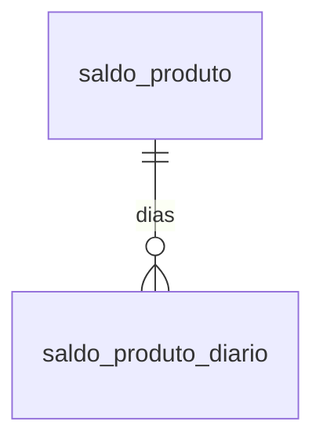

# Modelo — Estoque fiscal (saldo de produtos)

> Gerado por `src/model/gerar_docs_modelo.py` a partir de `src/model/modulos/estoque.yaml`, do catálogo e do perfil de colunas. **Não edite à mão.**

2 entidades. A coluna *Preench.* é o % de linhas com valor útil (nem nulo, nem em branco, nem zero, nem 1900-01-01; para colunas de código o zero conta como valor).

## Diagrama

## Entidades

| Entidade | Tabela | Linhas | Volume | Filtro obrigatório |
|---|---|---|---|---|
| [saldo_produto](#saldo_produto) | `efsdopro` | 8.451.202 | grande | empresa; um de: produto_codigo, periodo |
| [saldo_produto_diario](#saldo_produto_diario) | `efsdopro_diario` | 249.231 | medio | empresa; um de: produto_codigo, periodo |

## saldo_produto

**Saldo mensal dos produtos (estoque fiscal)** — tabela `efsdopro` (8.451.202 linhas)

Uma linha por empresa, produto e competência (primeiro dia do mês): saldo físico e em valor no início, entradas e saídas do mês e saldo no fim. Traz também o estoque final da Portaria CAT 17/99 (SP) e o saldo de ICMS-ST. 8,45 milhões de linhas, 473 empresas, 2014-01 a 2026-09. Origem do movimento: notas de entrada (`efmvepro`), notas de saída (`efmvspro`) e CF-e.

- **Chave:** `codi_emp, codi_pdi, data_pro`
- **Empresa:** `codi_emp`
- **Período:** `data_pro` · exige um de: `produto_codigo, periodo`
- **Ordem padrão:** `data_pro desc`, `codi_pdi asc`

**Regras de negócio validadas:**

- Identidade do saldo (empresa 680, 63.777 saldos): saldo_valor = saldo_valor_anterior + entradas_valor - saidas_valor em 100% (tolerância 0,01); saldo_fisico = anterior + entradas - saídas em 100% a menos de 0,001 (463 saldos diferem só por arredondamento, desvio máximo 0,0005). Use `saldo_fisico` e `saldo_valor`; as colunas `*_recalculado` existem para conferir.
- Continuidade: o saldo anterior de um mês é igual ao saldo do mês anterior do mesmo produto em 62.130 de 62.130 pares (físico e valor). 76 saldos têm anterior diferente de zero sem registro do mês anterior (produto sem movimento no mês não gera linha).
- Entradas: entradas_fisicas é igual à soma de efmvepro.qtde_mep (notas de entrada) por produto e mês em 63.775 de 63.777 (empresa 680).
- Saídas: saidas_fisicas é igual à soma de efmvspro.qtde_msp (notas de saída) MAIS a quantidade dos itens de CF-e vigentes (situação 0) em 63.777 de 63.777 saldos a menos de 0,001 (63.258 exatos a 0,0001; os outros 519 diferem no máximo 0,0005, arredondamento). Só com as notas de saída seriam 57.529 (90,2%): o CF-e entra no saldo. Empresa 680.
- Portaria CAT 17/99: estoque_final_cat17 x valor_unitario_cat17 = saldo_final_cat17 (tolerância 0,05) em 63.777 de 63.777; todos os saldos da empresa 680 têm saldo_valido = S.
- Chave: (empresa, produto, competência) é única (PK); a competência é sempre o primeiro dia do mês.

| Campo | Coluna | Tipo | Preench. | Domínio | Descrição (banco) |
|---|---|---|---|---|---|
| produto_codigo | `codi_pdi` | char(14) |  |  | Produto |
| competencia | `data_pro` | date(4) |  |  | Competencia |
| saldo_fisico_anterior | `sfisant_pro` | numeric(18) |  |  | Saldo fisico anterior |
| saldo_valor_anterior | `svalant_pro` | numeric(15) |  |  | Valor do saldo anterior |
| entradas_fisicas | `entfis_pro` | numeric(15) |  |  | Entrada fisicas do mes |
| entradas_valor | `entval_pro` | numeric(15) |  |  | Valor das entradas do mes |
| saidas_fisicas | `saifis_pro` | numeric(15) |  |  | Saidas fisicas do mes |
| saidas_valor | `saival_pro` | numeric(15) |  |  | Valor das saidas do mes |
| saldo_fisico | `sfismes_pro` | numeric(18) |  |  | Saldo Fisico no mes |
| saldo_valor | `svalmes_pro` | numeric(15) |  |  | Valor do saldo no mes |
| estoque_final_cat17 | `estoque_final` | numeric(15) |  |  | Estoque final - Portaria Cat nº 17/99 |
| valor_unitario_cat17 | `valor_unitario` | numeric(15) |  |  | Valor unitário - Portaria Cat nº 17/99 |
| saldo_final_cat17 | `saldo_final` | numeric(16) |  |  | Valor final do estoque - Portaria Cat nº 17/99 |
| quantidade_final_icms_st | `quantidade_final_icms_st` | numeric(15) |  |  | Quantidade final ICMS ST |
| valor_unitario_medio_icms_st | `valor_unitario_medio_icms_st` | numeric(19) |  |  | Valor unitário médio ICMS ST |
| valor_final_icms_st | `valor_final_icms_st` | numeric(13) |  |  | Valor final ICMS ST |
| saldo_valido | `saldo_valido` | char(1) |  | sim_nao_texto |  |
| origem_registro | `origem_reg` | tinyint(1) |  | origem_registro_estoque | Origem do registro 0 - Sistema, 1 - Imp. Tabelas, 2 - Imp. Layout, 3- Imp. Tabelas Concorrentes |
| saldo_fisico_recalculado (calculada) | `sfisant_pro + entfis_pro - saifis_pro` | — | — | | Calculada pelo modelo: sfisant_pro + entfis_pro - saifis_pro |
| saldo_valor_recalculado (calculada) | `svalant_pro + entval_pro - saival_pro` | — | — | | Calculada pelo modelo: svalant_pro + entval_pro - saival_pro |

**Vínculos (LEFT JOIN, acrescentam colunas legíveis):**

- `produto` → `efprodutos` por `codi_emp` = `codi_emp` e `codi_pdi` = `codi_pdi`; colunas: `produto_descricao`, `produto_ncm`

**Filhos (1:N):**

- `dias` → [saldo_produto_diario](#saldo_produto_diario)

**Filtros:** `produto_codigo` (eq/in/prefixo), `competencia` (eq/entre/gte/lte), `saldo_valido` (eq)

## saldo_produto_diario

**Saldo diário dos produtos (estoque fiscal)** — tabela `efsdopro_diario` (249.231 linhas)

Saldo físico e em valor, e de ICMS e ICMS-ST, de cada produto por dia com movimento dentro da competência. 249 mil linhas, 173 empresas, 2018-09 a 2026-09. É o detalhe do saldo mensal.

- **Chave:** `codi_emp, data_pro, codi_pdi, dia_saldo`
- **Empresa:** `codi_emp`
- **Período:** `dia_saldo` · exige um de: `produto_codigo, periodo`
- **Ordem padrão:** `dia_saldo desc`, `codi_pdi asc`

**Regras de negócio validadas:**

- Fechamento com o mensal (empresa 644, 82.962 meses de produto): o saldo físico e o saldo em valor do último dia da competência são iguais a saldo_produto.saldo_fisico e saldo_valor em 82.962 de 82.962.
- A empresa 644 tem 86.485 linhas diárias, só do ano de 2024 (2024-01 a 2024-12); todas com saldo_valido = S.

| Campo | Coluna | Tipo | Preench. | Domínio | Descrição (banco) |
|---|---|---|---|---|---|
| competencia | `data_pro` | date(4) |  |  | Competência |
| produto_codigo | `codi_pdi` | char(14) |  |  | Código do produto |
| dia | `dia_saldo` | date(4) |  |  | Dia |
| saldo_fisico_anterior | `saldo_fisico_anterior` | numeric(18) |  |  | Saldo fisíco anterior |
| saldo_valor_anterior | `saldo_valor_anterior` | numeric(15) |  |  | Saldo valor anterior |
| icms_total_anterior | `icms_total_anterior` | numeric(13) |  |  | Valor do ICMS anterior |
| saldo_fisico_final | `saldo_fisico_final` | numeric(18) |  |  | Saldo fisíco final |
| saldo_valor_final | `saldo_valor_final` | numeric(15) |  |  | Saldo valor final |
| icms_total_final | `icms_total_final` | numeric(13) |  |  | Valor do ICMS final |
| saldo_fisico_icms_st_anterior | `saldo_fisico_icms_st_anterior` | numeric(18) |  |  | Saldo fisíco ICMS ST anterior |
| icms_st_total_anterior | `icms_st_total_anterior` | numeric(13) |  |  | Valor do ICMS ST anterior |
| saldo_fisico_icms_st_final | `saldo_fisico_icms_st_final` | numeric(18) |  |  | Saldo fisíco ICMS ST final |
| icms_st_total_final | `icms_st_total_final` | numeric(13) |  |  | Valor do ICMS ST final |
| saldo_valido | `saldo_valido` | char(1) |  | sim_nao_texto |  |

**Vínculos (LEFT JOIN, acrescentam colunas legíveis):**

- `produto` → `efprodutos` por `codi_emp` = `codi_emp` e `codi_pdi` = `codi_pdi`; colunas: `produto_descricao`

**Filtros:** `produto_codigo` (eq/in/prefixo), `competencia` (eq/entre/gte/lte), `dia` (eq/entre/gte/lte)

## Domínios (significado dos códigos)

`confirmado`: **sim** = vem do comentário do banco e/ou foi conferido nos dados; **parcial** = parte dos valores; **não** = hipótese, não use como regra.

### status_empresa

Situação da empresa no cadastro (geempre.stat_emp)

Confirmado: sim

| Código | Significado |
|---|---|
| A | Ativa |
| I | Inativa |
| C | Em constituição |
| M | Ativo sem movimento |
| B | Em processo de baixa |
| E | Excluindo |

### motivo_inatividade

Motivo da inatividade (geempre.tipoi_emp). Só aparece em empresas inativas.

Confirmado: sim

| Código | Significado |
|---|---|
| 1 | Outros |
| 2 | Baixada |
| 3 | Transferida |
| 4 | Inadimplente |

### tipo_inscricao

Tipo da inscrição (CNPJ/CPF/CEI/CAEPF)

Confirmado: sim

| Código | Significado |
|---|---|
| 1 | CNPJ |
| 2 | CPF |
| 3 | CEI |
| 6 | CAEPF |

### regime_federal_empresa

Regime federal da folha (geempre.rfed_emp)

Confirmado: parcial

| Código | Significado |
|---|---|
| 1 | Normal |
| 2 | Microempresa |
| 3 | Empresa de pequeno porte |

### tipo_honorario_empresa

Como a empresa usa o módulo Honorários (geempre.honorario_tipo)

Confirmado: sim

| Código | Significado |
|---|---|
| E | Escritório (quem fatura) |
| C | Cliente |

### sim_nao_texto

Confirmado: sim

| Código | Significado |
|---|---|
| S | Sim |
| N | Não |

### sim_nao_numerico

Confirmado: sim

| Código | Significado |
|---|---|
| 1 | Sim |
| 0 | Não |

### origem_registro_estoque

Origem do registro (origem_reg)

Confirmado: parcial

> Valores do comentário do banco (0 Sistema, 1 a 3 importações). Na empresa 680 os 63.777 saldos têm origem 0; nas demais empresas não foi medido.

| Código | Significado |
|---|---|
| 0 | Sistema |
| 1 | Importação de tabelas |
| 2 | Importação de layout |
| 3 | Importação de tabelas concorrentes |

