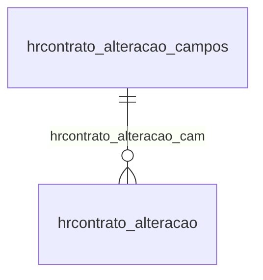

# Modelo — Financeiro do escritório - contrato (rascunho em lote)

> Gerado por `src/model/gerar_docs_modelo.py` a partir de `src/model/modulos/financeiro_contrato.yaml`, do catálogo e do perfil de colunas. **Não edite à mão.**

7 entidades. A coluna *Preench.* é o % de linhas com valor útil (nem nulo, nem em branco, nem zero, nem 1900-01-01; para colunas de código o zero conta como valor).

## Diagrama

## Entidades

| Entidade | Tabela | Linhas | Volume | Filtro obrigatório |
|---|---|---|---|---|
| [hrcontrato_competencia](#hrcontrato_competencia) | `HRCONTRATO_COMPETENCIA` | 11.353 | medio | empresa |
| [hrcontrato_faturamento](#hrcontrato_faturamento) | `HRCONTRATO_FATURAMENTO` | 1.157 | pequeno | empresa |
| [hrcontrato_adicional_competencia](#hrcontrato_adicional_competencia) | `HRCONTRATO_ADICIONAL_COMPETENCIA` | 864 | pequeno | empresa |
| [hrcontrato_alteracao](#hrcontrato_alteracao) | `HRCONTRATO_ALTERACAO` | 32 | pequeno | empresa |
| [hrcontrato_historico](#hrcontrato_historico) | `HRCONTRATO_HISTORICO` | 4 | pequeno | empresa |
| [hrcontrato_excedente_faturamento](#hrcontrato_excedente_faturamento) | `HRCONTRATO_EXCEDENTE_FATURAMENTO` | 1 | pequeno | empresa |
| [hrcontrato_alteracao_campos](#hrcontrato_alteracao_campos) | `HRCONTRATO_ALTERACAO_CAMPOS` | 1 | pequeno | — |

## hrcontrato_competencia

**Contratos - Competencias para faturamento futuro** — tabela `HRCONTRATO_COMPETENCIA` (11.353 linhas)

Contratos - Competencias para faturamento futuro. 11.353 linhas no catálogo; chave: CODI_EMP, I_CONTRATO, MES.

- **Chave:** `CODI_EMP, I_CONTRATO, MES`
- **Empresa:** `CODI_EMP`
- **Período:** `—`
- **Ordem padrão:** `I_CONTRATO asc`, `MES asc`

**Regras de negócio validadas:**

- Medido em 2026-10-18: 11.353 linhas, 2 empresa(s).
- Vínculo hrcontrato (HRCONTRATO): 0 de 11.269 linhas sem registro relacionado (empresa 1).

| Campo | Coluna | Tipo | Preench. | Domínio | Descrição (banco) |
|---|---|---|---|---|---|
| escritorio | `codi_emp` | integer(4) |  |  | Escritorio |
| contrato | `i_contrato` | integer(4) |  |  | Contrato |
| mes_de_faturamento | `mes` | tinyint(1) |  |  | Mes de faturamento |

**Vínculos (LEFT JOIN, acrescentam colunas legíveis):**

- `hrcontrato` → `HRCONTRATO` por `codi_emp` = `codi_emp` e `i_contrato` = `i_contrato`; colunas: `hrcontrato_nome`

**Filtros:** `contrato` (eq/in), `mes_de_faturamento` (eq/in)

## hrcontrato_faturamento

**Contrato - Faturamento** — tabela `HRCONTRATO_FATURAMENTO` (1.157 linhas)

Contrato - Faturamento. 1.157 linhas no catálogo; chave: CODI_EMP, I_CONTRATO, COMPETENCIA.

- **Chave:** `CODI_EMP, I_CONTRATO, COMPETENCIA`
- **Empresa:** `CODI_EMP`
- **Período:** `COMPETENCIA`
- **Ordem padrão:** `COMPETENCIA desc`, `I_CONTRATO asc`

**Regras de negócio validadas:**

- Medido em 2026-10-18: 1.157 linhas, 2 empresa(s), COMPETENCIA de 2018-01-01 a 2025-05-01.
- Vínculo hrcontrato (HRCONTRATO): 0 de 1.148 linhas sem registro relacionado (empresa 1).

| Campo | Coluna | Tipo | Preench. | Domínio | Descrição (banco) |
|---|---|---|---|---|---|
| escritorio | `codi_emp` | integer(4) |  |  | Escritorio |
| contrato | `i_contrato` | integer(4) |  |  | Contrato |
| competencia | `competencia` | date(4) |  |  | Competencia |
| situacao_a_ativo_i_inativo | `situacao` | char(1) |  |  | Situacao A Ativo I Inativo |
| usuario | `usuario` | varchar(128) |  |  | Usuario |

**Vínculos (LEFT JOIN, acrescentam colunas legíveis):**

- `hrcontrato` → `HRCONTRATO` por `codi_emp` = `codi_emp` e `i_contrato` = `i_contrato`; colunas: `hrcontrato_nome`

**Filtros:** `contrato` (eq/in), `competencia` (eq/in), `situacao_a_ativo_i_inativo` (eq/in), `usuario` (contem/prefixo)

## hrcontrato_adicional_competencia

**Contratos - Adicional anual - Competencias para faturamento futuro** — tabela `HRCONTRATO_ADICIONAL_COMPETENCIA` (864 linhas)

Contratos - Adicional anual - Competencias para faturamento futuro. 864 linhas no catálogo; chave: CODI_EMP, I_CONTRATO, MES.

- **Chave:** `CODI_EMP, I_CONTRATO, MES`
- **Empresa:** `CODI_EMP`
- **Período:** `—`
- **Ordem padrão:** `I_CONTRATO asc`, `MES asc`

**Regras de negócio validadas:**

- Medido em 2026-10-18: 864 linhas, 1 empresa(s).
- Vínculo hrcontrato (HRCONTRATO): 0 de 864 linhas sem registro relacionado (empresa 1).

| Campo | Coluna | Tipo | Preench. | Domínio | Descrição (banco) |
|---|---|---|---|---|---|
| escritorio | `codi_emp` | integer(4) |  |  | Escritorio |
| contrato | `i_contrato` | integer(4) |  |  | Contrato |
| mes_de_faturamento | `mes` | tinyint(1) |  |  | Mes de faturamento |
| dia_de_vencimento | `dia_vencimento` | tinyint(1) |  |  | Dia de vencimento |

**Vínculos (LEFT JOIN, acrescentam colunas legíveis):**

- `hrcontrato` → `HRCONTRATO` por `codi_emp` = `codi_emp` e `i_contrato` = `i_contrato`; colunas: `hrcontrato_nome`

**Filtros:** `contrato` (eq/in), `mes_de_faturamento` (eq/in)

## hrcontrato_alteracao

**Contratos - Alterações** — tabela `HRCONTRATO_ALTERACAO` (32 linhas)

Contratos - Alterações. 32 linhas no catálogo; chave: CODI_EMP, i_CONTRATO, DATA_ALTERACAO, I_CAMPO.

- **Chave:** `CODI_EMP, i_CONTRATO, DATA_ALTERACAO, I_CAMPO`
- **Empresa:** `CODI_EMP`
- **Período:** `DATA_ALTERACAO`
- **Ordem padrão:** `DATA_ALTERACAO desc`, `i_CONTRATO asc`, `I_CAMPO asc`

**Regras de negócio validadas:**

- Medido em 2026-10-18: 32 linhas, 1 empresa(s), DATA_ALTERACAO de 2022-02-01 a 2025-01-01.
- Vínculo hrcontrato (HRCONTRATO): 0 de 32 linhas sem registro relacionado (empresa 1).
- Vínculo hrcontrato_alteracao_cam (HRCONTRATO_ALTERACAO_CAMPOS): 0 de 32 linhas sem registro relacionado (empresa 1).

| Campo | Coluna | Tipo | Preench. | Domínio | Descrição (banco) |
|---|---|---|---|---|---|
| codigo_da_empresa | `codi_emp` | integer(4) |  |  | Código da empresa |
| codigo_do_contrato | `i_contrato` | integer(4) |  |  | Código do contrato |
| data_da_alteracao | `data_alteracao` | date(4) |  |  | Data da alteração |
| campo_alterado | `i_campo` | integer(4) |  |  | Campo alterado |
| valor_anterior_a_alteracao | `de` | varchar(255) |  |  | Valor anterior a alteracao |
| valor_posterior_a_aleracao | `para` | varchar(255) |  |  | Valor posterior a aleracao |

**Vínculos (LEFT JOIN, acrescentam colunas legíveis):**

- `hrcontrato` → `HRCONTRATO` por `codi_emp` = `codi_emp` e `i_contrato` = `i_contrato`; colunas: `hrcontrato_nome`
- `hrcontrato_alteracao_cam` → `HRCONTRATO_ALTERACAO_CAMPOS` por `i_campo` = `i_campo`; colunas: `hrcontrato_alteracao_cam_nome`

**Filtros:** `codigo_do_contrato` (eq/in), `data_da_alteracao` (eq/in), `campo_alterado` (eq/in), `valor_anterior_a_alteracao` (contem/prefixo), `valor_posterior_a_aleracao` (contem/prefixo)

## hrcontrato_historico

**Contratos - Historicos** — tabela `HRCONTRATO_HISTORICO` (4 linhas)

Contratos - Historicos. 4 linhas no catálogo; chave: CODI_EMP, I_CONTRATO, SEQUENCIAL.

- **Chave:** `CODI_EMP, I_CONTRATO, SEQUENCIAL`
- **Empresa:** `CODI_EMP`
- **Período:** `DATA_HISTORICO`
- **Ordem padrão:** `DATA_HISTORICO desc`, `I_CONTRATO asc`, `SEQUENCIAL asc`

**Regras de negócio validadas:**

- Medido em 2026-10-18: 4 linhas, 1 empresa(s), DATA_HISTORICO de 2024-08-09 a 2024-10-09.
- Vínculo hrcontrato (HRCONTRATO): 0 de 4 linhas sem registro relacionado (empresa 1).

| Campo | Coluna | Tipo | Preench. | Domínio | Descrição (banco) |
|---|---|---|---|---|---|
| escritorio | `codi_emp` | integer(4) |  |  | Escritorio |
| contrato | `i_contrato` | integer(4) |  |  | Contrato |
| sequencial | `sequencial` | integer(4) |  |  | Sequencial |
| data | `data_historico` | date(4) |  |  | Data |
| descricao | `descricao` | varchar(100) |  |  | Descricao |

**Vínculos (LEFT JOIN, acrescentam colunas legíveis):**

- `hrcontrato` → `HRCONTRATO` por `codi_emp` = `codi_emp` e `i_contrato` = `i_contrato`; colunas: `hrcontrato_nome`

**Filtros:** `contrato` (eq/in), `sequencial` (eq/in), `data` (entre/gte/lte), `descricao` (contem/prefixo)

## hrcontrato_excedente_faturamento

**Contrato - Excedentes de faturamento** — tabela `HRCONTRATO_EXCEDENTE_FATURAMENTO` (1 linhas)

Contrato - Excedentes de faturamento. 1 linhas no catálogo; chave: CODI_EMP, I_CONTRATO, I_EXCEDENTE.

- **Chave:** `CODI_EMP, I_CONTRATO, I_EXCEDENTE`
- **Empresa:** `CODI_EMP`
- **Período:** `A_PARTIR_DE`
- **Ordem padrão:** `A_PARTIR_DE desc`, `I_CONTRATO asc`, `I_EXCEDENTE asc`

**Regras de negócio validadas:**

- Medido em 2026-10-18: 1 linhas, 1 empresa(s), A_PARTIR_DE de 2017-08-01 a 2017-08-01.
- Colunas expostas nulas em 100% das linhas (1): encerrado_em.
- execente_c_lancamentos_contabeis_f_lanca: todos os valores reais estão no comentário do banco (E=1).
- Vínculo hrcontrato (HRCONTRATO): 0 de 1 linhas sem registro relacionado (empresa 1).
- Vínculo hrevento (HREVENTO): 0 de 1 linhas sem registro relacionado (empresa 1).

| Campo | Coluna | Tipo | Preench. | Domínio | Descrição (banco) |
|---|---|---|---|---|---|
| escritorio | `codi_emp` | integer(4) |  |  | Escritorio |
| codigo_contrato | `i_contrato` | integer(4) |  |  | Codigo contrato |
| sequencial | `i_excedente` | integer(4) |  |  | Sequencial |
| execente_c_lancamentos_contabeis_f_lanca | `excedente` | char(1) |  | hrcontrato_excedente_faturamento_execente_c_lanc | Execente (C=Lançamentos contábeis/ F=Lançamentos fiscais/ T=Horas trabalhadas/ E=Funcionários) |
| evento | `i_evento` | integer(4) |  |  | Evento |
| valor | `valor` | numeric(13) |  |  | Valor |
| a_partir_de | `a_partir_de` | date(4) |  |  | A partir de |
| encerrar_s_n | `encerrar` | char(1) |  |  | Encerrar (S/N) |
| encerrado_em | `encerrado_em` | date(4) |  |  | Encerrado em |

**Vínculos (LEFT JOIN, acrescentam colunas legíveis):**

- `hrcontrato` → `HRCONTRATO` por `codi_emp` = `codi_emp` e `i_contrato` = `i_contrato`; colunas: `hrcontrato_nome`
- `hrevento` → `HREVENTO` por `codi_emp` = `codi_emp` e `i_evento` = `i_evento`; colunas: `hrevento_nome`

**Filtros:** `codigo_contrato` (eq/in), `sequencial` (eq/in), `a_partir_de` (entre/gte/lte), `encerrado_em` (entre/gte/lte), `execente_c_lancamentos_contabeis_f_lanca` (eq/in), `evento` (eq/in), `encerrar_s_n` (eq/in)

## hrcontrato_alteracao_campos

**Contratos - Campos alterações** — tabela `HRCONTRATO_ALTERACAO_CAMPOS` (1 linhas)

Contratos - Campos alterações. 1 linhas no catálogo; chave: I_CAMPO.

- **Chave:** `I_CAMPO`
- **Empresa:** `não se aplica (tabela global)`
- **Período:** `—`
- **Ordem padrão:** `I_CAMPO asc`

**Regras de negócio validadas:**

- Medido em 2026-10-18: 1 linhas.

| Campo | Coluna | Tipo | Preench. | Domínio | Descrição (banco) |
|---|---|---|---|---|---|
| codigo_do_campo | `i_campo` | integer(4) |  |  | Código do campo |
| descricao_do_campo | `descricao` | varchar(100) |  |  | Descrição do campo |

**Filtros:** `codigo_do_campo` (eq/in), `descricao_do_campo` (contem/prefixo)

## Domínios (significado dos códigos)

`confirmado`: **sim** = vem do comentário do banco e/ou foi conferido nos dados; **parcial** = parte dos valores; **não** = hipótese, não use como regra.

### status_empresa

Situação da empresa no cadastro (geempre.stat_emp)

Confirmado: sim

| Código | Significado |
|---|---|
| A | Ativa |
| I | Inativa |
| C | Em constituição |
| M | Ativo sem movimento |
| B | Em processo de baixa |
| E | Excluindo |

### motivo_inatividade

Motivo da inatividade (geempre.tipoi_emp). Só aparece em empresas inativas.

Confirmado: sim

| Código | Significado |
|---|---|
| 1 | Outros |
| 2 | Baixada |
| 3 | Transferida |
| 4 | Inadimplente |

### tipo_inscricao

Tipo da inscrição (CNPJ/CPF/CEI/CAEPF)

Confirmado: sim

| Código | Significado |
|---|---|
| 1 | CNPJ |
| 2 | CPF |
| 3 | CEI |
| 6 | CAEPF |

### regime_federal_empresa

Regime federal da folha (geempre.rfed_emp)

Confirmado: parcial

| Código | Significado |
|---|---|
| 1 | Normal |
| 2 | Microempresa |
| 3 | Empresa de pequeno porte |

### tipo_honorario_empresa

Como a empresa usa o módulo Honorários (geempre.honorario_tipo)

Confirmado: sim

| Código | Significado |
|---|---|
| E | Escritório (quem fatura) |
| C | Cliente |

### sim_nao_texto

Confirmado: sim

| Código | Significado |
|---|---|
| S | Sim |
| N | Não |

### sim_nao_numerico

Confirmado: sim

| Código | Significado |
|---|---|
| 1 | Sim |
| 0 | Não |

### hrcontrato_excedente_faturamento_execente_c_lanc

Confirmado: sim

> Todos os valores observados em HRCONTRATO_EXCEDENTE_FATURAMENTO.EXCEDENTE estão no comentário do banco (2026-10-18). Distribuição: E=1.

| Código | Significado |
|---|---|
| C | Lançamentos contábeis |
| F | Lançamentos fiscais |
| T | Horas trabalhadas |
| E | Funcionários |

