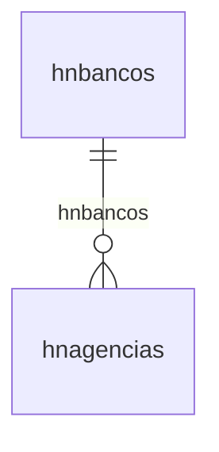

# Modelo — Financeiro do escritório - nucleo (rascunho em lote)

> Gerado por `src/model/gerar_docs_modelo.py` a partir de `src/model/modulos/financeiro_nucleo.yaml`, do catálogo e do perfil de colunas. **Não edite à mão.**

12 entidades. A coluna *Preench.* é o % de linhas com valor útil (nem nulo, nem em branco, nem zero, nem 1900-01-01; para colunas de código o zero conta como valor).

## Diagrama

## Entidades

| Entidade | Tabela | Linhas | Volume | Filtro obrigatório |
|---|---|---|---|---|
| [hrpagamento](#hrpagamento) | `HRPAGAMENTO` | 8.118 | pequeno | empresa |
| [hrrenegociacao](#hrrenegociacao) | `HRRENEGOCIACAO` | 1.031 | pequeno | empresa |
| [hradiantamento](#hradiantamento) | `HRADIANTAMENTO` | 158 | pequeno | empresa |
| [hraviso](#hraviso) | `HRAVISO` | 13 | pequeno | — |
| [hrparametro](#hrparametro) | `HRPARAMETRO` | 3 | pequeno | empresa |
| [hrobservacao](#hrobservacao) | `HROBSERVACAO` | 2 | pequeno | — |
| [hrconversao](#hrconversao) | `HRCONVERSAO` | 1 | pequeno | — |
| [hneventos](#hneventos) | `hneventos` | 46 | pequeno | — |
| [hnbancos](#hnbancos) | `hnbancos` | 9 | pequeno | — |
| [hnagencias](#hnagencias) | `hnagencias` | 8 | pequeno | — |
| [hntipocontrato](#hntipocontrato) | `hntipocontrato` | 3 | pequeno | — |
| [hnclassificacoes](#hnclassificacoes) | `hnclassificacoes` | 2 | pequeno | — |

## hrpagamento

**Pagamentos de contas a pagar** — tabela `HRPAGAMENTO` (8.118 linhas)

Pagamentos de contas a pagar. 8.118 linhas no catálogo; chave: CODI_EMP, I_PAGAR, I_PARCELA, I_PAGAMENTO.

- **Chave:** `CODI_EMP, I_PAGAR, I_PARCELA, I_PAGAMENTO`
- **Empresa:** `CODI_EMP`
- **Período:** `DATA_PAGAMENTO`
- **Ordem padrão:** `DATA_PAGAMENTO desc`, `I_PAGAR asc`, `I_PARCELA asc`

**Regras de negócio validadas:**

- Medido em 2026-10-18: 8.118 linhas, 2 empresa(s), DATA_PAGAMENTO de 2018-01-03 a 2025-12-26.
- Colunas expostas nulas em 100% das linhas (1): codigo_do_historico.
- origem_do_lancamento_m_manual_a_automati: todos os valores reais estão no comentário do banco (M=8.118).
- Vínculo hrconta_financeira (HRCONTA_FINANCEIRA): 0 de 8.072 linhas sem registro relacionado (empresa 1).
- Vínculo hrhistorico (HRHISTORICO): 8.072 de 8.072 linhas sem registro relacionado (empresa 1).

| Campo | Coluna | Tipo | Preench. | Domínio | Descrição (banco) |
|---|---|---|---|---|---|
| escritorio | `codi_emp` | integer(4) |  |  | Escritorio |
| lancamento_a_pagar | `i_pagar` | integer(4) |  |  | Lancamento a pagar |
| parcela | `i_parcela` | integer(4) |  |  | Parcela |
| codigo | `i_pagamento` | integer(4) |  |  | Codigo |
| conta_corrente_escritorio | `i_movimento_escritorio` | integer(4) |  |  | Conta corrente escritorio |
| conta_financeira | `i_conta_financeira` | integer(4) |  |  | Conta financeira |
| codigo_do_historico | `i_historico` | integer(4) |  |  | Codigo do historico |
| historico | `historico` | varchar(512) |  |  | Historico |
| data_do_pagamento | `data_pagamento` | date(4) |  |  | Data do pagamento |
| gerar_valor_i_individual_por_parcela_a_a | `gerar_valor` | char(1) |  |  | Gerar valor I Individual por parcela A Agrupado por fornecedor T Total geral das parcelas |
| valor_liquido_do_pagamento | `valor` | numeric(13) |  |  | Valor liquido do pagamento |
| valor_bruto_do_pagamento | `valor_pago` | numeric(13) |  |  | Valor bruto do pagamento |
| valor_do_juros | `valor_juros` | numeric(13) |  |  | Valor do juros |
| valor_da_multa | `valor_multa` | numeric(13) |  |  | Valor da multa |
| valor_de_desconto | `valor_desconto` | numeric(13) |  |  | Valor de desconto |
| origem_do_registro_0_sistema_1_imp_tabel | `origem_reg` | tinyint(1) |  |  | Origem do registro 0 - Sistema, 1 - Imp. Tabelas, 2 - Imp. Layout, 3- Imp. Tabelas Concorrentes |
| realizar_pagamento_com_cheques_s_n | `realizar_pagamento_com_cheque` | char(1) |  |  | Realizar pagamento com cheques (S/N) |
| realizar_pagamento_com_cheques_recebidos | `realizar_pagamento_com_cheque_recebido_de_cliente` | char(1) |  |  | Realizar pagamento com cheques recebidos de clientes |
| origem_do_lancamento_m_manual_a_automati | `origem` | char(1) |  | hrpagamento_origem_do_lancamento_ | Origem do lançamento (M - Manual/A - Automática) |

**Vínculos (LEFT JOIN, acrescentam colunas legíveis):**

- `hrconta_financeira` → `HRCONTA_FINANCEIRA` por `codi_emp` = `codi_emp` e `i_conta_financeira` = `i_conta_financeira`; colunas: `hrconta_financeira_nome`
- `hrhistorico` → `HRHISTORICO` por `codi_emp` = `codi_emp` e `i_historico` = `i_historico`; colunas: `hrhistorico_nome`

**Filtros:** `lancamento_a_pagar` (eq/in), `parcela` (eq/in), `codigo` (eq/in), `data_do_pagamento` (entre/gte/lte), `conta_corrente_escritorio` (eq/in), `conta_financeira` (eq/in), `codigo_do_historico` (eq/in), `historico` (contem/prefixo), `gerar_valor_i_individual_por_parcela_a_a` (eq/in), `realizar_pagamento_com_cheques_s_n` (eq/in), `realizar_pagamento_com_cheques_recebidos` (eq/in), `origem_do_lancamento_m_manual_a_automati` (eq/in)

## hrrenegociacao

**Renegociacoes** — tabela `HRRENEGOCIACAO` (1.031 linhas)

Renegociacoes. 1.031 linhas no catálogo; chave: CODI_EMP, I_RENEGOCIACAO.

- **Chave:** `CODI_EMP, I_RENEGOCIACAO`
- **Empresa:** `CODI_EMP`
- **Período:** `DATA_RENEGOCIACAO`
- **Ordem padrão:** `DATA_RENEGOCIACAO desc`, `I_RENEGOCIACAO asc`

**Regras de negócio validadas:**

- Medido em 2026-10-18: 1.031 linhas, 2 empresa(s), DATA_RENEGOCIACAO de 2018-03-23 a 2025-08-25.
- Colunas expostas nulas em 100% das linhas (5): codigo_do_historico, valor_recebido, intervalo_de_dias_do_reparcelar, novo_evento, evento_de_multa.
- Vínculo geempre (geempre): 0 de 1.027 linhas sem registro relacionado (empresa 1).
- Vínculo hrcliente (HRCLIENTE): 0 de 1.027 linhas sem registro relacionado (empresa 1).
- Vínculo hrevento (HREVENTO): 1.027 de 1.027 linhas sem registro relacionado (empresa 1).
- Vínculo hrhistorico (HRHISTORICO): 1.027 de 1.027 linhas sem registro relacionado (empresa 1).

| Campo | Coluna | Tipo | Preench. | Domínio | Descrição (banco) |
|---|---|---|---|---|---|
| escritorio | `codi_emp` | integer(4) |  |  | Escritorio |
| codigo | `i_renegociacao` | integer(4) |  |  | Codigo |
| cliente | `i_cliente` | integer(4) |  |  | Cliente |
| data | `data_renegociacao` | date(4) |  |  | Data |
| codigo_do_historico | `i_historico` | integer(4) |  |  | Codigo do historico |
| historico | `historico` | varchar(512) |  |  | Historico |
| valor_recebido | `valor_recebido` | numeric(13) |  |  | Valor recebido |
| gerar_novo_faturamento_s_n | `gerar_novo` | char(1) |  |  | Gerar novo faturamento S N |
| valor_do_novo_faturamento | `novo_valor` | numeric(13) |  |  | Valor do novo faturamento |
| competencia_do_novo_faturamento | `novo_competencia` | date(4) |  |  | Competencia do novo faturamento |
| vencimento_do_novo_faturamento | `novo_vencimento` | date(4) |  |  | Vencimento do novo faturamento |
| reparcelar_gerando_novo_faturamento_s_n | `reparcelar` | char(1) |  |  | Reparcelar gerando novo faturamento S N |
| valor_do_reparcelar_gerando_novo_faturam | `reparcelar_valor` | numeric(13) |  |  | Valor do reparcelar gerando novo faturamento |
| quitar_sem_recebimento_s_n | `quitar` | char(1) |  |  | Quitar sem recebimento S N |
| valor_do_quitar_sem_recebimento | `quitar_valor` | numeric(13) |  |  | Valor do quitar sem recebimento |
| quantidade_de_parcelas_do_reparcelar | `reparcelar_quantidade` | integer(4) |  |  | Quantidade de parcelas do reparcelar |
| intervalo_de_dias_do_reparcelar | `reparcelar_intervalo` | integer(4) |  |  | Intervalo de dias do reparcelar |
| competencia_do_reparcelar | `reparcelar_competencia` | date(4) |  |  | Competencia do reparcelar |
| mes_do_vencimento_do_reparcelar_n_no_mes | `reparcelar_mes_vencimento` | char(1) |  |  | Mes do vencimento do reparcelar N No mesmo mes A Apos o mes S No segundo mes |
| dia_vencimento_do_reparcelar | `reparcelar_dia_vencimento` | tinyint(1) |  |  | Dia vencimento do reparcelar |
| gerar_eventos_m_mesmos_eventos_u_unico_e | `gerar_evento` | char(1) |  |  | Gerar eventos M Mesmos eventos U Unico evento |
| novo_evento | `i_evento` | integer(4) |  |  | Novo evento |
| alterar_vencimento_s_n | `alterar_vencimento` | char(1) |  |  | Alterar vencimento S N |
| vencimento_original_da_parcela | `vencimento_origem` | date(4) |  |  | Vencimento original da parcela |
| vencimento_alterado | `vencimento_destino` | date(4) |  |  | Vencimento alterado |
| faturamento_do_vencimento_alterado | `i_faturamento` | integer(4) |  |  | Faturamento do vencimento alterado |
| parcela_do_vencimento_alterado | `i_parcela` | integer(4) |  |  | Parcela do vencimento alterado |
| origem_r_recebida_e_renegociada_n_renego | `origem` | char(1) |  |  | Origem R Recebida e renegociada N Renegociada A Alterado o vencimento |
| usuario_que_efetuou_a_renegociacao | `usuario` | varchar(128) |  |  | Usuario que efetuou a renegociaCAo |
| cobrar_juros_s_n | `cobrar_juros` | char(1) |  |  | Cobrar juros (S/N) |
| valor_do_juros | `juros_valor` | numeric(13) |  |  | Valor do juros |
| evento_de_juros | `juros_evento` | integer(4) |  |  | Evento de juros |
| cobrar_multa_s_n | `cobrar_multa` | char(1) |  |  | Cobrar multa (S/N) |
| valor_da_multa | `multa_valor` | numeric(13) |  |  | Valor da multa |
| evento_de_multa | `multa_evento` | integer(4) |  |  | Evento de multa |
| valor_do_juros_utilizado_no_novo_faturam | `valor_juros_refaturado` | numeric(13) |  |  | Valor do juros utilizado no novo faturamento |
| valor_do_juros_utilizado_no_reparcelamen | `valor_juros_reparcelado` | numeric(13) |  |  | Valor do juros utilizado no reparcelamento |
| valor_da_multa_utilizado_no_novo_faturam | `valor_multa_refaturado` | numeric(13) |  |  | Valor da multa utilizado no novo faturamento |
| valor_da_multa_utilizado_no_reparcelamen | `valor_multa_reparcelado` | numeric(13) |  |  | Valor da multa utilizado no reparcelamento |
| desconto_da_renegociaaao | `desconto_valor` | numeric(13) |  |  | Desconto da Renegociação |

**Vínculos (LEFT JOIN, acrescentam colunas legíveis):**

- `geempre` → `geempre` por `codi_emp` = `codi_emp`; colunas: `geempre_nome`
- `hrcliente` → `HRCLIENTE` por `codi_emp` = `codi_emp` e `i_cliente` = `i_cliente`; colunas: `hrcliente_nome`
- `hrevento` → `HREVENTO` por `codi_emp` = `codi_emp` e `i_evento` = `i_evento`; colunas: `hrevento_nome`
- `hrhistorico` → `HRHISTORICO` por `codi_emp` = `codi_emp` e `i_historico` = `i_historico`; colunas: `hrhistorico_nome`

**Filtros:** `codigo` (eq/in), `data` (entre/gte/lte), `competencia_do_novo_faturamento` (entre/gte/lte), `vencimento_do_novo_faturamento` (entre/gte/lte), `competencia_do_reparcelar` (entre/gte/lte), `vencimento_original_da_parcela` (entre/gte/lte), `vencimento_alterado` (entre/gte/lte), `cliente` (eq/in), `codigo_do_historico` (eq/in), `historico` (contem/prefixo), `gerar_novo_faturamento_s_n` (eq/in), `reparcelar_gerando_novo_faturamento_s_n` (eq/in), `quitar_sem_recebimento_s_n` (eq/in), `mes_do_vencimento_do_reparcelar_n_no_mes` (eq/in)

## hradiantamento

**Adiantamentos** — tabela `HRADIANTAMENTO` (158 linhas)

Adiantamentos. 158 linhas no catálogo; chave: CODI_EMP, I_ADIANTAMENTO.

- **Chave:** `CODI_EMP, I_ADIANTAMENTO`
- **Empresa:** `CODI_EMP`
- **Período:** `DATA_ADIANTAMENTO`
- **Ordem padrão:** `DATA_ADIANTAMENTO desc`, `I_ADIANTAMENTO asc`

**Regras de negócio validadas:**

- Medido em 2026-10-18: 158 linhas, 2 empresa(s), DATA_ADIANTAMENTO de 2019-02-18 a 2025-03-18.
- Colunas expostas nulas em 100% das linhas (2): codigo_do_historico, categoria.
- origem_m_manual_r_recebimento: todos os valores reais estão no comentário do banco (M=157, R=1).
- Vínculo hrcategoria_receber (HRCATEGORIA_RECEBER): 156 de 156 linhas sem registro relacionado (empresa 1).
- Vínculo hrcliente (HRCLIENTE): 0 de 156 linhas sem registro relacionado (empresa 1).
- Vínculo hrconta_financeira (HRCONTA_FINANCEIRA): 0 de 156 linhas sem registro relacionado (empresa 1).
- Vínculo hrhistorico (HRHISTORICO): 156 de 156 linhas sem registro relacionado (empresa 1).

| Campo | Coluna | Tipo | Preench. | Domínio | Descrição (banco) |
|---|---|---|---|---|---|
| escritorio | `codi_emp` | integer(4) |  |  | Escritorio |
| codigo | `i_adiantamento` | integer(4) |  |  | Codigo |
| conta_corrente_cliente | `i_movimento_cliente` | integer(4) |  |  | Conta corrente cliente |
| conta_corrente_cliente_sequencial | `i_movimento_cliente_seq` | integer(4) |  |  | Conta corrente cliente sequencial |
| conta_corrente_escritorio | `i_movimento_escritorio` | integer(4) |  |  | Conta corrente escritorio |
| cliente | `i_cliente` | integer(4) |  |  | Cliente |
| data | `data_adiantamento` | date(4) |  |  | Data |
| valor | `valor` | numeric(13) |  |  | Valor |
| conta_financeira | `i_conta_financeira` | integer(4) |  |  | Conta financeira |
| codigo_do_historico | `i_historico` | integer(4) |  |  | Codigo do historico |
| historico | `historico` | varchar(512) |  |  | Historico |
| somente_eventos_com_categoria_s_n | `somente_evento_categoria` | char(1) |  |  | Somente eventos com categoria S N |
| categoria | `i_categoria_receber` | integer(4) |  |  | Categoria |
| incluir_eventos_cadastrados_depois_do_ad | `incluir_evento_depois` | char(1) |  |  | Incluir eventos cadastrados depois do adiantamento S N |
| origem_do_registro_0_sistema_1_imp_tabel | `origem_reg` | tinyint(1) |  |  | Origem do registro 0 - Sistema, 1 - Imp. Tabelas, 2 - Imp. Layout, 3- Imp. Tabelas Concorrentes |
| origem_m_manual_r_recebimento | `origem` | char(1) |  | hradiantamento_origem_m_manual_r_recebimento | Origem(M - Manual/R - Recebimento) |

**Vínculos (LEFT JOIN, acrescentam colunas legíveis):**

- `hrcategoria_receber` → `HRCATEGORIA_RECEBER` por `codi_emp` = `codi_emp` e `i_categoria_receber` = `i_categoria_receber`; colunas: `hrcategoria_receber_nome`
- `hrcliente` → `HRCLIENTE` por `codi_emp` = `codi_emp` e `i_cliente` = `i_cliente`; colunas: `hrcliente_nome`
- `hrconta_financeira` → `HRCONTA_FINANCEIRA` por `codi_emp` = `codi_emp` e `i_conta_financeira` = `i_conta_financeira`; colunas: `hrconta_financeira_nome`
- `hrhistorico` → `HRHISTORICO` por `codi_emp` = `codi_emp` e `i_historico` = `i_historico`; colunas: `hrhistorico_nome`

**Filtros:** `codigo` (eq/in), `data` (entre/gte/lte), `conta_corrente_cliente` (eq/in), `conta_corrente_cliente_sequencial` (eq/in), `conta_corrente_escritorio` (eq/in), `cliente` (eq/in), `conta_financeira` (eq/in), `codigo_do_historico` (eq/in), `historico` (contem/prefixo), `somente_eventos_com_categoria_s_n` (eq/in), `categoria` (eq/in), `incluir_eventos_cadastrados_depois_do_ad` (eq/in), `origem_m_manual_r_recebimento` (eq/in)

## hraviso

**Avisos do modulo Honorarios** — tabela `HRAVISO` (13 linhas)

Avisos do modulo Honorarios. 13 linhas no catálogo; chave: USUARIO, TIPO.

- **Chave:** `USUARIO, TIPO`
- **Empresa:** `não se aplica (tabela global)`
- **Período:** `DATA_AVISO`
- **Ordem padrão:** `DATA_AVISO desc`, `USUARIO asc`, `TIPO asc`

**Regras de negócio validadas:**

- Medido em 2026-10-18: 13 linhas, DATA_AVISO de 2022-07-01 a 2026-07-17.

| Campo | Coluna | Tipo | Preench. | Domínio | Descrição (banco) |
|---|---|---|---|---|---|
| usuario | `usuario` | varchar(128) |  |  | Usuario |
| tipo_do_aviso_p_contas_a_pagar_v_convers | `tipo` | char(1) |  |  | Tipo do aviso P Contas a pagar V Conversao |
| data | `data_aviso` | date(4) |  |  | Data |
| mostrar_s_n | `mostrar` | char(1) |  |  | Mostrar S N |

**Filtros:** `usuario` (eq/in), `tipo_do_aviso_p_contas_a_pagar_v_convers` (eq/in), `data` (entre/gte/lte), `mostrar_s_n` (eq/in)

## hrparametro

**Parametro Honorarios** — tabela `HRPARAMETRO` (3 linhas)

Parametro Honorarios. 3 linhas no catálogo; chave: CODI_EMP.

- **Chave:** `CODI_EMP`
- **Empresa:** `CODI_EMP`
- **Período:** `FECHAMENTO_DATA`
- **Ordem padrão:** `FECHAMENTO_DATA desc`

**Regras de negócio validadas:**

- Medido em 2026-10-18: 3 linhas, 3 empresa(s), FECHAMENTO_DATA de 2023-01-01 a 2023-06-01.
- Vínculo geempre (geempre): 0 de 1 linhas sem registro relacionado (empresa 9996).

| Campo | Coluna | Tipo | Preench. | Domínio | Descrição (banco) |
|---|---|---|---|---|---|
| escritorio | `codi_emp` | integer(4) |  |  | Escritorio |
| compentencia_de_trabalho | `competencia_trabalho` | date(4) |  |  | Compentencia de trabalho |
| sequencial_usado_na_cobranca_registrada | `cobranca_registrada_sequencial` | integer(4) |  |  | Sequencial usado na cobranca registrada |
| origem_do_registro_0_sistema_1_imp_tabel | `origem_reg` | tinyint(1) |  |  | Origem do registro 0 - Sistema, 1 - Imp. Tabelas, 2 - Imp. Layout, 3- Imp. Tabelas Concorrentes |
| cobranca_registrada_sequencial_237 | `cobranca_registrada_sequencial_237` | integer(4) |  |  | Sequencial usado na cobranca registrada - Bradesco |
| cobranca_registrada_sequencial_748 | `cobranca_registrada_sequencial_748` | integer(4) |  |  | Sequencial usado na cobranca registrada - Sicredi |
| cobranca_registrada_sequencial_756 | `cobranca_registrada_sequencial_756` | integer(4) |  |  | Sequencial usado na cobranca registrada - Credip |
| data_do_fechamento | `fechamento_data` | date(4) |  |  | Data do fechamento |
| cobranca_registrada_sequencial_104 | `cobranca_registrada_sequencial_104` | integer(4) |  |  | Sequencial usado na cobranca registrada - Caixa |
| cobranca_registrada_sequencial_41 | `cobranca_registrada_sequencial_41` | integer(4) |  |  | Sequencial usado na cobranca registrada - Banrisul |
| cobranca_registrada_sequencial_85 | `cobranca_registrada_sequencial_85` | integer(4) |  |  | Sequencial usado na cobranca registrada - Cecred |
| cobranca_registrada_sequencial_097 | `cobranca_registrada_sequencial_097` | integer(4) |  |  | Sequencial usado na cobranca registrada - CredSis |
| cobranca_registrada_sequencial_136 | `cobranca_registrada_sequencial_136` | integer(4) |  |  | Sequencial usado na cobranca registrada - Unicred 136) |
| cobranca_registrada_sequencial_422 | `cobranca_registrada_sequencial_422` | integer(4) |  |  | Sequencial usado na cobranca registrada - Safra 422 |
| cobranca_registrada_sequencial_341 | `cobranca_registrada_sequencial_341` | integer(4) |  |  | Sequencial usado na cobranca registrada - Itau 341 |
| cobranca_registrada_sequencial_84 | `cobranca_registrada_sequencial_84` | integer(4) |  |  | Sequencial usado na cobranca registrada - Uniprime 84 |
| cobranca_registrada_sequencial_218 | `cobranca_registrada_sequencial_218` | integer(4) |  |  | Sequencial usado na cobranca registrada - BS2 218 |
| cobranca_registrada_sequencial_077 | `cobranca_registrada_sequencial_077` | integer(4) |  |  | Sequencial usado na cobranca registrada - INTER 077 |
| cobranca_registrada_sequencial_133 | `cobranca_registrada_sequencial_133` | integer(4) |  |  | Sequencial usado na cobranca registrada - CRESOL 133 |

**Vínculos (LEFT JOIN, acrescentam colunas legíveis):**

- `geempre` → `geempre` por `codi_emp` = `codi_emp`; colunas: `geempre_nome`

**Filtros:** `compentencia_de_trabalho` (entre/gte/lte), `data_do_fechamento` (entre/gte/lte)

## hrobservacao

**Observacoes** — tabela `HROBSERVACAO` (2 linhas)

Observacoes. 2 linhas no catálogo; chave: I_OBSERVACAO.

- **Chave:** `I_OBSERVACAO`
- **Empresa:** `não se aplica (tabela global)`
- **Período:** `—`
- **Ordem padrão:** `I_OBSERVACAO asc`

**Regras de negócio validadas:**

- Medido em 2026-10-18: 2 linhas.

| Campo | Coluna | Tipo | Preench. | Domínio | Descrição (banco) |
|---|---|---|---|---|---|
| codigo | `i_observacao` | integer(4) |  |  | Codigo |
| descricao | `descricao` | varchar(512) |  |  | Descricao |
| origem_do_registro_0_sistema_1_imp_tabel | `origem_reg` | tinyint(1) |  |  | Origem do registro 0 - Sistema, 1 - Imp. Tabelas, 2 - Imp. Layout, 3- Imp. Tabelas Concorrentes |

**Filtros:** `codigo` (eq/in), `descricao` (contem/prefixo)

## hrconversao

**Conversao para o Dominio Honorarios** — tabela `HRCONVERSAO` (1 linhas)

Conversao para o Dominio Honorarios. 1 linhas no catálogo; chave: STATUS.

- **Chave:** `STATUS`
- **Empresa:** `não se aplica (tabela global)`
- **Período:** `—`
- **Ordem padrão:** `STATUS asc`

**Regras de negócio validadas:**

- Medido em 2026-10-18: 1 linhas.

| Campo | Coluna | Tipo | Preench. | Domínio | Descrição (banco) |
|---|---|---|---|---|---|
| indica_como_esta_o_processo_de_conversao | `status` | tinyint(1) |  |  | Indica como esta o processo de conversao 0 Nao definido 1 Dados convertidos 2 Atualizou sem converter |

**Filtros:** `indica_como_esta_o_processo_de_conversao` (eq/in)

## hneventos

**Eventos - Cadastro - Novo Honorarios** — tabela `hneventos` (46 linhas)

Eventos - Cadastro - Novo Honorarios. 46 linhas no catálogo; chave: i_evento.

- **Chave:** `i_evento`
- **Empresa:** `não se aplica (tabela global)`
- **Período:** `—`
- **Ordem padrão:** `i_evento asc`

**Regras de negócio validadas:**

- Medido em 2026-10-18: 46 linhas.
- unidade_v_valor_q_quantidade_p_percentua: todos os valores reais estão no comentário do banco (V=28, Q=18).

| Campo | Coluna | Tipo | Preench. | Domínio | Descrição (banco) |
|---|---|---|---|---|---|
| codigo | `i_evento` | integer(4) |  |  | Codigo |
| descricao | `desc_evt` | varchar(80) |  |  | Descricao |
| soma_no_faturamento_s_n | `somafat_evt` | char(1) |  |  | Soma no faturamento (S/N) |
| soma_irrf_s_n | `somairrf_evt` | char(1) |  |  | Soma IRRF (S/N) |
| soma_iss_s_n | `somaiss_evt` | char(1) |  |  | Soma ISS (S/N) |
| aliquota_do_irrf | `aliqirrf_evt` | numeric(5) |  |  | Aliquota do IRRF |
| aliquota_iss | `aliqiss_evt` | numeric(5) |  |  | Aliquota ISS |
| provento_desconto_p_d | `provdesc_evt` | char(1) |  |  | Provento/Desconto (P/D) |
| formula_do_evento | `formula_evt` | varchar(1000) |  |  | Formula do evento |
| conta_contabil | `conta_evt` | integer(4) |  |  | Conta Contabil |
| codigo_do_historico_padrao | `chis_evt` | integer(4) |  |  | Codigo do Historico Padrao |
| soma_contribuicoes_retidas_na_fonte_s_n | `somacrf_evt` | char(1) |  |  | Soma Contribuicoes Retidas na Fonte (S/N) |
| aliquota_das_contribuicoes_retidas_na_fo | `aliqcrf_evt` | numeric(5) |  |  | Aliquota das Contribuicoes Retidas na Fonte |
| complemento_do_evento | `compl_evt` | varchar(80) |  |  | Complemento do evento |
| origem_do_registro_0_sistema_1_imp_tabel | `origem_reg` | tinyint(1) |  |  | Origem do registro 0 - Sistema, 1 - Imp. Tabelas, 2 - Imp. Layout, 3- Imp. Tabelas Concorrentes |
| soma_inss_s_n | `somainss_evt` | char(1) |  |  | Soma INSS (S/N) |
| aliquota_do_inss | `aliqinss_evt` | numeric(5) |  |  | Aliquota do INSS |
| soma_iss_retido_s_n | `somaissr_evt` | char(1) |  |  | Soma ISS Retido (S/N) |
| aliquota_do_iss_retido | `aliqissr_evt` | numeric(5) |  |  | Aliquota do ISS Retido |
| unidade_v_valor_q_quantidade_p_percentua | `unidade_evt` | char(1) |  | hneventos_unidade_v_valor_q | Unidade (V=Valor/Q=Quantidade/P=Percentual) |
| referencia | `referencia_evt` | numeric(13) |  |  | Referencia |

**Filtros:** `codigo` (eq/in), `descricao` (contem/prefixo), `soma_no_faturamento_s_n` (eq/in), `soma_irrf_s_n` (eq/in), `soma_iss_s_n` (eq/in), `provento_desconto_p_d` (eq/in), `formula_do_evento` (contem/prefixo), `soma_contribuicoes_retidas_na_fonte_s_n` (eq/in), `complemento_do_evento` (contem/prefixo), `soma_inss_s_n` (eq/in), `soma_iss_retido_s_n` (eq/in), `unidade_v_valor_q_quantidade_p_percentua` (eq/in)

## hnbancos

**Bancos - Cadastro** — tabela `hnbancos` (9 linhas)

Bancos - Cadastro. 9 linhas no catálogo; chave: i_banco.

- **Chave:** `i_banco`
- **Empresa:** `não se aplica (tabela global)`
- **Período:** `—`
- **Ordem padrão:** `i_banco asc`

**Regras de negócio validadas:**

- Medido em 2026-10-18: 9 linhas.

| Campo | Coluna | Tipo | Preench. | Domínio | Descrição (banco) |
|---|---|---|---|---|---|
| sequencial | `i_banco` | integer(4) |  |  | Sequencial |
| nome | `nome_ban` | varchar(50) |  |  | Nome |
| codigo_do_banco | `codi_ban` | integer(4) |  |  | Codigo do Banco |
| origem_do_registro_0_sistema_1_imp_tabel | `origem_reg` | tinyint(1) |  |  | Origem do registro 0 - Sistema, 1 - Imp. Tabelas, 2 - Imp. Layout, 3- Imp. Tabelas Concorrentes |

**Filtros:** `sequencial` (eq/in), `nome` (contem/prefixo), `codigo_do_banco` (eq/in)

## hnagencias

**Agencias Bancarias - Cadastro** — tabela `hnagencias` (8 linhas)

Agencias Bancarias - Cadastro. 8 linhas no catálogo; chave: i_agencia.

- **Chave:** `i_agencia`
- **Empresa:** `não se aplica (tabela global)`
- **Período:** `—`
- **Ordem padrão:** `i_agencia asc`

**Regras de negócio validadas:**

- Medido em 2026-10-18: 8 linhas.
- Colunas expostas nulas em 100% das linhas (6): complemento, cnpj_da_cooperativa_de_credito, agencia_da_cooperativa, agencia_da_cooperativa_digito_verificado, codigo_da_cooperativa, prefixo_da_cooperativa.
- banco_da_cooperativa_u_unicred_s_sicoob: todos os valores reais estão no comentário do banco (U=8).
- Vínculo hnbancos (hnbancos): 0 de 8 linhas sem registro relacionado.

| Campo | Coluna | Tipo | Preench. | Domínio | Descrição (banco) |
|---|---|---|---|---|---|
| sequencial | `i_agencia` | integer(4) |  |  | Sequencial |
| banco | `i_banco` | integer(4) |  |  | Banco |
| nome | `nome_age` | varchar(50) |  |  | Nome |
| digito_verificador | `agencia_dv` | char(2) |  |  | Digito verificador |
| codigo_da_agencia | `codi_age` | integer(4) |  |  | Codigo da agencia |
| origem_do_registro_0_sistema_1_imp_tabel | `origem_reg` | tinyint(1) |  |  | Origem do registro 0 - Sistema, 1 - Imp. Tabelas, 2 - Imp. Layout, 3- Imp. Tabelas Concorrentes |
| endereco 🔒 | `endereco` | char(40) |  |  | Endereco |
| bairro 🔒 | `bairro` | char(40) |  |  | Bairro |
| cidade | `cidade` | char(40) |  |  | Cidade |
| numero | `numero` | integer(4) |  |  | Numero |
| uf | `uf` | char(2) |  |  | UF |
| cep 🔒 | `cep` | char(8) |  |  | CEP |
| complemento | `complemento` | char(30) |  |  | Complemento |
| ddd | `ddd` | integer(4) |  |  | DDD |
| fone 🔒 | `fone` | char(14) |  |  | Fone |
| cooperativa_de_credito_s_n | `cooperativa_credito` | char(1) |  |  | Cooperativa de crédito (S/N) |
| cnpj_da_cooperativa_de_credito 🔒 | `cooperativa_credito_cnpj` | char(14) |  |  | CNPJ da cooperativa de crédito |
| agencia_da_cooperativa | `cooperativa_credito_agencia` | integer(4) |  |  | Agência da cooperativa |
| agencia_da_cooperativa_digito_verificado | `cooperativa_credito_agencia_dv` | char(1) |  |  | Agência da cooperativa - Dígito verificador |
| banco_da_cooperativa_u_unicred_s_sicoob | `cooperativa_credito_banco` | char(1) |  | hnagencias_banco_da_cooperativa_u | BANCO DA COOPERATIVA (U=UNICRED/S=SICOOB/N=UNIPRIME) |
| codigo_da_cooperativa | `cooperativa_credito_codigo` | varchar(13) |  |  | Código da cooperativa |
| prefixo_da_cooperativa | `cooperativa_credito_prefixo` | char(3) |  |  | Prefixo da cooperativa |

**Vínculos (LEFT JOIN, acrescentam colunas legíveis):**

- `hnbancos` → `hnbancos` por `i_banco` = `i_banco`; colunas: `hnbancos_nome`

**Filtros:** `sequencial` (eq/in), `banco` (eq/in), `nome` (contem/prefixo), `digito_verificador` (eq/in), `codigo_da_agencia` (eq/in), `endereco` (contem/prefixo), `bairro` (contem/prefixo), `cidade` (contem/prefixo), `uf` (eq/in), `cep` (eq/in), `complemento` (contem/prefixo), `fone` (eq/in), `cooperativa_de_credito_s_n` (eq/in), `cnpj_da_cooperativa_de_credito` (eq/in)

## hntipocontrato

**Tipos de Contratos - Cadastro** — tabela `hntipocontrato` (3 linhas)

Tipos de Contratos - Cadastro. 3 linhas no catálogo; chave: i_tipocontrato.

- **Chave:** `i_tipocontrato`
- **Empresa:** `não se aplica (tabela global)`
- **Período:** `—`
- **Ordem padrão:** `i_tipocontrato asc`

**Regras de negócio validadas:**

- Medido em 2026-10-18: 3 linhas.
- tipo_de_reajuste_do_contrato_m_mensal_b: todos os valores reais estão no comentário do banco (D=1, M=1, A=1).
- periodicidade_de_faturamento_m_mensal_b: todos os valores reais estão no comentário do banco (M=3).

| Campo | Coluna | Tipo | Preench. | Domínio | Descrição (banco) |
|---|---|---|---|---|---|
| codigo_do_tipo_de_contrato | `i_tipocontrato` | integer(4) |  |  | Codigo do tipo de contrato |
| tipo_de_reajuste_do_contrato_m_mensal_b | `tiporeajuste_crt` | char(1) |  | hntipocontrato_tipo_de_reajuste_do_co | Tipo de reajuste do contrato (M - Mensal/B - Bimestral/T - Trimestral/Q - Quadrimestral/S - Semestral/A - Anual/D - Data base) |
| periodicidade_de_faturamento_m_mensal_b | `periodicidadefat_crt` | char(1) |  | hntipocontrato_periodicidade_de_fatur | Periodicidade de faturamento (M - Mensal/B - Bimestral/T - Trimestral/Q - Quadrimestral/S - Semestral/A - Anual) |
| descricao_dos_servicos | `descricao_crt` | varchar(50) |  |  | Descricao dos servicos |
| mes_base_para_reajuste_do_contrato_utili | `mesbase_crt` | tinyint(1) |  |  | Mes base para reajuste do contrato utilizado quando o tipo de reajuste for Data Base |
| origem_do_registro_0_sistema_1_imp_tabel | `origem_reg` | tinyint(1) |  |  | Origem do registro 0 - Sistema, 1 - Imp. Tabelas, 2 - Imp. Layout, 3- Imp. Tabelas Concorrentes |

**Filtros:** `codigo_do_tipo_de_contrato` (eq/in), `tipo_de_reajuste_do_contrato_m_mensal_b` (eq/in), `periodicidade_de_faturamento_m_mensal_b` (eq/in), `descricao_dos_servicos` (contem/prefixo)

## hnclassificacoes

**Classificacao dos Clientes - Cadastro** — tabela `hnclassificacoes` (2 linhas)

Classificacao dos Clientes - Cadastro. 2 linhas no catálogo; chave: i_classificacoes.

- **Chave:** `i_classificacoes`
- **Empresa:** `não se aplica (tabela global)`
- **Período:** `—`
- **Ordem padrão:** `i_classificacoes asc`

**Regras de negócio validadas:**

- Medido em 2026-10-18: 2 linhas.

| Campo | Coluna | Tipo | Preench. | Domínio | Descrição (banco) |
|---|---|---|---|---|---|
| codigo | `i_classificacoes` | integer(4) |  |  | Codigo |
| descricao | `descricao_cla` | varchar(50) |  |  | Descricao |
| origem_do_registro_0_sistema_1_imp_tabel | `origem_reg` | tinyint(1) |  |  | Origem do registro 0 - Sistema, 1 - Imp. Tabelas, 2 - Imp. Layout, 3- Imp. Tabelas Concorrentes |

**Filtros:** `codigo` (eq/in), `descricao` (contem/prefixo)

## Domínios (significado dos códigos)

`confirmado`: **sim** = vem do comentário do banco e/ou foi conferido nos dados; **parcial** = parte dos valores; **não** = hipótese, não use como regra.

### status_empresa

Situação da empresa no cadastro (geempre.stat_emp)

Confirmado: sim

| Código | Significado |
|---|---|
| A | Ativa |
| I | Inativa |
| C | Em constituição |
| M | Ativo sem movimento |
| B | Em processo de baixa |
| E | Excluindo |

### motivo_inatividade

Motivo da inatividade (geempre.tipoi_emp). Só aparece em empresas inativas.

Confirmado: sim

| Código | Significado |
|---|---|
| 1 | Outros |
| 2 | Baixada |
| 3 | Transferida |
| 4 | Inadimplente |

### tipo_inscricao

Tipo da inscrição (CNPJ/CPF/CEI/CAEPF)

Confirmado: sim

| Código | Significado |
|---|---|
| 1 | CNPJ |
| 2 | CPF |
| 3 | CEI |
| 6 | CAEPF |

### regime_federal_empresa

Regime federal da folha (geempre.rfed_emp)

Confirmado: parcial

| Código | Significado |
|---|---|
| 1 | Normal |
| 2 | Microempresa |
| 3 | Empresa de pequeno porte |

### tipo_honorario_empresa

Como a empresa usa o módulo Honorários (geempre.honorario_tipo)

Confirmado: sim

| Código | Significado |
|---|---|
| E | Escritório (quem fatura) |
| C | Cliente |

### sim_nao_texto

Confirmado: sim

| Código | Significado |
|---|---|
| S | Sim |
| N | Não |

### sim_nao_numerico

Confirmado: sim

| Código | Significado |
|---|---|
| 1 | Sim |
| 0 | Não |

### hrpagamento_origem_do_lancamento_

Confirmado: sim

> Todos os valores observados em HRPAGAMENTO.ORIGEM estão no comentário do banco (2026-10-18). Distribuição: M=8.118.

| Código | Significado |
|---|---|
| M | Manual |
| A | Automática |

### hradiantamento_origem_m_manual_r_recebimento

Confirmado: sim

> Todos os valores observados em HRADIANTAMENTO.ORIGEM estão no comentário do banco (2026-10-18). Distribuição: M=157, R=1.

| Código | Significado |
|---|---|
| M | Manual |
| R | Recebimento |

### hneventos_unidade_v_valor_q

Confirmado: sim

> Todos os valores observados em hneventos.unidade_evt estão no comentário do banco (2026-10-18). Distribuição: V=28, Q=18.

| Código | Significado |
|---|---|
| V | Valor |
| Q | Quantidade |
| P | Percentual |

### hnagencias_banco_da_cooperativa_u

Confirmado: sim

> Todos os valores observados em hnagencias.COOPERATIVA_CREDITO_BANCO estão no comentário do banco (2026-10-18). Distribuição: U=8.

| Código | Significado |
|---|---|
| U | UNICRED |
| S | SICOOB |
| N | UNIPRIME |

### hntipocontrato_tipo_de_reajuste_do_co

Confirmado: sim

> Todos os valores observados em hntipocontrato.tiporeajuste_crt estão no comentário do banco (2026-10-18). Distribuição: D=1, M=1, A=1.

| Código | Significado |
|---|---|
| M | Mensal |
| B | Bimestral |
| T | Trimestral |
| Q | Quadrimestral |
| S | Semestral |
| A | Anual |
| D | Data base |

### hntipocontrato_periodicidade_de_fatur

Confirmado: sim

> Todos os valores observados em hntipocontrato.periodicidadefat_crt estão no comentário do banco (2026-10-18). Distribuição: M=3.

| Código | Significado |
|---|---|
| M | Mensal |
| B | Bimestral |
| T | Trimestral |
| Q | Quadrimestral |
| S | Semestral |
| A | Anual |

