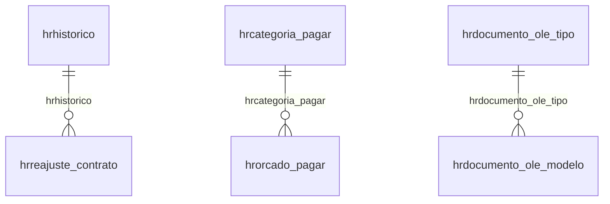

# Modelo — Financeiro do escritório - outros (rascunho em lote)

> Gerado por `src/model/gerar_docs_modelo.py` a partir de `src/model/modulos/financeiro_outros.yaml`, do catálogo e do perfil de colunas. **Não edite à mão.**

29 entidades. A coluna *Preench.* é o % de linhas com valor útil (nem nulo, nem em branco, nem zero, nem 1900-01-01; para colunas de código o zero conta como valor).

## Diagrama

## Entidades

| Entidade | Tabela | Linhas | Volume | Filtro obrigatório |
|---|---|---|---|---|
| [hrrecebimento_lancto](#hrrecebimento_lancto) | `HRRECEBIMENTO_LANCTO` | 41.380 | medio | empresa |
| [hrlote_nfse](#hrlote_nfse) | `HRLOTE_NFSE` | 33.094 | medio | empresa |
| [hrconta_corrente_escritorio_lancto](#hrconta_corrente_escritorio_lancto) | `HRCONTA_CORRENTE_ESCRITORIO_LANCTO` | 6.781 | pequeno | empresa |
| [hrconta_corrente_escritorio_impostos](#hrconta_corrente_escritorio_impostos) | `HRCONTA_CORRENTE_ESCRITORIO_IMPOSTOS` | 634 | pequeno | empresa |
| [hrconta_financeira_intervalo](#hrconta_financeira_intervalo) | `HRCONTA_FINANCEIRA_INTERVALO` | 21 | pequeno | empresa |
| [hrpagamento_lancto](#hrpagamento_lancto) | `HRPAGAMENTO_LANCTO` | 5.051 | pequeno | empresa |
| [hrurl_nfse](#hrurl_nfse) | `HRURL_NFSE` | 3.288 | pequeno | — |
| [hrreajuste_contrato](#hrreajuste_contrato) | `HRREAJUSTE_CONTRATO` | 2.979 | pequeno | empresa |
| [hrnumero_utilizado_recebimento](#hrnumero_utilizado_recebimento) | `HRNUMERO_UTILIZADO_RECEBIMENTO` | 872 | pequeno | empresa |
| [hrrenegociacao_recebimento](#hrrenegociacao_recebimento) | `HRRENEGOCIACAO_RECEBIMENTO` | 508 | pequeno | empresa |
| [hrrenegociacao_faturamento](#hrrenegociacao_faturamento) | `HRRENEGOCIACAO_FATURAMENTO` | 483 | pequeno | empresa |
| [hradiantamento_aproveitamento](#hradiantamento_aproveitamento) | `HRADIANTAMENTO_APROVEITAMENTO` | 215 | pequeno | empresa |
| [hradiantamento_evento](#hradiantamento_evento) | `HRADIANTAMENTO_EVENTO` | 196 | pequeno | empresa |
| [hradiantamento_lancto](#hradiantamento_lancto) | `HRADIANTAMENTO_LANCTO` | 155 | pequeno | empresa |
| [hrcategoria_pagar](#hrcategoria_pagar) | `HRCATEGORIA_PAGAR` | 201 | pequeno | empresa |
| [hrcategoria_receber](#hrcategoria_receber) | `HRCATEGORIA_RECEBER` | 84 | pequeno | empresa |
| [hrnota_nfse_gerar_tag_cfps_cst](#hrnota_nfse_gerar_tag_cfps_cst) | `HRNOTA_NFSE_GERAR_TAG_CFPS_CST` | 72 | pequeno | — |
| [hrclassificacao_tributaria_ibs_cbs](#hrclassificacao_tributaria_ibs_cbs) | `HRCLASSIFICACAO_TRIBUTARIA_IBS_CBS` | 69 | pequeno | — |
| [hrcustos_itens_automaticos](#hrcustos_itens_automaticos) | `HRCUSTOS_ITENS_AUTOMATICOS` | 44 | pequeno | — |
| [hrcustos_geral](#hrcustos_geral) | `HRCUSTOS_GERAL` | 1 | pequeno | — |
| [hrtipo_contrato](#hrtipo_contrato) | `HRTIPO_CONTRATO` | 38 | pequeno | empresa |
| [hrindicador_operacoes_ibs_cbs](#hrindicador_operacoes_ibs_cbs) | `HRINDICADOR_OPERACOES_IBS_CBS` | 36 | pequeno | — |
| [hrorcado_pagar](#hrorcado_pagar) | `HRORCADO_PAGAR` | 20 | pequeno | empresa |
| [hrdocumento_ole_modelo](#hrdocumento_ole_modelo) | `HRDOCUMENTO_OLE_MODELO` | 19 | pequeno | — |
| [hrdocumento_ole_tipo](#hrdocumento_ole_tipo) | `HRDOCUMENTO_OLE_TIPO` | 4 | pequeno | — |
| [hrcliente_conta_despesa](#hrcliente_conta_despesa) | `HRCLIENTE_CONTA_DESPESA` | 11 | pequeno | empresa |
| [hrservico_prestado](#hrservico_prestado) | `HRSERVICO_PRESTADO` | 3 | pequeno | empresa |
| [hrcodigo_cancelamento_nfse](#hrcodigo_cancelamento_nfse) | `HRCODIGO_CANCELAMENTO_NFSE` | 2 | pequeno | empresa |
| [hrhistorico](#hrhistorico) | `HRHISTORICO` | 11 | pequeno | empresa |

## hrrecebimento_lancto

**Recebimento de contas a receber X Lancamentos Contabeis** — tabela `HRRECEBIMENTO_LANCTO` (41.380 linhas)

Recebimento de contas a receber X Lancamentos Contabeis. 41.380 linhas no catálogo; chave: CODI_EMP, I_FATURAMENTO, I_PARCELA, I_RECEBIMENTO, EMPRESA_LAN, NUME_LAN.

- **Chave:** `CODI_EMP, I_FATURAMENTO, I_PARCELA, I_RECEBIMENTO, EMPRESA_LAN, NUME_LAN`
- **Empresa:** `CODI_EMP`
- **Período:** `—`
- **Ordem padrão:** `I_FATURAMENTO asc`, `I_PARCELA asc`

**Regras de negócio validadas:**

- Medido em 2026-10-18: 41.380 linhas, 2 empresa(s).
- Vínculo geempre (geempre): 0 de 39.407 linhas sem registro relacionado (empresa 1).

| Campo | Coluna | Tipo | Preench. | Domínio | Descrição (banco) |
|---|---|---|---|---|---|
| escritorio | `codi_emp` | integer(4) |  |  | Escritorio |
| faturamento | `i_faturamento` | integer(4) |  |  | Faturamento |
| parcela | `i_parcela` | integer(4) |  |  | Parcela |
| recebimento | `i_recebimento` | integer(4) |  |  | Recebimento |
| empresa_do_lancamento_contabil | `empresa_lan` | integer(4) |  |  | Empresa do lancamento contabil |
| numero_do_lancamento_contabil | `nume_lan` | integer(4) |  |  | Numero do lancamento contabil |
| empresa_que_originou_o_lancamento_contab | `fili_lan` | integer(4) |  |  | Empresa que originou o lancamento contabil |
| codigo_do_lote | `codi_lote` | integer(4) |  |  | Codigo do lote |
| tipo_do_lancamento_contabil_s_sistema_u | `tipo_lancamento` | char(1) |  |  | Tipo do lancamento contabil S Sistema U Usuario |

**Vínculos (LEFT JOIN, acrescentam colunas legíveis):**

- `geempre` → `geempre` por `fili_lan` = `codi_emp`; colunas: `geempre_nome`

**Filtros:** `faturamento` (eq/in), `parcela` (eq/in), `recebimento` (eq/in), `empresa_do_lancamento_contabil` (eq/in), `numero_do_lancamento_contabil` (eq/in), `codigo_do_lote` (eq/in), `tipo_do_lancamento_contabil_s_sistema_u` (eq/in)

## hrlote_nfse

**Lotes para notas fiscais de servico eletronica emitidas** — tabela `HRLOTE_NFSE` (33.094 linhas)

Lotes para notas fiscais de servico eletronica emitidas. 33.094 linhas no catálogo; chave: CODI_EMP, I_LOTE.

- **Chave:** `CODI_EMP, I_LOTE`
- **Empresa:** `CODI_EMP`
- **Período:** `—`
- **Ordem padrão:** `I_LOTE asc`

**Regras de negócio validadas:**

- Medido em 2026-10-18: 33.094 linhas, 2 empresa(s).
- Colunas expostas nulas em 100% das linhas (1): descriaao_do_lote.
- situacao_do_lote_0_enviado_1_nao_recebid: todos os valores reais estão no comentário do banco (4=33.094).
- Vínculo geempre (geempre): 0 de 31.235 linhas sem registro relacionado (empresa 1).

| Campo | Coluna | Tipo | Preench. | Domínio | Descrição (banco) |
|---|---|---|---|---|---|
| escritorio | `codi_emp` | integer(4) |  |  | Escritorio |
| lote | `i_lote` | integer(4) |  |  | Lote |
| numero_do_protocolo | `numero_protocolo` | varchar(100) |  |  | Numero do protocolo |
| situacao_do_lote_0_enviado_1_nao_recebid | `situacao` | tinyint(1) |  | hrlote_nfse_situacao_do | Situacao do lote (0=Enviado/ 1=Nao Recebido/ 2=Nao Processado/ 3=Processado com Erro/ 4=Processado com Sucesso/ 5=Aguardando assinatura) |
| descriaao_do_lote | `descricao` | varchar(128) |  |  | Descrição do lote |
| nfse_ambiente_de_envio | `nfse_ambiente_envio` | char(1) |  |  | NFSE - Ambiente de envio |
| sequencial_do_lote | `i_sequencial_lote` | integer(4) |  |  | Sequencial do Lote. |
| numero_do_lote_de_envio | `numero_lote_envio` | integer(4) |  |  | Numero do Lote de envio. |
| sequencial_do_lote_nfse_nacional | `i_sequencial_lote_nacional` | integer(4) |  |  | Sequencial do Lote NFSe Nacional |

**Vínculos (LEFT JOIN, acrescentam colunas legíveis):**

- `geempre` → `geempre` por `codi_emp` = `codi_emp`; colunas: `geempre_nome`

**Filtros:** `lote` (eq/in), `numero_do_protocolo` (contem/prefixo), `situacao_do_lote_0_enviado_1_nao_recebid` (eq/in), `descriaao_do_lote` (contem/prefixo), `nfse_ambiente_de_envio` (eq/in), `sequencial_do_lote` (eq/in), `sequencial_do_lote_nfse_nacional` (eq/in)

## hrconta_corrente_escritorio_lancto

**Conta corrente do escritorio X Lancamentos Contabeis** — tabela `HRCONTA_CORRENTE_ESCRITORIO_LANCTO` (6.781 linhas)

Conta corrente do escritorio X Lancamentos Contabeis. 6.781 linhas no catálogo; chave: CODI_EMP, I_MOVIMENTO_ESCRITORIO, EMPRESA_LAN, NUME_LAN.

- **Chave:** `CODI_EMP, I_MOVIMENTO_ESCRITORIO, EMPRESA_LAN, NUME_LAN`
- **Empresa:** `CODI_EMP`
- **Período:** `—`
- **Ordem padrão:** `I_MOVIMENTO_ESCRITORIO asc`, `EMPRESA_LAN asc`

**Regras de negócio validadas:**

- Medido em 2026-10-18: 6.781 linhas, 2 empresa(s).
- Vínculo geempre (geempre): 0 de 5.982 linhas sem registro relacionado (empresa 1).

| Campo | Coluna | Tipo | Preench. | Domínio | Descrição (banco) |
|---|---|---|---|---|---|
| escritorio | `codi_emp` | integer(4) |  |  | Escritorio |
| conta_corrente_escritorio | `i_movimento_escritorio` | integer(4) |  |  | Conta corrente escritorio |
| empresa_do_lancamento_contabil | `empresa_lan` | integer(4) |  |  | Empresa do lancamento contabil |
| numero_do_lancamento_contabil | `nume_lan` | integer(4) |  |  | Numero do lancamento contabil |
| empresa_que_originou_o_lancamento_contab | `fili_lan` | integer(4) |  |  | Empresa que originou o lancamento contabil |
| codigo_do_lote | `codi_lote` | integer(4) |  |  | Codigo do lote |
| tipo_do_lancamento_contabil_s_sistema_u | `tipo_lancamento` | char(1) |  |  | Tipo do lancamento contabil S Sistema U Usuario |

**Vínculos (LEFT JOIN, acrescentam colunas legíveis):**

- `geempre` → `geempre` por `fili_lan` = `codi_emp`; colunas: `geempre_nome`

**Filtros:** `conta_corrente_escritorio` (eq/in), `empresa_do_lancamento_contabil` (eq/in), `numero_do_lancamento_contabil` (eq/in), `codigo_do_lote` (eq/in), `tipo_do_lancamento_contabil_s_sistema_u` (eq/in)

## hrconta_corrente_escritorio_impostos

**Tabela de detalhamento de imposto/encargo para cada movimentacao financeira** — tabela `HRCONTA_CORRENTE_ESCRITORIO_IMPOSTOS` (634 linhas)

Tabela de detalhamento de imposto/encargo para cada movimentacao financeira. 634 linhas no catálogo; chave: CODI_EMP, I_MOVIMENTO_ESCRITORIO, I_SEQUENCIAL.

- **Chave:** `CODI_EMP, I_MOVIMENTO_ESCRITORIO, I_SEQUENCIAL`
- **Empresa:** `CODI_EMP`
- **Período:** `—`
- **Ordem padrão:** `I_MOVIMENTO_ESCRITORIO asc`, `I_SEQUENCIAL asc`

**Regras de negócio validadas:**

- Medido em 2026-10-18: 634 linhas, 2 empresa(s).

| Campo | Coluna | Tipo | Preench. | Domínio | Descrição (banco) |
|---|---|---|---|---|---|
| escritorio | `codi_emp` | integer(4) |  |  | Escritorio |
| codigo_movimentacao_financeira | `i_movimento_escritorio` | integer(4) |  |  | Código movimentacao financeira |
| sequencial | `i_sequencial` | integer(4) |  |  | Sequencial |
| imposto | `codi_imp` | integer(4) |  |  | Imposto |
| valor_do_imposto | `valor` | numeric(13) |  |  | Valor do imposto |

**Filtros:** `codigo_movimentacao_financeira` (eq/in), `sequencial` (eq/in), `imposto` (eq/in)

## hrconta_financeira_intervalo

**Conta financeira - intervalo de numeracao** — tabela `HRCONTA_FINANCEIRA_INTERVALO` (21 linhas)

Conta financeira - intervalo de numeracao. 21 linhas no catálogo; chave: CODI_EMP, I_CONTA_FINANCEIRA, I_INTERVALO.

- **Chave:** `CODI_EMP, I_CONTA_FINANCEIRA, I_INTERVALO`
- **Empresa:** `CODI_EMP`
- **Período:** `—`
- **Ordem padrão:** `I_CONTA_FINANCEIRA asc`, `I_INTERVALO asc`

**Regras de negócio validadas:**

- Medido em 2026-10-18: 21 linhas, 3 empresa(s).
- Vínculo hrconta_financeira (HRCONTA_FINANCEIRA): 0 de 5 linhas sem registro relacionado (empresa 930).

| Campo | Coluna | Tipo | Preench. | Domínio | Descrição (banco) |
|---|---|---|---|---|---|
| escritorio | `codi_emp` | integer(4) |  |  | Escritorio |
| conta_financeira | `i_conta_financeira` | integer(4) |  |  | Conta financeira |
| codigo | `i_intervalo` | integer(4) |  |  | Codigo |
| inicial | `inicial` | numeric(17) |  |  | Inicial |
| final | `final` | numeric(17) |  |  | Final |
| ultimo_codigo_de_intervalo_utilizado_pel | `ultimo_utilizado` | numeric(17) |  |  | Ultimo codigo de intervalo utilizado pelo nosso numero |
| inutilizar_intervalo_s_n | `inutilizar_intervalo` | char(1) |  |  | Inutilizar intervalo S N |
| tipo_de_invervalo_u_usuario_s_sistema | `tipo_intervalo` | char(1) |  |  | Tipo de invervalo U Usuario S Sistema |
| origem_do_registro_0_sistema_1_imp_tabel | `origem_reg` | tinyint(1) |  |  | Origem do registro 0 - Sistema, 1 - Imp. Tabelas, 2 - Imp. Layout, 3- Imp. Tabelas Concorrentes |

**Vínculos (LEFT JOIN, acrescentam colunas legíveis):**

- `hrconta_financeira` → `HRCONTA_FINANCEIRA` por `codi_emp` = `codi_emp` e `i_conta_financeira` = `i_conta_financeira`; colunas: `hrconta_financeira_nome`

**Filtros:** `conta_financeira` (eq/in), `codigo` (eq/in), `inutilizar_intervalo_s_n` (eq/in), `tipo_de_invervalo_u_usuario_s_sistema` (eq/in)

## hrpagamento_lancto

**Pagamentos de contas a pagar X Lancamentos Contabeis** — tabela `HRPAGAMENTO_LANCTO` (5.051 linhas)

Pagamentos de contas a pagar X Lancamentos Contabeis. 5.051 linhas no catálogo; chave: CODI_EMP, I_PAGAR, I_PARCELA, I_PAGAMENTO, EMPRESA_LAN, NUME_LAN.

- **Chave:** `CODI_EMP, I_PAGAR, I_PARCELA, I_PAGAMENTO, EMPRESA_LAN, NUME_LAN`
- **Empresa:** `CODI_EMP`
- **Período:** `—`
- **Ordem padrão:** `I_PAGAR asc`, `I_PARCELA asc`

**Regras de negócio validadas:**

- Medido em 2026-10-18: 5.051 linhas, 2 empresa(s).
- Vínculo geempre (geempre): 0 de 5.005 linhas sem registro relacionado (empresa 1).

| Campo | Coluna | Tipo | Preench. | Domínio | Descrição (banco) |
|---|---|---|---|---|---|
| escritorio | `codi_emp` | integer(4) |  |  | Escritorio |
| lancamento_a_pagar | `i_pagar` | integer(4) |  |  | Lancamento a pagar |
| parcela | `i_parcela` | integer(4) |  |  | Parcela |
| pagamento | `i_pagamento` | integer(4) |  |  | Pagamento |
| empresa_do_lancamento_contabil | `empresa_lan` | integer(4) |  |  | Empresa do lancamento contabil |
| numero_do_lancamento_contabil | `nume_lan` | integer(4) |  |  | Numero do lancamento contabil |
| empresa_que_originou_o_lancamento_contab | `fili_lan` | integer(4) |  |  | Empresa que originou o lancamento contabil |
| codigo_do_lote | `codi_lote` | integer(4) |  |  | Codigo do lote |
| tipo_do_lancamento_contabil_s_sistema_u | `tipo_lancamento` | char(1) |  |  | Tipo do lancamento contabil S Sistema U Usuario |

**Vínculos (LEFT JOIN, acrescentam colunas legíveis):**

- `geempre` → `geempre` por `fili_lan` = `codi_emp`; colunas: `geempre_nome`

**Filtros:** `lancamento_a_pagar` (eq/in), `parcela` (eq/in), `pagamento` (eq/in), `empresa_do_lancamento_contabil` (eq/in), `numero_do_lancamento_contabil` (eq/in), `codigo_do_lote` (eq/in), `tipo_do_lancamento_contabil_s_sistema_u` (eq/in)

## hrurl_nfse

**Armazena as RULs usadas na nota fiscal de servico eletronica** — tabela `HRURL_NFSE` (3.288 linhas)

Armazena as RULs usadas na nota fiscal de servico eletronica. 3.288 linhas no catálogo; chave: CODIGO_MUNICIPIO_SRF, ACAO, OFICIAL_TESTE, VIGENCIA.

- **Chave:** `CODIGO_MUNICIPIO_SRF, ACAO, OFICIAL_TESTE, VIGENCIA`
- **Empresa:** `não se aplica (tabela global)`
- **Período:** `VIGENCIA`
- **Ordem padrão:** `VIGENCIA desc`, `CODIGO_MUNICIPIO_SRF asc`, `ACAO asc`

**Regras de negócio validadas:**

- Medido em 2026-10-18: 3.288 linhas, VIGENCIA de 1900-01-01 a 1900-01-01.
- acao_1_consulta_situacao_nfse_2_consulta: todos os valores reais estão no comentário do banco (6=1.055, 4=898, 2=898, 8=199, 3=132, 5=100, 12=4, 9=2).
- tipo_da_url_o_oficial_t_teste: todos os valores reais estão no comentário do banco (O=1.753, T=1.535).

| Campo | Coluna | Tipo | Preench. | Domínio | Descrição (banco) |
|---|---|---|---|---|---|
| codigo_do_municipio_da_secretaria_da_rec | `codigo_municipio_srf` | integer(4) |  |  | Codigo do municipio da Secretaria da Receita Federal |
| acao_1_consulta_situacao_nfse_2_consulta | `acao` | tinyint(1) |  | hrurl_nfse_acao_1_cons | ACAO (1=CONSULTA SITUACAO NFSE/ 2=CONSULTA SITUACAO LOTE/ 3=CONSULTA NFSE RPS/ 4=CONSULTA LOTE RPS/ 5=CONSULTA NFSE/ 6=ENVIO LOTE / 7=CANCELAR NFSE/ 8=CANCELAR LOTE / 9=GERAR TOKEN / 10=INUTILIZAR INTERVALO / 12=BAIXAR ARQUIVO DE RETORNO) |
| tipo_da_url_o_oficial_t_teste | `oficial_teste` | char(1) |  | hrurl_nfse_tipo_da_url | Tipo da URL (O=Oficial/ T=Teste) |
| vigencia_da_url | `vigencia` | date(4) |  |  | Vigência da URL |
| url | `url` | varchar(500) |  |  | URL |
| url_usada_para_determinar_uma_acao | `url_acao` | varchar(500) |  |  | URL usada para determinar uma ação |
| url_usada_para_logar | `url_logar` | char(500) |  |  | URL usada para logar |

**Filtros:** `codigo_do_municipio_da_secretaria_da_rec` (eq/in), `acao_1_consulta_situacao_nfse_2_consulta` (eq/in), `tipo_da_url_o_oficial_t_teste` (eq/in), `vigencia_da_url` (eq/in), `url` (contem/prefixo), `url_usada_para_determinar_uma_acao` (contem/prefixo), `url_usada_para_logar` (contem/prefixo)

## hrreajuste_contrato

**Reajuste de contratos** — tabela `HRREAJUSTE_CONTRATO` (2.979 linhas)

Reajuste de contratos. 2.979 linhas no catálogo; chave: CODI_EMP, I_CONTRATO, COMPETENCIA.

- **Chave:** `CODI_EMP, I_CONTRATO, COMPETENCIA`
- **Empresa:** `CODI_EMP`
- **Período:** `DATA_REAJUSTE`
- **Ordem padrão:** `DATA_REAJUSTE desc`, `I_CONTRATO asc`, `COMPETENCIA asc`

**Regras de negócio validadas:**

- Medido em 2026-10-18: 2.979 linhas, 1 empresa(s), DATA_REAJUSTE de 2018-02-21 a 2025-05-02.
- Colunas expostas nulas em 100% das linhas (1): codigo_do_historico.
- Vínculo hrcontrato (HRCONTRATO): 0 de 2.979 linhas sem registro relacionado (empresa 1).
- Vínculo hrhistorico (HRHISTORICO): 2.979 de 2.979 linhas sem registro relacionado (empresa 1).

| Campo | Coluna | Tipo | Preench. | Domínio | Descrição (banco) |
|---|---|---|---|---|---|
| escritorio | `codi_emp` | integer(4) |  |  | Escritorio |
| contrato | `i_contrato` | integer(4) |  |  | Contrato |
| competencia | `competencia` | date(4) |  |  | Competencia |
| data_que_ocorreu_o_reajuste | `data_reajuste` | date(4) |  |  | Data que ocorreu o reajuste |
| compentencia_em_que_o_contrato_deveria_t | `data_vencimento` | date(4) |  |  | Compentencia em que o contrato deveria ter sido reajustado |
| codigo_do_historico | `i_historico` | integer(4) |  |  | Codigo do historico |
| historico | `historico` | varchar(512) |  |  | Historico |
| forma_de_reajuste_p_percentual_a_adicion | `forma_reajuste` | char(1) |  |  | Forma de reajuste P Percentual A Adicionar valor N Novo valor C Conforme o valor do indice |
| valor_aplicado_ao_contrato | `valor_aplicado` | numeric(13) |  |  | Valor aplicado ao contrato |
| novo_valor_do_contrato_apos_reajuste | `valor_novo_contrato` | numeric(13) |  |  | Novo valor do contrato apos reajuste |
| valor_do_contrato_antes_do_reajuste | `valor_anterior_reajuste` | numeric(13) |  |  | Valor do contrato antes do reajuste |

**Vínculos (LEFT JOIN, acrescentam colunas legíveis):**

- `hrcontrato` → `HRCONTRATO` por `codi_emp` = `codi_emp` e `i_contrato` = `i_contrato`; colunas: `hrcontrato_nome`
- `hrhistorico` → `HRHISTORICO` por `codi_emp` = `codi_emp` e `i_historico` = `i_historico`; colunas: `hrhistorico_nome`

**Filtros:** `contrato` (eq/in), `competencia` (eq/in), `data_que_ocorreu_o_reajuste` (entre/gte/lte), `compentencia_em_que_o_contrato_deveria_t` (entre/gte/lte), `codigo_do_historico` (eq/in), `historico` (contem/prefixo), `forma_de_reajuste_p_percentual_a_adicion` (eq/in)

## hrnumero_utilizado_recebimento

**Tabela para ser usada na geração de números e verificar se os números estão sendo utilizados** — tabela `HRNUMERO_UTILIZADO_RECEBIMENTO` (872 linhas)

Tabela para ser usada na geração de números e verificar se os números estão sendo utilizados. 872 linhas no catálogo; chave: CODI_EMP, I_NUMERO_UTILIZADO.

- **Chave:** `CODI_EMP, I_NUMERO_UTILIZADO`
- **Empresa:** `CODI_EMP`
- **Período:** `—`
- **Ordem padrão:** `I_NUMERO_UTILIZADO asc`

**Regras de negócio validadas:**

- Medido em 2026-10-18: 872 linhas, 1 empresa(s).

| Campo | Coluna | Tipo | Preench. | Domínio | Descrição (banco) |
|---|---|---|---|---|---|
| empresa | `codi_emp` | integer(4) |  |  | Empresa |
| numero | `i_numero_utilizado` | numeric(30) |  |  | Número |
| conta_financeira | `i_conta_financeira` | integer(4) |  |  | Conta financeira |
| usuario | `usuario` | varchar(128) |  |  | Usuário |
| tipo_de_recebimento | `tipo_recebimento` | integer(4) |  |  | Tipo de recebimento |
| identificador_de_conexao | `connection_id` | integer(4) |  |  | Identificador de conexão |

**Filtros:** `numero` (eq/in), `conta_financeira` (eq/in), `usuario` (contem/prefixo), `tipo_de_recebimento` (eq/in)

## hrrenegociacao_recebimento

**Renegociacao - Recebimento** — tabela `HRRENEGOCIACAO_RECEBIMENTO` (508 linhas)

Renegociacao - Recebimento. 508 linhas no catálogo; chave: CODI_EMP, I_RENEGOCIACAO, I_FATURAMENTO, I_PARCELA, I_RECEBIMENTO.

- **Chave:** `CODI_EMP, I_RENEGOCIACAO, I_FATURAMENTO, I_PARCELA, I_RECEBIMENTO`
- **Empresa:** `CODI_EMP`
- **Período:** `—`
- **Ordem padrão:** `I_RENEGOCIACAO asc`, `I_FATURAMENTO asc`

**Regras de negócio validadas:**

- Medido em 2026-10-18: 508 linhas, 2 empresa(s).

| Campo | Coluna | Tipo | Preench. | Domínio | Descrição (banco) |
|---|---|---|---|---|---|
| escritorio | `codi_emp` | integer(4) |  |  | Escritorio |
| renegociacao | `i_renegociacao` | integer(4) |  |  | Renegociacao |
| faturamento | `i_faturamento` | integer(4) |  |  | Faturamento |
| parcela | `i_parcela` | integer(4) |  |  | Parcela |
| recebimento | `i_recebimento` | integer(4) |  |  | Recebimento |

**Filtros:** `renegociacao` (eq/in), `faturamento` (eq/in), `parcela` (eq/in), `recebimento` (eq/in)

## hrrenegociacao_faturamento

**Renegociacao - Faturamento** — tabela `HRRENEGOCIACAO_FATURAMENTO` (483 linhas)

Renegociacao - Faturamento. 483 linhas no catálogo; chave: CODI_EMP, I_RENEGOCIACAO, I_FATURAMENTO_ORIGEM, I_PARCELA_ORIGEM, I_FATURAMENTO_DESTINO, I_PARCELA_DESTINO.

- **Chave:** `CODI_EMP, I_RENEGOCIACAO, I_FATURAMENTO_ORIGEM, I_PARCELA_ORIGEM, I_FATURAMENTO_DESTINO, I_PARCELA_DESTINO`
- **Empresa:** `CODI_EMP`
- **Período:** `—`
- **Ordem padrão:** `I_RENEGOCIACAO asc`, `I_FATURAMENTO_ORIGEM asc`

**Regras de negócio validadas:**

- Medido em 2026-10-18: 483 linhas, 1 empresa(s).

| Campo | Coluna | Tipo | Preench. | Domínio | Descrição (banco) |
|---|---|---|---|---|---|
| escritorio | `codi_emp` | integer(4) |  |  | Escritorio |
| renegociacao | `i_renegociacao` | integer(4) |  |  | Renegociacao |
| faturamento_origem | `i_faturamento_origem` | integer(4) |  |  | Faturamento origem |
| parcela_origem | `i_parcela_origem` | integer(4) |  |  | Parcela origem |
| faturamento_destino | `i_faturamento_destino` | integer(4) |  |  | Faturamento destino |
| parcela_destino | `i_parcela_destino` | integer(4) |  |  | Parcela destino |
| tipo_de_renegociacao_que_originou_o_fatu | `tipo_renegociacao` | char(1) |  |  | Tipo de renegociacao que originou o faturamento F Refaturado R Reparcelado |

**Filtros:** `renegociacao` (eq/in), `faturamento_origem` (eq/in), `parcela_origem` (eq/in), `faturamento_destino` (eq/in), `parcela_destino` (eq/in), `tipo_de_renegociacao_que_originou_o_fatu` (eq/in)

## hradiantamento_aproveitamento

**Adiantamentos - Aproveitamentos** — tabela `HRADIANTAMENTO_APROVEITAMENTO` (215 linhas)

Adiantamentos - Aproveitamentos. 215 linhas no catálogo; chave: CODI_EMP, I_ADIANTAMENTO, I_FATURAMENTO, I_PARCELA, I_RECEBIMENTO, I_EVENTO, PAGO_ESCRITORIO.

- **Chave:** `CODI_EMP, I_ADIANTAMENTO, I_FATURAMENTO, I_PARCELA, I_RECEBIMENTO, I_EVENTO, PAGO_ESCRITORIO`
- **Empresa:** `CODI_EMP`
- **Período:** `—`
- **Ordem padrão:** `I_ADIANTAMENTO asc`, `I_FATURAMENTO asc`

**Regras de negócio validadas:**

- Medido em 2026-10-18: 215 linhas, 2 empresa(s).

| Campo | Coluna | Tipo | Preench. | Domínio | Descrição (banco) |
|---|---|---|---|---|---|
| escritorio | `codi_emp` | integer(4) |  |  | Escritorio |
| adiantamento | `i_adiantamento` | integer(4) |  |  | Adiantamento |
| faturamento | `i_faturamento` | integer(4) |  |  | Faturamento |
| parcela | `i_parcela` | integer(4) |  |  | Parcela |
| recebimento | `i_recebimento` | integer(4) |  |  | Recebimento |
| evento | `i_evento` | integer(4) |  |  | Evento |
| pago_pelo_escritorio_s_n | `pago_escritorio` | char(1) |  |  | Pago pelo escritorio S N |
| origem_c_cadastro_de_adiantamento_f_fatu | `origem` | char(1) |  |  | Origem C Cadastro de adiantamento F Faturamento |
| valor_aproveitado | `valor` | numeric(13) |  |  | Valor aproveitado |
| usuario_que_efetuou_o_aproveitamento | `usuario` | varchar(128) |  |  | Usuario que efetuou o aproveitamento |

**Filtros:** `adiantamento` (eq/in), `faturamento` (eq/in), `parcela` (eq/in), `recebimento` (eq/in), `evento` (eq/in), `pago_pelo_escritorio_s_n` (eq/in), `origem_c_cadastro_de_adiantamento_f_fatu` (eq/in), `usuario_que_efetuou_o_aproveitamento` (contem/prefixo)

## hradiantamento_evento

**Adiantamentos - Eventos** — tabela `HRADIANTAMENTO_EVENTO` (196 linhas)

Adiantamentos - Eventos. 196 linhas no catálogo; chave: CODI_EMP, I_ADIANTAMENTO, I_EVENTO.

- **Chave:** `CODI_EMP, I_ADIANTAMENTO, I_EVENTO`
- **Empresa:** `CODI_EMP`
- **Período:** `—`
- **Ordem padrão:** `I_ADIANTAMENTO asc`, `I_EVENTO asc`

**Regras de negócio validadas:**

- Medido em 2026-10-18: 196 linhas, 2 empresa(s).
- Vínculo hrevento (HREVENTO): 0 de 192 linhas sem registro relacionado (empresa 1).

| Campo | Coluna | Tipo | Preench. | Domínio | Descrição (banco) |
|---|---|---|---|---|---|
| escritorio | `codi_emp` | integer(4) |  |  | Escritorio |
| adiantamento | `i_adiantamento` | integer(4) |  |  | Adiantamento |
| evento | `i_evento` | integer(4) |  |  | Evento |
| ordem_de_aproveitamento | `ordem` | integer(4) |  |  | Ordem de aproveitamento |

**Vínculos (LEFT JOIN, acrescentam colunas legíveis):**

- `hrevento` → `HREVENTO` por `codi_emp` = `codi_emp` e `i_evento` = `i_evento`; colunas: `hrevento_nome`

**Filtros:** `adiantamento` (eq/in), `evento` (eq/in)

## hradiantamento_lancto

**Adiantamentos X Lancamento Contabeis** — tabela `HRADIANTAMENTO_LANCTO` (155 linhas)

Adiantamentos X Lancamento Contabeis. 155 linhas no catálogo; chave: CODI_EMP, I_ADIANTAMENTO, EMPRESA_LAN, NUME_LAN.

- **Chave:** `CODI_EMP, I_ADIANTAMENTO, EMPRESA_LAN, NUME_LAN`
- **Empresa:** `CODI_EMP`
- **Período:** `—`
- **Ordem padrão:** `I_ADIANTAMENTO asc`, `EMPRESA_LAN asc`

**Regras de negócio validadas:**

- Medido em 2026-10-18: 155 linhas, 2 empresa(s).
- Vínculo geempre (geempre): 0 de 153 linhas sem registro relacionado (empresa 1).

| Campo | Coluna | Tipo | Preench. | Domínio | Descrição (banco) |
|---|---|---|---|---|---|
| escritorio | `codi_emp` | integer(4) |  |  | Escritorio |
| adiantamento | `i_adiantamento` | integer(4) |  |  | Adiantamento |
| empresa_do_lancamento_contabil | `empresa_lan` | integer(4) |  |  | Empresa do lancamento contabil |
| numero_do_lancamento_contabil | `nume_lan` | integer(4) |  |  | Numero do lancamento contabil |
| empresa_que_originou_o_lancamento_contab | `fili_lan` | integer(4) |  |  | Empresa que originou o lancamento contabil |
| codigo_do_lote | `codi_lote` | integer(4) |  |  | Codigo do lote |
| tipo_do_lancamento_contabil_s_sistema_u | `tipo_lancamento` | char(1) |  |  | Tipo do lancamento contabil S Sistema U Usuario |

**Vínculos (LEFT JOIN, acrescentam colunas legíveis):**

- `geempre` → `geempre` por `fili_lan` = `codi_emp`; colunas: `geempre_nome`

**Filtros:** `adiantamento` (eq/in), `empresa_do_lancamento_contabil` (eq/in), `numero_do_lancamento_contabil` (eq/in), `codigo_do_lote` (eq/in), `tipo_do_lancamento_contabil_s_sistema_u` (eq/in)

## hrcategoria_pagar

**Categorias de contas a receber** — tabela `HRCATEGORIA_PAGAR` (201 linhas)

Categorias de contas a receber. 201 linhas no catálogo; chave: CODI_EMP, I_CATEGORIA_PAGAR.

- **Chave:** `CODI_EMP, I_CATEGORIA_PAGAR`
- **Empresa:** `CODI_EMP`
- **Período:** `—`
- **Ordem padrão:** `I_CATEGORIA_PAGAR asc`

**Regras de negócio validadas:**

- Medido em 2026-10-18: 201 linhas, 2 empresa(s).
- Vínculo effornece (effornece): 96 de 105 linhas sem registro relacionado (empresa 1).
- Vínculo hrconta_financeira (HRCONTA_FINANCEIRA): 100 de 105 linhas sem registro relacionado (empresa 1).

| Campo | Coluna | Tipo | Preench. | Domínio | Descrição (banco) |
|---|---|---|---|---|---|
| escritorio | `codi_emp` | integer(4) |  |  | Escritorio |
| codigo | `i_categoria_pagar` | integer(4) |  |  | Codigo |
| descricao | `descricao` | varchar(60) |  |  | Descricao |
| tipo_t_totalizadora_n_nao_totalizadora | `tipo` | char(1) |  |  | Tipo T Totalizadora N Nao totalizadora |
| subordinado_a | `subordinada_pagar` | integer(4) |  |  | Subordinado a |
| conta_de_despesa | `conta_despesa` | integer(4) |  |  | Conta de despesa |
| historico | `historico_contabil` | integer(4) |  |  | Historico |
| gerar_lancamentos_na_conta_do_fornecedor | `gera_lancamento` | char(1) |  |  | Gerar lancamentos na conta do fornecedor para lancamentos de contas a pagar a vista |
| fornecedor | `i_fornecedor` | integer(4) |  |  | Fornecedor |
| conta_financeira_para_pagamento | `i_conta_financeira` | integer(4) |  |  | Conta financeira para pagamento |
| considerar_para_o_fluxo_de_caixa_projeta | `considerar_fluxo_caixa` | char(1) |  |  | Considerar para o fluxo de caixa projetado S N |
| lancamento_fluxo_caixa | `lancamento_fluxo_caixa` | char(1) |  |  | Considerar para o fluxo de caixa projetado lancamentos C Contas a pagar O Orcados |
| origem_do_registro_0_sistema_1_imp_tabel | `origem_reg` | tinyint(1) |  |  | Origem do registro 0 - Sistema, 1 - Imp. Tabelas, 2 - Imp. Layout, 3- Imp. Tabelas Concorrentes |

**Vínculos (LEFT JOIN, acrescentam colunas legíveis):**

- `effornece` → `effornece` por `codi_emp` = `codi_emp` e `i_fornecedor` = `codi_for`; colunas: `effornece_nome`
- `hrconta_financeira` → `HRCONTA_FINANCEIRA` por `codi_emp` = `codi_emp` e `i_conta_financeira` = `i_conta_financeira`; colunas: `hrconta_financeira_nome`

**Filtros:** `codigo` (eq/in), `descricao` (contem/prefixo), `tipo_t_totalizadora_n_nao_totalizadora` (eq/in), `gerar_lancamentos_na_conta_do_fornecedor` (eq/in), `fornecedor` (eq/in), `conta_financeira_para_pagamento` (eq/in), `considerar_para_o_fluxo_de_caixa_projeta` (eq/in), `lancamento_fluxo_caixa` (eq/in)

## hrcategoria_receber

**Categorias contas a receber** — tabela `HRCATEGORIA_RECEBER` (84 linhas)

Categorias contas a receber. 84 linhas no catálogo; chave: CODI_EMP, I_CATEGORIA_RECEBER.

- **Chave:** `CODI_EMP, I_CATEGORIA_RECEBER`
- **Empresa:** `CODI_EMP`
- **Período:** `—`
- **Ordem padrão:** `I_CATEGORIA_RECEBER asc`

**Regras de negócio validadas:**

- Medido em 2026-10-18: 84 linhas, 2 empresa(s).

| Campo | Coluna | Tipo | Preench. | Domínio | Descrição (banco) |
|---|---|---|---|---|---|
| escritorio | `codi_emp` | integer(4) |  |  | Escritorio |
| codigo | `i_categoria_receber` | integer(4) |  |  | Codigo |
| descricao | `descricao` | varchar(60) |  |  | Descricao |
| tipo_t_totalizadora_n_nao_totalizadora | `tipo` | char(1) |  |  | Tipo T Totalizadora N Nao totalizadora |
| subordinado_a | `subordinada_receber` | integer(4) |  |  | Subordinado a |
| classificacao_r_receitas_o_outras_receit | `classificacao` | char(1) |  |  | Classificacao R Receitas O Outras receitas I Impostos T Taxas U Outros |
| considerar_para_o_fluxo_de_caixa_projeta | `considerar_contrato` | char(1) |  |  | Considerar para o fluxo de caixa projetado contratos S N |
| considerar_adicional | `considerar_adicional` | char(1) |  |  | Considerar para o fluxo de caixa projetado adicional anual S N |
| considerar_fixo | `considerar_fixo` | char(1) |  |  | Considerar para o fluxo de caixa projetado lancamentos de eventos fixos S N |
| considerar_mensal | `considerar_mensal` | char(1) |  |  | Considerar para o fluxo de caixa projetado lancamentos de eventos mensais S N |
| considerar_orcado | `considerar_orcado` | char(1) |  |  | Considerar para o fluxo de caixa projetado lancamentos orcados S N |
| origem_do_registro_0_sistema_1_imp_tabel | `origem_reg` | tinyint(1) |  |  | Origem do registro 0 - Sistema, 1 - Imp. Tabelas, 2 - Imp. Layout, 3- Imp. Tabelas Concorrentes |
| codigo_da_conta_credito | `conta_credito` | integer(4) |  |  | Código da conta crédito |
| codigo_do_historico_de_credito | `historico_credito` | integer(4) |  |  | Código do histórico de crédito |

**Filtros:** `codigo` (eq/in), `descricao` (contem/prefixo), `tipo_t_totalizadora_n_nao_totalizadora` (eq/in), `classificacao_r_receitas_o_outras_receit` (eq/in), `considerar_para_o_fluxo_de_caixa_projeta` (eq/in), `considerar_adicional` (eq/in), `considerar_fixo` (eq/in), `considerar_mensal` (eq/in), `considerar_orcado` (eq/in)

## hrnota_nfse_gerar_tag_cfps_cst

**Tabela de validação para CFPS x CST** — tabela `HRNOTA_NFSE_GERAR_TAG_CFPS_CST` (72 linhas)

Tabela de validação para CFPS x CST. 72 linhas no catálogo; chave: CODIGO_MUNICIPIO_SRF, I_CST, I_CFPS.

- **Chave:** `CODIGO_MUNICIPIO_SRF, I_CST, I_CFPS`
- **Empresa:** `não se aplica (tabela global)`
- **Período:** `—`
- **Ordem padrão:** `CODIGO_MUNICIPIO_SRF asc`, `I_CST asc`

**Regras de negócio validadas:**

- Medido em 2026-10-18: 72 linhas.

| Campo | Coluna | Tipo | Preench. | Domínio | Descrição (banco) |
|---|---|---|---|---|---|
| codigo_do_municipio_srf | `codigo_municipio_srf` | integer(4) |  |  | Código do munícipio SRF |
| cst_codigos_de_situacao_tributaria | `i_cst` | integer(4) |  |  | CST - Códigos de Situação Tributária |
| cfps_codigo_fiscal_de_prestacao_de_servi | `i_cfps` | integer(4) |  |  | CFPS - Código Fiscal de Prestação de Serviços |
| gera_base_de_calculo_s_sim_n_nao | `gera_base_calculo` | char(1) |  |  | Gera base de calculo S-Sim / N-Não |

**Filtros:** `codigo_do_municipio_srf` (eq/in), `cst_codigos_de_situacao_tributaria` (eq/in), `cfps_codigo_fiscal_de_prestacao_de_servi` (eq/in), `gera_base_de_calculo_s_sim_n_nao` (eq/in)

## hrclassificacao_tributaria_ibs_cbs

**Classificações Tributárias IBS e CBS** — tabela `HRCLASSIFICACAO_TRIBUTARIA_IBS_CBS` (69 linhas)

Classificações Tributárias IBS e CBS. 69 linhas no catálogo; chave: CODIGO.

- **Chave:** `CODIGO`
- **Empresa:** `não se aplica (tabela global)`
- **Período:** `—`
- **Ordem padrão:** `CODIGO asc`

**Regras de negócio validadas:**

- Medido em 2026-10-18: 69 linhas.

| Campo | Coluna | Tipo | Preench. | Domínio | Descrição (banco) |
|---|---|---|---|---|---|
| codigo_da_classificacao_tributaria | `codigo` | varchar(6) |  |  | Código da classificação tributária |
| descricao_da_classificacao_tributaria | `descricao` | varchar(1200) |  |  | Descrição da classificação tributária |
| codigo_de_situacao_tributaria_vinculado | `cst` | varchar(6) |  |  | Código de situação tributária vinculado |
| descricao_do_cst | `cst_descricao` | varchar(150) |  |  | Descrição do CST |
| percentual_de_reducao_ibs | `reducao_ibs` | numeric(5) |  |  | Percentual de redução IBS |
| percentual_de_reducao_cbs | `reducao_cbs` | numeric(5) |  |  | Percentual de redução CBS |

**Filtros:** `codigo_da_classificacao_tributaria` (eq/in), `descricao_da_classificacao_tributaria` (contem/prefixo), `codigo_de_situacao_tributaria_vinculado` (eq/in), `descricao_do_cst` (contem/prefixo)

## hrcustos_itens_automaticos

**Itens de custos automáticos pré definidos** — tabela `HRCUSTOS_ITENS_AUTOMATICOS` (44 linhas)

Itens de custos automáticos pré definidos. 44 linhas no catálogo; chave: CODI_ITEM_AUTOMATICO.

- **Chave:** `CODI_ITEM_AUTOMATICO`
- **Empresa:** `não se aplica (tabela global)`
- **Período:** `—`
- **Ordem padrão:** `CODI_ITEM_AUTOMATICO asc`

**Regras de negócio validadas:**

- Medido em 2026-10-18: 44 linhas.
- unidade_1_valor_2_quantidade_3_horas: todos os valores reais estão no comentário do banco (1=18, 2=17, 3=9).
- tipo_de_empresa_1_escritorio_2_cliente: todos os valores reais estão no comentário do banco (2=28, 1=16).

| Campo | Coluna | Tipo | Preench. | Domínio | Descrição (banco) |
|---|---|---|---|---|---|
| codigo_do_item_automatico | `codi_item_automatico` | integer(4) |  |  | Codigo do item automático |
| descricao_do_item | `descricao` | varchar(250) |  |  | Descrição do item |
| unidade_1_valor_2_quantidade_3_horas | `unidade` | integer(4) |  | hrcustos_itens_automaticos_unidade_1_v | Unidade(1=Valor/2=Quantidade/3=Horas) |
| tipo_de_empresa_1_escritorio_2_cliente | `tipo_empresa` | integer(4) |  | hrcustos_itens_automaticos_tipo_de_emp | Tipo de empresa(1=Escritorio/2=Cliente) |
| modulo_origem_da_informacao | `modulo` | integer(4) |  |  | Modulo origem da informação |

**Filtros:** `codigo_do_item_automatico` (eq/in), `descricao_do_item` (contem/prefixo), `tipo_de_empresa_1_escritorio_2_cliente` (eq/in)

## hrcustos_geral

**Dados gerais referente ao custos** — tabela `HRCUSTOS_GERAL` (1 linhas)

Dados gerais referente ao custos. 1 linhas no catálogo; chave: CHAVE.

- **Chave:** `CHAVE`
- **Empresa:** `não se aplica (tabela global)`
- **Período:** `DATA_ULTIMA_LIMPEZA`
- **Ordem padrão:** `DATA_ULTIMA_LIMPEZA desc`, `CHAVE asc`

**Regras de negócio validadas:**

- Medido em 2026-10-18: 1 linhas, DATA_ULTIMA_LIMPEZA de 2021-09-23 a 2021-09-23.

| Campo | Coluna | Tipo | Preench. | Domínio | Descrição (banco) |
|---|---|---|---|---|---|
| chave | `chave` | integer(4) |  |  | Chave |
| c_0_nao_executar_limpeza_1_executar_limp | `status_limpeza_dados` | tinyint(1) |  |  | 0 - Não executar limpeza, 1 - Executar limpeza, 2 - Limpeza concluída |
| data_da_ultima_limpeza_de_dados_executad | `data_ultima_limpeza` | date(4) |  |  | Data da última limpeza de dados executada |

**Filtros:** `chave` (eq/in), `data_da_ultima_limpeza_de_dados_executad` (entre/gte/lte)

## hrtipo_contrato

**Tipo de contrato** — tabela `HRTIPO_CONTRATO` (38 linhas)

Tipo de contrato. 38 linhas no catálogo; chave: CODI_EMP, I_TIPO_CONTRATO.

- **Chave:** `CODI_EMP, I_TIPO_CONTRATO`
- **Empresa:** `CODI_EMP`
- **Período:** `—`
- **Ordem padrão:** `I_TIPO_CONTRATO asc`

**Regras de negócio validadas:**

- Medido em 2026-10-18: 38 linhas, 2 empresa(s).
- Colunas expostas nulas em 100% das linhas (1): indice.
- Vínculo geempre (geempre): 0 de 26 linhas sem registro relacionado (empresa 1).
- Vínculo geindice (GEINDICE): 0 de 26 linhas sem registro relacionado (empresa 1).

| Campo | Coluna | Tipo | Preench. | Domínio | Descrição (banco) |
|---|---|---|---|---|---|
| escritorio | `codi_emp` | integer(4) |  |  | Escritorio |
| codigo | `i_tipo_contrato` | integer(4) |  |  | Codigo |
| nome | `nome` | varchar(60) |  |  | Nome |
| periodicidade_1_mensal_2_bimestral_3_tri | `periodicidade` | tinyint(1) |  |  | Periodicidade 1 Mensal 2 Bimestral 3 Trimestral 4 Quadrimestral 6 Semestral 12 Anual |
| tipo_reajuste | `tipo_reajuste` | tinyint(1) |  |  | Tipo de reajuste 1 Mensal 2 Bimestral 3 Trimestral 4 Quadrimestral 6 Semestral 12 Anual 0 Data base |
| mes_base | `mes_base` | tinyint(1) |  |  | Mes base 1 Janeiro 2 Fevereiro 3 Marco 4 Abril 5 Maio 6 Junho 7 Julho 8 Agosto 9 Setembro 10 Outubro 11 Novembro 12 Dezembro |
| indexador_m_moeda_corrente_i_indices | `indexador` | char(1) |  |  | Indexador M Moeda corrente I Indices |
| indice | `indice` | char(8) |  |  | Indice |
| proporcional_a_data_do_contrato_s_n | `proporcional` | char(1) |  |  | Proporcional a data do contrato S N |
| origem_do_registro_0_sistema_1_imp_tabel | `origem_reg` | tinyint(1) |  |  | Origem do registro 0 - Sistema, 1 - Imp. Tabelas, 2 - Imp. Layout, 3- Imp. Tabelas Concorrentes |
| codigo_do_indice_do_reajuste | `i_indice_reajuste` | integer(4) |  |  | Código do índice do reajuste |

**Vínculos (LEFT JOIN, acrescentam colunas legíveis):**

- `geempre` → `geempre` por `codi_emp` = `codi_emp`; colunas: `geempre_nome`
- `geindice` → `GEINDICE` por `i_indice_reajuste` = `i_indice`; colunas: `geindice_nome`

**Filtros:** `codigo` (eq/in), `nome` (contem/prefixo), `tipo_reajuste` (eq/in), `indexador_m_moeda_corrente_i_indices` (eq/in), `indice` (eq/in), `proporcional_a_data_do_contrato_s_n` (eq/in), `codigo_do_indice_do_reajuste` (eq/in)

## hrindicador_operacoes_ibs_cbs

**Indicadores de Operação IBS/CBS** — tabela `HRINDICADOR_OPERACOES_IBS_CBS` (36 linhas)

Indicadores de Operação IBS/CBS. 36 linhas no catálogo; chave: CODIGO.

- **Chave:** `CODIGO`
- **Empresa:** `não se aplica (tabela global)`
- **Período:** `—`
- **Ordem padrão:** `CODIGO asc`

**Regras de negócio validadas:**

- Medido em 2026-10-18: 36 linhas.

| Campo | Coluna | Tipo | Preench. | Domínio | Descrição (banco) |
|---|---|---|---|---|---|
| codigo_sequencial_do_registro | `codigo` | integer(4) |  |  | Código sequencial do registro |
| codigo_do_indicador_de_operacao | `codigo_operacao` | varchar(6) |  |  | Código do indicador de operação |
| descricao_do_indicador_de_operacao | `descricao` | varchar(250) |  |  | Descrição do indicador de operação |

**Filtros:** `codigo_sequencial_do_registro` (eq/in), `codigo_do_indicador_de_operacao` (eq/in), `descricao_do_indicador_de_operacao` (contem/prefixo)

## hrorcado_pagar

**Lancamentos orcados de contas a pagar** — tabela `HRORCADO_PAGAR` (20 linhas)

Lancamentos orcados de contas a pagar. 20 linhas no catálogo; chave: CODI_EMP, I_ORCADO_PAGAR.

- **Chave:** `CODI_EMP, I_ORCADO_PAGAR`
- **Empresa:** `CODI_EMP`
- **Período:** `VENCIMENTO`
- **Ordem padrão:** `VENCIMENTO desc`, `I_ORCADO_PAGAR asc`

**Regras de negócio validadas:**

- Medido em 2026-10-18: 20 linhas, 1 empresa(s), VENCIMENTO de 2024-04-05 a 2024-12-19.
- Vínculo effornece (effornece): 0 de 20 linhas sem registro relacionado (empresa 1).
- Vínculo hrcategoria_pagar (HRCATEGORIA_PAGAR): 0 de 20 linhas sem registro relacionado (empresa 1).
- Vínculo hrconta_financeira (HRCONTA_FINANCEIRA): 0 de 20 linhas sem registro relacionado (empresa 1).

| Campo | Coluna | Tipo | Preench. | Domínio | Descrição (banco) |
|---|---|---|---|---|---|
| escritorio | `codi_emp` | integer(4) |  |  | Escritorio |
| codigo | `i_orcado_pagar` | integer(4) |  |  | Codigo |
| descricao | `descricao` | varchar(60) |  |  | Descricao |
| categoria | `i_categoria_pagar` | integer(4) |  |  | Categoria |
| possivel_fornecedor | `i_fornecedor` | integer(4) |  |  | Possivel fornecedor |
| possivel_conta_para_pagamento | `i_conta_financeira` | integer(4) |  |  | Possivel conta para pagamento |
| valor | `valor` | numeric(13) |  |  | Valor |
| vencimento | `vencimento` | date(4) |  |  | Vencimento |
| origem_do_registro_0_sistema_1_imp_tabel | `origem_reg` | tinyint(1) |  |  | Origem do registro 0 - Sistema, 1 - Imp. Tabelas, 2 - Imp. Layout, 3- Imp. Tabelas Concorrentes |

**Vínculos (LEFT JOIN, acrescentam colunas legíveis):**

- `effornece` → `effornece` por `codi_emp` = `codi_emp` e `i_fornecedor` = `codi_for`; colunas: `effornece_nome`
- `hrcategoria_pagar` → `HRCATEGORIA_PAGAR` por `codi_emp` = `codi_emp` e `i_categoria_pagar` = `i_categoria_pagar`; colunas: `hrcategoria_pagar_nome`
- `hrconta_financeira` → `HRCONTA_FINANCEIRA` por `codi_emp` = `codi_emp` e `i_conta_financeira` = `i_conta_financeira`; colunas: `hrconta_financeira_nome`

**Filtros:** `codigo` (eq/in), `vencimento` (entre/gte/lte), `descricao` (contem/prefixo), `categoria` (eq/in), `possivel_fornecedor` (eq/in), `possivel_conta_para_pagamento` (eq/in)

## hrdocumento_ole_modelo

**Modelos de documentos OLEs** — tabela `HRDOCUMENTO_OLE_MODELO` (19 linhas)

Modelos de documentos OLEs. 19 linhas no catálogo; chave: I_MODELO, I_TIPO.

- **Chave:** `I_MODELO, I_TIPO`
- **Empresa:** `não se aplica (tabela global)`
- **Período:** `—`
- **Ordem padrão:** `I_MODELO asc`, `I_TIPO asc`

**Regras de negócio validadas:**

- Medido em 2026-10-18: 19 linhas.
- Vínculo hrdocumento_ole_tipo (HRDOCUMENTO_OLE_TIPO): 0 de 19 linhas sem registro relacionado.

| Campo | Coluna | Tipo | Preench. | Domínio | Descrição (banco) |
|---|---|---|---|---|---|
| codigo | `i_modelo` | integer(4) |  |  | Codigo |
| tipo | `i_tipo` | integer(4) |  |  | Tipo |
| descricao | `descricao` | varchar(100) |  |  | Descricao |
| codigo_padrao | `padrao` | char(10) |  |  | Codigo padrao |
| c_1_office_2_openoffice | `editor` | integer(4) |  |  | 1- Office, 2-OpenOffice |

**Vínculos (LEFT JOIN, acrescentam colunas legíveis):**

- `hrdocumento_ole_tipo` → `HRDOCUMENTO_OLE_TIPO` por `i_tipo` = `i_tipo`; colunas: `hrdocumento_ole_tipo_nome`

**Filtros:** `codigo` (eq/in), `tipo` (eq/in), `descricao` (contem/prefixo), `codigo_padrao` (eq/in)

## hrdocumento_ole_tipo

**Tipos de Documentos** — tabela `HRDOCUMENTO_OLE_TIPO` (4 linhas)

Tipos de Documentos. 4 linhas no catálogo; chave: I_TIPO.

- **Chave:** `I_TIPO`
- **Empresa:** `não se aplica (tabela global)`
- **Período:** `—`
- **Ordem padrão:** `I_TIPO asc`

**Regras de negócio validadas:**

- Medido em 2026-10-18: 4 linhas.

| Campo | Coluna | Tipo | Preench. | Domínio | Descrição (banco) |
|---|---|---|---|---|---|
| codigo | `i_tipo` | integer(4) |  |  | Codigo |
| descricao | `descricao` | varchar(100) |  |  | Descricao |

**Filtros:** `codigo` (eq/in), `descricao` (contem/prefixo)

## hrcliente_conta_despesa

**Clientes Fixos e Eventuais - Contas de Despesas** — tabela `HRCLIENTE_CONTA_DESPESA` (11 linhas)

Clientes Fixos e Eventuais - Contas de Despesas. 11 linhas no catálogo; chave: CODI_EMP, I_CLIENTE, I_EVENTO.

- **Chave:** `CODI_EMP, I_CLIENTE, I_EVENTO`
- **Empresa:** `CODI_EMP`
- **Período:** `—`
- **Ordem padrão:** `I_CLIENTE asc`, `I_EVENTO asc`

**Regras de negócio validadas:**

- Medido em 2026-10-18: 11 linhas, 1 empresa(s).
- Vínculo hrcliente (HRCLIENTE): 0 de 11 linhas sem registro relacionado (empresa 1).
- Vínculo hrevento (HREVENTO): 0 de 11 linhas sem registro relacionado (empresa 1).

| Campo | Coluna | Tipo | Preench. | Domínio | Descrição (banco) |
|---|---|---|---|---|---|
| escritorio | `codi_emp` | integer(4) |  |  | Escritorio |
| cliente | `i_cliente` | integer(4) |  |  | Cliente |
| evento | `i_evento` | integer(4) |  |  | Evento |
| conta_contabil | `conta` | integer(4) |  |  | Conta contabil |
| historico_contabil | `historico_contabil` | integer(4) |  |  | Historico contabil |

**Vínculos (LEFT JOIN, acrescentam colunas legíveis):**

- `hrcliente` → `HRCLIENTE` por `codi_emp` = `codi_emp` e `i_cliente` = `i_cliente`; colunas: `hrcliente_nome`
- `hrevento` → `HREVENTO` por `codi_emp` = `codi_emp` e `i_evento` = `i_evento`; colunas: `hrevento_nome`

**Filtros:** `cliente` (eq/in), `evento` (eq/in)

## hrservico_prestado

**Codigo do servico prestado** — tabela `HRSERVICO_PRESTADO` (3 linhas)

Codigo do servico prestado. 3 linhas no catálogo; chave: CODI_EMP, I_SEQUENCIAL.

- **Chave:** `CODI_EMP, I_SEQUENCIAL`
- **Empresa:** `CODI_EMP`
- **Período:** `—`
- **Ordem padrão:** `I_SEQUENCIAL asc`

**Regras de negócio validadas:**

- Medido em 2026-10-18: 3 linhas, 2 empresa(s).
- Colunas expostas nulas em 100% das linhas (1): codigo_de_tributacao_municipal.
- Vínculo geempre (geempre): 0 de 2 linhas sem registro relacionado (empresa 1).
- Vínculo hrtabela_nfse_aliquota_i (HRTABELA_NFSE_ALIQUOTA_IBPT): 0 de 2 linhas sem registro relacionado (empresa 1).

| Campo | Coluna | Tipo | Preench. | Domínio | Descrição (banco) |
|---|---|---|---|---|---|
| escritorio | `codi_emp` | integer(4) |  |  | Escritorio |
| sequencial | `i_sequencial` | integer(4) |  |  | Sequencial |
| codigo | `i_servico_prestado` | char(10) |  |  | Codigo |
| descricao | `descricao` | varchar(660) |  |  | Descricao |
| codigo_de_tributacao_municipal | `codigo_tributacao` | char(20) |  |  | Código de tributação municipal |
| aliquota_de_impostos_conforme_ibpt | `i_aliquota_ibpt` | integer(4) |  |  | Alíquota de impostos conforme IBPT |
| aliquota_ibpt_2015 | `aliquota_ibpt_2015` | numeric(5) |  |  | Alíquota IBPT a partir de 2015 |
| aliquota_ibpt_municipal | `aliquota_ibpt_municipal` | numeric(5) |  |  | Alíquota IBPT - Municipal |
| e_nfse_n_nfse_nacional | `modelo_nota_fiscal` | char(1) |  |  | E - NFSE / N - NFSE NACIONAL |

**Vínculos (LEFT JOIN, acrescentam colunas legíveis):**

- `geempre` → `geempre` por `codi_emp` = `codi_emp`; colunas: `geempre_nome`
- `hrtabela_nfse_aliquota_i` → `HRTABELA_NFSE_ALIQUOTA_IBPT` por `i_aliquota_ibpt` = `i_aliquota`; colunas: `hrtabela_nfse_aliquota_i_nome`

**Filtros:** `sequencial` (eq/in), `codigo` (eq/in), `descricao` (contem/prefixo), `codigo_de_tributacao_municipal` (eq/in), `aliquota_de_impostos_conforme_ibpt` (eq/in), `e_nfse_n_nfse_nacional` (eq/in)

## hrcodigo_cancelamento_nfse

**Código de cancelamento NFS-e Tecnospeed** — tabela `HRCODIGO_CANCELAMENTO_NFSE` (2 linhas)

Código de cancelamento NFS-e Tecnospeed. 2 linhas no catálogo; chave: CODI_EMP, CODIGO.

- **Chave:** `CODI_EMP, CODIGO`
- **Empresa:** `CODI_EMP`
- **Período:** `—`
- **Ordem padrão:** `CODIGO asc`

**Regras de negócio validadas:**

- Medido em 2026-10-18: 2 linhas, 2 empresa(s).
- Vínculo geempre (geempre): 0 de 1 linhas sem registro relacionado (empresa 930).

| Campo | Coluna | Tipo | Preench. | Domínio | Descrição (banco) |
|---|---|---|---|---|---|
| codigo_da_empresa | `codi_emp` | integer(4) |  |  | Código da empresa |
| codigo_de_cancelamento | `codigo` | varchar(5) |  |  | Código de cancelamento |
| descricao_do_cancelamento | `descricao` | varchar(100) |  |  | Descrição do cancelamento |

**Vínculos (LEFT JOIN, acrescentam colunas legíveis):**

- `geempre` → `geempre` por `codi_emp` = `codi_emp`; colunas: `geempre_nome`

**Filtros:** `codigo_de_cancelamento` (eq/in), `descricao_do_cancelamento` (contem/prefixo)

## hrhistorico

**Historicos financeiros** — tabela `HRHISTORICO` (11 linhas)

Historicos financeiros. 11 linhas no catálogo; chave: CODI_EMP, I_HISTORICO.

- **Chave:** `CODI_EMP, I_HISTORICO`
- **Empresa:** `CODI_EMP`
- **Período:** `—`
- **Ordem padrão:** `I_HISTORICO asc`

**Regras de negócio validadas:**

- Medido em 2026-10-18: 11 linhas, 3 empresa(s).
- Vínculo geempre (geempre): 0 de 4 linhas sem registro relacionado (empresa 930).

| Campo | Coluna | Tipo | Preench. | Domínio | Descrição (banco) |
|---|---|---|---|---|---|
| escritorio | `codi_emp` | integer(4) |  |  | Escritorio |
| codigo | `i_historico` | integer(4) |  |  | Codigo |
| tipo_1_geral_2_lancto_de_contas_a_pagar | `tipo` | tinyint(1) |  |  | Tipo 1 Geral 2 Lancto de contas a pagar 3 Pagamento 4 Recebimento 5 Adiantamentos 6 Pagto de impostos 7 Pagto de funcionarios 8 Movto de conta Entrada 9 Movto de conta Saida 10 Movto Transf 11 Renegocicao |
| descricao | `historico` | varchar(512) |  |  | Descricao |
| origem_do_registro_0_sistema_1_imp_tabel | `origem_reg` | tinyint(1) |  |  | Origem do registro 0 - Sistema, 1 - Imp. Tabelas, 2 - Imp. Layout, 3- Imp. Tabelas Concorrentes |

**Vínculos (LEFT JOIN, acrescentam colunas legíveis):**

- `geempre` → `geempre` por `codi_emp` = `codi_emp`; colunas: `geempre_nome`

**Filtros:** `codigo` (eq/in), `tipo_1_geral_2_lancto_de_contas_a_pagar` (eq/in), `descricao` (contem/prefixo)

## Domínios (significado dos códigos)

`confirmado`: **sim** = vem do comentário do banco e/ou foi conferido nos dados; **parcial** = parte dos valores; **não** = hipótese, não use como regra.

### status_empresa

Situação da empresa no cadastro (geempre.stat_emp)

Confirmado: sim

| Código | Significado |
|---|---|
| A | Ativa |
| I | Inativa |
| C | Em constituição |
| M | Ativo sem movimento |
| B | Em processo de baixa |
| E | Excluindo |

### motivo_inatividade

Motivo da inatividade (geempre.tipoi_emp). Só aparece em empresas inativas.

Confirmado: sim

| Código | Significado |
|---|---|
| 1 | Outros |
| 2 | Baixada |
| 3 | Transferida |
| 4 | Inadimplente |

### tipo_inscricao

Tipo da inscrição (CNPJ/CPF/CEI/CAEPF)

Confirmado: sim

| Código | Significado |
|---|---|
| 1 | CNPJ |
| 2 | CPF |
| 3 | CEI |
| 6 | CAEPF |

### regime_federal_empresa

Regime federal da folha (geempre.rfed_emp)

Confirmado: parcial

| Código | Significado |
|---|---|
| 1 | Normal |
| 2 | Microempresa |
| 3 | Empresa de pequeno porte |

### tipo_honorario_empresa

Como a empresa usa o módulo Honorários (geempre.honorario_tipo)

Confirmado: sim

| Código | Significado |
|---|---|
| E | Escritório (quem fatura) |
| C | Cliente |

### sim_nao_texto

Confirmado: sim

| Código | Significado |
|---|---|
| S | Sim |
| N | Não |

### sim_nao_numerico

Confirmado: sim

| Código | Significado |
|---|---|
| 1 | Sim |
| 0 | Não |

### hrlote_nfse_situacao_do

Confirmado: sim

> Todos os valores observados em HRLOTE_NFSE.SITUACAO estão no comentário do banco (2026-10-18). Distribuição: 4=33.094.

| Código | Significado |
|---|---|
| 0 | Enviado |
| 1 | Nao Recebido |
| 2 | Nao Processado |
| 3 | Processado com Erro |
| 4 | Processado com Sucesso |
| 5 | Aguardando assinatura |

### hrurl_nfse_acao_1_cons

Confirmado: sim

> Todos os valores observados em HRURL_NFSE.ACAO estão no comentário do banco (2026-10-18). Distribuição: 6=1.055, 4=898, 2=898, 8=199, 3=132, 5=100, 12=4, 9=2.

| Código | Significado |
|---|---|
| 1 | CONSULTA SITUACAO NFSE |
| 2 | CONSULTA SITUACAO LOTE |
| 3 | CONSULTA NFSE RPS |
| 4 | CONSULTA LOTE RPS |
| 5 | CONSULTA NFSE |
| 6 | ENVIO LOTE |
| 7 | CANCELAR NFSE |
| 8 | CANCELAR LOTE |
| 9 | GERAR TOKEN |
| 10 | INUTILIZAR INTERVALO |
| 12 | BAIXAR ARQUIVO DE RETORNO |

### hrurl_nfse_tipo_da_url

Confirmado: sim

> Todos os valores observados em HRURL_NFSE.OFICIAL_TESTE estão no comentário do banco (2026-10-18). Distribuição: O=1.753, T=1.535.

| Código | Significado |
|---|---|
| O | Oficial |
| T | Teste |

### hrcustos_itens_automaticos_unidade_1_v

Confirmado: sim

> Todos os valores observados em HRCUSTOS_ITENS_AUTOMATICOS.UNIDADE estão no comentário do banco (2026-10-18). Distribuição: 1=18, 2=17, 3=9.

| Código | Significado |
|---|---|
| 1 | Valor |
| 2 | Quantidade |
| 3 | Horas |

### hrcustos_itens_automaticos_tipo_de_emp

Confirmado: sim

> Todos os valores observados em HRCUSTOS_ITENS_AUTOMATICOS.TIPO_EMPRESA estão no comentário do banco (2026-10-18). Distribuição: 2=28, 1=16.

| Código | Significado |
|---|---|
| 1 | Escritorio |
| 2 | Cliente |

