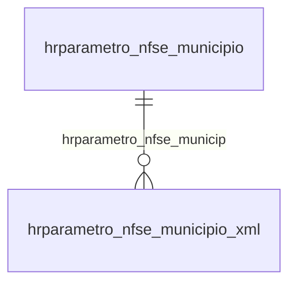

# Modelo — Financeiro do escritório - parametro (rascunho em lote)

> Gerado por `src/model/gerar_docs_modelo.py` a partir de `src/model/modulos/financeiro_parametro.yaml`, do catálogo e do perfil de colunas. **Não edite à mão.**

11 entidades. A coluna *Preench.* é o % de linhas com valor útil (nem nulo, nem em branco, nem zero, nem 1900-01-01; para colunas de código o zero conta como valor).

## Diagrama

## Entidades

| Entidade | Tabela | Linhas | Volume | Filtro obrigatório |
|---|---|---|---|---|
| [hrparametro_nfse_municipio](#hrparametro_nfse_municipio) | `HRPARAMETRO_NFSE_MUNICIPIO` | 1.735 | pequeno | — |
| [hrparametro_nfse_municipio_xml](#hrparametro_nfse_municipio_xml) | `HRPARAMETRO_NFSE_MUNICIPIO_XML` | 1.224 | pequeno | — |
| [hrparametro_intervalo_rps](#hrparametro_intervalo_rps) | `HRPARAMETRO_INTERVALO_RPS` | 13 | pequeno | empresa |
| [hrparametro_imagem](#hrparametro_imagem) | `HRPARAMETRO_IMAGEM` | 3 | pequeno | empresa |
| [hrparametro_vigencia](#hrparametro_vigencia) | `HRPARAMETRO_VIGENCIA` | 3 | pequeno | empresa |
| [hrparametro_nfse_cabecalho](#hrparametro_nfse_cabecalho) | `HRPARAMETRO_NFSE_CABECALHO` | 3 | pequeno | empresa |
| [hrparametro_intervalo_lote](#hrparametro_intervalo_lote) | `HRPARAMETRO_INTERVALO_LOTE` | 3 | pequeno | empresa |
| [hrparametro_sequencial_nfse_lote](#hrparametro_sequencial_nfse_lote) | `HRPARAMETRO_SEQUENCIAL_NFSE_LOTE` | 3 | pequeno | empresa |
| [hrparametro_sequencial_nfse_rps](#hrparametro_sequencial_nfse_rps) | `HRPARAMETRO_SEQUENCIAL_NFSE_RPS` | 3 | pequeno | empresa |
| [hrparametro_sequencial_nfse_dps](#hrparametro_sequencial_nfse_dps) | `HRPARAMETRO_SEQUENCIAL_NFSE_DPS` | 3 | pequeno | empresa |
| [hrparametro_sequencial_nfse_nacional_lote](#hrparametro_sequencial_nfse_nacional_lote) | `HRPARAMETRO_SEQUENCIAL_NFSE_NACIONAL_LOTE` | 3 | pequeno | empresa |

## hrparametro_nfse_municipio

**Parametro Honorarios - Municípios que usam a NFS-e** — tabela `HRPARAMETRO_NFSE_MUNICIPIO` (1.735 linhas)

Parametro Honorarios - Municípios que usam a NFS-e. 1.735 linhas no catálogo; chave: I_MUNICIPIO.

- **Chave:** `I_MUNICIPIO`
- **Empresa:** `não se aplica (tabela global)`
- **Período:** `VIGENCIA`
- **Ordem padrão:** `VIGENCIA desc`, `I_MUNICIPIO asc`

**Regras de negócio validadas:**

- Medido em 2026-10-18: 1.735 linhas, VIGENCIA de 1900-01-01 a 1900-01-01.
- Vínculo gemunicipio (gemunicipio): 0 de 1.735 linhas sem registro relacionado.

| Campo | Coluna | Tipo | Preench. | Domínio | Descrição (banco) |
|---|---|---|---|---|---|
| sequencial | `i_municipio` | integer(4) |  |  | Sequencial |
| codigo_do_municipio | `codigo_municipio` | integer(4) |  |  | Codigo do município |
| nome_do_fornecedor_do_software | `fornecedor_software` | varchar(128) |  |  | Nome do fornecedor do software |
| versao_da_estrutura_do_arquivo_xml_que_e | `versao_estrutura_xml` | tinyint(1) |  |  | Versão da estrutura do arquivo XML que é enviado para a prefeitura |
| nome_da_classe_xml_a_ser_utilizada_para | `nome_classe_xml` | varchar(100) |  |  | Nome da classe xml a ser utilizada para o envio de notas |
| controla_sequencial_quando_troca_de_forn | `controle_sequencial_troca_fornecedor` | char(1) |  |  | Controla sequencial quando troca de fornecedor. |
| vigencia_do_fornecedor | `vigencia` | date(4) |  |  | Vigencia do fornecedor |

**Vínculos (LEFT JOIN, acrescentam colunas legíveis):**

- `gemunicipio` → `gemunicipio` por `codigo_municipio` = `codigo_municipio`; colunas: `gemunicipio_nome`

**Filtros:** `sequencial` (eq/in), `vigencia_do_fornecedor` (entre/gte/lte), `codigo_do_municipio` (eq/in), `nome_do_fornecedor_do_software` (contem/prefixo), `nome_da_classe_xml_a_ser_utilizada_para` (contem/prefixo), `controla_sequencial_quando_troca_de_forn` (eq/in)

## hrparametro_nfse_municipio_xml

**Parâmetro Honorarios - Tabela utilizada para montar o XML de envio de RPS para municípios específicos** — tabela `HRPARAMETRO_NFSE_MUNICIPIO_XML` (1.224 linhas)

Parâmetro Honorarios - Tabela utilizada para montar o XML de envio de RPS para municípios específicos. 1.224 linhas no catálogo; chave: I_MUNICIPIO, I_SEQUENCIAL_TAG, TIPO_XML.

- **Chave:** `I_MUNICIPIO, I_SEQUENCIAL_TAG, TIPO_XML`
- **Empresa:** `não se aplica (tabela global)`
- **Período:** `—`
- **Ordem padrão:** `I_MUNICIPIO asc`, `I_SEQUENCIAL_TAG asc`

**Regras de negócio validadas:**

- Medido em 2026-10-18: 1.224 linhas.
- Vínculo hrparametro_nfse_municip (HRPARAMETRO_NFSE_MUNICIPIO): 0 de 1.224 linhas sem registro relacionado.

| Campo | Coluna | Tipo | Preench. | Domínio | Descrição (banco) |
|---|---|---|---|---|---|
| codigo_municipio | `i_municipio` | integer(4) |  |  | Código Municipio |
| sequencial_tags | `i_sequencial_tag` | integer(4) |  |  | Sequencial tags |
| tipo_de_xml_0_envio_2_consulta_lote_3_co | `tipo_xml` | integer(4) |  |  | TIPO DE XML (0 - Envio, 2 - Consulta Lote, 3 - Consulta Situação, 4 - Cancelamento) |
| tag_atual | `tag` | varchar(128) |  |  | Tag Atual |
| valor_da_mascara | `mascara_valor` | varchar(128) |  |  | Valor da mascara |
| tag_pai | `tag_pai` | varchar(150) |  |  | Tag Pai |
| campo_da_dw_de_dados | `chave_campo_dw` | varchar(128) |  |  | Campo da DW de dados |
| campo_obrigatorio | `campo_obrigatorio` | char(1) |  |  | Campo obrigatorio |
| chave_do_atributo | `atributo_chave_1` | varchar(128) |  |  | Chave do Atributo |
| valor_do_atributo | `atributo_valor_1` | varchar(128) |  |  | Valor do Atributo |
| atributo_chave_2 | `atributo_chave_2` | varchar(128) |  |  | Chave do Atributo |
| atributo_valor_2 | `atributo_valor_2` | varchar(128) |  |  | Valor do Atributo |
| atributo_chave_3 | `atributo_chave_3` | varchar(128) |  |  | Chave do Atributo |
| atributo_valor_3 | `atributo_valor_3` | varchar(128) |  |  | Valor do Atributo |
| constante_origem_informacao_0_sem_valor | `origem_informacao` | integer(4) |  |  | Constante origem informação ( 0 - Sem Valor, 1 - DW Faturamento, 2 - DW Evento, 3 - Fixo Conforme mascara, 4 - Customizado na função, 5 - Tag Principal para Assinatura) |
| atributo_chave_4 | `atributo_chave_4` | varchar(128) |  |  | Chave do Atributo |
| atributo_valor_4 | `atributo_valor_4` | varchar(128) |  |  | Valor do Atributo |
| atributo_chave_5 | `atributo_chave_5` | varchar(128) |  |  | Chave do Atributo |
| atributo_valor_5 | `atributo_valor_5` | varchar(128) |  |  | Valor do Atributo |

**Vínculos (LEFT JOIN, acrescentam colunas legíveis):**

- `hrparametro_nfse_municip` → `HRPARAMETRO_NFSE_MUNICIPIO` por `i_municipio` = `i_municipio`; colunas: `hrparametro_nfse_municip_nome`

**Filtros:** `codigo_municipio` (eq/in), `sequencial_tags` (eq/in), `tipo_de_xml_0_envio_2_consulta_lote_3_co` (eq/in), `tag_atual` (contem/prefixo), `valor_da_mascara` (contem/prefixo), `tag_pai` (contem/prefixo), `campo_da_dw_de_dados` (contem/prefixo), `campo_obrigatorio` (eq/in), `chave_do_atributo` (contem/prefixo), `valor_do_atributo` (contem/prefixo), `atributo_chave_2` (contem/prefixo), `atributo_valor_2` (contem/prefixo), `atributo_chave_3` (contem/prefixo), `atributo_valor_3` (contem/prefixo)

## hrparametro_intervalo_rps

**Parametro Honorarios - Intervalo de RPS** — tabela `HRPARAMETRO_INTERVALO_RPS` (13 linhas)

Parametro Honorarios - Intervalo de RPS. 13 linhas no catálogo; chave: CODI_EMP, I_INTERVALO, I_SEQUENCIAL_RPS.

- **Chave:** `CODI_EMP, I_INTERVALO, I_SEQUENCIAL_RPS`
- **Empresa:** `CODI_EMP`
- **Período:** `—`
- **Ordem padrão:** `I_INTERVALO asc`, `I_SEQUENCIAL_RPS asc`

**Regras de negócio validadas:**

- Medido em 2026-10-18: 13 linhas, 3 empresa(s).
- Colunas expostas nulas em 100% das linhas (1): processo_administrativo.
- tipo_de_invervalo_u_usuario_s_sistema: todos os valores reais estão no comentário do banco (U=10, S=3).
- Vínculo geempre (geempre): 0 de 5 linhas sem registro relacionado (empresa 930).

| Campo | Coluna | Tipo | Preench. | Domínio | Descrição (banco) |
|---|---|---|---|---|---|
| escritorio | `codi_emp` | integer(4) |  |  | Escritorio |
| codigo | `i_intervalo` | integer(4) |  |  | Codigo |
| sequencial_do_rps | `i_sequencial_rps` | integer(4) |  |  | Sequencial do Rps. |
| inicial | `inicial` | numeric(17) |  |  | Inicial |
| final | `final` | numeric(17) |  |  | Final |
| ultimo_codigo_de_intervalo_utilizado_pel | `ultimo_utilizado` | numeric(17) |  |  | Ultimo codigo de intervalo utilizado pelo nosso numero |
| inutilizar_intervalo_s_n | `inutilizar_intervalo` | char(1) |  |  | Inutilizar intervalo (S/N) |
| tipo_de_invervalo_u_usuario_s_sistema | `tipo_intervalo` | char(1) |  | hrparametro_intervalo_rps_tipo_de_inve | Tipo de invervalo (U=Usuario/S=Sistema) |
| origem_do_registro_0_sistema_1_imp_tabel | `origem_reg` | tinyint(1) |  |  | Origem do registro 0 - Sistema, 1 - Imp. Tabelas, 2 - Imp. Layout, 3- Imp. Tabelas Concorrentes |
| processo_administrativo | `processo_administrativo` | varchar(15) |  |  | Processo administrativo |

**Vínculos (LEFT JOIN, acrescentam colunas legíveis):**

- `geempre` → `geempre` por `codi_emp` = `codi_emp`; colunas: `geempre_nome`

**Filtros:** `codigo` (eq/in), `sequencial_do_rps` (eq/in), `inutilizar_intervalo_s_n` (eq/in), `tipo_de_invervalo_u_usuario_s_sistema` (eq/in), `processo_administrativo` (eq/in)

## hrparametro_imagem

**Parametro Honorarios - Imagem para relatorios personalizados** — tabela `HRPARAMETRO_IMAGEM` (3 linhas)

Parametro Honorarios - Imagem para relatorios personalizados. 3 linhas no catálogo; chave: CODI_EMP.

- **Chave:** `CODI_EMP`
- **Empresa:** `CODI_EMP`
- **Período:** `—`
- **Ordem padrão:** 

**Regras de negócio validadas:**

- Medido em 2026-10-18: 3 linhas, 3 empresa(s).

| Campo | Coluna | Tipo | Preench. | Domínio | Descrição (banco) |
|---|---|---|---|---|---|
| escritorio | `codi_emp` | integer(4) |  |  | Escritorio |
| origem_do_registro_0_sistema_1_imp_tabel | `origem_reg` | tinyint(1) |  |  | Origem do registro 0 - Sistema, 1 - Imp. Tabelas, 2 - Imp. Layout, 3- Imp. Tabelas Concorrentes |

## hrparametro_vigencia

**Parametro Honorarios - Vigencia** — tabela `HRPARAMETRO_VIGENCIA` (3 linhas)

Parametro Honorarios - Vigencia. 3 linhas no catálogo; chave: CODI_EMP, VIGENCIA.

- **Chave:** `CODI_EMP, VIGENCIA`
- **Empresa:** `CODI_EMP`
- **Período:** `VIGENCIA`
- **Ordem padrão:** `VIGENCIA desc`

**Regras de negócio validadas:**

- Medido em 2026-10-18: 3 linhas, 3 empresa(s), VIGENCIA de 1900-01-01 a 1900-01-01.

| Campo | Coluna | Tipo | Preench. | Domínio | Descrição (banco) |
|---|---|---|---|---|---|
| codigo_do_escritorio | `codi_emp` | integer(4) |  |  | Codigo do escritorio |
| data_de_vigencia | `vigencia` | date(4) |  |  | Data de vigencia |
| contas_a_pagar_s_n | `contas_pagar` | char(1) |  |  | Contas a pagar S N |
| numero_de_dias_de_antecedencia | `dias_antecedencia` | integer(4) |  |  | Numero de dias de antecedencia |
| calcular_juros_no_recebimento_s_n | `calcula_juros_recebimento` | char(1) |  |  | Calcular juros no recebimento S N |
| calcular_multa_no_recebimento_s_n | `calcula_multa_recebimento` | char(1) |  |  | Calcular multa no recebimento S N |
| nao_exibir_a_tela_de_evento_no_recebimen | `nao_exibir_evento_recebimento` | char(1) |  |  | Nao exibir a tela de evento no recebimento individual |
| percentual_de_juros | `percentual_juros` | numeric(5) |  |  | Percentual de juros |
| percentual_de_multa | `percentual_multa` | numeric(5) |  |  | Percentual de multa |
| emitir_comprovante_no_momento_do_recebim | `emitir_comprovante_recebimento_individual` | char(1) |  |  | Emitir comprovante no momento do recebimento S N |
| modelo_recebimento_individual | `modelo_recebimento_individual` | varchar(80) |  |  | Modelo recebimento individual |
| emitir_comprovante_recebimento_grupo | `emitir_comprovante_recebimento_grupo` | char(1) |  |  | Emitir comprovante no momento do recebimento C Cada recebimento U Unico para varios |
| modelo_recebimento_grupo | `modelo_recebimento_grupo` | varchar(80) |  |  | Modelo recebimento grupo |
| emitir_comprovante_no_momento_no_adianta | `emitir_comprovante_recebimento_adiantamento` | char(1) |  |  | Emitir comprovante no momento no adiantamento S N |
| modelo_recebimento_adiantamento | `modelo_recebimento_adiantamento` | varchar(80) |  |  | Modelo recebimento adiantamento |
| valor_minimo_para_retencao_do_irrf | `valor_minimo_irrf` | numeric(13) |  |  | Valor minimo para retencao do IRRF |
| fato_gerador_irrf_r_recebimento_e_emissa | `fato_gerador_irrf` | char(1) |  |  | Fato gerador IRRF R Recebimento E Emissao |
| valor_minimo_para_retencao_do_inss | `valor_minimo_inss` | numeric(13) |  |  | Valor minimo para retencao do INSS |
| valor_minimo_para_retencao_do_iss | `valor_minimo_iss` | numeric(13) |  |  | Valor minimo para retencao do ISS |
| possui_crf_s_n | `possui_crf` | char(1) |  |  | Possui CRF S N |
| possui_pis_s_n | `possui_pis` | char(1) |  |  | Possui PIS S N |
| possui_cofins_s_n | `possui_cofins` | char(1) |  |  | Possui COFINS S N |
| possui_csll_s_n | `possui_csll` | char(1) |  |  | Possui CSLL S N |
| valor_minimo_da_parcela_para_calculo_da | `valor_minimo_crf` | numeric(13) |  |  | Valor minimo da parcela para calculo da CRF |
| fato_gerador_crf_r_recebimento_e_emissao | `fato_gerador_crf` | char(1) |  |  | Fato gerador CRF R Recebimento E Emissao |
| nao_faturar_com_parcelas_vencidas_s_n | `nao_faturar_vencida` | char(1) |  |  | Nao faturar com parcelas vencidas S N |
| quantidade_de_parcelas_em_aberta | `quantidade_parcelas_aberta` | integer(4) |  |  | Quantidade de parcelas em aberta |
| calcular_desconto_no_contrato_para_clien | `calcular_desconto_adimplente` | char(1) |  |  | Calcular desconto no contrato para clientes adimplentes S N |
| quantidade_de_meses_adimplente | `quantidade_meses_adimplente` | integer(4) |  |  | Quantidade de meses adimplente |
| percentual_adimplente | `percentual_adimplente` | numeric(5) |  |  | Percentual adimplente |
| faturar_clientes_inativos_s_n | `faturar_inativo` | char(1) |  |  | Faturar clientes inativos S N |
| faturar_clientes_em_constituicao_s_n | `faturar_constituicao` | char(1) |  |  | Faturar clientes em constituicao S N |
| avisar_sobre_os_reajustes_vencidos_s_n | `avisar_reajuste_vencido` | char(1) |  |  | Avisar sobre os reajustes vencidos S N |
| avisar_se_o_cliente_possuir_parcelas_em | `avisar_cliente_parcela_aberta` | char(1) |  |  | Avisar se o cliente possuir parcelas em aberto S N |
| numero_de_parcelas_em_aberto | `numero_parcela_aberta` | integer(4) |  |  | Numero de parcelas em aberto |
| tipo_do_vencimento_1_direto_2_antecipado | `tipo_vencimento` | tinyint(1) |  |  | Tipo do vencimento 1 Direto 2 Antecipados 3 Adiados 4 Uteis |
| limitar_dias_de_vencimento_s_n | `limitar_dias_vencimento` | char(1) |  |  | Limitar dias de vencimento S N |
| dias_para_vencimento | `dias_vencimento` | varchar(128) |  |  | Dias para vencimento |
| gerar_lancamentos_contabeis | `gera_lancamento` | char(1) |  |  | Gerar lancamentos contabeis |
| mostrar_na_baixa_de_contas_a_receber_ind | `mostrar_baixa_receber` | char(1) |  |  | Mostrar na baixa de contas a receber individual S N |
| mostrar_no_lancamento_de_contas_a_pagar | `mostrar_lancamento_pagar` | char(1) |  |  | Mostrar no lancamento de contas a pagar S N |
| mostrar_na_baixa_de_contas_a_pagar_indiv | `mostrar_baixar_pagar` | char(1) |  |  | Mostrar na baixa de contas a pagar individual S N |
| mostrar_no_adiantamento_s_n | `mostrar_adiantamento` | char(1) |  |  | Mostrar no adiantamento S N |
| mostrar_na_movimentacao_de_contas_s_n | `mostrar_movimentacao` | char(1) |  |  | Mostrar na movimentacao de contas S N |
| cada_cliente_gera_uma_conta_s_n | `cliente_cria_conta` | char(1) |  |  | Cada cliente gera uma conta S N |
| classificacao_diferente_para_cada_conta | `classificacao_diferente_cliente` | char(1) |  |  | Classificacao diferente para cada conta S N |
| codigo_do_cliente_igual_ao_da_conta_s_n | `codigo_igual_cliente` | char(1) |  |  | Codigo do cliente igual ao da conta S N |
| classificacao_da_conta_cliente | `classificacao_conta_cliente` | varchar(20) |  |  | Classificacao da conta cliente |
| contas_a_receber_conta_multa | `receber_conta_multa` | integer(4) |  |  | Contas a receber conta multa |
| contas_a_receber_historico_multa | `receber_historico_multa` | integer(4) |  |  | Contas a receber historico multa |
| contas_a_receber_conta_juros | `receber_conta_juros` | integer(4) |  |  | Contas a receber conta juros |
| contas_a_receber_historico_juros | `receber_historico_juros` | integer(4) |  |  | Contas a receber historico juros |
| contas_a_receber_conta_desconto | `receber_conta_desconto` | integer(4) |  |  | Contas a receber conta desconto |
| contas_a_receber_historico_desconto | `receber_historico_desconto` | integer(4) |  |  | Contas a receber historico desconto |
| contas_a_receber_conta_adiantamento | `receber_conta_adiantamento` | integer(4) |  |  | Contas a receber conta adiantamento |
| contas_a_receber_historico_adiantamento | `receber_historico_adiantamento` | integer(4) |  |  | Contas a receber historico adiantamento |
| contas_a_receber_historico_recebimento | `receber_historico_recebimento` | integer(4) |  |  | Contas a receber historico recebimento |
| contas_a_pagar_conta_multa | `pagar_conta_multa` | integer(4) |  |  | Contas a pagar conta multa |
| contas_a_pagar_historico_multa | `pagar_historico_multa` | integer(4) |  |  | Contas a pagar historico multa |
| contas_a_pagar_conta_juros | `pagar_conta_juros` | integer(4) |  |  | Contas a pagar conta juros |

**Filtros:** `data_de_vigencia` (eq/in), `contas_a_pagar_s_n` (eq/in), `calcular_juros_no_recebimento_s_n` (eq/in), `calcular_multa_no_recebimento_s_n` (eq/in), `nao_exibir_a_tela_de_evento_no_recebimen` (eq/in), `emitir_comprovante_no_momento_do_recebim` (eq/in), `modelo_recebimento_individual` (contem/prefixo), `emitir_comprovante_recebimento_grupo` (eq/in), `modelo_recebimento_grupo` (contem/prefixo), `emitir_comprovante_no_momento_no_adianta` (eq/in), `modelo_recebimento_adiantamento` (contem/prefixo), `fato_gerador_irrf_r_recebimento_e_emissa` (eq/in), `possui_crf_s_n` (eq/in), `possui_pis_s_n` (eq/in)

## hrparametro_nfse_cabecalho

**Parametro Honorarios - Imagem e textos para NFSe** — tabela `HRPARAMETRO_NFSE_CABECALHO` (3 linhas)

Parametro Honorarios - Imagem e textos para NFSe. 3 linhas no catálogo; chave: CODI_EMP.

- **Chave:** `CODI_EMP`
- **Empresa:** `CODI_EMP`
- **Período:** `—`
- **Ordem padrão:** 

**Regras de negócio validadas:**

- Medido em 2026-10-18: 3 linhas, 3 empresa(s).

| Campo | Coluna | Tipo | Preench. | Domínio | Descrição (banco) |
|---|---|---|---|---|---|
| escritorio | `codi_emp` | integer(4) |  |  | Escritorio |
| texto_para_rps | `texto_rps` | varchar(512) |  |  | Texto para RPS |
| texto_para_nfs_e | `texto_nfse` | varchar(512) |  |  | Texto para NFS-e |
| origem_do_registro_0_sistema_1_imp_tabel | `origem_reg` | tinyint(1) |  |  | Origem do registro 0 - Sistema, 1 - Imp. Tabelas, 2 - Imp. Layout, 3- Imp. Tabelas Concorrentes |

**Filtros:** `texto_para_rps` (contem/prefixo), `texto_para_nfs_e` (contem/prefixo)

## hrparametro_intervalo_lote

**Parametro Honorarios - Intervalo de Lote** — tabela `HRPARAMETRO_INTERVALO_LOTE` (3 linhas)

Parametro Honorarios - Intervalo de Lote. 3 linhas no catálogo; chave: CODI_EMP, I_INTERVALO, I_SEQUENCIAL_LOTE.

- **Chave:** `CODI_EMP, I_INTERVALO, I_SEQUENCIAL_LOTE`
- **Empresa:** `CODI_EMP`
- **Período:** `—`
- **Ordem padrão:** `I_INTERVALO asc`, `I_SEQUENCIAL_LOTE asc`

**Regras de negócio validadas:**

- Medido em 2026-10-18: 3 linhas, 3 empresa(s).
- tipo_de_invervalo_u_usuario_s_sistema: todos os valores reais estão no comentário do banco (S=3).
- Vínculo geempre (geempre): 0 de 1 linhas sem registro relacionado (empresa 9996).

| Campo | Coluna | Tipo | Preench. | Domínio | Descrição (banco) |
|---|---|---|---|---|---|
| escritorio | `codi_emp` | integer(4) |  |  | Escritório |
| codigo | `i_intervalo` | integer(4) |  |  | Código |
| sequencial_do_lote | `i_sequencial_lote` | integer(4) |  |  | Sequencial do lote. |
| inicial | `inicial` | numeric(17) |  |  | Inicial |
| final | `final` | numeric(17) |  |  | Final |
| ultimo_codigo_de_intervalo_utilizado_pel | `ultimo_utilizado` | numeric(17) |  |  | Último codigo de intervalo utilizado pelo nosso numero |
| inutilizar_intervalo_s_n | `inutilizar_intervalo` | char(1) |  |  | Inutilizar intervalo (S/N) |
| tipo_de_invervalo_u_usuario_s_sistema | `tipo_intervalo` | char(1) |  | hrparametro_intervalo_lote_tipo_de_inv | Tipo de invervalo (U=Usuario/S=Sistema) |
| origem_do_registro_0_sistema_1_imp_tabel | `origem_reg` | tinyint(1) |  |  | Origem do registro 0 - Sistema, 1 - Imp. Tabelas, 2 - Imp. Layout, 3- Imp. Tabelas Concorrentes |

**Vínculos (LEFT JOIN, acrescentam colunas legíveis):**

- `geempre` → `geempre` por `codi_emp` = `codi_emp`; colunas: `geempre_nome`

**Filtros:** `codigo` (eq/in), `sequencial_do_lote` (eq/in), `inutilizar_intervalo_s_n` (eq/in), `tipo_de_invervalo_u_usuario_s_sistema` (eq/in)

## hrparametro_sequencial_nfse_lote

**Parâmetro Honorarios - Sequência de lote utilizada para NFS-e** — tabela `HRPARAMETRO_SEQUENCIAL_NFSE_LOTE` (3 linhas)

Parâmetro Honorarios - Sequência de lote utilizada para NFS-e. 3 linhas no catálogo; chave: CODI_EMP, I_SEQUENCIAL_LOTE.

- **Chave:** `CODI_EMP, I_SEQUENCIAL_LOTE`
- **Empresa:** `CODI_EMP`
- **Período:** `—`
- **Ordem padrão:** `I_SEQUENCIAL_LOTE asc`

**Regras de negócio validadas:**

- Medido em 2026-10-18: 3 linhas, 3 empresa(s).
- Vínculo geempre (geempre): 0 de 1 linhas sem registro relacionado (empresa 9996).

| Campo | Coluna | Tipo | Preench. | Domínio | Descrição (banco) |
|---|---|---|---|---|---|
| codigo_empresa | `codi_emp` | integer(4) |  |  | Código empresa |
| codigo_sequencial_lote | `i_sequencial_lote` | integer(4) |  |  | Código sequencial lote |

**Vínculos (LEFT JOIN, acrescentam colunas legíveis):**

- `geempre` → `geempre` por `codi_emp` = `codi_emp`; colunas: `geempre_nome`

**Filtros:** `codigo_sequencial_lote` (eq/in)

## hrparametro_sequencial_nfse_rps

**Parâmetro Honorarios - Sequência de RPS utilizada para NFS-e** — tabela `HRPARAMETRO_SEQUENCIAL_NFSE_RPS` (3 linhas)

Parâmetro Honorarios - Sequência de RPS utilizada para NFS-e. 3 linhas no catálogo; chave: CODI_EMP, I_SEQUENCIAL_RPS.

- **Chave:** `CODI_EMP, I_SEQUENCIAL_RPS`
- **Empresa:** `CODI_EMP`
- **Período:** `—`
- **Ordem padrão:** `I_SEQUENCIAL_RPS asc`

**Regras de negócio validadas:**

- Medido em 2026-10-18: 3 linhas, 3 empresa(s).
- Vínculo geempre (geempre): 0 de 1 linhas sem registro relacionado (empresa 9996).

| Campo | Coluna | Tipo | Preench. | Domínio | Descrição (banco) |
|---|---|---|---|---|---|
| codigo_empresa | `codi_emp` | integer(4) |  |  | Código empresa |
| codigo_sequencial_rps | `i_sequencial_rps` | integer(4) |  |  | Código sequencial RPS |

**Vínculos (LEFT JOIN, acrescentam colunas legíveis):**

- `geempre` → `geempre` por `codi_emp` = `codi_emp`; colunas: `geempre_nome`

**Filtros:** `codigo_sequencial_rps` (eq/in)

## hrparametro_sequencial_nfse_dps

**Parâmetro Honorarios - Sequência de DPS utilizada para NFS-e Nacional** — tabela `HRPARAMETRO_SEQUENCIAL_NFSE_DPS` (3 linhas)

Parâmetro Honorarios - Sequência de DPS utilizada para NFS-e Nacional. 3 linhas no catálogo; chave: CODI_EMP, I_SEQUENCIAL_DPS.

- **Chave:** `CODI_EMP, I_SEQUENCIAL_DPS`
- **Empresa:** `CODI_EMP`
- **Período:** `—`
- **Ordem padrão:** `I_SEQUENCIAL_DPS asc`

**Regras de negócio validadas:**

- Medido em 2026-10-18: 3 linhas, 3 empresa(s).
- Vínculo geempre (geempre): 0 de 1 linhas sem registro relacionado (empresa 9996).

| Campo | Coluna | Tipo | Preench. | Domínio | Descrição (banco) |
|---|---|---|---|---|---|
| codigo_empresa | `codi_emp` | integer(4) |  |  | Código empresa |
| codigo_sequencial_dps | `i_sequencial_dps` | integer(4) |  |  | Código sequencial DPS |

**Vínculos (LEFT JOIN, acrescentam colunas legíveis):**

- `geempre` → `geempre` por `codi_emp` = `codi_emp`; colunas: `geempre_nome`

**Filtros:** `codigo_sequencial_dps` (eq/in)

## hrparametro_sequencial_nfse_nacional_lote

**Parâmetro Honorarios - Sequência de lote utilizada para NFS-e Nacional** — tabela `HRPARAMETRO_SEQUENCIAL_NFSE_NACIONAL_LOTE` (3 linhas)

Parâmetro Honorarios - Sequência de lote utilizada para NFS-e Nacional. 3 linhas no catálogo; chave: CODI_EMP, I_SEQUENCIAL_LOTE.

- **Chave:** `CODI_EMP, I_SEQUENCIAL_LOTE`
- **Empresa:** `CODI_EMP`
- **Período:** `—`
- **Ordem padrão:** `I_SEQUENCIAL_LOTE asc`

**Regras de negócio validadas:**

- Medido em 2026-10-18: 3 linhas, 3 empresa(s).
- Vínculo geempre (geempre): 0 de 1 linhas sem registro relacionado (empresa 9996).

| Campo | Coluna | Tipo | Preench. | Domínio | Descrição (banco) |
|---|---|---|---|---|---|
| codigo_empresa | `codi_emp` | integer(4) |  |  | Código empresa |
| codigo_sequencial_lote | `i_sequencial_lote` | integer(4) |  |  | Código sequencial lote |

**Vínculos (LEFT JOIN, acrescentam colunas legíveis):**

- `geempre` → `geempre` por `codi_emp` = `codi_emp`; colunas: `geempre_nome`

**Filtros:** `codigo_sequencial_lote` (eq/in)

## Domínios (significado dos códigos)

`confirmado`: **sim** = vem do comentário do banco e/ou foi conferido nos dados; **parcial** = parte dos valores; **não** = hipótese, não use como regra.

### status_empresa

Situação da empresa no cadastro (geempre.stat_emp)

Confirmado: sim

| Código | Significado |
|---|---|
| A | Ativa |
| I | Inativa |
| C | Em constituição |
| M | Ativo sem movimento |
| B | Em processo de baixa |
| E | Excluindo |

### motivo_inatividade

Motivo da inatividade (geempre.tipoi_emp). Só aparece em empresas inativas.

Confirmado: sim

| Código | Significado |
|---|---|
| 1 | Outros |
| 2 | Baixada |
| 3 | Transferida |
| 4 | Inadimplente |

### tipo_inscricao

Tipo da inscrição (CNPJ/CPF/CEI/CAEPF)

Confirmado: sim

| Código | Significado |
|---|---|
| 1 | CNPJ |
| 2 | CPF |
| 3 | CEI |
| 6 | CAEPF |

### regime_federal_empresa

Regime federal da folha (geempre.rfed_emp)

Confirmado: parcial

| Código | Significado |
|---|---|
| 1 | Normal |
| 2 | Microempresa |
| 3 | Empresa de pequeno porte |

### tipo_honorario_empresa

Como a empresa usa o módulo Honorários (geempre.honorario_tipo)

Confirmado: sim

| Código | Significado |
|---|---|
| E | Escritório (quem fatura) |
| C | Cliente |

### sim_nao_texto

Confirmado: sim

| Código | Significado |
|---|---|
| S | Sim |
| N | Não |

### sim_nao_numerico

Confirmado: sim

| Código | Significado |
|---|---|
| 1 | Sim |
| 0 | Não |

### hrparametro_intervalo_rps_tipo_de_inve

Confirmado: sim

> Todos os valores observados em HRPARAMETRO_INTERVALO_RPS.TIPO_INTERVALO estão no comentário do banco (2026-10-18). Distribuição: U=10, S=3.

| Código | Significado |
|---|---|
| U | Usuario |
| S | Sistema |

### hrparametro_intervalo_lote_tipo_de_inv

Confirmado: sim

> Todos os valores observados em HRPARAMETRO_INTERVALO_LOTE.TIPO_INTERVALO estão no comentário do banco (2026-10-18). Distribuição: S=3.

| Código | Significado |
|---|---|
| U | Usuario |
| S | Sistema |

