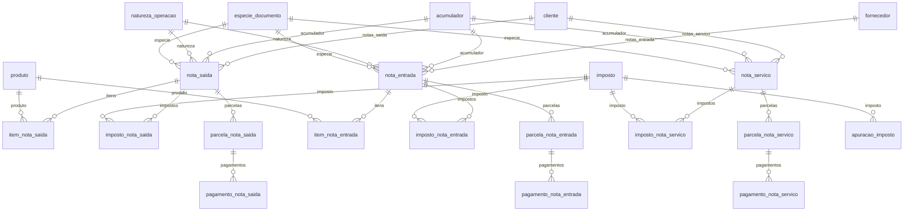

# Modelo — Escrita Fiscal

> Gerado por `src/model/gerar_docs_modelo.py` a partir de `src/model/modulos/fiscal.yaml`, do catálogo e do perfil de colunas. **Não edite à mão.**

22 entidades. A coluna *Preench.* é o % de linhas com valor útil (nem nulo, nem em branco, nem zero, nem 1900-01-01; para colunas de código o zero conta como valor).

## Diagrama

## Entidades

| Entidade | Tabela | Linhas | Volume | Filtro obrigatório |
|---|---|---|---|---|
| [cliente](#cliente) | `efclientes` | 689.035 | medio | empresa |
| [fornecedor](#fornecedor) | `effornece` | 61.984 | medio | empresa |
| [produto](#produto) | `efprodutos` | 221.153 | medio | empresa |
| [acumulador](#acumulador) | `EFACUMULADOR` | 434.521 | medio | empresa |
| [natureza_operacao](#natureza_operacao) | `efnatureza` | 1.548 | pequeno | — |
| [especie_documento](#especie_documento) | `efespecies` | 55 | pequeno | — |
| [imposto](#imposto) | `geimposto` | 272.150 | medio | empresa |
| [nota_saida](#nota_saida) | `efsaidas` | 513.113 | medio | empresa |
| [item_nota_saida](#item_nota_saida) | `efmvspro` | 1.338.693 | grande | empresa; um de: codigo_nota, periodo |
| [imposto_nota_saida](#imposto_nota_saida) | `efimpsai` | 636.496 | medio | empresa; um de: codigo_nota, periodo |
| [parcela_nota_saida](#parcela_nota_saida) | `efsaidaspar` | 181.154 | medio | empresa |
| [pagamento_nota_saida](#pagamento_nota_saida) | `efsaidaspag` | 2.970 | pequeno | empresa |
| [nota_entrada](#nota_entrada) | `efentradas` | 511.949 | medio | empresa |
| [item_nota_entrada](#item_nota_entrada) | `efmvepro` | 620.302 | medio | empresa; um de: codigo_nota, periodo |
| [imposto_nota_entrada](#imposto_nota_entrada) | `efimpent` | 806.969 | medio | empresa; um de: codigo_nota, periodo |
| [parcela_nota_entrada](#parcela_nota_entrada) | `efentradaspar` | 157.539 | medio | empresa |
| [pagamento_nota_entrada](#pagamento_nota_entrada) | `efentradaspag` | 104.582 | pequeno | empresa |
| [nota_servico](#nota_servico) | `efservicos` | 585.771 | medio | empresa |
| [imposto_nota_servico](#imposto_nota_servico) | `efimpser` | 1.155.629 | grande | empresa; um de: codigo_nota, periodo |
| [parcela_nota_servico](#parcela_nota_servico) | `efservicospar` | 115.341 | medio | empresa |
| [pagamento_nota_servico](#pagamento_nota_servico) | `efservicospag` | 215.111 | pequeno | empresa |
| [apuracao_imposto](#apuracao_imposto) | `efsdoimp` | 791.318 | medio | empresa |

## cliente

**Clientes** — tabela `efclientes` (689.035 linhas)

Cadastro de clientes da escrita fiscal (por empresa). Inclui pessoas físicas — ver `sensivel`.

- **Chave:** `codi_emp, codi_cli`
- **Empresa:** `codi_emp`
- **Período:** `—`
- **Ordem padrão:** `nome_cli asc`

| Campo | Coluna | Tipo | Preench. | Domínio | Descrição (banco) |
|---|---|---|---|---|---|
| codigo | `codi_cli` | integer(4) | 100% |  | Codigo |
| nome | `nome_cli` | char(150) | 100% |  | Razao Social |
| nome_resumido | `nomr_cli` | char(40) | 100% |  | Nome |
| cnpj_cpf 🔒 | `cgce_cli` | char(14) | 100% |  | CNPJ |
| tipo_inscricao | `tins_cli` | integer(4) | 100% | tipo_inscricao | TIPO DA INSCRICAO (1 - CNPJ/2 - CPF/3 - CEI/6 - CAEPF) |
| inscricao_estadual | `insc_cli` | char(20) | 9% |  | Inscricao estadual |
| inscricao_municipal | `imun_cli` | char(20) | 8% |  | Inscricao Municipal |
| contribuinte_icms | `icms_cli` | char(1) | 100% | sim_nao_texto | Contribuinte de ICMS (S/N) |
| regime_apuracao | `regime_cli` | char(1) | 100% | regime_apuracao | REGIME DE APURACAO (N - NORMAL/M- ME - SIMPLES NACIONAL/E - EPP - SIMPLES NACIONAL/O - OUTROS/U - IMUNE/I - ISENTA) |
| produtor_rural_pf | `produtor_rural_pf_cli` | char(1) | 100% | sim_nao_texto | Produtor Rural Pessoa Física |
| endereco 🔒 | `ende_cli` | char(40) | 32% |  | Endereco |
| numero | `nume_cli` | integer(4) | 31% |  | Numero |
| complemento | `complemento_cli` | char(40) | 16% |  | Complemento do endereco |
| bairro | `bair_cli` | char(60) | 32% |  | Bairro |
| cidade | `cida_cli` | char(30) | 11% |  | Cidade |
| uf | `sigl_est` | char(2) | 100% |  | Estado |
| cep | `cepe_cli` | char(8) | 31% |  | CEP |
| telefone 🔒 | `fone_cli` | char(14) | 13% |  | Fone |
| municipio_codigo | `codigo_municipio` | integer(4) | 35% |  | Codigo do municipio |
| pais_codigo | `codigo_pais` | integer(4) | 100% |  | Codigo do pais |
| conta_contabil | `codi_cta` | integer(4) | 67% |  | Conta contabil |
| data_cadastro | `cadastro_cli` | date(4) | 100% |  | Data do cadastro do cliente |

**Vínculos (LEFT JOIN, acrescentam colunas legíveis):**

- `municipio` → `gemunicipio` por `codigo_municipio` = `codigo_municipio`; colunas: `municipio_nome`, `municipio_ibge`

**Filhos (1:N):**

- `notas_saida` → [nota_saida](#nota_saida)
- `notas_servico` → [nota_servico](#nota_servico)

**Filtros:** `codigo` (eq/in), `nome` (contem/prefixo), `cnpj_cpf` (eq), `uf` (eq/in), `regime_apuracao` (eq/in)

## fornecedor

**Fornecedores** — tabela `effornece` (61.984 linhas)

Cadastro de fornecedores da escrita fiscal (por empresa).

- **Chave:** `codi_emp, codi_for`
- **Empresa:** `codi_emp`
- **Período:** `—`
- **Ordem padrão:** `nome_for asc`

| Campo | Coluna | Tipo | Preench. | Domínio | Descrição (banco) |
|---|---|---|---|---|---|
| codigo | `codi_for` | integer(4) | 100% |  | Codigo |
| nome | `nome_for` | char(150) | 100% |  | Razao social |
| nome_resumido | `nomr_for` | char(40) | 100% |  | Nome |
| cnpj_cpf 🔒 | `cgce_for` | char(14) | 99% |  | CNPJ |
| tipo_inscricao | `tins_for` | integer(4) | 100% | tipo_inscricao | TIPO DA INSCRICAO (1 - CNPJ/2 - CPF/3 - CEI/6 - CAEPF) |
| inscricao_estadual | `insc_for` | char(20) | 28% |  | Inscricao estadual |
| inscricao_municipal | `imun_for` | char(20) | 39% |  | Inscricao Municipal |
| contribuinte_icms | `icms_for` | char(1) | 100% | sim_nao_texto | Contribuinte do ICMS (S/N) |
| regime_apuracao | `regime_for` | char(1) | 100% | regime_apuracao | REGIME DE APURACAO (N - NORMAL/M- ME/E - EPP/O - OUTROS/S - ME - SIMPLES NACIONAL/P - EPP - SIMPLES NACIONAL/U - IMUNE/I - ISENTA)) |
| endereco 🔒 | `ende_for` | char(40) | 98% |  | Endereco |
| numero | `nume_for` | integer(4) | 92% |  | Numero |
| complemento | `complemento_for` | char(40) | 49% |  | Complemento do endereco |
| bairro | `bair_for` | char(60) | 97% |  | Bairro |
| cidade | `cida_for` | char(30) | 30% |  | Cidade |
| uf | `sigl_est` | char(2) | 100% |  | Estado |
| cep | `cepe_for` | char(8) | 97% |  | CEP |
| telefone 🔒 | `fone_for` | char(14) | 30% |  | Fone |
| email 🔒 | `email_for` | char(255) | 30% |  | Email |
| municipio_codigo | `codigo_municipio` | integer(4) | 94% |  | Codigo do municipio |
| pais_codigo | `codigo_pais` | integer(4) | 100% |  | Codigo do pais |
| conta_contabil | `codi_cta` | integer(4) | 94% |  | Conta contabil |
| data_cadastro | `cadastro_for` | date(4) | 100% |  | Data do cadastro do fornecedor |

**Vínculos (LEFT JOIN, acrescentam colunas legíveis):**

- `municipio` → `gemunicipio` por `codigo_municipio` = `codigo_municipio`; colunas: `municipio_nome`, `municipio_ibge`

**Filhos (1:N):**

- `notas_entrada` → [nota_entrada](#nota_entrada)

**Filtros:** `codigo` (eq/in), `nome` (contem/prefixo), `cnpj_cpf` (eq), `uf` (eq/in)

## produto

**Produtos** — tabela `efprodutos` (221.153 linhas)

Cadastro de produtos/mercadorias (por empresa) — base de itens de entrada e saída e do inventário.

- **Chave:** `codi_emp, codi_pdi`
- **Empresa:** `codi_emp`
- **Período:** `—`
- **Ordem padrão:** `desc_pdi asc`

| Campo | Coluna | Tipo | Preench. | Domínio | Descrição (banco) |
|---|---|---|---|---|---|
| codigo | `codi_pdi` | char(14) | 100% |  | Codigo |
| descricao | `desc_pdi` | char(255) | 100% |  | Descricao |
| grupo_codigo | `codi_gru` | integer(4) | 100% |  | Grupo |
| unidade | `unid_pdi` | char(6) | 100% |  | Unidade de medida |
| ncm | `cncm_pdi` | char(8) | 99% |  | Nomenclatura Comum do Mercosul |
| ean | `ean_pdi` | varchar(14) | 0% |  | Codigo EAN/Codigo de Barras - SE |
| tipo | `tipo_pdi` | char(1) | 100% | tipo_produto | Tipo(V=Veíc. Novos/M=Medicamentos/A=Armas Fogo/O=Outros/C=Combustíveis/U=Comunicação/E=Energ. Elétr./S=Veíc. Usados) |
| tipo_item | `tipo_item_pdi` | tinyint(1) | 100% | tipo_item_produto | Tipo do item (0=Mercadoria/1=Materia Prima/2=Produto Intermediario/3=Produto em Fabricacao/4=Produto Acabado/5=Embalagem/9=Serviços/10=Outros insumos/99=Outros) |
| cst | `cst_pdi` | integer(4) | 69% |  | Codigo da Situacao Tributaria |
| aliquota_icms | `aicms_pdi` | numeric(5) | 0% |  | Aliquota do ICMS |
| aliquota_ipi | `aipi_pdi` | numeric(5) | 0% |  | Aliquota do IPI |
| valor_unitario | `vuni_pdi` | numeric(15) | 96% |  | Valor unitario |
| quantidade_inicial | `qtin_pdi` | numeric(13) | 0% |  | Quantidade inicial |
| valor_inicial | `vlin_pdi` | numeric(13) | 0% |  | Valor inicial |
| quantidade_final | `qtfi_pdi` | numeric(13) | 0% |  | Quantidade final |
| valor_final | `vlfi_pdi` | numeric(13) | 0% |  | Valor final |

**Filtros:** `codigo` (eq/in/prefixo), `descricao` (contem/prefixo), `ncm` (eq/prefixo), `tipo` (eq/in), `tipo_item` (eq/in)

## acumulador

**Acumuladores** — tabela `EFACUMULADOR` (434.521 linhas)

Acumuladores fiscais (classificam notas de entrada, saída e serviço).

- **Chave:** `codi_emp, codi_acu`
- **Empresa:** `codi_emp`
- **Período:** `—`
- **Ordem padrão:** `codi_acu asc`

| Campo | Coluna | Tipo | Preench. | Domínio | Descrição (banco) |
|---|---|---|---|---|---|
| codigo | `codi_acu` | integer(4) | 100% |  | Codigo |
| nome | `nome_acu` | char(40) | 100% |  | Nome |
| situacao | `situacao_acu` | char(1) | 100% |  | Situação |
| data_cadastro | `data_cadastro_acu` | date(4) | 100% |  | Data de cadastro. |
| data_inativacao | `data_inativacao_acu` | date(4) | 0% |  | Data de inativação |

**Filtros:** `codigo` (eq/in), `nome` (contem/prefixo), `situacao` (eq)

## natureza_operacao

**Naturezas de operação (CFOP)** — tabela `efnatureza` (1.548 linhas)

Tabela global de naturezas/CFOP (não depende de empresa). Existem versões (versao_nat 1 e 2).

- **Chave:** `codi_nat, versao_nat`
- **Empresa:** `não se aplica (tabela global)`
- **Período:** `—`
- **Ordem padrão:** `codi_nat asc`, `versao_nat asc`

| Campo | Coluna | Tipo | Preench. | Domínio | Descrição (banco) |
|---|---|---|---|---|---|
| codigo | `codi_nat` | integer(4) | 100% |  | Codigo |
| versao | `versao_nat` | smallint(2) | 100% |  | Versao |
| nome | `nome_nat` | varchar(512) | 100% |  | Nome |
| mascara | `masc_nat` | char(7) | 100% |  | Mascara |

**Filtros:** `codigo` (eq/in/prefixo), `nome` (contem)

## especie_documento

**Espécies de documento fiscal** — tabela `efespecies` (55 linhas)

Tabela global de espécies (NF, NFe, NFCe, CTe...). Não depende de empresa.

- **Chave:** `codi_esp`
- **Empresa:** `não se aplica (tabela global)`
- **Período:** `—`
- **Ordem padrão:** `codi_esp asc`

| Campo | Coluna | Tipo | Preench. | Domínio | Descrição (banco) |
|---|---|---|---|---|---|
| codigo | `codi_esp` | integer(4) | 100% |  | Codigo |
| nome | `nome_esp` | char(30) | 100% |  | Nome |
| modelo_documento | `mode_esp` | integer(4) | 87% |  | Modelo do documento fiscal |
| codigo_modelo | `codigo_modelo` | char(2) | 100% |  | Codigo do modelo |
| tipo | `tipo_esp` | integer(4) | 100% |  | Tipo da especie |
| documento_nao_fiscal | `documento_nao_fiscal` | char(1) | 100% | sim_nao_texto | Documento não fiscal (S/N) |
| nota_fiscal_conjugada | `nota_fiscal_conjugada` | char(1) | 100% | sim_nao_texto | Nota fiscal conjugada (S/N) |

**Filtros:** `codigo` (eq/in), `nome` (contem)

## imposto

**Impostos (cadastro por empresa)** — tabela `geimposto` (272.150 linhas)

Cadastro de impostos por empresa. O código (codi_imp) tem o mesmo significado em todas as empresas.

- **Chave:** `codi_emp, codi_imp`
- **Empresa:** `codi_emp`
- **Período:** `—`
- **Ordem padrão:** `codi_imp asc`

| Campo | Coluna | Tipo | Preench. | Domínio | Descrição (banco) |
|---|---|---|---|---|---|
| codigo | `codi_imp` | integer(4) | 100% | codigo_imposto | Codigo |
| nome | `nome_imp` | varchar(250) | 100% |  | Nome |
| sigla | `sigl_imp` | char(8) | 100% |  | Sigla |
| nome_resumido | `nome_resumido` | varchar(250) | 100% |  |  |

**Filtros:** `codigo` (eq/in), `nome` (contem)

## nota_saida

**Notas fiscais de saída** — tabela `efsaidas` (513.113 linhas)

Cabeçalho das notas fiscais de saída (mercadorias e outras saídas) lançadas na escrita fiscal.

- **Chave:** `codi_emp, codi_sai`
- **Empresa:** `codi_emp`
- **Período:** `dsai_sai`
- **Ordem padrão:** `dsai_sai desc`, `codi_sai desc`

**Regras de negócio validadas:**

- A apuração (apuracao_imposto) de cada imposto soma o valor contábil POR IMPOSTO (imposto_nota_saida.valor_contabil, com codigo_imposto = o do imposto), e não o valor_contabil do cabeçalho da nota: nota sem aquele imposto não entra na soma. Validado centavo a centavo (6 de 6 competências, empresa 1430, ICMS).
- O mês de apuração é o de data_saida. A coluna competencia quase sempre vale 1900-01-01 (não informada) e não deve ser usada como período.
- cancelada = 'S' marca a nota cancelada. situacao tem significado NÃO confirmado (ver domínio situacao_documento); não use situacao = 2 como sinônimo de cancelada.

| Campo | Coluna | Tipo | Preench. | Domínio | Descrição (banco) |
|---|---|---|---|---|---|
| codigo | `codi_sai` | integer(4) | 100% |  | Codigo |
| numero | `nume_sai` | numeric(15) | 100% |  | Documento |
| numero_final | `atex_sai` | numeric(15) | 0% |  | Documento final |
| serie | `seri_sai` | char(7) | 99% |  | Serie |
| sub_serie | `sub_serie_sai` | integer(4) | 0% |  | Sub Serie |
| data_saida | `dsai_sai` | date(4) | 100% |  | Data de saida |
| data_emissao | `ddoc_sai` | date(4) | 100% |  | Data de emissao |
| competencia | `compte_sai` | date(4) | 1% |  | Competencia ⚠️ Valor-padrão 1900-01-01 em 99,9% das notas (não informada). A competência de apuração é o mês de data_saida. |
| valor_contabil | `vcon_sai` | numeric(13) | 98% |  | Valor contabil |
| valor_produtos | `vprod_sai` | numeric(13) | 98% |  | Valor produtos |
| valor_frete | `vfre_sai` | numeric(13) | 16% |  | Valor do frete |
| valor_seguro | `vseg_sai` | numeric(13) | 0% |  | Valor do seguro |
| despesas_acessorias | `vdesace_sai` | numeric(13) | 0% |  | Valor das despesas acessorias |
| valor_deducao | `deducao_sai` | numeric(13) | 0% |  | Valor da deducao |
| valor_excluido | `vexc_sai` | numeric(13) | 0% |  | Valor excluido |
| cliente_codigo | `codi_cli` | integer(4) | 100% |  | Cliente |
| acumulador_codigo | `codi_acu` | integer(4) | 100% |  | Acumulador |
| natureza_codigo | `codi_nat` | integer(4) | 100% |  | Natureza |
| natureza_versao | `versao_nat` | smallint(2) | 100% |  | Versao da natureza |
| especie_codigo | `codi_esp` | integer(4) | 100% |  | Especie |
| uf | `sigl_est` | char(2) | 100% |  | Estado |
| municipio_codigo | `codigo_municipio` | integer(4) | 5% |  | Codigo do municipio |
| situacao | `situacao_sai` | tinyint(1) | 100% | situacao_documento | Codigo do modelo do documento fiscal |
| cancelada | `cancelada_sai` | char(1) | 100% | sim_nao_texto | Nota cancelada (S/N) |
| tipo_frete | `cifob_sai` | char(1) | 100% | tipo_frete | C-Cif / F-Fob |
| chave_nfe | `chave_nfe_sai` | char(44) | 98% |  | Chave da nota fiscal eletrônica |
| cfps | `cfps_sai` | integer(4) | 0% |  | Codigo fiscal da prestacao de servicos |
| observacao | `obse_sai` | varchar(300) | 0% |  | Observacao |
| usuario | `codi_usu` | char(30) | 100% |  | Usuario |
| origem_registro | `origem_reg` | tinyint(1) | 99% |  | Origem do registro 0 - Sistema, 1 - Imp. Tabelas, 2 - Imp. Layout, 3- Imp. Tabelas Concorrentes |

**Vínculos (LEFT JOIN, acrescentam colunas legíveis):**

- `cliente` → `efclientes` por `codi_emp` = `codi_emp` e `codi_cli` = `codi_cli`; colunas: `cliente_nome`, `cliente_cnpj_cpf`
- `acumulador` → `EFACUMULADOR` por `codi_emp` = `codi_emp` e `codi_acu` = `codi_acu`; colunas: `acumulador_nome`
- `natureza` → `efnatureza` por `codi_nat` = `codi_nat` e `versao_nat` = `versao_nat`; colunas: `natureza_nome`
- `especie` → `efespecies` por `codi_esp` = `codi_esp`; colunas: `especie_nome`, `especie_modelo`
- `municipio` → `gemunicipio` por `codigo_municipio` = `codigo_municipio`; colunas: `municipio_nome`, `municipio_ibge`

**Filhos (1:N):**

- `itens` → [item_nota_saida](#item_nota_saida)
- `impostos` → [imposto_nota_saida](#imposto_nota_saida)
- `parcelas` → [parcela_nota_saida](#parcela_nota_saida)

**Filtros:** `codigo` (eq/in), `numero` (eq/in/entre), `serie` (eq), `data_saida` (entre/gte/lte), `data_emissao` (entre/gte/lte), `competencia` (eq/entre), `cliente_codigo` (eq/in), `acumulador_codigo` (eq/in), `natureza_codigo` (eq/in/prefixo), `especie_codigo` (eq/in), `uf` (eq/in), `cancelada` (eq), `situacao` (eq/in), `chave_nfe` (eq), `valor_contabil` (gte/lte/entre)

## item_nota_saida

**Itens das notas de saída** — tabela `efmvspro` (1.338.693 linhas)

Produtos de cada nota de saída, com bases e valores de ICMS, ST, IPI, PIS e COFINS.

- **Chave:** `codi_emp, codi_sai, nume_msp`
- **Empresa:** `codi_emp`
- **Período:** `nota.dsai_sai` · exige um de: `codigo_nota, periodo`
- **Ordem padrão:** `codi_sai desc`, `nume_msp asc`

| Campo | Coluna | Tipo | Preench. | Domínio | Descrição (banco) |
|---|---|---|---|---|---|
| codigo_nota | `codi_sai` | integer(4) | 100% |  | Saida |
| sequencial | `nume_msp` | integer(4) | 100% |  | Sequencial |
| produto_codigo | `codi_pdi` | char(14) | 100% |  | Produto |
| quantidade | `qtde_msp` | numeric(13) | 100% |  | Quantidade |
| unidade | `unidade` | char(6) | 100% |  | Unidade comercializada |
| valor_unitario | `valor_unit_msp` | numeric(15) | 100% |  | Valor unitario |
| valor_produto | `vpro_msp` | numeric(13) | 100% |  | Valor do Produto |
| valor_desconto | `vdes_msp` | numeric(13) | 19% |  | Valor do Desconto |
| valor_frete | `vfre_msp` | numeric(13) | 11% |  | Valor do frete |
| valor_seguro | `vseg_msp` | numeric(13) | 0% |  | Valor do seguro |
| despesas_acessorias | `vdesace_msp` | numeric(13) | 0% |  | Valor das despesas acessorias |
| cfop | `cfop_msp` | integer(4) | 100% |  | CFOP |
| cst_icms | `cst_msp` | integer(4) | 77% |  | Codigo da Stituacao Tributaria |
| base_icms | `bicms_msp` | numeric(13) | 23% |  | Base do ICMS |
| aliquota_icms | `aliicms_msp` | numeric(13) | 23% |  | Aliquota do ICMS |
| valor_icms | `valor_icms_msp` | numeric(13) | 22% |  | Valor do ICMS |
| base_icms_st | `bicmsst_msp` | numeric(13) | 9% |  | Base do ICMS para Substituicao Tributaria |
| aliquota_st | `aliq_st_msp` | numeric(5) | 9% |  | Aliquota da Substituicao tributaria |
| valor_st | `valor_subtri_msp` | numeric(13) | 9% |  | Valor do SUBTRI |
| base_ipi | `bcal_msp` | numeric(13) | 1% |  | Base de Calculo do IPI |
| aliquota_ipi | `aliq_ipi_msp` | numeric(5) | 1% |  | Aliquota de IPI |
| valor_ipi | `vipi_msp` | numeric(13) | 1% |  | Valor do IPI |
| cst_pis | `cst_pis_msp` | integer(4) | 44% |  | CST do PIS |
| base_pis | `bc_pis_msp` | numeric(13) | 22% |  | Base de calculo do PIS |
| aliquota_pis | `aliq_pis_msp` | numeric(7) | 7% |  | Aliquota do PIS |
| valor_pis | `valor_pis_msp` | numeric(13) | 6% |  | Valor do PIS |
| cst_cofins | `cst_cofins_msp` | integer(4) | 44% |  | CST do COFINS |
| base_cofins | `bc_cofins_msp` | numeric(13) | 22% |  | Base de calculo do COFINS |
| aliquota_cofins | `aliq_cofins_msp` | numeric(7) | 7% |  | Aliquota do COFINS |
| valor_cofins | `valor_cofins_msp` | numeric(13) | 6% |  | Valor do COFINS |
| quantidade_cancelada | `qtde_cancelada_msp` | numeric(15) | 0% |  | Quantidade cancelada |
| valor_cancelado | `valor_cancel_msp` | numeric(13) | 0% |  | Valor do cancelamento |
| data | `data_msp` | date(4) | 100% |  | Data |

**Vínculos (LEFT JOIN, acrescentam colunas legíveis):**

- `nota` → `efsaidas` por `codi_emp` = `codi_emp` e `codi_sai` = `codi_sai`; colunas: `nota_numero`, `nota_serie`, `nota_data_saida`, `nota_cancelada`
- `produto` → `efprodutos` por `codi_emp` = `codi_emp` e `codi_pdi` = `codi_pdi`; colunas: `produto_descricao`, `produto_ncm`

**Filtros:** `codigo_nota` (eq/in), `produto_codigo` (eq/in/prefixo), `cfop` (eq/in), `cst_icms` (eq/in), `data` (entre/gte/lte)

## imposto_nota_saida

**Impostos das notas de saída** — tabela `efimpsai` (636.496 linhas)

Uma linha por imposto de cada nota de saída (ICMS, IPI, ISS, PIS, COFINS, retenções...), com base, alíquota e valor.

- **Chave:** `codi_emp, codi_sai, codi_imp, sequ_isa`
- **Empresa:** `codi_emp`
- **Período:** `nota.dsai_sai` · exige um de: `codigo_nota, periodo`
- **Ordem padrão:** `codi_sai desc`, `codi_imp asc`, `sequ_isa asc`

| Campo | Coluna | Tipo | Preench. | Domínio | Descrição (banco) |
|---|---|---|---|---|---|
| codigo_nota | `codi_sai` | integer(4) | 100% |  | Saida |
| imposto_codigo | `codi_imp` | integer(4) | 100% | codigo_imposto | Imposto |
| sequencia | `sequ_isa` | integer(4) | 100% |  | Sequencia do imposto |
| percentual_base | `prbc_isa` | numeric(7) | 5% |  | Percentual da base de calculo |
| base_calculo | `bcal_isa` | numeric(13) | 23% |  | Base de calculo |
| aliquota | `aliq_isa` | numeric(5) | 23% |  | Aliquota |
| valor_imposto | `vlor_isa` | numeric(13) | 22% |  | Valor do imposto |
| valor_isentas | `vise_isa` | numeric(13) | 1% |  | Valor de isentas |
| valor_outras | `vout_isa` | numeric(13) | 75% |  | Valor de outras |
| valor_contabil | `vcon_isa` | numeric(13) | 98% |  | Valor contabil |
| nao_tributadas | `ntri_isa` | numeric(13) | 0% |  | Nao tributadas |
| parcela_reduzida | `redu_isa` | numeric(13) | 0% |  | Parcela reduzida |
| valor_ipi | `vloripi_isa` | numeric(13) | 0% |  | Valor do IPI |
| codigo_recolhimento | `codigo_recolhimento` | char(6) | 16% |  | Codigo de recolhimento do imposto |

**Vínculos (LEFT JOIN, acrescentam colunas legíveis):**

- `nota` → `efsaidas` por `codi_emp` = `codi_emp` e `codi_sai` = `codi_sai`; colunas: `nota_numero`, `nota_serie`, `nota_data_saida`
- `imposto` → `geimposto` por `codi_emp` = `codi_emp` e `codi_imp` = `codi_imp`; colunas: `imposto_nome`, `imposto_sigla`

**Filtros:** `codigo_nota` (eq/in), `imposto_codigo` (eq/in)

## parcela_nota_saida

**Parcelas das notas de saída** — tabela `efsaidaspar` (181.154 linhas)

- **Chave:** `codi_emp, codi_sai, parc_saip`
- **Empresa:** `codi_emp`
- **Período:** `vcto_saip`
- **Ordem padrão:** `vcto_saip asc`, `codi_sai asc`, `parc_saip asc`

| Campo | Coluna | Tipo | Preench. | Domínio | Descrição (banco) |
|---|---|---|---|---|---|
| codigo_nota | `codi_sai` | integer(4) | 100% |  | Saida |
| parcela | `parc_saip` | integer(4) | 100% |  | Numero da parcela |
| vencimento | `vcto_saip` | date(4) | 100% |  | Data de vencimento da parcela |
| valor | `vlor_saip` | numeric(13) | 100% |  | Valor da Parcela |
| valor_bruto | `vbru_saip` | numeric(13) | 100% |  | Valor Bruto da parcela |
| tipo | `tipo_saip` | tinyint(1) | 100% | tipo_parcela | Tipo da parcela (1-a vista/0 - Outro valor a prazo) |
| valor_crf | `vcrf_saip` | numeric(13) | 0% |  | Valor da CRF |
| valor_irrf | `virrf_saip` | numeric(13) | 0% |  | Valor do IRRF |
| valor_iss_retido | `vissr_saip` | numeric(13) | 0% |  | Valor do ISS retido |
| valor_inss_retido | `vinss_saip` | numeric(13) | 0% |  | Valor do INSS retido |
| valor_pis_retido | `vpisret_saip` | numeric(13) | 0% |  | Valor do PIS retido |
| valor_cofins_retido | `vcofret_saip` | numeric(13) | 0% |  | Valor da COFINS retido |
| valor_csll_retido | `vcsocret_saip` | numeric(13) | 0% |  | Valor da CSLL retido |
| numero_titulo | `numero_titulo_saip` | char(60) | 98% |  | Número do título |

**Filhos (1:N):**

- `pagamentos` → [pagamento_nota_saida](#pagamento_nota_saida)

**Filtros:** `codigo_nota` (eq/in), `vencimento` (entre/gte/lte)

## pagamento_nota_saida

**Recebimentos das notas de saída** — tabela `efsaidaspag` (2.970 linhas)

Pagamentos/recebimentos (e juros, multas, descontos, retenções) lançados contra as parcelas.

- **Chave:** `codi_emp, codi_sai, pgto_saip, tipo_saip, parc_saip, nropag_saip`
- **Empresa:** `codi_emp`
- **Período:** `pgto_saip`
- **Ordem padrão:** `pgto_saip desc`, `codi_sai asc`

| Campo | Coluna | Tipo | Preench. | Domínio | Descrição (banco) |
|---|---|---|---|---|---|
| codigo_nota | `codi_sai` | integer(4) | 100% |  | Saida |
| parcela | `parc_saip` | integer(4) | 100% |  | Numero da parcela |
| data_pagamento | `pgto_saip` | date(4) | 100% |  | Data do pagamento |
| tipo | `tipo_saip` | tinyint(1) | 100% | tipo_pagamento_saida | TIPO (1-NORMAL/ 2-JUROS/ 3-MULTA/ 4-DESCONTO/ 5-DEVOLUCAO/ 6-PIS/ 7-COFINS/ 8-CSLL/ 9-IRRF/ 11-PISOP/ 12-COFINSOP/ 13-CSLLOP/ 14-IRPJOP/ 15-IRRFP/ 16-JUROS VALOR PRESENTE/ 17-OUTRAS/ 18-PROFISSIONAL PARCEIRO/19 - ICMS ST/20-FETHAB) |
| numero_pagamento | `nropag_saip` | tinyint(1) | 100% |  | Numero do pagamento(sequencial) |
| valor | `vpag_saip` | numeric(13) | 100% |  | Valor do pagamento |
| lancamento_contabil | `nlan_saip` | integer(4) | 0% |  | Numero do lancamento na contabilidade |
| origem_pagamento | `origempg_saip` | char(1) | 100% | origem_pagamento | Origem do pagamento (B - baixa/L - Lancamento) |
| numero_titulo | `numero_titulo_saip` | char(60) | 7% |  | Número do título |
| historico | `historico_de_recebimento` | varchar(200) | 0% |  | Histórico de recebimento |

**Filtros:** `codigo_nota` (eq/in), `data_pagamento` (entre/gte/lte), `tipo` (eq/in)

## nota_entrada

**Notas fiscais de entrada** — tabela `efentradas` (511.949 linhas)

Cabeçalho das notas fiscais de entrada (compras e outras entradas) lançadas na escrita fiscal.

- **Chave:** `codi_emp, codi_ent`
- **Empresa:** `codi_emp`
- **Período:** `dent_ent`
- **Ordem padrão:** `dent_ent desc`, `codi_ent desc`

**Regras de negócio validadas:**

- Na apuração de um imposto só entram as notas que têm aquele imposto (imposto_nota_entrada); a soma do valor_contabil do cabeçalho das notas NÃO fecha com a apuração (ex.: 418.479,86 nas notas contra 372.995,98 apurados de ICMS). Validado centavo a centavo somando imposto_nota_entrada.valor_contabil.
- O mês de apuração é o de data_entrada, não o de competencia (quase sempre 1900-01-01).

| Campo | Coluna | Tipo | Preench. | Domínio | Descrição (banco) |
|---|---|---|---|---|---|
| codigo | `codi_ent` | integer(4) | 100% |  | Codigo |
| numero | `nume_ent` | numeric(15) | 100% |  | Documento |
| numero_final | `atex_ent` | numeric(15) | 0% |  | Documento final |
| serie | `seri_ent` | char(7) | 51% |  | Serie |
| sub_serie | `sub_serie_ent` | integer(4) | 0% |  | Sub Serie |
| data_entrada | `dent_ent` | date(4) | 100% |  | Data de entrada |
| data_emissao | `ddoc_ent` | date(4) | 100% |  | Data de emissao |
| competencia | `compte_ent` | date(4) | 0% |  | Competencia ⚠️ Valor-padrão 1900-01-01 em 99,9% das notas (não informada). A competência de apuração é o mês de data_entrada. |
| valor_contabil | `vcon_ent` | numeric(13) | 99% |  | Valor contabil |
| valor_produtos | `vprod_ent` | numeric(13) | 98% |  | Valor produtos |
| valor_frete | `vfre_ent` | numeric(13) | 1% |  | Valor do frete |
| valor_seguro | `vseg_ent` | numeric(13) | 0% |  | Valor do Seguro |
| despesas_acessorias | `vdesace_ent` | numeric(13) | 1% |  | Valor das despesas acessorias |
| valor_pis | `vpis_ent` | numeric(13) | 0% |  | Valor do PIS |
| valor_cofins | `vcof_ent` | numeric(13) | 0% |  | Valor do COFINS |
| valor_excluido | `vexc_ent` | numeric(13) | 0% |  | Valor excluido |
| fornecedor_codigo | `codi_for` | integer(4) | 100% |  | Fornecedor |
| acumulador_codigo | `codi_acu` | integer(4) | 100% |  | Acumulador |
| natureza_codigo | `codi_nat` | integer(4) | 100% |  | Natureza |
| natureza_versao | `versao_nat` | smallint(2) | 100% |  | Versao da natureza |
| especie_codigo | `codi_esp` | integer(4) | 100% |  | Especie |
| municipio_codigo | `codigo_municipio` | integer(4) | 7% |  | Codigo do municipio |
| situacao | `situacao_ent` | tinyint(1) | 100% | situacao_documento | Codigo do modelo do documento fiscal |
| emitente | `emitente_ent` | char(1) | 100% | emitente_nota | Emitente da Nota Fiscal  ( P-Proprio / T-Terceiro ) |
| tipo_frete | `cifob_ent` | char(1) | 61% | tipo_frete | C-Cif / F-Fob |
| chave_nfe | `chave_nfe_ent` | char(44) | 45% |  | Chave da nota fiscal eletrônica |
| cfop_documento | `cfop_sai_ent` | integer(4) | 0% |  | CFOP documento fiscal |
| observacao | `obse_ent` | varchar(300) | 3% |  | Observacao |
| usuario | `codi_usu` | char(30) | 100% |  | Usuario |
| origem_registro | `origem_reg` | tinyint(1) | 85% |  | Origem do registro 0 - Sistema, 1 - Imp. Tabelas, 2 - Imp. Layout, 3- Imp. Tabelas Concorrentes |

**Vínculos (LEFT JOIN, acrescentam colunas legíveis):**

- `fornecedor` → `effornece` por `codi_emp` = `codi_emp` e `codi_for` = `codi_for`; colunas: `fornecedor_nome`, `fornecedor_cnpj_cpf`
- `acumulador` → `EFACUMULADOR` por `codi_emp` = `codi_emp` e `codi_acu` = `codi_acu`; colunas: `acumulador_nome`
- `natureza` → `efnatureza` por `codi_nat` = `codi_nat` e `versao_nat` = `versao_nat`; colunas: `natureza_nome`
- `especie` → `efespecies` por `codi_esp` = `codi_esp`; colunas: `especie_nome`, `especie_modelo`
- `municipio` → `gemunicipio` por `codigo_municipio` = `codigo_municipio`; colunas: `municipio_nome`, `municipio_ibge`

**Filhos (1:N):**

- `itens` → [item_nota_entrada](#item_nota_entrada)
- `impostos` → [imposto_nota_entrada](#imposto_nota_entrada)
- `parcelas` → [parcela_nota_entrada](#parcela_nota_entrada)

**Filtros:** `codigo` (eq/in), `numero` (eq/in/entre), `serie` (eq), `data_entrada` (entre/gte/lte), `data_emissao` (entre/gte/lte), `competencia` (eq/entre), `fornecedor_codigo` (eq/in), `acumulador_codigo` (eq/in), `natureza_codigo` (eq/in/prefixo), `especie_codigo` (eq/in), `emitente` (eq), `situacao` (eq/in), `chave_nfe` (eq), `valor_contabil` (gte/lte/entre)

## item_nota_entrada

**Itens das notas de entrada** — tabela `efmvepro` (620.302 linhas)

Produtos de cada nota de entrada, com bases e valores de ICMS, ST e IPI.

- **Chave:** `codi_emp, codi_ent, nume_mep`
- **Empresa:** `codi_emp`
- **Período:** `nota.dent_ent` · exige um de: `codigo_nota, periodo`
- **Ordem padrão:** `codi_ent desc`, `nume_mep asc`

| Campo | Coluna | Tipo | Preench. | Domínio | Descrição (banco) |
|---|---|---|---|---|---|
| codigo_nota | `codi_ent` | integer(4) | 100% |  | Entrada |
| sequencial | `nume_mep` | integer(4) | 100% |  | Sequencial |
| produto_codigo | `codi_pdi` | char(14) | 100% |  | Produto |
| quantidade | `qtde_mep` | numeric(13) | 100% |  | Quantidade |
| valor_unitario | `valor_unit_mep` | numeric(15) | 100% |  | Valor unitario |
| valor_produto | `vpro_mep` | numeric(13) | 100% |  | Valor do Produto |
| valor_desconto | `vdes_mep` | numeric(13) | 8% |  | Valor do Desconto |
| valor_total | `vlor_mep` | numeric(13) | 78% |  | Valor total (Base calculo + Valor IPI) |
| valor_frete | `vfre_mep` | numeric(13) | 3% |  | Valor do frete |
| valor_seguro | `vseg_mep` | numeric(13) | 0% |  | Valor do seguro |
| despesas_acessorias | `vdesace_mep` | numeric(13) | 2% |  | Valor das despesas acessorias |
| cst_icms | `cst_mep` | integer(4) | 84% |  | Codigo da Situacao Tributaria |
| base_icms | `bicms_mep` | numeric(13) | 7% |  | Base do ICMS |
| aliquota_icms | `aliicms_mep` | numeric(13) | 8% |  | Aliquota do ICMS |
| valor_icms | `valor_icms_mep` | numeric(13) | 7% |  | Valor do ICMS |
| base_icms_st | `bicmsst_mep` | numeric(13) | 5% |  | Base do ICMS para Substituicao Tributaria |
| aliquota_st | `aliq_st_mep` | numeric(5) | 5% |  | Aliquota da Substituicao tributaria |
| valor_st | `valor_subtri_mep` | numeric(13) | 5% |  | Valor da SUBTRI |
| base_ipi | `bcal_mep` | numeric(13) | 3% |  | Base de calculo |
| aliquota_ipi | `aliq_ipi_mep` | numeric(5) | 2% |  | Aliquota de IPI |
| valor_ipi | `vipi_mep` | numeric(13) | 2% |  | Valor do IPI |
| cfop | `cfop_mep` | integer(4) | 100% |  | CFOP |
| cst_pis | `cst_pis_mep` | integer(4) | 57% |  | CST do PIS |
| base_pis | `bc_pis_mep` | numeric(13) | 13% |  | Base de calculo do PIS |
| aliquota_pis | `aliq_pis_mep` | numeric(7) | 6% |  | Aliquota do PIS |
| valor_pis | `valor_pis_mep` | numeric(13) | 6% |  | Valor do PIS |
| cst_cofins | `cst_cofins_mep` | integer(4) | 57% |  | CST do COFINS |
| base_cofins | `bc_cofins_mep` | numeric(13) | 13% |  | Base de calculo do COFINS |
| aliquota_cofins | `aliq_cofins_mep` | numeric(7) | 6% |  | Aliquota da COFINS |
| valor_cofins | `valor_cofins_mep` | numeric(13) | 6% |  | Valor da COFINS |
| data | `data_mep` | date(4) | 100% |  | Data |

**Vínculos (LEFT JOIN, acrescentam colunas legíveis):**

- `nota` → `efentradas` por `codi_emp` = `codi_emp` e `codi_ent` = `codi_ent`; colunas: `nota_numero`, `nota_serie`, `nota_data_entrada`
- `produto` → `efprodutos` por `codi_emp` = `codi_emp` e `codi_pdi` = `codi_pdi`; colunas: `produto_descricao`, `produto_ncm`

**Filtros:** `codigo_nota` (eq/in), `produto_codigo` (eq/in/prefixo), `cst_icms` (eq/in), `cfop` (eq/in), `data` (entre/gte/lte)

## imposto_nota_entrada

**Impostos das notas de entrada** — tabela `efimpent` (806.969 linhas)

- **Chave:** `codi_emp, codi_ent, codi_imp, sequ_ien`
- **Empresa:** `codi_emp`
- **Período:** `nota.dent_ent` · exige um de: `codigo_nota, periodo`
- **Ordem padrão:** `codi_ent desc`, `codi_imp asc`, `sequ_ien asc`

| Campo | Coluna | Tipo | Preench. | Domínio | Descrição (banco) |
|---|---|---|---|---|---|
| codigo_nota | `codi_ent` | integer(4) | 100% |  | Entrada |
| imposto_codigo | `codi_imp` | integer(4) | 100% | codigo_imposto | Imposto |
| sequencia | `sequ_ien` | integer(4) | 100% |  | Sequencia do imposto |
| percentual_base | `prbc_ien` | numeric(7) | 2% |  | Percentual da base de calculo |
| base_calculo | `bcal_ien` | numeric(13) | 21% |  | Base de calculo |
| aliquota | `aliq_ien` | numeric(5) | 27% |  | Aliquota |
| valor_imposto | `vlor_ien` | numeric(13) | 18% |  | Valor do imposto |
| valor_isentas | `vise_ien` | numeric(13) | 6% |  | Valor de isentas |
| valor_outras | `vout_ien` | numeric(13) | 47% |  | Valor de outras |
| valor_contabil | `vcon_ien` | numeric(13) | 99% |  | Valor contabil |
| nao_tributadas | `ntri_ien` | numeric(13) | 0% |  | Nao tributadas |
| parcela_reduzida | `redu_ien` | numeric(13) | 0% |  | Parcela reduzida |
| valor_ipi | `vloripi_ien` | numeric(13) | 0% |  | Valor do IPI |
| valor_substituicao | `vlorsubtri_ien` | numeric(13) | 1% |  | Valor da Sub. Tributaria |
| codigo_recolhimento | `codrec_ien` | char(6) | 34% |  | Codigo de recolhimento do imposto |

**Vínculos (LEFT JOIN, acrescentam colunas legíveis):**

- `nota` → `efentradas` por `codi_emp` = `codi_emp` e `codi_ent` = `codi_ent`; colunas: `nota_numero`, `nota_serie`, `nota_data_entrada`
- `imposto` → `geimposto` por `codi_emp` = `codi_emp` e `codi_imp` = `codi_imp`; colunas: `imposto_nome`, `imposto_sigla`

**Filtros:** `codigo_nota` (eq/in), `imposto_codigo` (eq/in)

## parcela_nota_entrada

**Parcelas das notas de entrada** — tabela `efentradaspar` (157.539 linhas)

- **Chave:** `codi_emp, codi_ent, parc_entp`
- **Empresa:** `codi_emp`
- **Período:** `vcto_entp`
- **Ordem padrão:** `vcto_entp asc`, `codi_ent asc`, `parc_entp asc`

| Campo | Coluna | Tipo | Preench. | Domínio | Descrição (banco) |
|---|---|---|---|---|---|
| codigo_nota | `codi_ent` | integer(4) | 100% |  | Entrada |
| parcela | `parc_entp` | integer(4) | 100% |  | Numero da parcela |
| vencimento | `vcto_entp` | date(4) | 100% |  | Data de vencimento da Parcela |
| valor | `vlor_entp` | numeric(13) | 99% |  | Valor da Parcela |
| valor_bruto | `vbru_entp` | numeric(13) | 99% |  | Valor Bruto da parcela(vlor_entp + vcrf_entp + virrf_entp + vissr_entp) |
| tipo | `tipo_entp` | tinyint(1) | 100% | tipo_parcela | Tipo da parcela (1-a vista/0 - Outro valor a prazo) |
| valor_crf | `vcrf_entp` | numeric(13) | 26% |  | Valor da CRF |
| valor_irrf | `virrf_entp` | numeric(13) | 18% |  | Valor do IRRF |
| valor_iss_retido | `vissr_entp` | numeric(13) | 5% |  | Valor do ISS Retido na Fonte |
| valor_inss_retido | `vinss_entp` | numeric(13) | 3% |  | Valor do INSS Retido |
| valor_pis_retido | `vpisret_entp` | numeric(13) | 0% |  | Valor do PIS retido |
| valor_cofins_retido | `vcofret_entp` | numeric(13) | 0% |  | Valor da COFINS retido |
| valor_csll_retido | `vcsocret_entp` | numeric(13) | 0% |  | Valor da CSLL retido |
| numero_titulo | `numero_titulo_entp` | char(60) | 28% |  | Numero do Título/Parcela |

**Filhos (1:N):**

- `pagamentos` → [pagamento_nota_entrada](#pagamento_nota_entrada)

**Filtros:** `codigo_nota` (eq/in), `vencimento` (entre/gte/lte)

## pagamento_nota_entrada

**Pagamentos das notas de entrada** — tabela `efentradaspag` (104.582 linhas)

- **Chave:** `codi_emp, codi_ent, pgto_entp, tipo_entp, parc_entp, nropag_entp`
- **Empresa:** `codi_emp`
- **Período:** `pgto_entp`
- **Ordem padrão:** `pgto_entp desc`, `codi_ent asc`

| Campo | Coluna | Tipo | Preench. | Domínio | Descrição (banco) |
|---|---|---|---|---|---|
| codigo_nota | `codi_ent` | integer(4) | 100% |  | Entrada |
| parcela | `parc_entp` | integer(4) | 100% |  | Numero da parcela |
| data_pagamento | `pgto_entp` | date(4) | 100% |  | Data do pagamento |
| tipo | `tipo_entp` | tinyint(1) | 100% | tipo_pagamento_entrada | Tipo (1-Normal/ 2-Juros/ 3-Multa/ 4-Descto/ 5-Devolucao/ 6-PIS/ 7-COFINS/ 8-CSOC/ 9-CRF/ 10-IRRF/ 11-IRRFPF/ 12-Juros Valor Presente/ 13-ISS/ 14-Outras) |
| numero_pagamento | `nropag_entp` | tinyint(1) | 100% |  | Numero do pagamento(sequencial) |
| valor | `vpag_entp` | numeric(13) | 100% |  | Valor do pagamento |
| lancamento_contabil | `nlan_entp` | integer(4) | 0% |  | Numero do lancamento na contabilidade |
| origem_pagamento | `origempg_entp` | char(1) | 100% | origem_pagamento | Origem do pagamento (B - baixa/L - Lancamento) |
| numero_titulo | `numero_titulo_entp` | char(60) | 0% |  | Numero do Título/Parcela |
| historico | `historico_de_pagamento` | varchar(200) | 0% |  | Histórico de pagamento |

**Filtros:** `codigo_nota` (eq/in), `data_pagamento` (entre/gte/lte), `tipo` (eq/in)

## nota_servico

**Notas fiscais de serviço** — tabela `efservicos` (585.771 linhas)

Notas fiscais de serviços prestados lançadas na escrita fiscal.

- **Chave:** `codi_emp, codi_ser`
- **Empresa:** `codi_emp`
- **Período:** `dser_ser`
- **Ordem padrão:** `dser_ser desc`, `codi_ser desc`

**Regras de negócio validadas:**

- A apuração do ISS soma imposto_nota_servico.valor_contabil (por imposto), validado centavo a centavo em 6 de 6 competências; somar o valor_contabil do cabeçalho divergiu em 1 de 6 (diferença de 5.299,00 por notas sem ISS).
- O mês de apuração é o de data_servico (dser_ser).

| Campo | Coluna | Tipo | Preench. | Domínio | Descrição (banco) |
|---|---|---|---|---|---|
| codigo | `codi_ser` | integer(4) | 100% |  | Codigo |
| numero | `nume_ser` | numeric(15) | 100% |  | Documento |
| numero_final | `atex_ser` | numeric(15) | 0% |  | Documento final |
| serie | `seri_ser` | char(7) | 18% |  | Serie |
| sub_serie | `sub_serie_ser` | char(3) | 0% |  | Sub Serie |
| data_servico | `dser_ser` | date(4) | 100% |  | Data do servico |
| data_emissao | `ddoc_ser` | date(4) | 100% |  | Data de emissao |
| valor_contabil | `vcon_ser` | numeric(13) | 96% |  | Valor contabil |
| valor_servicos | `valor_servicos_ser` | numeric(13) | 96% |  | Valor de serviço |
| valor_desconto | `valor_desconto_ser` | numeric(13) | 0% |  | Valor de Desconto do serviço |
| valor_deducao | `deducao_ser` | numeric(13) | 0% |  | Valor da deducao |
| valor_ibs | `valor_total_ibs` | numeric(13) | 0% |  | Valor Total IBS |
| valor_cbs | `valor_total_cbs` | numeric(13) | 0% |  | Valor Total CBS |
| cliente_codigo | `codi_cli` | integer(4) | 100% |  | Cliente |
| acumulador_codigo | `codi_acu` | integer(4) | 100% |  | Acumulador |
| especie_codigo | `codi_esp` | integer(4) | 100% |  | Especie |
| uf | `sigl_est` | char(2) | 99% |  | Estado |
| municipio_codigo | `codigo_municipio` | integer(4) | 1% |  | Codigo do municipio |
| situacao | `situacao_ser` | tinyint(1) | 100% | situacao_documento | Codigo do modelo do documento fiscal |
| cancelada | `cancelada_ser` | char(1) | 100% | sim_nao_texto | Nota cancelada(S/N) |
| chave_eletronica | `chave_eletronica` | varchar(50) | 81% |  | Chave eletronica |
| cfps | `cfps_ser` | integer(4) | 10% |  | Codigo fiscal da prestacao de servicos |
| observacao | `obse_ser` | varchar(300) | 4% |  | Observacao |
| usuario | `codi_usu` | char(30) | 99% |  | Usuario |
| origem_registro | `origem_reg` | tinyint(1) | 97% |  | Origem do registro 0 - Sistema, 1 - Imp. Tabelas, 2 - Imp. Layout, 3- Imp. Tabelas Concorrentes |

**Vínculos (LEFT JOIN, acrescentam colunas legíveis):**

- `cliente` → `efclientes` por `codi_emp` = `codi_emp` e `codi_cli` = `codi_cli`; colunas: `cliente_nome`, `cliente_cnpj_cpf`
- `acumulador` → `EFACUMULADOR` por `codi_emp` = `codi_emp` e `codi_acu` = `codi_acu`; colunas: `acumulador_nome`
- `especie` → `efespecies` por `codi_esp` = `codi_esp`; colunas: `especie_nome`, `especie_modelo`
- `municipio` → `gemunicipio` por `codigo_municipio` = `codigo_municipio`; colunas: `municipio_nome`, `municipio_ibge`

**Filhos (1:N):**

- `impostos` → [imposto_nota_servico](#imposto_nota_servico)
- `parcelas` → [parcela_nota_servico](#parcela_nota_servico)

**Filtros:** `codigo` (eq/in), `numero` (eq/in/entre), `serie` (eq), `data_servico` (entre/gte/lte), `data_emissao` (entre/gte/lte), `cliente_codigo` (eq/in), `acumulador_codigo` (eq/in), `especie_codigo` (eq/in), `cancelada` (eq), `situacao` (eq/in), `chave_eletronica` (eq), `valor_contabil` (gte/lte/entre)

## imposto_nota_servico

**Impostos das notas de serviço** — tabela `efimpser` (1.155.629 linhas)

- **Chave:** `codi_emp, codi_ser, codi_imp, sequ_ise`
- **Empresa:** `codi_emp`
- **Período:** `nota.dser_ser` · exige um de: `codigo_nota, periodo`
- **Ordem padrão:** `codi_ser desc`, `codi_imp asc`, `sequ_ise asc`

| Campo | Coluna | Tipo | Preench. | Domínio | Descrição (banco) |
|---|---|---|---|---|---|
| codigo_nota | `codi_ser` | integer(4) | 100% |  | Servico |
| imposto_codigo | `codi_imp` | integer(4) | 100% | codigo_imposto | Imposto |
| sequencia | `sequ_ise` | integer(4) | 100% |  | Sequencia do imposto |
| percentual_base | `prbc_ise` | numeric(7) | 0% |  | Percentual da base de calculo |
| base_calculo | `bcal_ise` | numeric(13) | 87% |  | Base de calculo |
| aliquota | `aliq_ise` | numeric(5) | 79% |  | Aliquota |
| valor_imposto | `vlor_ise` | numeric(13) | 71% |  | Valor do imposto |
| valor_isentas | `vise_ise` | numeric(13) | 1% |  | Valor de isentas |
| valor_outras | `vout_ise` | numeric(13) | 5% |  | Valor de outras |
| valor_contabil | `vcon_ise` | numeric(13) | 97% |  | Valor contabil |
| codigo_recolhimento | `codigo_recolhimento` | char(6) | 50% |  | Código de recolhimento do imposto |

**Vínculos (LEFT JOIN, acrescentam colunas legíveis):**

- `nota` → `efservicos` por `codi_emp` = `codi_emp` e `codi_ser` = `codi_ser`; colunas: `nota_numero`, `nota_serie`, `nota_data_servico`
- `imposto` → `geimposto` por `codi_emp` = `codi_emp` e `codi_imp` = `codi_imp`; colunas: `imposto_nome`, `imposto_sigla`

**Filtros:** `codigo_nota` (eq/in), `imposto_codigo` (eq/in)

## parcela_nota_servico

**Parcelas das notas de serviço** — tabela `efservicospar` (115.341 linhas)

- **Chave:** `codi_emp, codi_ser, parc_serp`
- **Empresa:** `codi_emp`
- **Período:** `vcto_serp`
- **Ordem padrão:** `vcto_serp asc`, `codi_ser asc`, `parc_serp asc`

| Campo | Coluna | Tipo | Preench. | Domínio | Descrição (banco) |
|---|---|---|---|---|---|
| codigo_nota | `codi_ser` | integer(4) | 100% |  | Servico |
| parcela | `parc_serp` | tinyint(1) | 100% |  | Numero da parcela |
| vencimento | `vcto_serp` | date(4) | 100% |  | Vencimento da Parcela |
| valor | `vlor_serp` | numeric(13) | 98% |  | Valor da parcela |
| valor_bruto | `vbru_serp` | numeric(13) | 98% |  | Valor Bruto da parcela |
| tipo | `tipo_serp` | tinyint(1) | 100% | tipo_parcela | Tipo da parcela (1-a vista/0 - Outro valor a prazo) |
| valor_crf | `vcrf_serp` | numeric(13) | 3% |  | Valor da CRF |
| valor_irrf | `virrf_serp` | numeric(13) | 39% |  | Valor do IRRF |
| valor_iss_retido | `vissr_serp` | numeric(13) | 0% |  | Valor do ISS Retido na Fonte |
| valor_inss_retido | `vinss_serp` | numeric(13) | 0% |  | Valor do INSS Retido |
| valor_pis_retido | `vpisret_serp` | numeric(13) | 42% |  | Valor do PIS retido |
| valor_cofins_retido | `vcofret_serp` | numeric(13) | 42% |  | Valor da COFINS retido |
| valor_csll_retido | `vcsocret_serp` | numeric(13) | 42% |  | Valor da CSLL retido |
| numero_titulo | `numero_titulo_serp` | char(60) | 0% |  | Número do título |

**Filhos (1:N):**

- `pagamentos` → [pagamento_nota_servico](#pagamento_nota_servico)

**Filtros:** `codigo_nota` (eq/in), `vencimento` (entre/gte/lte)

## pagamento_nota_servico

**Recebimentos das notas de serviço** — tabela `efservicospag` (215.111 linhas)

- **Chave:** `codi_emp, codi_ser, pgto_serp, tipo_serp, parc_serp, nropag_serp`
- **Empresa:** `codi_emp`
- **Período:** `pgto_serp`
- **Ordem padrão:** `pgto_serp desc`, `codi_ser asc`

| Campo | Coluna | Tipo | Preench. | Domínio | Descrição (banco) |
|---|---|---|---|---|---|
| codigo_nota | `codi_ser` | integer(4) | 100% |  | Servico |
| parcela | `parc_serp` | tinyint(1) | 100% |  | Numero da parcela |
| data_pagamento | `pgto_serp` | date(4) | 100% |  | Data do pagamento |
| tipo | `tipo_serp` | tinyint(1) | 100% | tipo_pagamento_saida | TIPO (1-NORMAL/ 2-JUROS/ 3-MULTA/ 4-DESCONTO/ 5-DEVOLUCAO/ 6-PIS/ 7-COFINS/ 8-CSLL/ 9-IRRF/ 11-PISOP/ 12-COFINSOP/ 13-CSLLOP/ 14-IRPJOP/ 15-IRRFP/ 16-JUROS VALOR PRESENTE/ 17-OUTRAS/ 18-PROFISSIONAL PARCEIRO) |
| numero_pagamento | `nropag_serp` | tinyint(1) | 100% |  | Numero do pagamento(sequencial) |
| valor | `vpag_serp` | numeric(13) | 100% |  | Valor do Pagamento |
| lancamento_contabil | `nlan_serp` | integer(4) | 0% |  | Numero do lancamento na contabilidade |
| origem_pagamento | `origempg_serp` | char(1) | 100% | origem_pagamento | Origem do pagamento (B - baixa/L - Lancamento) |
| numero_titulo | `numero_titulo_serp` | char(60) | 0% |  | Número do título |
| historico | `historico_de_recebimento` | varchar(200) | 0% |  | Histórico de recebimento |

**Filtros:** `codigo_nota` (eq/in), `data_pagamento` (entre/gte/lte), `tipo` (eq/in)

## apuracao_imposto

**Apuração de impostos (saldos)** — tabela `efsdoimp` (791.318 linhas)

Saldo/apuração de cada imposto por competência e periodicidade: totais de entradas, saídas e serviços (valor contábil, base, imposto, isentas, outras), créditos, débitos, estornos e saldo a recolher/credor.

- **Chave:** `codi_emp, codi_imp, data_sim, pdic_sim`
- **Empresa:** `codi_emp`
- **Período:** `data_sim`
- **Ordem padrão:** `data_sim desc`, `codi_imp asc`, `pdic_sim asc`

**Regras de negócio validadas:**

- Totais de entradas/saídas/serviços (…_valor_contabil) = soma de imposto_nota_*.valor_contabil do mesmo imposto no mês, pela data de movimento da nota. Conferido 6/6 competências nas três origens.
- Os totais de 'entradas'/'saídas'/'serviços' são por imposto: o mesmo documento pode aparecer em vários impostos. Não some entre impostos diferentes.

| Campo | Coluna | Tipo | Preench. | Domínio | Descrição (banco) |
|---|---|---|---|---|---|
| imposto_codigo | `codi_imp` | integer(4) | 100% | codigo_imposto | Imposto |
| competencia | `data_sim` | date(4) | 100% |  | Competencia |
| periodicidade | `pdic_sim` | integer(4) | 100% | periodicidade_apuracao | Periodicidade (1=1D, 2=2D, 3=3D, 4=1Q, 5=2Q, 6=M, 7=T, 11=1S, 12=2S, 13=3S, 14=4S, 15=5S, 51=Complementar, 52=13Sal) |
| saldo_a_recolher | `sdev_sim` | numeric(13) | 12% |  | Saldo a Recolher |
| saldo_credor | `scre_sim` | numeric(13) | 1% |  | Saldo Credor |
| entradas_valor_contabil | `vcoe_sim` | numeric(13) | 6% |  | Valor contabil de entradas |
| entradas_base_calculo | `bcae_sim` | numeric(13) | 3% |  | Base de calculo de entradas |
| entradas_valor_imposto | `vime_sim` | numeric(13) | 4% |  | Valor do imposto de entradas |
| entradas_isentas | `vise_sim` | numeric(13) | 0% |  | Valor de isentas de entradas |
| entradas_outras | `voue_sim` | numeric(13) | 1% |  | Valor de outras de entradas |
| saidas_valor_contabil | `vcos_sim` | numeric(13) | 1% |  | Valor contabil de saidas |
| saidas_base_calculo | `bcas_sim` | numeric(13) | 1% |  | Base de calculo de saidas |
| saidas_valor_imposto | `vims_sim` | numeric(13) | 1% |  | Valor do imposto de saidas |
| saidas_isentas | `viss_sim` | numeric(13) | 0% |  | Valor de isentas de saidas |
| saidas_outras | `vous_sim` | numeric(13) | 0% |  | Valor de outras de saidas |
| servicos_valor_contabil | `vcov_sim` | numeric(13) | 7% |  | Valor contabil de servicos |
| servicos_base_calculo | `bcav_sim` | numeric(13) | 7% |  | Base de calculo de servicos |
| servicos_valor_imposto | `vimv_sim` | numeric(13) | 5% |  | Valor do imposto de servicos |
| servicos_isentas | `visv_sim` | numeric(13) | 0% |  | Valor de isentas de servicos |
| servicos_outras | `vouv_sim` | numeric(13) | 0% |  | Valor de outras de servicos |
| outros_creditos | `outc_sim` | numeric(13) | 0% |  | Outros creditos/Outros recolhimentos |
| estorno_debitos | `estd_sim` | numeric(13) | 0% |  | Estorno de debitos/Estorno de despesas |
| outros_debitos | `outd_sim` | numeric(13) | 0% |  | Outros debitos/Outras despesas |
| estorno_creditos | `estc_sim` | numeric(13) | 0% |  | Estorno de creditos/Estorno de recolhimentos |
| outras_deducoes | `oded_sim` | numeric(13) | 0% |  | Outras deducoes |
| outros_acrescimos | `oacr_sim` | numeric(13) | 0% |  | Outros acrescimos |
| base_acumulada_mes_anterior | `acum_sim` | numeric(13) | 0% |  | Base de calculo acumulada ate o mes anterior |

**Vínculos (LEFT JOIN, acrescentam colunas legíveis):**

- `imposto` → `geimposto` por `codi_emp` = `codi_emp` e `codi_imp` = `codi_imp`; colunas: `imposto_nome`, `imposto_sigla`

**Filtros:** `imposto_codigo` (eq/in), `competencia` (eq/entre/gte/lte), `periodicidade` (eq/in)

## Domínios (significado dos códigos)

`confirmado`: **sim** = vem do comentário do banco e/ou foi conferido nos dados; **parcial** = parte dos valores; **não** = hipótese, não use como regra.

### status_empresa

Situação da empresa no cadastro (geempre.stat_emp)

Confirmado: sim

| Código | Significado |
|---|---|
| A | Ativa |
| I | Inativa |
| C | Em constituição |
| M | Ativo sem movimento |
| B | Em processo de baixa |
| E | Excluindo |

### motivo_inatividade

Motivo da inatividade (geempre.tipoi_emp). Só aparece em empresas inativas.

Confirmado: sim

| Código | Significado |
|---|---|
| 1 | Outros |
| 2 | Baixada |
| 3 | Transferida |
| 4 | Inadimplente |

### tipo_inscricao

Tipo da inscrição (CNPJ/CPF/CEI/CAEPF)

Confirmado: sim

| Código | Significado |
|---|---|
| 1 | CNPJ |
| 2 | CPF |
| 3 | CEI |
| 6 | CAEPF |

### regime_federal_empresa

Regime federal da folha (geempre.rfed_emp)

Confirmado: parcial

| Código | Significado |
|---|---|
| 1 | Normal |
| 2 | Microempresa |
| 3 | Empresa de pequeno porte |

### tipo_honorario_empresa

Como a empresa usa o módulo Honorários (geempre.honorario_tipo)

Confirmado: sim

| Código | Significado |
|---|---|
| E | Escritório (quem fatura) |
| C | Cliente |

### sim_nao_texto

Confirmado: sim

| Código | Significado |
|---|---|
| S | Sim |
| N | Não |

### sim_nao_numerico

Confirmado: sim

| Código | Significado |
|---|---|
| 1 | Sim |
| 0 | Não |

### situacao_documento

Situação do documento (situacao_sai / situacao_ent / situacao_ser)

Confirmado: **não**

> O comentário do banco ("Codigo do modelo do documento fiscal") não corresponde aos valores. Os códigos lembram a tabela COD_SIT do SPED (00 regular, 02 cancelado, 06 complementar, 08 regime especial), mas NÃO foi confirmado. Em notas de saída: 92% das notas canceladas têm situacao=2 (3.793 de 4.123), porém só 59% das notas com situacao=2 estão canceladas (3.793 de 6.453; as outras 2.660 têm cancelada='N'). Portanto situacao=2 NÃO equivale a cancelada. Use `cancelada` para saber se a nota está cancelada.

| Código | Significado |
|---|---|
| 0 | regular (97,9% das notas) |
| 1 | desconhecido |
| 2 | desconhecido |
| 4 | desconhecido |
| 6 | desconhecido |
| 7 | desconhecido |
| 8 | desconhecido |
| 9 | desconhecido |
| 10 | desconhecido |

### tipo_frete

Responsável pelo frete (cifob_sai / cifob_ent)

Confirmado: parcial

| Código | Significado |
|---|---|
| C | CIF |
| F | FOB |
| T | Terceiros (provável) |
| S | Sem frete (provável) |

### emitente_nota

Confirmado: sim

| Código | Significado |
|---|---|
| P | Próprio |
| T | Terceiro |

### tipo_produto

Confirmado: sim

| Código | Significado |
|---|---|
| V | Veículos novos |
| M | Medicamentos |
| A | Armas de fogo |
| O | Outros |
| C | Combustíveis |
| U | Comunicação |
| E | Energia elétrica |
| S | Veículos usados |

### tipo_item_produto

Confirmado: sim

| Código | Significado |
|---|---|
| 0 | Mercadoria para revenda |
| 1 | Matéria-prima |
| 2 | Produto intermediário |
| 3 | Produto em fabricação |
| 4 | Produto acabado |
| 5 | Embalagem |
| 9 | Serviços |
| 10 | Outros insumos |
| 99 | Outras |

### regime_apuracao

Confirmado: parcial

| Código | Significado |
|---|---|
| N | Normal |
| M | ME - Simples Nacional |
| E | EPP - Simples Nacional |
| O | Outros |
| U | Imune |
| I | Isenta |
| S | ME - Simples Nacional (fornecedor) |
| P | EPP - Simples Nacional (fornecedor) |

### codigo_imposto

Código do imposto (codi_imp). O cadastro por empresa está em geimposto; os nomes abaixo são globais (iguais em todas as empresas).

Confirmado: sim

| Código | Significado |
|---|---|
| 1 | ICMS |
| 2 | IPI |
| 3 | ISS |
| 4 | PIS |
| 5 | COFINS |
| 8 | DIFALI |
| 9 | Substituição Tributária |
| 16 | IRRF |
| 18 | ISS Retido |
| 22 | PIS (Retido) |
| 23 | COFINS (Retido) |
| 24 | Contribuição Social (Retida) |
| 26 | INSS Retido |

### periodicidade_apuracao

Periodicidade do saldo de imposto (efsdoimp.pdic_sim)

Confirmado: sim

| Código | Significado |
|---|---|
| 1 | 1º decêndio |
| 2 | 2º decêndio |
| 3 | 3º decêndio |
| 4 | 1ª quinzena |
| 5 | 2ª quinzena |
| 6 | Mensal |
| 7 | Trimestral |
| 11 | 1ª semana |
| 12 | 2ª semana |
| 13 | 3ª semana |
| 14 | 4ª semana |
| 15 | 5ª semana |
| 51 | Complementar |
| 52 | 13º salário |

### tipo_parcela

Confirmado: sim

| Código | Significado |
|---|---|
| 1 | À vista |
| 0 | Outro valor a prazo |

### tipo_pagamento_saida

Tipo de pagamento/recebimento de nota de saída ou serviço (tipo_saip / tipo_serp)

Confirmado: sim

| Código | Significado |
|---|---|
| 1 | Normal |
| 2 | Juros |
| 3 | Multa |
| 4 | Desconto |
| 5 | Devolução |
| 6 | PIS |
| 7 | COFINS |
| 8 | CSLL |
| 9 | IRRF |
| 11 | PISOP |
| 12 | COFINSOP |
| 13 | CSLLOP |
| 14 | IRPJOP |
| 15 | IRRFP |
| 16 | Juros valor presente |
| 17 | Outras |
| 18 | Profissional parceiro |
| 19 | ICMS ST |
| 20 | FETHAB |

### tipo_pagamento_entrada

Confirmado: sim

| Código | Significado |
|---|---|
| 1 | Normal |
| 2 | Juros |
| 3 | Multa |
| 4 | Desconto |
| 5 | Devolução |
| 6 | PIS |
| 7 | COFINS |
| 8 | CSOC |
| 9 | CRF |
| 10 | IRRF |
| 11 | IRRFPF |
| 12 | Juros valor presente |
| 13 | ISS |
| 14 | Outras |

### origem_pagamento

Confirmado: sim

| Código | Significado |
|---|---|
| B | Baixa |
| L | Lançamento |

