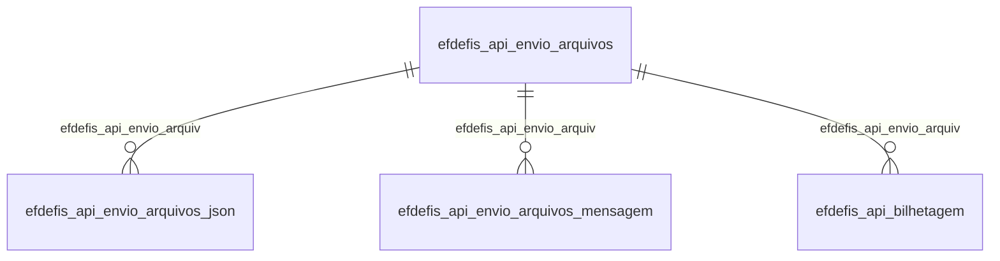

# Modelo — Fiscal - defis (rascunho em lote)

> Gerado por `src/model/gerar_docs_modelo.py` a partir de `src/model/modulos/fiscal_defis.yaml`, do catálogo e do perfil de colunas. **Não edite à mão.**

4 entidades. A coluna *Preench.* é o % de linhas com valor útil (nem nulo, nem em branco, nem zero, nem 1900-01-01; para colunas de código o zero conta como valor).

## Diagrama

## Entidades

| Entidade | Tabela | Linhas | Volume | Filtro obrigatório |
|---|---|---|---|---|
| [efdefis_api_envio_arquivos_json](#efdefis_api_envio_arquivos_json) | `EFDEFIS_API_ENVIO_ARQUIVOS_JSON` | 680 | pequeno | empresa |
| [efdefis_api_envio_arquivos](#efdefis_api_envio_arquivos) | `EFDEFIS_API_ENVIO_ARQUIVOS` | 340 | pequeno | empresa |
| [efdefis_api_envio_arquivos_mensagem](#efdefis_api_envio_arquivos_mensagem) | `EFDEFIS_API_ENVIO_ARQUIVOS_MENSAGEM` | 340 | pequeno | empresa |
| [efdefis_api_bilhetagem](#efdefis_api_bilhetagem) | `EFDEFIS_API_BILHETAGEM` | 340 | pequeno | empresa |

## efdefis_api_envio_arquivos_json

**DEFIS Api - Envio dos Arquivos - JSON** — tabela `EFDEFIS_API_ENVIO_ARQUIVOS_JSON` (680 linhas)

DEFIS Api - Envio dos Arquivos - JSON. 680 linhas no catálogo; chave: CODI_EMP, I_ENVIO, TIPO_ARQUIVO.

- **Chave:** `CODI_EMP, I_ENVIO, TIPO_ARQUIVO`
- **Empresa:** `CODI_EMP`
- **Período:** `—`
- **Ordem padrão:** `I_ENVIO asc`, `TIPO_ARQUIVO asc`

**Regras de negócio validadas:**

- Medido em 2026-10-18: 680 linhas, 215 empresa(s).
- Vínculo efdefis_api_envio_arquiv (EFDEFIS_API_ENVIO_ARQUIVOS): 0 de 2 linhas sem registro relacionado (empresa 729).

| Campo | Coluna | Tipo | Preench. | Domínio | Descrição (banco) |
|---|---|---|---|---|---|
| codigo_da_empresa | `codi_emp` | integer(4) |  |  | Código da empresa |
| codigo_sequencial_de_envio_dos_arquivos | `i_envio` | integer(4) |  |  | Código sequencial de envio dos arquivos |
| tipo_do_arquivo | `tipo_arquivo` | char(1) |  |  | Tipo do arquivo |

**Vínculos (LEFT JOIN, acrescentam colunas legíveis):**

- `efdefis_api_envio_arquiv` → `EFDEFIS_API_ENVIO_ARQUIVOS` por `codi_emp` = `codi_emp` e `i_envio` = `i_envio`; colunas: `efdefis_api_envio_arquiv_nome`

**Filtros:** `codigo_sequencial_de_envio_dos_arquivos` (eq/in), `tipo_do_arquivo` (eq/in)

## efdefis_api_envio_arquivos

**DEFIS Api - Envio dos Arquivos** — tabela `EFDEFIS_API_ENVIO_ARQUIVOS` (340 linhas)

DEFIS Api - Envio dos Arquivos. 340 linhas no catálogo; chave: CODI_EMP, I_ENVIO.

- **Chave:** `CODI_EMP, I_ENVIO`
- **Empresa:** `CODI_EMP`
- **Período:** `DATA_ENVIO`
- **Ordem padrão:** `DATA_ENVIO desc`, `I_ENVIO asc`

**Regras de negócio validadas:**

- Medido em 2026-10-18: 340 linhas, 215 empresa(s), DATA_ENVIO de 2025-03-21 a 2026-05-27.
- Colunas expostas nulas em 100% das linhas (1): numero_da_guia_defis.
- Vínculo geempre (geempre): 0 de 1 linhas sem registro relacionado (empresa 729).

| Campo | Coluna | Tipo | Preench. | Domínio | Descrição (banco) |
|---|---|---|---|---|---|
| codigo_da_empresa | `codi_emp` | integer(4) |  |  | Código da empresa |
| codigo_sequencial_de_envio_dos_arquivos | `i_envio` | integer(4) |  |  | Código sequencial de envio dos arquivos |
| competencia | `competencia` | date(4) |  |  | Competência |
| tipo_de_envio | `tipo_envio` | integer(4) |  |  | Tipo de envio |
| situacao_processo | `situacao` | integer(4) |  |  | Situação processo |
| nome_do_arquivo | `nome_arquivo` | varchar(100) |  |  | Nome do arquivo |
| tipo_de_declaracao | `tipo_declaracao` | integer(4) |  |  | Tipo de declaração |
| data_de_envio | `data_envio` | date(4) |  |  | Data de envio |
| hora_de_envio | `horario_envio` | time(8) |  |  | Hora de envio |
| numero_da_guia_defis | `numero_defis` | char(20) |  |  | Numero da guia DEFIS |

**Vínculos (LEFT JOIN, acrescentam colunas legíveis):**

- `geempre` → `geempre` por `codi_emp` = `codi_emp`; colunas: `geempre_nome`

**Filtros:** `codigo_sequencial_de_envio_dos_arquivos` (eq/in), `competencia` (entre/gte/lte), `data_de_envio` (entre/gte/lte), `tipo_de_envio` (eq/in), `situacao_processo` (eq/in), `nome_do_arquivo` (contem/prefixo), `tipo_de_declaracao` (eq/in), `numero_da_guia_defis` (eq/in)

## efdefis_api_envio_arquivos_mensagem

**DEFIS Api - Envio dos Arquivos - Retorno** — tabela `EFDEFIS_API_ENVIO_ARQUIVOS_MENSAGEM` (340 linhas)

DEFIS Api - Envio dos Arquivos - Retorno. 340 linhas no catálogo; chave: CODI_EMP, I_ENVIO, SEQUENCIAL_MENSAGEM.

- **Chave:** `CODI_EMP, I_ENVIO, SEQUENCIAL_MENSAGEM`
- **Empresa:** `CODI_EMP`
- **Período:** `—`
- **Ordem padrão:** `I_ENVIO asc`, `SEQUENCIAL_MENSAGEM asc`

**Regras de negócio validadas:**

- Medido em 2026-10-18: 340 linhas, 215 empresa(s).
- Vínculo efdefis_api_envio_arquiv (EFDEFIS_API_ENVIO_ARQUIVOS): 0 de 1 linhas sem registro relacionado (empresa 729).

| Campo | Coluna | Tipo | Preench. | Domínio | Descrição (banco) |
|---|---|---|---|---|---|
| codigo_da_empresa | `codi_emp` | integer(4) |  |  | Código da empresa |
| codigo_sequencial_de_envio_dos_arquivos | `i_envio` | integer(4) |  |  | Código sequencial de envio dos arquivos |
| sequencial_mensagem | `sequencial_mensagem` | integer(4) |  |  |  |
| codigo_da_mensagem_de_retorno | `codigo_mensagem` | integer(4) |  |  | Código da mensagem de retorno |
| titulo_da_mensagem_de_retorno | `titulo_mensagem` | varchar(100) |  |  | Titulo da mensagem de retorno |
| descricao_do_titulo | `descricao_mensagem` | varchar(500) |  |  | Descrição do titulo |

**Vínculos (LEFT JOIN, acrescentam colunas legíveis):**

- `efdefis_api_envio_arquiv` → `EFDEFIS_API_ENVIO_ARQUIVOS` por `codi_emp` = `codi_emp` e `i_envio` = `i_envio`; colunas: `efdefis_api_envio_arquiv_nome`

**Filtros:** `codigo_sequencial_de_envio_dos_arquivos` (eq/in), `sequencial_mensagem` (eq/in), `codigo_da_mensagem_de_retorno` (eq/in), `titulo_da_mensagem_de_retorno` (contem/prefixo), `descricao_do_titulo` (contem/prefixo)

## efdefis_api_bilhetagem

**DEFIS Api - Envio dos Arquivos - Bilhetagem de custos** — tabela `EFDEFIS_API_BILHETAGEM` (340 linhas)

DEFIS Api - Envio dos Arquivos - Bilhetagem de custos. 340 linhas no catálogo; chave: CODI_EMP, I_ENVIO, CODI_CON, SEQUENCIAL_BILHETAGEM.

- **Chave:** `CODI_EMP, I_ENVIO, CODI_CON, SEQUENCIAL_BILHETAGEM`
- **Empresa:** `CODI_EMP`
- **Período:** `—`
- **Ordem padrão:** `I_ENVIO asc`, `CODI_CON asc`

**Regras de negócio validadas:**

- Medido em 2026-10-18: 340 linhas, 215 empresa(s).
- Vínculo efdefis_api_envio_arquiv (EFDEFIS_API_ENVIO_ARQUIVOS): 0 de 1 linhas sem registro relacionado (empresa 729).

| Campo | Coluna | Tipo | Preench. | Domínio | Descrição (banco) |
|---|---|---|---|---|---|
| codigo_da_empresa | `codi_emp` | integer(4) |  |  | Código da empresa |
| codigo_sequencial_de_envio_dos_arquivos | `i_envio` | integer(4) |  |  | Código sequencial de envio dos arquivos |
| codigo_do_contador | `codi_con` | integer(4) |  |  | Código do contador |
| sequencial_bilhetagem | `sequencial_bilhetagem` | integer(4) |  |  |  |
| tipo_de_servico_realizado | `tipo_envio` | integer(4) |  |  | Tipo de serviço realizado |
| operacao_gerou_custo | `gerou_custo` | char(1) |  |  | Operação gerou custo |

**Vínculos (LEFT JOIN, acrescentam colunas legíveis):**

- `efdefis_api_envio_arquiv` → `EFDEFIS_API_ENVIO_ARQUIVOS` por `codi_emp` = `codi_emp` e `i_envio` = `i_envio`; colunas: `efdefis_api_envio_arquiv_nome`

**Filtros:** `codigo_sequencial_de_envio_dos_arquivos` (eq/in), `codigo_do_contador` (eq/in), `sequencial_bilhetagem` (eq/in), `tipo_de_servico_realizado` (eq/in), `operacao_gerou_custo` (eq/in)

## Domínios (significado dos códigos)

`confirmado`: **sim** = vem do comentário do banco e/ou foi conferido nos dados; **parcial** = parte dos valores; **não** = hipótese, não use como regra.

### status_empresa

Situação da empresa no cadastro (geempre.stat_emp)

Confirmado: sim

| Código | Significado |
|---|---|
| A | Ativa |
| I | Inativa |
| C | Em constituição |
| M | Ativo sem movimento |
| B | Em processo de baixa |
| E | Excluindo |

### motivo_inatividade

Motivo da inatividade (geempre.tipoi_emp). Só aparece em empresas inativas.

Confirmado: sim

| Código | Significado |
|---|---|
| 1 | Outros |
| 2 | Baixada |
| 3 | Transferida |
| 4 | Inadimplente |

### tipo_inscricao

Tipo da inscrição (CNPJ/CPF/CEI/CAEPF)

Confirmado: sim

| Código | Significado |
|---|---|
| 1 | CNPJ |
| 2 | CPF |
| 3 | CEI |
| 6 | CAEPF |

### regime_federal_empresa

Regime federal da folha (geempre.rfed_emp)

Confirmado: parcial

| Código | Significado |
|---|---|
| 1 | Normal |
| 2 | Microempresa |
| 3 | Empresa de pequeno porte |

### tipo_honorario_empresa

Como a empresa usa o módulo Honorários (geempre.honorario_tipo)

Confirmado: sim

| Código | Significado |
|---|---|
| E | Escritório (quem fatura) |
| C | Cliente |

### sim_nao_texto

Confirmado: sim

| Código | Significado |
|---|---|
| S | Sim |
| N | Não |

### sim_nao_numerico

Confirmado: sim

| Código | Significado |
|---|---|
| 1 | Sim |
| 0 | Não |

