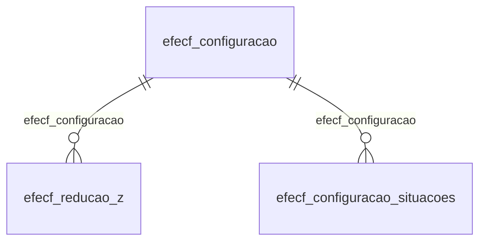

# Modelo — Fiscal - ecf (rascunho em lote)

> Gerado por `src/model/gerar_docs_modelo.py` a partir de `src/model/modulos/fiscal_ecf.yaml`, do catálogo e do perfil de colunas. **Não edite à mão.**

14 entidades. A coluna *Preench.* é o % de linhas com valor útil (nem nulo, nem em branco, nem zero, nem 1900-01-01; para colunas de código o zero conta como valor).

## Diagrama

## Entidades

| Entidade | Tabela | Linhas | Volume | Filtro obrigatório |
|---|---|---|---|---|
| [efecf_cupom_fiscal_estoque](#efecf_cupom_fiscal_estoque) | `EFECF_CUPOM_FISCAL_ESTOQUE` | 189.652 | medio | empresa |
| [efecf_cupom_fiscal_pis_cofins](#efecf_cupom_fiscal_pis_cofins) | `EFECF_CUPOM_FISCAL_PIS_COFINS` | 57.401 | medio | empresa |
| [efecf_reducao_z_estoque](#efecf_reducao_z_estoque) | `EFECF_REDUCAO_Z_ESTOQUE` | 38.335 | medio | empresa |
| [efecf_reducao_z_estoque_apuracao_estoque](#efecf_reducao_z_estoque_apuracao_estoque) | `EFECF_REDUCAO_Z_ESTOQUE_APURACAO_ESTOQUE` | 37.754 | medio | empresa |
| [efecf_cupom_fiscal](#efecf_cupom_fiscal) | `EFECF_CUPOM_FISCAL` | 34.381 | medio | empresa |
| [efecf_reducao_z_situacao_tributaria](#efecf_reducao_z_situacao_tributaria) | `EFECF_REDUCAO_Z_SITUACAO_TRIBUTARIA` | 1.608 | pequeno | empresa |
| [efecf_reducao_z_situacao_tributaria_detalhamento](#efecf_reducao_z_situacao_tributaria_detalhamento) | `EFECF_REDUCAO_Z_SITUACAO_TRIBUTARIA_DETALHAMENTO` | 1.608 | pequeno | empresa |
| [efecf_reducao_z_impostos](#efecf_reducao_z_impostos) | `EFECF_REDUCAO_Z_IMPOSTOS` | 1.493 | pequeno | empresa |
| [efecf_reducao_z](#efecf_reducao_z) | `EFECF_REDUCAO_Z` | 459 | pequeno | empresa |
| [efecf_reducao_z_pis_cofins](#efecf_reducao_z_pis_cofins) | `EFECF_REDUCAO_Z_PIS_COFINS` | 355 | pequeno | empresa |
| [efecf_reducao_z_lancto](#efecf_reducao_z_lancto) | `EFECF_REDUCAO_Z_LANCTO` | 354 | pequeno | empresa |
| [efecf_configuracao_situacoes](#efecf_configuracao_situacoes) | `EFECF_CONFIGURACAO_SITUACOES` | 67 | pequeno | empresa |
| [efecf_configuracao_acumuladores](#efecf_configuracao_acumuladores) | `EFECF_CONFIGURACAO_ACUMULADORES` | 67 | pequeno | empresa |
| [efecf_configuracao](#efecf_configuracao) | `EFECF_CONFIGURACAO` | 13 | pequeno | empresa |

## efecf_cupom_fiscal_estoque

**ECF - Cupom fiscal - Estoque** — tabela `EFECF_CUPOM_FISCAL_ESTOQUE` (189.652 linhas)

ECF - Cupom fiscal - Estoque. 189.652 linhas no catálogo; chave: CODI_EMP, I_REDUCAO, I_CUPOM, I_ESTOQUE.

- **Chave:** `CODI_EMP, I_REDUCAO, I_CUPOM, I_ESTOQUE`
- **Empresa:** `CODI_EMP`
- **Período:** `—`
- **Ordem padrão:** `I_REDUCAO asc`, `I_CUPOM asc`

**Regras de negócio validadas:**

- Medido em 2026-10-18: 189.652 linhas, 3 empresa(s).
- Colunas expostas nulas em 100% das linhas (7): bico_do_combustivel, combustivel_operacao, modal, servico, natureza_da_receita_do_pis, natureza_da_receita_do_cofins, tanque_do_combustivel.
- Vínculo efprodutos (efprodutos): 0 de 20.179 linhas sem registro relacionado (empresa 455).
- Vínculo eftabela_natureza_receit (EFTABELA_NATUREZA_RECEITA): 0 de 20.179 linhas sem registro relacionado (empresa 455).
- Vínculo efcombustivel_tanque (EFCOMBUSTIVEL_TANQUE): 20.179 de 20.179 linhas sem registro relacionado (empresa 455).

| Campo | Coluna | Tipo | Preench. | Domínio | Descrição (banco) |
|---|---|---|---|---|---|
| empresa | `codi_emp` | integer(4) |  |  | Empresa |
| codigo_da_reducao_z | `i_reducao` | integer(4) |  |  | Código da redução Z |
| sequencial_do_cupom_fiscal | `i_cupom` | integer(4) |  |  | Sequencial do cupom fiscal |
| sequencial_do_estoque | `i_estoque` | integer(4) |  |  | Sequencial do estoque |
| produto | `codi_pdi` | char(14) |  |  | Produto |
| quantidade | `quantidade` | numeric(13) |  |  | Quantidade |
| quantidade_cancelada | `quantidade_cancelada` | numeric(15) |  |  | Quantidade cancelada |
| codigo_da_unidade | `codigo_unidade` | integer(4) |  |  | Código da unidade |
| unidade_comercializada | `unidade` | char(6) |  |  | Unidade comercializada |
| valor_unitario | `valor_unitario` | numeric(15) |  |  | Valor unitário |
| valor_total | `valor_total` | numeric(13) |  |  | Valor total |
| valor_do_desconto | `desconto` | numeric(13) |  |  | Valor do desconto |
| valor_do_cancelamento | `cancelamento` | numeric(13) |  |  | Valor do cancelamento |
| valor_do_acrescimo | `acrescimo` | numeric(13) |  |  | Valor do acréscimo |
| valor_liquido | `valor_liquido` | numeric(13) |  |  | Valor líquido |
| valor_do_issqn | `valor_issqn` | numeric(13) |  |  | Valor do ISSQN |
| codigo_da_situacao_tributaria_icms | `cst_icms` | integer(4) |  |  | Código da Situação Tributária ICMS |
| operacao | `operacao` | integer(4) |  |  | Operação |
| cfop | `cfop` | integer(4) |  |  | CFOP |
| base_de_calculo_do_icms | `base_calculo_icms` | numeric(13) |  |  | Base de cálculo do ICMS |
| aliquota_do_icms | `aliquota_icms` | numeric(5) |  |  | Alíquota do ICMS |
| valor_do_icms | `valor_icms` | numeric(13) |  |  | Valor do ICMS |
| valor_de_isentas_do_icms | `isentas_icms` | numeric(13) |  |  | Valor de isentas do ICMS |
| valor_nao_tributado_do_icms | `nao_tributadas_icms` | numeric(13) |  |  | Valor não tributado do ICMS |
| valor_adquirido_com_st | `adquirida_subtri` | numeric(13) |  |  | Valor adquirido com ST |
| base_de_calculo_do_pis | `base_calculo_pis` | numeric(13) |  |  | Base de cálculo do PIS |
| aliquota_do_pis | `aliquota_pis` | numeric(7) |  |  | Alíquota do PIS |
| valor_do_pis | `valor_pis` | numeric(13) |  |  | Valor do PIS |
| base_de_calculo_da_cofins | `base_calculo_cofins` | numeric(13) |  |  | Base de cálculo da COFINS |
| aliquota_da_cofins | `aliquota_cofins` | numeric(7) |  |  | Alíquota da COFINS |
| valor_da_cofins | `valor_cofins` | numeric(13) |  |  | Valor da COFINS |
| movimentacao_fisica_de_produto_s_n | `movimentacao_fisica` | char(1) |  |  | Movimentação física de produto(S/N) |
| origem_do_registro_0_sistema_1_imp_tabel | `origem_reg` | integer(4) |  |  | Origem do registro 0 - Sistema, 1 - Imp. Tabelas, 2 - Imp. Layout, 3- Imp. Tabelas Concorrentes |
| cst_do_pis | `cst_pis` | integer(4) |  |  | CST do PIS |
| cst_da_cofins | `cst_cofins` | integer(4) |  |  | CST da COFINS |
| bico_do_combustivel | `i_bico` | integer(4) |  |  | Bico do combustível |
| quantidade_tributada_pis_por_unidade_de | `qtde_tributaria_medida_pis` | numeric(13) |  |  | Quantidade tributada PIS por unidade de medida |
| valor_unidade_pis_por_unidade_de_medida | `valor_unidade_medida_pis` | numeric(13) |  |  | Valor unidade PIS por unidade de medida |
| valor_pis_por_unidade_de_medida | `valor_medida_pis` | numeric(13) |  |  | Valor PIS por unidade de medida |
| quantidade_tributada_cofins_por_unidade | `qtde_tributaria_medida_cofins` | numeric(13) |  |  | Quantidade tributada COFINS por unidade de medida |
| valor_unidade_cofins_por_unidade_de_medi | `valor_unidade_medida_cofins` | numeric(13) |  |  | Valor unidade COFINS por unidade de medida |
| valor_cofins_por_unidade_de_medida | `valor_medida_cofins` | numeric(13) |  |  | Valor COFINS por unidade de medida |
| dados_referente_ao_pis_cofins_ok_s_n | `dados_piscofins_ok` | char(1) |  |  | Dados referente ao PIS/COFINS OK (S/N) |
| cst_do_issqn | `cst_issqn` | integer(4) |  |  | CST do ISSQN |
| base_de_calculo_do_issqn | `base_calculo_issqn` | numeric(13) |  |  | Base de cálculo do ISSQN |
| aliquota_do_issqn | `aliquota_issqn` | numeric(5) |  |  | Alíquota do ISSQN |
| isentas_de_issqn | `isentas_issqn` | numeric(13) |  |  | Isentas de ISSQN |
| nao_incidencia_de_issqn | `nao_incidencia_issqn` | numeric(13) |  |  | Não incidência de ISSQN |
| combustivel_operacao | `combustivel_operacao` | integer(4) |  |  | Operação |
| modal | `combustivel_modal` | integer(4) |  |  | Modal |
| codigo_veiculo | `combustivel_codigo_veiculo` | varchar(7) |  |  | Código Veículo |
| servico | `combustivel_servico` | integer(4) |  |  | Serviço |
| natureza_da_receita_do_pis | `natureza_receita_pis` | integer(4) |  |  | Natureza da receita do PIS |
| natureza_da_receita_do_cofins | `natureza_receita_cofins` | integer(4) |  |  | Natureza da receita do COFINS |
| exclusao_cooperativa | `exclusao_cooperativa` | numeric(13) |  |  | Exclusão cooperativa |
| codigo_sequencial_do_cst_de_icms | `i_cst_vigencia_icms` | integer(4) |  |  | Código sequencial do CST de ICMS |
| tanque_do_combustivel | `i_tanque` | integer(4) |  |  | Tanque do combustível |
| percentual_reducao_base_calculo_pis | `percentual_reducao_bc_pis` | numeric(5) |  |  | Percentual Redução Base Cálculo PIS |
| percentual_reducao_base_calculo_cofins | `percentual_reducao_bc_cofins` | numeric(5) |  |  | Percentual Redução Base Cálculo COFINS |
| codigo_sequencial_do_recolhimento_do_pis | `i_recolhimento_pis` | integer(4) |  |  | Código Sequencial do Recolhimento do PIS |

**Vínculos (LEFT JOIN, acrescentam colunas legíveis):**

- `efprodutos` → `efprodutos` por `codi_pdi` = `codi_pdi` e `codi_emp` = `codi_emp`; colunas: `efprodutos_nome`
- `eftabela_natureza_receit` → `EFTABELA_NATUREZA_RECEITA` por `natureza_receita_pis` = `codigo` e `cst_pis` = `codigo_cst`; colunas: `eftabela_natureza_receit_nome`
- `efcombustivel_tanque` → `EFCOMBUSTIVEL_TANQUE` por `codi_emp` = `codi_emp` e `i_tanque` = `i_tanque`; colunas: `efcombustivel_tanque_nome`

**Filtros:** `codigo_da_reducao_z` (eq/in), `sequencial_do_cupom_fiscal` (eq/in), `sequencial_do_estoque` (eq/in), `produto` (eq/in), `codigo_da_unidade` (eq/in), `unidade_comercializada` (eq/in), `movimentacao_fisica_de_produto_s_n` (eq/in), `bico_do_combustivel` (eq/in), `dados_referente_ao_pis_cofins_ok_s_n` (eq/in), `codigo_veiculo` (eq/in), `codigo_sequencial_do_cst_de_icms` (eq/in), `tanque_do_combustivel` (eq/in), `codigo_sequencial_do_recolhimento_do_pis` (eq/in)

## efecf_cupom_fiscal_pis_cofins

**ECF - Cupom Fiscal - PIS/COFINS** — tabela `EFECF_CUPOM_FISCAL_PIS_COFINS` (57.401 linhas)

ECF - Cupom Fiscal - PIS/COFINS. 57.401 linhas no catálogo; chave: CODI_EMP, I_REDUCAO, I_CUPOM, I_PIS_COFINS.

- **Chave:** `CODI_EMP, I_REDUCAO, I_CUPOM, I_PIS_COFINS`
- **Empresa:** `CODI_EMP`
- **Período:** `—`
- **Ordem padrão:** `I_REDUCAO asc`, `I_CUPOM asc`

**Regras de negócio validadas:**

- Medido em 2026-10-18: 57.401 linhas, 1 empresa(s).
- Colunas expostas nulas em 100% das linhas (3): natureza_da_receita, codigo_sequencial_do_recolhimento_do_pis, codigo_sequencial_do_recolhimento_do_cof.
- Vínculo eftabela_natureza_receit (EFTABELA_NATUREZA_RECEITA): 0 de 57.401 linhas sem registro relacionado (empresa 364).
- Vínculo efnatureza (efnatureza): 0 de 57.401 linhas sem registro relacionado (empresa 364).

| Campo | Coluna | Tipo | Preench. | Domínio | Descrição (banco) |
|---|---|---|---|---|---|
| empresa | `codi_emp` | integer(4) |  |  | Empresa |
| codigo_da_reducao_z | `i_reducao` | integer(4) |  |  | Código da redução Z |
| sequencial_do_cupom_fiscal | `i_cupom` | integer(4) |  |  | Sequencial do cupom fiscal |
| sequencial | `i_pis_cofins` | integer(4) |  |  | Sequencial |
| cst | `cst` | integer(4) |  |  | CST |
| natureza_da_receita | `natureza_receita` | integer(4) |  |  | Natureza da receita |
| versao_da_cfop | `versao_cfop` | smallint(2) |  |  | Versão da CFOP |
| cfop | `cfop` | integer(4) |  |  | CFOP |
| valor_contabil | `valor_contabil` | numeric(13) |  |  | Valor contábil |
| exclusoes | `exclusoes` | numeric(13) |  |  | Exclusões |
| base_de_calculo | `base_calculo` | numeric(13) |  |  | Base de cálculo |
| aliquota_do_pis | `aliquota_pis` | numeric(7) |  |  | Alíquota do PIS |
| aliquota_da_cofins | `aliquota_cofins` | numeric(7) |  |  | Alíquota da COFINS |
| quantidade_tributada | `quantidade_tributada` | numeric(13) |  |  | Quantidade tributada |
| valor_por_unidade_do_pis_por_unidade_de | `valor_unidade_medida_pis` | numeric(13) |  |  | Valor por unidade do PIS por unidade de medida |
| valor_por_unidade_da_cofins_por_unidade | `valor_unidade_medida_cofins` | numeric(13) |  |  | Valor por unidade da COFINS por unidade de medida |
| valor_do_pis | `valor_pis` | numeric(13) |  |  | Valor do PIS |
| valor_da_cofins | `valor_cofins` | numeric(13) |  |  | Valor da COFINS |
| exclusao_cooperativa | `exclusao_cooperativa` | numeric(13) |  |  | Exclusão Cooperativa |
| percentual_reducao_base_calculo | `percentual_reducao_bc` | numeric(5) |  |  | Percentual Redução Base Cálculo |
| codigo_sequencial_do_recolhimento_do_pis | `i_recolhimento_pis` | integer(4) |  |  | Código Sequencial do Recolhimento do PIS |
| codigo_do_recolhimento_do_pis | `codigo_recolhimento_pis` | char(6) |  |  | Código do Recolhimento do PIS |
| codigo_sequencial_do_recolhimento_do_cof | `i_recolhimento_cofins` | integer(4) |  |  | Código Sequencial do Recolhimento do COFINS |
| codigo_do_recolhimento_do_cofins | `codigo_recolhimento_cofins` | char(6) |  |  | Código do Recolhimento do COFINS |
| calcular_reducao_linear_lc224 | `calcular_reducao_linear_lc224` | char(1) |  |  | Calcular redução conf. LC 224/2025 |

**Vínculos (LEFT JOIN, acrescentam colunas legíveis):**

- `eftabela_natureza_receit` → `EFTABELA_NATUREZA_RECEITA` por `natureza_receita` = `codigo` e `cst` = `codigo_cst`; colunas: `eftabela_natureza_receit_nome`
- `efnatureza` → `efnatureza` por `cfop` = `codi_nat` e `versao_cfop` = `versao_nat`; colunas: `efnatureza_nome`

**Filtros:** `codigo_da_reducao_z` (eq/in), `sequencial_do_cupom_fiscal` (eq/in), `sequencial` (eq/in), `codigo_sequencial_do_recolhimento_do_pis` (eq/in), `codigo_do_recolhimento_do_pis` (eq/in), `codigo_sequencial_do_recolhimento_do_cof` (eq/in), `codigo_do_recolhimento_do_cofins` (eq/in), `calcular_reducao_linear_lc224` (eq/in)

## efecf_reducao_z_estoque

**ECF - Dados da redução Z - Estoque** — tabela `EFECF_REDUCAO_Z_ESTOQUE` (38.335 linhas)

ECF - Dados da redução Z - Estoque. 38.335 linhas no catálogo; chave: CODI_EMP, I_REDUCAO, I_ESTOQUE.

- **Chave:** `CODI_EMP, I_REDUCAO, I_ESTOQUE`
- **Empresa:** `CODI_EMP`
- **Período:** `DATA_REDUCAO`
- **Ordem padrão:** `DATA_REDUCAO desc`, `I_REDUCAO asc`, `I_ESTOQUE asc`

**Regras de negócio validadas:**

- Medido em 2026-10-18: 38.335 linhas, 3 empresa(s), DATA_REDUCAO de 2018-01-02 a 2020-03-19.
- Colunas expostas nulas em 100% das linhas (9): bico_do_combustivel, cst_do_issqn, combustivel_operacao, modal, servico, natureza_da_receita_do_pis, natureza_da_receita_do_cofins, codigo_sequencial_do_cst_de_icms, tanque_do_combustivel.
- Vínculo efprodutos (efprodutos): 0 de 8.331 linhas sem registro relacionado (empresa 455).
- Vínculo eftabela_natureza_receit (EFTABELA_NATUREZA_RECEITA): 0 de 8.331 linhas sem registro relacionado (empresa 455).
- Vínculo efcombustivel_tanque (EFCOMBUSTIVEL_TANQUE): 8.331 de 8.331 linhas sem registro relacionado (empresa 455).

| Campo | Coluna | Tipo | Preench. | Domínio | Descrição (banco) |
|---|---|---|---|---|---|
| empresa | `codi_emp` | integer(4) |  |  | Empresa |
| codigo_da_reducao_z | `i_reducao` | integer(4) |  |  | Código da redução Z |
| sequencial_do_estoque | `i_estoque` | integer(4) |  |  | Sequencial do estoque |
| produto | `codi_pdi` | char(14) |  |  | Produto |
| quantidade | `quantidade` | numeric(13) |  |  | Quantidade |
| quantidade_cancelada | `quantidade_cancelada` | numeric(15) |  |  | Quantidade cancelada |
| codigo_da_unidade | `codigo_unidade` | integer(4) |  |  | Código da unidade |
| unidade_comercializada | `unidade` | char(6) |  |  | Unidade comercializada |
| valor_unitario | `valor_unitario` | numeric(15) |  |  | Valor unitário |
| valor_total | `valor_total` | numeric(13) |  |  | Valor total |
| valor_do_desconto | `desconto` | numeric(13) |  |  | Valor do desconto |
| valor_do_cancelamento | `cancelamento` | numeric(13) |  |  | Valor do cancelamento |
| valor_do_acrescimo | `acrescimo` | numeric(13) |  |  | Valor do acréscimo |
| valor_liquido | `valor_liquido` | numeric(13) |  |  | Valor líquido |
| codigo_da_situacao_tributaria_icms | `cst_icms` | integer(4) |  |  | Código da Situação Tributaria ICMS |
| operacao | `operacao` | integer(4) |  |  | Operação |
| cfop | `cfop` | integer(4) |  |  | CFOP |
| base_de_calculo_do_icms | `base_calculo_icms` | numeric(13) |  |  | Base de cálculo do ICMS |
| aliquota_do_icms | `aliquota_icms` | numeric(5) |  |  | Alíquota do ICMS |
| valor_do_icms | `valor_icms` | numeric(13) |  |  | Valor do ICMS |
| valor_de_isentas_de_icms | `isentas_icms` | numeric(13) |  |  | Valor de isentas de ICMS |
| valor_nao_tributado_do_icms | `nao_tributadas_icms` | numeric(13) |  |  | Valor não tributado do ICMS |
| valor_adquirido_com_st | `adquirida_subtri` | numeric(13) |  |  | Valor adquirido com ST |
| base_de_calculo_do_pis | `base_calculo_pis` | numeric(13) |  |  | Base de cálculo do PIS |
| aliquota_do_pis | `aliquota_pis` | numeric(7) |  |  | Alíquota do PIS |
| valor_do_pis | `valor_pis` | numeric(13) |  |  | Valor do PIS |
| base_de_calculo_da_cofins | `base_calculo_cofins` | numeric(13) |  |  | Base de cálculo da COFINS |
| aliquota_da_cofins | `aliquota_cofins` | numeric(7) |  |  | Alíquota da COFINS |
| valor_da_cofins | `valor_cofins` | numeric(13) |  |  | Valor da COFINS |
| movimentacao_fisica_de_produto_s_n | `movimentacao_fisica` | char(1) |  |  | Movimentação física de produto(S/N) |
| origem_do_registro_0_sistema_1_imp_tabel | `origem_reg` | integer(4) |  |  | Origem do registro 0 - Sistema, 1 - Imp. Tabelas, 2 - Imp. Layout, 3- Imp. Tabelas Concorrentes |
| cst_do_pis | `cst_pis` | integer(4) |  |  | CST do PIS |
| cst_da_cofins | `cst_cofins` | integer(4) |  |  | CST da COFINS |
| bico_do_combustivel | `i_bico` | integer(4) |  |  | Bico do combustível |
| quantidade_tributada_pis_por_unidade_de | `qtde_tributaria_medida_pis` | numeric(13) |  |  | Quantidade tributada PIS por unidade de medida |
| valor_unidade_pis_por_unidade_de_medida | `valor_unidade_medida_pis` | numeric(13) |  |  | Valor unidade PIS por unidade de medida |
| valor_pis_por_unidade_de_medida | `valor_medida_pis` | numeric(13) |  |  | Valor PIS por unidade de medida |
| quantidade_tributada_cofins_por_unidade | `qtde_tributaria_medida_cofins` | numeric(13) |  |  | Quantidade tributada COFINS por unidade de medida |
| valor_unidade_cofins_por_unidade_de_medi | `valor_unidade_medida_cofins` | numeric(13) |  |  | Valor unidade COFINS por unidade de medida |
| valor_cofins_por_unidade_de_medida | `valor_medida_cofins` | numeric(13) |  |  | Valor COFINS por unidade de medida |
| dados_referente_ao_pis_cofins_ok_s_n | `dados_piscofins_ok` | char(1) |  |  | Dados referente ao PIS/COFINS OK (S/N) |
| cst_do_issqn | `cst_issqn` | integer(4) |  |  | CST do ISSQN |
| base_de_calculo_do_issqn | `base_calculo_issqn` | numeric(13) |  |  | Base de cálculo do ISSQN |
| aliquota_do_issqn | `aliquota_issqn` | numeric(5) |  |  | Alíquota do ISSQN |
| valor_do_issqn | `valor_issqn` | numeric(13) |  |  | Valor do ISSQN |
| isentas_de_issqn | `isentas_issqn` | numeric(13) |  |  | Isentas de ISSQN |
| nao_incidencia_de_issqn | `nao_incidencia_issqn` | numeric(13) |  |  | Não incidência de ISSQN |
| combustivel_operacao | `combustivel_operacao` | integer(4) |  |  | Operação |
| modal | `combustivel_modal` | integer(4) |  |  | Modal |
| codigo_veiculo | `combustivel_codigo_veiculo` | varchar(7) |  |  | Código Veículo |
| servico | `combustivel_servico` | integer(4) |  |  | Serviço |
| natureza_da_receita_do_pis | `natureza_receita_pis` | integer(4) |  |  | Natureza da receita do PIS |
| natureza_da_receita_do_cofins | `natureza_receita_cofins` | integer(4) |  |  | Natureza da receita do COFINS |
| exclusao_cooperativa | `exclusao_cooperativa` | numeric(13) |  |  | Exclusão cooperativa |
| codigo_sequencial_do_cst_de_icms | `i_cst_vigencia_icms` | integer(4) |  |  | Código sequencial do CST de ICMS |
| valor_total_pelo_custo_medio | `valor_total_custo_medio` | numeric(16) |  |  | Valor total pelo custo médio |
| tanque_do_combustivel | `i_tanque` | integer(4) |  |  | Tanque do combustível |
| data_da_reducao_z | `data_reducao` | date(4) |  |  | Data da redução Z |
| percentual_reducao_base_calculo_pis | `percentual_reducao_bc_pis` | numeric(5) |  |  | Percentual Redução Base Cálculo PIS |
| percentual_reducao_base_calculo_cofins | `percentual_reducao_bc_cofins` | numeric(5) |  |  | Percentual Redução Base Cálculo COFINS |

**Vínculos (LEFT JOIN, acrescentam colunas legíveis):**

- `efprodutos` → `efprodutos` por `codi_pdi` = `codi_pdi` e `codi_emp` = `codi_emp`; colunas: `efprodutos_nome`
- `eftabela_natureza_receit` → `EFTABELA_NATUREZA_RECEITA` por `natureza_receita_pis` = `codigo` e `cst_pis` = `codigo_cst`; colunas: `eftabela_natureza_receit_nome`
- `efcombustivel_tanque` → `EFCOMBUSTIVEL_TANQUE` por `codi_emp` = `codi_emp` e `i_tanque` = `i_tanque`; colunas: `efcombustivel_tanque_nome`

**Filtros:** `codigo_da_reducao_z` (eq/in), `sequencial_do_estoque` (eq/in), `data_da_reducao_z` (entre/gte/lte), `produto` (eq/in), `codigo_da_unidade` (eq/in), `unidade_comercializada` (eq/in), `movimentacao_fisica_de_produto_s_n` (eq/in), `bico_do_combustivel` (eq/in), `dados_referente_ao_pis_cofins_ok_s_n` (eq/in), `codigo_veiculo` (eq/in), `codigo_sequencial_do_cst_de_icms` (eq/in), `tanque_do_combustivel` (eq/in)

## efecf_reducao_z_estoque_apuracao_estoque

**ECF - Dados da Redução Z - Estoque - Apuração de estoque** — tabela `EFECF_REDUCAO_Z_ESTOQUE_APURACAO_ESTOQUE` (37.754 linhas)

ECF - Dados da Redução Z - Estoque - Apuração de estoque. 37.754 linhas no catálogo; chave: CODI_EMP, I_REDUCAO, I_ESTOQUE.

- **Chave:** `CODI_EMP, I_REDUCAO, I_ESTOQUE`
- **Empresa:** `CODI_EMP`
- **Período:** `DATA_MOVIMENTACAO`
- **Ordem padrão:** `DATA_MOVIMENTACAO desc`, `I_REDUCAO asc`, `I_ESTOQUE asc`

**Regras de negócio validadas:**

- Medido em 2026-10-18: 37.754 linhas, 3 empresa(s), DATA_MOVIMENTACAO de 2018-01-02 a 2020-03-19.

| Campo | Coluna | Tipo | Preench. | Domínio | Descrição (banco) |
|---|---|---|---|---|---|
| codigo_da_empresa | `codi_emp` | integer(4) |  |  | Código da empresa |
| sequencial_da_reducao_z | `i_reducao` | integer(4) |  |  | Sequêncial da Redução Z |
| sequencial_do_estoque | `i_estoque` | integer(4) |  |  | Sequêncial do estoque |
| data_da_movimentacao | `data_movimentacao` | date(4) |  |  | Data da movimentação |
| codigo_do_produto | `codi_pdi` | char(14) |  |  | Código do produto |
| quantidade | `quantidade` | numeric(13) |  |  | Quantidade |
| valor_unitario | `valor_unitario` | numeric(15) |  |  | Valor unitário |
| valor_total | `valor_total` | numeric(15) |  |  | Valor total |
| quantidade_acumulada | `quantidade_acumulada` | numeric(13) |  |  | Quantidade acumulada |
| valor_unitario_medio | `valor_unitario_medio` | numeric(15) |  |  | Valor unitário médio |
| valor_acumulado | `valor_acumulado` | numeric(15) |  |  | Valor acumulado |
| valor_do_icms_unitario | `icms_unitario` | numeric(19) |  |  | Valor do ICMS unitário |
| valor_do_icms_total | `icms_total` | numeric(13) |  |  | Valor do ICMS total |
| valor_do_icms_unitario_medio | `icms_unitario_medio` | numeric(19) |  |  | Valor do ICMS unitário médio |
| valor_do_icms_acumulado | `icms_acumulado` | numeric(13) |  |  | Valor do ICMS acumulado |
| quantidade_icms_st | `icms_st_quantidade` | numeric(13) |  |  | Quantidade ICMS ST |
| valor_do_icms_st_unitario | `icms_st_unitario` | numeric(19) |  |  | Valor do ICMS ST unitário |
| valor_do_icms_st_total | `icms_st_total` | numeric(13) |  |  | Valor do ICMS ST total |
| quantidade_icms_st_acumulado | `icms_st_quantidade_acumulado` | numeric(13) |  |  | Quantidade ICMS ST acumulado |
| valor_do_icms_st_unitario_medio | `icms_st_unitario_medio` | numeric(19) |  |  | Valor do ICMS ST unitário médio |
| icms_st_acumulado | `icms_st_acumulado` | numeric(13) |  |  | Valor do ICMS acumulado |

**Filtros:** `sequencial_da_reducao_z` (eq/in), `sequencial_do_estoque` (eq/in), `data_da_movimentacao` (entre/gte/lte), `codigo_do_produto` (eq/in)

## efecf_cupom_fiscal

**ECF - Cupom fiscal** — tabela `EFECF_CUPOM_FISCAL` (34.381 linhas)

ECF - Cupom fiscal. 34.381 linhas no catálogo; chave: CODI_EMP, I_REDUCAO, I_CUPOM.

- **Chave:** `CODI_EMP, I_REDUCAO, I_CUPOM`
- **Empresa:** `CODI_EMP`
- **Período:** `EMISSAO`
- **Ordem padrão:** `EMISSAO desc`, `I_REDUCAO asc`, `I_CUPOM asc`

**Regras de negócio validadas:**

- Medido em 2026-10-18: 34.381 linhas, 3 empresa(s), EMISSAO de 2018-01-02 a 2020-03-19.
- situacao_0_documento_regular_1_documento: todos os valores reais estão no comentário do banco (0=33.875, 2=506).
- tipo_do_titulo_0_duplicata_1_cheque_2_pr: todos os valores reais estão no comentário do banco (99=34.381).
- Vínculo efclientes (efclientes): 0 de 4.198 linhas sem registro relacionado (empresa 455).

| Campo | Coluna | Tipo | Preench. | Domínio | Descrição (banco) |
|---|---|---|---|---|---|
| empresa | `codi_emp` | integer(4) |  |  | Empresa |
| codigo_da_reducao_z | `i_reducao` | integer(4) |  |  | Código da redução Z |
| sequencial_do_cupom_fiscal | `i_cupom` | integer(4) |  |  | Sequencial do cupom fiscal |
| numero_do_cupom_fiscal | `numero` | integer(4) |  |  | Número do cupom fiscal |
| data_de_emissao | `emissao` | date(4) |  |  | Data de emissão |
| codigo_do_cliente | `codi_cli` | integer(4) |  |  | Código do cliente |
| situacao_0_documento_regular_1_documento | `situacao` | integer(4) |  | efecf_cupom_fiscal_situacao_0_documento_regular_1_do | Situação (0 - Documento regular/1 - Documento regular extemporâneo/2 - Documento cancelado) |
| valor_dos_produtos | `valor_produto` | numeric(13) |  |  | Valor dos produtos |
| valor_do_desconto | `valor_desconto` | numeric(13) |  |  | Valor do desconto |
| valor_total | `valor_total` | numeric(13) |  |  | Valor total |
| gerar_parcelas_s_n | `gerar_parcelas` | char(1) |  |  | Gerar parcelas(S/N) |
| valor_do_acrescimo | `acrescimo` | numeric(13) |  |  | Valor do acréscimo |
| tipo_do_titulo_0_duplicata_1_cheque_2_pr | `tipo_titulo` | tinyint(1) |  | efecf_cupom_fiscal_tipo_do_titulo_0_duplicata_1_cheq | Tipo do Titulo (0=Duplicata/1=Cheque/2=Promissória/3=Recibo/4=Clientes/5=Documento Fiscal/99=Outros) |
| identificacao | `identificacao` | varchar(255) |  |  | Identificação |
| orderm_de_operacao_coo | `ordem_operacao` | integer(4) |  |  | Orderm de operação (COO) |

**Vínculos (LEFT JOIN, acrescentam colunas legíveis):**

- `efclientes` → `efclientes` por `codi_emp` = `codi_emp` e `codi_cli` = `codi_cli`; colunas: `efclientes_nome`

**Filtros:** `codigo_da_reducao_z` (eq/in), `sequencial_do_cupom_fiscal` (eq/in), `data_de_emissao` (entre/gte/lte), `codigo_do_cliente` (eq/in), `situacao_0_documento_regular_1_documento` (eq/in), `gerar_parcelas_s_n` (eq/in), `tipo_do_titulo_0_duplicata_1_cheque_2_pr` (eq/in), `identificacao` (contem/prefixo)

## efecf_reducao_z_situacao_tributaria

**ECF - Dados da redução Z - Situação tributária** — tabela `EFECF_REDUCAO_Z_SITUACAO_TRIBUTARIA` (1.608 linhas)

ECF - Dados da redução Z - Situação tributária. 1.608 linhas no catálogo; chave: CODI_EMP, I_REDUCAO, I_SITUACAO.

- **Chave:** `CODI_EMP, I_REDUCAO, I_SITUACAO`
- **Empresa:** `CODI_EMP`
- **Período:** `—`
- **Ordem padrão:** `I_REDUCAO asc`, `I_SITUACAO asc`

**Regras de negócio validadas:**

- Medido em 2026-10-18: 1.608 linhas, 6 empresa(s).

| Campo | Coluna | Tipo | Preench. | Domínio | Descrição (banco) |
|---|---|---|---|---|---|
| empresa | `codi_emp` | integer(4) |  |  | Empresa |
| codigo_da_reducao_z | `i_reducao` | integer(4) |  |  | Código da redução Z |
| sequencial_da_situacao_tributaria | `i_situacao` | integer(4) |  |  | Sequencial da situação tributária |
| operacao | `operacao` | integer(4) |  |  | Operação |
| valor_da_operacao | `valor` | numeric(13) |  |  | Valor da operação |
| aliquota_da_operacao | `aliquota` | numeric(5) |  |  | Alíquota da operação |
| valor_do_imposto_da_operacao | `imposto` | numeric(13) |  |  | Valor do imposto da operação |

**Filtros:** `codigo_da_reducao_z` (eq/in), `sequencial_da_situacao_tributaria` (eq/in)

## efecf_reducao_z_situacao_tributaria_detalhamento

**ECF - Dados da redução Z - Situação tributária - Detalhamento** — tabela `EFECF_REDUCAO_Z_SITUACAO_TRIBUTARIA_DETALHAMENTO` (1.608 linhas)

ECF - Dados da redução Z - Situação tributária - Detalhamento. 1.608 linhas no catálogo; chave: CODI_EMP, I_REDUCAO, I_SITUACAO, I_DETALHAMENTO.

- **Chave:** `CODI_EMP, I_REDUCAO, I_SITUACAO, I_DETALHAMENTO`
- **Empresa:** `CODI_EMP`
- **Período:** `—`
- **Ordem padrão:** `I_REDUCAO asc`, `I_SITUACAO asc`

**Regras de negócio validadas:**

- Medido em 2026-10-18: 1.608 linhas, 6 empresa(s).
- Vínculo efacumulador (EFACUMULADOR): 0 de 359 linhas sem registro relacionado (empresa 543).
- Vínculo efnatureza (efnatureza): 0 de 359 linhas sem registro relacionado (empresa 543).

| Campo | Coluna | Tipo | Preench. | Domínio | Descrição (banco) |
|---|---|---|---|---|---|
| empresa | `codi_emp` | integer(4) |  |  | Empresa |
| codigo_da_reducao_z | `i_reducao` | integer(4) |  |  | Código da redução Z |
| sequencial_da_situacao_tributaria | `i_situacao` | integer(4) |  |  | Sequencial da situação tributária |
| sequencial_do_detalhamento | `i_detalhamento` | integer(4) |  |  | Sequencial do detalhamento |
| acumulador | `codi_acu` | integer(4) |  |  | Acumulador |
| cfop | `codi_nat` | integer(4) |  |  | CFOP |
| versao_da_cfop | `versao_nat` | smallint(2) |  |  | Versão da CFOP |
| valor_do_detalhamento | `valor` | numeric(13) |  |  | Valor do detalhamento |
| valor_do_imposto_do_detalhamento | `imposto` | numeric(13) |  |  | Valor do imposto do detalhamento |
| cst | `cst` | integer(4) |  |  | CST |

**Vínculos (LEFT JOIN, acrescentam colunas legíveis):**

- `efacumulador` → `EFACUMULADOR` por `codi_emp` = `codi_emp` e `codi_acu` = `codi_acu`; colunas: `efacumulador_nome`
- `efnatureza` → `efnatureza` por `codi_nat` = `codi_nat` e `versao_nat` = `versao_nat`; colunas: `efnatureza_nome`

**Filtros:** `codigo_da_reducao_z` (eq/in), `sequencial_da_situacao_tributaria` (eq/in), `sequencial_do_detalhamento` (eq/in), `acumulador` (eq/in), `cfop` (eq/in)

## efecf_reducao_z_impostos

**ECF - Dados da redução Z - Impostos** — tabela `EFECF_REDUCAO_Z_IMPOSTOS` (1.493 linhas)

ECF - Dados da redução Z - Impostos. 1.493 linhas no catálogo; chave: CODI_EMP, I_REDUCAO, I_IMPOSTO.

- **Chave:** `CODI_EMP, I_REDUCAO, I_IMPOSTO`
- **Empresa:** `CODI_EMP`
- **Período:** `—`
- **Ordem padrão:** `I_REDUCAO asc`, `I_IMPOSTO asc`

**Regras de negócio validadas:**

- Medido em 2026-10-18: 1.493 linhas, 6 empresa(s).
- Vínculo efacumulador (EFACUMULADOR): 0 de 287 linhas sem registro relacionado (empresa 455).
- Vínculo efnatureza (efnatureza): 0 de 287 linhas sem registro relacionado (empresa 455).
- Vínculo geimposto (geimposto): 0 de 287 linhas sem registro relacionado (empresa 455).

| Campo | Coluna | Tipo | Preench. | Domínio | Descrição (banco) |
|---|---|---|---|---|---|
| empresa | `codi_emp` | integer(4) |  |  | Empresa |
| codigo_da_reducao_z | `i_reducao` | integer(4) |  |  | Código da redução Z |
| sequencial_do_imposto | `i_imposto` | integer(4) |  |  | Sequencial do imposto |
| acumulador | `codi_acu` | integer(4) |  |  | Acumulador |
| cfop | `codi_nat` | integer(4) |  |  | CFOP |
| versao_da_cfop | `versao_nat` | smallint(2) |  |  | Versão da CFOP |
| codigo_do_imposto | `codi_imp` | integer(4) |  |  | Código do imposto |
| valor_contabil | `valor_contabil` | numeric(13) |  |  | Valor contábil |
| base_de_calculo | `base_calculo` | numeric(13) |  |  | Base de cálculo |
| aliquota | `aliquota` | numeric(5) |  |  | Alíquota |
| valor_do_imposto | `imposto` | numeric(13) |  |  | Valor do imposto |
| valor_isento | `isentas` | numeric(13) |  |  | Valor isento |
| valor_de_outros | `outros` | numeric(13) |  |  | Valor de outros |
| valor_de_nao_tributadas | `nao_tributadas` | numeric(13) |  |  | Valor de não tributadas |
| valor_de_parcela_reduzida | `parcela_reduzida` | numeric(13) |  |  | Valor de parcela reduzida |
| valor_fundo_ampara_rs | `valor_fundo_ampara` | numeric(13) |  |  | Valor Fundo Ampara/RS |
| aliquota_funrural | `aliquota_funrural` | numeric(6) |  |  | Alíquota Funrural |

**Vínculos (LEFT JOIN, acrescentam colunas legíveis):**

- `efacumulador` → `EFACUMULADOR` por `codi_emp` = `codi_emp` e `codi_acu` = `codi_acu`; colunas: `efacumulador_nome`
- `efnatureza` → `efnatureza` por `codi_nat` = `codi_nat` e `versao_nat` = `versao_nat`; colunas: `efnatureza_nome`
- `geimposto` → `geimposto` por `codi_emp` = `codi_emp` e `codi_imp` = `codi_imp`; colunas: `geimposto_nome`

**Filtros:** `codigo_da_reducao_z` (eq/in), `sequencial_do_imposto` (eq/in), `acumulador` (eq/in), `cfop` (eq/in), `codigo_do_imposto` (eq/in)

## efecf_reducao_z

**ECF - Dados da redução Z** — tabela `EFECF_REDUCAO_Z` (459 linhas)

ECF - Dados da redução Z. 459 linhas no catálogo; chave: CODI_EMP, I_REDUCAO.

- **Chave:** `CODI_EMP, I_REDUCAO`
- **Empresa:** `CODI_EMP`
- **Período:** `DATA_REDUCAO`
- **Ordem padrão:** `DATA_REDUCAO desc`, `I_REDUCAO asc`

**Regras de negócio validadas:**

- Medido em 2026-10-18: 459 linhas, 6 empresa(s), DATA_REDUCAO de 2013-01-02 a 2020-03-19.
- Colunas expostas nulas em 100% das linhas (1): codigo_da_observacao_da_nota.
- Vínculo efecf_configuracao (EFECF_CONFIGURACAO): 123 de 123 linhas sem registro relacionado (empresa 543).
- Vínculo geempre (geempre): 0 de 123 linhas sem registro relacionado (empresa 543).

| Campo | Coluna | Tipo | Preench. | Domínio | Descrição (banco) |
|---|---|---|---|---|---|
| empresa | `codi_emp` | integer(4) |  |  | Empresa |
| codigo_da_reducao_z | `i_reducao` | integer(4) |  |  | Código da redução Z |
| codigo_da_maquina_ecf | `codigo_maquina` | integer(4) |  |  | Código da máquina ECF |
| origem_do_registro_0_sistema_1_imp_tabel | `origem_reg` | integer(4) |  |  | Origem do registro 0 - Sistema, 1 - Imp. Tabelas, 2 - Imp. Layout, 3- Imp. Tabelas Concorrentes |
| contador_de_reinicio | `contador_reinicio` | integer(4) |  |  | Contador de reinício |
| data_da_reducao_z | `data_reducao` | date(4) |  |  | Data da redução Z |
| contador_da_reducao_z | `contador_reducao` | integer(4) |  |  | Contador da redução Z |
| coo_contador_de_ordem_de_operacao_inicia | `cupom_inicial` | integer(4) |  |  | COO - Contador de Ordem de Operação Inicial |
| coo_contador_de_ordem_de_operacao_final | `cupom_final` | integer(4) |  |  | COO - Contador de Ordem de Operação Final |
| quantidade_de_documentos_cancelados | `documentos_cancelados` | integer(4) |  |  | Quantidade de documentos cancelados |
| numero_do_caixa | `numero_caixa` | integer(4) |  |  | Número do caixa |
| numero_do_mapa_resumo | `mapa_resumo` | integer(4) |  |  | Número do mapa resumo |
| grande_total_anterior | `gt_anterior` | numeric(16) |  |  | Grande total anterior |
| grande_total_final | `gt_final` | numeric(16) |  |  | Grande total final |
| valor_da_venda_bruta | `venda_bruta` | numeric(13) |  |  | Valor da venda bruta |
| valor_dos_cancelamentos | `cancelamentos` | numeric(13) |  |  | Valor dos cancelamentos |
| valor_dos_descontos | `descontos` | numeric(13) |  |  | Valor dos descontos |
| valor_da_venda_liquida | `venda_liquida` | numeric(13) |  |  | Valor da venda líquida |
| codigo_da_configuracao | `i_configuracao` | integer(4) |  |  | Código da configuração |
| data_em_que_foi_feito_o_lancamento | `data_origem` | date(4) |  |  | Data em que foi feito o lançamento |
| codigo_da_observacao_da_nota | `codigo_observacao` | integer(4) |  |  | Código da observação da nota |
| observacao_da_nota | `observacao_reducao` | varchar(300) |  |  | Observação da nota |
| usuario | `codi_usu` | char(30) |  |  | Usuário |
| conferido_s_n | `conferido` | char(1) |  |  | Conferido (S/N) |

**Vínculos (LEFT JOIN, acrescentam colunas legíveis):**

- `efecf_configuracao` → `EFECF_CONFIGURACAO` por `codi_emp` = `codi_emp` e `i_configuracao` = `i_configuracao`; colunas: `efecf_configuracao_nome`
- `geempre` → `geempre` por `codi_emp` = `codi_emp`; colunas: `geempre_nome`

**Filtros:** `codigo_da_reducao_z` (eq/in), `data_da_reducao_z` (entre/gte/lte), `data_em_que_foi_feito_o_lancamento` (entre/gte/lte), `codigo_da_maquina_ecf` (eq/in), `codigo_da_configuracao` (eq/in), `codigo_da_observacao_da_nota` (eq/in), `observacao_da_nota` (contem/prefixo), `usuario` (contem/prefixo), `conferido_s_n` (eq/in)

## efecf_reducao_z_pis_cofins

**ECF - Dados da Redução Z - PIS/COFINS** — tabela `EFECF_REDUCAO_Z_PIS_COFINS` (355 linhas)

ECF - Dados da Redução Z - PIS/COFINS. 355 linhas no catálogo; chave: CODI_EMP, I_REDUCAO, I_PIS_COFINS.

- **Chave:** `CODI_EMP, I_REDUCAO, I_PIS_COFINS`
- **Empresa:** `CODI_EMP`
- **Período:** `—`
- **Ordem padrão:** `I_REDUCAO asc`, `I_PIS_COFINS asc`

**Regras de negócio validadas:**

- Medido em 2026-10-18: 355 linhas, 2 empresa(s).
- Colunas expostas nulas em 100% das linhas (3): natureza_da_receita, codigo_sequencial_do_recolhimento_do_pis, codigo_sequencial_do_recolhimento_do_cof.
- Vínculo efnatureza (efnatureza): 0 de 352 linhas sem registro relacionado (empresa 364).
- Vínculo eftabela_natureza_receit (EFTABELA_NATUREZA_RECEITA): 0 de 352 linhas sem registro relacionado (empresa 364).

| Campo | Coluna | Tipo | Preench. | Domínio | Descrição (banco) |
|---|---|---|---|---|---|
| empresa | `codi_emp` | integer(4) |  |  | Empresa |
| codigo_da_reducao_z | `i_reducao` | integer(4) |  |  | Código da redução Z |
| sequencial | `i_pis_cofins` | integer(4) |  |  | Sequencial |
| cst | `cst` | integer(4) |  |  | CST |
| natureza_da_receita | `natureza_receita` | integer(4) |  |  | Natureza da receita |
| versao_da_cfop | `versao_cfop` | smallint(2) |  |  | Versão da CFOP |
| cfop | `cfop` | integer(4) |  |  | CFOP |
| valor_contabil | `valor_contabil` | numeric(13) |  |  | Valor contábil |
| exclusoes | `exclusoes` | numeric(13) |  |  | Exclusões |
| base_de_calculo | `base_calculo` | numeric(13) |  |  | Base de cálculo |
| aliquota_do_pis | `aliquota_pis` | numeric(7) |  |  | Alíquota do PIS |
| aliquota_da_cofins | `aliquota_cofins` | numeric(7) |  |  | Alíquota da COFINS |
| quantidade_tributada | `quantidade_tributada` | numeric(13) |  |  | Quantidade tributada |
| valor_por_unidade_do_pis_por_unidade_de | `valor_unidade_medida_pis` | numeric(13) |  |  | Valor por unidade do PIS por unidade de medida |
| valor_por_unidade_da_cofins_por_unidade | `valor_unidade_medida_cofins` | numeric(13) |  |  | Valor por unidade da COFINS por unidade de medida |
| valor_do_pis | `valor_pis` | numeric(13) |  |  | Valor do PIS |
| valor_da_cofins | `valor_cofins` | numeric(13) |  |  | Valor da COFINS |
| exclusao_cooperativa | `exclusao_cooperativa` | numeric(13) |  |  | Exclusão Cooperativa |
| percentual_reducao_base_calculo | `percentual_reducao_bc` | numeric(5) |  |  | Percentual Redução Base Cálculo |
| codigo_sequencial_do_recolhimento_do_pis | `i_recolhimento_pis` | integer(4) |  |  | Código Sequencial do Recolhimento do PIS |
| codigo_do_recolhimento_do_pis | `codigo_recolhimento_pis` | char(6) |  |  | Código do Recolhimento do PIS |
| codigo_sequencial_do_recolhimento_do_cof | `i_recolhimento_cofins` | integer(4) |  |  | Código Sequencial do Recolhimento do COFINS |
| codigo_do_recolhimento_do_cofins | `codigo_recolhimento_cofins` | char(6) |  |  | Código do Recolhimento do COFINS |
| calcular_reducao_linear_lc224 | `calcular_reducao_linear_lc224` | char(1) |  |  | Calcular redução conf. LC 224/2025 |

**Vínculos (LEFT JOIN, acrescentam colunas legíveis):**

- `efnatureza` → `efnatureza` por `cfop` = `codi_nat` e `versao_cfop` = `versao_nat`; colunas: `efnatureza_nome`
- `eftabela_natureza_receit` → `EFTABELA_NATUREZA_RECEITA` por `natureza_receita` = `codigo` e `cst` = `codigo_cst`; colunas: `eftabela_natureza_receit_nome`

**Filtros:** `codigo_da_reducao_z` (eq/in), `sequencial` (eq/in), `codigo_sequencial_do_recolhimento_do_pis` (eq/in), `codigo_do_recolhimento_do_pis` (eq/in), `codigo_sequencial_do_recolhimento_do_cof` (eq/in), `codigo_do_recolhimento_do_cofins` (eq/in), `calcular_reducao_linear_lc224` (eq/in)

## efecf_reducao_z_lancto

**Redução Z X Lancamentos contábeis** — tabela `EFECF_REDUCAO_Z_LANCTO` (354 linhas)

Redução Z X Lancamentos contábeis. 354 linhas no catálogo; chave: CODI_EMP, NUME_LAN, FILI_LAN, I_REDUCAO.

- **Chave:** `CODI_EMP, NUME_LAN, FILI_LAN, I_REDUCAO`
- **Empresa:** `CODI_EMP`
- **Período:** `—`
- **Ordem padrão:** `NUME_LAN asc`, `FILI_LAN asc`

**Regras de negócio validadas:**

- Medido em 2026-10-18: 354 linhas, 4 empresa(s).

| Campo | Coluna | Tipo | Preench. | Domínio | Descrição (banco) |
|---|---|---|---|---|---|
| empresa_do_lancamento | `codi_emp` | integer(4) |  |  | Empresa do lançamento |
| numero_do_lancamento | `nume_lan` | integer(4) |  |  | Número do lançamento |
| empresa_da_reducao | `fili_lan` | integer(4) |  |  | Empresa da redução |
| codigo_da_reducao_z | `i_reducao` | integer(4) |  |  | Código da redução Z |
| tipo_do_lancamento | `tipo` | integer(4) |  |  | Tipo do lançamento |

**Filtros:** `numero_do_lancamento` (eq/in), `empresa_da_reducao` (eq/in), `codigo_da_reducao_z` (eq/in), `tipo_do_lancamento` (eq/in)

## efecf_configuracao_situacoes

**ECF - Configuração da redução Z - Situações** — tabela `EFECF_CONFIGURACAO_SITUACOES` (67 linhas)

ECF - Configuração da redução Z - Situações. 67 linhas no catálogo; chave: CODI_EMP, I_CONFIGURACAO, I_SITUACAO.

- **Chave:** `CODI_EMP, I_CONFIGURACAO, I_SITUACAO`
- **Empresa:** `CODI_EMP`
- **Período:** `—`
- **Ordem padrão:** `I_CONFIGURACAO asc`, `I_SITUACAO asc`

**Regras de negócio validadas:**

- Medido em 2026-10-18: 67 linhas, 13 empresa(s).
- Vínculo efecf_configuracao (EFECF_CONFIGURACAO): 0 de 7 linhas sem registro relacionado (empresa 10051).

| Campo | Coluna | Tipo | Preench. | Domínio | Descrição (banco) |
|---|---|---|---|---|---|
| empresa | `codi_emp` | integer(4) |  |  | Empresa |
| codigo_da_configuracao | `i_configuracao` | integer(4) |  |  | Código da configuração |
| sequencial_da_situacao | `i_situacao` | integer(4) |  |  | Sequencial da situação |
| operacao | `operacao` | integer(4) |  |  | Operação |
| aliquota | `aliquota` | numeric(5) |  |  | Alíquota |
| ordem | `ordem` | integer(4) |  |  | Ordem |

**Vínculos (LEFT JOIN, acrescentam colunas legíveis):**

- `efecf_configuracao` → `EFECF_CONFIGURACAO` por `codi_emp` = `codi_emp` e `i_configuracao` = `i_configuracao`; colunas: `efecf_configuracao_nome`

**Filtros:** `codigo_da_configuracao` (eq/in), `sequencial_da_situacao` (eq/in)

## efecf_configuracao_acumuladores

**ECF - Configuração da redução Z - Acumuladores** — tabela `EFECF_CONFIGURACAO_ACUMULADORES` (67 linhas)

ECF - Configuração da redução Z - Acumuladores. 67 linhas no catálogo; chave: CODI_EMP, I_CONFIGURACAO, I_SITUACAO, I_ACUMULADOR.

- **Chave:** `CODI_EMP, I_CONFIGURACAO, I_SITUACAO, I_ACUMULADOR`
- **Empresa:** `CODI_EMP`
- **Período:** `—`
- **Ordem padrão:** `I_CONFIGURACAO asc`, `I_SITUACAO asc`

**Regras de negócio validadas:**

- Medido em 2026-10-18: 67 linhas, 13 empresa(s).
- Vínculo efacumulador (EFACUMULADOR): 0 de 7 linhas sem registro relacionado (empresa 10051).
- Vínculo efnatureza (efnatureza): 0 de 7 linhas sem registro relacionado (empresa 10051).

| Campo | Coluna | Tipo | Preench. | Domínio | Descrição (banco) |
|---|---|---|---|---|---|
| empresa | `codi_emp` | integer(4) |  |  | Empresa |
| codigo_da_configuracao | `i_configuracao` | integer(4) |  |  | Código da configuração |
| sequencial_da_situacao | `i_situacao` | integer(4) |  |  | Sequencial da situação |
| sequencial | `i_acumulador` | integer(4) |  |  | Sequencial |
| codigo_do_acumulador | `codi_acu` | integer(4) |  |  | Código do Acumulador |
| cfop | `codi_nat` | integer(4) |  |  | CFOP |
| versao_da_cfop | `versao_nat` | smallint(2) |  |  | Versão da CFOP |
| ordem | `ordem` | integer(4) |  |  | Ordem |

**Vínculos (LEFT JOIN, acrescentam colunas legíveis):**

- `efacumulador` → `EFACUMULADOR` por `codi_emp` = `codi_emp` e `codi_acu` = `codi_acu`; colunas: `efacumulador_nome`
- `efnatureza` → `efnatureza` por `codi_nat` = `codi_nat` e `versao_nat` = `versao_nat`; colunas: `efnatureza_nome`

**Filtros:** `codigo_da_configuracao` (eq/in), `sequencial_da_situacao` (eq/in), `sequencial` (eq/in), `codigo_do_acumulador` (eq/in), `cfop` (eq/in)

## efecf_configuracao

**ECF - Configuração da redução Z** — tabela `EFECF_CONFIGURACAO` (13 linhas)

ECF - Configuração da redução Z. 13 linhas no catálogo; chave: CODI_EMP, I_CONFIGURACAO.

- **Chave:** `CODI_EMP, I_CONFIGURACAO`
- **Empresa:** `CODI_EMP`
- **Período:** `—`
- **Ordem padrão:** `I_CONFIGURACAO asc`

**Regras de negócio validadas:**

- Medido em 2026-10-18: 13 linhas, 13 empresa(s).
- Vínculo geempre (geempre): 0 de 1 linhas sem registro relacionado (empresa 10054).

| Campo | Coluna | Tipo | Preench. | Domínio | Descrição (banco) |
|---|---|---|---|---|---|
| empresa | `codi_emp` | integer(4) |  |  | Empresa |
| codigo_da_configuracao | `i_configuracao` | integer(4) |  |  | Código da configuração |
| descricao | `descricao` | char(128) |  |  | Descrição |

**Vínculos (LEFT JOIN, acrescentam colunas legíveis):**

- `geempre` → `geempre` por `codi_emp` = `codi_emp`; colunas: `geempre_nome`

**Filtros:** `codigo_da_configuracao` (eq/in), `descricao` (contem/prefixo)

## Domínios (significado dos códigos)

`confirmado`: **sim** = vem do comentário do banco e/ou foi conferido nos dados; **parcial** = parte dos valores; **não** = hipótese, não use como regra.

### status_empresa

Situação da empresa no cadastro (geempre.stat_emp)

Confirmado: sim

| Código | Significado |
|---|---|
| A | Ativa |
| I | Inativa |
| C | Em constituição |
| M | Ativo sem movimento |
| B | Em processo de baixa |
| E | Excluindo |

### motivo_inatividade

Motivo da inatividade (geempre.tipoi_emp). Só aparece em empresas inativas.

Confirmado: sim

| Código | Significado |
|---|---|
| 1 | Outros |
| 2 | Baixada |
| 3 | Transferida |
| 4 | Inadimplente |

### tipo_inscricao

Tipo da inscrição (CNPJ/CPF/CEI/CAEPF)

Confirmado: sim

| Código | Significado |
|---|---|
| 1 | CNPJ |
| 2 | CPF |
| 3 | CEI |
| 6 | CAEPF |

### regime_federal_empresa

Regime federal da folha (geempre.rfed_emp)

Confirmado: parcial

| Código | Significado |
|---|---|
| 1 | Normal |
| 2 | Microempresa |
| 3 | Empresa de pequeno porte |

### tipo_honorario_empresa

Como a empresa usa o módulo Honorários (geempre.honorario_tipo)

Confirmado: sim

| Código | Significado |
|---|---|
| E | Escritório (quem fatura) |
| C | Cliente |

### sim_nao_texto

Confirmado: sim

| Código | Significado |
|---|---|
| S | Sim |
| N | Não |

### sim_nao_numerico

Confirmado: sim

| Código | Significado |
|---|---|
| 1 | Sim |
| 0 | Não |

### efecf_cupom_fiscal_situacao_0_documento_regular_1_do

Confirmado: sim

> Todos os valores observados em EFECF_CUPOM_FISCAL.SITUACAO estão no comentário do banco (2026-10-18). Distribuição: 0=33.875, 2=506.

| Código | Significado |
|---|---|
| 0 | Documento regular |
| 1 | Documento regular extemporâneo |
| 2 | Documento cancelado |

### efecf_cupom_fiscal_tipo_do_titulo_0_duplicata_1_cheq

Confirmado: sim

> Todos os valores observados em EFECF_CUPOM_FISCAL.TIPO_TITULO estão no comentário do banco (2026-10-18). Distribuição: 99=34.381.

| Código | Significado |
|---|---|
| 0 | Duplicata |
| 1 | Cheque |
| 2 | Promissória |
| 3 | Recibo |
| 4 | Clientes |
| 5 | Documento Fiscal |
| 99 | Outros |

