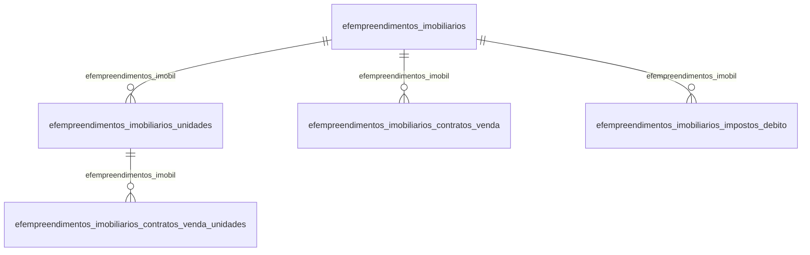

# Modelo — Fiscal - empreendimentos (rascunho em lote)

> Gerado por `src/model/gerar_docs_modelo.py` a partir de `src/model/modulos/fiscal_empreendimentos.yaml`, do catálogo e do perfil de colunas. **Não edite à mão.**

12 entidades. A coluna *Preench.* é o % de linhas com valor útil (nem nulo, nem em branco, nem zero, nem 1900-01-01; para colunas de código o zero conta como valor).

## Diagrama

## Entidades

| Entidade | Tabela | Linhas | Volume | Filtro obrigatório |
|---|---|---|---|---|
| [efempreendimentos_imobiliarios_contratos_venda_parcelas](#efempreendimentos_imobiliarios_contratos_venda_parcelas) | `EFEMPREENDIMENTOS_IMOBILIARIOS_CONTRATOS_VENDA_PARCELAS` | 34 | pequeno | empresa |
| [efempreendimentos_imobiliarios_unidades](#efempreendimentos_imobiliarios_unidades) | `EFEMPREENDIMENTOS_IMOBILIARIOS_UNIDADES` | 16 | pequeno | empresa |
| [efempreendimentos_imobiliarios_vigencia_impostos_debito](#efempreendimentos_imobiliarios_vigencia_impostos_debito) | `EFEMPREENDIMENTOS_IMOBILIARIOS_VIGENCIA_IMPOSTOS_DEBITO` | 13 | pequeno | empresa |
| [efempreendimentos_imobiliarios](#efempreendimentos_imobiliarios) | `EFEMPREENDIMENTOS_IMOBILIARIOS` | 7 | pequeno | empresa |
| [efempreendimentos_imobiliarios_vigencia](#efempreendimentos_imobiliarios_vigencia) | `EFEMPREENDIMENTOS_IMOBILIARIOS_VIGENCIA` | 7 | pequeno | empresa |
| [efempreendimentos_imobiliarios_contratos_venda_pagamentos](#efempreendimentos_imobiliarios_contratos_venda_pagamentos) | `EFEMPREENDIMENTOS_IMOBILIARIOS_CONTRATOS_VENDA_PAGAMENTOS` | 6 | pequeno | empresa |
| [efempreendimentos_imobiliarios_contratos_venda_cliente](#efempreendimentos_imobiliarios_contratos_venda_cliente) | `EFEMPREENDIMENTOS_IMOBILIARIOS_CONTRATOS_VENDA_CLIENTE` | 4 | pequeno | empresa |
| [efempreendimentos_imobiliarios_contratos_venda](#efempreendimentos_imobiliarios_contratos_venda) | `EFEMPREENDIMENTOS_IMOBILIARIOS_CONTRATOS_VENDA` | 3 | pequeno | empresa |
| [efempreendimentos_imobiliarios_contratos_venda_unidades](#efempreendimentos_imobiliarios_contratos_venda_unidades) | `EFEMPREENDIMENTOS_IMOBILIARIOS_CONTRATOS_VENDA_UNIDADES` | 3 | pequeno | empresa |
| [efempreendimentos_imobiliarios_contratos_venda_cliente_alter](#efempreendimentos_imobiliarios_contratos_venda_cliente_alter) | `EFEMPREENDIMENTOS_IMOBILIARIOS_CONTRATOS_VENDA_CLIENTE_ALTERACAO` | 2 | pequeno | empresa |
| [efempreendimentos_imobiliarios_contratos_venda_lancto](#efempreendimentos_imobiliarios_contratos_venda_lancto) | `EFEMPREENDIMENTOS_IMOBILIARIOS_CONTRATOS_VENDA_LANCTO` | 1 | pequeno | empresa |
| [efempreendimentos_imobiliarios_impostos_debito](#efempreendimentos_imobiliarios_impostos_debito) | `EFEMPREENDIMENTOS_IMOBILIARIOS_IMPOSTOS_DEBITO` | 1 | pequeno | empresa |

## efempreendimentos_imobiliarios_contratos_venda_parcelas

**Empreendimentos imobiliários - Contratos de venda - Parcelas** — tabela `EFEMPREENDIMENTOS_IMOBILIARIOS_CONTRATOS_VENDA_PARCELAS` (34 linhas)

Empreendimentos imobiliários - Contratos de venda - Parcelas. 34 linhas no catálogo; chave: CODI_EMP, I_CONTRATO, I_PARCELA.

- **Chave:** `CODI_EMP, I_CONTRATO, I_PARCELA`
- **Empresa:** `CODI_EMP`
- **Período:** `VENCIMENTO`
- **Ordem padrão:** `VENCIMENTO desc`, `I_CONTRATO asc`, `I_PARCELA asc`

**Regras de negócio validadas:**

- Medido em 2026-10-18: 34 linhas, 2 empresa(s), VENCIMENTO de 2021-06-01 a 2024-01-28.

| Campo | Coluna | Tipo | Preench. | Domínio | Descrição (banco) |
|---|---|---|---|---|---|
| empresa | `codi_emp` | integer(4) |  |  | Empresa |
| codigo_do_contrato | `i_contrato` | integer(4) |  |  | Código do contrato |
| codigo_da_parcela | `i_parcela` | integer(4) |  |  | Código da parcela |
| vencimento | `vencimento` | date(4) |  |  | Vencimento |
| valor_da_parcela | `valor_parcela` | numeric(13) |  |  | Valor da parcela |

**Filtros:** `codigo_do_contrato` (eq/in), `codigo_da_parcela` (eq/in), `vencimento` (entre/gte/lte)

## efempreendimentos_imobiliarios_unidades

**Empreendimentos imobiliários - unidades - cadastro** — tabela `EFEMPREENDIMENTOS_IMOBILIARIOS_UNIDADES` (16 linhas)

Empreendimentos imobiliários - unidades - cadastro. 16 linhas no catálogo; chave: CODI_EMP, I_EMPREENDIMENTO, I_UNIDADE.

- **Chave:** `CODI_EMP, I_EMPREENDIMENTO, I_UNIDADE`
- **Empresa:** `CODI_EMP`
- **Período:** `—`
- **Ordem padrão:** `I_EMPREENDIMENTO asc`, `I_UNIDADE asc`

**Regras de negócio validadas:**

- Medido em 2026-10-18: 16 linhas, 7 empresa(s).
- Vínculo efempreendimentos_imobil (EFEMPREENDIMENTOS_IMOBILIARIOS): 0 de 1 linhas sem registro relacionado (empresa 741).

| Campo | Coluna | Tipo | Preench. | Domínio | Descrição (banco) |
|---|---|---|---|---|---|
| empresa | `codi_emp` | integer(4) |  |  | Empresa |
| codigo_do_empreendimento | `i_empreendimento` | integer(4) |  |  | Código do empreendimento |
| codigo_da_unidade | `i_unidade` | integer(4) |  |  | Código da unidade |
| descricao_resumida | `descricao_resumida` | char(90) |  |  | Descrição resumida |
| area_da_unidade | `area_unidade` | numeric(13) |  |  | Área da unidade |
| complemento_endereco 🔒 | `complemento_endereco` | varchar(60) |  |  | Complemento Endereço |

**Vínculos (LEFT JOIN, acrescentam colunas legíveis):**

- `efempreendimentos_imobil` → `EFEMPREENDIMENTOS_IMOBILIARIOS` por `codi_emp` = `codi_emp` e `i_empreendimento` = `i_empreendimento`; colunas: `efempreendimentos_imobil_nome`

**Filtros:** `codigo_do_empreendimento` (eq/in), `codigo_da_unidade` (eq/in), `descricao_resumida` (contem/prefixo), `complemento_endereco` (contem/prefixo)

## efempreendimentos_imobiliarios_vigencia_impostos_debito

**Empreendimentos imobiliários - impostos - débito - cadastro Vigência** — tabela `EFEMPREENDIMENTOS_IMOBILIARIOS_VIGENCIA_IMPOSTOS_DEBITO` (13 linhas)

Empreendimentos imobiliários - impostos - débito - cadastro Vigência. 13 linhas no catálogo; chave: CODI_EMP, I_EMPREENDIMENTO, VIGENCIA, CODI_IMP.

- **Chave:** `CODI_EMP, I_EMPREENDIMENTO, VIGENCIA, CODI_IMP`
- **Empresa:** `CODI_EMP`
- **Período:** `VIGENCIA`
- **Ordem padrão:** `VIGENCIA desc`, `I_EMPREENDIMENTO asc`, `CODI_IMP asc`

**Regras de negócio validadas:**

- Medido em 2026-10-18: 13 linhas, 4 empresa(s), VIGENCIA de 2015-01-01 a 2023-07-01.

| Campo | Coluna | Tipo | Preench. | Domínio | Descrição (banco) |
|---|---|---|---|---|---|
| empresa | `codi_emp` | integer(4) |  |  | Empresa |
| codigo_do_empreendimento | `i_empreendimento` | integer(4) |  |  | Código do empreendimento |
| vigencia | `vigencia` | date(4) |  |  | Vigência |
| codigo_do_imposto | `codi_imp` | integer(4) |  |  | Código do imposto |
| percentual_de_reducao_da_base_de_calculo | `percentual_reducao_base_calculo` | numeric(7) |  |  | Percentual de redução da base de cálculo |
| aliquota_do_imposto | `aliquota` | numeric(7) |  |  | Alíquota do imposto |

**Filtros:** `codigo_do_empreendimento` (eq/in), `vigencia` (eq/in), `codigo_do_imposto` (eq/in)

## efempreendimentos_imobiliarios

**Empreendimentos imobiliários - cadastro** — tabela `EFEMPREENDIMENTOS_IMOBILIARIOS` (7 linhas)

Empreendimentos imobiliários - cadastro. 7 linhas no catálogo; chave: CODI_EMP, I_EMPREENDIMENTO.

- **Chave:** `CODI_EMP, I_EMPREENDIMENTO`
- **Empresa:** `CODI_EMP`
- **Período:** `DATA_INICIO`
- **Ordem padrão:** `DATA_INICIO desc`, `I_EMPREENDIMENTO asc`

**Regras de negócio validadas:**

- Medido em 2026-10-18: 7 linhas, 7 empresa(s), DATA_INICIO de 2015-01-01 a 2018-01-01.
- Colunas expostas nulas em 100% das linhas (7): identificacao_do_processo, identificacao_da_secao_judiciaria, identificacao_da_vara, natureza_da_acao_judicial, data_da_sentenca_decisao_judicial, descricao, sequencial_do_scp.
- origem_do_processo_1_justica_federal_3_s: todos os valores reais estão no comentário do banco (9=7).
- Vínculo geempre (geempre): 0 de 1 linhas sem registro relacionado (empresa 10058).

| Campo | Coluna | Tipo | Preench. | Domínio | Descrição (banco) |
|---|---|---|---|---|---|
| empresa | `codi_emp` | integer(4) |  |  | Empresa |
| codigo_do_empreendimento | `i_empreendimento` | integer(4) |  |  | Código do empreendimento |
| nome | `nome` | varchar(255) |  |  | Nome |
| tipo_de_unidade_imobiliaria | `tipo_unidade_imobiliaria` | char(2) |  |  | Tipo de unidade imobiliária |
| natureza_especifica_do_empreendimento | `natureza_especifica` | char(2) |  |  | Natureza específica do empreendimento |
| descricao_resumida | `descricao_resumida` | char(90) |  |  | Descrição resumida |
| data_do_inicio_do_empreendimento | `data_inicio` | date(4) |  |  | Data do início do empreendimento |
| area_total | `area_total` | numeric(13) |  |  | Área total |
| area_com_direito_a_credito | `area_com_direito_a_credito` | numeric(13) |  |  | Área com direito a crédito |
| calcular_credito_presumido_do_custo_orca | `calcular_credito_presumido_custo_orcado` | char(1) |  |  | Calcular crédito presumido do custo orçado |
| possui_processo_referenciado_s_n | `possui_processo_referenciado` | char(1) |  |  | Possui processo referenciado (S/N) |
| identificacao_do_processo | `identificacao_referenciado` | varchar(20) |  |  | Identificacao do processo |
| origem_do_processo_1_justica_federal_3_s | `origem_referenciado` | char(1) |  | efempreendimentos_imobiliarios_origem_do_pr | Origem do processo (1=Justica Federal/ 3=Secretaria da Receita Federal do Brasil/ 9=Outros) |
| identificacao_da_secao_judiciaria | `secao_judiciaria` | char(255) |  |  | Identificação da Seção judiciária |
| identificacao_da_vara | `vara` | char(2) |  |  | Identificação da Vara |
| natureza_da_acao_judicial | `natureza_acao` | char(2) |  |  | Natureza da ação judicial |
| data_da_sentenca_decisao_judicial | `data_sentenca` | date(4) |  |  | Data da Sentença/Decisão Judicial |
| descricao | `descricao_processo` | char(100) |  |  | Descrição |
| conta_debito_do_custo_incorrido | `ct_debito_custo_incorrido` | integer(4) |  |  | Conta débito do custo incorrido |
| conta_credito_do_custo_incorrido | `ct_credito_custo_incorrido` | integer(4) |  |  | Conta crédito do custo incorrido |
| historico_do_custo_incorrido | `ch_custo_incorrido` | integer(4) |  |  | Histórico do custo incorrido |
| conta_debito_do_custo_orcado | `ct_debito_custo_orcado` | integer(4) |  |  | Conta débito do custo orçado |
| conta_credito_do_custo_orcado | `ct_credito_custo_orcado` | integer(4) |  |  | Conta crédito do custo orçado |
| historico_do_custo_orcado | `ch_custo_orcado` | integer(4) |  |  | Histórico do custo orçado |
| conta_debito_da_receita_do_contrato_de_v | `ct_debito_contrato_receita` | integer(4) |  |  | Conta débito da receita do contrato de venda |
| conta_credito_da_receita_do_contrato_de | `ct_credito_contrato_receita` | integer(4) |  |  | Conta crédito da receita do contrato de venda |
| historico_da_receita_do_contrato_de_vend | `ch_contrato_receita` | integer(4) |  |  | Histórico da receita do contrato de venda |
| conta_debito_da_atualizacao_monetaria_do | `ct_debito_contrato_atualizacao_monetaria` | integer(4) |  |  | Conta débito da atualização monetária do contrato de venda |
| conta_credito_da_atualizacao_monetaria_d | `ct_credito_contrato_atualizacao_monetaria` | integer(4) |  |  | Conta crédito da atualização monetária do contrato de venda |
| historico_da_atualizacao_monetaria_do_co | `ch_debito_contrato_atualizacao_monetaria` | integer(4) |  |  | Histórico da atualização monetária do contrato de venda |
| conta_da_receita_do_recebimento_de_parce | `ct_recebimento_receita` | integer(4) |  |  | Conta da receita do recebimento de parcelas |
| historico_da_receita_do_recebimento_de_p | `ch_recebimento_receita` | integer(4) |  |  | Histórico da receita do recebimento de parcelas |
| conta_dos_juros_do_recebimento_de_parcel | `ct_recebimento_juros` | integer(4) |  |  | Conta dos juros do recebimento de parcelas |
| historico_dos_juros_do_recebimento_de_pa | `ch_recebimento_juros` | integer(4) |  |  | Histórico dos juros do recebimento de parcelas |
| conta_da_multa_do_recebimento_de_parcela | `ct_recebimento_multa` | integer(4) |  |  | Conta da multa do recebimento de parcelas |
| historico_multa_do_recebimento_de_parcel | `ch_recebimento_multa` | integer(4) |  |  | Histórico multa do recebimento de parcelas |
| conta_da_desconto_do_recebimento_de_parc | `ct_recebimento_desconto` | integer(4) |  |  | Conta da desconto do recebimento de parcelas |
| historico_desconto_do_recebimento_de_par | `ch_recebimento_desconto` | integer(4) |  |  | Histórico desconto do recebimento de parcelas |
| conta_da_atualizacao_monetaria_do_recebi | `ct_recebimento_atualizacao_monetaria` | integer(4) |  |  | Conta da atualização monetária do recebimento de parcelas |
| historico_da_atualizacao_monetaria_do_re | `ch_recebimento_atualizacao_monetaria` | integer(4) |  |  | Histórico da atualização monetária do recebimento de parcelas |
| calcular_pis_e_cofins_para_receitas_de_c | `calcular_pis_cofins_correcao_monetaria` | char(1) |  |  | Cálcular PIS e COFINS para receitas de correção monetária |
| soma_o_valor_do_desconto_na_base_de_calc | `soma_valor_desconto_base_calculo_pis_cofins` | char(1) |  |  | Soma o valor do desconto na base de cálculo do PIS e da COFINS |
| conta_da_receita_da_devolucao | `ct_devolucao_receita` | integer(4) |  |  | Conta da receita da devolução |
| historico_da_receita_da_devolucao | `ch_devolucao_receita` | integer(4) |  |  | Histórico da receita da devolução |
| conta_da_atualizacao_monetaria_da_devolu | `ct_devolucao_atualizacao_monetaria` | integer(4) |  |  | Conta da atualização monetária da devolução |
| historico_da_atualizacao_monetaria_da_de | `ch_devolucao_atualizacao_monetaria` | integer(4) |  |  | Histórico da atualização monetária da devolução |
| receita_bruta_desse_empreendimento_e_dif | `receita_bruta_diferente_cnae_principal` | char(1) |  |  | Receita bruta desse empreendimento é diferente do CNAE principal (S/N) |
| sequencial_do_scp | `i_scp` | integer(4) |  |  | Sequencial do SCP |
| considerar_o_valor_do_desconto_para_o_ca | `considerar_desconto_calculo_irpj_lp_csoc` | char(1) |  |  | Considerar o valor do desconto para o cálculo dos impostos IRPJ-LP e CSOC |
| nao_calcular_inss_receita_bruta_para_rec | `calcular_inss_rb_correcao_juro_multa` | char(1) |  |  | Não calcular INSS Receita Bruta para receitas de correção monetária, juros e multas |
| data_da_matricula_no_cei | `data_matricula_cei` | date(4) |  |  | Data da matrícula no CEI |
| aplicar_o_percentual_de_presuncao_dos_im | `aplicar_percentual_presuncao_irpj_csll_juro_multa` | char(1) |  |  | Aplicar o percentual de presunção dos impostos IRPJ-LP e CSLL no cálculo das receitas de juros e multa |
| historico_do_desconto_da_devolucao | `ch_devolucao_desconto` | integer(4) |  |  | Histórico do Desconto da Devolução |
| contabilizar_os_custos_incorridos_na_ven | `contabilizar_custo_incorrido_venda_unidade` | char(1) |  |  | Contabilizar os custos incorridos na venda da unidade imobiliária |
| contabilizar_custo_incorrido_venda_unida | `contabilizar_custo_incorrido_venda_unidade_tipo` | integer(4) |  |  | Contabilizar os custos incorridos na venda da unidade imobiliária - Tipo (1/2) |
| contabilizar_custos_e_receita_proporcion | `contabilizar_custo_receita_proporcional` | char(1) |  |  | Contabilizar custos e receita proporcional ao recebimento da parcela |
| contabilizar_custo_receita_proporcional | `contabilizar_custo_receita_proporcional_tipo` | integer(4) |  |  | Contabilizar custos e receita proporcional ao recebimento da parcela - Tipo (1/2) |
| custo_incorrido_transferencia_de_custo_i | `ct_transferencia_custo_incorrido` | integer(4) |  |  | Custo Incorrido - Transferência de custo incorrido na venda - Conta |
| ch_transferencia_custo_incorrido | `ch_transferencia_custo_incorrido` | integer(4) |  |  | Custo Incorrido - Transferência de custo incorrido na venda - Histórico |
| recebimento_de_parcela_reconhecimento_da | `ct_recebimento_reconhecimento_receita` | integer(4) |  |  | Recebimento de Parcela - Reconhecimento da Receita - Conta |

**Vínculos (LEFT JOIN, acrescentam colunas legíveis):**

- `geempre` → `geempre` por `codi_emp` = `codi_emp`; colunas: `geempre_nome`

**Filtros:** `codigo_do_empreendimento` (eq/in), `data_do_inicio_do_empreendimento` (entre/gte/lte), `data_da_sentenca_decisao_judicial` (entre/gte/lte), `data_da_matricula_no_cei` (entre/gte/lte), `nome` (contem/prefixo), `tipo_de_unidade_imobiliaria` (eq/in), `natureza_especifica_do_empreendimento` (eq/in), `descricao_resumida` (contem/prefixo), `calcular_credito_presumido_do_custo_orca` (eq/in), `possui_processo_referenciado_s_n` (eq/in), `identificacao_do_processo` (eq/in), `origem_do_processo_1_justica_federal_3_s` (eq/in), `identificacao_da_secao_judiciaria` (contem/prefixo), `identificacao_da_vara` (eq/in)

## efempreendimentos_imobiliarios_vigencia

**Empreendimentos imobiliários - Cadastro Vigência** — tabela `EFEMPREENDIMENTOS_IMOBILIARIOS_VIGENCIA` (7 linhas)

Empreendimentos imobiliários - Cadastro Vigência. 7 linhas no catálogo; chave: CODI_EMP, I_EMPREENDIMENTO, VIGENCIA.

- **Chave:** `CODI_EMP, I_EMPREENDIMENTO, VIGENCIA`
- **Empresa:** `CODI_EMP`
- **Período:** `DATA_INICIO`
- **Ordem padrão:** `DATA_INICIO desc`, `I_EMPREENDIMENTO asc`, `VIGENCIA asc`

**Regras de negócio validadas:**

- Medido em 2026-10-18: 7 linhas, 7 empresa(s), DATA_INICIO de 2015-01-01 a 2023-07-01.
- Colunas expostas nulas em 100% das linhas (2): sequencial_do_scp, sequencial_do_cno.

| Campo | Coluna | Tipo | Preench. | Domínio | Descrição (banco) |
|---|---|---|---|---|---|
| empresa | `codi_emp` | integer(4) |  |  | Empresa |
| codigo_do_empreendimento | `i_empreendimento` | integer(4) |  |  | Código do empreendimento |
| vigencia | `vigencia` | date(4) |  |  | Vigência |
| descricao_vigencia | `descricao` | char(80) |  |  | Descrição Vigência |
| aplicar_o_percentual_de_presuncao_dos_im | `aplicar_percentual_presuncao_irpj_csll_juro_multa` | char(1) |  |  | Aplicar o percentual de presunção dos impostos IRPJ-LP e CSLL no cálculo das receitas de juros e multa |
| nao_calcular_inss_receita_bruta_para_rec | `calcular_inss_rb_correcao_juro_multa` | char(1) |  |  | Não calcular INSS Receita Bruta para receitas de correção monetária, juros e multas |
| historico_da_receita_do_contrato_de_vend | `ch_contrato_receita` | integer(4) |  |  | Histórico da receita do contrato de venda |
| historico_do_custo_incorrido | `ch_custo_incorrido` | integer(4) |  |  | Histórico do custo incorrido |
| historico_do_custo_orcado | `ch_custo_orcado` | integer(4) |  |  | Histórico do custo orçado |
| historico_da_atualizacao_monetaria_do_co | `ch_debito_contrato_atualizacao_monetaria` | integer(4) |  |  | Histórico da atualização monetária do contrato de venda |
| historico_da_atualizacao_monetaria_da_de | `ch_devolucao_atualizacao_monetaria` | integer(4) |  |  | Histórico da atualização monetária da devolução |
| historico_do_desconto_da_devolucao | `ch_devolucao_desconto` | integer(4) |  |  | Histórico do Desconto da Devolução |
| historico_da_receita_da_devolucao | `ch_devolucao_receita` | integer(4) |  |  | Histórico da receita da devolução |
| historico_da_atualizacao_monetaria_do_re | `ch_recebimento_atualizacao_monetaria` | integer(4) |  |  | Histórico da atualização monetária do recebimento de parcelas |
| historico_desconto_do_recebimento_de_par | `ch_recebimento_desconto` | integer(4) |  |  | Histórico desconto do recebimento de parcelas |
| historico_dos_juros_do_recebimento_de_pa | `ch_recebimento_juros` | integer(4) |  |  | Histórico dos juros do recebimento de parcelas |
| historico_multa_do_recebimento_de_parcel | `ch_recebimento_multa` | integer(4) |  |  | Histórico multa do recebimento de parcelas |
| historico_da_receita_do_recebimento_de_p | `ch_recebimento_receita` | integer(4) |  |  | Histórico da receita do recebimento de parcelas |
| recebimento_de_parcela_reconhecimento_cu | `ch_recebimento_reconhecimento_custo_receita` | integer(4) |  |  | Recebimento de Parcela - Reconhecimento custo da Receita - Histórico |
| recebimento_de_parcela_reconhecimento_da | `ch_recebimento_reconhecimento_receita` | integer(4) |  |  | Recebimento de Parcela - Reconhecimento da Receita - Histórico |
| custo_incorrido_transferencia_de_custo_i | `ch_transferencia_custo_incorrido` | integer(4) |  |  | Custo Incorrido - Transferência de custo incorrido na venda - Histórico |
| considerar_o_valor_do_desconto_para_o_ca | `considerar_desconto_calculo_irpj_lp_csoc` | char(1) |  |  | Considerar o valor do desconto para o cálculo dos impostos IRPJ-LP e CSOC |
| considerar_as_receitas_de_correcao_monet | `considerar_receitas_correcao_monetaria_calculo_pis_cofins` | integer(4) |  |  | Considerar as receitas de correção monetária no cálculo do PIS/COFINS |
| contabilizar_os_custos_incorridos_na_ven | `contabilizar_custo_incorrido_venda_unidade` | char(1) |  |  | Contabilizar os custos incorridos na venda da unidade imobiliária |
| contabilizar_custo_incorrido_venda_unida | `contabilizar_custo_incorrido_venda_unidade_tipo` | integer(4) |  |  | Contabilizar os custos incorridos na venda da unidade imobiliária - Tipo (1/2/3) |
| contabilizar_custos_e_receita_proporcion | `contabilizar_custo_receita_proporcional` | char(1) |  |  | Contabilizar custos e receita proporcional ao recebimento da parcela |
| contabilizar_custo_receita_proporcional | `contabilizar_custo_receita_proporcional_tipo` | integer(4) |  |  | Contabilizar custos e receita proporcional ao recebimento da parcela - Tipo (1/2) |
| conta_credito_da_atualizacao_monetaria_d | `ct_credito_contrato_atualizacao_monetaria` | integer(4) |  |  | Conta crédito da atualização monetária do contrato de venda |
| conta_credito_da_receita_do_contrato_de | `ct_credito_contrato_receita` | integer(4) |  |  | Conta crédito da receita do contrato de venda |
| conta_credito_do_custo_incorrido | `ct_credito_custo_incorrido` | integer(4) |  |  | Conta crédito do custo incorrido |
| conta_credito_do_custo_orcado | `ct_credito_custo_orcado` | integer(4) |  |  | Conta crédito do custo orçado |
| conta_debito_da_atualizacao_monetaria_do | `ct_debito_contrato_atualizacao_monetaria` | integer(4) |  |  | Conta débito da atualização monetária do contrato de venda |
| conta_debito_da_receita_do_contrato_de_v | `ct_debito_contrato_receita` | integer(4) |  |  | Conta débito da receita do contrato de venda |
| conta_debito_do_custo_incorrido | `ct_debito_custo_incorrido` | integer(4) |  |  | Conta débito do custo incorrido |
| conta_debito_do_custo_orcado | `ct_debito_custo_orcado` | integer(4) |  |  | Conta débito do custo orçado |
| conta_da_atualizacao_monetaria_da_devolu | `ct_devolucao_atualizacao_monetaria` | integer(4) |  |  | Conta da atualização monetária da devolução |
| conta_da_receita_da_devolucao | `ct_devolucao_receita` | integer(4) |  |  | Conta da receita da devolução |
| conta_da_atualizacao_monetaria_do_recebi | `ct_recebimento_atualizacao_monetaria` | integer(4) |  |  | Conta da atualização monetária do recebimento de parcelas |
| conta_da_desconto_do_recebimento_de_parc | `ct_recebimento_desconto` | integer(4) |  |  | Conta da desconto do recebimento de parcelas |
| conta_dos_juros_do_recebimento_de_parcel | `ct_recebimento_juros` | integer(4) |  |  | Conta dos juros do recebimento de parcelas |
| conta_da_multa_do_recebimento_de_parcela | `ct_recebimento_multa` | integer(4) |  |  | Conta da multa do recebimento de parcelas |
| conta_da_receita_do_recebimento_de_parce | `ct_recebimento_receita` | integer(4) |  |  | Conta da receita do recebimento de parcelas |
| ct_recebimento_reconhecimento_custo_rece | `ct_recebimento_reconhecimento_custo_receita` | integer(4) |  |  | Recebimento de Parcela - Reconhecimento custo da Receita - Conta |
| ct_recebimento_reconhecimento_receita | `ct_recebimento_reconhecimento_receita` | integer(4) |  |  | Recebimento de Parcela - Reconhecimento da Receita - Conta |
| ct_transferencia_custo_incorrido | `ct_transferencia_custo_incorrido` | integer(4) |  |  | Custo Incorrido - Transferência de custo incorrido na venda - Conta |
| receita_bruta_desse_empreendimento_e_dif | `receita_bruta_diferente_cnae_principal` | char(1) |  |  | Receita bruta desse empreendimento é diferente do CNAE principal (S/N) |
| somar_o_valor_do_desconto_na_base_de_cal | `soma_valor_desconto_base_calculo_inss_rb` | char(1) |  |  | Somar o valor do desconto na base de cálculo do INSS Receita Bruta |
| soma_o_valor_do_desconto_na_base_de_calc | `soma_valor_desconto_base_calculo_pis_cofins` | char(1) |  |  | Soma o valor do desconto na base de cálculo do PIS e da COFINS |
| tipo_de_unidade_imobiliaria | `tipo_unidade_imobiliaria` | varchar(2) |  |  | Tipo de unidade imobiliária |
| natureza_especifica_do_empreendimento | `natureza_especifica` | varchar(2) |  |  | Natureza específica do empreendimento |
| sequencial_do_scp | `i_scp` | integer(4) |  |  | Sequencial do SCP |
| sequencial_do_cno | `i_cno` | integer(4) |  |  | Sequencial do CNO |
| descricao_resumida | `descricao_resumida` | varchar(90) |  |  | Descrição Resumida |
| data_do_inicio_do_empreendimento | `data_inicio` | date(4) |  |  | Data do início do empreendimento |
| data_da_matricula_no_cei | `data_matricula_cei` | date(4) |  |  | Data da matrícula no CEI |
| area_total | `area_total` | numeric(13) |  |  | Área total |
| area_com_direito_a_credito | `area_com_direito_a_credito` | numeric(13) |  |  | Área com direito a crédito |
| calcular_credito_presumido_do_custo_orca | `calcular_credito_presumido_custo_orcado` | char(1) |  |  | Calcular crédito presumido do custo orçado |
| contabilizar_o_reconhecimento_da_receita | `contabilizar_reconhecimento_rec_ctb_poc` | char(1) |  |  | Contabilizar o reconhecimento da receita contábil conforme o Percentual de Obra Concluída - POC |
| conta_debito_contrato_receita_contabil | `ct_debito_contrato_rec_ctb` | integer(4) |  |  | Conta débito contrato receita contábil |

**Filtros:** `codigo_do_empreendimento` (eq/in), `vigencia` (eq/in), `data_do_inicio_do_empreendimento` (entre/gte/lte), `data_da_matricula_no_cei` (entre/gte/lte), `descricao_vigencia` (contem/prefixo), `aplicar_o_percentual_de_presuncao_dos_im` (eq/in), `nao_calcular_inss_receita_bruta_para_rec` (eq/in), `considerar_o_valor_do_desconto_para_o_ca` (eq/in), `contabilizar_os_custos_incorridos_na_ven` (eq/in), `contabilizar_custo_incorrido_venda_unida` (eq/in), `contabilizar_custos_e_receita_proporcion` (eq/in), `contabilizar_custo_receita_proporcional` (eq/in), `receita_bruta_desse_empreendimento_e_dif` (eq/in), `somar_o_valor_do_desconto_na_base_de_cal` (eq/in)

## efempreendimentos_imobiliarios_contratos_venda_pagamentos

**Empreendimentos imobiliários - Contratos de venda - Parcelas - Pagamentos** — tabela `EFEMPREENDIMENTOS_IMOBILIARIOS_CONTRATOS_VENDA_PAGAMENTOS` (6 linhas)

Empreendimentos imobiliários - Contratos de venda - Parcelas - Pagamentos. 6 linhas no catálogo; chave: CODI_EMP, I_CONTRATO, I_PARCELA, I_PAGAMENTO.

- **Chave:** `CODI_EMP, I_CONTRATO, I_PARCELA, I_PAGAMENTO`
- **Empresa:** `CODI_EMP`
- **Período:** `DATA_PAGAMENTO`
- **Ordem padrão:** `DATA_PAGAMENTO desc`, `I_CONTRATO asc`, `I_PARCELA asc`

**Regras de negócio validadas:**

- Medido em 2026-10-18: 6 linhas, 2 empresa(s), DATA_PAGAMENTO de 2021-06-01 a 2021-09-28.
- Colunas expostas nulas em 100% das linhas (1): cst_receita_financeira_correcao.
- origem_do_pagamento_b_baixa_l_lancamento: todos os valores reais estão no comentário do banco (L=3, B=3).

| Campo | Coluna | Tipo | Preench. | Domínio | Descrição (banco) |
|---|---|---|---|---|---|
| empresa | `codi_emp` | integer(4) |  |  | Empresa |
| codigo_do_contrato | `i_contrato` | integer(4) |  |  | Código do contrato |
| codigo_da_parcela | `i_parcela` | integer(4) |  |  | Código da parcela |
| codigo_do_pagamento | `i_pagamento` | integer(4) |  |  | Código do pagamento |
| data_do_pagamento | `data_pagamento` | date(4) |  |  | Data do pagamento |
| valor_pago | `valor_pago` | numeric(13) |  |  | Valor pago |
| valor_da_correcao | `valor_correcao` | numeric(13) |  |  | Valor da correção |
| valor_dos_juros | `valor_juros` | numeric(13) |  |  | Valor dos juros |
| valor_da_multa | `valor_multa` | numeric(13) |  |  | Valor da multa |
| valor_do_desconto | `valor_desconto` | numeric(13) |  |  | Valor do desconto |
| valor_liquido | `valor_liquido` | numeric(13) |  |  | Valor líquido |
| base_de_calculo_do_pis | `base_calculo_pis` | numeric(13) |  |  | Base de cálculo do PIS |
| base_de_calculo_da_cofins | `base_calculo_cofins` | numeric(13) |  |  | Base de cálculo da COFINS |
| origem_do_pagamento_b_baixa_l_lancamento | `origem_pagamento` | char(1) |  | efempreendimentos_imobiliarios_contratos_venda_pagamentos_origem_do_p | ORIGEM DO PAGAMENTO (B - BAIXA/L - LANÇAMENTO/R - RESCINDIDA) |
| valor_devolucao | `valor_devolucao` | numeric(13) |  |  | Valor devolução |
| cst_receita_financeira_correcao | `cst_pis_cofins_receita_financeira_correcao` | integer(4) |  |  | CST - Receita financeira - Correção |
| base_de_pis_e_cofins_receita_financeira | `base_calculo_pis_cofins_receita_financeira_correcao` | numeric(13) |  |  | Base de PIS e COFINS - Receita financeira - Correção |
| base_calculo_pis_cofins_receita_financei | `base_calculo_pis_cofins_receita_financeira_juros_multa` | numeric(13) |  |  | Base de PIS e COFINS - Receita financeira - Juros e Multa |
| redutor_de_ajuste_do_ibs_cbs | `redutor_ajuste_ibs_cbs` | numeric(13) |  |  | Redutor de ajuste do IBS/CBS |
| redutor_social_do_ibs_cbs | `redutor_social_ibs_cbs` | numeric(13) |  |  | Redutor social do IBS/CBS |
| base_de_calculo_do_ibs | `base_calculo_ibs` | numeric(13) |  |  | Base de cálculo do IBS |
| aliquota_do_ibs | `aliquota_ibs` | numeric(5) |  |  | Alíquota do IBS |
| valor_do_ibs | `valor_ibs` | numeric(13) |  |  | Valor do IBS |
| base_de_calculo_da_cbs | `base_calculo_cbs` | numeric(13) |  |  | Base de cálculo da CBS |
| aliquota_da_cbs | `aliquota_cbs` | numeric(5) |  |  | Alíquota da CBS |
| valor_da_cbs | `valor_cbs` | numeric(13) |  |  | Valor da CBS |

**Filtros:** `codigo_do_contrato` (eq/in), `codigo_da_parcela` (eq/in), `codigo_do_pagamento` (eq/in), `data_do_pagamento` (entre/gte/lte), `origem_do_pagamento_b_baixa_l_lancamento` (eq/in)

## efempreendimentos_imobiliarios_contratos_venda_cliente

**Empreendimentos Imobiliários - Contratos de Venda - Cliente** — tabela `EFEMPREENDIMENTOS_IMOBILIARIOS_CONTRATOS_VENDA_CLIENTE` (4 linhas)

Empreendimentos Imobiliários - Contratos de Venda - Cliente. 4 linhas no catálogo; chave: CODI_EMP, I_CONTRATO, I_SEQUENCIAL.

- **Chave:** `CODI_EMP, I_CONTRATO, I_SEQUENCIAL`
- **Empresa:** `CODI_EMP`
- **Período:** `—`
- **Ordem padrão:** `I_CONTRATO asc`, `I_SEQUENCIAL asc`

**Regras de negócio validadas:**

- Medido em 2026-10-18: 4 linhas, 3 empresa(s).
- Vínculo efclientes (efclientes): 0 de 1 linhas sem registro relacionado (empresa 10058).

| Campo | Coluna | Tipo | Preench. | Domínio | Descrição (banco) |
|---|---|---|---|---|---|
| empresa | `codi_emp` | integer(4) |  |  | Empresa |
| codigo_do_contrato | `i_contrato` | integer(4) |  |  | Código do Contrato |
| sequencial | `i_sequencial` | integer(4) |  |  | Sequencial |
| codigo_do_cliente | `codi_cli` | integer(4) |  |  | Código do Cliente |
| percentual_participacao | `percentual_participacao` | numeric(7) |  |  | Percentual participação |

**Vínculos (LEFT JOIN, acrescentam colunas legíveis):**

- `efclientes` → `efclientes` por `codi_emp` = `codi_emp` e `codi_cli` = `codi_cli`; colunas: `efclientes_nome`

**Filtros:** `codigo_do_contrato` (eq/in), `sequencial` (eq/in), `codigo_do_cliente` (eq/in)

## efempreendimentos_imobiliarios_contratos_venda

**Empreendimentos imobiliários - Contratos de venda** — tabela `EFEMPREENDIMENTOS_IMOBILIARIOS_CONTRATOS_VENDA` (3 linhas)

Empreendimentos imobiliários - Contratos de venda. 3 linhas no catálogo; chave: CODI_EMP, I_CONTRATO.

- **Chave:** `CODI_EMP, I_CONTRATO`
- **Empresa:** `CODI_EMP`
- **Período:** `DATA_OPERACAO`
- **Ordem padrão:** `DATA_OPERACAO desc`, `I_CONTRATO asc`

**Regras de negócio validadas:**

- Medido em 2026-10-18: 3 linhas, 3 empresa(s), DATA_OPERACAO de 2015-01-01 a 2021-07-26.
- Colunas expostas nulas em 100% das linhas (7): indice_de_calculo_da_correcao_monetaria, indice_de_calculo_dos_juros, codigo_do_indice_da_correcao_monetaria, codigo_do_indice_do_juros, sequencial_do_contrato_origem, data_da_renegociacao, data_transferencia.
- Vínculo efclientes (efclientes): 0 de 1 linhas sem registro relacionado (empresa 10058).
- Vínculo efempreendimentos_imobil (EFEMPREENDIMENTOS_IMOBILIARIOS): 0 de 1 linhas sem registro relacionado (empresa 10058).
- Vínculo geindice (GEINDICE): 0 de 1 linhas sem registro relacionado (empresa 10058).

| Campo | Coluna | Tipo | Preench. | Domínio | Descrição (banco) |
|---|---|---|---|---|---|
| empresa | `codi_emp` | integer(4) |  |  | Empresa |
| codigo_do_contrato | `i_contrato` | integer(4) |  |  | Código do contrato |
| codigo_do_empreendimento | `i_empreendimento` | integer(4) |  |  | Código do empreendimento |
| codigo_do_cliente | `codi_cli` | integer(4) |  |  | Código do cliente |
| numero_do_contrato | `numero` | char(90) |  |  | Número do contrato |
| data_da_operacao | `data_operacao` | date(4) |  |  | Data da operação |
| valor_de_venda | `valor_venda` | numeric(13) |  |  | Valor de venda |
| tipo_da_operacao | `tipo_operacao` | char(2) |  |  | Tipo da operação |
| informacoes_complementares | `informacoes_complementares` | char(90) |  |  | Informações complementares |
| calcular_correcao_monetaria_s_n | `calcular_correcao_monetaria` | char(1) |  |  | Calcular correção monetária (S/N) |
| indice_de_calculo_da_correcao_monetaria | `indice_correcao_monetaria` | char(8) |  |  | Indice de cálculo da correção monetária |
| valor_do_contrato_em_indice | `valor_contrato_em_indice` | numeric(17) |  |  | Valor do contrato em índice |
| calcular_juros_s_n | `calcular_juros` | char(1) |  |  | Calcular juros (S/N) |
| forma_de_calculo_dos_juros | `forma_calculo_juros` | char(1) |  |  | Forma de cálculo dos juros |
| indice_de_calculo_dos_juros | `indice_juros` | char(8) |  |  | Índice de cálculo dos juros |
| taxa_de_juros | `taxa_juros` | numeric(5) |  |  | Taxa de juros |
| contrato_ja_encerrado_s_n | `encerrado` | char(1) |  |  | Contrato já encerrado (S/N) |
| data_de_encerramento_do_contrato | `data_encerramento` | date(4) |  |  | Data de encerramento do contrato |
| codigo_do_indice_da_correcao_monetaria | `i_indice_correcao_monetaria` | integer(4) |  |  | Código do Índice da Correção Monetária |
| codigo_do_indice_do_juros | `i_indice_juros` | integer(4) |  |  | Código do Índice do Juros |
| sequencial_do_contrato_origem | `i_contrato_origem` | integer(4) |  |  | Sequencial do contrato origem |
| contrato_renegociado_s_n | `contrato_renegociado` | char(1) |  |  | Contrato renegociado (S/N) |
| data_da_renegociacao | `data_renegociacao` | date(4) |  |  | Data da renegociação |
| contrato_transferido | `contrato_transferido` | char(1) |  |  | Contrato Transferido |
| data_transferencia | `data_transferencia` | date(4) |  |  | Data transferência |
| origem_da_transferencia | `origem_transferencia` | char(1) |  |  | Origem da transferência |
| aplicar_ret_1_porcento_faixa_urbana_1 | `aplicar_ret_1_porcento_faixa_urbana_1` | char(1) |  |  | Aplicar RET 1% - Faixa Urbana 1 |
| redutor_de_ajuste | `redutor_ajuste` | numeric(13) |  |  | Redutor de Ajuste |
| redutor_social | `redutor_social` | numeric(13) |  |  | Redutor Social |

**Vínculos (LEFT JOIN, acrescentam colunas legíveis):**

- `efclientes` → `efclientes` por `codi_emp` = `codi_emp` e `codi_cli` = `codi_cli`; colunas: `efclientes_nome`
- `efempreendimentos_imobil` → `EFEMPREENDIMENTOS_IMOBILIARIOS` por `codi_emp` = `codi_emp` e `i_empreendimento` = `i_empreendimento`; colunas: `efempreendimentos_imobil_nome`
- `geindice` → `GEINDICE` por `i_indice_correcao_monetaria` = `i_indice`; colunas: `geindice_nome`

**Filtros:** `codigo_do_contrato` (eq/in), `data_da_operacao` (entre/gte/lte), `data_de_encerramento_do_contrato` (entre/gte/lte), `data_da_renegociacao` (entre/gte/lte), `data_transferencia` (entre/gte/lte), `codigo_do_empreendimento` (eq/in), `codigo_do_cliente` (eq/in), `numero_do_contrato` (contem/prefixo), `tipo_da_operacao` (eq/in), `informacoes_complementares` (contem/prefixo), `calcular_correcao_monetaria_s_n` (eq/in), `indice_de_calculo_da_correcao_monetaria` (eq/in), `calcular_juros_s_n` (eq/in), `forma_de_calculo_dos_juros` (eq/in)

## efempreendimentos_imobiliarios_contratos_venda_unidades

**Empreendimentos imobiliários - Contratos de venda - Unidades** — tabela `EFEMPREENDIMENTOS_IMOBILIARIOS_CONTRATOS_VENDA_UNIDADES` (3 linhas)

Empreendimentos imobiliários - Contratos de venda - Unidades. 3 linhas no catálogo; chave: CODI_EMP, I_CONTRATO, I_UNIDADE.

- **Chave:** `CODI_EMP, I_CONTRATO, I_UNIDADE`
- **Empresa:** `CODI_EMP`
- **Período:** `—`
- **Ordem padrão:** `I_CONTRATO asc`, `I_UNIDADE asc`

**Regras de negócio validadas:**

- Medido em 2026-10-18: 3 linhas, 3 empresa(s).
- Vínculo efempreendimentos_imobil (EFEMPREENDIMENTOS_IMOBILIARIOS_UNIDADES): 0 de 1 linhas sem registro relacionado (empresa 10058).

| Campo | Coluna | Tipo | Preench. | Domínio | Descrição (banco) |
|---|---|---|---|---|---|
| empresa | `codi_emp` | integer(4) |  |  | Empresa |
| codigo_do_contrato | `i_contrato` | integer(4) |  |  | Código do contrato |
| codigo_da_unidade | `i_unidade` | integer(4) |  |  | Código da unidade |
| codigo_do_empreendimento | `i_empreendimento` | integer(4) |  |  | Código do empreendimento |
| valor_de_venda | `valor_venda` | numeric(13) |  |  | Valor de venda |

**Vínculos (LEFT JOIN, acrescentam colunas legíveis):**

- `efempreendimentos_imobil` → `EFEMPREENDIMENTOS_IMOBILIARIOS_UNIDADES` por `codi_emp` = `codi_emp` e `i_empreendimento` = `i_empreendimento` e `i_unidade` = `i_unidade`; colunas: `efempreendimentos_imobil_nome`

**Filtros:** `codigo_do_contrato` (eq/in), `codigo_da_unidade` (eq/in), `codigo_do_empreendimento` (eq/in)

## efempreendimentos_imobiliarios_contratos_venda_cliente_alter

**Empreendimentos Imobiliários - Contratos de Venda - Alteraçõs de Clientes** — tabela `EFEMPREENDIMENTOS_IMOBILIARIOS_CONTRATOS_VENDA_CLIENTE_ALTERACAO` (2 linhas)

Empreendimentos Imobiliários - Contratos de Venda - Alteraçõs de Clientes. 2 linhas no catálogo; chave: CODI_EMP, I_CONTRATO, I_ALTERACAO, DATA_ALTERACAO.

- **Chave:** `CODI_EMP, I_CONTRATO, I_ALTERACAO, DATA_ALTERACAO`
- **Empresa:** `CODI_EMP`
- **Período:** `DATA_ALTERACAO`
- **Ordem padrão:** `DATA_ALTERACAO desc`, `I_CONTRATO asc`, `I_ALTERACAO asc`

**Regras de negócio validadas:**

- Medido em 2026-10-18: 2 linhas, 1 empresa(s), DATA_ALTERACAO de 2021-08-18 a 2021-08-18.
- Vínculo geempre (geempre): 0 de 2 linhas sem registro relacionado (empresa 741).
- Vínculo efclientes (efclientes): 1 de 2 linhas sem registro relacionado (empresa 741).

| Campo | Coluna | Tipo | Preench. | Domínio | Descrição (banco) |
|---|---|---|---|---|---|
| codigo_da_empresa | `codi_emp` | integer(4) |  |  | Código da Empresa |
| codigo_do_contrato_imobiliario | `i_contrato` | integer(4) |  |  | Código do Contrato Imobiliário |
| sequencial_da_alteracao | `i_alteracao` | integer(4) |  |  | Sequencial da alteração |
| data_de_alteracao | `data_alteracao` | date(4) |  |  | Data de Alteração |
| codigo_do_cliente_de | `codi_cli_de` | integer(4) |  |  | Código do Cliente De |
| codigo_do_cliente_para | `codi_cli_para` | integer(4) |  |  | Código do Cliente Para |
| c_1_cliente_2_demais_clientes | `campo` | integer(4) |  |  | 1 - Cliente / 2 - Demais clientes |

**Vínculos (LEFT JOIN, acrescentam colunas legíveis):**

- `geempre` → `geempre` por `codi_emp` = `codi_emp`; colunas: `geempre_nome`
- `efclientes` → `efclientes` por `codi_emp` = `codi_emp` e `codi_cli_de` = `codi_cli`; colunas: `efclientes_nome`

**Filtros:** `codigo_do_contrato_imobiliario` (eq/in), `sequencial_da_alteracao` (eq/in), `data_de_alteracao` (eq/in), `codigo_do_cliente_de` (eq/in), `codigo_do_cliente_para` (eq/in)

## efempreendimentos_imobiliarios_contratos_venda_lancto

**Empreendimentos imobiliários - Contratos de venda X Lançamentos contábeis** — tabela `EFEMPREENDIMENTOS_IMOBILIARIOS_CONTRATOS_VENDA_LANCTO` (1 linhas)

Empreendimentos imobiliários - Contratos de venda X Lançamentos contábeis. 1 linhas no catálogo; chave: CODI_EMP, NUME_LAN, FILI_LAN, I_CONTRATO.

- **Chave:** `CODI_EMP, NUME_LAN, FILI_LAN, I_CONTRATO`
- **Empresa:** `CODI_EMP`
- **Período:** `—`
- **Ordem padrão:** `NUME_LAN asc`, `FILI_LAN asc`

**Regras de negócio validadas:**

- Medido em 2026-10-18: 1 linhas, 1 empresa(s).

| Campo | Coluna | Tipo | Preench. | Domínio | Descrição (banco) |
|---|---|---|---|---|---|
| empresa_do_lancamento | `codi_emp` | integer(4) |  |  | Empresa do lançamento |
| numero_do_lancamento | `nume_lan` | integer(4) |  |  | Número do lançamento |
| empresa_do_contrato | `fili_lan` | integer(4) |  |  | Empresa do contrato |
| codigo_do_contrato | `i_contrato` | integer(4) |  |  | Código do contrato |
| tipo_do_lancamento | `tipo` | integer(4) |  |  | Tipo do lançamento |

**Filtros:** `numero_do_lancamento` (eq/in), `empresa_do_contrato` (eq/in), `codigo_do_contrato` (eq/in), `tipo_do_lancamento` (eq/in)

## efempreendimentos_imobiliarios_impostos_debito

**Empreendimentos imobiliários - impostos - débito - cadastro** — tabela `EFEMPREENDIMENTOS_IMOBILIARIOS_IMPOSTOS_DEBITO` (1 linhas)

Empreendimentos imobiliários - impostos - débito - cadastro. 1 linhas no catálogo; chave: CODI_EMP, I_EMPREENDIMENTO, CODI_IMP.

- **Chave:** `CODI_EMP, I_EMPREENDIMENTO, CODI_IMP`
- **Empresa:** `CODI_EMP`
- **Período:** `—`
- **Ordem padrão:** `I_EMPREENDIMENTO asc`, `CODI_IMP asc`

**Regras de negócio validadas:**

- Medido em 2026-10-18: 1 linhas, 1 empresa(s).
- Vínculo efempreendimentos_imobil (EFEMPREENDIMENTOS_IMOBILIARIOS): 0 de 1 linhas sem registro relacionado (empresa 10058).
- Vínculo geimposto (geimposto): 0 de 1 linhas sem registro relacionado (empresa 10058).

| Campo | Coluna | Tipo | Preench. | Domínio | Descrição (banco) |
|---|---|---|---|---|---|
| empresa | `codi_emp` | integer(4) |  |  | Empresa |
| codigo_do_empreendimento | `i_empreendimento` | integer(4) |  |  | Código do empreendimento |
| codigo_do_imposto | `codi_imp` | integer(4) |  |  | Código do imposto |
| percentual_de_reducao_da_base_de_calculo | `percentual_reducao_base_calculo` | numeric(7) |  |  | Percentual de redução da base de cálculo |
| aliquota_do_imposto | `aliquota` | numeric(7) |  |  | Alíquota do imposto |

**Vínculos (LEFT JOIN, acrescentam colunas legíveis):**

- `efempreendimentos_imobil` → `EFEMPREENDIMENTOS_IMOBILIARIOS` por `codi_emp` = `codi_emp` e `i_empreendimento` = `i_empreendimento`; colunas: `efempreendimentos_imobil_nome`
- `geimposto` → `geimposto` por `codi_emp` = `codi_emp` e `codi_imp` = `codi_imp`; colunas: `geimposto_nome`

**Filtros:** `codigo_do_empreendimento` (eq/in), `codigo_do_imposto` (eq/in)

## Domínios (significado dos códigos)

`confirmado`: **sim** = vem do comentário do banco e/ou foi conferido nos dados; **parcial** = parte dos valores; **não** = hipótese, não use como regra.

### status_empresa

Situação da empresa no cadastro (geempre.stat_emp)

Confirmado: sim

| Código | Significado |
|---|---|
| A | Ativa |
| I | Inativa |
| C | Em constituição |
| M | Ativo sem movimento |
| B | Em processo de baixa |
| E | Excluindo |

### motivo_inatividade

Motivo da inatividade (geempre.tipoi_emp). Só aparece em empresas inativas.

Confirmado: sim

| Código | Significado |
|---|---|
| 1 | Outros |
| 2 | Baixada |
| 3 | Transferida |
| 4 | Inadimplente |

### tipo_inscricao

Tipo da inscrição (CNPJ/CPF/CEI/CAEPF)

Confirmado: sim

| Código | Significado |
|---|---|
| 1 | CNPJ |
| 2 | CPF |
| 3 | CEI |
| 6 | CAEPF |

### regime_federal_empresa

Regime federal da folha (geempre.rfed_emp)

Confirmado: parcial

| Código | Significado |
|---|---|
| 1 | Normal |
| 2 | Microempresa |
| 3 | Empresa de pequeno porte |

### tipo_honorario_empresa

Como a empresa usa o módulo Honorários (geempre.honorario_tipo)

Confirmado: sim

| Código | Significado |
|---|---|
| E | Escritório (quem fatura) |
| C | Cliente |

### sim_nao_texto

Confirmado: sim

| Código | Significado |
|---|---|
| S | Sim |
| N | Não |

### sim_nao_numerico

Confirmado: sim

| Código | Significado |
|---|---|
| 1 | Sim |
| 0 | Não |

### efempreendimentos_imobiliarios_origem_do_pr

Confirmado: sim

> Todos os valores observados em EFEMPREENDIMENTOS_IMOBILIARIOS.ORIGEM_REFERENCIADO estão no comentário do banco (2026-10-18). Distribuição: 9=7.

| Código | Significado |
|---|---|
| 1 | Justica Federal |
| 3 | Secretaria da Receita Federal do Brasil |
| 9 | Outros |

### efempreendimentos_imobiliarios_contratos_venda_pagamentos_origem_do_p

Confirmado: sim

> Todos os valores observados em EFEMPREENDIMENTOS_IMOBILIARIOS_CONTRATOS_VENDA_PAGAMENTOS.ORIGEM_PAGAMENTO estão no comentário do banco (2026-10-18). Distribuição: L=3, B=3.

| Código | Significado |
|---|---|
| B | BAIXA |
| L | LANÇAMENTO |
| R | RESCINDIDA |

