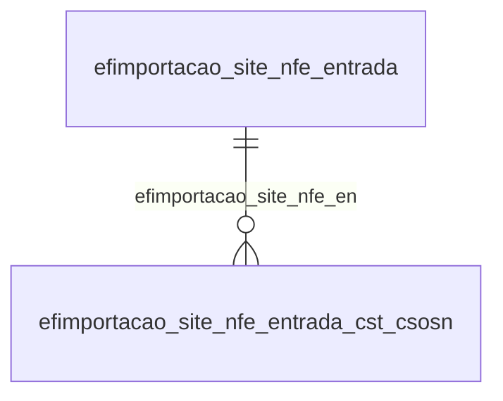

# Modelo — Fiscal - importacao (rascunho em lote)

> Gerado por `src/model/gerar_docs_modelo.py` a partir de `src/model/modulos/fiscal_importacao.yaml`, do catálogo e do perfil de colunas. **Não edite à mão.**

20 entidades. A coluna *Preench.* é o % de linhas com valor útil (nem nulo, nem em branco, nem zero, nem 1900-01-01; para colunas de código o zero conta como valor).

## Diagrama

## Entidades

| Entidade | Tabela | Linhas | Volume | Filtro obrigatório |
|---|---|---|---|---|
| [efimportacao_site_nfe_acumuladores_cfops](#efimportacao_site_nfe_acumuladores_cfops) | `EFIMPORTACAO_SITE_NFE_ACUMULADORES_CFOPS` | 504.015 | medio | empresa |
| [efimportacao_site_nfe_acumuladores](#efimportacao_site_nfe_acumuladores) | `EFIMPORTACAO_SITE_NFE_ACUMULADORES` | 271.192 | medio | empresa |
| [efimportacao_site_nfe_cfop_cfops](#efimportacao_site_nfe_cfop_cfops) | `EFIMPORTACAO_SITE_NFE_CFOP_CFOPS` | 220.989 | medio | empresa |
| [efimportacao_site_nfe_cfop](#efimportacao_site_nfe_cfop) | `EFIMPORTACAO_SITE_NFE_CFOP` | 178.283 | medio | empresa |
| [efimportacao_site_nfe_entrada_diferenca_bc_icms](#efimportacao_site_nfe_entrada_diferenca_bc_icms) | `EFIMPORTACAO_SITE_NFE_ENTRADA_DIFERENCA_BC_ICMS` | 8.319 | pequeno | empresa |
| [efimportacao_site_nfe_saida_diferenca_bc_icms](#efimportacao_site_nfe_saida_diferenca_bc_icms) | `EFIMPORTACAO_SITE_NFE_SAIDA_DIFERENCA_BC_ICMS` | 8.316 | pequeno | empresa |
| [efimportacao_site_nfe_configuracao](#efimportacao_site_nfe_configuracao) | `EFIMPORTACAO_SITE_NFE_CONFIGURACAO` | 1.215 | pequeno | empresa |
| [efimportacao_site_nfe_entrada](#efimportacao_site_nfe_entrada) | `EFIMPORTACAO_SITE_NFE_ENTRADA` | 1.210 | pequeno | empresa |
| [efimportacao_site_nfe_saida](#efimportacao_site_nfe_saida) | `EFIMPORTACAO_SITE_NFE_SAIDA` | 1.210 | pequeno | empresa |
| [efimportacao_site_nfe_entrada_diferenca_bc_ipi](#efimportacao_site_nfe_entrada_diferenca_bc_ipi) | `EFIMPORTACAO_SITE_NFE_ENTRADA_DIFERENCA_BC_IPI` | 1.188 | pequeno | empresa |
| [efimportacao_site_nfe_saida_diferenca_bc_ipi](#efimportacao_site_nfe_saida_diferenca_bc_ipi) | `EFIMPORTACAO_SITE_NFE_SAIDA_DIFERENCA_BC_IPI` | 1.188 | pequeno | empresa |
| [efimportacao_site_nfe_entrada_dados_pis_cofins](#efimportacao_site_nfe_entrada_dados_pis_cofins) | `EFIMPORTACAO_SITE_NFE_ENTRADA_DADOS_PIS_COFINS` | 850 | pequeno | empresa |
| [efimportacao_site_nfe_saida_dados_pis_cofins](#efimportacao_site_nfe_saida_dados_pis_cofins) | `EFIMPORTACAO_SITE_NFE_SAIDA_DADOS_PIS_COFINS` | 850 | pequeno | empresa |
| [efimportacao_site_nfe_campos](#efimportacao_site_nfe_campos) | `EFIMPORTACAO_SITE_NFE_CAMPOS` | 174 | pequeno | — |
| [efimportacao_site_nfe_acumuladores_ncm](#efimportacao_site_nfe_acumuladores_ncm) | `EFIMPORTACAO_SITE_NFE_ACUMULADORES_NCM` | 18 | pequeno | empresa |
| [efimportacao_site_nfe_entrada_cst_csosn_cfop](#efimportacao_site_nfe_entrada_cst_csosn_cfop) | `EFIMPORTACAO_SITE_NFE_ENTRADA_CST_CSOSN_CFOP` | 10 | pequeno | empresa |
| [efimportacao_site_nfe_entrada_cst_csosn](#efimportacao_site_nfe_entrada_cst_csosn) | `EFIMPORTACAO_SITE_NFE_ENTRADA_CST_CSOSN` | 8 | pequeno | empresa |
| [efimportacao_site_nfe_saida_cfop](#efimportacao_site_nfe_saida_cfop) | `EFIMPORTACAO_SITE_NFE_SAIDA_CFOP` | 8 | pequeno | empresa |
| [efimportacao_site_nfe_saida_cfop_entrada](#efimportacao_site_nfe_saida_cfop_entrada) | `EFIMPORTACAO_SITE_NFE_SAIDA_CFOP_ENTRADA` | 8 | pequeno | empresa |
| [efimportacao_site_nfe_entrada_impostos_gerados](#efimportacao_site_nfe_entrada_impostos_gerados) | `EFIMPORTACAO_SITE_NFE_ENTRADA_IMPOSTOS_GERADOS` | 1 | pequeno | empresa |

## efimportacao_site_nfe_acumuladores_cfops

**Configuração da importação da NFe - Tabela de acumuladores e seus CFOPs** — tabela `EFIMPORTACAO_SITE_NFE_ACUMULADORES_CFOPS` (504.015 linhas)

Configuração da importação da NFe - Tabela de acumuladores e seus CFOPs. 504.015 linhas no catálogo; chave: CODI_EMP, TIPO_NOTA, CFOP, VERSAO_CFOP, I_ACUMULADOR.

- **Chave:** `CODI_EMP, TIPO_NOTA, CFOP, VERSAO_CFOP, I_ACUMULADOR`
- **Empresa:** `CODI_EMP`
- **Período:** `—`
- **Ordem padrão:** `TIPO_NOTA asc`, `CFOP asc`

**Regras de negócio validadas:**

- Medido em 2026-10-18: 504.015 linhas, 1.213 empresa(s).
- Vínculo efnatureza (efnatureza): 0 de 423 linhas sem registro relacionado (empresa 138).
- Vínculo efacumulador (EFACUMULADOR): 0 de 423 linhas sem registro relacionado (empresa 138).

| Campo | Coluna | Tipo | Preench. | Domínio | Descrição (banco) |
|---|---|---|---|---|---|
| codigo_da_empresa | `codi_emp` | integer(4) |  |  | Código da empresa |
| tipo_da_nota | `tipo_nota` | char(1) |  |  | Tipo da nota |
| cfop | `cfop` | integer(4) |  |  | CFOP |
| versao_cfop | `versao_cfop` | smallint(2) |  |  | Versão CFOP |
| sequencial_do_acumulador | `i_acumulador` | integer(4) |  |  | Sequencial do acumulador |
| codigo_do_acumulador | `codi_acu` | integer(4) |  |  | Código do acumulador |
| operacao_abrangente | `operacao` | char(1) |  |  | Operação abrangente |

**Vínculos (LEFT JOIN, acrescentam colunas legíveis):**

- `efnatureza` → `efnatureza` por `cfop` = `codi_nat` e `versao_cfop` = `versao_nat`; colunas: `efnatureza_nome`
- `efacumulador` → `EFACUMULADOR` por `codi_emp` = `codi_emp` e `codi_acu` = `codi_acu`; colunas: `efacumulador_nome`

**Filtros:** `tipo_da_nota` (eq/in), `cfop` (eq/in), `versao_cfop` (eq/in), `sequencial_do_acumulador` (eq/in), `codigo_do_acumulador` (eq/in), `operacao_abrangente` (eq/in)

## efimportacao_site_nfe_acumuladores

**Configuração da importação da NFe - Tabela de acumuladores** — tabela `EFIMPORTACAO_SITE_NFE_ACUMULADORES` (271.192 linhas)

Configuração da importação da NFe - Tabela de acumuladores. 271.192 linhas no catálogo; chave: CODI_EMP, TIPO_NOTA, I_ACUMULADOR.

- **Chave:** `CODI_EMP, TIPO_NOTA, I_ACUMULADOR`
- **Empresa:** `CODI_EMP`
- **Período:** `—`
- **Ordem padrão:** `TIPO_NOTA asc`, `I_ACUMULADOR asc`

**Regras de negócio validadas:**

- Medido em 2026-10-18: 271.192 linhas, 1.213 empresa(s).
- Vínculo geempre (geempre): 0 de 227 linhas sem registro relacionado (empresa 394).
- Vínculo efacumulador (EFACUMULADOR): 0 de 227 linhas sem registro relacionado (empresa 394).

| Campo | Coluna | Tipo | Preench. | Domínio | Descrição (banco) |
|---|---|---|---|---|---|
| codigo_da_empresa | `codi_emp` | integer(4) |  |  | Código da empresa |
| tipo_da_nota | `tipo_nota` | char(1) |  |  | Tipo da nota |
| sequencial_do_acumulador | `i_acumulador` | integer(4) |  |  | Sequencial do acumulador |
| codigo_do_acumulador | `codi_acu` | integer(4) |  |  | Código do acumulador |
| operacao_abrangente | `operacao` | char(1) |  |  | Operação abrangente |
| selecao_do_cst | `selecao_cst` | char(1) |  |  | Seleção do CST |
| selecao_do_fornecedor | `selecao_fornecedor` | char(1) |  |  | Seleção do fornecedor |
| selecao_do_produto | `selecao_produto` | char(1) |  |  | Seleção do produto |
| selecao_do_ncm | `selecao_ncm` | char(1) |  |  | Seleção do NCM |
| versao_leiaute | `versao_leiaute` | integer(4) |  |  | Versão do leiaute: 31 para leiaute até 3.1 e 40 para leiaute 4.0. |
| selecao_da_forma_de_pagamento | `selecao_forma_pagamento` | char(1) |  |  | Seleção da Forma de Pagamento |
| origem_do_acumulador_t_todos_s_seleciona | `selecao_origem` | char(1) |  |  | Origem do acumulador (T = Todos, S = Selecionados) |
| selecao_do_grupo | `selecao_grupo` | char(1) |  |  | Seleção do grupo |

**Vínculos (LEFT JOIN, acrescentam colunas legíveis):**

- `geempre` → `geempre` por `codi_emp` = `codi_emp`; colunas: `geempre_nome`
- `efacumulador` → `EFACUMULADOR` por `codi_emp` = `codi_emp` e `codi_acu` = `codi_acu`; colunas: `efacumulador_nome`

**Filtros:** `tipo_da_nota` (eq/in), `sequencial_do_acumulador` (eq/in), `codigo_do_acumulador` (eq/in), `operacao_abrangente` (eq/in), `selecao_do_cst` (eq/in), `selecao_do_fornecedor` (eq/in), `selecao_do_produto` (eq/in), `selecao_do_ncm` (eq/in), `selecao_da_forma_de_pagamento` (eq/in), `origem_do_acumulador_t_todos_s_seleciona` (eq/in), `selecao_do_grupo` (eq/in)

## efimportacao_site_nfe_cfop_cfops

**Configuração da importação da NFe - CFOP entrada - CFOPs** — tabela `EFIMPORTACAO_SITE_NFE_CFOP_CFOPS` (220.989 linhas)

Configuração da importação da NFe - CFOP entrada - CFOPs. 220.989 linhas no catálogo; chave: CODI_EMP, CFOP, VERSAO_CFOP, CFOP_SAIDA, VERSAO_CFOP_SAIDA.

- **Chave:** `CODI_EMP, CFOP, VERSAO_CFOP, CFOP_SAIDA, VERSAO_CFOP_SAIDA`
- **Empresa:** `CODI_EMP`
- **Período:** `—`
- **Ordem padrão:** `CFOP asc`, `VERSAO_CFOP asc`

**Regras de negócio validadas:**

- Medido em 2026-10-18: 220.989 linhas, 1.214 empresa(s).
- Vínculo efnatureza (efnatureza): 0 de 186 linhas sem registro relacionado (empresa 1156).

| Campo | Coluna | Tipo | Preench. | Domínio | Descrição (banco) |
|---|---|---|---|---|---|
| codigo_da_empresa | `codi_emp` | integer(4) |  |  | Código da empresa |
| cfop | `cfop` | integer(4) |  |  | CFOP |
| versao_cfop | `versao_cfop` | smallint(2) |  |  | Versão CFOP |
| cfop_saida | `cfop_saida` | integer(4) |  |  | CFOP saída |
| versao_cfop_saida | `versao_cfop_saida` | smallint(2) |  |  | Versão CFOP saída |

**Vínculos (LEFT JOIN, acrescentam colunas legíveis):**

- `efnatureza` → `efnatureza` por `cfop_saida` = `codi_nat` e `versao_cfop_saida` = `versao_nat`; colunas: `efnatureza_nome`

**Filtros:** `cfop` (eq/in), `versao_cfop` (eq/in), `cfop_saida` (eq/in), `versao_cfop_saida` (eq/in)

## efimportacao_site_nfe_cfop

**Configuração da importação da NFe - CFOP entrada** — tabela `EFIMPORTACAO_SITE_NFE_CFOP` (178.283 linhas)

Configuração da importação da NFe - CFOP entrada. 178.283 linhas no catálogo; chave: CODI_EMP, CFOP, VERSAO_CFOP.

- **Chave:** `CODI_EMP, CFOP, VERSAO_CFOP`
- **Empresa:** `CODI_EMP`
- **Período:** `—`
- **Ordem padrão:** `CFOP asc`, `VERSAO_CFOP asc`

**Regras de negócio validadas:**

- Medido em 2026-10-18: 178.283 linhas, 1.214 empresa(s).
- Vínculo efnatureza (efnatureza): 0 de 150 linhas sem registro relacionado (empresa 1666).
- Vínculo geempre (geempre): 0 de 150 linhas sem registro relacionado (empresa 1666).

| Campo | Coluna | Tipo | Preench. | Domínio | Descrição (banco) |
|---|---|---|---|---|---|
| codigo_da_empresa | `codi_emp` | integer(4) |  |  | Código da empresa |
| cfop | `cfop` | integer(4) |  |  | CFOP |
| versao_cfop | `versao_cfop` | smallint(2) |  |  | Versão CFOP |
| selecao_do_cst | `selecao_cst` | char(1) |  |  | Seleção do CST |

**Vínculos (LEFT JOIN, acrescentam colunas legíveis):**

- `efnatureza` → `efnatureza` por `cfop` = `codi_nat` e `versao_cfop` = `versao_nat`; colunas: `efnatureza_nome`
- `geempre` → `geempre` por `codi_emp` = `codi_emp`; colunas: `geempre_nome`

**Filtros:** `cfop` (eq/in), `versao_cfop` (eq/in), `selecao_do_cst` (eq/in)

## efimportacao_site_nfe_entrada_diferenca_bc_icms

**Configuração da importação da NFe - Entrada - Diferença entre valor contábil e base de cálculo ICMS** — tabela `EFIMPORTACAO_SITE_NFE_ENTRADA_DIFERENCA_BC_ICMS` (8.319 linhas)

Configuração da importação da NFe - Entrada - Diferença entre valor contábil e base de cálculo ICMS. 8.319 linhas no catálogo; chave: CODI_EMP, I_DIFERENCA.

- **Chave:** `CODI_EMP, I_DIFERENCA`
- **Empresa:** `CODI_EMP`
- **Período:** `—`
- **Ordem padrão:** `I_DIFERENCA asc`

**Regras de negócio validadas:**

- Medido em 2026-10-18: 8.319 linhas, 1.188 empresa(s).
- Colunas expostas nulas em 100% das linhas (1): mg_detalhamento_de_outros_valores.

| Campo | Coluna | Tipo | Preench. | Domínio | Descrição (banco) |
|---|---|---|---|---|---|
| codigo_da_empresa | `codi_emp` | integer(4) |  |  | Código da empresa |
| sequencial_da_diferenca | `i_diferenca` | integer(4) |  |  | Sequencial da diferença |
| codigo_do_cst | `cst` | integer(4) |  |  | Código do CST |
| definicao_da_diferenca | `definicao` | char(1) |  |  | Definição da diferença |
| chave_sequencial_do_cst | `i_sequencial_cst` | integer(4) |  |  | Chave sequencial do CST |
| mg_detalhamento_de_outros_valores | `detalhamento_outros_valores_mg` | integer(4) |  |  | MG - Detalhamento de outros valores |

**Filtros:** `sequencial_da_diferenca` (eq/in), `definicao_da_diferenca` (eq/in), `chave_sequencial_do_cst` (eq/in)

## efimportacao_site_nfe_saida_diferenca_bc_icms

**Configuração da importação da NFe - Saída - Diferença entre valor contábil e base de cálculo ICMS** — tabela `EFIMPORTACAO_SITE_NFE_SAIDA_DIFERENCA_BC_ICMS` (8.316 linhas)

Configuração da importação da NFe - Saída - Diferença entre valor contábil e base de cálculo ICMS. 8.316 linhas no catálogo; chave: CODI_EMP, I_DIFERENCA.

- **Chave:** `CODI_EMP, I_DIFERENCA`
- **Empresa:** `CODI_EMP`
- **Período:** `—`
- **Ordem padrão:** `I_DIFERENCA asc`

**Regras de negócio validadas:**

- Medido em 2026-10-18: 8.316 linhas, 1.188 empresa(s).
- Colunas expostas nulas em 100% das linhas (1): mg_detalhamento_de_outros_valores.

| Campo | Coluna | Tipo | Preench. | Domínio | Descrição (banco) |
|---|---|---|---|---|---|
| codigo_da_empresa | `codi_emp` | integer(4) |  |  | Código da empresa |
| sequencial_da_diferenca | `i_diferenca` | integer(4) |  |  | Sequencial da diferença |
| codigo_do_cst | `cst` | integer(4) |  |  | Código do CST |
| definicao_da_diferenca | `definicao` | char(1) |  |  | Definição da diferença |
| chave_sequencial_do_cst | `i_sequencial_cst` | integer(4) |  |  | Chave sequencial do CST |
| mg_detalhamento_de_outros_valores | `detalhamento_outros_valores_mg` | integer(4) |  |  | MG - Detalhamento de outros valores |

**Filtros:** `sequencial_da_diferenca` (eq/in), `definicao_da_diferenca` (eq/in), `chave_sequencial_do_cst` (eq/in)

## efimportacao_site_nfe_configuracao

**Configuração da importação da NFe pelo site da Receita Federal** — tabela `EFIMPORTACAO_SITE_NFE_CONFIGURACAO` (1.215 linhas)

Configuração da importação da NFe pelo site da Receita Federal. 1.215 linhas no catálogo; chave: CODI_EMP.

- **Chave:** `CODI_EMP`
- **Empresa:** `CODI_EMP`
- **Período:** `—`
- **Ordem padrão:** 

**Regras de negócio validadas:**

- Medido em 2026-10-18: 1.215 linhas, 1.215 empresa(s).
- Colunas expostas nulas em 100% das linhas (4): notas_de_saida_complemento_padrao_do_icm, notas_de_entrada_complemento_padrao_do_i, codigo_do_cst_csosn_para_excecao_das_ent, sequencial_do_cst_csosn_para_excecao_das.
- Vínculo efacumulador (EFACUMULADOR): 1 de 1 linhas sem registro relacionado (empresa 1669).
- Vínculo efnatureza (efnatureza): 0 de 1 linhas sem registro relacionado (empresa 1669).
- Vínculo efgrupopdi (efgrupopdi): 0 de 1 linhas sem registro relacionado (empresa 1669).
- Vínculo efcomplemento_cfop_cat_1 (EFCOMPLEMENTO_CFOP_CAT_17_99): 0 de 1 linhas sem registro relacionado (empresa 1669).
- Vínculo geempre (geempre): 0 de 1 linhas sem registro relacionado (empresa 1669).
- Vínculo eftabela_aliquota_icms (EFTABELA_ALIQUOTA_ICMS): 0 de 1 linhas sem registro relacionado (empresa 1669).

| Campo | Coluna | Tipo | Preench. | Domínio | Descrição (banco) |
|---|---|---|---|---|---|
| codigo_da_empresa | `codi_emp` | integer(4) |  |  | Código da empresa |
| data_do_cadastro_do_fornecedor_cliente | `data_cadastro_forcli` | char(1) |  |  | Data do cadastro do fornecedor cliente |
| codigo_do_imposto_pis | `codi_imp_pis` | integer(4) |  |  | Código do imposto PIS |
| codigo_do_imposto_cofins | `codi_imp_cofins` | integer(4) |  |  | Código do imposto COFINS |
| define_onde_ira_o_pis_e_o_cofins_em_nota | `pis_cofins_seguimentada` | char(1) |  |  | Define onde irá o PIS e o COFINS em notas seguimentadas |
| definir_acumulador_para_excessao_nas_sai | `acu_sai_excessao` | char(1) |  |  | Definir acumulador para excessão nas saídas |
| codigo_do_acumulador_para_excessao_nas_s | `codi_acu_sai_excessao` | integer(4) |  |  | Código do acumulador para excessão nas saídas |
| definir_cfop_para_excessao_nas_entradas | `cfop_ent_excessao` | char(1) |  |  | Definir CFOP Para excessão nas entradas |
| cfop_para_excessao_nas_entradas_estaduai | `cfop_ent_excessao_estadual` | integer(4) |  |  | CFOP para excessão nas entradas estaduais |
| versao_do_cfop_estadual_na_entrada | `cfop_ent_versao_estadual` | smallint(2) |  |  | Versão do CFOP estadual na entrada |
| cfop_para_excessao_nas_entradas_interest | `cfop_ent_excessao_interestadual` | integer(4) |  |  | CFOP para excessão nas entradas interestaduais |
| versao_do_cfop_interestadual_na_entrada | `cfop_ent_versao_interestadual` | smallint(2) |  |  | Versão do CFOP interestadual na entrada |
| acu_ent_excessao | `acu_ent_excessao` | char(1) |  |  | Definir acumulador para excessão nas saídas |
| codigo_do_acumulador_para_excessao_nas_e | `codi_acu_ent_excessao` | integer(4) |  |  | Código do acumulador para excessão nas entradas |
| cfop_para_notas_estaduais_de_saidas_canc | `cfop_sai_cancelada_estadual` | integer(4) |  |  | CFOP para notas estaduais de saídas canceladas |
| versao_do_cfop_para_notas_estaduais_de_s | `cfop_sai_versao_cancelada_estadual` | smallint(2) |  |  | Versão do CFOP para notas estaduais de saídas canceladas |
| cfop_para_notas_interestaduais_de_saidas | `cfop_sai_cancelada_interestadual` | integer(4) |  |  | CFOP para notas interestaduais de saídas canceladas |
| versao_do_cfop_para_notas_interestaduais | `cfop_sai_versao_cancelada_interestadual` | smallint(2) |  |  | Versão do CFOP para notas interestaduais de saídas canceladas |
| cfop_para_notas_do_exterior_canceladas | `cfop_sai_cancelada_exterior` | integer(4) |  |  | CFOP para notas do exterior canceladas |
| versao_do_cfop_para_notas_do_exterior_ca | `cfop_sai_versao_cancelada_exterior` | smallint(2) |  |  | Versão do CFOP para notas do exterior canceladas |
| importar_movimento_de_produtos_das_notas | `importar_prod_sai` | char(1) |  |  | Importar movimento de produtos das notas de saída |
| notas_de_saida_campo_a_ser_considerado_p | `procura_prod_sai` | char(1) |  |  | Notas de saída: Campo a ser considerado para verificar a existência do produto |
| notas_de_saida_quando_o_produto_a_ser_im | `prod_novo_sai` | char(1) |  |  | Notas de saída: Quando o produto a ser importado não estiver cadastrado |
| notas_de_saida_grupo_para_cadastros_novo | `codi_gru_sai` | integer(4) |  |  | Notas de saída: Grupo para cadastros novos de produtos |
| notas_de_saida_cadastrar_unidade_automat | `cad_uni_auto_sai` | char(1) |  |  | Notas de saída: Cadastrar unidade automaticamente |
| importar_prod_ent | `importar_prod_ent` | char(1) |  |  | Importar movimento de produtos das notas de entrada |
| notas_de_entrada_campo_a_ser_considerado | `procura_prod_ent` | char(1) |  |  | Notas de entrada: Campo a ser considerado para verificar a existência do produto |
| notas_de_entrada_quando_o_produto_a_ser | `prod_novo_ent` | char(1) |  |  | Notas de entrada: Quando o produto a ser importado não estiver cadastrado |
| notas_de_entrada_grupo_para_cadastros_no | `codi_gru_ent` | integer(4) |  |  | Notas de entrada: Grupo para cadastros novos de produtos |
| notas_de_entrada_cadastrar_unidade_autom | `cad_uni_auto_ent` | char(1) |  |  | Notas de entrada: Cadastrar unidade automaticamente |
| ignorar_impostos_nao_definidos_no_acumul | `ignorar_impostos_acu_ent` | char(1) |  |  | Ignorar impostos não definidos no acumulador |
| gerar_pagamento_para_parcelas_com_data_d | `gerar_pagamento_parcela_sai` | char(1) |  |  | Gerar pagamento para parcelas com data de vencimento igual a data da nota |
| gerar_parcela_com_pagamento_para_notas_s | `gerar_parcela_com_pagamento_sai` | char(1) |  |  | Gerar parcela com pagamento para notas sem parcelas |
| informar_data_de_saida_no_momento_da_imp | `informar_data_saida` | char(1) |  |  | Informar data de saída no momento da importação(S/N) |
| informar_data_de_entrada_no_momento_da_i | `informar_data_entrada` | char(1) |  |  | Informar data de entrada no momento da importação(S/N) |
| notas_de_saida_complemento_padrao_do_icm | `complemento_cfop_cat_17_99_sai` | integer(4) |  |  | Notas de saída: Complemento padrão do ICMS-CAT 17/99 |
| notas_de_entrada_complemento_padrao_do_i | `complemento_cfop_cat_17_99_ent` | integer(4) |  |  | Notas de entrada: Complemento padrão do ICMS-CAT 17/99 |
| considerar_o_percentual_de_base_de_calcu | `considerar_icms_acu_ent` | char(1) |  |  | Considerar o percentual de base de cálculo e alíquota do ICMS do cadastro do acumulador sobre o valor |
| beneficiario_de_credito_fiscal_presumido | `beneficiaria_credito_presumido_entrada` | char(1) |  |  | Beneficiário de crédito fiscal presumido conforme Art. 24 RICMS |
| sobrescrever_cadastros_existentes | `sobrescrever_cadastros` | char(1) |  |  | Sobrescrever cadastros existentes |
| sobrescrever_movimentos_existentes | `sobrescrever_movimentos` | char(1) |  |  | Sobrescrever movimentos existentes |
| definir_excecao_para_cst_csosn | `cst_csosn_excecao` | char(1) |  |  | Definir exceção para CST/CSOSN |
| gerar_cst_csosn | `gerar_cst_csosn_informado_nota` | char(1) |  |  | Gerar CST/CSOSN |
| codigo_do_cst_csosn_para_excecao_das_ent | `cst_csosn_definido` | integer(4) |  |  | Código do CST/CSOSN para exceção das entradas |
| notas_de_entrada_gerar_lancamentos_conta | `gerar_lancamentos_contabeis_ent` | char(1) |  |  | Notas de entrada: Gerar lançamentos contábeis |
| notas_de_saida_gerar_lancamentos_contabe | `gerar_lancamentos_contabeis_sai` | char(1) |  |  | Notas de saída: Gerar lançamentos contábeis |
| identificacao_do_cadastro_do_fornecedor | `identificacao_forcli` | integer(4) |  |  | Identificação do cadastro do fornecedor/cliente |
| criar_conta_contabil_para_fornecedor_cli | `criar_conta_forcli` | char(1) |  |  | Criar conta contábil para fornecedor/cliente |
| utilizar_a_mesma_conta_do_grupo_cnpj_do 🔒 | `conta_mesmo_grupo_cnpj` | char(1) |  |  | Utilizar a mesma conta do grupo CNPJ do fornecedor/cliente |
| permitir_relacionar_o_mesmo_cfop_de_said | `permite_relacionar_mais_cfop_ent` | char(1) |  |  | Permitir relacionar o mesmo CFOP de saída com mais de um CFOP de entrada |
| gerar_observacao_informada_no_cadastro_d | `gerar_observacao_acumulador_ent` | char(1) |  |  | Gerar observação informada no cadastro do acumulador das notas de entrada |
| gerar_observacao_acumulador_sai | `gerar_observacao_acumulador_sai` | char(1) |  |  | Gerar observação informada no cadastro do acumulador das notas de saída |
| notas_de_saida_produtos_para_notas_segme | `produtos_notas_segmentadas_sai` | char(1) |  |  | Notas de saída: Produtos para notas segmentadas |
| notas_de_entrada_produtos_para_notas_seg | `produtos_notas_segmentadas_ent` | char(1) |  |  | Notas de entrada: Produtos para notas segmentadas |
| formato_de_letras_nos_cadastros | `formato_letras_cadastros` | char(1) |  |  | Formato de letras nos cadastros |
| sequencial_do_cst_csosn_para_excecao_das | `i_sequencial_cst_csosn_definido` | integer(4) |  |  | Sequencial do CST/CSOSN para exceção das entradas |
| notas_de_entrada_efetuar_a_importacao_da | `utilizar_cfop_cadastro_produto_ent` | char(1) |  |  | Notas de entrada: Efetuar a importação das notas de entrada conforme o CFOP do cadastro de produtos |
| notas_de_entrada_considerar_as_definicoe | `considerar_ipi_acu_ent` | char(1) |  |  | Notas de entrada: Considerar as definições do imposto IPI do cadastro do acumulador |
| notas_de_entrada_importar_o_valor_do_cre | `importar_credito_icms_art23_ent` | char(1) |  |  | Notas de entrada: Importar o valor do crédito do ICMS nos termos do Art. 23 da Lei Complementar 123/2006(Simples Nacional) |
| notas_de_entrada_permitir_relacionar_o_m | `permite_relacionar_cfop_mais_acu_ent` | char(1) |  |  | Notas de entrada: Permitir relacionar o mesmo CFOP de entrada para mais de um acumulador |

**Vínculos (LEFT JOIN, acrescentam colunas legíveis):**

- `efacumulador` → `EFACUMULADOR` por `codi_emp` = `codi_emp` e `codi_acu_sai_excessao` = `codi_acu`; colunas: `efacumulador_nome`
- `efnatureza` → `efnatureza` por `cfop_ent_excessao_interestadual` = `codi_nat` e `cfop_ent_versao_interestadual` = `versao_nat`; colunas: `efnatureza_nome`
- `efgrupopdi` → `efgrupopdi` por `codi_emp` = `codi_emp` e `codi_gru_sai` = `codi_gru`; colunas: `efgrupopdi_nome`
- `efcomplemento_cfop_cat_1` → `EFCOMPLEMENTO_CFOP_CAT_17_99` por `complemento_cfop_cat_17_99_sai` = `complemento_cfop_cat_17_99`; colunas: `efcomplemento_cfop_cat_1_nome`
- `geempre` → `geempre` por `codi_emp` = `codi_emp`; colunas: `geempre_nome`
- `eftabela_aliquota_icms` → `EFTABELA_ALIQUOTA_ICMS` por `codi_emp` = `codi_emp` e `tabela_icms_prod_ent` = `i_tabela_icms`; colunas: `eftabela_aliquota_icms_nome`

**Filtros:** `data_do_cadastro_do_fornecedor_cliente` (eq/in), `codigo_do_imposto_pis` (eq/in), `codigo_do_imposto_cofins` (eq/in), `define_onde_ira_o_pis_e_o_cofins_em_nota` (eq/in), `definir_acumulador_para_excessao_nas_sai` (eq/in), `codigo_do_acumulador_para_excessao_nas_s` (eq/in), `definir_cfop_para_excessao_nas_entradas` (eq/in), `acu_ent_excessao` (eq/in), `codigo_do_acumulador_para_excessao_nas_e` (eq/in), `importar_movimento_de_produtos_das_notas` (eq/in), `notas_de_saida_campo_a_ser_considerado_p` (eq/in), `notas_de_saida_quando_o_produto_a_ser_im` (eq/in), `notas_de_saida_grupo_para_cadastros_novo` (eq/in), `notas_de_saida_cadastrar_unidade_automat` (eq/in)

## efimportacao_site_nfe_entrada

**Configuração da importação da NFe - Entrada** — tabela `EFIMPORTACAO_SITE_NFE_ENTRADA` (1.210 linhas)

Configuração da importação da NFe - Entrada. 1.210 linhas no catálogo; chave: CODI_EMP.

- **Chave:** `CODI_EMP`
- **Empresa:** `CODI_EMP`
- **Período:** `—`
- **Ordem padrão:** 

**Regras de negócio validadas:**

- Medido em 2026-10-18: 1.210 linhas, 1.210 empresa(s).
- Colunas expostas nulas em 100% das linhas (4): produtos_conta_contabil_em_poder_de_terc, produtos_conta_contabil_de_terceiros_em, excecao_do_tipo_do_item, ipi_definicao_da_excecao_do_relacionamen.
- definicao_excecao_diferenca_bc_ipi: todos os valores reais estão no comentário do banco (O=1.188, nulo=22).
- Vínculo geempre (geempre): 0 de 1 linhas sem registro relacionado (empresa 902).

| Campo | Coluna | Tipo | Preench. | Domínio | Descrição (banco) |
|---|---|---|---|---|---|
| codigo_da_empresa | `codi_emp` | integer(4) |  |  | Código da empresa |
| definir_excecao_para_diferenca_entre_val | `diferenca_bc_icms_excecao` | char(1) |  |  | Definir exceção para diferença entre valor contábil e base de cálculo ICMS |
| lancar_diferenca_entre_valor_contabil_e | `definicao_bc_icms_excecao` | char(1) |  |  | Lançar diferença entre valor contábil e base de cálculo ICMS em |
| nao_considerar_as_definicoes_para_os_val | `nao_considera_definicao_valores` | char(1) |  |  | Não considerar as definições para os valores de IPI e SUBTRI da linha do ICMS |
| produtos_define_conta_contabil | `produtos_define_conta` | char(1) |  |  | Produtos - Define conta contábil |
| produtos_conta_contabil_em_seu_poder | `produtos_conta_em_seu_poder` | integer(4) |  |  | Produtos - Conta contábil - Em seu poder |
| produtos_conta_contabil_em_poder_de_terc | `produtos_conta_em_poder_de_terceiros` | integer(4) |  |  | Produtos - Conta contábil - Em poder de terceiros |
| produtos_conta_contabil_de_terceiros_em | `produtos_conta_de_terceiros_em_seu_poder` | integer(4) |  |  | Produtos - Conta contábil - De terceiros em seu poder |
| definir_excecao_diferenca_bc_ipi | `definir_excecao_diferenca_bc_ipi` | char(1) |  |  | Definir exceção para diferença entre valor contábil e base de cálculo IPI |
| definicao_excecao_diferenca_bc_ipi | `definicao_excecao_diferenca_bc_ipi` | char(1) |  | efimportacao_site_nfe_entrada_lancar_dife | Lançar diferença entre valor contábil e base de cálculo IPI em (I=Isentas/ O=Outras/ N=Nenhuma) |
| ipi_nao_considerar_as_definicoes_para_os | `nao_considerar_diferenca_bc_subtri_excecao_ipi` | char(1) |  |  | IPI - Não considerar as definições para os valores do SUBTRI |
| ipi_lancar_subtri_em | `definicao_diferenca_bc_subtri_excecao_ipi` | char(1) |  |  | IPI - Lançar SUBTRI em |
| nao_incluir_o_codigo_de_atividade_confor | `nao_incluir_codigo_atividade_inss` | char(1) |  |  | Não incluir o código de atividade conforme NCM para cálculo do INSS Receita Bruta |
| tipo_do_item_a_ser_informado_no_cadastro | `tipo_item_novos_produtos` | char(1) |  |  | Tipo do item a ser informado no cadastro de novos produtos |
| definir_excecao_do_tipo_do_item | `tipo_item_definir_excecao` | char(1) |  |  | Definir exceção do tipo do item |
| excecao_do_tipo_do_item | `tipo_item_excecao` | integer(4) |  |  | Exceção do tipo do item |
| ipi_determinar_o_relacionamento_de_cst | `determinar_relacionamento_cst_ipi` | char(1) |  |  | IPI - Determinar o relacionamento de CST |
| ipi_definir_excecao_do_relacionamento_de | `definir_excecao_relacionamento_cst_ipi` | char(1) |  |  | IPI - Definir exceção do relacionamento de CST |
| ipi_definicao_da_excecao_do_relacionamen | `definicao_excecao_relacionamento_cst_ipi` | integer(4) |  |  | IPI - Definição da exceção do relacionamento de CST |
| definir_excecao_dos_dados_de_pis_cofins | `definir_excecao_pis_cofins_conforme_cfop` | char(1) |  |  | Definir exceção dos dados de PIS/COFINS |
| definicao_da_excecao_dos_dados_de_pis_co | `definicao_excecao_pis_cofins_conforme_cfop` | char(1) |  |  | Definição da exceção dos dados de PIS/COFINS |
| realizar_lancamento_de_produto_generico | `realizar_lancamento_produto_generico` | char(1) |  |  | Realizar lançamento de produto genérico |
| importar_descricao_complementar_do_produ | `importar_descricao_complementar_produto` | char(1) |  |  | Importar descrição complementar do produto |

**Vínculos (LEFT JOIN, acrescentam colunas legíveis):**

- `geempre` → `geempre` por `codi_emp` = `codi_emp`; colunas: `geempre_nome`

**Filtros:** `definir_excecao_para_diferenca_entre_val` (eq/in), `lancar_diferenca_entre_valor_contabil_e` (eq/in), `nao_considerar_as_definicoes_para_os_val` (eq/in), `produtos_define_conta_contabil` (eq/in), `definir_excecao_diferenca_bc_ipi` (eq/in), `definicao_excecao_diferenca_bc_ipi` (eq/in), `ipi_nao_considerar_as_definicoes_para_os` (eq/in), `ipi_lancar_subtri_em` (eq/in), `nao_incluir_o_codigo_de_atividade_confor` (eq/in), `tipo_do_item_a_ser_informado_no_cadastro` (eq/in), `definir_excecao_do_tipo_do_item` (eq/in), `excecao_do_tipo_do_item` (eq/in), `ipi_determinar_o_relacionamento_de_cst` (eq/in), `ipi_definir_excecao_do_relacionamento_de` (eq/in)

## efimportacao_site_nfe_saida

**Configuração da importação da NFe - Saída** — tabela `EFIMPORTACAO_SITE_NFE_SAIDA` (1.210 linhas)

Configuração da importação da NFe - Saída. 1.210 linhas no catálogo; chave: CODI_EMP.

- **Chave:** `CODI_EMP`
- **Empresa:** `CODI_EMP`
- **Período:** `—`
- **Ordem padrão:** 

**Regras de negócio validadas:**

- Medido em 2026-10-18: 1.210 linhas, 1.210 empresa(s).
- Colunas expostas nulas em 100% das linhas (7): produtos_conta_contabil_em_poder_de_terc, produtos_conta_contabil_de_terceiros_em, excecao_do_tipo_do_item, cfop_estadual_excecao, versao_cfop_estadual_excecao, cfop_interestadual_excecao, versao_cfop_interestadual_excecao.
- definicao_excecao_diferenca_bc_ipi: todos os valores reais estão no comentário do banco (O=1.188, nulo=22).
- Vínculo efnatureza (efnatureza): 0 de 1 linhas sem registro relacionado (empresa 902).
- Vínculo geempre (geempre): 0 de 1 linhas sem registro relacionado (empresa 902).

| Campo | Coluna | Tipo | Preench. | Domínio | Descrição (banco) |
|---|---|---|---|---|---|
| codigo_da_empresa | `codi_emp` | integer(4) |  |  | Código da empresa |
| definir_excecao_para_diferenca_entre_val | `diferenca_bc_icms_excecao` | char(1) |  |  | Definir exceção para diferença entre valor contábil e base de cálculo ICMS |
| lancar_diferenca_entre_valor_contabil_e | `definicao_bc_icms_excecao` | char(1) |  |  | Lançar diferença entre valor contábil e base de cálculo ICMS em |
| nao_considerar_as_definicoes_para_os_val | `nao_considerar_diferenca_bc_ipi_excecao` | char(1) |  |  | Não considerar as definições para os valores do IPI |
| lancar_ipi_em | `definicao_diferenca_bc_ipi_excecao` | char(1) |  |  | Lançar IPI em |
| nao_considerar_diferenca_bc_subtri_excec | `nao_considerar_diferenca_bc_subtri_excecao` | char(1) |  |  | Não considerar as definições para os valores do SUBTRI |
| lancar_subtri_em | `definicao_diferenca_bc_subtri_excecao` | char(1) |  |  | Lançar SUBTRI em |
| determinar_dispositivo_para_os_produtos | `protege_go_determinar_dispositivo_sem_beneficio_fiscal` | char(1) |  |  | Determinar dispositivo para os produtos que não foram relacionados no Benefício Fiscal |
| data_do_cupom_fiscal_referenciado | `data_cupom_fiscal_referenciado` | char(1) |  |  | Data do Cupom Fiscal Referenciado |
| produtos_define_conta_contabil | `produtos_define_conta` | char(1) |  |  | Produtos - Define conta contábil |
| produtos_conta_contabil_em_seu_poder | `produtos_conta_em_seu_poder` | integer(4) |  |  | Produtos - Conta contábil - Em seu poder |
| produtos_conta_contabil_em_poder_de_terc | `produtos_conta_em_poder_de_terceiros` | integer(4) |  |  | Produtos - Conta contábil - Em poder de terceiros |
| produtos_conta_contabil_de_terceiros_em | `produtos_conta_de_terceiros_em_seu_poder` | integer(4) |  |  | Produtos - Conta contábil - De terceiros em seu poder |
| definir_excecao_diferenca_bc_ipi | `definir_excecao_diferenca_bc_ipi` | char(1) |  |  | Definir exceção para diferença entre valor contábil e base de cálculo IPI |
| definicao_excecao_diferenca_bc_ipi | `definicao_excecao_diferenca_bc_ipi` | char(1) |  | efimportacao_site_nfe_saida_lancar_dife | Lançar diferença entre valor contábil e base de cálculo IPI em (I=Isentas/ O=Outras/ N=Nenhuma) |
| ipi_nao_considerar_as_definicoes_para_os | `nao_considerar_diferenca_bc_subtri_excecao_ipi` | char(1) |  |  | IPI - Não considerar as definições para os valores do SUBTRI |
| ipi_lancar_subtri_em | `definicao_diferenca_bc_subtri_excecao_ipi` | char(1) |  |  | IPI - Lançar SUBTRI em |
| nao_incluir_o_codigo_de_atividade_confor | `nao_incluir_codigo_atividade_inss` | char(1) |  |  | Não incluir o código de atividade conforme NCM para cálculo do INSS Receita Bruta |
| tipo_do_item_a_ser_informado_no_cadastro | `tipo_item_novos_produtos` | char(1) |  |  | Tipo do item a ser informado no cadastro de novos produtos |
| definir_excecao_do_tipo_do_item | `tipo_item_definir_excecao` | char(1) |  |  | Definir exceção do tipo do item |
| excecao_do_tipo_do_item | `tipo_item_excecao` | integer(4) |  |  | Exceção do tipo do item |
| cfop_excecao | `cfop_excecao` | char(1) |  |  |  |
| cfop_estadual_excecao | `cfop_estadual_excecao` | integer(4) |  |  |  |
| versao_cfop_estadual_excecao | `versao_cfop_estadual_excecao` | smallint(2) |  |  |  |
| cfop_interestadual_excecao | `cfop_interestadual_excecao` | integer(4) |  |  |  |
| versao_cfop_interestadual_excecao | `versao_cfop_interestadual_excecao` | smallint(2) |  |  |  |
| definir_excecao_dos_dados_de_pis_cofins | `definir_excecao_pis_cofins_conforme_cfop` | char(1) |  |  | Definir exceção dos dados de PIS/COFINS |
| definicao_da_excecao_dos_dados_de_pis_co | `definicao_excecao_pis_cofins_conforme_cfop` | char(1) |  |  | Definição da exceção dos dados de PIS/COFINS |
| realizar_lancamento_de_produto_generico | `realizar_lancamento_produto_generico` | char(1) |  |  | Realizar lançamento de produto genérico |
| considerar_como_exceaao_a_opaao_todos_da | `considerar_todos_como_excecao_cfop_sai` | char(1) |  |  | Considerar como exceção a opção "Todos" das colunas para relacionamento do CFOP saída |
| importar_descricao_complementar_do_produ | `importar_descricao_complementar_produto` | char(1) |  |  | Importar descrição complementar do produto |

**Vínculos (LEFT JOIN, acrescentam colunas legíveis):**

- `efnatureza` → `efnatureza` por `cfop_estadual_excecao` = `codi_nat` e `versao_cfop_estadual_excecao` = `versao_nat`; colunas: `efnatureza_nome`
- `geempre` → `geempre` por `codi_emp` = `codi_emp`; colunas: `geempre_nome`

**Filtros:** `definir_excecao_para_diferenca_entre_val` (eq/in), `lancar_diferenca_entre_valor_contabil_e` (eq/in), `nao_considerar_as_definicoes_para_os_val` (eq/in), `lancar_ipi_em` (eq/in), `nao_considerar_diferenca_bc_subtri_excec` (eq/in), `lancar_subtri_em` (eq/in), `determinar_dispositivo_para_os_produtos` (eq/in), `data_do_cupom_fiscal_referenciado` (eq/in), `produtos_define_conta_contabil` (eq/in), `definir_excecao_diferenca_bc_ipi` (eq/in), `definicao_excecao_diferenca_bc_ipi` (eq/in), `ipi_nao_considerar_as_definicoes_para_os` (eq/in), `ipi_lancar_subtri_em` (eq/in), `nao_incluir_o_codigo_de_atividade_confor` (eq/in)

## efimportacao_site_nfe_entrada_diferenca_bc_ipi

**Configuração da importação da NFe - Entrada - Diferença entre valor contábil e base de cálculo IPI** — tabela `EFIMPORTACAO_SITE_NFE_ENTRADA_DIFERENCA_BC_IPI` (1.188 linhas)

Configuração da importação da NFe - Entrada - Diferença entre valor contábil e base de cálculo IPI. 1.188 linhas no catálogo; chave: CODI_EMP, I_DIFERENCA.

- **Chave:** `CODI_EMP, I_DIFERENCA`
- **Empresa:** `CODI_EMP`
- **Período:** `—`
- **Ordem padrão:** `I_DIFERENCA asc`

**Regras de negócio validadas:**

- Medido em 2026-10-18: 1.188 linhas, 1.188 empresa(s).
- definicao_da_diferenca_i_isentas_o_outra: todos os valores reais estão no comentário do banco (I=1.177, O=11).

| Campo | Coluna | Tipo | Preench. | Domínio | Descrição (banco) |
|---|---|---|---|---|---|
| codigo_da_empresa | `codi_emp` | integer(4) |  |  | Código da empresa |
| sequencial_da_diferenca | `i_diferenca` | integer(4) |  |  | Sequencial da diferença |
| codigo_do_cst | `cst` | integer(4) |  |  | Código do CST |
| definicao_da_diferenca_i_isentas_o_outra | `definicao` | char(1) |  | efimportacao_site_nfe_entrada_diferenca_bc_ipi_definicao_d | Definição da diferença (I=Isentas/ O=Outras/ N=Nenhuma) |

**Filtros:** `sequencial_da_diferenca` (eq/in), `definicao_da_diferenca_i_isentas_o_outra` (eq/in)

## efimportacao_site_nfe_saida_diferenca_bc_ipi

**Configuração da importação da NFe - Saída - Diferença entre valor contábil e base de cálculo IPI** — tabela `EFIMPORTACAO_SITE_NFE_SAIDA_DIFERENCA_BC_IPI` (1.188 linhas)

Configuração da importação da NFe - Saída - Diferença entre valor contábil e base de cálculo IPI. 1.188 linhas no catálogo; chave: CODI_EMP, I_DIFERENCA.

- **Chave:** `CODI_EMP, I_DIFERENCA`
- **Empresa:** `CODI_EMP`
- **Período:** `—`
- **Ordem padrão:** `I_DIFERENCA asc`

**Regras de negócio validadas:**

- Medido em 2026-10-18: 1.188 linhas, 1.188 empresa(s).
- definicao_da_diferenca_i_isentas_o_outra: todos os valores reais estão no comentário do banco (I=1.187, O=1).

| Campo | Coluna | Tipo | Preench. | Domínio | Descrição (banco) |
|---|---|---|---|---|---|
| codigo_da_empresa | `codi_emp` | integer(4) |  |  | Código da empresa |
| sequencial_da_diferenca | `i_diferenca` | integer(4) |  |  | Sequencial da diferença |
| codigo_do_cst | `cst` | integer(4) |  |  | Código do CST |
| definicao_da_diferenca_i_isentas_o_outra | `definicao` | char(1) |  | efimportacao_site_nfe_saida_diferenca_bc_ipi_definicao_d | Definição da diferença (I=Isentas/ O=Outras/ N=Nenhuma) |

**Filtros:** `sequencial_da_diferenca` (eq/in), `definicao_da_diferenca_i_isentas_o_outra` (eq/in)

## efimportacao_site_nfe_entrada_dados_pis_cofins

**Configuração da importação da NFe - Entrada - Dados de PIS/COFINS** — tabela `EFIMPORTACAO_SITE_NFE_ENTRADA_DADOS_PIS_COFINS` (850 linhas)

Configuração da importação da NFe - Entrada - Dados de PIS/COFINS. 850 linhas no catálogo; chave: CODI_EMP, I_DADOS_PIS_COFINS.

- **Chave:** `CODI_EMP, I_DADOS_PIS_COFINS`
- **Empresa:** `CODI_EMP`
- **Período:** `—`
- **Ordem padrão:** `I_DADOS_PIS_COFINS asc`

**Regras de negócio validadas:**

- Medido em 2026-10-18: 850 linhas, 850 empresa(s).
- Vínculo geempre (geempre): 0 de 1 linhas sem registro relacionado (empresa 1669).

| Campo | Coluna | Tipo | Preench. | Domínio | Descrição (banco) |
|---|---|---|---|---|---|
| codigo_da_empresa | `codi_emp` | integer(4) |  |  | Código da empresa |
| sequencial_dos_dados_de_pis_cofins | `i_dados_pis_cofins` | integer(4) |  |  | Sequencial dos dados de PIS/COFINS |

**Vínculos (LEFT JOIN, acrescentam colunas legíveis):**

- `geempre` → `geempre` por `codi_emp` = `codi_emp`; colunas: `geempre_nome`

**Filtros:** `sequencial_dos_dados_de_pis_cofins` (eq/in)

## efimportacao_site_nfe_saida_dados_pis_cofins

**Configuração da importação da NFe - Saída - Dados de PIS/COFINS** — tabela `EFIMPORTACAO_SITE_NFE_SAIDA_DADOS_PIS_COFINS` (850 linhas)

Configuração da importação da NFe - Saída - Dados de PIS/COFINS. 850 linhas no catálogo; chave: CODI_EMP, I_DADOS_PIS_COFINS.

- **Chave:** `CODI_EMP, I_DADOS_PIS_COFINS`
- **Empresa:** `CODI_EMP`
- **Período:** `—`
- **Ordem padrão:** `I_DADOS_PIS_COFINS asc`

**Regras de negócio validadas:**

- Medido em 2026-10-18: 850 linhas, 850 empresa(s).
- Vínculo geempre (geempre): 0 de 1 linhas sem registro relacionado (empresa 1669).

| Campo | Coluna | Tipo | Preench. | Domínio | Descrição (banco) |
|---|---|---|---|---|---|
| codigo_da_empresa | `codi_emp` | integer(4) |  |  | Código da empresa |
| sequencial_dos_dados_de_pis_cofins | `i_dados_pis_cofins` | integer(4) |  |  | Sequencial dos dados de PIS/COFINS |

**Vínculos (LEFT JOIN, acrescentam colunas legíveis):**

- `geempre` → `geempre` por `codi_emp` = `codi_emp`; colunas: `geempre_nome`

**Filtros:** `sequencial_dos_dados_de_pis_cofins` (eq/in)

## efimportacao_site_nfe_campos

**Importação da NFe - Leiaute** — tabela `EFIMPORTACAO_SITE_NFE_CAMPOS` (174 linhas)

Importação da NFe - Leiaute. 174 linhas no catálogo; chave: CAMPO.

- **Chave:** `CAMPO`
- **Empresa:** `não se aplica (tabela global)`
- **Período:** `—`
- **Ordem padrão:** `CAMPO asc`

**Regras de negócio validadas:**

- Medido em 2026-10-18: 174 linhas.
- tipo_do_campo_imagem_1_texto_2_numerico: todos os valores reais estão no comentário do banco (1=86, 2=65, nulo=23).

| Campo | Coluna | Tipo | Preench. | Domínio | Descrição (banco) |
|---|---|---|---|---|---|
| campo_da_pagina | `campo` | varchar(64) |  |  | Campo da página |
| texto_do_campo_na_pagina | `texto` | varchar(512) |  |  | Texto do campo na página |
| tipo_do_campo_imagem_1_texto_2_numerico | `tipo_campo` | smallint(2) |  | efimportacao_site_nfe_campos_tipo_do_campo_imagem_1_t | TIPO DO CAMPO IMAGEM (1 - Texto / 2 - Numérico) |

**Filtros:** `campo_da_pagina` (eq/in), `texto_do_campo_na_pagina` (contem/prefixo), `tipo_do_campo_imagem_1_texto_2_numerico` (eq/in)

## efimportacao_site_nfe_acumuladores_ncm

**Configuração da importação da NFe - Tabela de acumuladores e seus NCMs** — tabela `EFIMPORTACAO_SITE_NFE_ACUMULADORES_NCM` (18 linhas)

Configuração da importação da NFe - Tabela de acumuladores e seus NCMs. 18 linhas no catálogo; chave: CODI_EMP, TIPO_NOTA, I_NCM, I_ACUMULADOR.

- **Chave:** `CODI_EMP, TIPO_NOTA, I_NCM, I_ACUMULADOR`
- **Empresa:** `CODI_EMP`
- **Período:** `—`
- **Ordem padrão:** `TIPO_NOTA asc`, `I_NCM asc`

**Regras de negócio validadas:**

- Medido em 2026-10-18: 18 linhas, 1 empresa(s).

| Campo | Coluna | Tipo | Preench. | Domínio | Descrição (banco) |
|---|---|---|---|---|---|
| codigo_da_empresa | `codi_emp` | integer(4) |  |  | Código da empresa |
| tipo_da_nota | `tipo_nota` | char(1) |  |  | Tipo da nota |
| sequencial_do_ncm | `i_ncm` | integer(4) |  |  | Sequencial do NCM |
| sequencial_do_acumulador | `i_acumulador` | integer(4) |  |  | Sequencial do acumulador |
| codigo_do_acumulador | `codi_acu` | integer(4) |  |  | Código do acumulador |
| operacao_abrangente | `operacao` | char(1) |  |  | Operação abrangente |
| ncm | `ncm` | char(8) |  |  | NCM |

**Filtros:** `tipo_da_nota` (eq/in), `sequencial_do_ncm` (eq/in), `sequencial_do_acumulador` (eq/in), `codigo_do_acumulador` (eq/in), `operacao_abrangente` (eq/in), `ncm` (eq/in)

## efimportacao_site_nfe_entrada_cst_csosn_cfop

**Configuração do leiaute NF-e XML do Importador Fixo - Entrada - CST/CSOSN - CFOP** — tabela `EFIMPORTACAO_SITE_NFE_ENTRADA_CST_CSOSN_CFOP` (10 linhas)

Configuração do leiaute NF-e XML do Importador Fixo - Entrada - CST/CSOSN - CFOP. 10 linhas no catálogo; chave: CODI_EMP, I_CST_CSOSN, I_CFOP.

- **Chave:** `CODI_EMP, I_CST_CSOSN, I_CFOP`
- **Empresa:** `CODI_EMP`
- **Período:** `—`
- **Ordem padrão:** `I_CST_CSOSN asc`, `I_CFOP asc`

**Regras de negócio validadas:**

- Medido em 2026-10-18: 10 linhas, 4 empresa(s).
- Vínculo efnatureza (efnatureza): 0 de 2 linhas sem registro relacionado (empresa 499).

| Campo | Coluna | Tipo | Preench. | Domínio | Descrição (banco) |
|---|---|---|---|---|---|
| codigo_da_empresa | `codi_emp` | integer(4) |  |  | Código da empresa |
| sequencial_do_cst_csosn | `i_cst_csosn` | integer(4) |  |  | Sequencial do CST/CSOSN |
| sequencial_do_cfop | `i_cfop` | integer(4) |  |  | Sequencial do CFOP |
| cfop | `cfop` | integer(4) |  |  | CFOP |
| versao_do_cfop | `versao_cfop` | smallint(2) |  |  | Versão do CFOP |

**Vínculos (LEFT JOIN, acrescentam colunas legíveis):**

- `efnatureza` → `efnatureza` por `cfop` = `codi_nat` e `versao_cfop` = `versao_nat`; colunas: `efnatureza_nome`

**Filtros:** `sequencial_do_cst_csosn` (eq/in), `sequencial_do_cfop` (eq/in)

## efimportacao_site_nfe_entrada_cst_csosn

**Configuração do leiaute NF-e XML do Importador Fixo - Entrada - CST/CSOSN** — tabela `EFIMPORTACAO_SITE_NFE_ENTRADA_CST_CSOSN` (8 linhas)

Configuração do leiaute NF-e XML do Importador Fixo - Entrada - CST/CSOSN. 8 linhas no catálogo; chave: CODI_EMP, I_CST_CSOSN.

- **Chave:** `CODI_EMP, I_CST_CSOSN`
- **Empresa:** `CODI_EMP`
- **Período:** `—`
- **Ordem padrão:** `I_CST_CSOSN asc`

**Regras de negócio validadas:**

- Medido em 2026-10-18: 8 linhas, 4 empresa(s).
- Vínculo efimportacao_site_nfe_en (EFIMPORTACAO_SITE_NFE_ENTRADA): 0 de 2 linhas sem registro relacionado (empresa 499).

| Campo | Coluna | Tipo | Preench. | Domínio | Descrição (banco) |
|---|---|---|---|---|---|
| codigo_da_empresa | `codi_emp` | integer(4) |  |  | Código da empresa |
| sequencial_do_cst_csosn | `i_cst_csosn` | integer(4) |  |  | Sequencial do CST/CSOSN |
| cst_csosn | `cst_csosn` | integer(4) |  |  | CST/CSOSN |
| cst_csosn_da_nota | `cst_csosn_nota` | integer(4) |  |  | CST/CSOSN da nota |
| chave_sequencial_do_cst_csosn | `i_sequencial_cst_csosn` | integer(4) |  |  | Chave sequencial do CST/CSOSN |
| chave_sequencial_do_cst_csosn_da_nota | `i_sequencial_cst_csosn_nota` | integer(4) |  |  | Chave sequencial do CST/CSOSN da nota |
| selecao_da_origem | `selecao_origem` | char(1) |  |  | Seleção da origem |

**Vínculos (LEFT JOIN, acrescentam colunas legíveis):**

- `efimportacao_site_nfe_en` → `EFIMPORTACAO_SITE_NFE_ENTRADA` por `codi_emp` = `codi_emp`; colunas: `efimportacao_site_nfe_en_nome`

**Filtros:** `sequencial_do_cst_csosn` (eq/in), `chave_sequencial_do_cst_csosn` (eq/in), `chave_sequencial_do_cst_csosn_da_nota` (eq/in), `selecao_da_origem` (eq/in)

## efimportacao_site_nfe_saida_cfop

**Configuração do portal NF-e - Saída - CFOP** — tabela `EFIMPORTACAO_SITE_NFE_SAIDA_CFOP` (8 linhas)

Configuração do portal NF-e - Saída - CFOP. 8 linhas no catálogo; chave: CODI_EMP, I_CFOP_SAIDA.

- **Chave:** `CODI_EMP, I_CFOP_SAIDA`
- **Empresa:** `CODI_EMP`
- **Período:** `—`
- **Ordem padrão:** `I_CFOP_SAIDA asc`

**Regras de negócio validadas:**

- Medido em 2026-10-18: 8 linhas, 3 empresa(s).
- Vínculo efnatureza (efnatureza): 0 de 2 linhas sem registro relacionado (empresa 109).
- Vínculo geempre (geempre): 0 de 2 linhas sem registro relacionado (empresa 109).

| Campo | Coluna | Tipo | Preench. | Domínio | Descrição (banco) |
|---|---|---|---|---|---|
| codigo_da_empresa | `codi_emp` | integer(4) |  |  | Código da empresa |
| sequencial_do_cfop_de_entrada | `i_cfop_saida` | integer(4) |  |  | Sequencial do CFOP de entrada |
| cfop_de_entrada | `cfop` | integer(4) |  |  | CFOP de entrada |
| versao_do_cfop_de_entrada | `versao_cfop` | smallint(2) |  |  | Versão do CFOP de entrada |
| selecao_cst | `selecao_cst` | char(1) |  |  |  |

**Vínculos (LEFT JOIN, acrescentam colunas legíveis):**

- `efnatureza` → `efnatureza` por `cfop` = `codi_nat` e `versao_cfop` = `versao_nat`; colunas: `efnatureza_nome`
- `geempre` → `geempre` por `codi_emp` = `codi_emp`; colunas: `geempre_nome`

**Filtros:** `sequencial_do_cfop_de_entrada` (eq/in), `selecao_cst` (eq/in)

## efimportacao_site_nfe_saida_cfop_entrada

**Configuração da importação da NFe - Saída - CFOP - CFOP** — tabela `EFIMPORTACAO_SITE_NFE_SAIDA_CFOP_ENTRADA` (8 linhas)

Configuração da importação da NFe - Saída - CFOP - CFOP. 8 linhas no catálogo; chave: CODI_EMP, I_CFOP_SAIDA, I_CFOP_ENTRADA.

- **Chave:** `CODI_EMP, I_CFOP_SAIDA, I_CFOP_ENTRADA`
- **Empresa:** `CODI_EMP`
- **Período:** `—`
- **Ordem padrão:** `I_CFOP_SAIDA asc`, `I_CFOP_ENTRADA asc`

**Regras de negócio validadas:**

- Medido em 2026-10-18: 8 linhas, 3 empresa(s).

| Campo | Coluna | Tipo | Preench. | Domínio | Descrição (banco) |
|---|---|---|---|---|---|
| codigo_da_empresa | `codi_emp` | integer(4) |  |  | Código da empresa |
| sequencial_do_cfop_de_saida | `i_cfop_saida` | integer(4) |  |  | Sequencial do CFOP de saída |
| sequencial_do_cfop_de_entrada | `i_cfop_entrada` | integer(4) |  |  | Sequencial do CFOP de entrada |
| cfop_de_entrada | `cfop` | integer(4) |  |  | CFOP de entrada |
| versao_do_cfop_de_entrada | `versao_cfop` | smallint(2) |  |  | Versão do CFOP de entrada |

**Filtros:** `sequencial_do_cfop_de_saida` (eq/in), `sequencial_do_cfop_de_entrada` (eq/in)

## efimportacao_site_nfe_entrada_impostos_gerados

**Configuração da importação da NFe - Entrada - Impostos gerados** — tabela `EFIMPORTACAO_SITE_NFE_ENTRADA_IMPOSTOS_GERADOS` (1 linhas)

Configuração da importação da NFe - Entrada - Impostos gerados. 1 linhas no catálogo; chave: CODI_EMP, I_IMPOSTO.

- **Chave:** `CODI_EMP, I_IMPOSTO`
- **Empresa:** `CODI_EMP`
- **Período:** `—`
- **Ordem padrão:** `I_IMPOSTO asc`

**Regras de negócio validadas:**

- Medido em 2026-10-18: 1 linhas, 1 empresa(s).
- Vínculo geempre (geempre): 0 de 1 linhas sem registro relacionado (empresa 1574).
- Vínculo geimposto (geimposto): 0 de 1 linhas sem registro relacionado (empresa 1574).

| Campo | Coluna | Tipo | Preench. | Domínio | Descrição (banco) |
|---|---|---|---|---|---|
| codigo_da_empresa | `codi_emp` | integer(4) |  |  | Código da empresa |
| sequencial_do_imposto_gerado | `i_imposto` | integer(4) |  |  | Sequencial do imposto gerado |
| codigo_do_imposto | `codi_imp` | integer(4) |  |  | Código do imposto |

**Vínculos (LEFT JOIN, acrescentam colunas legíveis):**

- `geempre` → `geempre` por `codi_emp` = `codi_emp`; colunas: `geempre_nome`
- `geimposto` → `geimposto` por `codi_emp` = `codi_emp` e `codi_imp` = `codi_imp`; colunas: `geimposto_nome`

**Filtros:** `sequencial_do_imposto_gerado` (eq/in), `codigo_do_imposto` (eq/in)

## Domínios (significado dos códigos)

`confirmado`: **sim** = vem do comentário do banco e/ou foi conferido nos dados; **parcial** = parte dos valores; **não** = hipótese, não use como regra.

### status_empresa

Situação da empresa no cadastro (geempre.stat_emp)

Confirmado: sim

| Código | Significado |
|---|---|
| A | Ativa |
| I | Inativa |
| C | Em constituição |
| M | Ativo sem movimento |
| B | Em processo de baixa |
| E | Excluindo |

### motivo_inatividade

Motivo da inatividade (geempre.tipoi_emp). Só aparece em empresas inativas.

Confirmado: sim

| Código | Significado |
|---|---|
| 1 | Outros |
| 2 | Baixada |
| 3 | Transferida |
| 4 | Inadimplente |

### tipo_inscricao

Tipo da inscrição (CNPJ/CPF/CEI/CAEPF)

Confirmado: sim

| Código | Significado |
|---|---|
| 1 | CNPJ |
| 2 | CPF |
| 3 | CEI |
| 6 | CAEPF |

### regime_federal_empresa

Regime federal da folha (geempre.rfed_emp)

Confirmado: parcial

| Código | Significado |
|---|---|
| 1 | Normal |
| 2 | Microempresa |
| 3 | Empresa de pequeno porte |

### tipo_honorario_empresa

Como a empresa usa o módulo Honorários (geempre.honorario_tipo)

Confirmado: sim

| Código | Significado |
|---|---|
| E | Escritório (quem fatura) |
| C | Cliente |

### sim_nao_texto

Confirmado: sim

| Código | Significado |
|---|---|
| S | Sim |
| N | Não |

### sim_nao_numerico

Confirmado: sim

| Código | Significado |
|---|---|
| 1 | Sim |
| 0 | Não |

### efimportacao_site_nfe_entrada_lancar_dife

Confirmado: sim

> Todos os valores observados em EFIMPORTACAO_SITE_NFE_ENTRADA.DEFINICAO_EXCECAO_DIFERENCA_BC_IPI estão no comentário do banco (2026-10-18). Distribuição: O=1.188, nulo=22.

| Código | Significado |
|---|---|
| I | Isentas |
| O | Outras |
| N | Nenhuma |

### efimportacao_site_nfe_saida_lancar_dife

Confirmado: sim

> Todos os valores observados em EFIMPORTACAO_SITE_NFE_SAIDA.DEFINICAO_EXCECAO_DIFERENCA_BC_IPI estão no comentário do banco (2026-10-18). Distribuição: O=1.188, nulo=22.

| Código | Significado |
|---|---|
| I | Isentas |
| O | Outras |
| N | Nenhuma |

### efimportacao_site_nfe_entrada_diferenca_bc_ipi_definicao_d

Confirmado: sim

> Todos os valores observados em EFIMPORTACAO_SITE_NFE_ENTRADA_DIFERENCA_BC_IPI.DEFINICAO estão no comentário do banco (2026-10-18). Distribuição: I=1.177, O=11.

| Código | Significado |
|---|---|
| I | Isentas |
| O | Outras |
| N | Nenhuma |

### efimportacao_site_nfe_saida_diferenca_bc_ipi_definicao_d

Confirmado: sim

> Todos os valores observados em EFIMPORTACAO_SITE_NFE_SAIDA_DIFERENCA_BC_IPI.DEFINICAO estão no comentário do banco (2026-10-18). Distribuição: I=1.187, O=1.

| Código | Significado |
|---|---|
| I | Isentas |
| O | Outras |
| N | Nenhuma |

### efimportacao_site_nfe_campos_tipo_do_campo_imagem_1_t

Confirmado: sim

> Todos os valores observados em EFIMPORTACAO_SITE_NFE_CAMPOS.TIPO_CAMPO estão no comentário do banco (2026-10-18). Distribuição: 1=86, 2=65, nulo=23.

| Código | Significado |
|---|---|
| 1 | Texto |
| 2 | Numérico |

