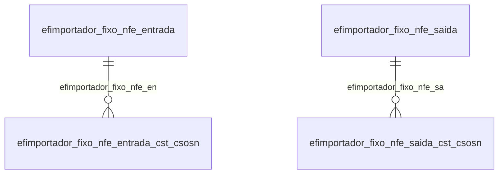

# Modelo — Fiscal - importador (rascunho em lote)

> Gerado por `src/model/gerar_docs_modelo.py` a partir de `src/model/modulos/fiscal_importador.yaml`, do catálogo e do perfil de colunas. **Não edite à mão.**

158 entidades. A coluna *Preench.* é o % de linhas com valor útil (nem nulo, nem em branco, nem zero, nem 1900-01-01; para colunas de código o zero conta como valor).

## Diagrama

## Entidades

| Entidade | Tabela | Linhas | Volume | Filtro obrigatório |
|---|---|---|---|---|
| [efimportador_fixo_sped_fiscal_saida_acumulador_cfop](#efimportador_fixo_sped_fiscal_saida_acumulador_cfop) | `EFIMPORTADOR_FIXO_SPED_FISCAL_SAIDA_ACUMULADOR_CFOP` | 564.205 | medio | empresa |
| [efimportador_fixo_sped_fiscal_entrada_acumulador_cfop](#efimportador_fixo_sped_fiscal_entrada_acumulador_cfop) | `EFIMPORTADOR_FIXO_SPED_FISCAL_ENTRADA_ACUMULADOR_CFOP` | 474.587 | medio | empresa |
| [efimportador_fixo_sped_fiscal_saida_acumulador](#efimportador_fixo_sped_fiscal_saida_acumulador) | `EFIMPORTADOR_FIXO_SPED_FISCAL_SAIDA_ACUMULADOR` | 302.235 | medio | empresa |
| [efimportador_fixo_nfe_saida_acumulador_cfop](#efimportador_fixo_nfe_saida_acumulador_cfop) | `EFIMPORTADOR_FIXO_NFE_SAIDA_ACUMULADOR_CFOP` | 277.225 | medio | empresa |
| [efimportador_fixo_sped_fiscal_entrada_acumulador](#efimportador_fixo_sped_fiscal_entrada_acumulador) | `EFIMPORTADOR_FIXO_SPED_FISCAL_ENTRADA_ACUMULADOR` | 255.685 | medio | empresa |
| [efimportador_fixo_nfe_entrada_acumulador_cfop](#efimportador_fixo_nfe_entrada_acumulador_cfop) | `EFIMPORTADOR_FIXO_NFE_ENTRADA_ACUMULADOR_CFOP` | 219.424 | medio | empresa |
| [efimportador_fixo_nfe_entrada_cfop_saida](#efimportador_fixo_nfe_entrada_cfop_saida) | `EFIMPORTADOR_FIXO_NFE_ENTRADA_CFOP_SAIDA` | 194.362 | medio | empresa |
| [efimportador_fixo_nfe_entrada_cfop](#efimportador_fixo_nfe_entrada_cfop) | `EFIMPORTADOR_FIXO_NFE_ENTRADA_CFOP` | 167.979 | medio | empresa |
| [efimportador_fixo_nfe_saida_acumulador](#efimportador_fixo_nfe_saida_acumulador) | `EFIMPORTADOR_FIXO_NFE_SAIDA_ACUMULADOR` | 148.407 | medio | empresa |
| [efimportador_fixo_nfe_entrada_acumulador](#efimportador_fixo_nfe_entrada_acumulador) | `EFIMPORTADOR_FIXO_NFE_ENTRADA_ACUMULADOR` | 119.292 | medio | empresa |
| [efimportador_fixo_cte_saida_acumulador_cfop](#efimportador_fixo_cte_saida_acumulador_cfop) | `EFIMPORTADOR_FIXO_CTE_SAIDA_ACUMULADOR_CFOP` | 24.918 | medio | empresa |
| [efimportador_site_cte_saida_acumulador_cfop](#efimportador_site_cte_saida_acumulador_cfop) | `EFIMPORTADOR_SITE_CTE_SAIDA_ACUMULADOR_CFOP` | 24.872 | medio | empresa |
| [efimportador_fixo_cte_entrada_acumulador_cfop](#efimportador_fixo_cte_entrada_acumulador_cfop) | `EFIMPORTADOR_FIXO_CTE_ENTRADA_ACUMULADOR_CFOP` | 18.894 | medio | empresa |
| [efimportador_site_cte_entrada_acumulador_cfop](#efimportador_site_cte_entrada_acumulador_cfop) | `EFIMPORTADOR_SITE_CTE_ENTRADA_ACUMULADOR_CFOP` | 18.765 | medio | empresa |
| [efimportador_fixo_cte_entrada_cfop_saida](#efimportador_fixo_cte_entrada_cfop_saida) | `EFIMPORTADOR_FIXO_CTE_ENTRADA_CFOP_SAIDA` | 18.685 | medio | empresa |
| [efimportador_fixo_cte_entrada_cfop](#efimportador_fixo_cte_entrada_cfop) | `EFIMPORTADOR_FIXO_CTE_ENTRADA_CFOP` | 18.660 | medio | empresa |
| [efimportador_site_cte_entrada_cfop_saida](#efimportador_site_cte_entrada_cfop_saida) | `EFIMPORTADOR_SITE_CTE_ENTRADA_CFOP_SAIDA` | 18.626 | medio | empresa |
| [efimportador_site_cte_entrada_cfop](#efimportador_site_cte_entrada_cfop) | `EFIMPORTADOR_SITE_CTE_ENTRADA_CFOP` | 18.625 | medio | empresa |
| [efimportador_fixo_sped_fiscal_grupo_produtos](#efimportador_fixo_sped_fiscal_grupo_produtos) | `EFIMPORTADOR_FIXO_SPED_FISCAL_GRUPO_PRODUTOS` | 14.220 | medio | empresa |
| [efimportador_fixo_cte_saida_acumulador](#efimportador_fixo_cte_saida_acumulador) | `EFIMPORTADOR_FIXO_CTE_SAIDA_ACUMULADOR` | 12.495 | medio | empresa |
| [efimportador_site_cte_saida_acumulador](#efimportador_site_cte_saida_acumulador) | `EFIMPORTADOR_SITE_CTE_SAIDA_ACUMULADOR` | 12.472 | medio | empresa |
| [efimportador_fixo_cte_entrada_acumulador](#efimportador_fixo_cte_entrada_acumulador) | `EFIMPORTADOR_FIXO_CTE_ENTRADA_ACUMULADOR` | 10.108 | medio | empresa |
| [efimportador_site_cte_entrada_acumulador](#efimportador_site_cte_entrada_acumulador) | `EFIMPORTADOR_SITE_CTE_ENTRADA_ACUMULADOR` | 10.039 | medio | empresa |
| [efimportador_fixo_nfe_entrada_diferenca_bc_icms](#efimportador_fixo_nfe_entrada_diferenca_bc_icms) | `EFIMPORTADOR_FIXO_NFE_ENTRADA_DIFERENCA_BC_ICMS` | 8.316 | pequeno | empresa |
| [efimportador_fixo_nfe_saida_diferenca_bc_icms](#efimportador_fixo_nfe_saida_diferenca_bc_icms) | `EFIMPORTADOR_FIXO_NFE_SAIDA_DIFERENCA_BC_ICMS` | 8.267 | pequeno | empresa |
| [efimportador_fixo_sped_fiscal_especie](#efimportador_fixo_sped_fiscal_especie) | `EFIMPORTADOR_FIXO_SPED_FISCAL_ESPECIE` | 8.199 | pequeno | empresa |
| [efimportador_fixo_sped_fiscal_entrada_diferenca_bc_icms](#efimportador_fixo_sped_fiscal_entrada_diferenca_bc_icms) | `EFIMPORTADOR_FIXO_SPED_FISCAL_ENTRADA_DIFERENCA_BC_ICMS` | 8.155 | pequeno | empresa |
| [efimportador_fixo_sped_fiscal_saida_diferenca_bc_icms](#efimportador_fixo_sped_fiscal_saida_diferenca_bc_icms) | `EFIMPORTADOR_FIXO_SPED_FISCAL_SAIDA_DIFERENCA_BC_ICMS` | 8.148 | pequeno | empresa |
| [efimportador_fixo_cat52_situacao_tributaria](#efimportador_fixo_cat52_situacao_tributaria) | `EFIMPORTADOR_FIXO_CAT52_SITUACAO_TRIBUTARIA` | 7.140 | pequeno | empresa |
| [efimportador_fixo_sped_fiscal_reducao_z_saidas_situacao_trib](#efimportador_fixo_sped_fiscal_reducao_z_saidas_situacao_trib) | `EFIMPORTADOR_FIXO_SPED_FISCAL_REDUCAO_Z_SAIDAS_SITUACAO_TRIBUTARIA_CFOP_FIXO` | 4.746 | pequeno | empresa |
| [efimportador_fixo_sped_fiscal_produto_mov_fisica](#efimportador_fixo_sped_fiscal_produto_mov_fisica) | `EFIMPORTADOR_FIXO_SPED_FISCAL_PRODUTO_MOV_FISICA` | 4.656 | pequeno | empresa |
| [efimportador_fixo_nfse_servico_acumulador](#efimportador_fixo_nfse_servico_acumulador) | `EFIMPORTADOR_FIXO_NFSE_SERVICO_ACUMULADOR` | 4.650 | pequeno | empresa |
| [efimportador_fixo_sped_fiscal_reducao_z_saidas_situacao_trib_x](#efimportador_fixo_sped_fiscal_reducao_z_saidas_situacao_trib_x) | `EFIMPORTADOR_FIXO_SPED_FISCAL_REDUCAO_Z_SAIDAS_SITUACAO_TRIBUTARIA_CFOP` | 3.529 | pequeno | empresa |
| [efimportador_fixo_cfe_saida_acumulador_cfop](#efimportador_fixo_cfe_saida_acumulador_cfop) | `EFIMPORTADOR_FIXO_CFE_SAIDA_ACUMULADOR_CFOP` | 3.266 | pequeno | empresa |
| [efimportador_fixo_sped_fiscal_cfe_saida_acumulador_cfop](#efimportador_fixo_sped_fiscal_cfe_saida_acumulador_cfop) | `EFIMPORTADOR_FIXO_SPED_FISCAL_CFE_SAIDA_ACUMULADOR_CFOP` | 3.231 | pequeno | empresa |
| [efimportador_fixo_nfe_entrada_produto_mov_fisica](#efimportador_fixo_nfe_entrada_produto_mov_fisica) | `EFIMPORTADOR_FIXO_NFE_ENTRADA_PRODUTO_MOV_FISICA` | 2.399 | pequeno | empresa |
| [efimportador_fixo_nfe_saida_produto_mov_fisica](#efimportador_fixo_nfe_saida_produto_mov_fisica) | `EFIMPORTADOR_FIXO_NFE_SAIDA_PRODUTO_MOV_FISICA` | 2.398 | pequeno | empresa |
| [efimportador_fixo_sped_fiscal_reducao_z_saidas_situacao_trib_x_x](#efimportador_fixo_sped_fiscal_reducao_z_saidas_situacao_trib_x_x) | `EFIMPORTADOR_FIXO_SPED_FISCAL_REDUCAO_Z_SAIDAS_SITUACAO_TRIBUTARIA` | 2.365 | pequeno | empresa |
| [efimportador_fixo_cfe_saida_acumulador](#efimportador_fixo_cfe_saida_acumulador) | `EFIMPORTADOR_FIXO_CFE_SAIDA_ACUMULADOR` | 2.186 | pequeno | empresa |
| [efimportador_fixo_sped_fiscal_cfe_saida_acumulador](#efimportador_fixo_sped_fiscal_cfe_saida_acumulador) | `EFIMPORTADOR_FIXO_SPED_FISCAL_CFE_SAIDA_ACUMULADOR` | 2.154 | pequeno | empresa |
| [efimportador_fixo_cfe_saida_diferenca_bc_icms](#efimportador_fixo_cfe_saida_diferenca_bc_icms) | `EFIMPORTADOR_FIXO_CFE_SAIDA_DIFERENCA_BC_ICMS` | 2.145 | pequeno | empresa |
| [efimportador_fixo_sped_pis_cofins_entrada_acumulador_cfop](#efimportador_fixo_sped_pis_cofins_entrada_acumulador_cfop) | `EFIMPORTADOR_FIXO_SPED_PIS_COFINS_ENTRADA_ACUMULADOR_CFOP` | 1.592 | pequeno | empresa |
| [efimportador_fixo_sped_pis_cofins_entrada_acumulador](#efimportador_fixo_sped_pis_cofins_entrada_acumulador) | `EFIMPORTADOR_FIXO_SPED_PIS_COFINS_ENTRADA_ACUMULADOR` | 1.568 | pequeno | empresa |
| [efimportador_fixo_nfe_entrada_cfop_excecao_por_fornecedor_cf](#efimportador_fixo_nfe_entrada_cfop_excecao_por_fornecedor_cf) | `EFIMPORTADOR_FIXO_NFE_ENTRADA_CFOP_EXCECAO_POR_FORNECEDOR_CFOP_ENTRADA_FORNECEDOR` | 1.356 | pequeno | empresa |
| [efimportador_fixo_cte](#efimportador_fixo_cte) | `EFIMPORTADOR_FIXO_CTE` | 1.260 | pequeno | empresa |
| [efimportador_fixo_cte_saida](#efimportador_fixo_cte_saida) | `EFIMPORTADOR_FIXO_CTE_SAIDA` | 1.259 | pequeno | empresa |
| [efimportador_fixo_cte_entrada](#efimportador_fixo_cte_entrada) | `EFIMPORTADOR_FIXO_CTE_ENTRADA` | 1.259 | pequeno | empresa |
| [efimportador_site_cte](#efimportador_site_cte) | `EFIMPORTADOR_SITE_CTE` | 1.255 | pequeno | empresa |
| [efimportador_site_cte_saida](#efimportador_site_cte_saida) | `EFIMPORTADOR_SITE_CTE_SAIDA` | 1.254 | pequeno | empresa |
| [efimportador_site_cte_entrada](#efimportador_site_cte_entrada) | `EFIMPORTADOR_SITE_CTE_ENTRADA` | 1.254 | pequeno | empresa |
| [efimportador_fixo_cte_saida_diferenca_bc_icms](#efimportador_fixo_cte_saida_diferenca_bc_icms) | `EFIMPORTADOR_FIXO_CTE_SAIDA_DIFERENCA_BC_ICMS` | 1.242 | pequeno | empresa |
| [efimportador_site_cte_saida_diferenca_bc_icms](#efimportador_site_cte_saida_diferenca_bc_icms) | `EFIMPORTADOR_SITE_CTE_SAIDA_DIFERENCA_BC_ICMS` | 1.240 | pequeno | empresa |
| [efimportador_fixo_cte_entrada_diferenca_bc_icms](#efimportador_fixo_cte_entrada_diferenca_bc_icms) | `EFIMPORTADOR_FIXO_CTE_ENTRADA_DIFERENCA_BC_ICMS` | 1.239 | pequeno | empresa |
| [efimportador_site_cte_entrada_diferenca_bc_icms](#efimportador_site_cte_entrada_diferenca_bc_icms) | `EFIMPORTADOR_SITE_CTE_ENTRADA_DIFERENCA_BC_ICMS` | 1.238 | pequeno | empresa |
| [efimportador_fixo_nfe](#efimportador_fixo_nfe) | `EFIMPORTADOR_FIXO_NFE` | 1.220 | pequeno | empresa |
| [efimportador_fixo_nfe_saida](#efimportador_fixo_nfe_saida) | `EFIMPORTADOR_FIXO_NFE_SAIDA` | 1.220 | pequeno | empresa |
| [efimportador_fixo_nfe_entrada](#efimportador_fixo_nfe_entrada) | `EFIMPORTADOR_FIXO_NFE_ENTRADA` | 1.220 | pequeno | empresa |
| [efimportador_fixo_cat52](#efimportador_fixo_cat52) | `EFIMPORTADOR_FIXO_CAT52` | 1.191 | pequeno | empresa |
| [efimportador_fixo_nfse](#efimportador_fixo_nfse) | `EFIMPORTADOR_FIXO_NFSE` | 1.190 | pequeno | empresa |
| [efimportador_fixo_nfse_servico](#efimportador_fixo_nfse_servico) | `EFIMPORTADOR_FIXO_NFSE_SERVICO` | 1.190 | pequeno | empresa |
| [efimportador_fixo_sped_fiscal](#efimportador_fixo_sped_fiscal) | `EFIMPORTADOR_FIXO_SPED_FISCAL` | 1.185 | pequeno | empresa |
| [efimportador_fixo_sped_fiscal_saida](#efimportador_fixo_sped_fiscal_saida) | `EFIMPORTADOR_FIXO_SPED_FISCAL_SAIDA` | 1.185 | pequeno | empresa |
| [efimportador_fixo_sped_fiscal_entrada](#efimportador_fixo_sped_fiscal_entrada) | `EFIMPORTADOR_FIXO_SPED_FISCAL_ENTRADA` | 1.185 | pequeno | empresa |
| [efimportador_fixo_sped_fiscal_reducao_z](#efimportador_fixo_sped_fiscal_reducao_z) | `EFIMPORTADOR_FIXO_SPED_FISCAL_REDUCAO_Z` | 1.185 | pequeno | empresa |
| [efimportador_fixo_nfe_entrada_diferenca_bc_ipi](#efimportador_fixo_nfe_entrada_diferenca_bc_ipi) | `EFIMPORTADOR_FIXO_NFE_ENTRADA_DIFERENCA_BC_IPI` | 1.183 | pequeno | empresa |
| [efimportador_fixo_nfe_saida_diferenca_bc_ipi](#efimportador_fixo_nfe_saida_diferenca_bc_ipi) | `EFIMPORTADOR_FIXO_NFE_SAIDA_DIFERENCA_BC_IPI` | 1.182 | pequeno | empresa |
| [efimportador_fixo_sped_fiscal_bilhete_passagem](#efimportador_fixo_sped_fiscal_bilhete_passagem) | `EFIMPORTADOR_FIXO_SPED_FISCAL_BILHETE_PASSAGEM` | 1.178 | pequeno | empresa |
| [efimportador_fixo_sped_fiscal_cfe_saida](#efimportador_fixo_sped_fiscal_cfe_saida) | `EFIMPORTADOR_FIXO_SPED_FISCAL_CFE_SAIDA` | 1.077 | pequeno | empresa |
| [efimportador_fixo_sped_fiscal_cfe_saida_diferenca_bc_icms](#efimportador_fixo_sped_fiscal_cfe_saida_diferenca_bc_icms) | `EFIMPORTADOR_FIXO_SPED_FISCAL_CFE_SAIDA_DIFERENCA_BC_ICMS` | 1.077 | pequeno | empresa |
| [efimportador_fixo_cfe](#efimportador_fixo_cfe) | `EFIMPORTADOR_FIXO_CFE` | 1.073 | pequeno | empresa |
| [efimportador_fixo_cfe_saida](#efimportador_fixo_cfe_saida) | `EFIMPORTADOR_FIXO_CFE_SAIDA` | 1.073 | pequeno | empresa |
| [efimportador_fixo_nfe_saida_dados_pis_cofins](#efimportador_fixo_nfe_saida_dados_pis_cofins) | `EFIMPORTADOR_FIXO_NFE_SAIDA_DADOS_PIS_COFINS` | 932 | pequeno | empresa |
| [efimportador_fixo_nfe_entrada_dados_pis_cofins](#efimportador_fixo_nfe_entrada_dados_pis_cofins) | `EFIMPORTADOR_FIXO_NFE_ENTRADA_DADOS_PIS_COFINS` | 922 | pequeno | empresa |
| [efimportador_xml_portal_federal](#efimportador_xml_portal_federal) | `EFIMPORTADOR_XML_PORTAL_FEDERAL` | 638 | pequeno | empresa |
| [efimportador_fixo_sped_pis_cofins_saida_acumulador_cfop](#efimportador_fixo_sped_pis_cofins_saida_acumulador_cfop) | `EFIMPORTADOR_FIXO_SPED_PIS_COFINS_SAIDA_ACUMULADOR_CFOP` | 624 | pequeno | empresa |
| [efimportador_fixo_sped_pis_cofins_saida_acumulador](#efimportador_fixo_sped_pis_cofins_saida_acumulador) | `EFIMPORTADOR_FIXO_SPED_PIS_COFINS_SAIDA_ACUMULADOR` | 606 | pequeno | empresa |
| [efimportador_fixo_sintegra_situacao_tributaria](#efimportador_fixo_sintegra_situacao_tributaria) | `EFIMPORTADOR_FIXO_SINTEGRA_SITUACAO_TRIBUTARIA` | 328 | pequeno | empresa |
| [efimportador_site_portal_nfe_campos_pagina](#efimportador_site_portal_nfe_campos_pagina) | `EFIMPORTADOR_SITE_PORTAL_NFE_CAMPOS_PAGINA` | 239 | pequeno | — |
| [efimportador_fixo_sped_pis_cofins_grupo_produtos](#efimportador_fixo_sped_pis_cofins_grupo_produtos) | `EFIMPORTADOR_FIXO_SPED_PIS_COFINS_GRUPO_PRODUTOS` | 228 | pequeno | empresa |
| [efimportador_fixo_nfse_nacional_entrada_acumulador](#efimportador_fixo_nfse_nacional_entrada_acumulador) | `EFIMPORTADOR_FIXO_NFSE_NACIONAL_ENTRADA_ACUMULADOR` | 217 | pequeno | empresa |
| [efimportador_fixo_nfse_nacional](#efimportador_fixo_nfse_nacional) | `EFIMPORTADOR_FIXO_NFSE_NACIONAL` | 191 | pequeno | empresa |
| [efimportador_fixo_nfse_nacional_servico](#efimportador_fixo_nfse_nacional_servico) | `EFIMPORTADOR_FIXO_NFSE_NACIONAL_SERVICO` | 191 | pequeno | empresa |
| [efimportador_fixo_nfse_nacional_entrada](#efimportador_fixo_nfse_nacional_entrada) | `EFIMPORTADOR_FIXO_NFSE_NACIONAL_ENTRADA` | 191 | pequeno | empresa |
| [efimportador_sefaz_es_campos_pagina](#efimportador_sefaz_es_campos_pagina) | `EFIMPORTADOR_SEFAZ_ES_CAMPOS_PAGINA` | 171 | pequeno | — |
| [efimportador_sefaz_rs_campos_pagina](#efimportador_sefaz_rs_campos_pagina) | `EFIMPORTADOR_SEFAZ_RS_CAMPOS_PAGINA` | 159 | pequeno | — |
| [efimportador_sefaz_sc_campos_pagina](#efimportador_sefaz_sc_campos_pagina) | `EFIMPORTADOR_SEFAZ_SC_CAMPOS_PAGINA` | 159 | pequeno | — |
| [efimportador_fixo_nfe_entrada_cfop_excecao_por_fornecedor_cf_x](#efimportador_fixo_nfe_entrada_cfop_excecao_por_fornecedor_cf_x) | `EFIMPORTADOR_FIXO_NFE_ENTRADA_CFOP_EXCECAO_POR_FORNECEDOR_CFOP_ENTRADA` | 159 | pequeno | empresa |
| [efimportador_fixo_nfse_nacional_servico_acumulador](#efimportador_fixo_nfse_nacional_servico_acumulador) | `EFIMPORTADOR_FIXO_NFSE_NACIONAL_SERVICO_ACUMULADOR` | 155 | pequeno | empresa |
| [efimportador_sefaz_mt_campos_pagina](#efimportador_sefaz_mt_campos_pagina) | `EFIMPORTADOR_SEFAZ_MT_CAMPOS_PAGINA` | 147 | pequeno | — |
| [efimportador_fixo_nfe_entrada_acumulador_ncm](#efimportador_fixo_nfe_entrada_acumulador_ncm) | `EFIMPORTADOR_FIXO_NFE_ENTRADA_ACUMULADOR_NCM` | 141 | pequeno | empresa |
| [efimportador_fixo_nfe_saida_cfop_entrada](#efimportador_fixo_nfe_saida_cfop_entrada) | `EFIMPORTADOR_FIXO_NFE_SAIDA_CFOP_ENTRADA` | 134 | pequeno | empresa |
| [efimportador_fixo_nfe_saida_cfop](#efimportador_fixo_nfe_saida_cfop) | `EFIMPORTADOR_FIXO_NFE_SAIDA_CFOP` | 127 | pequeno | empresa |
| [efimportador_fixo_convenio_icms115_acumulador_cfop](#efimportador_fixo_convenio_icms115_acumulador_cfop) | `EFIMPORTADOR_FIXO_CONVENIO_ICMS115_ACUMULADOR_CFOP` | 110 | pequeno | empresa |
| [efimportador_site_cte_campos_pagina](#efimportador_site_cte_campos_pagina) | `EFIMPORTADOR_SITE_CTE_CAMPOS_PAGINA` | 85 | pequeno | — |
| [efimportador_fixo_nfse_entrada](#efimportador_fixo_nfse_entrada) | `EFIMPORTADOR_FIXO_NFSE_ENTRADA` | 84 | pequeno | empresa |
| [efimportador_fixo_nfce_saida_acumulador_cfop](#efimportador_fixo_nfce_saida_acumulador_cfop) | `EFIMPORTADOR_FIXO_NFCE_SAIDA_ACUMULADOR_CFOP` | 81 | pequeno | empresa |
| [efimportador_fixo_sped_pis_cofins_especie](#efimportador_fixo_sped_pis_cofins_especie) | `EFIMPORTADOR_FIXO_SPED_PIS_COFINS_ESPECIE` | 76 | pequeno | empresa |
| [efimportador_fixo_nfce_saida_acumulador](#efimportador_fixo_nfce_saida_acumulador) | `EFIMPORTADOR_FIXO_NFCE_SAIDA_ACUMULADOR` | 76 | pequeno | empresa |
| [efimportador_fixo_nfse_entrada_acumulador](#efimportador_fixo_nfse_entrada_acumulador) | `EFIMPORTADOR_FIXO_NFSE_ENTRADA_ACUMULADOR` | 72 | pequeno | empresa |
| [efimportador_fixo_sintegra](#efimportador_fixo_sintegra) | `EFIMPORTADOR_FIXO_SINTEGRA` | 61 | pequeno | empresa |
| [efimportador_fixo_convenio_icms115_especie](#efimportador_fixo_convenio_icms115_especie) | `EFIMPORTADOR_FIXO_CONVENIO_ICMS115_ESPECIE` | 59 | pequeno | empresa |
| [efimportador_fixo_convenio_icms115_acumulador](#efimportador_fixo_convenio_icms115_acumulador) | `EFIMPORTADOR_FIXO_CONVENIO_ICMS115_ACUMULADOR` | 56 | pequeno | empresa |
| [efimportador_fixo_nfce](#efimportador_fixo_nfce) | `EFIMPORTADOR_FIXO_NFCE` | 51 | pequeno | empresa |
| [efimportador_fixo_nfce_entrada](#efimportador_fixo_nfce_entrada) | `EFIMPORTADOR_FIXO_NFCE_ENTRADA` | 51 | pequeno | empresa |
| [efimportador_fixo_nfce_saida](#efimportador_fixo_nfce_saida) | `EFIMPORTADOR_FIXO_NFCE_SAIDA` | 51 | pequeno | empresa |
| [efimportador_fixo_nfe_entrada_cst_csosn_cfop](#efimportador_fixo_nfe_entrada_cst_csosn_cfop) | `EFIMPORTADOR_FIXO_NFE_ENTRADA_CST_CSOSN_CFOP` | 40 | pequeno | empresa |
| [efimportador_fixo_nfe_entrada_acumulador_forma_pagamento](#efimportador_fixo_nfe_entrada_acumulador_forma_pagamento) | `EFIMPORTADOR_FIXO_NFE_ENTRADA_ACUMULADOR_FORMA_PAGAMENTO` | 31 | pequeno | empresa |
| [efimportador_site_cte_nfe_campos_pagina](#efimportador_site_cte_nfe_campos_pagina) | `EFIMPORTADOR_SITE_CTE_NFE_CAMPOS_PAGINA` | 26 | pequeno | — |
| [efimportador_fixo_nfe_saida_acumulador_forma_pagamento](#efimportador_fixo_nfe_saida_acumulador_forma_pagamento) | `EFIMPORTADOR_FIXO_NFE_SAIDA_ACUMULADOR_FORMA_PAGAMENTO` | 25 | pequeno | empresa |
| [efimportador_fixo_nfce_entrada_cfop](#efimportador_fixo_nfce_entrada_cfop) | `EFIMPORTADOR_FIXO_NFCE_ENTRADA_CFOP` | 21 | pequeno | empresa |
| [efimportador_fixo_nfce_entrada_cfop_saida](#efimportador_fixo_nfce_entrada_cfop_saida) | `EFIMPORTADOR_FIXO_NFCE_ENTRADA_CFOP_SAIDA` | 21 | pequeno | empresa |
| [efimportador_fixo_nfce_formas_pagamento](#efimportador_fixo_nfce_formas_pagamento) | `EFIMPORTADOR_FIXO_NFCE_FORMAS_PAGAMENTO` | 21 | pequeno | — |
| [efimportador_fixo_nfe_formas_pagamento](#efimportador_fixo_nfe_formas_pagamento) | `EFIMPORTADOR_FIXO_NFE_FORMAS_PAGAMENTO` | 21 | pequeno | — |
| [efimportador_fixo_convenio_icms115](#efimportador_fixo_convenio_icms115) | `EFIMPORTADOR_FIXO_CONVENIO_ICMS115` | 20 | pequeno | empresa |
| [efimportador_fixo_nfe_entrada_impostos_gerados](#efimportador_fixo_nfe_entrada_impostos_gerados) | `EFIMPORTADOR_FIXO_NFE_ENTRADA_IMPOSTOS_GERADOS` | 20 | pequeno | empresa |
| [efimportador_fixo_sped_pis_cofins](#efimportador_fixo_sped_pis_cofins) | `EFIMPORTADOR_FIXO_SPED_PIS_COFINS` | 19 | pequeno | empresa |
| [efimportador_fixo_sped_pis_cofins_saida](#efimportador_fixo_sped_pis_cofins_saida) | `EFIMPORTADOR_FIXO_SPED_PIS_COFINS_SAIDA` | 19 | pequeno | empresa |
| [efimportador_fixo_sped_pis_cofins_entrada](#efimportador_fixo_sped_pis_cofins_entrada) | `EFIMPORTADOR_FIXO_SPED_PIS_COFINS_ENTRADA` | 19 | pequeno | empresa |
| [efimportador_fixo_sped_pis_cofins_servico](#efimportador_fixo_sped_pis_cofins_servico) | `EFIMPORTADOR_FIXO_SPED_PIS_COFINS_SERVICO` | 19 | pequeno | empresa |
| [efimportador_fixo_nfe_entrada_cst_csosn](#efimportador_fixo_nfe_entrada_cst_csosn) | `EFIMPORTADOR_FIXO_NFE_ENTRADA_CST_CSOSN` | 18 | pequeno | empresa |
| [efimportador_site_cadastros_campos_pagina](#efimportador_site_cadastros_campos_pagina) | `EFIMPORTADOR_SITE_CADASTROS_CAMPOS_PAGINA` | 12 | pequeno | — |
| [efimportador_fixo_nfe_saida_cst_csosn](#efimportador_fixo_nfe_saida_cst_csosn) | `EFIMPORTADOR_FIXO_NFE_SAIDA_CST_CSOSN` | 12 | pequeno | empresa |
| [efimportador_fixo_nfe_saida_cst_csosn_cfop](#efimportador_fixo_nfe_saida_cst_csosn_cfop) | `EFIMPORTADOR_FIXO_NFE_SAIDA_CST_CSOSN_CFOP` | 12 | pequeno | empresa |
| [efimportador_fixo_nfe_saida_cfop_cst](#efimportador_fixo_nfe_saida_cfop_cst) | `EFIMPORTADOR_FIXO_NFE_SAIDA_CFOP_CST` | 11 | pequeno | empresa |
| [efimportador_sefaz_ms_campos_pagina](#efimportador_sefaz_ms_campos_pagina) | `EFIMPORTADOR_SEFAZ_MS_CAMPOS_PAGINA` | 10 | pequeno | — |
| [efimportador_fixo_nfce_entrada_acumulador_cfop](#efimportador_fixo_nfce_entrada_acumulador_cfop) | `EFIMPORTADOR_FIXO_NFCE_ENTRADA_ACUMULADOR_CFOP` | 9 | pequeno | empresa |
| [efimportador_fixo_nfce_saida_diferenca_bc_icms](#efimportador_fixo_nfce_saida_diferenca_bc_icms) | `EFIMPORTADOR_FIXO_NFCE_SAIDA_DIFERENCA_BC_ICMS` | 9 | pequeno | empresa |
| [efimportador_fixo_nfe_saida_acumulador_ncm](#efimportador_fixo_nfe_saida_acumulador_ncm) | `EFIMPORTADOR_FIXO_NFE_SAIDA_ACUMULADOR_NCM` | 9 | pequeno | empresa |
| [efimportador_fixo_nfce_entrada_acumulador](#efimportador_fixo_nfce_entrada_acumulador) | `EFIMPORTADOR_FIXO_NFCE_ENTRADA_ACUMULADOR` | 8 | pequeno | empresa |
| [efimportador_fixo_nfce_saida_acumulador_forma_pagamento](#efimportador_fixo_nfce_saida_acumulador_forma_pagamento) | `EFIMPORTADOR_FIXO_NFCE_SAIDA_ACUMULADOR_FORMA_PAGAMENTO` | 6 | pequeno | empresa |
| [efimportador_fixo_nfe_entrada_cfop_cst](#efimportador_fixo_nfe_entrada_cfop_cst) | `EFIMPORTADOR_FIXO_NFE_ENTRADA_CFOP_CST` | 5 | pequeno | empresa |
| [efimportador_fixo_nfe_saida_dados_pis_cofins_dados](#efimportador_fixo_nfe_saida_dados_pis_cofins_dados) | `EFIMPORTADOR_FIXO_NFE_SAIDA_DADOS_PIS_COFINS_DADOS` | 5 | pequeno | empresa |
| [efimportador_fixo_cfe_saida_acumulador_produto](#efimportador_fixo_cfe_saida_acumulador_produto) | `EFIMPORTADOR_FIXO_CFE_SAIDA_ACUMULADOR_PRODUTO` | 5 | pequeno | empresa |
| [efimportador_fixo_nfe_saida_dados_pis_cofins_cfop](#efimportador_fixo_nfe_saida_dados_pis_cofins_cfop) | `EFIMPORTADOR_FIXO_NFE_SAIDA_DADOS_PIS_COFINS_CFOP` | 4 | pequeno | empresa |
| [efimportador_fixo_nfe_entrada_impostos_notas_op_nacional](#efimportador_fixo_nfe_entrada_impostos_notas_op_nacional) | `EFIMPORTADOR_FIXO_NFE_ENTRADA_IMPOSTOS_NOTAS_OP_NACIONAL` | 4 | pequeno | empresa |
| [efimportador_fixo_nfe_saida_acumulador_cst](#efimportador_fixo_nfe_saida_acumulador_cst) | `EFIMPORTADOR_FIXO_NFE_SAIDA_ACUMULADOR_CST` | 3 | pequeno | empresa |
| [efimportador_fixo_nf3e_entrada_acumulador](#efimportador_fixo_nf3e_entrada_acumulador) | `EFIMPORTADOR_FIXO_NF3E_ENTRADA_ACUMULADOR` | 3 | pequeno | empresa |
| [efimportador_fixo_nf3e_entrada_acumulador_cfop](#efimportador_fixo_nf3e_entrada_acumulador_cfop) | `EFIMPORTADOR_FIXO_NF3E_ENTRADA_ACUMULADOR_CFOP` | 3 | pequeno | empresa |
| [efimportador_fixo_nfe_entrada_acumulador_cst](#efimportador_fixo_nfe_entrada_acumulador_cst) | `EFIMPORTADOR_FIXO_NFE_ENTRADA_ACUMULADOR_CST` | 2 | pequeno | empresa |
| [efimportador_fixo_nfe_saida_acumulador_cst_pis](#efimportador_fixo_nfe_saida_acumulador_cst_pis) | `EFIMPORTADOR_FIXO_NFE_SAIDA_ACUMULADOR_CST_PIS` | 2 | pequeno | empresa |
| [efimportador_fixo_nfe_entrada_acumulador_fornecedor](#efimportador_fixo_nfe_entrada_acumulador_fornecedor) | `EFIMPORTADOR_FIXO_NFE_ENTRADA_ACUMULADOR_FORNECEDOR` | 2 | pequeno | empresa |
| [efimportador_fixo_nfse_servico_acumulador_item_servico](#efimportador_fixo_nfse_servico_acumulador_item_servico) | `EFIMPORTADOR_FIXO_NFSE_SERVICO_ACUMULADOR_ITEM_SERVICO` | 2 | pequeno | empresa |
| [efimportador_fixo_cfe_saida_acumulador_cst](#efimportador_fixo_cfe_saida_acumulador_cst) | `EFIMPORTADOR_FIXO_CFE_SAIDA_ACUMULADOR_CST` | 2 | pequeno | empresa |
| [efimportador_fixo_nfse_nacional_servico_acumulador_item_serv](#efimportador_fixo_nfse_nacional_servico_acumulador_item_serv) | `EFIMPORTADOR_FIXO_NFSE_NACIONAL_SERVICO_ACUMULADOR_ITEM_SERVICO` | 2 | pequeno | empresa |
| [efimportador_fixo_sped_pis_cofins_entrada_diferenca_bc_icms](#efimportador_fixo_sped_pis_cofins_entrada_diferenca_bc_icms) | `EFIMPORTADOR_FIXO_SPED_PIS_COFINS_ENTRADA_DIFERENCA_BC_ICMS` | 1 | pequeno | empresa |
| [efimportador_site_cad_cpf_campos_pagina](#efimportador_site_cad_cpf_campos_pagina) | `EFIMPORTADOR_SITE_CAD_CPF_CAMPOS_PAGINA` | 1 | pequeno | — |
| [efimportador_xml_portal_federal_alteracao](#efimportador_xml_portal_federal_alteracao) | `EFIMPORTADOR_XML_PORTAL_FEDERAL_ALTERACAO` | 1 | pequeno | — |
| [efimportador_fixo_nfe_saida_acumulador_cliente](#efimportador_fixo_nfe_saida_acumulador_cliente) | `EFIMPORTADOR_FIXO_NFE_SAIDA_ACUMULADOR_CLIENTE` | 1 | pequeno | empresa |
| [efimportador_fixo_nfse_entrada_acumulador_item_servico](#efimportador_fixo_nfse_entrada_acumulador_item_servico) | `EFIMPORTADOR_FIXO_NFSE_ENTRADA_ACUMULADOR_ITEM_SERVICO` | 1 | pequeno | empresa |
| [efimportador_fixo_nf3e](#efimportador_fixo_nf3e) | `EFIMPORTADOR_FIXO_NF3E` | 1 | pequeno | empresa |
| [efimportador_fixo_nf3e_saida](#efimportador_fixo_nf3e_saida) | `EFIMPORTADOR_FIXO_NF3E_SAIDA` | 1 | pequeno | empresa |
| [efimportador_fixo_nfse_servico_acumulador_cliente](#efimportador_fixo_nfse_servico_acumulador_cliente) | `EFIMPORTADOR_FIXO_NFSE_SERVICO_ACUMULADOR_CLIENTE` | 1 | pequeno | empresa |
| [efimportador_fixo_nf3e_entrada](#efimportador_fixo_nf3e_entrada) | `EFIMPORTADOR_FIXO_NF3E_ENTRADA` | 1 | pequeno | empresa |
| [efimportador_fixo_nf3e_entrada_cfop](#efimportador_fixo_nf3e_entrada_cfop) | `EFIMPORTADOR_FIXO_NF3E_ENTRADA_CFOP` | 1 | pequeno | empresa |
| [efimportador_fixo_nf3e_entrada_cfop_saida](#efimportador_fixo_nf3e_entrada_cfop_saida) | `EFIMPORTADOR_FIXO_NF3E_ENTRADA_CFOP_SAIDA` | 1 | pequeno | empresa |
| [efimportador_fixo_nf3e_entrada_cst_csosn](#efimportador_fixo_nf3e_entrada_cst_csosn) | `EFIMPORTADOR_FIXO_NF3E_ENTRADA_CST_CSOSN` | 1 | pequeno | empresa |
| [efimportador_fixo_nf3e_entrada_cst_csosn_cfop](#efimportador_fixo_nf3e_entrada_cst_csosn_cfop) | `EFIMPORTADOR_FIXO_NF3E_ENTRADA_CST_CSOSN_CFOP` | 1 | pequeno | empresa |
| [efimportador_fixo_nf3e_entrada_dados_pis_cofins](#efimportador_fixo_nf3e_entrada_dados_pis_cofins) | `EFIMPORTADOR_FIXO_NF3E_ENTRADA_DADOS_PIS_COFINS` | 1 | pequeno | empresa |

## efimportador_fixo_sped_fiscal_saida_acumulador_cfop

**Configuração do leiaute SPED Fiscal do Importador Fixo - Saída - Acumulador - CFOP** — tabela `EFIMPORTADOR_FIXO_SPED_FISCAL_SAIDA_ACUMULADOR_CFOP` (564.205 linhas)

Configuração do leiaute SPED Fiscal do Importador Fixo - Saída - Acumulador - CFOP. 564.205 linhas no catálogo; chave: CODI_EMP, I_ACUMULADOR, I_CFOP.

- **Chave:** `CODI_EMP, I_ACUMULADOR, I_CFOP`
- **Empresa:** `CODI_EMP`
- **Período:** `—`
- **Ordem padrão:** `I_ACUMULADOR asc`, `I_CFOP asc`

**Regras de negócio validadas:**

- Medido em 2026-10-18: 564.205 linhas, 1.185 empresa(s).
- Vínculo efnatureza (efnatureza): 0 de 484 linhas sem registro relacionado (empresa 646).

| Campo | Coluna | Tipo | Preench. | Domínio | Descrição (banco) |
|---|---|---|---|---|---|
| codigo_da_empresa | `codi_emp` | integer(4) |  |  | Código da empresa |
| sequencial_do_acumulador | `i_acumulador` | integer(4) |  |  | Sequencial do acumulador |
| sequencial_do_cfop | `i_cfop` | integer(4) |  |  | Sequencial do CFOP |
| cfop | `cfop` | integer(4) |  |  | CFOP |
| versao_do_cfop | `versao_cfop` | smallint(2) |  |  | Versão do CFOP |

**Vínculos (LEFT JOIN, acrescentam colunas legíveis):**

- `efnatureza` → `efnatureza` por `cfop` = `codi_nat` e `versao_cfop` = `versao_nat`; colunas: `efnatureza_nome`

**Filtros:** `sequencial_do_acumulador` (eq/in), `sequencial_do_cfop` (eq/in)

## efimportador_fixo_sped_fiscal_entrada_acumulador_cfop

**Configuração do leiaute SPED Fiscal do Importador Fixo - Entrada - Acumulador - CFOP** — tabela `EFIMPORTADOR_FIXO_SPED_FISCAL_ENTRADA_ACUMULADOR_CFOP` (474.587 linhas)

Configuração do leiaute SPED Fiscal do Importador Fixo - Entrada - Acumulador - CFOP. 474.587 linhas no catálogo; chave: CODI_EMP, I_ACUMULADOR, I_CFOP.

- **Chave:** `CODI_EMP, I_ACUMULADOR, I_CFOP`
- **Empresa:** `CODI_EMP`
- **Período:** `—`
- **Ordem padrão:** `I_ACUMULADOR asc`, `I_CFOP asc`

**Regras de negócio validadas:**

- Medido em 2026-10-18: 474.587 linhas, 1.184 empresa(s).
- Vínculo efnatureza (efnatureza): 0 de 407 linhas sem registro relacionado (empresa 902).

| Campo | Coluna | Tipo | Preench. | Domínio | Descrição (banco) |
|---|---|---|---|---|---|
| codigo_da_empresa | `codi_emp` | integer(4) |  |  | Código da empresa |
| sequencial_do_acumulador | `i_acumulador` | integer(4) |  |  | Sequencial do acumulador |
| sequencial_do_cfop | `i_cfop` | integer(4) |  |  | Sequencial do CFOP |
| cfop | `cfop` | integer(4) |  |  | CFOP |
| versao_do_cfop | `versao_cfop` | smallint(2) |  |  | Versão do CFOP |

**Vínculos (LEFT JOIN, acrescentam colunas legíveis):**

- `efnatureza` → `efnatureza` por `cfop` = `codi_nat` e `versao_cfop` = `versao_nat`; colunas: `efnatureza_nome`

**Filtros:** `sequencial_do_acumulador` (eq/in), `sequencial_do_cfop` (eq/in)

## efimportador_fixo_sped_fiscal_saida_acumulador

**Configuração do leiaute SPED Fiscal do Importador Fixo - Saída - Acumulador** — tabela `EFIMPORTADOR_FIXO_SPED_FISCAL_SAIDA_ACUMULADOR` (302.235 linhas)

Configuração do leiaute SPED Fiscal do Importador Fixo - Saída - Acumulador. 302.235 linhas no catálogo; chave: CODI_EMP, I_ACUMULADOR.

- **Chave:** `CODI_EMP, I_ACUMULADOR`
- **Empresa:** `CODI_EMP`
- **Período:** `—`
- **Ordem padrão:** `I_ACUMULADOR asc`

**Regras de negócio validadas:**

- Medido em 2026-10-18: 302.235 linhas, 1.185 empresa(s).
- Vínculo efespecies (efespecies): 0 de 259 linhas sem registro relacionado (empresa 646).
- Vínculo efacumulador (EFACUMULADOR): 0 de 259 linhas sem registro relacionado (empresa 646).

| Campo | Coluna | Tipo | Preench. | Domínio | Descrição (banco) |
|---|---|---|---|---|---|
| codigo_da_empresa | `codi_emp` | integer(4) |  |  | Código da empresa |
| sequencial_do_acumulador | `i_acumulador` | integer(4) |  |  | Sequencial do acumulador |
| codigo_da_especie | `codi_esp` | integer(4) |  |  | Código da espécie |
| operacao_abrangente | `operacao` | char(1) |  |  | Operação abrangente |
| codigo_do_acumulador | `codi_acu` | integer(4) |  |  | Código do acumulador |
| selecao_do_cst | `selecao_cst` | char(1) |  |  | Seleção do CST |
| selecao_da_natureza | `selecao_natureza` | char(1) |  |  | Seleção da natureza |
| selecao_do_produto | `selecao_produto` | char(1) |  |  | Seleção do produto |
| selecao_do_cliente | `selecao_cliente` | char(1) |  |  | Seleção do cliente |
| selecao_do_ncm | `selecao_ncm` | char(1) |  |  | Seleção do NCM |
| selecao_do_grupo | `selecao_grupo` | char(1) |  |  | Seleção do grupo |

**Vínculos (LEFT JOIN, acrescentam colunas legíveis):**

- `efespecies` → `efespecies` por `codi_esp` = `codi_esp`; colunas: `efespecies_nome`
- `efacumulador` → `EFACUMULADOR` por `codi_emp` = `codi_emp` e `codi_acu` = `codi_acu`; colunas: `efacumulador_nome`

**Filtros:** `sequencial_do_acumulador` (eq/in), `codigo_da_especie` (eq/in), `operacao_abrangente` (eq/in), `codigo_do_acumulador` (eq/in), `selecao_do_cst` (eq/in), `selecao_da_natureza` (eq/in), `selecao_do_produto` (eq/in), `selecao_do_cliente` (eq/in), `selecao_do_ncm` (eq/in), `selecao_do_grupo` (eq/in)

## efimportador_fixo_nfe_saida_acumulador_cfop

**Configuração do leiaute NF-e XML do Importador Fixo - Saída - Acumulador - CFOP** — tabela `EFIMPORTADOR_FIXO_NFE_SAIDA_ACUMULADOR_CFOP` (277.225 linhas)

Configuração do leiaute NF-e XML do Importador Fixo - Saída - Acumulador - CFOP. 277.225 linhas no catálogo; chave: CODI_EMP, I_ACUMULADOR, I_CFOP.

- **Chave:** `CODI_EMP, I_ACUMULADOR, I_CFOP`
- **Empresa:** `CODI_EMP`
- **Período:** `—`
- **Ordem padrão:** `I_ACUMULADOR asc`, `I_CFOP asc`

**Regras de negócio validadas:**

- Medido em 2026-10-18: 277.225 linhas, 1.212 empresa(s).
- Vínculo efnatureza (efnatureza): 0 de 234 linhas sem registro relacionado (empresa 401).

| Campo | Coluna | Tipo | Preench. | Domínio | Descrição (banco) |
|---|---|---|---|---|---|
| codigo_da_empresa | `codi_emp` | integer(4) |  |  | Código da empresa |
| sequencial_do_acumulador | `i_acumulador` | integer(4) |  |  | Sequencial do acumulador |
| sequencial_do_cfop | `i_cfop` | integer(4) |  |  | Sequencial do CFOP |
| cfop | `cfop` | integer(4) |  |  | CFOP |
| versao_do_cfop | `versao_cfop` | smallint(2) |  |  | Versão do CFOP |

**Vínculos (LEFT JOIN, acrescentam colunas legíveis):**

- `efnatureza` → `efnatureza` por `cfop` = `codi_nat` e `versao_cfop` = `versao_nat`; colunas: `efnatureza_nome`

**Filtros:** `sequencial_do_acumulador` (eq/in), `sequencial_do_cfop` (eq/in)

## efimportador_fixo_sped_fiscal_entrada_acumulador

**Configuração do leiaute SPED Fiscal do Importador Fixo - Entrada - Acumulador** — tabela `EFIMPORTADOR_FIXO_SPED_FISCAL_ENTRADA_ACUMULADOR` (255.685 linhas)

Configuração do leiaute SPED Fiscal do Importador Fixo - Entrada - Acumulador. 255.685 linhas no catálogo; chave: CODI_EMP, I_ACUMULADOR.

- **Chave:** `CODI_EMP, I_ACUMULADOR`
- **Empresa:** `CODI_EMP`
- **Período:** `—`
- **Ordem padrão:** `I_ACUMULADOR asc`

**Regras de negócio validadas:**

- Medido em 2026-10-18: 255.685 linhas, 1.184 empresa(s).
- Vínculo efespecies (efespecies): 0 de 219 linhas sem registro relacionado (empresa 902).
- Vínculo efacumulador (EFACUMULADOR): 0 de 219 linhas sem registro relacionado (empresa 902).

| Campo | Coluna | Tipo | Preench. | Domínio | Descrição (banco) |
|---|---|---|---|---|---|
| codigo_da_empresa | `codi_emp` | integer(4) |  |  | Código da empresa |
| sequencial_do_acumulador | `i_acumulador` | integer(4) |  |  | Sequencial do acumulador |
| codigo_da_especie | `codi_esp` | integer(4) |  |  | Código da espécie |
| operacao_abrangente | `operacao` | char(1) |  |  | Operação abrangente |
| codigo_do_acumulador | `codi_acu` | integer(4) |  |  | Código do acumulador |
| selecao_do_cst | `selecao_cst` | char(1) |  |  | Seleção do CST |
| selecao_do_fornecedor | `selecao_fornecedor` | char(1) |  |  | Seleção do fornecedor |
| selecao_da_natureza | `selecao_natureza` | char(1) |  |  | Seleção da natureza |
| selecao_do_produto | `selecao_produto` | char(1) |  |  | Seleção do produto |
| selecao_do_ncm | `selecao_ncm` | char(1) |  |  | Seleção do NCM |
| selecao_do_grupo | `selecao_grupo` | char(1) |  |  | Seleção do grupo |

**Vínculos (LEFT JOIN, acrescentam colunas legíveis):**

- `efespecies` → `efespecies` por `codi_esp` = `codi_esp`; colunas: `efespecies_nome`
- `efacumulador` → `EFACUMULADOR` por `codi_emp` = `codi_emp` e `codi_acu` = `codi_acu`; colunas: `efacumulador_nome`

**Filtros:** `sequencial_do_acumulador` (eq/in), `codigo_da_especie` (eq/in), `operacao_abrangente` (eq/in), `codigo_do_acumulador` (eq/in), `selecao_do_cst` (eq/in), `selecao_do_fornecedor` (eq/in), `selecao_da_natureza` (eq/in), `selecao_do_produto` (eq/in), `selecao_do_ncm` (eq/in), `selecao_do_grupo` (eq/in)

## efimportador_fixo_nfe_entrada_acumulador_cfop

**Configuração do leiaute NF-e XML do Importador Fixo - Entrada - Acumulador - CFOP** — tabela `EFIMPORTADOR_FIXO_NFE_ENTRADA_ACUMULADOR_CFOP` (219.424 linhas)

Configuração do leiaute NF-e XML do Importador Fixo - Entrada - Acumulador - CFOP. 219.424 linhas no catálogo; chave: CODI_EMP, I_ACUMULADOR, I_CFOP.

- **Chave:** `CODI_EMP, I_ACUMULADOR, I_CFOP`
- **Empresa:** `CODI_EMP`
- **Período:** `—`
- **Ordem padrão:** `I_ACUMULADOR asc`, `I_CFOP asc`

**Regras de negócio validadas:**

- Medido em 2026-10-18: 219.424 linhas, 1.217 empresa(s).
- Vínculo efnatureza (efnatureza): 0 de 183 linhas sem registro relacionado (empresa 1685).

| Campo | Coluna | Tipo | Preench. | Domínio | Descrição (banco) |
|---|---|---|---|---|---|
| codigo_da_empresa | `codi_emp` | integer(4) |  |  | Código da empresa |
| sequencial_do_acumulador | `i_acumulador` | integer(4) |  |  | Sequencial do acumulador |
| sequencial_do_cfop | `i_cfop` | integer(4) |  |  | Sequencial do CFOP |
| cfop | `cfop` | integer(4) |  |  | CFOP |
| versao_do_cfop | `versao_cfop` | smallint(2) |  |  | Versão do CFOP |

**Vínculos (LEFT JOIN, acrescentam colunas legíveis):**

- `efnatureza` → `efnatureza` por `cfop` = `codi_nat` e `versao_cfop` = `versao_nat`; colunas: `efnatureza_nome`

**Filtros:** `sequencial_do_acumulador` (eq/in), `sequencial_do_cfop` (eq/in)

## efimportador_fixo_nfe_entrada_cfop_saida

**Configuração do leiaute NF-e XML do Importador Fixo - Entrada - CFOP - CFOP** — tabela `EFIMPORTADOR_FIXO_NFE_ENTRADA_CFOP_SAIDA` (194.362 linhas)

Configuração do leiaute NF-e XML do Importador Fixo - Entrada - CFOP - CFOP. 194.362 linhas no catálogo; chave: CODI_EMP, I_CFOP_ENTRADA, I_CFOP_SAIDA.

- **Chave:** `CODI_EMP, I_CFOP_ENTRADA, I_CFOP_SAIDA`
- **Empresa:** `CODI_EMP`
- **Período:** `—`
- **Ordem padrão:** `I_CFOP_ENTRADA asc`, `I_CFOP_SAIDA asc`

**Regras de negócio validadas:**

- Medido em 2026-10-18: 194.362 linhas, 1.218 empresa(s).

| Campo | Coluna | Tipo | Preench. | Domínio | Descrição (banco) |
|---|---|---|---|---|---|
| codigo_da_empresa | `codi_emp` | integer(4) |  |  | Código da empresa |
| sequencial_do_cfop_de_entrada | `i_cfop_entrada` | integer(4) |  |  | Sequencial do CFOP de entrada |
| sequencial_do_cfop_de_saida | `i_cfop_saida` | integer(4) |  |  | Sequencial do CFOP de saída |
| cfop_de_saida | `cfop` | integer(4) |  |  | CFOP de saída |
| versao_do_cfop_de_saida | `versao_cfop` | smallint(2) |  |  | Versão do CFOP de saída |

**Filtros:** `sequencial_do_cfop_de_entrada` (eq/in), `sequencial_do_cfop_de_saida` (eq/in)

## efimportador_fixo_nfe_entrada_cfop

**Configuração do leiaute NF-e XML do Importador Fixo - Entrada - CFOP** — tabela `EFIMPORTADOR_FIXO_NFE_ENTRADA_CFOP` (167.979 linhas)

Configuração do leiaute NF-e XML do Importador Fixo - Entrada - CFOP. 167.979 linhas no catálogo; chave: CODI_EMP, I_CFOP_ENTRADA.

- **Chave:** `CODI_EMP, I_CFOP_ENTRADA`
- **Empresa:** `CODI_EMP`
- **Período:** `—`
- **Ordem padrão:** `I_CFOP_ENTRADA asc`

**Regras de negócio validadas:**

- Medido em 2026-10-18: 167.979 linhas, 1.218 empresa(s).
- Vínculo geempre (geempre): 0 de 142 linhas sem registro relacionado (empresa 649).
- Vínculo efnatureza (efnatureza): 0 de 142 linhas sem registro relacionado (empresa 649).

| Campo | Coluna | Tipo | Preench. | Domínio | Descrição (banco) |
|---|---|---|---|---|---|
| codigo_da_empresa | `codi_emp` | integer(4) |  |  | Código da empresa |
| sequencial_do_cfop_de_entrada | `i_cfop_entrada` | integer(4) |  |  | Sequencial do CFOP de entrada |
| cfop_de_entrada | `cfop` | integer(4) |  |  | CFOP de entrada |
| versao_do_cfop_de_entrada | `versao_cfop` | smallint(2) |  |  | Versão do CFOP de entrada |
| selecao_do_cst | `selecao_cst` | char(1) |  |  | Seleção do CST |
| excecao_por_fornecedor | `excecao_por_fornecedor` | char(1) |  |  | Exceção por fornecedor |
| selecao_do_ncm | `selecao_ncm` | char(1) |  |  | Seleção do NCM |
| selecao_do_grupo | `selecao_grupo` | char(1) |  |  | Seleção do GRUPO |
| selecao_do_produto | `selecao_produto` | char(1) |  |  | Seleção do PRODUTO |

**Vínculos (LEFT JOIN, acrescentam colunas legíveis):**

- `geempre` → `geempre` por `codi_emp` = `codi_emp`; colunas: `geempre_nome`
- `efnatureza` → `efnatureza` por `cfop` = `codi_nat` e `versao_cfop` = `versao_nat`; colunas: `efnatureza_nome`

**Filtros:** `sequencial_do_cfop_de_entrada` (eq/in), `selecao_do_cst` (eq/in), `excecao_por_fornecedor` (eq/in), `selecao_do_ncm` (eq/in), `selecao_do_grupo` (eq/in), `selecao_do_produto` (eq/in)

## efimportador_fixo_nfe_saida_acumulador

**Configuração do leiaute NF-e XML do Importador Fixo - Saída - Acumulador** — tabela `EFIMPORTADOR_FIXO_NFE_SAIDA_ACUMULADOR` (148.407 linhas)

Configuração do leiaute NF-e XML do Importador Fixo - Saída - Acumulador. 148.407 linhas no catálogo; chave: CODI_EMP, I_ACUMULADOR.

- **Chave:** `CODI_EMP, I_ACUMULADOR`
- **Empresa:** `CODI_EMP`
- **Período:** `—`
- **Ordem padrão:** `I_ACUMULADOR asc`

**Regras de negócio validadas:**

- Medido em 2026-10-18: 148.407 linhas, 1.212 empresa(s).
- Vínculo efacumulador (EFACUMULADOR): 0 de 125 linhas sem registro relacionado (empresa 657).

| Campo | Coluna | Tipo | Preench. | Domínio | Descrição (banco) |
|---|---|---|---|---|---|
| codigo_da_empresa | `codi_emp` | integer(4) |  |  | Código da empresa |
| sequencial_do_acumulador | `i_acumulador` | integer(4) |  |  | Sequencial do acumulador |
| codigo_do_acumulador | `codi_acu` | integer(4) |  |  | Código do acumulador |
| operacao_abrangente | `operacao` | char(1) |  |  | Operação abrangente |
| selecao_do_cst_do_icms | `selecao_cst` | char(1) |  |  | Seleção do CST do ICMS |
| selecao_do_cst_do_pis | `selecao_cst_pis` | char(1) |  |  | Seleção do CST do PIS |
| selecao_do_produto | `selecao_produto` | char(1) |  |  | Seleção do produto |
| selecao_do_ncm | `selecao_ncm` | char(1) |  |  | Seleção do NCM |
| selecao_do_cliente | `selecao_cliente` | char(1) |  |  | Seleção do cliente |
| versao_leiaute | `versao_leiaute` | integer(4) |  |  | Versão do leiaute: 31 para leiaute até 3.1 e 40 para leiaute 4.0. |
| selecao_da_porma_de_pagamento | `selecao_forma_pagamento` | char(1) |  |  | Seleção da porma de pagamento |
| origem_do_acumulador_t_todos_s_seleciona | `selecao_origem` | char(1) |  |  | Origem do acumulador (T = Todos, S = Selecionados) |
| selecao_do_grupo | `selecao_grupo` | char(1) |  |  | Seleção do grupo |
| selecao_do_tipo_de_inscricao_do_cliente 🔒 | `selecao_tipo_inscricao_cliente` | char(1) |  |  | Seleção do tipo de inscrição do cliente |

**Vínculos (LEFT JOIN, acrescentam colunas legíveis):**

- `efacumulador` → `EFACUMULADOR` por `codi_emp` = `codi_emp` e `codi_acu` = `codi_acu`; colunas: `efacumulador_nome`

**Filtros:** `sequencial_do_acumulador` (eq/in), `codigo_do_acumulador` (eq/in), `operacao_abrangente` (eq/in), `selecao_do_cst_do_icms` (eq/in), `selecao_do_cst_do_pis` (eq/in), `selecao_do_produto` (eq/in), `selecao_do_ncm` (eq/in), `selecao_do_cliente` (eq/in), `selecao_da_porma_de_pagamento` (eq/in), `origem_do_acumulador_t_todos_s_seleciona` (eq/in), `selecao_do_grupo` (eq/in), `selecao_do_tipo_de_inscricao_do_cliente` (eq/in)

## efimportador_fixo_nfe_entrada_acumulador

**Configuração do leiaute NF-e XML do Importador Fixo - Entrada - Acumulador** — tabela `EFIMPORTADOR_FIXO_NFE_ENTRADA_ACUMULADOR` (119.292 linhas)

Configuração do leiaute NF-e XML do Importador Fixo - Entrada - Acumulador. 119.292 linhas no catálogo; chave: CODI_EMP, I_ACUMULADOR.

- **Chave:** `CODI_EMP, I_ACUMULADOR`
- **Empresa:** `CODI_EMP`
- **Período:** `—`
- **Ordem padrão:** `I_ACUMULADOR asc`

**Regras de negócio validadas:**

- Medido em 2026-10-18: 119.292 linhas, 1.217 empresa(s).
- Vínculo efacumulador (EFACUMULADOR): 0 de 99 linhas sem registro relacionado (empresa 1685).

| Campo | Coluna | Tipo | Preench. | Domínio | Descrição (banco) |
|---|---|---|---|---|---|
| codigo_da_empresa | `codi_emp` | integer(4) |  |  | Código da empresa |
| sequencial_do_acumulador | `i_acumulador` | integer(4) |  |  | Sequencial do acumulador |
| codigo_do_acumulador | `codi_acu` | integer(4) |  |  | Código do acumulador |
| operacao_abrangente | `operacao` | char(1) |  |  | Operação abrangente |
| selecao_do_cst | `selecao_cst` | char(1) |  |  | Seleção do CST |
| selecao_do_fornecedor | `selecao_fornecedor` | char(1) |  |  | Seleção do fornecedor |
| selecao_do_produto | `selecao_produto` | char(1) |  |  | Seleção do produto |
| selecao_do_ncm | `selecao_ncm` | char(1) |  |  | Seleção do NCM |
| versao_leiaute | `versao_leiaute` | integer(4) |  |  | Versão do leiaute: 31 para leiaute até 3.1 e 40 para leiaute 4.0. |
| selecao_da_porma_de_pagamento | `selecao_forma_pagamento` | char(1) |  |  | Seleção da porma de pagamento |
| selecao_do_grupo | `selecao_grupo` | char(1) |  |  | Seleção do grupo |
| origem_do_acumulador_t_todos_s_seleciona | `selecao_origem` | char(1) |  |  | Origem do acumulador (T = Todos, S = Selecionados) |
| selecao_do_tipo_de_inscricao_do_forneced 🔒 | `selecao_tipo_inscricao_fornecedor` | char(1) |  |  | Seleção do tipo de inscrição do fornecedor |
| regime_de_apuracao_t_todos_n_normal_m_mi | `regime_apuracao_fornecedor` | char(1) |  |  | Regime de Apuração (T - Todos, N - Normal, M - Microempresa, E - EPP, O - Outros, S - ME Simples Nacional, P - EPP Simples Nacional, I - Imune do IRPJ, R - Isenta do IRPJ) |

**Vínculos (LEFT JOIN, acrescentam colunas legíveis):**

- `efacumulador` → `EFACUMULADOR` por `codi_emp` = `codi_emp` e `codi_acu` = `codi_acu`; colunas: `efacumulador_nome`

**Filtros:** `sequencial_do_acumulador` (eq/in), `codigo_do_acumulador` (eq/in), `operacao_abrangente` (eq/in), `selecao_do_cst` (eq/in), `selecao_do_fornecedor` (eq/in), `selecao_do_produto` (eq/in), `selecao_do_ncm` (eq/in), `selecao_da_porma_de_pagamento` (eq/in), `selecao_do_grupo` (eq/in), `origem_do_acumulador_t_todos_s_seleciona` (eq/in), `selecao_do_tipo_de_inscricao_do_forneced` (eq/in), `regime_de_apuracao_t_todos_n_normal_m_mi` (eq/in)

## efimportador_fixo_cte_saida_acumulador_cfop

**Configuração do leiaute CT-e XML do Importador Fixo - Saída - Acumulador - CFOP** — tabela `EFIMPORTADOR_FIXO_CTE_SAIDA_ACUMULADOR_CFOP` (24.918 linhas)

Configuração do leiaute CT-e XML do Importador Fixo - Saída - Acumulador - CFOP. 24.918 linhas no catálogo; chave: CODI_EMP, I_ACUMULADOR, I_CFOP.

- **Chave:** `CODI_EMP, I_ACUMULADOR, I_CFOP`
- **Empresa:** `CODI_EMP`
- **Período:** `—`
- **Ordem padrão:** `I_ACUMULADOR asc`, `I_CFOP asc`

**Regras de negócio validadas:**

- Medido em 2026-10-18: 24.918 linhas, 1.254 empresa(s).
- Vínculo efnatureza (efnatureza): 0 de 20 linhas sem registro relacionado (empresa 1668).

| Campo | Coluna | Tipo | Preench. | Domínio | Descrição (banco) |
|---|---|---|---|---|---|
| codigo_da_empresa | `codi_emp` | integer(4) |  |  | Código da empresa |
| sequencial_do_acumulador | `i_acumulador` | integer(4) |  |  | Sequencial do acumulador |
| sequencial_do_cfop | `i_cfop` | integer(4) |  |  | Sequencial do CFOP |
| cfop | `cfop` | integer(4) |  |  | CFOP |
| versao_do_cfop | `versao_cfop` | smallint(2) |  |  | Versão do CFOP |

**Vínculos (LEFT JOIN, acrescentam colunas legíveis):**

- `efnatureza` → `efnatureza` por `cfop` = `codi_nat` e `versao_cfop` = `versao_nat`; colunas: `efnatureza_nome`

**Filtros:** `sequencial_do_acumulador` (eq/in), `sequencial_do_cfop` (eq/in)

## efimportador_site_cte_saida_acumulador_cfop

**Configuração da importação do CT-e pelo site da Receita Federal - Saída - Acumulador - CFOP** — tabela `EFIMPORTADOR_SITE_CTE_SAIDA_ACUMULADOR_CFOP` (24.872 linhas)

Configuração da importação do CT-e pelo site da Receita Federal - Saída - Acumulador - CFOP. 24.872 linhas no catálogo; chave: CODI_EMP, I_ACUMULADOR, I_CFOP.

- **Chave:** `CODI_EMP, I_ACUMULADOR, I_CFOP`
- **Empresa:** `CODI_EMP`
- **Período:** `—`
- **Ordem padrão:** `I_ACUMULADOR asc`, `I_CFOP asc`

**Regras de negócio validadas:**

- Medido em 2026-10-18: 24.872 linhas, 1.252 empresa(s).
- Vínculo efnatureza (efnatureza): 0 de 20 linhas sem registro relacionado (empresa 645).

| Campo | Coluna | Tipo | Preench. | Domínio | Descrição (banco) |
|---|---|---|---|---|---|
| codigo_da_empresa | `codi_emp` | integer(4) |  |  | Código da empresa |
| sequencial_do_acumulador | `i_acumulador` | integer(4) |  |  | Sequencial do acumulador |
| sequencial_do_cfop | `i_cfop` | integer(4) |  |  | Sequencial do CFOP |
| cfop | `cfop` | integer(4) |  |  | CFOP |
| versao_do_cfop | `versao_cfop` | smallint(2) |  |  | Versão do CFOP |

**Vínculos (LEFT JOIN, acrescentam colunas legíveis):**

- `efnatureza` → `efnatureza` por `cfop` = `codi_nat` e `versao_cfop` = `versao_nat`; colunas: `efnatureza_nome`

**Filtros:** `sequencial_do_acumulador` (eq/in), `sequencial_do_cfop` (eq/in)

## efimportador_fixo_cte_entrada_acumulador_cfop

**Configuração do leiaute CT-e XML do Importador Fixo - Entrada - Acumulador - CFOP** — tabela `EFIMPORTADOR_FIXO_CTE_ENTRADA_ACUMULADOR_CFOP` (18.894 linhas)

Configuração do leiaute CT-e XML do Importador Fixo - Entrada - Acumulador - CFOP. 18.894 linhas no catálogo; chave: CODI_EMP, I_ACUMULADOR, I_CFOP.

- **Chave:** `CODI_EMP, I_ACUMULADOR, I_CFOP`
- **Empresa:** `CODI_EMP`
- **Período:** `—`
- **Ordem padrão:** `I_ACUMULADOR asc`, `I_CFOP asc`

**Regras de negócio validadas:**

- Medido em 2026-10-18: 18.894 linhas, 1.258 empresa(s).
- Vínculo efnatureza (efnatureza): 0 de 15 linhas sem registro relacionado (empresa 647).

| Campo | Coluna | Tipo | Preench. | Domínio | Descrição (banco) |
|---|---|---|---|---|---|
| codigo_da_empresa | `codi_emp` | integer(4) |  |  | Código da empresa |
| sequencial_do_acumulador | `i_acumulador` | integer(4) |  |  | Sequencial do acumulador |
| sequencial_do_cfop | `i_cfop` | integer(4) |  |  | Sequencial do CFOP |
| cfop | `cfop` | integer(4) |  |  | CFOP |
| versao_do_cfop | `versao_cfop` | smallint(2) |  |  | Versão do CFOP |

**Vínculos (LEFT JOIN, acrescentam colunas legíveis):**

- `efnatureza` → `efnatureza` por `cfop` = `codi_nat` e `versao_cfop` = `versao_nat`; colunas: `efnatureza_nome`

**Filtros:** `sequencial_do_acumulador` (eq/in), `sequencial_do_cfop` (eq/in)

## efimportador_site_cte_entrada_acumulador_cfop

**Configuração da importação do CT-e pelo site da Receita Federal - Entrada - Acumulador - CFOP** — tabela `EFIMPORTADOR_SITE_CTE_ENTRADA_ACUMULADOR_CFOP` (18.765 linhas)

Configuração da importação do CT-e pelo site da Receita Federal - Entrada - Acumulador - CFOP. 18.765 linhas no catálogo; chave: CODI_EMP, I_ACUMULADOR, I_CFOP.

- **Chave:** `CODI_EMP, I_ACUMULADOR, I_CFOP`
- **Empresa:** `CODI_EMP`
- **Período:** `—`
- **Ordem padrão:** `I_ACUMULADOR asc`, `I_CFOP asc`

**Regras de negócio validadas:**

- Medido em 2026-10-18: 18.765 linhas, 1.252 empresa(s).
- Vínculo efnatureza (efnatureza): 0 de 15 linhas sem registro relacionado (empresa 1669).

| Campo | Coluna | Tipo | Preench. | Domínio | Descrição (banco) |
|---|---|---|---|---|---|
| codigo_da_empresa | `codi_emp` | integer(4) |  |  | Código da empresa |
| sequencial_do_acumulador | `i_acumulador` | integer(4) |  |  | Sequencial do acumulador |
| sequencial_do_cfop | `i_cfop` | integer(4) |  |  | Sequencial do CFOP |
| cfop | `cfop` | integer(4) |  |  | CFOP |
| versao_do_cfop | `versao_cfop` | smallint(2) |  |  | Versão do CFOP |

**Vínculos (LEFT JOIN, acrescentam colunas legíveis):**

- `efnatureza` → `efnatureza` por `cfop` = `codi_nat` e `versao_cfop` = `versao_nat`; colunas: `efnatureza_nome`

**Filtros:** `sequencial_do_acumulador` (eq/in), `sequencial_do_cfop` (eq/in)

## efimportador_fixo_cte_entrada_cfop_saida

**Configuração do leiaute CT-e XML do Importador Fixo - Entrada - CFOP - CFOP** — tabela `EFIMPORTADOR_FIXO_CTE_ENTRADA_CFOP_SAIDA` (18.685 linhas)

Configuração do leiaute CT-e XML do Importador Fixo - Entrada - CFOP - CFOP. 18.685 linhas no catálogo; chave: CODI_EMP, I_CFOP_ENTRADA, I_CFOP_SAIDA.

- **Chave:** `CODI_EMP, I_CFOP_ENTRADA, I_CFOP_SAIDA`
- **Empresa:** `CODI_EMP`
- **Período:** `—`
- **Ordem padrão:** `I_CFOP_ENTRADA asc`, `I_CFOP_SAIDA asc`

**Regras de negócio validadas:**

- Medido em 2026-10-18: 18.685 linhas, 1.258 empresa(s).

| Campo | Coluna | Tipo | Preench. | Domínio | Descrição (banco) |
|---|---|---|---|---|---|
| codigo_da_empresa | `codi_emp` | integer(4) |  |  | Código da empresa |
| sequencial_do_cfop_de_entrada | `i_cfop_entrada` | integer(4) |  |  | Sequencial do CFOP de entrada |
| sequencial_do_cfop_de_saida | `i_cfop_saida` | integer(4) |  |  | Sequencial do CFOP de saída |
| cfop_de_saida | `cfop` | integer(4) |  |  | CFOP de saída |
| versao_do_cfop_de_saida | `versao_cfop` | smallint(2) |  |  | Versão do CFOP de saída |

**Filtros:** `sequencial_do_cfop_de_entrada` (eq/in), `sequencial_do_cfop_de_saida` (eq/in)

## efimportador_fixo_cte_entrada_cfop

**Configuração do leiaute CT-e XML do Importador Fixo - Entrada - CFOP** — tabela `EFIMPORTADOR_FIXO_CTE_ENTRADA_CFOP` (18.660 linhas)

Configuração do leiaute CT-e XML do Importador Fixo - Entrada - CFOP. 18.660 linhas no catálogo; chave: CODI_EMP, I_CFOP_ENTRADA.

- **Chave:** `CODI_EMP, I_CFOP_ENTRADA`
- **Empresa:** `CODI_EMP`
- **Período:** `—`
- **Ordem padrão:** `I_CFOP_ENTRADA asc`

**Regras de negócio validadas:**

- Medido em 2026-10-18: 18.660 linhas, 1.258 empresa(s).
- Vínculo geempre (geempre): 0 de 15 linhas sem registro relacionado (empresa 1667).
- Vínculo efnatureza (efnatureza): 0 de 15 linhas sem registro relacionado (empresa 1667).

| Campo | Coluna | Tipo | Preench. | Domínio | Descrição (banco) |
|---|---|---|---|---|---|
| codigo_da_empresa | `codi_emp` | integer(4) |  |  | Código da empresa |
| sequencial_do_cfop_de_entrada | `i_cfop_entrada` | integer(4) |  |  | Sequencial do CFOP de entrada |
| cfop_de_entrada | `cfop` | integer(4) |  |  | CFOP de entrada |
| versao_do_cfop_de_entrada | `versao_cfop` | smallint(2) |  |  | Versão do CFOP de entrada |

**Vínculos (LEFT JOIN, acrescentam colunas legíveis):**

- `geempre` → `geempre` por `codi_emp` = `codi_emp`; colunas: `geempre_nome`
- `efnatureza` → `efnatureza` por `cfop` = `codi_nat` e `versao_cfop` = `versao_nat`; colunas: `efnatureza_nome`

**Filtros:** `sequencial_do_cfop_de_entrada` (eq/in)

## efimportador_site_cte_entrada_cfop_saida

**Configuração da importação do CT-e pelo site da Receita Federal - Entrada - CFOP - CFOP** — tabela `EFIMPORTADOR_SITE_CTE_ENTRADA_CFOP_SAIDA` (18.626 linhas)

Configuração da importação do CT-e pelo site da Receita Federal - Entrada - CFOP - CFOP. 18.626 linhas no catálogo; chave: CODI_EMP, I_CFOP_ENTRADA, I_CFOP_SAIDA.

- **Chave:** `CODI_EMP, I_CFOP_ENTRADA, I_CFOP_SAIDA`
- **Empresa:** `CODI_EMP`
- **Período:** `—`
- **Ordem padrão:** `I_CFOP_ENTRADA asc`, `I_CFOP_SAIDA asc`

**Regras de negócio validadas:**

- Medido em 2026-10-18: 18.626 linhas, 1.253 empresa(s).

| Campo | Coluna | Tipo | Preench. | Domínio | Descrição (banco) |
|---|---|---|---|---|---|
| codigo_da_empresa | `codi_emp` | integer(4) |  |  | Código da empresa |
| sequencial_do_cfop_de_entrada | `i_cfop_entrada` | integer(4) |  |  | Sequencial do CFOP de entrada |
| sequencial_do_cfop_de_saida | `i_cfop_saida` | integer(4) |  |  | Sequencial do CFOP de saída |
| cfop_de_saida | `cfop` | integer(4) |  |  | CFOP de saída |
| versao_do_cfop_de_saida | `versao_cfop` | smallint(2) |  |  | Versão do CFOP de saída |

**Filtros:** `sequencial_do_cfop_de_entrada` (eq/in), `sequencial_do_cfop_de_saida` (eq/in)

## efimportador_site_cte_entrada_cfop

**Configuração da importação do CT-e pelo site da Receita Federal - Entrada - CFOP** — tabela `EFIMPORTADOR_SITE_CTE_ENTRADA_CFOP` (18.625 linhas)

Configuração da importação do CT-e pelo site da Receita Federal - Entrada - CFOP. 18.625 linhas no catálogo; chave: CODI_EMP, I_CFOP_ENTRADA.

- **Chave:** `CODI_EMP, I_CFOP_ENTRADA`
- **Empresa:** `CODI_EMP`
- **Período:** `—`
- **Ordem padrão:** `I_CFOP_ENTRADA asc`

**Regras de negócio validadas:**

- Medido em 2026-10-18: 18.625 linhas, 1.253 empresa(s).
- Vínculo geempre (geempre): 0 de 15 linhas sem registro relacionado (empresa 1668).
- Vínculo efnatureza (efnatureza): 0 de 15 linhas sem registro relacionado (empresa 1668).

| Campo | Coluna | Tipo | Preench. | Domínio | Descrição (banco) |
|---|---|---|---|---|---|
| codigo_da_empresa | `codi_emp` | integer(4) |  |  | Código da empresa |
| sequencial_do_cfop_de_entrada | `i_cfop_entrada` | integer(4) |  |  | Sequencial do CFOP de entrada |
| cfop_de_entrada | `cfop` | integer(4) |  |  | CFOP de entrada |
| versao_do_cfop_de_entrada | `versao_cfop` | smallint(2) |  |  | Versão do CFOP de entrada |

**Vínculos (LEFT JOIN, acrescentam colunas legíveis):**

- `geempre` → `geempre` por `codi_emp` = `codi_emp`; colunas: `geempre_nome`
- `efnatureza` → `efnatureza` por `cfop` = `codi_nat` e `versao_cfop` = `versao_nat`; colunas: `efnatureza_nome`

**Filtros:** `sequencial_do_cfop_de_entrada` (eq/in)

## efimportador_fixo_sped_fiscal_grupo_produtos

**Configuração do leiaute SPED Fiscal do Importador Fixo - Grupo dos produtos** — tabela `EFIMPORTADOR_FIXO_SPED_FISCAL_GRUPO_PRODUTOS` (14.220 linhas)

Configuração do leiaute SPED Fiscal do Importador Fixo - Grupo dos produtos. 14.220 linhas no catálogo; chave: CODI_EMP, I_GRUPO.

- **Chave:** `CODI_EMP, I_GRUPO`
- **Empresa:** `CODI_EMP`
- **Período:** `—`
- **Ordem padrão:** `I_GRUPO asc`

**Regras de negócio validadas:**

- Medido em 2026-10-18: 14.220 linhas, 1.185 empresa(s).
- Vínculo efgrupopdi (efgrupopdi): 0 de 12 linhas sem registro relacionado (empresa 902).

| Campo | Coluna | Tipo | Preench. | Domínio | Descrição (banco) |
|---|---|---|---|---|---|
| codigo_da_empresa | `codi_emp` | integer(4) |  |  | Código da empresa |
| sequencial_do_grupo_dos_produtos | `i_grupo` | integer(4) |  |  | Sequencial do grupo dos produtos |
| tipo_do_item | `tipo_item` | integer(4) |  |  | Tipo do item |
| grupo_para_cadastros_novos_de_produtos | `codi_gru` | integer(4) |  |  | Grupo para cadastros novos de produtos |

**Vínculos (LEFT JOIN, acrescentam colunas legíveis):**

- `efgrupopdi` → `efgrupopdi` por `codi_emp` = `codi_emp` e `codi_gru` = `codi_gru`; colunas: `efgrupopdi_nome`

**Filtros:** `sequencial_do_grupo_dos_produtos` (eq/in), `tipo_do_item` (eq/in), `grupo_para_cadastros_novos_de_produtos` (eq/in)

## efimportador_fixo_cte_saida_acumulador

**Configuração do leiaute CT-e XML do Importador Fixo - Saída - Acumulador** — tabela `EFIMPORTADOR_FIXO_CTE_SAIDA_ACUMULADOR` (12.495 linhas)

Configuração do leiaute CT-e XML do Importador Fixo - Saída - Acumulador. 12.495 linhas no catálogo; chave: CODI_EMP, I_ACUMULADOR.

- **Chave:** `CODI_EMP, I_ACUMULADOR`
- **Empresa:** `CODI_EMP`
- **Período:** `—`
- **Ordem padrão:** `I_ACUMULADOR asc`

**Regras de negócio validadas:**

- Medido em 2026-10-18: 12.495 linhas, 1.254 empresa(s).
- Vínculo efacumulador (EFACUMULADOR): 0 de 10 linhas sem registro relacionado (empresa 1668).

| Campo | Coluna | Tipo | Preench. | Domínio | Descrição (banco) |
|---|---|---|---|---|---|
| codigo_da_empresa | `codi_emp` | integer(4) |  |  | Código da empresa |
| sequencial_do_acumulador | `i_acumulador` | integer(4) |  |  | Sequencial do acumulador |
| codigo_do_acumulador | `codi_acu` | integer(4) |  |  | Código do acumulador |
| operacao_abrangente | `operacao` | char(1) |  |  | Operação abrangente |
| selecao_do_cst | `selecao_cst` | char(1) |  |  | Seleção do CST |
| modalidade_do_frete | `modalidade_frete` | char(1) |  |  | Modalidade do frete |
| modelo_cte | `modelo_cte` | char(1) |  |  | Modelo CTe |
| selecao_do_cliente | `selecao_cliente` | char(1) |  |  | Seleção do cliente |

**Vínculos (LEFT JOIN, acrescentam colunas legíveis):**

- `efacumulador` → `EFACUMULADOR` por `codi_emp` = `codi_emp` e `codi_acu` = `codi_acu`; colunas: `efacumulador_nome`

**Filtros:** `sequencial_do_acumulador` (eq/in), `codigo_do_acumulador` (eq/in), `operacao_abrangente` (eq/in), `selecao_do_cst` (eq/in), `modalidade_do_frete` (eq/in), `modelo_cte` (eq/in), `selecao_do_cliente` (eq/in)

## efimportador_site_cte_saida_acumulador

**Configuração da importação do CT-e pelo site da Receita Federal - Saída - Acumulador** — tabela `EFIMPORTADOR_SITE_CTE_SAIDA_ACUMULADOR` (12.472 linhas)

Configuração da importação do CT-e pelo site da Receita Federal - Saída - Acumulador. 12.472 linhas no catálogo; chave: CODI_EMP, I_ACUMULADOR.

- **Chave:** `CODI_EMP, I_ACUMULADOR`
- **Empresa:** `CODI_EMP`
- **Período:** `—`
- **Ordem padrão:** `I_ACUMULADOR asc`

**Regras de negócio validadas:**

- Medido em 2026-10-18: 12.472 linhas, 1.252 empresa(s).
- Vínculo efacumulador (EFACUMULADOR): 0 de 10 linhas sem registro relacionado (empresa 645).

| Campo | Coluna | Tipo | Preench. | Domínio | Descrição (banco) |
|---|---|---|---|---|---|
| codigo_da_empresa | `codi_emp` | integer(4) |  |  | Código da empresa |
| sequencial_do_acumulador | `i_acumulador` | integer(4) |  |  | Sequencial do acumulador |
| codigo_do_acumulador | `codi_acu` | integer(4) |  |  | Código do acumulador |
| operacao_abrangente | `operacao` | char(1) |  |  | Operação abrangente |
| selecao_do_cst | `selecao_cst` | char(1) |  |  | Seleção do CST |
| modalidade_do_frete | `modalidade_frete` | char(1) |  |  | Modalidade do frete |
| modelo_cte | `modelo_cte` | char(1) |  |  | Modelo CTe |
| selecao_do_cliente | `selecao_cliente` | char(1) |  |  | Seleção do cliente |

**Vínculos (LEFT JOIN, acrescentam colunas legíveis):**

- `efacumulador` → `EFACUMULADOR` por `codi_emp` = `codi_emp` e `codi_acu` = `codi_acu`; colunas: `efacumulador_nome`

**Filtros:** `sequencial_do_acumulador` (eq/in), `codigo_do_acumulador` (eq/in), `operacao_abrangente` (eq/in), `selecao_do_cst` (eq/in), `modalidade_do_frete` (eq/in), `modelo_cte` (eq/in), `selecao_do_cliente` (eq/in)

## efimportador_fixo_cte_entrada_acumulador

**Configuração do leiaute CT-e XML do Importador Fixo - Entrada - Acumulador** — tabela `EFIMPORTADOR_FIXO_CTE_ENTRADA_ACUMULADOR` (10.108 linhas)

Configuração do leiaute CT-e XML do Importador Fixo - Entrada - Acumulador. 10.108 linhas no catálogo; chave: CODI_EMP, I_ACUMULADOR.

- **Chave:** `CODI_EMP, I_ACUMULADOR`
- **Empresa:** `CODI_EMP`
- **Período:** `—`
- **Ordem padrão:** `I_ACUMULADOR asc`

**Regras de negócio validadas:**

- Medido em 2026-10-18: 10.108 linhas, 1.258 empresa(s).
- Vínculo efacumulador (EFACUMULADOR): 0 de 8 linhas sem registro relacionado (empresa 647).

| Campo | Coluna | Tipo | Preench. | Domínio | Descrição (banco) |
|---|---|---|---|---|---|
| codigo_da_empresa | `codi_emp` | integer(4) |  |  | Código da empresa |
| sequencial_do_acumulador | `i_acumulador` | integer(4) |  |  | Sequencial do acumulador |
| codigo_do_acumulador | `codi_acu` | integer(4) |  |  | Código do acumulador |
| operacao_abrangente | `operacao` | char(1) |  |  | Operação abrangente |
| selecao_do_cst | `selecao_cst` | char(1) |  |  | Seleção do CST |
| modalidade_do_frete | `modalidade_frete` | char(1) |  |  | Modalidade do frete |
| modelo_cte | `modelo_cte` | char(1) |  |  | Modelo CTe |
| selecao_do_fornecedor | `selecao_fornecedor` | char(1) |  |  | Seleção do fornecedor |

**Vínculos (LEFT JOIN, acrescentam colunas legíveis):**

- `efacumulador` → `EFACUMULADOR` por `codi_emp` = `codi_emp` e `codi_acu` = `codi_acu`; colunas: `efacumulador_nome`

**Filtros:** `sequencial_do_acumulador` (eq/in), `codigo_do_acumulador` (eq/in), `operacao_abrangente` (eq/in), `selecao_do_cst` (eq/in), `modalidade_do_frete` (eq/in), `modelo_cte` (eq/in), `selecao_do_fornecedor` (eq/in)

## efimportador_site_cte_entrada_acumulador

**Configuração da importação do CT-e pelo site da Receita Federal - Entrada - Acumulador** — tabela `EFIMPORTADOR_SITE_CTE_ENTRADA_ACUMULADOR` (10.039 linhas)

Configuração da importação do CT-e pelo site da Receita Federal - Entrada - Acumulador. 10.039 linhas no catálogo; chave: CODI_EMP, I_ACUMULADOR.

- **Chave:** `CODI_EMP, I_ACUMULADOR`
- **Empresa:** `CODI_EMP`
- **Período:** `—`
- **Ordem padrão:** `I_ACUMULADOR asc`

**Regras de negócio validadas:**

- Medido em 2026-10-18: 10.039 linhas, 1.252 empresa(s).
- Vínculo efacumulador (EFACUMULADOR): 0 de 8 linhas sem registro relacionado (empresa 648).

| Campo | Coluna | Tipo | Preench. | Domínio | Descrição (banco) |
|---|---|---|---|---|---|
| codigo_da_empresa | `codi_emp` | integer(4) |  |  | Código da empresa |
| sequencial_do_acumulador | `i_acumulador` | integer(4) |  |  | Sequencial do acumulador |
| codigo_do_acumulador | `codi_acu` | integer(4) |  |  | Código do acumulador |
| operacao_abrangente | `operacao` | char(1) |  |  | Operação abrangente |
| selecao_do_cst | `selecao_cst` | char(1) |  |  | Seleção do CST |
| modalidade_do_frete | `modalidade_frete` | char(1) |  |  | Modalidade do frete |
| modelo_cte | `modelo_cte` | char(1) |  |  | Modelo CTe |
| selecao_do_fornecedor | `selecao_fornecedor` | char(1) |  |  | Seleção do fornecedor |

**Vínculos (LEFT JOIN, acrescentam colunas legíveis):**

- `efacumulador` → `EFACUMULADOR` por `codi_emp` = `codi_emp` e `codi_acu` = `codi_acu`; colunas: `efacumulador_nome`

**Filtros:** `sequencial_do_acumulador` (eq/in), `codigo_do_acumulador` (eq/in), `operacao_abrangente` (eq/in), `selecao_do_cst` (eq/in), `modalidade_do_frete` (eq/in), `modelo_cte` (eq/in), `selecao_do_fornecedor` (eq/in)

## efimportador_fixo_nfe_entrada_diferenca_bc_icms

**Configuração do leiaute NF-e XML do Importador Fixo - Entrada - Diferença entre valor contábil e base de cálculo ICMS** — tabela `EFIMPORTADOR_FIXO_NFE_ENTRADA_DIFERENCA_BC_ICMS` (8.316 linhas)

Configuração do leiaute NF-e XML do Importador Fixo - Entrada - Diferença entre valor contábil e base de cálculo ICMS. 8.316 linhas no catálogo; chave: CODI_EMP, I_DIFERENCA.

- **Chave:** `CODI_EMP, I_DIFERENCA`
- **Empresa:** `CODI_EMP`
- **Período:** `—`
- **Ordem padrão:** `I_DIFERENCA asc`

**Regras de negócio validadas:**

- Medido em 2026-10-18: 8.316 linhas, 1.182 empresa(s).

| Campo | Coluna | Tipo | Preench. | Domínio | Descrição (banco) |
|---|---|---|---|---|---|
| codigo_da_empresa | `codi_emp` | integer(4) |  |  | Código da empresa |
| sequencial_da_diferenca | `i_diferenca` | integer(4) |  |  | Sequencial da diferença |
| codigo_do_cst | `cst` | integer(4) |  |  | Código do CST |
| definicao_da_diferenca | `definicao` | char(1) |  |  | Definição da diferença |
| mg_detalhamento_de_outros_valores | `detalhamento_outros_valores_mg` | integer(4) |  |  | MG - Detalhamento de outros valores |
| chave_sequencial_do_cst | `i_sequencial_cst` | integer(4) |  |  | Chave sequencial do CST |

**Filtros:** `sequencial_da_diferenca` (eq/in), `definicao_da_diferenca` (eq/in), `chave_sequencial_do_cst` (eq/in)

## efimportador_fixo_nfe_saida_diferenca_bc_icms

**Configuração do leiaute NF-e XML do Importador Fixo - Saída - Diferença entre valor contábil e base de cálculo ICMS** — tabela `EFIMPORTADOR_FIXO_NFE_SAIDA_DIFERENCA_BC_ICMS` (8.267 linhas)

Configuração do leiaute NF-e XML do Importador Fixo - Saída - Diferença entre valor contábil e base de cálculo ICMS. 8.267 linhas no catálogo; chave: CODI_EMP, I_DIFERENCA.

- **Chave:** `CODI_EMP, I_DIFERENCA`
- **Empresa:** `CODI_EMP`
- **Período:** `—`
- **Ordem padrão:** `I_DIFERENCA asc`

**Regras de negócio validadas:**

- Medido em 2026-10-18: 8.267 linhas, 1.181 empresa(s).

| Campo | Coluna | Tipo | Preench. | Domínio | Descrição (banco) |
|---|---|---|---|---|---|
| codigo_da_empresa | `codi_emp` | integer(4) |  |  | Código da empresa |
| sequencial_da_diferenca | `i_diferenca` | integer(4) |  |  | Sequencial da diferença |
| codigo_do_cst | `cst` | integer(4) |  |  | Código do CST |
| definicao_da_diferenca | `definicao` | char(1) |  |  | Definição da diferença |
| mg_detalhamento_de_outros_valores | `detalhamento_outros_valores_mg` | integer(4) |  |  | MG - Detalhamento de outros valores |
| chave_sequencial_do_cst | `i_sequencial_cst` | integer(4) |  |  | Chave sequencial do CST |

**Filtros:** `sequencial_da_diferenca` (eq/in), `definicao_da_diferenca` (eq/in), `chave_sequencial_do_cst` (eq/in)

## efimportador_fixo_sped_fiscal_especie

**Configuração do leiaute SPED Fiscal do Importador Fixo - Modelo/Espécie** — tabela `EFIMPORTADOR_FIXO_SPED_FISCAL_ESPECIE` (8.199 linhas)

Configuração do leiaute SPED Fiscal do Importador Fixo - Modelo/Espécie. 8.199 linhas no catálogo; chave: CODI_EMP, I_ESPECIE.

- **Chave:** `CODI_EMP, I_ESPECIE`
- **Empresa:** `CODI_EMP`
- **Período:** `—`
- **Ordem padrão:** `I_ESPECIE asc`

**Regras de negócio validadas:**

- Medido em 2026-10-18: 8.199 linhas, 1.185 empresa(s).
- Vínculo efespecies (efespecies): 0 de 7 linhas sem registro relacionado (empresa 902).
- Vínculo geempre (geempre): 0 de 7 linhas sem registro relacionado (empresa 902).

| Campo | Coluna | Tipo | Preench. | Domínio | Descrição (banco) |
|---|---|---|---|---|---|
| codigo_da_empresa | `codi_emp` | integer(4) |  |  | Código da empresa |
| sequencial_do_relacionamento_de_modelos | `i_especie` | integer(4) |  |  | Sequencial do relacionamento de modelos e espécies |
| codigo_do_modelo | `codigo_modelo` | char(3) |  |  | Código do modelo |
| codigo_da_especie | `codi_esp` | integer(4) |  |  | Código da espécie |

**Vínculos (LEFT JOIN, acrescentam colunas legíveis):**

- `efespecies` → `efespecies` por `codi_esp` = `codi_esp`; colunas: `efespecies_nome`
- `geempre` → `geempre` por `codi_emp` = `codi_emp`; colunas: `geempre_nome`

**Filtros:** `sequencial_do_relacionamento_de_modelos` (eq/in), `codigo_do_modelo` (eq/in), `codigo_da_especie` (eq/in)

## efimportador_fixo_sped_fiscal_entrada_diferenca_bc_icms

**Configuração do leiaute SPED Fiscal do Importador Fixo - Entrada - Diferença entre valor contábil e base de cálculo ICMS** — tabela `EFIMPORTADOR_FIXO_SPED_FISCAL_ENTRADA_DIFERENCA_BC_ICMS` (8.155 linhas)

Configuração do leiaute SPED Fiscal do Importador Fixo - Entrada - Diferença entre valor contábil e base de cálculo ICMS. 8.155 linhas no catálogo; chave: CODI_EMP, I_DIFERENCA.

- **Chave:** `CODI_EMP, I_DIFERENCA`
- **Empresa:** `CODI_EMP`
- **Período:** `—`
- **Ordem padrão:** `I_DIFERENCA asc`

**Regras de negócio validadas:**

- Medido em 2026-10-18: 8.155 linhas, 1.171 empresa(s).
- Colunas expostas nulas em 100% das linhas (1): mg_detalhamento_de_outros_valores.

| Campo | Coluna | Tipo | Preench. | Domínio | Descrição (banco) |
|---|---|---|---|---|---|
| codigo_da_empresa | `codi_emp` | integer(4) |  |  | Código da empresa |
| sequencial_da_diferenca | `i_diferenca` | integer(4) |  |  | Sequencial da diferença |
| codigo_do_cst | `cst` | integer(4) |  |  | Código do CST |
| definicao_da_diferenca | `definicao` | char(1) |  |  | Definição da diferença |
| selecao_especie | `selecao_especie` | char(1) |  |  |  |
| chave_sequencial_do_cst | `i_sequencial_cst` | integer(4) |  |  | Chave sequencial do CST |
| mg_detalhamento_de_outros_valores | `detalhamento_outros_valores_mg` | integer(4) |  |  | MG - Detalhamento de outros valores |

**Filtros:** `sequencial_da_diferenca` (eq/in), `definicao_da_diferenca` (eq/in), `selecao_especie` (eq/in), `chave_sequencial_do_cst` (eq/in)

## efimportador_fixo_sped_fiscal_saida_diferenca_bc_icms

**Configuração do leiaute SPED Fiscal do Importador Fixo - Saída - Diferença entre valor contábil e base de cálculo ICMS** — tabela `EFIMPORTADOR_FIXO_SPED_FISCAL_SAIDA_DIFERENCA_BC_ICMS` (8.148 linhas)

Configuração do leiaute SPED Fiscal do Importador Fixo - Saída - Diferença entre valor contábil e base de cálculo ICMS. 8.148 linhas no catálogo; chave: CODI_EMP, I_DIFERENCA.

- **Chave:** `CODI_EMP, I_DIFERENCA`
- **Empresa:** `CODI_EMP`
- **Período:** `—`
- **Ordem padrão:** `I_DIFERENCA asc`

**Regras de negócio validadas:**

- Medido em 2026-10-18: 8.148 linhas, 1.164 empresa(s).
- Colunas expostas nulas em 100% das linhas (1): mg_detalhamento_de_outros_valores.

| Campo | Coluna | Tipo | Preench. | Domínio | Descrição (banco) |
|---|---|---|---|---|---|
| codigo_da_empresa | `codi_emp` | integer(4) |  |  | Código da empresa |
| sequencial_da_diferenca | `i_diferenca` | integer(4) |  |  | Sequencial da diferença |
| codigo_do_cst | `cst` | integer(4) |  |  | Código do CST |
| definicao_da_diferenca | `definicao` | char(1) |  |  | Definição da diferença |
| selecao_especie | `selecao_especie` | char(1) |  |  |  |
| chave_sequencial_do_cst | `i_sequencial_cst` | integer(4) |  |  | Chave sequencial do CST |
| mg_detalhamento_de_outros_valores | `detalhamento_outros_valores_mg` | integer(4) |  |  | MG - Detalhamento de outros valores |

**Filtros:** `sequencial_da_diferenca` (eq/in), `definicao_da_diferenca` (eq/in), `selecao_especie` (eq/in), `chave_sequencial_do_cst` (eq/in)

## efimportador_fixo_cat52_situacao_tributaria

**Configuração do leiaute CAT52 do Importador Fixo - Situação tributária** — tabela `EFIMPORTADOR_FIXO_CAT52_SITUACAO_TRIBUTARIA` (7.140 linhas)

Configuração do leiaute CAT52 do Importador Fixo - Situação tributária. 7.140 linhas no catálogo; chave: CODI_EMP, I_SITUACAO.

- **Chave:** `CODI_EMP, I_SITUACAO`
- **Empresa:** `CODI_EMP`
- **Período:** `—`
- **Ordem padrão:** `I_SITUACAO asc`

**Regras de negócio validadas:**

- Medido em 2026-10-18: 7.140 linhas, 1.190 empresa(s).
- Vínculo efacumulador (EFACUMULADOR): 0 de 6 linhas sem registro relacionado (empresa 647).
- Vínculo efnatureza (efnatureza): 0 de 6 linhas sem registro relacionado (empresa 647).
- Vínculo geempre (geempre): 0 de 6 linhas sem registro relacionado (empresa 647).

| Campo | Coluna | Tipo | Preench. | Domínio | Descrição (banco) |
|---|---|---|---|---|---|
| codigo_da_empresa | `codi_emp` | integer(4) |  |  | Código da empresa |
| sequencial_da_situacao_tributaria | `i_situacao` | integer(4) |  |  | Sequencial da situação tributária |
| operacao | `operacao` | integer(4) |  |  | Operação |
| cfop | `cfop` | integer(4) |  |  | CFOP |
| versao_cfop | `versao_cfop` | smallint(2) |  |  | Versão CFOP |
| codigo_do_acumulador | `codi_acu` | integer(4) |  |  | Código do acumulador |
| selecao_do_meio_de_pagamento | `selecao_meio_pagamento` | char(1) |  |  | Seleção do meio de pagamento |
| selecao_do_produto | `selecao_produto` | char(1) |  |  | Seleção do produto |
| selecao_da_aliquota | `selecao_aliquota` | char(1) |  |  | Seleção da alíquota |
| mg_detalhamento_de_outros_valores | `detalhamento_outros_valores_mg` | integer(4) |  |  | MG - Detalhamento de outros valores |
| selecao_do_ncm | `selecao_ncm` | char(1) |  |  | Seleção do NCM |
| selecao_do_grupo | `selecao_grupo` | char(1) |  |  | Seleção do grupo |

**Vínculos (LEFT JOIN, acrescentam colunas legíveis):**

- `efacumulador` → `EFACUMULADOR` por `codi_emp` = `codi_emp` e `codi_acu` = `codi_acu`; colunas: `efacumulador_nome`
- `efnatureza` → `efnatureza` por `cfop` = `codi_nat` e `versao_cfop` = `versao_nat`; colunas: `efnatureza_nome`
- `geempre` → `geempre` por `codi_emp` = `codi_emp`; colunas: `geempre_nome`

**Filtros:** `sequencial_da_situacao_tributaria` (eq/in), `codigo_do_acumulador` (eq/in), `selecao_do_meio_de_pagamento` (eq/in), `selecao_do_produto` (eq/in), `selecao_da_aliquota` (eq/in), `selecao_do_ncm` (eq/in), `selecao_do_grupo` (eq/in)

## efimportador_fixo_sped_fiscal_reducao_z_saidas_situacao_trib

**Configuração do leiaute SPED Fiscal do Importador Fixo - Redução Z - Saidas - Situação tributária com CFOP Fixo** — tabela `EFIMPORTADOR_FIXO_SPED_FISCAL_REDUCAO_Z_SAIDAS_SITUACAO_TRIBUTARIA_CFOP_FIXO` (4.746 linhas)

Configuração do leiaute SPED Fiscal do Importador Fixo - Redução Z - Saidas - Situação tributária com CFOP Fixo. 4.746 linhas no catálogo; chave: CODI_EMP, I_SITUACAO.

- **Chave:** `CODI_EMP, I_SITUACAO`
- **Empresa:** `CODI_EMP`
- **Período:** `—`
- **Ordem padrão:** `I_SITUACAO asc`

**Regras de negócio validadas:**

- Medido em 2026-10-18: 4.746 linhas, 1.184 empresa(s).
- Vínculo efacumulador (EFACUMULADOR): 0 de 4 linhas sem registro relacionado (empresa 1672).
- Vínculo efnatureza (efnatureza): 0 de 4 linhas sem registro relacionado (empresa 1672).

| Campo | Coluna | Tipo | Preench. | Domínio | Descrição (banco) |
|---|---|---|---|---|---|
| codigo_da_empresa | `codi_emp` | integer(4) |  |  | Código da empresa |
| sequencial_da_situacao_tributaria | `i_situacao` | integer(4) |  |  | Sequencial da situação tributária |
| operacao | `operacao` | integer(4) |  |  | Operação |
| cfop | `cfop` | integer(4) |  |  | CFOP |
| versao_cfop | `versao_cfop` | smallint(2) |  |  | Versão CFOP |
| codigo_do_acumulador | `codi_acu` | integer(4) |  |  | Código do acumulador |
| mg_detalhamento_de_outros_valores | `detalhamento_outros_valores_mg` | integer(4) |  |  | MG - Detalhamento de outros valores |

**Vínculos (LEFT JOIN, acrescentam colunas legíveis):**

- `efacumulador` → `EFACUMULADOR` por `codi_emp` = `codi_emp` e `codi_acu` = `codi_acu`; colunas: `efacumulador_nome`
- `efnatureza` → `efnatureza` por `cfop` = `codi_nat` e `versao_cfop` = `versao_nat`; colunas: `efnatureza_nome`

**Filtros:** `sequencial_da_situacao_tributaria` (eq/in), `codigo_do_acumulador` (eq/in)

## efimportador_fixo_sped_fiscal_produto_mov_fisica

**Configuração do leiaute SPED Fiscal do Importador Fixo - Produtos sem movimentação física** — tabela `EFIMPORTADOR_FIXO_SPED_FISCAL_PRODUTO_MOV_FISICA` (4.656 linhas)

Configuração do leiaute SPED Fiscal do Importador Fixo - Produtos sem movimentação física. 4.656 linhas no catálogo; chave: CODI_EMP, I_MOV_FISICA.

- **Chave:** `CODI_EMP, I_MOV_FISICA`
- **Empresa:** `CODI_EMP`
- **Período:** `—`
- **Ordem padrão:** `I_MOV_FISICA asc`

**Regras de negócio validadas:**

- Medido em 2026-10-18: 4.656 linhas, 1.164 empresa(s).
- Vínculo efnatureza (efnatureza): 0 de 4 linhas sem registro relacionado (empresa 904).

| Campo | Coluna | Tipo | Preench. | Domínio | Descrição (banco) |
|---|---|---|---|---|---|
| codigo_da_empresa | `codi_emp` | integer(4) |  |  | Código da empresa |
| sequencial_movimentacao_fisica | `i_mov_fisica` | integer(4) |  |  | Sequencial movimentação física |
| cfop | `cfop` | integer(4) |  |  | CFOP |
| versao_cfop | `versao_cfop` | smallint(2) |  |  | Versão CFOP |
| selecao_de_produtos_abrangente | `selecao` | char(1) |  |  | Seleção de produtos abrangente |

**Vínculos (LEFT JOIN, acrescentam colunas legíveis):**

- `efnatureza` → `efnatureza` por `cfop` = `codi_nat` e `versao_cfop` = `versao_nat`; colunas: `efnatureza_nome`

**Filtros:** `sequencial_movimentacao_fisica` (eq/in), `selecao_de_produtos_abrangente` (eq/in)

## efimportador_fixo_nfse_servico_acumulador

**Configuração do leiaute NFS-e XML do Importador Fixo - Serviço - Acumulador** — tabela `EFIMPORTADOR_FIXO_NFSE_SERVICO_ACUMULADOR` (4.650 linhas)

Configuração do leiaute NFS-e XML do Importador Fixo - Serviço - Acumulador. 4.650 linhas no catálogo; chave: CODI_EMP, I_ACUMULADOR.

- **Chave:** `CODI_EMP, I_ACUMULADOR`
- **Empresa:** `CODI_EMP`
- **Período:** `—`
- **Ordem padrão:** `I_ACUMULADOR asc`

**Regras de negócio validadas:**

- Medido em 2026-10-18: 4.650 linhas, 1.182 empresa(s).
- Vínculo efacumulador (EFACUMULADOR): 0 de 4 linhas sem registro relacionado (empresa 1157).
- Vínculo geempre (geempre): 0 de 4 linhas sem registro relacionado (empresa 1157).

| Campo | Coluna | Tipo | Preench. | Domínio | Descrição (banco) |
|---|---|---|---|---|---|
| codigo_da_empresa | `codi_emp` | integer(4) |  |  | Código da empresa |
| sequencial_do_acumulador | `i_acumulador` | integer(4) |  |  | Sequencial do acumulador |
| codigo_do_acumulador | `codi_acu` | integer(4) |  |  | Código do acumulador |
| natureza_da_operacao | `natureza_operacao` | integer(4) |  |  | Natureza da operação |
| selecao_dos_itens_de_servico | `selecao_item_servico` | char(1) |  |  | Seleção dos itens de serviço |
| tipo_de_iss | `tipo_iss` | char(1) |  |  | Tipo de ISS |
| selecao_do_cliente | `selecao_cliente` | char(1) |  |  | Seleção do cliente |
| tipo_de_inscricao 🔒 | `tipo_inscricao_cliente` | char(1) |  |  | Tipo de Inscrição |
| selecao_do_cnae | `selecao_cnae` | char(1) |  |  | Seleção do CNAE |

**Vínculos (LEFT JOIN, acrescentam colunas legíveis):**

- `efacumulador` → `EFACUMULADOR` por `codi_emp` = `codi_emp` e `codi_acu` = `codi_acu`; colunas: `efacumulador_nome`
- `geempre` → `geempre` por `codi_emp` = `codi_emp`; colunas: `geempre_nome`

**Filtros:** `sequencial_do_acumulador` (eq/in), `codigo_do_acumulador` (eq/in), `selecao_dos_itens_de_servico` (eq/in), `tipo_de_iss` (eq/in), `selecao_do_cliente` (eq/in), `tipo_de_inscricao` (eq/in), `selecao_do_cnae` (eq/in)

## efimportador_fixo_sped_fiscal_reducao_z_saidas_situacao_trib_x

**Configuração do leiaute SPED Fiscal do Importador Fixo - Redução Z - Saidas - Situação tributária - CFOP** — tabela `EFIMPORTADOR_FIXO_SPED_FISCAL_REDUCAO_Z_SAIDAS_SITUACAO_TRIBUTARIA_CFOP` (3.529 linhas)

Configuração do leiaute SPED Fiscal do Importador Fixo - Redução Z - Saidas - Situação tributária - CFOP. 3.529 linhas no catálogo; chave: CODI_EMP, I_SITUACAO, I_CFOP.

- **Chave:** `CODI_EMP, I_SITUACAO, I_CFOP`
- **Empresa:** `CODI_EMP`
- **Período:** `—`
- **Ordem padrão:** `I_SITUACAO asc`, `I_CFOP asc`

**Regras de negócio validadas:**

- Medido em 2026-10-18: 3.529 linhas, 1.183 empresa(s).
- Vínculo efnatureza (efnatureza): 0 de 3 linhas sem registro relacionado (empresa 902).

| Campo | Coluna | Tipo | Preench. | Domínio | Descrição (banco) |
|---|---|---|---|---|---|
| codigo_da_empresa | `codi_emp` | integer(4) |  |  | Código da empresa |
| sequencial_da_situacao_tributaria | `i_situacao` | integer(4) |  |  | Sequencial da situação tributária |
| sequencial_do_cfop | `i_cfop` | integer(4) |  |  | Sequencial do CFOP |
| cfop | `cfop` | integer(4) |  |  | CFOP |
| versao_do_cfop | `versao_cfop` | smallint(2) |  |  | Versão do CFOP |

**Vínculos (LEFT JOIN, acrescentam colunas legíveis):**

- `efnatureza` → `efnatureza` por `cfop` = `codi_nat` e `versao_cfop` = `versao_nat`; colunas: `efnatureza_nome`

**Filtros:** `sequencial_da_situacao_tributaria` (eq/in), `sequencial_do_cfop` (eq/in)

## efimportador_fixo_cfe_saida_acumulador_cfop

**Configuração do leiaute CF-e XML do Importador Fixo - Saída - Acumulador - CFOP** — tabela `EFIMPORTADOR_FIXO_CFE_SAIDA_ACUMULADOR_CFOP` (3.266 linhas)

Configuração do leiaute CF-e XML do Importador Fixo - Saída - Acumulador - CFOP. 3.266 linhas no catálogo; chave: CODI_EMP, I_ACUMULADOR, I_CFOP.

- **Chave:** `CODI_EMP, I_ACUMULADOR, I_CFOP`
- **Empresa:** `CODI_EMP`
- **Período:** `—`
- **Ordem padrão:** `I_ACUMULADOR asc`, `I_CFOP asc`

**Regras de negócio validadas:**

- Medido em 2026-10-18: 3.266 linhas, 1.073 empresa(s).
- Vínculo efnatureza (efnatureza): 0 de 3 linhas sem registro relacionado (empresa 400).

| Campo | Coluna | Tipo | Preench. | Domínio | Descrição (banco) |
|---|---|---|---|---|---|
| codigo_da_empresa | `codi_emp` | integer(4) |  |  | Código da empresa |
| sequencial_do_acumulador | `i_acumulador` | integer(4) |  |  | Sequencial do acumulador |
| sequencial_do_cfop | `i_cfop` | integer(4) |  |  | Sequencial do CFOP |
| cfop | `cfop` | integer(4) |  |  | CFOP |
| versao_do_cfop | `versao_cfop` | smallint(2) |  |  | Versão do CFOP |

**Vínculos (LEFT JOIN, acrescentam colunas legíveis):**

- `efnatureza` → `efnatureza` por `cfop` = `codi_nat` e `versao_cfop` = `versao_nat`; colunas: `efnatureza_nome`

**Filtros:** `sequencial_do_acumulador` (eq/in), `sequencial_do_cfop` (eq/in)

## efimportador_fixo_sped_fiscal_cfe_saida_acumulador_cfop

**Configuração do leiaute CF-e do Importador Fixo SPED Fiscal - Saída - Acumulador - CFOP** — tabela `EFIMPORTADOR_FIXO_SPED_FISCAL_CFE_SAIDA_ACUMULADOR_CFOP` (3.231 linhas)

Configuração do leiaute CF-e do Importador Fixo SPED Fiscal - Saída - Acumulador - CFOP. 3.231 linhas no catálogo; chave: CODI_EMP, I_ACUMULADOR, I_CFOP.

- **Chave:** `CODI_EMP, I_ACUMULADOR, I_CFOP`
- **Empresa:** `CODI_EMP`
- **Período:** `—`
- **Ordem padrão:** `I_ACUMULADOR asc`, `I_CFOP asc`

**Regras de negócio validadas:**

- Medido em 2026-10-18: 3.231 linhas, 1.077 empresa(s).
- Vínculo efnatureza (efnatureza): 0 de 3 linhas sem registro relacionado (empresa 1164).

| Campo | Coluna | Tipo | Preench. | Domínio | Descrição (banco) |
|---|---|---|---|---|---|
| codigo_da_empresa | `codi_emp` | integer(4) |  |  | Código da empresa |
| sequencial_do_acumulador | `i_acumulador` | integer(4) |  |  | Sequencial do acumulador |
| sequencial_do_cfop | `i_cfop` | integer(4) |  |  | Sequencial do CFOP |
| cfop | `cfop` | integer(4) |  |  | CFOP |
| versao_do_cfop | `versao_cfop` | smallint(2) |  |  | Versão do CFOP |

**Vínculos (LEFT JOIN, acrescentam colunas legíveis):**

- `efnatureza` → `efnatureza` por `cfop` = `codi_nat` e `versao_cfop` = `versao_nat`; colunas: `efnatureza_nome`

**Filtros:** `sequencial_do_acumulador` (eq/in), `sequencial_do_cfop` (eq/in)

## efimportador_fixo_nfe_entrada_produto_mov_fisica

**Configuração do leiaute NF-e XML do Importador Fixo - Entrada - Produtos sem movimentação física** — tabela `EFIMPORTADOR_FIXO_NFE_ENTRADA_PRODUTO_MOV_FISICA` (2.399 linhas)

Configuração do leiaute NF-e XML do Importador Fixo - Entrada - Produtos sem movimentação física. 2.399 linhas no catálogo; chave: CODI_EMP, I_MOV_FISICA.

- **Chave:** `CODI_EMP, I_MOV_FISICA`
- **Empresa:** `CODI_EMP`
- **Período:** `—`
- **Ordem padrão:** `I_MOV_FISICA asc`

**Regras de negócio validadas:**

- Medido em 2026-10-18: 2.399 linhas, 1.199 empresa(s).
- Vínculo efnatureza (efnatureza): 0 de 2 linhas sem registro relacionado (empresa 647).
- Vínculo geempre (geempre): 0 de 2 linhas sem registro relacionado (empresa 647).

| Campo | Coluna | Tipo | Preench. | Domínio | Descrição (banco) |
|---|---|---|---|---|---|
| codigo_da_empresa | `codi_emp` | integer(4) |  |  | Código da empresa |
| sequencial_movimentacao_fisica | `i_mov_fisica` | integer(4) |  |  | Sequencial movimentação física |
| cfop | `cfop` | integer(4) |  |  | CFOP |
| versao_cfop | `versao_cfop` | smallint(2) |  |  | Versão CFOP |
| selecao | `selecao` | char(1) |  |  | Seleção |

**Vínculos (LEFT JOIN, acrescentam colunas legíveis):**

- `efnatureza` → `efnatureza` por `cfop` = `codi_nat` e `versao_cfop` = `versao_nat`; colunas: `efnatureza_nome`
- `geempre` → `geempre` por `codi_emp` = `codi_emp`; colunas: `geempre_nome`

**Filtros:** `sequencial_movimentacao_fisica` (eq/in), `selecao` (eq/in)

## efimportador_fixo_nfe_saida_produto_mov_fisica

**Configuração do leiaute NF-e XML do Importador Fixo - Saída - Produtos sem movimentação física** — tabela `EFIMPORTADOR_FIXO_NFE_SAIDA_PRODUTO_MOV_FISICA` (2.398 linhas)

Configuração do leiaute NF-e XML do Importador Fixo - Saída - Produtos sem movimentação física. 2.398 linhas no catálogo; chave: CODI_EMP, I_MOV_FISICA.

- **Chave:** `CODI_EMP, I_MOV_FISICA`
- **Empresa:** `CODI_EMP`
- **Período:** `—`
- **Ordem padrão:** `I_MOV_FISICA asc`

**Regras de negócio validadas:**

- Medido em 2026-10-18: 2.398 linhas, 1.199 empresa(s).
- Vínculo efnatureza (efnatureza): 0 de 2 linhas sem registro relacionado (empresa 647).
- Vínculo geempre (geempre): 0 de 2 linhas sem registro relacionado (empresa 647).

| Campo | Coluna | Tipo | Preench. | Domínio | Descrição (banco) |
|---|---|---|---|---|---|
| codigo_da_empresa | `codi_emp` | integer(4) |  |  | Código da empresa |
| sequencial_movimentacao_fisica | `i_mov_fisica` | integer(4) |  |  | Sequencial movimentação física |
| cfop | `cfop` | integer(4) |  |  | CFOP |
| versao_cfop | `versao_cfop` | smallint(2) |  |  | Versão CFOP |
| selecao | `selecao` | char(1) |  |  | Seleção |

**Vínculos (LEFT JOIN, acrescentam colunas legíveis):**

- `efnatureza` → `efnatureza` por `cfop` = `codi_nat` e `versao_cfop` = `versao_nat`; colunas: `efnatureza_nome`
- `geempre` → `geempre` por `codi_emp` = `codi_emp`; colunas: `geempre_nome`

**Filtros:** `sequencial_movimentacao_fisica` (eq/in), `selecao` (eq/in)

## efimportador_fixo_sped_fiscal_reducao_z_saidas_situacao_trib_x_x

**Configuração do leiaute SPED Fiscal do Importador Fixo - Redução Z - Saidas - Situação tributária** — tabela `EFIMPORTADOR_FIXO_SPED_FISCAL_REDUCAO_Z_SAIDAS_SITUACAO_TRIBUTARIA` (2.365 linhas)

Configuração do leiaute SPED Fiscal do Importador Fixo - Redução Z - Saidas - Situação tributária. 2.365 linhas no catálogo; chave: CODI_EMP, I_SITUACAO.

- **Chave:** `CODI_EMP, I_SITUACAO`
- **Empresa:** `CODI_EMP`
- **Período:** `—`
- **Ordem padrão:** `I_SITUACAO asc`

**Regras de negócio validadas:**

- Medido em 2026-10-18: 2.365 linhas, 1.183 empresa(s).
- Vínculo efacumulador (EFACUMULADOR): 0 de 2 linhas sem registro relacionado (empresa 1158).

| Campo | Coluna | Tipo | Preench. | Domínio | Descrição (banco) |
|---|---|---|---|---|---|
| codigo_da_empresa | `codi_emp` | integer(4) |  |  | Código da empresa |
| sequencial_da_situacao_tributaria | `i_situacao` | integer(4) |  |  | Sequencial da situação tributária |
| operacao | `operacao` | integer(4) |  |  | Operação |
| codigo_do_acumulador | `codi_acu` | integer(4) |  |  | Código do acumulador |
| mg_detalhamento_de_outros_valores | `detalhamento_outros_valores_mg` | integer(4) |  |  | MG - Detalhamento de outros valores |
| selecao_do_produto | `selecao_produto` | char(1) |  |  | Seleção do produto |
| seleaao_do_grupo | `selecao_grupo` | char(1) |  |  | Seleção do grupo |
| selecao_do_ncm | `selecao_ncm` | char(1) |  |  | Seleção do NCM |

**Vínculos (LEFT JOIN, acrescentam colunas legíveis):**

- `efacumulador` → `EFACUMULADOR` por `codi_emp` = `codi_emp` e `codi_acu` = `codi_acu`; colunas: `efacumulador_nome`

**Filtros:** `sequencial_da_situacao_tributaria` (eq/in), `codigo_do_acumulador` (eq/in), `selecao_do_produto` (eq/in), `seleaao_do_grupo` (eq/in), `selecao_do_ncm` (eq/in)

## efimportador_fixo_cfe_saida_acumulador

**Configuração do leiaute CF-e XML do Importador Fixo - Saída - Acumulador** — tabela `EFIMPORTADOR_FIXO_CFE_SAIDA_ACUMULADOR` (2.186 linhas)

Configuração do leiaute CF-e XML do Importador Fixo - Saída - Acumulador. 2.186 linhas no catálogo; chave: CODI_EMP, I_ACUMULADOR.

- **Chave:** `CODI_EMP, I_ACUMULADOR`
- **Empresa:** `CODI_EMP`
- **Período:** `—`
- **Ordem padrão:** `I_ACUMULADOR asc`

**Regras de negócio validadas:**

- Medido em 2026-10-18: 2.186 linhas, 1.073 empresa(s).
- Vínculo efacumulador (EFACUMULADOR): 0 de 2 linhas sem registro relacionado (empresa 1167).

| Campo | Coluna | Tipo | Preench. | Domínio | Descrição (banco) |
|---|---|---|---|---|---|
| codigo_da_empresa | `codi_emp` | integer(4) |  |  | Código da empresa |
| sequencial_do_acumulador | `i_acumulador` | integer(4) |  |  | Sequencial do acumulador |
| codigo_do_acumulador | `codi_acu` | integer(4) |  |  | Código do acumulador |
| selecao_do_cst_do_icms | `selecao_cst` | char(1) |  |  | Seleção do CST do ICMS |
| selecao_do_cst_do_pis | `selecao_cst_pis` | char(1) |  |  | Seleção do CST do PIS |
| selecao_do_produto | `selecao_produto` | char(1) |  |  | Seleção do produto |
| selecao_do_ncm | `selecao_ncm` | char(1) |  |  | Seleção do NCM |
| seleaao_do_grupo | `selecao_grupo` | char(1) |  |  | Seleção do grupo |

**Vínculos (LEFT JOIN, acrescentam colunas legíveis):**

- `efacumulador` → `EFACUMULADOR` por `codi_emp` = `codi_emp` e `codi_acu` = `codi_acu`; colunas: `efacumulador_nome`

**Filtros:** `sequencial_do_acumulador` (eq/in), `codigo_do_acumulador` (eq/in), `selecao_do_cst_do_icms` (eq/in), `selecao_do_cst_do_pis` (eq/in), `selecao_do_produto` (eq/in), `selecao_do_ncm` (eq/in), `seleaao_do_grupo` (eq/in)

## efimportador_fixo_sped_fiscal_cfe_saida_acumulador

**Configuração do leiaute CF-e do Importador Fixo SPED Fiscal - Saída - Acumulador** — tabela `EFIMPORTADOR_FIXO_SPED_FISCAL_CFE_SAIDA_ACUMULADOR` (2.154 linhas)

Configuração do leiaute CF-e do Importador Fixo SPED Fiscal - Saída - Acumulador. 2.154 linhas no catálogo; chave: CODI_EMP, I_ACUMULADOR.

- **Chave:** `CODI_EMP, I_ACUMULADOR`
- **Empresa:** `CODI_EMP`
- **Período:** `—`
- **Ordem padrão:** `I_ACUMULADOR asc`

**Regras de negócio validadas:**

- Medido em 2026-10-18: 2.154 linhas, 1.077 empresa(s).
- Vínculo efacumulador (EFACUMULADOR): 0 de 2 linhas sem registro relacionado (empresa 1164).

| Campo | Coluna | Tipo | Preench. | Domínio | Descrição (banco) |
|---|---|---|---|---|---|
| codigo_da_empresa | `codi_emp` | integer(4) |  |  | Código da empresa |
| sequencial_do_acumulador | `i_acumulador` | integer(4) |  |  | Sequencial do acumulador |
| codigo_do_acumulador | `codi_acu` | integer(4) |  |  | Código do acumulador |
| selecao_do_cst_do_icms | `selecao_cst` | char(1) |  |  | Seleção do CST do ICMS |
| selecao_do_cst_do_pis | `selecao_cst_pis` | char(1) |  |  | Seleção do CST do PIS |
| selecao_do_produto | `selecao_produto` | char(1) |  |  | Seleção do produto |
| selecao_do_ncm | `selecao_ncm` | char(1) |  |  | Seleção do NCM |

**Vínculos (LEFT JOIN, acrescentam colunas legíveis):**

- `efacumulador` → `EFACUMULADOR` por `codi_emp` = `codi_emp` e `codi_acu` = `codi_acu`; colunas: `efacumulador_nome`

**Filtros:** `sequencial_do_acumulador` (eq/in), `codigo_do_acumulador` (eq/in), `selecao_do_cst_do_icms` (eq/in), `selecao_do_cst_do_pis` (eq/in), `selecao_do_produto` (eq/in), `selecao_do_ncm` (eq/in)

## efimportador_fixo_cfe_saida_diferenca_bc_icms

**Configuração do leiaute CF-e XML do Importador Fixo - Saída - Diferença entre valor contábil e base de cálculo ICMS** — tabela `EFIMPORTADOR_FIXO_CFE_SAIDA_DIFERENCA_BC_ICMS` (2.145 linhas)

Configuração do leiaute CF-e XML do Importador Fixo - Saída - Diferença entre valor contábil e base de cálculo ICMS. 2.145 linhas no catálogo; chave: CODI_EMP, I_DIFERENCA.

- **Chave:** `CODI_EMP, I_DIFERENCA`
- **Empresa:** `CODI_EMP`
- **Período:** `—`
- **Ordem padrão:** `I_DIFERENCA asc`

**Regras de negócio validadas:**

- Medido em 2026-10-18: 2.145 linhas, 1.072 empresa(s).

| Campo | Coluna | Tipo | Preench. | Domínio | Descrição (banco) |
|---|---|---|---|---|---|
| codigo_da_empresa | `codi_emp` | integer(4) |  |  | Código da empresa |
| sequencial_da_diferenca | `i_diferenca` | integer(4) |  |  | Sequencial da diferença |
| codigo_do_cst | `cst` | integer(4) |  |  | Código do CST |
| definicao_da_diferenca | `definicao` | char(1) |  |  | Definição da diferença |

**Filtros:** `sequencial_da_diferenca` (eq/in), `definicao_da_diferenca` (eq/in)

## efimportador_fixo_sped_pis_cofins_entrada_acumulador_cfop

**Configuração do leiaute SPED PIS/COFINS do Importador Fixo - Entrada - Acumulador - CFOP** — tabela `EFIMPORTADOR_FIXO_SPED_PIS_COFINS_ENTRADA_ACUMULADOR_CFOP` (1.592 linhas)

Configuração do leiaute SPED PIS/COFINS do Importador Fixo - Entrada - Acumulador - CFOP. 1.592 linhas no catálogo; chave: CODI_EMP, I_ACUMULADOR, I_CFOP.

- **Chave:** `CODI_EMP, I_ACUMULADOR, I_CFOP`
- **Empresa:** `CODI_EMP`
- **Período:** `—`
- **Ordem padrão:** `I_ACUMULADOR asc`, `I_CFOP asc`

**Regras de negócio validadas:**

- Medido em 2026-10-18: 1.592 linhas, 17 empresa(s).
- Vínculo efnatureza (efnatureza): 0 de 96 linhas sem registro relacionado (empresa 10101).

| Campo | Coluna | Tipo | Preench. | Domínio | Descrição (banco) |
|---|---|---|---|---|---|
| codigo_da_empresa | `codi_emp` | integer(4) |  |  | Código da empresa |
| sequencial_do_acumulador | `i_acumulador` | integer(4) |  |  | Sequencial do acumulador |
| sequencial_do_cfop | `i_cfop` | integer(4) |  |  | Sequencial do CFOP |
| cfop | `cfop` | integer(4) |  |  | CFOP |
| versao_do_cfop | `versao_cfop` | smallint(2) |  |  | Versão do CFOP |

**Vínculos (LEFT JOIN, acrescentam colunas legíveis):**

- `efnatureza` → `efnatureza` por `cfop` = `codi_nat` e `versao_cfop` = `versao_nat`; colunas: `efnatureza_nome`

**Filtros:** `sequencial_do_acumulador` (eq/in), `sequencial_do_cfop` (eq/in)

## efimportador_fixo_sped_pis_cofins_entrada_acumulador

**Configuração do leiaute SPED PIS/COFINS do Importador Fixo - Entrada - Acumulador** — tabela `EFIMPORTADOR_FIXO_SPED_PIS_COFINS_ENTRADA_ACUMULADOR` (1.568 linhas)

Configuração do leiaute SPED PIS/COFINS do Importador Fixo - Entrada - Acumulador. 1.568 linhas no catálogo; chave: CODI_EMP, I_ACUMULADOR.

- **Chave:** `CODI_EMP, I_ACUMULADOR`
- **Empresa:** `CODI_EMP`
- **Período:** `—`
- **Ordem padrão:** `I_ACUMULADOR asc`

**Regras de negócio validadas:**

- Medido em 2026-10-18: 1.568 linhas, 17 empresa(s).
- Vínculo efespecies (efespecies): 0 de 96 linhas sem registro relacionado (empresa 10101).
- Vínculo efacumulador (EFACUMULADOR): 0 de 96 linhas sem registro relacionado (empresa 10101).

| Campo | Coluna | Tipo | Preench. | Domínio | Descrição (banco) |
|---|---|---|---|---|---|
| codigo_da_empresa | `codi_emp` | integer(4) |  |  | Código da empresa |
| sequencial_do_acumulador | `i_acumulador` | integer(4) |  |  | Sequencial do acumulador |
| codigo_da_especie | `codi_esp` | integer(4) |  |  | Código da espécie |
| operacao_abrangente | `operacao` | char(1) |  |  | Operação abrangente |
| codigo_do_acumulador | `codi_acu` | integer(4) |  |  | Código do acumulador |
| selecao_do_cst | `selecao_cst` | char(1) |  |  | Seleção do CST |
| selecao_do_fornecedor | `selecao_fornecedor` | char(1) |  |  | Seleção do fornecedor |
| selecao_da_natureza | `selecao_natureza` | char(1) |  |  | Seleção da natureza |
| selecao_do_produto | `selecao_produto` | char(1) |  |  | Seleção do produto |

**Vínculos (LEFT JOIN, acrescentam colunas legíveis):**

- `efespecies` → `efespecies` por `codi_esp` = `codi_esp`; colunas: `efespecies_nome`
- `efacumulador` → `EFACUMULADOR` por `codi_emp` = `codi_emp` e `codi_acu` = `codi_acu`; colunas: `efacumulador_nome`

**Filtros:** `sequencial_do_acumulador` (eq/in), `codigo_da_especie` (eq/in), `operacao_abrangente` (eq/in), `codigo_do_acumulador` (eq/in), `selecao_do_cst` (eq/in), `selecao_do_fornecedor` (eq/in), `selecao_da_natureza` (eq/in), `selecao_do_produto` (eq/in)

## efimportador_fixo_nfe_entrada_cfop_excecao_por_fornecedor_cf

**Configuração do leiaute NF-e XML do Importador Fixo - Entrada - CFOP - Exceção por fornecedor, CFOP de entrada - Fornecedor** — tabela `EFIMPORTADOR_FIXO_NFE_ENTRADA_CFOP_EXCECAO_POR_FORNECEDOR_CFOP_ENTRADA_FORNECEDOR` (1.356 linhas)

Configuração do leiaute NF-e XML do Importador Fixo - Entrada - CFOP - Exceção por fornecedor, CFOP de entrada - Fornecedor. 1.356 linhas no catálogo; chave: CODI_EMP, I_CFOP_ENTRADA, I_EXCECAO_POR_FORNECEDOR_CFOP_ENTRADA, I_FORNECEDOR.

- **Chave:** `CODI_EMP, I_CFOP_ENTRADA, I_EXCECAO_POR_FORNECEDOR_CFOP_ENTRADA, I_FORNECEDOR`
- **Empresa:** `CODI_EMP`
- **Período:** `—`
- **Ordem padrão:** `I_CFOP_ENTRADA asc`, `I_EXCECAO_POR_FORNECEDOR_CFOP_ENTRADA asc`

**Regras de negócio validadas:**

- Medido em 2026-10-18: 1.356 linhas, 38 empresa(s).
- Vínculo effornece (effornece): 0 de 9 linhas sem registro relacionado (empresa 234).

| Campo | Coluna | Tipo | Preench. | Domínio | Descrição (banco) |
|---|---|---|---|---|---|
| codigo_da_empresa | `codi_emp` | integer(4) |  |  | Código da empresa |
| sequencial_do_cfop_de_entrada | `i_cfop_entrada` | integer(4) |  |  | Sequencial do CFOP de entrada |
| sequencial_do_cfop_de_entrada_da_excecao | `i_excecao_por_fornecedor_cfop_entrada` | integer(4) |  |  | Sequencial do CFOP de entrada da exceção por fornecedor |
| sequencial_do_fornecedor | `i_fornecedor` | integer(4) |  |  | Sequencial do fornecedor |
| codigo_do_fornecedor | `codi_for` | integer(4) |  |  | Código do fornecedor |

**Vínculos (LEFT JOIN, acrescentam colunas legíveis):**

- `effornece` → `effornece` por `codi_emp` = `codi_emp` e `codi_for` = `codi_for`; colunas: `effornece_nome`

**Filtros:** `sequencial_do_cfop_de_entrada` (eq/in), `sequencial_do_cfop_de_entrada_da_excecao` (eq/in), `sequencial_do_fornecedor` (eq/in), `codigo_do_fornecedor` (eq/in)

## efimportador_fixo_cte

**Configuração do leiaute CT-e XML do Importador Fixo** — tabela `EFIMPORTADOR_FIXO_CTE` (1.260 linhas)

Configuração do leiaute CT-e XML do Importador Fixo. 1.260 linhas no catálogo; chave: CODI_EMP.

- **Chave:** `CODI_EMP`
- **Empresa:** `CODI_EMP`
- **Período:** `—`
- **Ordem padrão:** 

**Regras de negócio validadas:**

- Medido em 2026-10-18: 1.260 linhas, 1.260 empresa(s).
- Vínculo geempre (geempre): 0 de 1 linhas sem registro relacionado (empresa 901).
- Vínculo efespecies (efespecies): 0 de 1 linhas sem registro relacionado (empresa 901).

| Campo | Coluna | Tipo | Preench. | Domínio | Descrição (banco) |
|---|---|---|---|---|---|
| codigo_da_empresa | `codi_emp` | integer(4) |  |  | Código da empresa |
| sobrescrever_cadastros_existentes | `sobrescrever_cadastros` | char(1) |  |  | Sobrescrever cadastros existentes |
| sobrescrever_movimentos_existentes | `sobrescrever_movimentos` | char(1) |  |  | Sobrescrever movimentos existentes |
| identificacao_do_cadastro_do_fornecedor | `identificacao_forcli` | integer(4) |  |  | Identificação do cadastro do fornecedor/cliente |
| data_do_cadastro_do_fornecedor_cliente | `data_cadastro_forcli` | char(1) |  |  | Data do cadastro do fornecedor/cliente |
| criar_conta_contabil_para_fornecedor_cli | `criar_conta_forcli` | char(1) |  |  | Criar conta contábil para fornecedor/cliente |
| codigo_do_imposto_pis | `codi_imp_pis` | integer(4) |  |  | Código do imposto PIS |
| codigo_do_imposto_cofins | `codi_imp_cofins` | integer(4) |  |  | Código do imposto COFINS |
| codigo_da_especie_do_documento_modelo_ct | `codi_esp` | integer(4) |  |  | Código da espécie do documento modelo CT-e |
| utilizar_a_mesma_conta_do_grupo_cnpj_do 🔒 | `conta_mesmo_grupo_cnpj` | char(1) |  |  | Utilizar a mesma conta do grupo CNPJ do fornecedor/cliente |
| nao_gerar_intervalo_no_codigo_sequencial | `reordenar_codigo_forcli` | char(1) |  |  | Não gerar intervalo no código sequencial do fornecedor/cliente |
| considerar_o_municipio_para_cadastrar_um 🔒 | `considerar_municipio_forcli_cpf` | char(1) |  |  | Considerar o município para cadastrar um novo quando a inscrição for CPF |
| codi_esp_os | `codi_esp_os` | integer(4) |  |  | Código da espécie do documento modelo CT-eOS. |
| nao_verificar_a_existencia_dos_documento | `nao_verificar_notas_banco` | char(1) |  |  | Não verificar a existência dos documentos nos lançamentos. |
| formato_de_letras_nos_cadastros | `formato_letras_cadastros` | char(1) |  |  | Formato de letras nos cadastros |

**Vínculos (LEFT JOIN, acrescentam colunas legíveis):**

- `geempre` → `geempre` por `codi_emp` = `codi_emp`; colunas: `geempre_nome`
- `efespecies` → `efespecies` por `codi_esp` = `codi_esp`; colunas: `efespecies_nome`

**Filtros:** `sobrescrever_cadastros_existentes` (eq/in), `sobrescrever_movimentos_existentes` (eq/in), `data_do_cadastro_do_fornecedor_cliente` (eq/in), `criar_conta_contabil_para_fornecedor_cli` (eq/in), `codigo_do_imposto_pis` (eq/in), `codigo_do_imposto_cofins` (eq/in), `codigo_da_especie_do_documento_modelo_ct` (eq/in), `utilizar_a_mesma_conta_do_grupo_cnpj_do` (eq/in), `nao_gerar_intervalo_no_codigo_sequencial` (eq/in), `considerar_o_municipio_para_cadastrar_um` (eq/in), `codi_esp_os` (eq/in), `nao_verificar_a_existencia_dos_documento` (eq/in), `formato_de_letras_nos_cadastros` (eq/in)

## efimportador_fixo_cte_saida

**Configuração do leiaute CT-e XML do Importador Fixo - Saída** — tabela `EFIMPORTADOR_FIXO_CTE_SAIDA` (1.259 linhas)

Configuração do leiaute CT-e XML do Importador Fixo - Saída. 1.259 linhas no catálogo; chave: CODI_EMP.

- **Chave:** `CODI_EMP`
- **Empresa:** `CODI_EMP`
- **Período:** `—`
- **Ordem padrão:** 

**Regras de negócio validadas:**

- Medido em 2026-10-18: 1.259 linhas, 1.259 empresa(s).
- Colunas expostas nulas em 100% das linhas (1): codigo_do_acumulador_para_excecao.
- deduzir_valor_difalnc_fcp_base_calculo_p: todos os valores reais estão no comentário do banco (A=1.259).
- Vínculo efacumulador (EFACUMULADOR): 1 de 1 linhas sem registro relacionado (empresa 645).

| Campo | Coluna | Tipo | Preench. | Domínio | Descrição (banco) |
|---|---|---|---|---|---|
| codigo_da_empresa | `codi_emp` | integer(4) |  |  | Código da empresa |
| importar_parcelas | `importar_parcelas` | char(1) |  |  | Importar parcelas |
| gerar_pagamento_para_parcelas_com_data_d | `gerar_pagamento_parcela` | char(1) |  |  | Gerar pagamento para parcelas com data de vencimento igual a data da nota |
| gerar_parcela_com_pagamento_para_notas_s | `gerar_parcela_com_pagamento` | char(1) |  |  | Gerar parcela com pagamento para notas sem parcelas |
| gerar_observacao_informada_no_cadastro_d | `gerar_observacao_acumulador` | char(1) |  |  | Gerar observação informada no cadastro do acumulador |
| definir_acumulador_para_excecao | `acumulador_excecao` | char(1) |  |  | Definir acumulador para exceção |
| codigo_do_acumulador_para_excecao | `codi_acu_excecao` | integer(4) |  |  | Código do acumulador para exceção |
| excluir_parcelas | `canc_exclui_parcelas` | char(1) |  |  | Excluir parcelas |
| excluir_lancamentos_contabeis | `canc_exclui_lanctos_contabeis` | char(1) |  |  | Excluir lançamentos contábeis |
| gerar_lancamentos_contabeis | `gerar_lancamentos_contabeis` | char(1) |  |  | Gerar lançamentos contábeis |
| importar_nota_de_entrada_em_outra_empres | `importar_nota_entrada_outra_empresa` | char(1) |  |  | Importar nota de entrada em outra empresa |
| gravar_as_notas_importadas_na_ordem_do_n | `reordenar_codigo_notas` | char(1) |  |  | Gravar as notas importadas na ordem do número do documento e sem intervalo no código sequencial |
| informar_data_de_saida_no_momento_da_imp | `informar_data_saida` | char(1) |  |  | Informar data de saída no momento da importação |
| considerar_as_definicoes_do_imposto_icms | `considerar_icms_acumulador` | char(1) |  |  | Considerar as definições do imposto ICMS do cadastro do acumulador |
| gerar_informacoes_complementares_informa | `gerar_info_complementar_acumulador` | char(1) |  |  | Gerar informações complementares informada no cadastro do acumulador (S/N) |
| definir_excecao_para_diferenca_entre_val | `diferenca_bc_icms_excecao` | char(1) |  |  | Definir exceção para diferença entre valor contábil e base de cálculo ICMS |
| lancar_diferenca_entre_valor_contabil_e | `definicao_bc_icms_excecao` | char(1) |  |  | Lançar diferença entre valor contábil e base de cálculo ICMS em |
| informar_o_detalhamento_de_isentas_no_mo | `informar_detalhamento_isentas` | char(1) |  |  | Informar o detalhamento de isentas no momento da importação |
| importar_o_valor_contabil_atraves_do_cam | `importar_valor_contabil_atraves` | char(1) |  |  | Importar o Valor Contábil através do campo |
| informar_o_km_percorrido_no_momento_da_i | `informar_km_percorrido` | char(1) |  |  | Informar o KM percorrido no momento da importação (S / N) |
| deduzir_o_valor_do_icms_da_base_de_calcu | `deduzir_valor_icms_base_calculo_piscofins` | varchar(1) |  |  | Deduzir o valor do ICMS da base de cálculo do PIS e COFINS |
| deduzir_o_imposto_145_difal_nc_e_146_fcp | `deduzir_valor_difalnc_fcp_base_calculo_piscofins_saida` | char(1) |  |  | Deduzir o imposto 145-DIFAL-NC e 146-FCP da base de cálculo do PIS/COFINS. (Saida) |
| deduzir_o_valor_do_icms_outra_uf_da_base | `deduzir_valor_icms_outra_uf_bc_piscofins_saida` | char(1) |  |  | Deduzir o valor do ICMS Outra UF da base de cálculo do PIS e COFINS. (Saida) |
| deduzir_valor_difalnc_fcp_base_calculo_p | `deduzir_valor_difalnc_fcp_base_calculo_piscofins_saida_definicao` | char(1) |  | efimportador_fixo_cte_saida_deduzir_o_i | Deduzir o imposto 145-DIFAL-NC e 146-FCP da base de cálculo do PIS/COFINS. (Saida) - Definição (A-DIFAL-NC e FCP/D-Valor do DIFAL-NC/F-Valor do FCP) |
| considerar_as_definiaaes_do_imposto_icms | `considerar_icms_acumulador_definicao` | char(1) |  |  | Considerar as definições do imposto ICMS do cadastro do acumulador - Definição |
| gerar_observacao_na_nota_conforme_inform | `gerar_observacao_definicao` | integer(4) |  |  | Gerar observação na nota conforme informado no(a)- Definição |

**Vínculos (LEFT JOIN, acrescentam colunas legíveis):**

- `efacumulador` → `EFACUMULADOR` por `codi_emp` = `codi_emp` e `codi_acu_excecao` = `codi_acu`; colunas: `efacumulador_nome`

**Filtros:** `importar_parcelas` (eq/in), `gerar_pagamento_para_parcelas_com_data_d` (eq/in), `gerar_parcela_com_pagamento_para_notas_s` (eq/in), `gerar_observacao_informada_no_cadastro_d` (eq/in), `definir_acumulador_para_excecao` (eq/in), `codigo_do_acumulador_para_excecao` (eq/in), `excluir_parcelas` (eq/in), `excluir_lancamentos_contabeis` (eq/in), `gerar_lancamentos_contabeis` (eq/in), `importar_nota_de_entrada_em_outra_empres` (eq/in), `gravar_as_notas_importadas_na_ordem_do_n` (eq/in), `informar_data_de_saida_no_momento_da_imp` (eq/in), `considerar_as_definicoes_do_imposto_icms` (eq/in), `gerar_informacoes_complementares_informa` (eq/in)

## efimportador_fixo_cte_entrada

**Configuração do leiaute CT-e XML do Importador Fixo - Entrada** — tabela `EFIMPORTADOR_FIXO_CTE_ENTRADA` (1.259 linhas)

Configuração do leiaute CT-e XML do Importador Fixo - Entrada. 1.259 linhas no catálogo; chave: CODI_EMP.

- **Chave:** `CODI_EMP`
- **Empresa:** `CODI_EMP`
- **Período:** `—`
- **Ordem padrão:** 

**Regras de negócio validadas:**

- Medido em 2026-10-18: 1.259 linhas, 1.259 empresa(s).
- Colunas expostas nulas em 100% das linhas (6): cfop_para_excecao_nas_entradas_estaduais, versao_do_cfop_para_excecao_nas_entradas, cfop_para_excecao_nas_entradas_interesta, versao_cfop_interestadual_excecao, codigo_do_cst_csosn_para_excecao_das_ent, chave_sequencial_do_cst_csosn_para_excec.
- deduzir_valor_icms_base_calculo_piscofin: todos os valores reais estão no comentário do banco (D=1.259).
- deduzir_valor_difalnc_fcp_base_calculo_p: todos os valores reais estão no comentário do banco (A=1.259).
- Vínculo efacumulador (EFACUMULADOR): 1 de 1 linhas sem registro relacionado (empresa 645).
- Vínculo efnatureza (efnatureza): 0 de 1 linhas sem registro relacionado (empresa 645).

| Campo | Coluna | Tipo | Preench. | Domínio | Descrição (banco) |
|---|---|---|---|---|---|
| codigo_da_empresa | `codi_emp` | integer(4) |  |  | Código da empresa |
| importar_parcelas | `importar_parcelas` | char(1) |  |  | Importar parcelas |
| ignorar_impostos_nao_definidos_no_acumul | `ignorar_impostos_nao_def_acu` | char(1) |  |  | Ignorar impostos não definidos no acumulador |
| considerar_as_definicoes_do_imposto_icms | `considerar_icms_acumulador` | char(1) |  |  | Considerar as definições do imposto ICMS do cadastro do acumulador |
| gerar_observacao_informada_no_cadastro_d | `gerar_observacao_acumulador` | char(1) |  |  | Gerar observação informada no cadastro do acumulador |
| definir_cfops_para_excecao | `cfop_excessao` | char(1) |  |  | Definir CFOPs para exceção |
| cfop_para_excecao_nas_entradas_estaduais | `cfop_estadual_excecao` | integer(4) |  |  | CFOP para exceção nas entradas estaduais |
| versao_do_cfop_para_excecao_nas_entradas | `versao_cfop_estadual_excecao` | smallint(2) |  |  | Versão do CFOP para exceção nas entradas estaduais |
| cfop_para_excecao_nas_entradas_interesta | `cfop_interestadual_excecao` | integer(4) |  |  | CFOP para exceção nas entradas interestaduais |
| versao_cfop_interestadual_excecao | `versao_cfop_interestadual_excecao` | smallint(2) |  |  | Versão do CFOP para exceção nas entradas interestaduais |
| definir_acumulador_para_excecao | `acumulador_excecao` | char(1) |  |  | Definir acumulador para exceção |
| codigo_do_acumulador_para_excecao | `codi_acu_excecao` | integer(4) |  |  | Código do acumulador para exceção |
| excluir_parcelas | `canc_exclui_parcelas` | char(1) |  |  | Excluir parcelas |
| excluir_lancamentos_contabeis | `canc_exclui_lanctos_contabeis` | char(1) |  |  | Excluir lançamentos contábeis |
| gerar_lancamentos_contabeis | `gerar_lancamentos_contabeis` | char(1) |  |  | Gerar lançamentos contábeis |
| informar_data_de_entrada_no_momento_da_i | `informar_data_entrada` | char(1) |  |  | Informar data de entrada no momento da importação |
| definir_excecao_para_cst_csosn | `cst_csosn_excecao` | char(1) |  |  | Definir exceção para CST/CSOSN |
| gerar_cst_csosn_informado_na_nota | `gerar_cst_csosn_informado_nota` | char(1) |  |  | Gerar CST/CSOSN informado na nota |
| codigo_do_cst_csosn_para_excecao_das_ent | `cst_csosn_definido` | integer(4) |  |  | Código do CST/CSOSN para exceção das entradas |
| chave_sequencial_do_cst_csosn_para_excec | `i_sequencial_cst_csosn_definido` | integer(4) |  |  | Chave sequencial do CST/CSOSN para exceção das entradas |
| gerar_informacoes_complementares_informa | `gerar_info_complementar_acumulador` | char(1) |  |  | Gerar informações complementares informada no cadastro do acumulador (S/N) |
| definir_excecao_para_diferenca_entre_val | `diferenca_bc_icms_excecao` | char(1) |  |  | Definir exceção para diferença entre valor contábil e base de cálculo ICMS |
| lancar_diferenca_entre_valor_contabil_e | `definicao_bc_icms_excecao` | char(1) |  |  | Lançar diferença entre valor contábil e base de cálculo ICMS em |
| incluir_o_imposto_ipi_nas_notas_que_nao | `inclui_ipi_nota_sem_ipi` | char(1) |  |  | Incluir o imposto IPI nas notas que não possuem IPI e o imposto estiver informado no acumulador |
| importar_o_valor_contabil_atraves_do_cam | `importar_valor_contabil_atraves` | char(1) |  |  | Importar o Valor Contábil através do campo |
| deduzir_o_valor_do_icms_da_base_de_calcu | `deduzir_valor_icms_base_calculo_piscofins_devolucao` | varchar(1) |  |  | Deduzir o valor do ICMS da base de cálculo do PIS e COFINS nas notas de devolução |
| deduzir_valor_icms_base_calculo_piscofin | `deduzir_valor_icms_base_calculo_piscofins_definicao` | char(1) |  | efimportador_fixo_cte_entrada_deduzir_o_v | Deduzir o valor do ICMS da base de cálculo do PIS e COFINS nas notas de devolução - Definição (D-Notas de devolução/E-Notas de entradas/T-Devolução e Entradas) |
| deduzir_o_imposto_145_difal_nc_e_146_fcp | `deduzir_valor_difalnc_fcp_base_calculo_piscofins_entrada` | char(1) |  |  | Deduzir o imposto 145-DIFAL-NC e 146-FCP da base de cálculo do PIS/COFINS. (Entrada) |
| deduzir_o_valor_do_icms_outra_uf_da_base | `deduzir_valor_icms_outra_uf_bc_piscofins_entrada` | char(1) |  |  | Deduzir o valor do ICMS Outra UF da base de cálculo do PIS e COFINS. (Entrada) |
| documentos_referenciados_notas_fiscais_t | `notas_fiscais_referenciadas_tipo_operacao` | char(1) |  |  | Documentos referenciados - Notas fiscais - Tipo de operação |
| notas_fiscais_referenciadas_tipo_emitent | `notas_fiscais_referenciadas_tipo_emitente` | char(1) |  |  | Documentos referenciados - Notas fiscais - Tipo de emitente |
| deduzir_valor_difalnc_fcp_base_calculo_p | `deduzir_valor_difalnc_fcp_base_calculo_piscofins_entrada_definicao` | char(1) |  | efimportador_fixo_cte_entrada_deduzir_o_i | Deduzir o imposto 145-DIFAL-NC e 146-FCP da base de cálculo do PIS/COFINS. (Entrada) - Definição (A-DIFAL-NC e FCP/D-Valor do DIFAL-NC/F-Valor do FCP) |
| considerar_as_definiaaes_do_imposto_icms | `considerar_icms_acumulador_definicao` | char(1) |  |  | Considerar as definições do imposto ICMS do cadastro do acumulador - Definição |
| gerar_observacao_na_nota_conforme_inform | `gerar_observacao_definicao` | integer(4) |  |  | Gerar observação na nota conforme informado no(a)- Definição |

**Vínculos (LEFT JOIN, acrescentam colunas legíveis):**

- `efacumulador` → `EFACUMULADOR` por `codi_emp` = `codi_emp` e `codi_acu_excecao` = `codi_acu`; colunas: `efacumulador_nome`
- `efnatureza` → `efnatureza` por `cfop_estadual_excecao` = `codi_nat` e `versao_cfop_estadual_excecao` = `versao_nat`; colunas: `efnatureza_nome`

**Filtros:** `importar_parcelas` (eq/in), `ignorar_impostos_nao_definidos_no_acumul` (eq/in), `considerar_as_definicoes_do_imposto_icms` (eq/in), `gerar_observacao_informada_no_cadastro_d` (eq/in), `definir_cfops_para_excecao` (eq/in), `definir_acumulador_para_excecao` (eq/in), `codigo_do_acumulador_para_excecao` (eq/in), `excluir_parcelas` (eq/in), `excluir_lancamentos_contabeis` (eq/in), `gerar_lancamentos_contabeis` (eq/in), `informar_data_de_entrada_no_momento_da_i` (eq/in), `definir_excecao_para_cst_csosn` (eq/in), `gerar_cst_csosn_informado_na_nota` (eq/in), `chave_sequencial_do_cst_csosn_para_excec` (eq/in)

## efimportador_site_cte

**Configuração da importação do CT-e pelo site da Receita Federal** — tabela `EFIMPORTADOR_SITE_CTE` (1.255 linhas)

Configuração da importação do CT-e pelo site da Receita Federal. 1.255 linhas no catálogo; chave: CODI_EMP.

- **Chave:** `CODI_EMP`
- **Empresa:** `CODI_EMP`
- **Período:** `—`
- **Ordem padrão:** 

**Regras de negócio validadas:**

- Medido em 2026-10-18: 1.255 linhas, 1.255 empresa(s).
- Vínculo geempre (geempre): 0 de 1 linhas sem registro relacionado (empresa 1668).

| Campo | Coluna | Tipo | Preench. | Domínio | Descrição (banco) |
|---|---|---|---|---|---|
| codigo_da_empresa | `codi_emp` | integer(4) |  |  | Código da empresa |
| sobrescrever_cadastros_existentes | `sobrescrever_cadastros` | char(1) |  |  | Sobrescrever cadastros existentes |
| sobrescrever_movimentos_existentes | `sobrescrever_movimentos` | char(1) |  |  | Sobrescrever movimentos existentes |
| identificacao_do_cadastro_do_fornecedor | `identificacao_forcli` | integer(4) |  |  | Identificação do cadastro do fornecedor/cliente |
| data_do_cadastro_do_fornecedor_cliente | `data_cadastro_forcli` | char(1) |  |  | Data do cadastro do fornecedor/cliente |
| criar_conta_contabil_para_fornecedor_cli | `criar_conta_forcli` | char(1) |  |  | Criar conta contábil para fornecedor/cliente |
| utilizar_a_mesma_conta_do_grupo_cnpj_do 🔒 | `conta_mesmo_grupo_cnpj` | char(1) |  |  | Utilizar a mesma conta do grupo CNPJ do fornecedor/cliente |
| codigo_do_imposto_pis | `codi_imp_pis` | integer(4) |  |  | Código do imposto PIS |
| codigo_do_imposto_cofins | `codi_imp_cofins` | integer(4) |  |  | Código do imposto COFINS |
| considerar_o_municipio_para_cadastrar_um 🔒 | `considerar_municipio_forcli_cpf` | char(1) |  |  | Considerar o município para cadastrar um novo quando a inscrição for CPF |
| formato_de_letras_nos_cadastros | `formato_letras_cadastros` | char(1) |  |  | Formato de letras nos cadastros |
| realizar_a_consulta_completa_da_ct_e_com | `consulta_completa_origem_certificado` | char(1) |  |  | Realizar a consulta completa da CT-e com o certificado digital do(a): (E: Empresa, C: Contador) |

**Vínculos (LEFT JOIN, acrescentam colunas legíveis):**

- `geempre` → `geempre` por `codi_emp` = `codi_emp`; colunas: `geempre_nome`

**Filtros:** `sobrescrever_cadastros_existentes` (eq/in), `sobrescrever_movimentos_existentes` (eq/in), `data_do_cadastro_do_fornecedor_cliente` (eq/in), `criar_conta_contabil_para_fornecedor_cli` (eq/in), `utilizar_a_mesma_conta_do_grupo_cnpj_do` (eq/in), `codigo_do_imposto_pis` (eq/in), `codigo_do_imposto_cofins` (eq/in), `considerar_o_municipio_para_cadastrar_um` (eq/in), `formato_de_letras_nos_cadastros` (eq/in), `realizar_a_consulta_completa_da_ct_e_com` (eq/in)

## efimportador_site_cte_saida

**Configuração da importação do CT-e pelo site da Receita Federal - Saída** — tabela `EFIMPORTADOR_SITE_CTE_SAIDA` (1.254 linhas)

Configuração da importação do CT-e pelo site da Receita Federal - Saída. 1.254 linhas no catálogo; chave: CODI_EMP.

- **Chave:** `CODI_EMP`
- **Empresa:** `CODI_EMP`
- **Período:** `—`
- **Ordem padrão:** 

**Regras de negócio validadas:**

- Medido em 2026-10-18: 1.254 linhas, 1.254 empresa(s).
- Colunas expostas nulas em 100% das linhas (1): codigo_do_acumulador_para_excecao.
- deduzir_valor_difalnc_fcp_base_calculo_p: todos os valores reais estão no comentário do banco (A=1.254).
- Vínculo efacumulador (EFACUMULADOR): 1 de 1 linhas sem registro relacionado (empresa 1668).

| Campo | Coluna | Tipo | Preench. | Domínio | Descrição (banco) |
|---|---|---|---|---|---|
| codigo_da_empresa | `codi_emp` | integer(4) |  |  | Código da empresa |
| gerar_parcela_com_pagamento_para_notas_s | `gerar_parcela_com_pagamento` | char(1) |  |  | Gerar parcela com pagamento para notas sem parcelas |
| considerar_as_definicoes_do_imposto_icms | `considerar_icms_acumulador` | char(1) |  |  | Considerar as definições do imposto ICMS do cadastro do acumulador |
| gerar_observacao_informada_no_cadastro_d | `gerar_observacao_acumulador` | char(1) |  |  | Gerar observação informada no cadastro do acumulador |
| informar_data_de_saida_no_momento_da_imp | `informar_data_saida` | char(1) |  |  | Informar data de saída no momento da importação |
| gerar_lancamentos_contabeis | `gerar_lancamentos_contabeis` | char(1) |  |  | Gerar lançamentos contábeis |
| definir_acumulador_para_excecao | `acumulador_excecao` | char(1) |  |  | Definir acumulador para exceção |
| codigo_do_acumulador_para_excecao | `codi_acu_excecao` | integer(4) |  |  | Código do acumulador para exceção |
| importar_do_portal_nf_e_os_dados_da_nota | `importar_portal_nfe_dados_nf_carga` | char(1) |  |  | Importar do portal NF-e os dados da nota fiscal que acoberta a carga |
| gerar_informacoes_complementares_informa | `gerar_info_complementar_acumulador` | char(1) |  |  | Gerar informações complementares informada no cadastro do acumulador (S/N) |
| definir_excecao_para_diferenca_entre_val | `diferenca_bc_icms_excecao` | char(1) |  |  | Definir exceção para diferença entre valor contábil e base de cálculo ICMS |
| lancar_diferenca_entre_valor_contabil_e | `definicao_bc_icms_excecao` | char(1) |  |  | Lançar diferença entre valor contábil e base de cálculo ICMS em |
| informar_o_detalhamento_de_isentas_no_mo | `informar_detalhamento_isentas` | char(1) |  |  | Informar o detalhamento de isentas no momento da importação |
| importar_o_valor_contabil_atraves_do_cam | `importar_valor_contabil_atraves` | char(1) |  |  | Importar o Valor Contábil através do campo |
| informar_o_km_percorrido_no_momento_da_i | `informar_km_percorrido` | char(1) |  |  | Informar o KM percorrido no momento da importação (S / N) |
| deduzir_o_valor_do_icms_da_base_de_calcu | `deduzir_valor_icms_base_calculo_piscofins` | varchar(1) |  |  | Deduzir o valor do ICMS da base de cálculo do PIS e COFINS |
| deduzir_o_imposto_145_difal_nc_e_146_fcp | `deduzir_valor_difalnc_fcp_base_calculo_piscofins_saida` | char(1) |  |  | Deduzir o imposto 145-DIFAL-NC e 146-FCP da base de cálculo do PIS/COFINS. (Saida) |
| deduzir_valor_difalnc_fcp_base_calculo_p | `deduzir_valor_difalnc_fcp_base_calculo_piscofins_saida_definicao` | char(1) |  | efimportador_site_cte_saida_deduzir_o_i | Deduzir o imposto 145-DIFAL-NC e 146-FCP da base de cálculo do PIS/COFINS. (Saida) - Definição (A-DIFAL-NC e FCP/D-Valor do DIFAL-NC/F-Valor do FCP) |
| considerar_as_definiaaes_do_imposto_icms | `considerar_icms_acumulador_definicao` | char(1) |  |  | Considerar as definições do imposto ICMS do cadastro do acumulador - Definição |

**Vínculos (LEFT JOIN, acrescentam colunas legíveis):**

- `efacumulador` → `EFACUMULADOR` por `codi_emp` = `codi_emp` e `codi_acu_excecao` = `codi_acu`; colunas: `efacumulador_nome`

**Filtros:** `gerar_parcela_com_pagamento_para_notas_s` (eq/in), `considerar_as_definicoes_do_imposto_icms` (eq/in), `gerar_observacao_informada_no_cadastro_d` (eq/in), `informar_data_de_saida_no_momento_da_imp` (eq/in), `gerar_lancamentos_contabeis` (eq/in), `definir_acumulador_para_excecao` (eq/in), `codigo_do_acumulador_para_excecao` (eq/in), `importar_do_portal_nf_e_os_dados_da_nota` (eq/in), `gerar_informacoes_complementares_informa` (eq/in), `definir_excecao_para_diferenca_entre_val` (eq/in), `lancar_diferenca_entre_valor_contabil_e` (eq/in), `informar_o_detalhamento_de_isentas_no_mo` (eq/in), `importar_o_valor_contabil_atraves_do_cam` (eq/in), `informar_o_km_percorrido_no_momento_da_i` (eq/in)

## efimportador_site_cte_entrada

**Configuração da importação do CT-e pelo site da Receita Federal - Entrada** — tabela `EFIMPORTADOR_SITE_CTE_ENTRADA` (1.254 linhas)

Configuração da importação do CT-e pelo site da Receita Federal - Entrada. 1.254 linhas no catálogo; chave: CODI_EMP.

- **Chave:** `CODI_EMP`
- **Empresa:** `CODI_EMP`
- **Período:** `—`
- **Ordem padrão:** 

**Regras de negócio validadas:**

- Medido em 2026-10-18: 1.254 linhas, 1.254 empresa(s).
- Colunas expostas nulas em 100% das linhas (7): cfop_para_excecao_nas_entradas_estaduais, versao_do_cfop_para_excecao_nas_entradas, cfop_para_excecao_nas_entradas_interesta, versao_cfop_interestadual_excecao, codigo_do_acumulador_para_excecao, codigo_do_cst_csosn_para_excecao_das_ent, chave_sequencial_do_cst_csosn_para_excec.
- deduzir_valor_icms_base_calculo_piscofin: todos os valores reais estão no comentário do banco (D=1.254).
- deduzir_valor_difalnc_fcp_base_calculo_p: todos os valores reais estão no comentário do banco (A=1.254).
- Vínculo efacumulador (EFACUMULADOR): 1 de 1 linhas sem registro relacionado (empresa 1668).
- Vínculo efnatureza (efnatureza): 0 de 1 linhas sem registro relacionado (empresa 1668).

| Campo | Coluna | Tipo | Preench. | Domínio | Descrição (banco) |
|---|---|---|---|---|---|
| codigo_da_empresa | `codi_emp` | integer(4) |  |  | Código da empresa |
| ignorar_impostos_nao_definidos_no_acumul | `ignorar_impostos_nao_def_acu` | char(1) |  |  | Ignorar impostos não definidos no acumulador |
| considerar_as_definicoes_do_imposto_icms | `considerar_icms_acumulador` | char(1) |  |  | Considerar as definições do imposto ICMS do cadastro do acumulador |
| gerar_observacao_informada_no_cadastro_d | `gerar_observacao_acumulador` | char(1) |  |  | Gerar observação informada no cadastro do acumulador |
| informar_data_de_entrada_no_momento_da_i | `informar_data_entrada` | char(1) |  |  | Informar data de entrada no momento da importação |
| gerar_lancamentos_contabeis | `gerar_lancamentos_contabeis` | char(1) |  |  | Gerar lançamentos contábeis |
| definir_cfops_para_excecao | `cfop_excessao` | char(1) |  |  | Definir CFOPs para exceção |
| cfop_para_excecao_nas_entradas_estaduais | `cfop_estadual_excecao` | integer(4) |  |  | CFOP para exceção nas entradas estaduais |
| versao_do_cfop_para_excecao_nas_entradas | `versao_cfop_estadual_excecao` | smallint(2) |  |  | Versão do CFOP para exceção nas entradas estaduais |
| cfop_para_excecao_nas_entradas_interesta | `cfop_interestadual_excecao` | integer(4) |  |  | CFOP para exceção nas entradas interestaduais |
| versao_cfop_interestadual_excecao | `versao_cfop_interestadual_excecao` | smallint(2) |  |  | Versão do CFOP para exceção nas entradas interestaduais |
| definir_acumulador_para_excecao | `acumulador_excecao` | char(1) |  |  | Definir acumulador para exceção |
| codigo_do_acumulador_para_excecao | `codi_acu_excecao` | integer(4) |  |  | Código do acumulador para exceção |
| definir_excecao_para_cst_csosn | `cst_csosn_excecao` | char(1) |  |  | Definir exceção para CST/CSOSN |
| gerar_cst_csosn_informado_na_nota | `gerar_cst_csosn_informado_nota` | char(1) |  |  | Gerar CST/CSOSN informado na nota |
| codigo_do_cst_csosn_para_excecao_das_ent | `cst_csosn_definido` | integer(4) |  |  | Código do CST/CSOSN para exceção das entradas |
| chave_sequencial_do_cst_csosn_para_excec | `i_sequencial_cst_csosn_definido` | integer(4) |  |  | Chave sequencial do CST/CSOSN para exceção das entradas |
| gerar_informacoes_complementares_informa | `gerar_info_complementar_acumulador` | char(1) |  |  | Gerar informações complementares informada no cadastro do acumulador (S/N) |
| permitir_relacionar_o_mesmo_cfop_de_entr | `permite_relacionar_cfop_mais_acu` | char(1) |  |  | Permitir relacionar o mesmo CFOP de entrada para mais de um acumulador |
| definir_excecao_para_diferenca_entre_val | `diferenca_bc_icms_excecao` | char(1) |  |  | Definir exceção para diferença entre valor contábil e base de cálculo ICMS |
| lancar_diferenca_entre_valor_contabil_e | `definicao_bc_icms_excecao` | char(1) |  |  | Lançar diferença entre valor contábil e base de cálculo ICMS em |
| incluir_o_imposto_ipi_nas_notas_que_nao | `inclui_ipi_nota_sem_ipi` | char(1) |  |  | Incluir o imposto IPI nas notas que não possuem IPI e o imposto estiver informado no acumulador |
| importar_o_valor_contabil_atraves_do_cam | `importar_valor_contabil_atraves` | char(1) |  |  | Importar o Valor Contábil através do campo |
| deduzir_o_valor_do_icms_da_base_de_calcu | `deduzir_valor_icms_base_calculo_piscofins_devolucao` | varchar(1) |  |  | Deduzir o valor do ICMS da base de cálculo do PIS e COFINS nas notas de devolução |
| deduzir_valor_icms_base_calculo_piscofin | `deduzir_valor_icms_base_calculo_piscofins_definicao` | char(1) |  | efimportador_site_cte_entrada_deduzir_o_v | Deduzir o valor do ICMS da base de cálculo do PIS e COFINS nas notas de devolução - Definição (D-Notas de devolução/E-Notas de entradas/T-Devolução e Entradas) |
| deduzir_o_imposto_145_difal_nc_e_146_fcp | `deduzir_valor_difalnc_fcp_base_calculo_piscofins_entrada` | char(1) |  |  | Deduzir o imposto 145-DIFAL-NC e 146-FCP da base de cálculo do PIS/COFINS. (Entrada) |
| documentos_referenciados_notas_fiscais_t | `notas_fiscais_referenciadas_tipo_operacao` | char(1) |  |  | Documentos referenciados - Notas fiscais - Tipo de operação |
| notas_fiscais_referenciadas_tipo_emitent | `notas_fiscais_referenciadas_tipo_emitente` | char(1) |  |  | Documentos referenciados - Notas fiscais - Tipo de emitente |
| deduzir_valor_difalnc_fcp_base_calculo_p | `deduzir_valor_difalnc_fcp_base_calculo_piscofins_entrada_definicao` | char(1) |  | efimportador_site_cte_entrada_deduzir_o_i | Deduzir o imposto 145-DIFAL-NC e 146-FCP da base de cálculo do PIS/COFINS. (Entrada) - Definição (A-DIFAL-NC e FCP/D-Valor do DIFAL-NC/F-Valor do FCP) |
| considerar_as_definiaaes_do_imposto_icms | `considerar_icms_acumulador_definicao` | char(1) |  |  | Considerar as definições do imposto ICMS do cadastro do acumulador - Definição |

**Vínculos (LEFT JOIN, acrescentam colunas legíveis):**

- `efacumulador` → `EFACUMULADOR` por `codi_emp` = `codi_emp` e `codi_acu_excecao` = `codi_acu`; colunas: `efacumulador_nome`
- `efnatureza` → `efnatureza` por `cfop_estadual_excecao` = `codi_nat` e `versao_cfop_estadual_excecao` = `versao_nat`; colunas: `efnatureza_nome`

**Filtros:** `ignorar_impostos_nao_definidos_no_acumul` (eq/in), `considerar_as_definicoes_do_imposto_icms` (eq/in), `gerar_observacao_informada_no_cadastro_d` (eq/in), `informar_data_de_entrada_no_momento_da_i` (eq/in), `gerar_lancamentos_contabeis` (eq/in), `definir_cfops_para_excecao` (eq/in), `definir_acumulador_para_excecao` (eq/in), `codigo_do_acumulador_para_excecao` (eq/in), `definir_excecao_para_cst_csosn` (eq/in), `gerar_cst_csosn_informado_na_nota` (eq/in), `chave_sequencial_do_cst_csosn_para_excec` (eq/in), `gerar_informacoes_complementares_informa` (eq/in), `permitir_relacionar_o_mesmo_cfop_de_entr` (eq/in), `definir_excecao_para_diferenca_entre_val` (eq/in)

## efimportador_fixo_cte_saida_diferenca_bc_icms

**Configuração do leiaute CT-e XML do Importador Fixo - Saída - Diferença entre valor contábil e base de cálculo ICMS** — tabela `EFIMPORTADOR_FIXO_CTE_SAIDA_DIFERENCA_BC_ICMS` (1.242 linhas)

Configuração do leiaute CT-e XML do Importador Fixo - Saída - Diferença entre valor contábil e base de cálculo ICMS. 1.242 linhas no catálogo; chave: CODI_EMP, I_DIFERENCA.

- **Chave:** `CODI_EMP, I_DIFERENCA`
- **Empresa:** `CODI_EMP`
- **Período:** `—`
- **Ordem padrão:** `I_DIFERENCA asc`

**Regras de negócio validadas:**

- Medido em 2026-10-18: 1.242 linhas, 1.242 empresa(s).
- Vínculo geempre (geempre): 0 de 1 linhas sem registro relacionado (empresa 646).

| Campo | Coluna | Tipo | Preench. | Domínio | Descrição (banco) |
|---|---|---|---|---|---|
| codigo_da_empresa | `codi_emp` | integer(4) |  |  | Código da empresa |
| sequencial_da_diferenca | `i_diferenca` | integer(4) |  |  | Sequencial da diferença |
| codigo_do_cst | `cst` | char(2) |  |  | Código do CST |
| definicao_da_diferenca | `definicao` | char(1) |  |  | Definição da diferença |
| mg_detalhamento_de_outros_valores | `detalhamento_outros_valores_mg` | integer(4) |  |  | MG - Detalhamento de outros valores |

**Vínculos (LEFT JOIN, acrescentam colunas legíveis):**

- `geempre` → `geempre` por `codi_emp` = `codi_emp`; colunas: `geempre_nome`

**Filtros:** `sequencial_da_diferenca` (eq/in), `codigo_do_cst` (eq/in), `definicao_da_diferenca` (eq/in)

## efimportador_site_cte_saida_diferenca_bc_icms

**Configuração da importação do CT-e pelo site da Receita Federal - Saída - Diferença entre valor contábil e base de cálculo ICMS** — tabela `EFIMPORTADOR_SITE_CTE_SAIDA_DIFERENCA_BC_ICMS` (1.240 linhas)

Configuração da importação do CT-e pelo site da Receita Federal - Saída - Diferença entre valor contábil e base de cálculo ICMS. 1.240 linhas no catálogo; chave: CODI_EMP, I_DIFERENCA.

- **Chave:** `CODI_EMP, I_DIFERENCA`
- **Empresa:** `CODI_EMP`
- **Período:** `—`
- **Ordem padrão:** `I_DIFERENCA asc`

**Regras de negócio validadas:**

- Medido em 2026-10-18: 1.240 linhas, 1.240 empresa(s).
- Vínculo geempre (geempre): 0 de 1 linhas sem registro relacionado (empresa 902).

| Campo | Coluna | Tipo | Preench. | Domínio | Descrição (banco) |
|---|---|---|---|---|---|
| codigo_da_empresa | `codi_emp` | integer(4) |  |  | Código da empresa |
| sequencial_da_diferenca | `i_diferenca` | integer(4) |  |  | Sequencial da diferença |
| codigo_do_cst | `cst` | char(2) |  |  | Código do CST |
| definicao_da_diferenca | `definicao` | char(1) |  |  | Definição da diferença |
| mg_detalhamento_de_outros_valores | `detalhamento_outros_valores_mg` | integer(4) |  |  | MG - Detalhamento de outros valores |

**Vínculos (LEFT JOIN, acrescentam colunas legíveis):**

- `geempre` → `geempre` por `codi_emp` = `codi_emp`; colunas: `geempre_nome`

**Filtros:** `sequencial_da_diferenca` (eq/in), `codigo_do_cst` (eq/in), `definicao_da_diferenca` (eq/in)

## efimportador_fixo_cte_entrada_diferenca_bc_icms

**Configuração do leiaute CT-e XML do Importador Fixo - Entrada - Diferença entre valor contábil e base de cálculo ICMS** — tabela `EFIMPORTADOR_FIXO_CTE_ENTRADA_DIFERENCA_BC_ICMS` (1.239 linhas)

Configuração do leiaute CT-e XML do Importador Fixo - Entrada - Diferença entre valor contábil e base de cálculo ICMS. 1.239 linhas no catálogo; chave: CODI_EMP, I_DIFERENCA.

- **Chave:** `CODI_EMP, I_DIFERENCA`
- **Empresa:** `CODI_EMP`
- **Período:** `—`
- **Ordem padrão:** `I_DIFERENCA asc`

**Regras de negócio validadas:**

- Medido em 2026-10-18: 1.239 linhas, 1.239 empresa(s).
- Vínculo geempre (geempre): 0 de 1 linhas sem registro relacionado (empresa 646).

| Campo | Coluna | Tipo | Preench. | Domínio | Descrição (banco) |
|---|---|---|---|---|---|
| codigo_da_empresa | `codi_emp` | integer(4) |  |  | Código da empresa |
| sequencial_da_diferenca | `i_diferenca` | integer(4) |  |  | Sequencial da diferença |
| codigo_do_cst | `cst` | char(2) |  |  | Código do CST |
| definicao_da_diferenca | `definicao` | char(1) |  |  | Definição da diferença |
| mg_detalhamento_de_outros_valores | `detalhamento_outros_valores_mg` | integer(4) |  |  | MG - Detalhamento de outros valores |

**Vínculos (LEFT JOIN, acrescentam colunas legíveis):**

- `geempre` → `geempre` por `codi_emp` = `codi_emp`; colunas: `geempre_nome`

**Filtros:** `sequencial_da_diferenca` (eq/in), `codigo_do_cst` (eq/in), `definicao_da_diferenca` (eq/in)

## efimportador_site_cte_entrada_diferenca_bc_icms

**Configuração da importação do CT-e pelo site da Receita Federal - Entrada - Diferença entre valor contábil e base de cálculo ICMS** — tabela `EFIMPORTADOR_SITE_CTE_ENTRADA_DIFERENCA_BC_ICMS` (1.238 linhas)

Configuração da importação do CT-e pelo site da Receita Federal - Entrada - Diferença entre valor contábil e base de cálculo ICMS. 1.238 linhas no catálogo; chave: CODI_EMP, I_DIFERENCA.

- **Chave:** `CODI_EMP, I_DIFERENCA`
- **Empresa:** `CODI_EMP`
- **Período:** `—`
- **Ordem padrão:** `I_DIFERENCA asc`

**Regras de negócio validadas:**

- Medido em 2026-10-18: 1.238 linhas, 1.238 empresa(s).
- Vínculo geempre (geempre): 0 de 1 linhas sem registro relacionado (empresa 1158).

| Campo | Coluna | Tipo | Preench. | Domínio | Descrição (banco) |
|---|---|---|---|---|---|
| codigo_da_empresa | `codi_emp` | integer(4) |  |  | Código da empresa |
| sequencial_da_diferenca | `i_diferenca` | integer(4) |  |  | Sequencial da diferença |
| codigo_do_cst | `cst` | char(2) |  |  | Código do CST |
| definicao_da_diferenca | `definicao` | char(1) |  |  | Definição da diferença |
| mg_detalhamento_de_outros_valores | `detalhamento_outros_valores_mg` | integer(4) |  |  | MG - Detalhamento de outros valores |

**Vínculos (LEFT JOIN, acrescentam colunas legíveis):**

- `geempre` → `geempre` por `codi_emp` = `codi_emp`; colunas: `geempre_nome`

**Filtros:** `sequencial_da_diferenca` (eq/in), `codigo_do_cst` (eq/in), `definicao_da_diferenca` (eq/in)

## efimportador_fixo_nfe

**Configuração do leiaute NF-e XML do Importador Fixo** — tabela `EFIMPORTADOR_FIXO_NFE` (1.220 linhas)

Configuração do leiaute NF-e XML do Importador Fixo. 1.220 linhas no catálogo; chave: CODI_EMP.

- **Chave:** `CODI_EMP`
- **Empresa:** `CODI_EMP`
- **Período:** `—`
- **Ordem padrão:** 

**Regras de negócio validadas:**

- Medido em 2026-10-18: 1.220 linhas, 1.220 empresa(s).
- sobrescrever_registros_existentes_t_todo: todos os valores reais estão no comentário do banco (T=1.213, C=7).
- Vínculo geempre (geempre): 0 de 1 linhas sem registro relacionado (empresa 1413).
- Vínculo efespecies (efespecies): 0 de 1 linhas sem registro relacionado (empresa 1413).

| Campo | Coluna | Tipo | Preench. | Domínio | Descrição (banco) |
|---|---|---|---|---|---|
| codigo_da_empresa | `codi_emp` | integer(4) |  |  | Código da empresa |
| sobrescrever_cadastros_existentes | `sobrescrever_cadastros` | char(1) |  |  | Sobrescrever cadastros existentes |
| sobrescrever_movimentos_existentes | `sobrescrever_movimentos` | char(1) |  |  | Sobrescrever movimentos existentes |
| identificacao_do_cadastro_do_fornecedor | `identificacao_forcli` | integer(4) |  |  | Identificação do cadastro do fornecedor/cliente |
| data_do_cadastro_do_fornecedor_cliente | `data_cadastro_forcli` | char(1) |  |  | Data do cadastro do fornecedor/cliente |
| criar_conta_contabil_para_fornecedor_cli | `criar_conta_forcli` | char(1) |  |  | Criar conta contábil para fornecedor/cliente |
| define_onde_irao_os_impostos_em_notas_se | `impostos_segmentada` | char(1) |  |  | Define onde irão os impostos em notas segmentadas |
| codigo_do_imposto_pis | `codi_imp_pis` | integer(4) |  |  | Código do imposto PIS |
| codigo_do_imposto_cofins | `codi_imp_cofins` | integer(4) |  |  | Código do imposto COFINS |
| codigo_da_especie_do_documento_modelo_nf | `codi_esp` | integer(4) |  |  | Código da espécie do documento modelo NF-e |
| utilizar_a_mesma_conta_do_grupo_cnpj_do 🔒 | `conta_mesmo_grupo_cnpj` | char(1) |  |  | Utilizar a mesma conta do grupo CNPJ do fornecedor/cliente |
| codi_esp_avulsa | `codi_esp_avulsa` | integer(4) |  |  | Código da espécie do documento modelo NF-e avulsa. |
| formato_de_letras_nos_cadastros | `formato_letras_cadastros` | char(1) |  |  | Formato de letras nos cadastros |
| nao_gerar_intervalo_no_codigo_sequencial | `reordenar_codigo_forcli` | char(1) |  |  | Não gerar intervalo no código sequencial do fornecedor/cliente |
| gerar_valores_para_o_calculo_do_inss_rec | `inss_receita_bruta_conforme_produtos` | char(1) |  |  | Gerar valores para o cálculo do INSS Receita Bruta conforme produtos |
| inss_receita_bruta_conforme_acumuladores | `inss_receita_bruta_conforme_acumuladores` | char(1) |  |  | Gerar valores para o cálculo do INSS Receita Bruta conforme acumuladores |
| criar_conta_contabil_fornecedor | `criar_conta_fornecedor` | char(1) |  |  | Criar conta contábil fornecedor |
| criar_conta_contabil_cliente | `criar_conta_cliente` | char(1) |  |  | Criar conta contábil cliente |
| considerar_o_municipio_para_cadastrar_um 🔒 | `considerar_municipio_forcli_cpf` | char(1) |  |  | Considerar o município para cadastrar um novo quando a inscrição for CPF |
| criar_conta_contabil_para | `criar_conta_forcli_para` | char(1) |  |  | Criar conta contábil para: |
| sobrescrever_registros_existentes_t_todo | `sobrescrever_opcoes_cadastros` | char(1) |  | efimportador_fixo_nfe_sobrescreve | Sobrescrever registros existentes(T - Todos os cadastros/C - Somente Clientes e Fornecedores/P - Somente Produtos) |
| utilizar_a_mesma_conta_para_fornecedor_c 🔒 | `conta_mesmo_cpf` | char(1) |  |  | Utilizar a mesma conta para fornecedor/cliente com o mesmo CPF |
| conta_padrao_clientes_cpf_cnpj 🔒 | `conta_padrao_clientes` | integer(4) |  |  | Conta padrão clientes CPF/CNPJ |
| nao_verificar_a_existencia_dos_documento | `nao_verificar_notas_banco` | char(1) |  |  | Não verificar a existência dos documentos nos lançamentos. |

**Vínculos (LEFT JOIN, acrescentam colunas legíveis):**

- `geempre` → `geempre` por `codi_emp` = `codi_emp`; colunas: `geempre_nome`
- `efespecies` → `efespecies` por `codi_esp` = `codi_esp`; colunas: `efespecies_nome`

**Filtros:** `sobrescrever_cadastros_existentes` (eq/in), `sobrescrever_movimentos_existentes` (eq/in), `data_do_cadastro_do_fornecedor_cliente` (eq/in), `criar_conta_contabil_para_fornecedor_cli` (eq/in), `define_onde_irao_os_impostos_em_notas_se` (eq/in), `codigo_do_imposto_pis` (eq/in), `codigo_do_imposto_cofins` (eq/in), `codigo_da_especie_do_documento_modelo_nf` (eq/in), `utilizar_a_mesma_conta_do_grupo_cnpj_do` (eq/in), `codi_esp_avulsa` (eq/in), `formato_de_letras_nos_cadastros` (eq/in), `nao_gerar_intervalo_no_codigo_sequencial` (eq/in), `gerar_valores_para_o_calculo_do_inss_rec` (eq/in), `inss_receita_bruta_conforme_acumuladores` (eq/in)

## efimportador_fixo_nfe_saida

**Configuração do leiaute NF-e XML do Importador Fixo - Saída** — tabela `EFIMPORTADOR_FIXO_NFE_SAIDA` (1.220 linhas)

Configuração do leiaute NF-e XML do Importador Fixo - Saída. 1.220 linhas no catálogo; chave: CODI_EMP.

- **Chave:** `CODI_EMP`
- **Empresa:** `CODI_EMP`
- **Período:** `—`
- **Ordem padrão:** 

**Regras de negócio validadas:**

- Medido em 2026-10-18: 1.220 linhas, 1.220 empresa(s).
- Colunas expostas nulas em 100% das linhas (7): complemento_cfop_cat_17_99, produtos_conta_contabil_em_poder_de_terc, produtos_conta_contabil_de_terceiros_em, titulo_padrao_para_notas_a_prazo, excecao_do_tipo_do_item, cfop_estadual_excecao, cfop_interestadual_excecao.
- lancar_diferenca_entre_valor_contabil_e: todos os valores reais estão no comentário do banco (O=1.181, nulo=39).
- Vínculo efgrupopdi (efgrupopdi): 0 de 1 linhas sem registro relacionado (empresa 1413).
- Vínculo efcomplemento_cfop_cat_1 (EFCOMPLEMENTO_CFOP_CAT_17_99): 0 de 1 linhas sem registro relacionado (empresa 1413).
- Vínculo eftabela_aliquota_icms (EFTABELA_ALIQUOTA_ICMS): 0 de 1 linhas sem registro relacionado (empresa 1413).
- Vínculo efnatureza (efnatureza): 0 de 1 linhas sem registro relacionado (empresa 1413).
- Vínculo efacumulador (EFACUMULADOR): 0 de 1 linhas sem registro relacionado (empresa 1413).
- Vínculo efclientes (efclientes): 0 de 1 linhas sem registro relacionado (empresa 1413).

| Campo | Coluna | Tipo | Preench. | Domínio | Descrição (banco) |
|---|---|---|---|---|---|
| codigo_da_empresa | `codi_emp` | integer(4) |  |  | Código da empresa |
| importar_parcelas | `importar_parcelas` | char(1) |  |  | Importar parcelas |
| gerar_pagamento_para_parcelas_com_data_d | `gerar_pagamento_parcela` | char(1) |  |  | Gerar pagamento para parcelas com data de vencimento igual a data da nota |
| gerar_parcela_com_pagamento_para_notas_s | `gerar_parcela_com_pagamento` | char(1) |  |  | Gerar parcela com pagamento para notas sem parcelas |
| gerar_observacao_informada_no_cadastro_d | `gerar_observacao_acumulador` | char(1) |  |  | Gerar observação informada no cadastro do acumulador |
| definir_acumulador_para_excecao | `acumulador_excecao` | char(1) |  |  | Definir acumulador para exceção |
| codigo_do_acumulador_para_excecao | `codi_acu_excecao` | integer(4) |  |  | Código do acumulador para exceção |
| importar_produtos_e_movimentacao_de_prod | `importar_prod` | char(1) |  |  | Importar produtos e movimentação de produtos |
| campo_a_ser_considerado_para_verificar_a | `procura_prod` | char(1) |  |  | Campo a ser considerado para verificar a existência do produto |
| quando_o_produto_a_ser_importado_nao_est | `prod_novo` | char(1) |  |  | Quando o produto a ser importado não estiver cadastrado |
| grupo_para_cadastros_de_produtos | `codi_gru` | integer(4) |  |  | Grupo para cadastros de produtos |
| complemento_cfop_cat_17_99 | `complemento_cfop_cat_17_99` | integer(4) |  |  | Complemento padrão do ICMS-CAT 17/99 |
| excluir_movimentacao_de_produtos | `canc_exclui_mov_produtos` | char(1) |  |  | Excluir movimentação de produtos |
| excluir_parcelas | `canc_exclui_parcelas` | char(1) |  |  | Excluir parcelas |
| excluir_lancamentos_contabeis | `canc_exclui_lanctos_contabeis` | char(1) |  |  | Excluir lançamentos contábeis |
| diferenca_base_de_calculo_para_excecao | `diferenca_bc_icms_excecao` | char(1) |  |  | Diferença base de cálculo para exceção |
| definicao_da_diferenca_base_de_calculo_p | `definicao_bc_icms_excecao` | char(1) |  |  | Definição da diferença base de cálculo para exceção |
| informar_data_de_saida_no_momento_da_imp | `informar_data_saida` | char(1) |  |  | Informar data de saída no momento da importação |
| considerar_o_percentual_de_base_de_calcu | `considerar_icms_acumulador` | char(1) |  |  | Considerar o percentual de base de cálculo e alíquota do ICMS do cadastro do acumulador sobre o valor |
| gerar_lancamentos_contabeis | `gerar_lancamentos_contabeis` | char(1) |  |  | Gerar lançamentos contábeis |
| produtos_para_notas_segmentadas | `produtos_notas_segmentadas` | char(1) |  |  | Produtos para notas segmentadas |
| importar_nota_de_entrada_em_outra_empres | `importar_nota_entrada_outra_empresa` | char(1) |  |  | Importar nota de entrada em outra empresa |
| gravar_as_notas_importadas_na_ordem_do_n | `reordenar_codigo_notas` | char(1) |  |  | Gravar as notas importadas na ordem do número do documento e sem intervalo no código sequencial |
| considerar_as_definicoes_do_imposto_subt | `considerar_subtri_acumulador` | char(1) |  |  | Considerar as definições do imposto SUBTRI do cadastro do acumulador |
| gerar_no_local_de_saida_dos_dados_do_fre | `dados_do_frete_gerar_local_saida_empresa` | char(1) |  |  | Gerar no local de saída dos dados do frete os dados da empresa |
| gerar_no_local_de_recebimento_dos_dados | `dados_do_frete_gerar_local_recibimento_cliente` | char(1) |  |  | Gerar no local de recebimento dos dados do frete os dados do cliente |
| nao_somar_o_valor_do_imposto_de_substitu | `nao_somar_subtri_icms` | char(1) |  |  | Não somar o valor do imposto de Substituição Tributária nas colunas Isentas/Outras do imposto ICMS |
| nao_considerar_as_definicoes_para_os_val | `nao_considerar_diferenca_bc_ipi_excecao` | char(1) |  |  | Não considerar as definições para os valores do IPI |
| lancar_ipi_em | `definicao_diferenca_bc_ipi_excecao` | char(1) |  |  | Lançar IPI em |
| nao_considerar_diferenca_bc_subtri_excec | `nao_considerar_diferenca_bc_subtri_excecao` | char(1) |  |  | Não considerar as definições para os valores do SUBTRI |
| lancar_subtri_em | `definicao_diferenca_bc_subtri_excecao` | char(1) |  |  | Lançar SUBTRI em |
| determinar_dispositivo_para_os_produtos | `protege_go_determinar_dispositivo_sem_beneficio_fiscal` | char(1) |  |  | Determinar dispositivo para os produtos que não foram relacionados no Benefício Fiscal |
| data_do_cupom_fiscal_referenciado | `data_cupom_fiscal_referenciado` | char(1) |  |  | Data do Cupom Fiscal Referenciado |
| produtos_define_conta_contabil | `produtos_define_conta` | char(1) |  |  | Produtos - Define conta contábil |
| produtos_conta_contabil_em_seu_poder | `produtos_conta_em_seu_poder` | integer(4) |  |  | Produtos - Conta contábil - Em seu poder |
| produtos_conta_contabil_em_poder_de_terc | `produtos_conta_em_poder_de_terceiros` | integer(4) |  |  | Produtos - Conta contábil - Em poder de terceiros |
| produtos_conta_contabil_de_terceiros_em | `produtos_conta_de_terceiros_em_seu_poder` | integer(4) |  |  | Produtos - Conta contábil - De terceiros em seu poder |
| determinar_tipo_do_titulo_padrao_para_no | `determinar_tipo_titulo_padrao` | char(1) |  |  | Determinar tipo do título padrão para notas a prazo |
| titulo_padrao_para_notas_a_prazo | `titulo_padrao` | integer(4) |  |  | Título padrão para notas a prazo |
| definir_excecao_para_diferenca_entre_val | `definir_excecao_diferenca_bc_ipi` | char(1) |  |  | Definir exceção para diferença entre valor contábil e base de cálculo IPI |
| lancar_diferenca_entre_valor_contabil_e | `definicao_excecao_diferenca_bc_ipi` | char(1) |  | efimportador_fixo_nfe_saida_lancar_dife | Lançar diferença entre valor contábil e base de cálculo IPI em (I=Isentas/ O=Outras/ N=Nenhuma) |
| ipi_nao_considerar_as_definicoes_para_os | `nao_considerar_diferenca_bc_subtri_excecao_ipi` | char(1) |  |  | IPI - Não considerar as definições para os valores do SUBTRI |
| ipi_lancar_subtri_em | `definicao_diferenca_bc_subtri_excecao_ipi` | char(1) |  |  | IPI - Lançar SUBTRI em |
| determinar_os_dados_de_pis_cofins_confor | `determinar_dados_pis_cofins_conforme_cfop` | char(1) |  |  | Determinar os dados de PIS/COFINS conforme o CFOP |
| definir_excecao_dos_dados_de_pis_cofins | `definir_excecao_pis_cofins_conforme_cfop` | char(1) |  |  | Definir exceção dos dados de PIS/COFINS |
| definicao_da_excecao_dos_dados_de_pis_co | `definicao_excecao_pis_cofins_conforme_cfop` | char(1) |  |  | Definição da exceção dos dados de PIS/COFINS |
| nao_incluir_o_codigo_de_atividade_confor | `nao_incluir_codigo_atividade_inss` | char(1) |  |  | Não incluir o código de atividade conforme NCM para cálculo do INSS Receita Bruta |
| identificar_o_produto_para_relacionar_ao | `identificar_produto_relacionar_acumulador` | char(1) |  |  | Identificar o produto para relacionar ao acumulador por |
| tipo_do_item_a_ser_informado_no_cadastro | `tipo_item_novos_produtos` | char(1) |  |  | Tipo do item a ser informado no cadastro de novos produtos |
| definir_excecao_do_tipo_do_item | `tipo_item_definir_excecao` | char(1) |  |  | Definir exceção do tipo do item |
| excecao_do_tipo_do_item | `tipo_item_excecao` | integer(4) |  |  | Exceção do tipo do item |
| tabela_de_aliquota_interestadual_de_icms | `tabela_icms_prod` | integer(4) |  |  | Tabela de alíquota interestadual de ICMS |
| cfop_excecao | `cfop_excecao` | char(1) |  |  |  |
| cfop_estadual_excecao | `cfop_estadual_excecao` | integer(4) |  |  |  |
| versao_cfop_estadual_excecao | `versao_cfop_estadual_excecao` | smallint(2) |  |  |  |
| cfop_interestadual_excecao | `cfop_interestadual_excecao` | integer(4) |  |  |  |
| versao_cfop_interestadual_excecao | `versao_cfop_interestadual_excecao` | smallint(2) |  |  |  |
| importar_somente_notas_que_possuem_o_pro | `importar_somente_notas_possuem_protocolo_autorizacao` | char(1) |  |  | Importar somente notas que possuem o protocolo de autorização de uso da NF-e |
| documentos_referenciados_notas_fiscais_t | `notas_fiscais_referenciadas_tipo_operacao` | char(1) |  |  | Documentos referenciados - Notas fiscais - Tipo de operação |
| notas_fiscais_referenciadas_tipo_emitent | `notas_fiscais_referenciadas_tipo_emitente` | char(1) |  |  | Documentos referenciados - Notas fiscais - Tipo de emitente |

**Vínculos (LEFT JOIN, acrescentam colunas legíveis):**

- `efgrupopdi` → `efgrupopdi` por `codi_emp` = `codi_emp` e `codi_gru` = `codi_gru`; colunas: `efgrupopdi_nome`
- `efcomplemento_cfop_cat_1` → `EFCOMPLEMENTO_CFOP_CAT_17_99` por `complemento_cfop_cat_17_99` = `complemento_cfop_cat_17_99`; colunas: `efcomplemento_cfop_cat_1_nome`
- `eftabela_aliquota_icms` → `EFTABELA_ALIQUOTA_ICMS` por `codi_emp` = `codi_emp` e `tabela_icms_prod` = `i_tabela_icms`; colunas: `eftabela_aliquota_icms_nome`
- `efnatureza` → `efnatureza` por `cfop_estadual_excecao` = `codi_nat` e `versao_cfop_estadual_excecao` = `versao_nat`; colunas: `efnatureza_nome`
- `efacumulador` → `EFACUMULADOR` por `codi_emp` = `codi_emp` e `doc_inutilizados_codi_acu` = `codi_acu`; colunas: `efacumulador_nome`
- `efclientes` → `efclientes` por `codi_emp` = `codi_emp` e `doc_inutilizados_codi_cli` = `codi_cli`; colunas: `efclientes_nome`

**Filtros:** `importar_parcelas` (eq/in), `gerar_pagamento_para_parcelas_com_data_d` (eq/in), `gerar_parcela_com_pagamento_para_notas_s` (eq/in), `gerar_observacao_informada_no_cadastro_d` (eq/in), `definir_acumulador_para_excecao` (eq/in), `codigo_do_acumulador_para_excecao` (eq/in), `importar_produtos_e_movimentacao_de_prod` (eq/in), `campo_a_ser_considerado_para_verificar_a` (eq/in), `quando_o_produto_a_ser_importado_nao_est` (eq/in), `grupo_para_cadastros_de_produtos` (eq/in), `excluir_movimentacao_de_produtos` (eq/in), `excluir_parcelas` (eq/in), `excluir_lancamentos_contabeis` (eq/in), `diferenca_base_de_calculo_para_excecao` (eq/in)

## efimportador_fixo_nfe_entrada

**Configuração do leiaute NF-e XML do Importador Fixo - Entrada** — tabela `EFIMPORTADOR_FIXO_NFE_ENTRADA` (1.220 linhas)

Configuração do leiaute NF-e XML do Importador Fixo - Entrada. 1.220 linhas no catálogo; chave: CODI_EMP.

- **Chave:** `CODI_EMP`
- **Empresa:** `CODI_EMP`
- **Período:** `—`
- **Ordem padrão:** 

**Regras de negócio validadas:**

- Medido em 2026-10-18: 1.220 linhas, 1.220 empresa(s).
- Colunas expostas nulas em 100% das linhas (7): complemento_cfop_cat_17_99, codigo_do_cst_csosn_para_excecao_das_ent, chave_sequencial_do_cst_csosn_para_excec, produtos_conta_contabil_em_poder_de_terc, produtos_conta_contabil_de_terceiros_em, titulo_padrao_para_notas_a_prazo, excecao_do_tipo_do_item.
- tipo_do_documento_de_importacao_0_declar: todos os valores reais estão no comentário do banco (nulo=1.218, 0=2).
- lancar_diferenca_entre_valor_contabil_e: todos os valores reais estão no comentário do banco (O=1.181, nulo=39).
- Vínculo efacumulador (EFACUMULADOR): 1 de 1 linhas sem registro relacionado (empresa 1413).
- Vínculo efnatureza (efnatureza): 0 de 1 linhas sem registro relacionado (empresa 1413).
- Vínculo eftabela_aliquota_icms (EFTABELA_ALIQUOTA_ICMS): 0 de 1 linhas sem registro relacionado (empresa 1413).
- Vínculo geempre (geempre): 0 de 1 linhas sem registro relacionado (empresa 1413).

| Campo | Coluna | Tipo | Preench. | Domínio | Descrição (banco) |
|---|---|---|---|---|---|
| codigo_da_empresa | `codi_emp` | integer(4) |  |  | Código da empresa |
| importar_parcelas | `importar_parcelas` | char(1) |  |  | Importar parcelas |
| ignorar_impostos_nao_definidos_no_acumul | `ignorar_impostos_nao_def_acu` | char(1) |  |  | Ignorar impostos não definidos no acumulador |
| considerar_o_percentual_de_base_de_calcu | `considerar_icms_acumulador` | char(1) |  |  | Considerar o percentual de base de cálculo e alíquota do ICMS do cadastro do acumulador sobre o valor |
| gerar_observacao_informada_no_cadastro_d | `gerar_observacao_acumulador` | char(1) |  |  | Gerar observação informada no cadastro do acumulador |
| definir_cfops_para_excecao | `cfop_excessao` | char(1) |  |  | Definir CFOPs para exceção |
| cfop_para_excecao_nas_entradas_estaduais | `cfop_estadual_excecao` | integer(4) |  |  | CFOP para exceção nas entradas estaduais |
| versao_do_cfop_para_excecao_nas_entradas | `versao_cfop_estadual_excecao` | smallint(2) |  |  | Versão do CFOP para exceção nas entradas estaduais |
| cfop_para_excecao_nas_entradas_interesta | `cfop_interestadual_excecao` | integer(4) |  |  | CFOP para exceção nas entradas interestaduais |
| versao_cfop_interestadual_excecao | `versao_cfop_interestadual_excecao` | smallint(2) |  |  | Versão do CFOP para exceção nas entradas interestaduais |
| definir_acumulador_para_excecao | `acumulador_excecao` | char(1) |  |  | Definir acumulador para exceção |
| codigo_do_acumulador_para_excecao | `codi_acu_excecao` | integer(4) |  |  | Código do acumulador para exceção |
| importar_produtos_e_movimentacao_de_prod | `importar_prod` | char(1) |  |  | Importar produtos e movimentação de produtos |
| campo_a_ser_considerado_para_verificar_a | `procura_prod` | char(1) |  |  | Campo a ser considerado para verificar a existência do produto |
| quando_o_produto_a_ser_importado_nao_est | `prod_novo` | char(1) |  |  | Quando o produto a ser importado não estiver cadastrado |
| grupo_para_cadastros_de_produtos | `codi_gru` | integer(4) |  |  | Grupo para cadastros de produtos |
| complemento_cfop_cat_17_99 | `complemento_cfop_cat_17_99` | integer(4) |  |  | Complemento padrão do ICMS-CAT 17/99 |
| excluir_movimentacao_de_produtos | `canc_exclui_mov_produtos` | char(1) |  |  | Excluir movimentação de produtos |
| excluir_parcelas | `canc_exclui_parcelas` | char(1) |  |  | Excluir parcelas |
| excluir_lancamentos_contabeis | `canc_exclui_lanctos_contabeis` | char(1) |  |  | Excluir lançamentos contábeis |
| beneficiario_de_credito_fiscal_presumido | `beneficiaria_credito_presumido` | char(1) |  |  | Beneficiário de crédito fiscal presumido conforme Art. 24 RICMS |
| diferenca_base_de_calculo_para_excecao | `diferenca_bc_icms_excecao` | char(1) |  |  | Diferença base de cálculo para exceção |
| definicao_da_diferenca_base_de_calculo_p | `definicao_bc_icms_excecao` | char(1) |  |  | Definição da diferença base de cálculo para exceção |
| informar_data_de_entrada_no_momento_da_i | `informar_data_entrada` | char(1) |  |  | Informar data de entrada no momento da importação |
| definir_excecao_para_cst_csosn | `cst_csosn_excecao` | char(1) |  |  | Definir exceção para CST/CSOSN |
| gerar_cst_csosn | `gerar_cst_csosn_informado_nota` | char(1) |  |  | Gerar CST/CSOSN |
| codigo_do_cst_csosn_para_excecao_das_ent | `cst_csosn_definido` | integer(4) |  |  | Código do CST/CSOSN para exceção das entradas |
| gerar_lancamentos_contabeis | `gerar_lancamentos_contabeis` | char(1) |  |  | Gerar lançamentos contábeis |
| nao_considerar_as_definicoes_para_os_val | `nao_considera_definicao_valores` | char(1) |  |  | Não considerar as definições para os valores de IPI e SUBTRI da linha do ICMS |
| incluir_o_imposto_ipi_nas_notas_que_nao | `inclui_ipi_nota_sem_ipi` | char(1) |  |  | Incluir o imposto IPI nas notas que não possuem IPI e o imposto estiver informado no acumulador |
| produtos_para_notas_segmentadas | `produtos_notas_segmentadas` | char(1) |  |  | Produtos para notas segmentadas |
| chave_sequencial_do_cst_csosn_para_excec | `i_sequencial_cst_csosn_definido` | integer(4) |  |  | Chave sequencial do CST/CSOSN para exceção das entradas |
| efetuar_a_importacao_das_notas_de_entrad | `utilizar_cfop_cadastro_produto` | char(1) |  |  | Efetuar a importação das notas de entrada conforme o CFOP do cadastro de produtos |
| considerar_as_definicoes_do_imposto_ipi | `considerar_ipi_acumulador` | char(1) |  |  | Considerar as definições do imposto IPI do cadastro do acumulador |
| importar_o_valor_do_credito_do_icms_nos | `importar_credito_icms_art23` | char(1) |  |  | Importar o valor do crédito do ICMS nos termos do Art. 23 da Lei Complementar 123/2006(Simples Nacional) |
| considerar_as_definicoes_do_imposto_subt | `considerar_subtri_acumulador` | char(1) |  |  | Considerar as definições do imposto SUBTRI do cadastro do acumulador |
| gerar_no_local_de_saida_dos_dados_do_fre | `dados_do_frete_gerar_local_saida_empresa` | char(1) |  |  | Gerar no local de saída dos dados do frete os dados da empresa |
| gerar_no_local_de_recebimento_dos_dados | `dados_do_frete_gerar_local_recibimento_fornecedor` | char(1) |  |  | Gerar no local de recebimento dos dados do frete os dados do fornecedor |
| produtos_define_conta_contabil | `produtos_define_conta` | char(1) |  |  | Produtos - Define conta contábil |
| produtos_conta_contabil_em_seu_poder | `produtos_conta_em_seu_poder` | integer(4) |  |  | Produtos - Conta contábil - Em seu poder |
| produtos_conta_contabil_em_poder_de_terc | `produtos_conta_em_poder_de_terceiros` | integer(4) |  |  | Produtos - Conta contábil - Em poder de terceiros |
| produtos_conta_contabil_de_terceiros_em | `produtos_conta_de_terceiros_em_seu_poder` | integer(4) |  |  | Produtos - Conta contábil - De terceiros em seu poder |
| determinar_tipo_do_titulo_padrao_para_no | `determinar_tipo_titulo_padrao` | char(1) |  |  | Determinar tipo do título padrão para notas a prazo |
| titulo_padrao_para_notas_a_prazo | `titulo_padrao` | integer(4) |  |  | Título padrão para notas a prazo |
| informar_o_tipo_do_documento_de_importac | `importar_tipo_documento_importacao` | char(1) |  |  | Informar o tipo do documento de importação (S/N) |
| tipo_do_documento_de_importacao_0_declar | `tipo_documento_importacao` | tinyint(1) |  | efimportador_fixo_nfe_entrada_tipo_do_doc | Tipo do documento de importação (0-Declaração de importação/ 1-Declaração simplificada de importação/ 2-Declaração única de importação) |
| definir_excecao_para_diferenca_entre_val | `definir_excecao_diferenca_bc_ipi` | char(1) |  |  | Definir exceção para diferença entre valor contábil e base de cálculo IPI |
| lancar_diferenca_entre_valor_contabil_e | `definicao_excecao_diferenca_bc_ipi` | char(1) |  | efimportador_fixo_nfe_entrada_lancar_dife | Lançar diferença entre valor contábil e base de cálculo IPI em (I=Isentas/ O=Outras/ N=Nenhuma) |
| ipi_nao_considerar_as_definicoes_para_os | `nao_considerar_diferenca_bc_subtri_excecao_ipi` | char(1) |  |  | IPI - Não considerar as definições para os valores do SUBTRI |
| ipi_lancar_subtri_em | `definicao_diferenca_bc_subtri_excecao_ipi` | char(1) |  |  | IPI - Lançar SUBTRI em |
| determinar_os_dados_de_pis_cofins_confor | `determinar_dados_pis_cofins_conforme_cfop` | char(1) |  |  | Determinar os dados de PIS/COFINS conforme o CFOP |
| definir_excecao_dos_dados_de_pis_cofins | `definir_excecao_pis_cofins_conforme_cfop` | char(1) |  |  | Definir exceção dos dados de PIS/COFINS |
| definicao_da_excecao_dos_dados_de_pis_co | `definicao_excecao_pis_cofins_conforme_cfop` | char(1) |  |  | Definição da exceção dos dados de PIS/COFINS |
| nao_incluir_o_codigo_de_atividade_confor | `nao_incluir_codigo_atividade_inss` | char(1) |  |  | Não incluir o código de atividade conforme NCM para cálculo do INSS Receita Bruta |
| identificar_o_produto_para_relacionar_ao | `identificar_produto_relacionar_acumulador` | char(1) |  |  | Identificar o produto para relacionar ao acumulador por |
| tipo_do_item_a_ser_informado_no_cadastro | `tipo_item_novos_produtos` | char(1) |  |  | Tipo do item a ser informado no cadastro de novos produtos |
| definir_excecao_do_tipo_do_item | `tipo_item_definir_excecao` | char(1) |  |  | Definir exceção do tipo do item |
| excecao_do_tipo_do_item | `tipo_item_excecao` | integer(4) |  |  | Exceção do tipo do item |
| ipi_determinar_o_relacionamento_de_cst | `determinar_relacionamento_cst_ipi` | char(1) |  |  | IPI - Determinar o relacionamento de CST |
| ipi_definir_excecao_do_relacionamento_de | `definir_excecao_relacionamento_cst_ipi` | char(1) |  |  | IPI - Definir exceção do relacionamento de CST |

**Vínculos (LEFT JOIN, acrescentam colunas legíveis):**

- `efacumulador` → `EFACUMULADOR` por `codi_emp` = `codi_emp` e `codi_acu_excecao` = `codi_acu`; colunas: `efacumulador_nome`
- `efnatureza` → `efnatureza` por `cfop_estadual_excecao` = `codi_nat` e `versao_cfop_estadual_excecao` = `versao_nat`; colunas: `efnatureza_nome`
- `eftabela_aliquota_icms` → `EFTABELA_ALIQUOTA_ICMS` por `codi_emp` = `codi_emp` e `tabela_icms_prod` = `i_tabela_icms`; colunas: `eftabela_aliquota_icms_nome`
- `geempre` → `geempre` por `codi_emp` = `codi_emp`; colunas: `geempre_nome`

**Filtros:** `importar_parcelas` (eq/in), `ignorar_impostos_nao_definidos_no_acumul` (eq/in), `considerar_o_percentual_de_base_de_calcu` (eq/in), `gerar_observacao_informada_no_cadastro_d` (eq/in), `definir_cfops_para_excecao` (eq/in), `definir_acumulador_para_excecao` (eq/in), `codigo_do_acumulador_para_excecao` (eq/in), `importar_produtos_e_movimentacao_de_prod` (eq/in), `campo_a_ser_considerado_para_verificar_a` (eq/in), `quando_o_produto_a_ser_importado_nao_est` (eq/in), `grupo_para_cadastros_de_produtos` (eq/in), `excluir_movimentacao_de_produtos` (eq/in), `excluir_parcelas` (eq/in), `excluir_lancamentos_contabeis` (eq/in)

## efimportador_fixo_cat52

**Configuração do leiaute CAT52 do Importador Fixo** — tabela `EFIMPORTADOR_FIXO_CAT52` (1.191 linhas)

Configuração do leiaute CAT52 do Importador Fixo. 1.191 linhas no catálogo; chave: CODI_EMP.

- **Chave:** `CODI_EMP`
- **Empresa:** `CODI_EMP`
- **Período:** `—`
- **Ordem padrão:** 

**Regras de negócio validadas:**

- Medido em 2026-10-18: 1.191 linhas, 1.191 empresa(s).
- Colunas expostas nulas em 100% das linhas (3): cfop_para_excecao, codigo_do_acumulador_para_excecao, complemento_cfop_cat_17_99.
- Vínculo efnatureza (efnatureza): 0 de 1 linhas sem registro relacionado (empresa 902).
- Vínculo efacumulador (EFACUMULADOR): 1 de 1 linhas sem registro relacionado (empresa 902).
- Vínculo efcomplemento_cfop_cat_1 (EFCOMPLEMENTO_CFOP_CAT_17_99): 0 de 1 linhas sem registro relacionado (empresa 902).
- Vínculo efgrupopdi (efgrupopdi): 0 de 1 linhas sem registro relacionado (empresa 902).
- Vínculo efunidades (efunidades): 0 de 1 linhas sem registro relacionado (empresa 902).
- Vínculo geempre (geempre): 0 de 1 linhas sem registro relacionado (empresa 902).

| Campo | Coluna | Tipo | Preench. | Domínio | Descrição (banco) |
|---|---|---|---|---|---|
| codigo_da_empresa | `codi_emp` | integer(4) |  |  | Código da empresa |
| sobrescrever_movimentos_existentes | `sobrescrever_movimentos` | char(1) |  |  | Sobrescrever movimentos existentes |
| data_do_cadastro_do_cliente | `data_cadastro_cli` | char(1) |  |  | Data do cadastro do cliente |
| definir_dados_para_excecao | `dados_excecao` | char(1) |  |  | Definir dados para exceção |
| cfop_para_excecao | `cfop_excecao` | integer(4) |  |  | CFOP para exceção |
| versao_do_cfop_para_excecao | `versao_cfop_excecao` | smallint(2) |  |  | Versão do CFOP para exceção |
| codigo_do_acumulador_para_excecao | `codi_acu_excecao` | integer(4) |  |  | Código do acumulador para exceção |
| importar_movimento_de_produtos_das_notas | `importar_prod` | char(1) |  |  | Importar movimento de produtos das notas de saída |
| campo_a_ser_considerado_para_verificar_a | `procura_prod` | char(1) |  |  | Campo a ser considerado para verificar a existência do produto |
| grupo_para_cadastros_novos_de_produtos | `codi_gru` | integer(4) |  |  | Grupo para cadastros novos de produtos |
| complemento_cfop_cat_17_99 | `complemento_cfop_cat_17_99` | integer(4) |  |  | Complemento padrão do ICMS-CAT 17/99 |
| ajustar_diferenca_entre_o_valor_do_icms | `ajustar_diferenca_icms_estoque` | char(1) |  |  | Ajustar diferença entre o valor do ICMS do estoque com o valor do ICMS das situações tributárias(S/N) |
| gerar_lancamentos_contabeis | `gerar_lancamentos_contabeis` | char(1) |  |  | Gerar lançamentos contábeis |
| utilizar_o_cliente_padrao_informado_nos | `utilizar_cliente_padrao_parametros` | char(1) |  |  | Utilizar o cliente padrão informado nos parâmetros |
| utilizar_cliente_padrao_parametros_quand | `utilizar_cliente_padrao_parametros_quando` | integer(4) |  |  | Utilizar o cliente padrão informado nos parâmetros quando |
| reducao_z_bilhete_de_passagem_informar_o | `bilhete_passagem_municipio_origem_mesmo_empresa` | char(1) |  |  | Redução Z - Bilhete de Passagem - Informar o município de origem o mesmo município do cadastro de empresa |
| quando_o_produto_a_ser_importado_nao_est | `prod_novo` | char(1) |  |  | Quando o produto a ser importado não estiver cadastrado |
| definir_cfops_acumuladores | `definir_cfops_acumuladores` | integer(4) |  |  | Definir CFOPs/Acumuladores |
| unidade_inventariada_a_ser_utilizada_qua | `codigo_unidade_padrao` | integer(4) |  |  | Unidade inventariada a ser utilizada quando não existir no arquivo |
| criar_conta_contabil_para_cliente | `criar_conta_forcli` | char(1) |  |  | Criar conta contábil para cliente |
| utilizar_a_mesma_conta_do_grupo_cnpj_do 🔒 | `conta_mesmo_grupo_cnpj` | char(1) |  |  | Utilizar a mesma conta do grupo CNPJ do cliente |
| ratear_o_valor_do_desconto_informado_no | `ratear_desconto_cupom_fiscal_produtos` | char(1) |  |  | Ratear o valor do desconto informado no cupom fiscal entre os produtos |
| ratear_o_valor_do_acrescimo_informado_no | `ratear_acrescimo_cupom_fiscal_produtos` | char(1) |  |  | Ratear o valor do acréscimo informado no cupom fiscal entre os produtos |
| tabela_de_aliquota_interestadual_de_icms | `tabela_icms_prod` | integer(4) |  |  | Tabela de alíquota interestadual de ICMS |
| considerar_a_situacao_tributaria_informa | `considerar_situacao_tributaria_produtos` | char(1) |  |  | Considerar a Situação Tributária informada nos produtos |
| determinar_o_cst_de_pis_cofins_ao_cadast | `determinar_dados_pis_cofins` | char(1) |  |  | Determinar o CST de PIS/COFINS ao cadastrar novos produtos |
| identificar_o_produto_para_relacionar_ao | `identificar_produto_relacionar_acumulador_por` | char(1) |  |  | Identificar o produto para relacionar ao acumulador por |
| manter_o_contador_de_operaaao_inicial_o | `manter_dados_quando_alterado_contador_reinicio` | char(1) |  |  | Manter o contador de operação inicial, o grande total anterior e o número do mapa resumo quando alterado o contador de reinício |
| considerar_as_definicoes_do_icms_do_cada | `considerar_icms_acumulador` | char(1) |  |  | Considerar as definições do ICMS do cadastro do acumulador |
| selecionar_os_meios_de_pagamentos_que_se | `selecionar_meios_pagamentos_utilizados` | char(1) |  |  | Selecionar os meios de pagamentos que serão utilizados na importação |
| quando_o_produto_a_ser_importado_estiver | `produto_em_duplicidade` | char(1) |  |  | Quando o produto a ser importado estiver cadastrado em duplicidade |

**Vínculos (LEFT JOIN, acrescentam colunas legíveis):**

- `efnatureza` → `efnatureza` por `cfop_excecao` = `codi_nat` e `versao_cfop_excecao` = `versao_nat`; colunas: `efnatureza_nome`
- `efacumulador` → `EFACUMULADOR` por `codi_emp` = `codi_emp` e `codi_acu_excecao` = `codi_acu`; colunas: `efacumulador_nome`
- `efcomplemento_cfop_cat_1` → `EFCOMPLEMENTO_CFOP_CAT_17_99` por `complemento_cfop_cat_17_99` = `complemento_cfop_cat_17_99`; colunas: `efcomplemento_cfop_cat_1_nome`
- `efgrupopdi` → `efgrupopdi` por `codi_emp` = `codi_emp` e `codi_gru` = `codi_gru`; colunas: `efgrupopdi_nome`
- `efunidades` → `efunidades` por `codigo_unidade_padrao` = `codigo_unidade`; colunas: `efunidades_nome`
- `geempre` → `geempre` por `codi_emp` = `codi_emp`; colunas: `geempre_nome`

**Filtros:** `sobrescrever_movimentos_existentes` (eq/in), `data_do_cadastro_do_cliente` (eq/in), `definir_dados_para_excecao` (eq/in), `codigo_do_acumulador_para_excecao` (eq/in), `importar_movimento_de_produtos_das_notas` (eq/in), `campo_a_ser_considerado_para_verificar_a` (eq/in), `grupo_para_cadastros_novos_de_produtos` (eq/in), `ajustar_diferenca_entre_o_valor_do_icms` (eq/in), `gerar_lancamentos_contabeis` (eq/in), `utilizar_o_cliente_padrao_informado_nos` (eq/in), `reducao_z_bilhete_de_passagem_informar_o` (eq/in), `quando_o_produto_a_ser_importado_nao_est` (eq/in), `unidade_inventariada_a_ser_utilizada_qua` (eq/in), `criar_conta_contabil_para_cliente` (eq/in)

## efimportador_fixo_nfse

**Configuração do leiaute NFS-e XML do Importador Fixo** — tabela `EFIMPORTADOR_FIXO_NFSE` (1.190 linhas)

Configuração do leiaute NFS-e XML do Importador Fixo. 1.190 linhas no catálogo; chave: CODI_EMP.

- **Chave:** `CODI_EMP`
- **Empresa:** `CODI_EMP`
- **Período:** `—`
- **Ordem padrão:** 

**Regras de negócio validadas:**

- Medido em 2026-10-18: 1.190 linhas, 1.190 empresa(s).
- Vínculo efespecies (efespecies): 0 de 1 linhas sem registro relacionado (empresa 391).
- Vínculo geempre (geempre): 0 de 1 linhas sem registro relacionado (empresa 391).

| Campo | Coluna | Tipo | Preench. | Domínio | Descrição (banco) |
|---|---|---|---|---|---|
| codigo_da_empresa | `codi_emp` | integer(4) |  |  | Código da empresa |
| sobrescrever_cadastros_existentes | `sobrescrever_cadastros` | char(1) |  |  | Sobrescrever cadastros existentes |
| sobrescrever_movimentos_existentes | `sobrescrever_movimentos` | char(1) |  |  | Sobrescrever movimentos existentes |
| identificacao_do_cadastro_do_fornecedor | `identificacao_forcli` | integer(4) |  |  | Identificação do cadastro do fornecedor/cliente |
| criar_conta_contabil_para_fornecedor_cli | `criar_conta_forcli` | char(1) |  |  | Criar conta contábil para fornecedor/cliente |
| utilizar_a_mesma_conta_do_grupo_cnpj_do 🔒 | `conta_mesmo_grupo_cnpj` | char(1) |  |  | Utilizar a mesma conta do grupo CNPJ do fornecedor/cliente |
| data_do_cadastro_do_fornecedor_cliente | `data_cadastro_forcli` | char(1) |  |  | Data do cadastro do fornecedor/cliente |
| formato_de_letras_nos_cadastros | `formato_letras_cadastros` | char(1) |  |  | Formato de letras nos cadastros |
| criar_conta_contabil_fornecedor | `criar_conta_fornecedor` | char(1) |  |  | Criar conta contábil fornecedor |
| nao_gerar_intervalo_no_codigo_sequencial | `reordenar_codigo_forcli` | char(1) |  |  | Não gerar intervalo no código sequencial do fornecedor/cliente |
| considerar_o_municipio_para_cadastrar_um 🔒 | `considerar_municipio_forcli_cpf` | char(1) |  |  | Considerar o município para cadastrar um novo quando a inscrição for CPF |
| codigo_do_imposto_pis | `codi_imp_pis` | integer(4) |  |  | Código do imposto PIS |
| codigo_do_imposto_cofins | `codi_imp_cofins` | integer(4) |  |  | Código do imposto COFINS |
| gerar_valores_para_o_calculo_do_inss_rec | `inss_receita_bruta_conforme_produtos` | char(1) |  |  | Gerar valores para o cálculo do INSS Receita Bruta conforme produtos |
| inss_receita_bruta_conforme_acumuladores | `inss_receita_bruta_conforme_acumuladores` | char(1) |  |  | Gerar valores para o cálculo do INSS Receita Bruta conforme acumuladores |
| codigo_da_especie_do_documento_modelo_nf | `codi_esp` | integer(4) |  |  | Código da espécie do documento modelo NFS-e |
| serie_do_documento_modelo_nfs_e | `serie` | char(7) |  |  | Série do documento modelo NFS-e |
| considerar_municipio_do_cadastro_da_empr | `considerar_municipio_cadastro_empresa` | char(1) |  |  | Considerar município do cadastro da empresa |
| criar_conta_contabil_para | `criar_conta_forcli_para` | char(1) |  |  | Criar conta contábil para: |

**Vínculos (LEFT JOIN, acrescentam colunas legíveis):**

- `efespecies` → `efespecies` por `codi_esp` = `codi_esp`; colunas: `efespecies_nome`
- `geempre` → `geempre` por `codi_emp` = `codi_emp`; colunas: `geempre_nome`

**Filtros:** `sobrescrever_cadastros_existentes` (eq/in), `sobrescrever_movimentos_existentes` (eq/in), `criar_conta_contabil_para_fornecedor_cli` (eq/in), `utilizar_a_mesma_conta_do_grupo_cnpj_do` (eq/in), `data_do_cadastro_do_fornecedor_cliente` (eq/in), `formato_de_letras_nos_cadastros` (eq/in), `criar_conta_contabil_fornecedor` (eq/in), `nao_gerar_intervalo_no_codigo_sequencial` (eq/in), `considerar_o_municipio_para_cadastrar_um` (eq/in), `codigo_do_imposto_pis` (eq/in), `codigo_do_imposto_cofins` (eq/in), `gerar_valores_para_o_calculo_do_inss_rec` (eq/in), `inss_receita_bruta_conforme_acumuladores` (eq/in), `codigo_da_especie_do_documento_modelo_nf` (eq/in)

## efimportador_fixo_nfse_servico

**Configuração do leiaute NFS-e XML do Importador Fixo - Serviço** — tabela `EFIMPORTADOR_FIXO_NFSE_SERVICO` (1.190 linhas)

Configuração do leiaute NFS-e XML do Importador Fixo - Serviço. 1.190 linhas no catálogo; chave: CODI_EMP.

- **Chave:** `CODI_EMP`
- **Empresa:** `CODI_EMP`
- **Período:** `—`
- **Ordem padrão:** 

**Regras de negócio validadas:**

- Medido em 2026-10-18: 1.190 linhas, 1.190 empresa(s).
- Colunas expostas nulas em 100% das linhas (1): codigo_produto_padrao.
- Vínculo eftabela_cfps (eftabela_cfps): 0 de 1 linhas sem registro relacionado (empresa 391).
- Vínculo efacumulador (EFACUMULADOR): 1 de 1 linhas sem registro relacionado (empresa 391).
- Vínculo efprodutos (efprodutos): 0 de 1 linhas sem registro relacionado (empresa 391).
- Vínculo geempre (geempre): 0 de 1 linhas sem registro relacionado (empresa 391).
- Vínculo efclientes (efclientes): 0 de 1 linhas sem registro relacionado (empresa 391).

| Campo | Coluna | Tipo | Preench. | Domínio | Descrição (banco) |
|---|---|---|---|---|---|
| codigo_da_empresa | `codi_emp` | integer(4) |  |  | Código da empresa |
| gerar_parcela_com_pagamento_para_notas_s | `gerar_parcela_com_pagamento` | char(1) |  |  | Gerar parcela com pagamento para notas sem parcelas |
| gerar_observacao_informada_no_cadastro_d | `gerar_observacao_acumulador` | char(1) |  |  | Gerar observação informada no cadastro do acumulador |
| informar_data_de_saida_no_momento_da_imp | `informar_data_saida` | char(1) |  |  | Informar data de saída no momento da importação |
| gerar_lancamentos_contabeis | `gerar_lancamentos_contabeis` | char(1) |  |  | Gerar lançamentos contábeis |
| gravar_as_notas_importadas_na_ordem_do_n | `reordenar_codigo_notas` | char(1) |  |  | Gravar as notas importadas na ordem do número do documento e sem intervalo no código sequencial |
| gerar_movimento_de_produtos | `gerar_movimento_produtos` | char(1) |  |  | Gerar movimento de produtos |
| codigo_produto_padrao | `codi_pdi_padrao` | char(14) |  |  | Código produto padrão |
| definir_cpfs 🔒 | `definir_cfps` | char(1) |  |  | Definir CPFS |
| cpfs_clientes_do_municipio 🔒 | `cfps_municipio` | integer(4) |  |  | CPFS - Clientes do município |
| cpfs_clientes_de_outro_municipio 🔒 | `cfps_outro_municipio` | integer(4) |  |  | CPFS - Clientes de outro município |
| cpfs_clientes_de_outro_estado 🔒 | `cfps_outro_estado` | integer(4) |  |  | CPFS - Clientes de outro estado |
| definir_acumulador_para_excecao | `acumulador_excecao` | char(1) |  |  | Definir acumulador para exceção |
| codigo_do_acumulador_para_excecao | `codi_acu_excecao` | integer(4) |  |  | Código do acumulador para exceção |
| formato_da_aliquota_do_imposto_iss_infor | `formato_aliquota` | char(1) |  |  | Formato da alíquota do imposto ISS informado no arquivo XML |
| excluir_movimentacao_de_itens | `canc_exclui_mov_produtos` | char(1) |  |  | Excluir movimentação de itens |
| excluir_parcelas | `canc_exclui_parcelas` | char(1) |  |  | Excluir parcelas |
| excluir_lancamentos_contabeis | `canc_exclui_lanctos_contabeis` | char(1) |  |  | Excluir lançamentos contábeis |
| informar_no_campo_data_de_saida_da_nfs_e | `informar_campo_data` | char(1) |  |  | Informar no campo data de saída da NFS-e a data de |
| considerar_as_definiaaes_do_imposto_iss | `considerar_iss_acumulador` | char(1) |  |  | Considerar as definições do imposto ISS do cadastro do acumulador |
| cliente_padrao | `codi_cli_padrao` | integer(4) |  |  | Cliente padrão |
| utilizar_o_cliente_padrao_quando | `utilizar_cliente_padrao_quando` | integer(4) |  |  | Utilizar o cliente padrão quando |
| importar_nota_de_entrada_em_outra_empres | `importar_nota_entrada_outra_empresa` | char(1) |  |  | Importar nota de entrada em outra empresa |
| codigo_do_acumulador_especifico_para_no | `codi_acu_cancelada` | integer(4) |  |  | Código do acumulador especifico para notas canceladas |
| identificar_tabela_para_relacionar_item | `informar_item_serv_acumulador_produto` | char(1) |  |  | Identificar tabela para relacionar item serviço ao acumulador e produto(I-Tabela Padrão\P-Tabela Personalizável) |
| importar_parcelas | `importar_parcelas` | char(1) |  |  | Importar parcelas |
| nao_importar_o_valor_dos_descontos | `nao_importar_valor_desconto` | char(1) |  |  | Não importar o valor dos descontos |
| considerar_como_excecao_a_opcao_todos_da | `considerar_todos_como_excecao_acu_servicos` | char(1) |  |  | Considerar como exceção a opção "Todos" das colunas para relacionamento do acumulador saída |
| identificar_o_cliente_para_relacionar_ao | `identificar_cliente_por` | char(1) |  |  | Identificar o cliente para relacionar ao acumulador por |
| deduzir_o_valor_do_iss_da_base_de_calcul | `deduzir_iss_da_base_pis_cofins` | char(1) |  |  | Deduzir o valor do ISS da base de cálculo do PIS e COFINS |
| opcao_deduzir_o_valor_do_iss_da_base_de | `deduzir_iss_da_base_pis_cofins_opcoes` | char(1) |  |  | Opção - Deduzir o valor do ISS da base de cálculo do PIS e COFINS |
| considerar_as_definicoes_do_imposto_inss | `considerar_inss_retido_acumulador` | char(1) |  |  | Considerar as definições do imposto INSS Retido do cadastro do acumulador |
| notas_de_servico_gerar_observacao_na_not | `gerar_observacao_definicao` | integer(4) |  |  | Notas de serviço: Gerar observação na nota conforme informado no(a) - Definição |
| considerar_as_definicoes_das_contribuico | `consid_def_contrib_ret_na_fonte_no_acu` | char(1) |  |  | Considerar as definições das contribuições retidas na fonte (PIS, COFINS e CSLL) do cadastro do acumulador |

**Vínculos (LEFT JOIN, acrescentam colunas legíveis):**

- `eftabela_cfps` → `eftabela_cfps` por `cfps_municipio` = `codigo`; colunas: `eftabela_cfps_nome`
- `efacumulador` → `EFACUMULADOR` por `codi_emp` = `codi_emp` e `codi_acu_excecao` = `codi_acu`; colunas: `efacumulador_nome`
- `efprodutos` → `efprodutos` por `codi_pdi_padrao` = `codi_pdi` e `codi_emp` = `codi_emp`; colunas: `efprodutos_nome`
- `geempre` → `geempre` por `codi_emp` = `codi_emp`; colunas: `geempre_nome`
- `efclientes` → `efclientes` por `codi_emp` = `codi_emp` e `codi_cli_padrao` = `codi_cli`; colunas: `efclientes_nome`

**Filtros:** `gerar_parcela_com_pagamento_para_notas_s` (eq/in), `gerar_observacao_informada_no_cadastro_d` (eq/in), `informar_data_de_saida_no_momento_da_imp` (eq/in), `gerar_lancamentos_contabeis` (eq/in), `gravar_as_notas_importadas_na_ordem_do_n` (eq/in), `gerar_movimento_de_produtos` (eq/in), `codigo_produto_padrao` (eq/in), `definir_cpfs` (eq/in), `definir_acumulador_para_excecao` (eq/in), `codigo_do_acumulador_para_excecao` (eq/in), `formato_da_aliquota_do_imposto_iss_infor` (eq/in), `excluir_movimentacao_de_itens` (eq/in), `excluir_parcelas` (eq/in), `excluir_lancamentos_contabeis` (eq/in)

## efimportador_fixo_sped_fiscal

**Configuração do leiaute SPED Fiscal do Importador Fixo** — tabela `EFIMPORTADOR_FIXO_SPED_FISCAL` (1.185 linhas)

Configuração do leiaute SPED Fiscal do Importador Fixo. 1.185 linhas no catálogo; chave: CODI_EMP.

- **Chave:** `CODI_EMP`
- **Empresa:** `CODI_EMP`
- **Período:** `—`
- **Ordem padrão:** 

**Regras de negócio validadas:**

- Medido em 2026-10-18: 1.185 linhas, 1.185 empresa(s).
- Colunas expostas nulas em 100% das linhas (1): complemento_cfop_cat_17_99.
- Vínculo efcomplemento_cfop_cat_1 (EFCOMPLEMENTO_CFOP_CAT_17_99): 0 de 1 linhas sem registro relacionado (empresa 902).
- Vínculo geempre (geempre): 0 de 1 linhas sem registro relacionado (empresa 902).
- Vínculo eftabela_aliquota_icms (EFTABELA_ALIQUOTA_ICMS): 0 de 1 linhas sem registro relacionado (empresa 902).

| Campo | Coluna | Tipo | Preench. | Domínio | Descrição (banco) |
|---|---|---|---|---|---|
| codigo_da_empresa | `codi_emp` | integer(4) |  |  | Código da empresa |
| sobrescrever_cadastros_existentes | `sobrescrever_cadastros` | char(1) |  |  | Sobrescrever cadastros existentes |
| sobrescrever_movimentos_existentes | `sobrescrever_movimentos` | char(1) |  |  | Sobrescrever movimentos existentes |
| identificao_do_cadastro_do_fornecedor_cl | `identificacao_forcli` | integer(4) |  |  | Identifição do cadastro do fornecedor/cliente |
| data_do_cadastro_do_fornecedor_cliente | `data_cadastro_forcli` | char(1) |  |  | Data do cadastro do fornecedor/cliente |
| criar_conta_contabil_para_fornecedor_cli | `criar_conta_forcli` | char(1) |  |  | Criar conta contábil para fornecedor/cliente |
| define_onde_irao_os_impostos_em_notas_se | `impostos_segmentada` | char(1) |  |  | Define onde irão os impostos em notas segmentadas |
| codigo_do_imposto_pis | `codi_imp_pis` | integer(4) |  |  | Código do imposto PIS |
| codigo_do_imposto_cofins | `codi_imp_cofins` | integer(4) |  |  | Código do imposto COFINS |
| importar_movimento_de_produtos_das_notas | `importar_prod` | char(1) |  |  | Importar movimento de produtos das notas de saída |
| campo_a_ser_considerado_para_verificar_a | `procura_prod` | char(1) |  |  | Campo a ser considerado para verificar a existência do produto |
| complemento_cfop_cat_17_99 | `complemento_cfop_cat_17_99` | integer(4) |  |  | Complemento padrão do ICMS-CAT 17/99 |
| utilizar_a_mesma_conta_do_grupo_cnpj_do 🔒 | `conta_mesmo_grupo_cnpj` | char(1) |  |  | Utilizar a mesma conta do grupo CNPJ do fornecedor/cliente |
| produtos_para_notas_segmentadas | `produtos_notas_segmentadas` | char(1) |  |  | Produtos para notas segmentadas |
| nao_gerar_intervalo_no_codigo_sequencial | `reordenar_codigo_forcli` | char(1) |  |  | Não gerar intervalo no código sequencial do fornecedor/cliente |
| verificar_a_existencia_da_unidade_no_arq | `verificacao_existencia_unidade_arquivo` | char(1) |  |  | Verificar a existência da unidade no arquivo |
| verificar_a_existencia_da_unidade_no_sis | `verificacao_existencia_unidade_sistema` | char(1) |  |  | Verificar a existência da unidade no sistema |
| gerar_valores_para_o_calculo_do_inss_rec | `inss_receita_bruta_conforme_produtos` | char(1) |  |  | Gerar valores para o cálculo do INSS Receita Bruta conforme produtos |
| inss_receita_bruta_conforme_acumuladores | `inss_receita_bruta_conforme_acumuladores` | char(1) |  |  | Gerar valores para o cálculo do INSS Receita Bruta conforme acumuladores |
| quando_o_produto_a_ser_importado_nao_est | `prod_novo` | char(1) |  |  | Quando o produto a ser importado não estiver cadastrado |
| formato_de_letras_nos_cadastros | `formato_letras_cadastros` | char(1) |  |  | Formato de letras nos cadastros |
| criar_conta_contabil_fornecedor | `criar_conta_fornecedor` | char(1) |  |  | Criar conta contábil fornecedor |
| criar_conta_contabil_cliente | `criar_conta_cliente` | char(1) |  |  | Criar conta contábil cliente |
| considerar_o_municipio_para_cadastrar_um 🔒 | `considerar_municipio_forcli_cpf` | char(1) |  |  | Considerar o município para cadastrar um novo quando a inscrição for CPF |
| realizar_a_validacao_dos_produtos | `realizar_validacao_produtos` | char(1) |  |  | Realizar a validação dos produtos |
| tabela_de_aliquota_interestadual_de_icms | `tabela_icms_prod` | integer(4) |  |  | Tabela de alíquota interestadual de ICMS |
| importar_cadastros_de_tanques_bicos_e_bo | `importar_cadastro_tanques_bicos_bombas` | char(1) |  |  | Importar cadastros de tanques, bicos e bombas |
| importar_alteracoes_do_cadastro_das_bomb | `importar_alteracoes_cadastro_bombas` | char(1) |  |  | Importar alterações do cadastro das bombas |
| quando_o_produto_a_ser_importado_estiver | `produto_em_duplicidade` | char(1) |  |  | Quando o produto a ser importado estiver cadastrado em duplicidade |
| importar_sequencial_do_item | `importar_sequencial_item` | char(1) |  |  | Importar sequencial do item |
| criar_conta_contabil_para | `criar_conta_forcli_para` | char(1) |  |  | Criar conta contábil para: |
| utilizar_a_mesma_conta_para_fornecedor_c 🔒 | `conta_mesmo_cpf` | char(1) |  |  | Utilizar a mesma conta para fornecedor/cliente com o mesmo CPF |
| acrescentar_o_fator_de_conversao_ao_nome | `acrescentar_fator_conversao_unidade` | char(1) |  |  | Acrescentar o fator de conversão ao nome no cadastro da unidade |

**Vínculos (LEFT JOIN, acrescentam colunas legíveis):**

- `efcomplemento_cfop_cat_1` → `EFCOMPLEMENTO_CFOP_CAT_17_99` por `complemento_cfop_cat_17_99` = `complemento_cfop_cat_17_99`; colunas: `efcomplemento_cfop_cat_1_nome`
- `geempre` → `geempre` por `codi_emp` = `codi_emp`; colunas: `geempre_nome`
- `eftabela_aliquota_icms` → `EFTABELA_ALIQUOTA_ICMS` por `codi_emp` = `codi_emp` e `tabela_icms_prod` = `i_tabela_icms`; colunas: `eftabela_aliquota_icms_nome`

**Filtros:** `sobrescrever_cadastros_existentes` (eq/in), `sobrescrever_movimentos_existentes` (eq/in), `data_do_cadastro_do_fornecedor_cliente` (eq/in), `criar_conta_contabil_para_fornecedor_cli` (eq/in), `define_onde_irao_os_impostos_em_notas_se` (eq/in), `codigo_do_imposto_pis` (eq/in), `codigo_do_imposto_cofins` (eq/in), `importar_movimento_de_produtos_das_notas` (eq/in), `campo_a_ser_considerado_para_verificar_a` (eq/in), `utilizar_a_mesma_conta_do_grupo_cnpj_do` (eq/in), `produtos_para_notas_segmentadas` (eq/in), `nao_gerar_intervalo_no_codigo_sequencial` (eq/in), `verificar_a_existencia_da_unidade_no_arq` (eq/in), `verificar_a_existencia_da_unidade_no_sis` (eq/in)

## efimportador_fixo_sped_fiscal_saida

**Configuração do leiaute SPED Fiscal do Importador Fixo - Saída** — tabela `EFIMPORTADOR_FIXO_SPED_FISCAL_SAIDA` (1.185 linhas)

Configuração do leiaute SPED Fiscal do Importador Fixo - Saída. 1.185 linhas no catálogo; chave: CODI_EMP.

- **Chave:** `CODI_EMP`
- **Empresa:** `CODI_EMP`
- **Período:** `—`
- **Ordem padrão:** 

**Regras de negócio validadas:**

- Medido em 2026-10-18: 1.185 linhas, 1.185 empresa(s).
- Colunas expostas nulas em 100% das linhas (2): chave_sequencial_do_cst_csosn_para_excec, codigo_do_cst_csosn_para_excecao_das_sai.
- deduzir_valor_difalnc_fcp_base_calculo_p: todos os valores reais estão no comentário do banco (A=1.185).
- Vínculo efclientes (efclientes): 0 de 1 linhas sem registro relacionado (empresa 902).
- Vínculo efacumulador (EFACUMULADOR): 0 de 1 linhas sem registro relacionado (empresa 902).
- Vínculo efnatureza (efnatureza): 0 de 1 linhas sem registro relacionado (empresa 902).
- Vínculo geempre (geempre): 0 de 1 linhas sem registro relacionado (empresa 902).

| Campo | Coluna | Tipo | Preench. | Domínio | Descrição (banco) |
|---|---|---|---|---|---|
| codigo_da_empresa | `codi_emp` | integer(4) |  |  | Código da empresa |
| cfop_das_notas_canceladas | `cfop_cancelada` | integer(4) |  |  | CFOP das notas canceladas |
| versao_do_cfop_das_notas_canceladas | `versao_cfop_cancelada` | smallint(2) |  |  | Versão do CFOP das notas canceladas |
| cliente_das_notas_canceladas | `codi_cli_cancelada` | integer(4) |  |  | Cliente das notas canceladas |
| data_das_notas_canceladas | `data_cancelada` | char(1) |  |  | Data das notas canceladas |
| codi_cli_c300 | `codi_cli_c300` | integer(4) |  |  | Cliente padrão das notas modelo 02 |
| importar_pacelas | `importar_parcelas` | char(1) |  |  | Importar pacelas |
| gerar_pagamento_para_parcelas_com_data_d | `gerar_pagamento_parcela` | char(1) |  |  | Gerar pagamento para parcelas com data de vencimento igual a data da nota |
| gerar_parcela_com_pagamento_para_notas_s | `gerar_parcela_com_pagamento` | char(1) |  |  | Gerar parcela com pagamento para notas sem parcelas |
| considerar_o_percentual_de_base_de_calcu | `considerar_icms_acumulador` | char(1) |  |  | Considerar o percentual de base de cálculo do ICMS do cadastro do acumulador |
| definir_acumulador_para_excecao | `acumulador_excecao` | char(1) |  |  | Definir acumulador para exceção |
| codigo_do_acumulador_para_excecao | `codi_acu_excecao` | integer(4) |  |  | Código do acumulador para exceção |
| codigo_do_acumulador_para_nota_cancelada | `codi_acu_cancelada` | integer(4) |  |  | Código do acumulador para nota cancelada |
| diferenca_base_de_calculo_para_excecao | `diferenca_bc_icms_excecao` | char(1) |  |  | Diferença base de cálculo para exceção |
| definicao_da_diferenca_base_de_calculo_p | `definicao_bc_icms_excecao` | char(1) |  |  | Definição da diferença base de cálculo para exceção |
| gerar_lancamentos_contabeis | `gerar_lancamentos_contabeis` | char(1) |  |  | Gerar lançamentos contábeis |
| utilizar_o_cliente_padrao_das_notas_mode | `utilizar_cliente_padrao_c300_quando` | integer(4) |  |  | Utilizar o cliente padrão das notas modelo 02 quando |
| gravar_as_notas_importadas_em_ordem_de_n | `reordenar_codigo_notas` | char(1) |  |  | Gravar as notas importadas em ordem de número e sem intervalo no código sequencial |
| gerar_observacao_informada_no_cadastro_d | `gerar_observacao_acumulador` | char(1) |  |  | Gerar observação informada no cadastro do acumulador |
| utilizar_somente_a_chave_da_nf_e_nfc_e_e | `utilizar_chave_para_identificar_notas` | char(1) |  |  | Utilizar somente a chave da NF-e, NFC-e e CT-e para identificar as notas já lançadas |
| identificar_o_codigo_de_natureza_de_oper | `identificar_codigo_natureza_operacao` | char(1) |  |  | Identificar o código de natureza de operação conforme |
| deduzir_o_valor_do_icms_da_base_de_calcu | `deduzir_valor_icms_base_calculo_piscofins` | varchar(1) |  |  | Deduzir o valor do ICMS da base de cálculo do PIS e COFINS |
| nao_considerar_as_definicoes_para_os_val | `nao_considerar_diferenca_bc_ipi_excecao` | char(1) |  |  | Não considerar as definições para os valores de IPI e lança-los em: |
| lancar_ipi_em | `definicao_diferenca_bc_ipi_excecao` | char(1) |  |  | Lançar IPI em |
| nao_considerar_diferenca_bc_subtri_excec | `nao_considerar_diferenca_bc_subtri_excecao` | char(1) |  |  | Não considerar as definições para os valores de SUBTRI e lança-los em: |
| ipi_lancar_subtri_em | `definicao_diferenca_bc_subtri_excecao` | char(1) |  |  | IPI - Lançar SUBTRI em |
| notas_de_saida_gerar_observacao_na_nota | `gerar_observacao_definicao` | integer(4) |  |  | Notas de saída: Gerar observação na nota conforme informado no(a) - Definição |
| notas_de_saida_gerar_informacoes_complem | `gerar_informacoes_complementares` | char(1) |  |  | Notas de saída: Gerar informações complementares na nota conforme informado no(a) |
| gerar_informacoes_complementares_definic | `gerar_informacoes_complementares_definicao` | integer(4) |  |  | Notas de saída: Gerar informações complementares na nota conforme informado no(a) - Definição |
| deduzir_o_imposto_145_difal_nc_e_146_fcp | `deduzir_valor_difalnc_fcp_base_calculo_piscofins_saida` | char(1) |  |  | Deduzir o imposto 145-DIFAL-NC e 146-FCP da base de cálculo do PIS/COFINS. (Saida) |
| informar_a_nota_de_saada_devolvida_no_mo | `informar_nota_entrada_devolvida_importacao` | char(1) |  |  | Informar a nota de saída devolvida no momento da importação |
| definir_excecao_para_cst_csosn | `cst_csosn_excecao` | char(1) |  |  | Definir exceção para CST/CSOSN |
| gerar_cst_csosn_informado_na_nota | `gerar_cst_csosn_informado_nota` | char(1) |  |  | Gerar CST/CSOSN informado na nota |
| chave_sequencial_do_cst_csosn_para_excec | `i_sequencial_cst_csosn_definido` | integer(4) |  |  | Chave sequencial do CST/CSOSN para exceção das saídas |
| codigo_do_cst_csosn_para_excecao_das_sai | `cst_csosn_definido` | integer(4) |  |  | Código do CST/CSOSN para exceção das saídas |
| identificar_o_produto_para_relacionar_ao | `identificar_produto_relacionar_acumulador` | char(1) |  |  | Identificar o produto para relacionar ao acumulador por |
| considerar_como_exceaao_a_opaao_todos_da | `considerar_todos_como_excecao_acu_sai` | char(1) |  |  | Considerar como exceção a opção "Todos" das colunas para relacionamento do acumulador |
| deduzir_valor_difalnc_fcp_base_calculo_p | `deduzir_valor_difalnc_fcp_base_calculo_piscofins_saida_definicao` | char(1) |  | efimportador_fixo_sped_fiscal_saida_deduzir_o_i | Deduzir o imposto 145-DIFAL-NC e 146-FCP da base de cálculo do PIS/COFINS. (Saida) - Definição (A-DIFAL-NC e FCP/D-Valor do DIFAL-NC/F-Valor do FCP) |
| ajuste_do_rateio_frete_seguro_despesas_p | `ajustar_rateio_frete_seguro_desp_acess` | char(1) |  |  | Ajuste do rateio frete/seguro/despesas: P=Primeiro produto, U=Ultimo produto |

**Vínculos (LEFT JOIN, acrescentam colunas legíveis):**

- `efclientes` → `efclientes` por `codi_emp` = `codi_emp` e `codi_cli_cancelada` = `codi_cli`; colunas: `efclientes_nome`
- `efacumulador` → `EFACUMULADOR` por `codi_emp` = `codi_emp` e `codi_acu_cancelada` = `codi_acu`; colunas: `efacumulador_nome`
- `efnatureza` → `efnatureza` por `cfop_cancelada` = `codi_nat` e `versao_cfop_cancelada` = `versao_nat`; colunas: `efnatureza_nome`
- `geempre` → `geempre` por `codi_emp` = `codi_emp`; colunas: `geempre_nome`

**Filtros:** `cliente_das_notas_canceladas` (eq/in), `data_das_notas_canceladas` (eq/in), `codi_cli_c300` (eq/in), `importar_pacelas` (eq/in), `gerar_pagamento_para_parcelas_com_data_d` (eq/in), `gerar_parcela_com_pagamento_para_notas_s` (eq/in), `considerar_o_percentual_de_base_de_calcu` (eq/in), `definir_acumulador_para_excecao` (eq/in), `codigo_do_acumulador_para_excecao` (eq/in), `codigo_do_acumulador_para_nota_cancelada` (eq/in), `diferenca_base_de_calculo_para_excecao` (eq/in), `definicao_da_diferenca_base_de_calculo_p` (eq/in), `gerar_lancamentos_contabeis` (eq/in), `gravar_as_notas_importadas_em_ordem_de_n` (eq/in)

## efimportador_fixo_sped_fiscal_entrada

**Configuração do leiaute SPED Fiscal do Importador Fixo - Entrada** — tabela `EFIMPORTADOR_FIXO_SPED_FISCAL_ENTRADA` (1.185 linhas)

Configuração do leiaute SPED Fiscal do Importador Fixo - Entrada. 1.185 linhas no catálogo; chave: CODI_EMP.

- **Chave:** `CODI_EMP`
- **Empresa:** `CODI_EMP`
- **Período:** `—`
- **Ordem padrão:** 

**Regras de negócio validadas:**

- Medido em 2026-10-18: 1.185 linhas, 1.185 empresa(s).
- Colunas expostas nulas em 100% das linhas (4): lancar_ipi_em, ipi_lancar_subtri_em, chave_sequencial_do_cst_csosn_para_excec, codigo_do_cst_csosn_para_excecao_das_ent.
- deduzir_valor_icms_base_calculo_piscofin: todos os valores reais estão no comentário do banco (D=1.185).
- deduzir_valor_difalnc_fcp_base_calculo_p: todos os valores reais estão no comentário do banco (A=1.185).
- Vínculo efacumulador (EFACUMULADOR): 0 de 1 linhas sem registro relacionado (empresa 902).
- Vínculo efnatureza (efnatureza): 0 de 1 linhas sem registro relacionado (empresa 902).
- Vínculo effornece (effornece): 0 de 1 linhas sem registro relacionado (empresa 902).
- Vínculo geempre (geempre): 0 de 1 linhas sem registro relacionado (empresa 902).

| Campo | Coluna | Tipo | Preench. | Domínio | Descrição (banco) |
|---|---|---|---|---|---|
| codigo_da_empresa | `codi_emp` | integer(4) |  |  | Código da empresa |
| importar_pacelas | `importar_parcelas` | char(1) |  |  | Importar pacelas |
| ignorar_impostos_nao_definidos_no_acumul | `ignorar_impostos_nao_def_acu` | char(1) |  |  | Ignorar impostos não definidos no acumulador |
| considerar_o_percentual_de_base_de_calcu | `considerar_icms_acumulador` | char(1) |  |  | Considerar o percentual de base de cálculo do ICMS do cadastro do acumulador |
| codigo_do_acumulador_para_nota_cancelada | `codi_acu_cancelada` | integer(4) |  |  | Código do acumulador para nota cancelada |
| definir_acumulador_para_excecao | `acumulador_excecao` | char(1) |  |  | Definir acumulador para exceção |
| codigo_do_acumulador_para_excecao | `codi_acu_excecao` | integer(4) |  |  | Código do acumulador para exceção |
| cfop_das_notas_canceladas | `cfop_cancelada` | integer(4) |  |  | CFOP das notas canceladas |
| versao_do_cfop_das_notas_canceladas | `versao_cfop_cancelada` | smallint(2) |  |  | Versão do CFOP das notas canceladas |
| fornecedor_das_notas_canceladas | `codi_for_cancelada` | integer(4) |  |  | Fornecedor das notas canceladas |
| data_das_notas_canceladas | `data_cancelada` | char(1) |  |  | Data das notas canceladas |
| data_de_escrituracao_dos_documentos_exte | `data_documento_extemporaneo` | char(1) |  |  | Data de escrituração dos documentos extemporâneos |
| diferenca_base_de_calculo_para_excecao | `diferenca_bc_icms_excecao` | char(1) |  |  | Diferença base de cálculo para exceção |
| definicao_da_diferenca_base_de_calculo_p | `definicao_bc_icms_excecao` | char(1) |  |  | Definição da diferença base de cálculo para exceção |
| nao_considerar_as_definicoes_para_os_val | `nao_considera_definicao_valores` | char(1) |  |  | Não considerar as definições para os valores de IPI e SUBTRI da linha do ICMS |
| gerar_lancamentos_contabeis | `gerar_lancamentos_contabeis` | char(1) |  |  | Gerar lançamentos contábeis |
| considerar_as_definicoes_do_imposto_ipi | `considerar_ipi_acumulador` | char(1) |  |  | Considerar as definições do imposto IPI do cadastro do acumulador |
| gerar_observacao_informada_no_cadastro_d | `gerar_observacao_acumulador` | char(1) |  |  | Gerar observação informada no cadastro do acumulador |
| utilizar_somente_a_chave_da_nf_e_nfc_e_e | `utilizar_chave_para_identificar_notas` | char(1) |  |  | Utilizar somente a chave da NF-e, NFC-e e CT-e para identificar as notas já lançadas |
| identificar_o_codigo_de_natureza_de_oper | `identificar_codigo_natureza_operacao` | char(1) |  |  | Identificar o código de natureza de operação conforme |
| deduzir_o_valor_do_icms_da_base_de_calcu | `deduzir_valor_icms_base_calculo_piscofins_devolucao` | varchar(1) |  |  | Deduzir o valor do ICMS da base de cálculo do PIS e COFINS nas notas de devolução |
| importar_situacao_das_notas_com_emissao | `importar_notas_situacao_terceiros_regime_especial_norm_especifica` | varchar(1) |  |  | Importar situação das notas com emissão de terceiros como Documento emitido com base em Regime Especial ou Normal Específica |
| nao_considerar_diferenca_bc_ipi_excecao | `nao_considerar_diferenca_bc_ipi_excecao` | char(1) |  |  | Não considerar as definições para os valores de IPI e lança-los em: |
| lancar_ipi_em | `definicao_diferenca_bc_ipi_excecao` | char(1) |  |  | Lançar IPI em |
| nao_considerar_diferenca_bc_subtri_excec | `nao_considerar_diferenca_bc_subtri_excecao` | char(1) |  |  | Não considerar as definições para os valores de SUBTRI e lança-los em: |
| ipi_lancar_subtri_em | `definicao_diferenca_bc_subtri_excecao` | char(1) |  |  | IPI - Lançar SUBTRI em |
| notas_de_entrada_gerar_observacao_na_not | `gerar_observacao_definicao` | integer(4) |  |  | Notas de entrada: Gerar observação na nota conforme informado no(a) - Definição |
| notas_de_entrada_gerar_informacoes_compl | `gerar_informacoes_complementares` | char(1) |  |  | Notas de entrada: Gerar informações complementares na nota conforme informado no(a) |
| gerar_informacoes_complementares_definic | `gerar_informacoes_complementares_definicao` | integer(4) |  |  | Notas de entrada: Gerar informações complementares na nota conforme informado no(a) - Definição |
| importar_o_montante_do_imposto_presumido | `importar_montante_imposto_presumido_registro_1923` | varchar(1) |  |  | Importar o montante do imposto presumido do registro 1923 para o cálculo do Ressarcimento/Complemento ICMS ST |
| importar_a_base_de_calculo_e_valor_do_ic | `importar_base_calculo_valor_icmsst_retido_reg_c197` | varchar(1) |  |  | Importar a Base de Cálculo e Valor do ICMS ST Retido através do Registro C197 conforme ajustes. |
| deduzir_valor_icms_base_calculo_piscofin | `deduzir_valor_icms_base_calculo_piscofins_definicao` | char(1) |  | efimportador_fixo_sped_fiscal_entrada_deduzir_o_v | Deduzir o valor do ICMS da base de cálculo do PIS e COFINS nas notas de devolução - Definição (D-Notas de devolução/E-Notas de entradas/T-Devolução e Entradas) |
| deduzir_o_imposto_145_difal_nc_e_146_fcp | `deduzir_valor_difalnc_fcp_base_calculo_piscofins_entrada` | char(1) |  |  | Deduzir o imposto 145-DIFAL-NC e 146-FCP da base de cálculo do PIS/COFINS. (Entrada) |
| informar_a_nota_de_entrada_no_momento_da | `informar_nota_saida_devolvida_importacao` | char(1) |  |  | Informar a nota de entrada no momento da importação |
| definir_excecao_para_cst_csosn | `cst_csosn_excecao` | char(1) |  |  | Definir exceção para CST/CSOSN |
| gerar_cst_csosn_informado_na_nota | `gerar_cst_csosn_informado_nota` | char(1) |  |  | Gerar CST/CSOSN informado na nota |
| chave_sequencial_do_cst_csosn_para_excec | `i_sequencial_cst_csosn_definido` | integer(4) |  |  | Chave sequencial do CST/CSOSN para exceção das entradas |
| codigo_do_cst_csosn_para_excecao_das_ent | `cst_csosn_definido` | integer(4) |  |  | Código do CST/CSOSN para exceção das entradas |
| identificar_o_produto_para_relacionar_ao | `identificar_produto_relacionar_acumulador` | char(1) |  |  | Identificar o produto para relacionar ao acumulador por |
| adicionar_o_valor_do_fundo_de_combate_a | `adicionar_valor_fcp_no_subtri` | varchar(1) |  |  | Adicionar o valor do Fundo de Combate a Pobreza ao valor da SUBTRI |
| considerar_como_exceaao_a_opaao_todos_da | `considerar_todos_como_excecao_acu_ent` | char(1) |  |  | Considerar como exceção a opção "Todos" das colunas para relacionamento do acumulador |
| deduzir_valor_difalnc_fcp_base_calculo_p | `deduzir_valor_difalnc_fcp_base_calculo_piscofins_entrada_definicao` | char(1) |  | efimportador_fixo_sped_fiscal_entrada_deduzir_o_i | Deduzir o imposto 145-DIFAL-NC e 146-FCP da base de cálculo do PIS/COFINS. (Entrada) - Definição (A-DIFAL-NC e FCP/D-Valor do DIFAL-NC/F-Valor do FCP) |
| importar_a_base_de_calculo_aliquota_e_va | `importar_bc_aliq_valor_icms_stat_reg_c197` | char(1) |  |  | Importar a Base de Cálculo, Alíquota e Valor do ICMS Antecipação Total - ST através do Registro C197 conforme ajustes. |
| ajuste_do_rateio_frete_seguro_despesas_p | `ajustar_rateio_frete_seguro_desp_acess` | char(1) |  |  | Ajuste do rateio frete/seguro/despesas: P=Primeiro produto, U=Ultimo produto |

**Vínculos (LEFT JOIN, acrescentam colunas legíveis):**

- `efacumulador` → `EFACUMULADOR` por `codi_emp` = `codi_emp` e `codi_acu_cancelada` = `codi_acu`; colunas: `efacumulador_nome`
- `efnatureza` → `efnatureza` por `cfop_cancelada` = `codi_nat` e `versao_cfop_cancelada` = `versao_nat`; colunas: `efnatureza_nome`
- `effornece` → `effornece` por `codi_emp` = `codi_emp` e `codi_for_cancelada` = `codi_for`; colunas: `effornece_nome`
- `geempre` → `geempre` por `codi_emp` = `codi_emp`; colunas: `geempre_nome`

**Filtros:** `importar_pacelas` (eq/in), `ignorar_impostos_nao_definidos_no_acumul` (eq/in), `considerar_o_percentual_de_base_de_calcu` (eq/in), `codigo_do_acumulador_para_nota_cancelada` (eq/in), `definir_acumulador_para_excecao` (eq/in), `codigo_do_acumulador_para_excecao` (eq/in), `fornecedor_das_notas_canceladas` (eq/in), `data_das_notas_canceladas` (eq/in), `data_de_escrituracao_dos_documentos_exte` (eq/in), `diferenca_base_de_calculo_para_excecao` (eq/in), `definicao_da_diferenca_base_de_calculo_p` (eq/in), `nao_considerar_as_definicoes_para_os_val` (eq/in), `gerar_lancamentos_contabeis` (eq/in), `considerar_as_definicoes_do_imposto_ipi` (eq/in)

## efimportador_fixo_sped_fiscal_reducao_z

**Configuração do leiaute SPED Fiscal do Importador Fixo - Redução Z** — tabela `EFIMPORTADOR_FIXO_SPED_FISCAL_REDUCAO_Z` (1.185 linhas)

Configuração do leiaute SPED Fiscal do Importador Fixo - Redução Z. 1.185 linhas no catálogo; chave: CODI_EMP.

- **Chave:** `CODI_EMP`
- **Empresa:** `CODI_EMP`
- **Período:** `—`
- **Ordem padrão:** 

**Regras de negócio validadas:**

- Medido em 2026-10-18: 1.185 linhas, 1.185 empresa(s).
- Vínculo efacumulador (EFACUMULADOR): 1 de 1 linhas sem registro relacionado (empresa 902).

| Campo | Coluna | Tipo | Preench. | Domínio | Descrição (banco) |
|---|---|---|---|---|---|
| codigo_da_empresa | `codi_emp` | integer(4) |  |  | Código da empresa |
| considerar_as_definicoes_do_imposto_icms | `considerar_icms_acumulador` | char(1) |  |  | Considerar as definições do imposto ICMS no acumulador |
| definir_dados_para_excecao_das_saidas | `sai_dados_excecao` | char(1) |  |  | Definir dados para exceção das saídas |
| codigo_do_acumulador_para_excecao_das_sa | `sai_codi_acu_excecao` | integer(4) |  |  | Código do acumulador para exceção das saídas |
| ajustar_diferenca_entre_o_valor_do_icms | `ajustar_diferenca_icms_estoque` | char(1) |  |  | Ajustar diferença entre o valor do ICMS do estoque com o valor do ICMS das situações tributárias |
| gerar_lancamentos_contabeis | `gerar_lancamentos_contabeis` | char(1) |  |  | Gerar lançamentos contábeis |
| utilizar_o_cliente_padrao_informado_nos | `utilizar_cliente_padrao_parametros` | char(1) |  |  | Utilizar o cliente padrão informado nos parâmetros |
| utilizar_cliente_padrao_parametros_quand | `utilizar_cliente_padrao_parametros_quando` | integer(4) |  |  | Utilizar o cliente padrão informado nos parâmetros quando |
| definir_o_acumulador | `definir_acumulador_saidas` | integer(4) |  |  | Definir o acumulador |
| ratear_o_valor_do_acrescimo_informado_no | `ratear_acrescimo_totalizador_produtos` | char(1) |  |  | Ratear o valor do acréscimo informado nos totalizadores parciais da redução Z entre os produtos |
| considerar_o_percentual_de_base_de_calcu | `considerar_bc_icms_acumulador` | char(1) |  |  | Considerar o percentual de base de cálculo do ICMS do cadastro do acumulador |
| deduzir_o_valor_do_icms_da_base_de_calcu | `deduzir_valor_icms_base_calculo_piscofins` | varchar(1) |  |  | Deduzir o valor do ICMS da base de cálculo do PIS e COFINS |
| definir_acumulador_saadas_produtos | `definir_acumulador_saidas_produtos` | char(1) |  |  | Definir acumulador saídas produtos |
| considerar_a_situacao_tributaria_para_tr | `considerar_st_tributacao_monofasica` | char(1) |  |  | Considerar a situação tributária para tributação monofásica com CST 061 |
| considerar_st_tributacao_monofasica_quan | `considerar_st_tributacao_monofasica_quando` | char(1) |  |  | Considerar a situação tributária para tributação monofásica com CST 061 como: |
| deduzir_o_valor_do_iss_da_base_de_calcul | `deduzir_iss_da_base_calculo_pis_cofins` | char(1) |  |  | Deduzir o valor do ISS da base de cálculo do PIS e COFINS. |

**Vínculos (LEFT JOIN, acrescentam colunas legíveis):**

- `efacumulador` → `EFACUMULADOR` por `codi_emp` = `codi_emp` e `sai_codi_acu_excecao` = `codi_acu`; colunas: `efacumulador_nome`

**Filtros:** `considerar_as_definicoes_do_imposto_icms` (eq/in), `definir_dados_para_excecao_das_saidas` (eq/in), `codigo_do_acumulador_para_excecao_das_sa` (eq/in), `ajustar_diferenca_entre_o_valor_do_icms` (eq/in), `gerar_lancamentos_contabeis` (eq/in), `utilizar_o_cliente_padrao_informado_nos` (eq/in), `ratear_o_valor_do_acrescimo_informado_no` (eq/in), `considerar_o_percentual_de_base_de_calcu` (eq/in), `deduzir_o_valor_do_icms_da_base_de_calcu` (eq/in), `definir_acumulador_saadas_produtos` (eq/in), `considerar_a_situacao_tributaria_para_tr` (eq/in), `considerar_st_tributacao_monofasica_quan` (eq/in), `deduzir_o_valor_do_iss_da_base_de_calcul` (eq/in)

## efimportador_fixo_nfe_entrada_diferenca_bc_ipi

**Configuração do leiaute NF-e XML do Importador Fixo - Entrada - Diferença entre valor contábil e base de cálculo IPI** — tabela `EFIMPORTADOR_FIXO_NFE_ENTRADA_DIFERENCA_BC_IPI` (1.183 linhas)

Configuração do leiaute NF-e XML do Importador Fixo - Entrada - Diferença entre valor contábil e base de cálculo IPI. 1.183 linhas no catálogo; chave: CODI_EMP, I_DIFERENCA.

- **Chave:** `CODI_EMP, I_DIFERENCA`
- **Empresa:** `CODI_EMP`
- **Período:** `—`
- **Ordem padrão:** `I_DIFERENCA asc`

**Regras de negócio validadas:**

- Medido em 2026-10-18: 1.183 linhas, 1.181 empresa(s).
- definicao_da_diferenca_i_isentas_o_outra: todos os valores reais estão no comentário do banco (I=1.155, O=28).

| Campo | Coluna | Tipo | Preench. | Domínio | Descrição (banco) |
|---|---|---|---|---|---|
| codigo_da_empresa | `codi_emp` | integer(4) |  |  | Código da empresa |
| sequencial_da_diferenca | `i_diferenca` | integer(4) |  |  | Sequencial da diferença |
| codigo_do_cst | `cst` | integer(4) |  |  | Código do CST |
| definicao_da_diferenca_i_isentas_o_outra | `definicao` | char(1) |  | efimportador_fixo_nfe_entrada_diferenca_bc_ipi_definicao_d | Definição da diferença (I=Isentas/ O=Outras/ N=Nenhuma) |

**Filtros:** `sequencial_da_diferenca` (eq/in), `definicao_da_diferenca_i_isentas_o_outra` (eq/in)

## efimportador_fixo_nfe_saida_diferenca_bc_ipi

**Configuração do leiaute NF-e XML do Importador Fixo - Saída - Diferença entre valor contábil e base de cálculo IPI** — tabela `EFIMPORTADOR_FIXO_NFE_SAIDA_DIFERENCA_BC_IPI` (1.182 linhas)

Configuração do leiaute NF-e XML do Importador Fixo - Saída - Diferença entre valor contábil e base de cálculo IPI. 1.182 linhas no catálogo; chave: CODI_EMP, I_DIFERENCA.

- **Chave:** `CODI_EMP, I_DIFERENCA`
- **Empresa:** `CODI_EMP`
- **Período:** `—`
- **Ordem padrão:** `I_DIFERENCA asc`

**Regras de negócio validadas:**

- Medido em 2026-10-18: 1.182 linhas, 1.182 empresa(s).
- definicao_da_diferenca_i_isentas_o_outra: todos os valores reais estão no comentário do banco (I=1.177, O=4, N=1).

| Campo | Coluna | Tipo | Preench. | Domínio | Descrição (banco) |
|---|---|---|---|---|---|
| codigo_da_empresa | `codi_emp` | integer(4) |  |  | Código da empresa |
| sequencial_da_diferenca | `i_diferenca` | integer(4) |  |  | Sequencial da diferença |
| codigo_do_cst | `cst` | integer(4) |  |  | Código do CST |
| definicao_da_diferenca_i_isentas_o_outra | `definicao` | char(1) |  | efimportador_fixo_nfe_saida_diferenca_bc_ipi_definicao_d | Definição da diferença (I=Isentas/ O=Outras/ N=Nenhuma) |

**Filtros:** `sequencial_da_diferenca` (eq/in), `definicao_da_diferenca_i_isentas_o_outra` (eq/in)

## efimportador_fixo_sped_fiscal_bilhete_passagem

**Configuração do leiaute SPED Fiscal do Importador Fixo - Bilhete de Passagem** — tabela `EFIMPORTADOR_FIXO_SPED_FISCAL_BILHETE_PASSAGEM` (1.178 linhas)

Configuração do leiaute SPED Fiscal do Importador Fixo - Bilhete de Passagem. 1.178 linhas no catálogo; chave: CODI_EMP.

- **Chave:** `CODI_EMP`
- **Empresa:** `CODI_EMP`
- **Período:** `—`
- **Ordem padrão:** 

**Regras de negócio validadas:**

- Medido em 2026-10-18: 1.178 linhas, 1.178 empresa(s).
- Colunas expostas nulas em 100% das linhas (4): codigo_do_acumulador_para_excecao_das_sa, codigo_do_acumulador_para_nota_cancelada, cfop_das_notas_canceladas, versao_do_cfop_das_notas_canceladas.
- Vínculo geempre (geempre): 0 de 1 linhas sem registro relacionado (empresa 1670).
- Vínculo efacumulador (EFACUMULADOR): 1 de 1 linhas sem registro relacionado (empresa 1670).
- Vínculo efnatureza (efnatureza): 0 de 1 linhas sem registro relacionado (empresa 1670).

| Campo | Coluna | Tipo | Preench. | Domínio | Descrição (banco) |
|---|---|---|---|---|---|
| codigo_da_empresa | `codi_emp` | integer(4) |  |  | Código da empresa |
| considerar_as_definicoes_do_imposto_icms | `considerar_icms_acumulador` | char(1) |  |  | Considerar as definições do imposto ICMS no acumulador |
| gerar_lancamentos_contabeis | `gerar_lancamentos_contabeis` | char(1) |  |  |  |
| definir_dados_para_excecao_das_saidas | `sai_dados_excecao` | char(1) |  |  | Definir dados para exceção das saídas |
| codigo_do_acumulador_para_excecao_das_sa | `sai_codi_acu_excecao` | integer(4) |  |  | Código do acumulador para exceção das saídas |
| deduzir_o_valor_do_icms_da_base_de_calcu | `deduzir_valor_icms_base_calculo_piscofins` | varchar(1) |  |  | Deduzir o valor do ICMS da base de cálculo do PIS e COFINS |
| data_das_notas_canceladas | `data_cancelada` | char(1) |  |  | Data das notas canceladas |
| codigo_do_acumulador_para_nota_cancelada | `codi_acu_cancelada` | integer(4) |  |  | Código do acumulador para nota cancelada |
| cfop_das_notas_canceladas | `cfop_cancelada` | integer(4) |  |  | CFOP das notas canceladas |
| versao_do_cfop_das_notas_canceladas | `versao_cfop_cancelada` | smallint(2) |  |  | Versão do CFOP das notas canceladas |
| deduzir_o_valor_do_iss_da_base_de_calcul | `deduzir_iss_da_base_calculo_pis_cofins` | char(1) |  |  | Deduzir o valor do ISS da base de cálculo do PIS e COFINS. |

**Vínculos (LEFT JOIN, acrescentam colunas legíveis):**

- `geempre` → `geempre` por `codi_emp` = `codi_emp`; colunas: `geempre_nome`
- `efacumulador` → `EFACUMULADOR` por `codi_emp` = `codi_emp` e `sai_codi_acu_excecao` = `codi_acu`; colunas: `efacumulador_nome`
- `efnatureza` → `efnatureza` por `cfop_cancelada` = `codi_nat` e `versao_cfop_cancelada` = `versao_nat`; colunas: `efnatureza_nome`

**Filtros:** `considerar_as_definicoes_do_imposto_icms` (eq/in), `gerar_lancamentos_contabeis` (eq/in), `definir_dados_para_excecao_das_saidas` (eq/in), `codigo_do_acumulador_para_excecao_das_sa` (eq/in), `deduzir_o_valor_do_icms_da_base_de_calcu` (eq/in), `data_das_notas_canceladas` (eq/in), `codigo_do_acumulador_para_nota_cancelada` (eq/in), `deduzir_o_valor_do_iss_da_base_de_calcul` (eq/in)

## efimportador_fixo_sped_fiscal_cfe_saida

**Configuração do leiaute CF-e do Importador Fixo SPED Fiscal - Saída** — tabela `EFIMPORTADOR_FIXO_SPED_FISCAL_CFE_SAIDA` (1.077 linhas)

Configuração do leiaute CF-e do Importador Fixo SPED Fiscal - Saída. 1.077 linhas no catálogo; chave: CODI_EMP.

- **Chave:** `CODI_EMP`
- **Empresa:** `CODI_EMP`
- **Período:** `—`
- **Ordem padrão:** 

**Regras de negócio validadas:**

- Medido em 2026-10-18: 1.077 linhas, 1.077 empresa(s).
- Colunas expostas nulas em 100% das linhas (6): codigo_do_acumulador_para_excecao, grupo_para_cadastros_de_produtos, tabela_de_aliquota_interestadual_de_icms, produtos_conta_contabil_em_seu_poder, produtos_conta_contabil_em_poder_de_terc, produtos_conta_contabil_de_terceiros_em.
- Vínculo efacumulador (EFACUMULADOR): 1 de 1 linhas sem registro relacionado (empresa 1164).
- Vínculo efclientes (efclientes): 0 de 1 linhas sem registro relacionado (empresa 1164).
- Vínculo efgrupopdi (efgrupopdi): 1 de 1 linhas sem registro relacionado (empresa 1164).
- Vínculo eftabela_aliquota_icms (EFTABELA_ALIQUOTA_ICMS): 1 de 1 linhas sem registro relacionado (empresa 1164).
- Vínculo geempre (geempre): 0 de 1 linhas sem registro relacionado (empresa 1164).

| Campo | Coluna | Tipo | Preench. | Domínio | Descrição (banco) |
|---|---|---|---|---|---|
| codigo_da_empresa | `codi_emp` | integer(4) |  |  | Código da empresa |
| considerar_o_percentual_de_base_de_calcu | `considerar_icms_acumulador` | char(1) |  |  | Considerar o percentual de base de cálculo e alíquota do ICMS do cadastro do acumulador |
| gerar_lancamentos_contabeis | `gerar_lancamentos_contabeis` | char(1) |  |  | Gerar lançamentos contábeis |
| gravar_os_cupons_importados_na_ordem_do | `reordenar_codigo_cupons` | char(1) |  |  | Gravar os cupons importados na ordem do número do documento e sem intervalo no código sequencial |
| identificar_o_produto_para_relacionar_ao | `identificar_produto_relacionar_acumulador` | char(1) |  |  | Identificar o produto para relacionar ao acumulador por |
| cliente_padrao | `codi_cli_padrao` | integer(4) |  |  | Cliente padrão |
| utilizar_o_cliente_padrao_quando | `utilizar_cliente_padrao_quando` | integer(4) |  |  | Utilizar o cliente padrão quando |
| definir_acumulador_para_excecao | `acumulador_excecao` | char(1) |  |  | Definir acumulador para exceção |
| codigo_do_acumulador_para_excecao | `codi_acu_excecao` | integer(4) |  |  | Código do acumulador para exceção |
| importar_produtos_e_movimentacao_de_prod | `importar_prod` | char(1) |  |  | Importar produtos e movimentação de produtos |
| campo_a_ser_considerado_para_verificar_a | `procura_prod` | char(1) |  |  | Campo a ser considerado para verificar a existência do produto |
| quando_o_produto_a_ser_importado_nao_est | `prod_novo` | char(1) |  |  | Quando o produto a ser importado não estiver cadastrado |
| grupo_para_cadastros_de_produtos | `codi_gru` | integer(4) |  |  | Grupo para cadastros de produtos |
| tabela_de_aliquota_interestadual_de_icms | `tabela_icms_prod` | integer(4) |  |  | Tabela de alíquota interestadual de ICMS |
| produtos_define_conta_contabil | `produtos_define_conta` | char(1) |  |  | Produtos - Define conta contábil |
| produtos_conta_contabil_em_seu_poder | `produtos_conta_em_seu_poder` | integer(4) |  |  | Produtos - Conta contábil - Em seu poder |
| produtos_conta_contabil_em_poder_de_terc | `produtos_conta_em_poder_de_terceiros` | integer(4) |  |  | Produtos - Conta contábil - Em poder de terceiros |
| produtos_conta_contabil_de_terceiros_em | `produtos_conta_de_terceiros_em_seu_poder` | integer(4) |  |  | Produtos - Conta contábil - De terceiros em seu poder |
| diferenca_base_de_calculo_para_excecao | `diferenca_bc_icms_excecao` | char(1) |  |  | Diferença base de cálculo para exceção |
| definicao_da_diferenca_base_de_calculo_p | `definicao_bc_icms_excecao` | char(1) |  |  | Definição da diferença base de cálculo para exceção |
| data_lancamento_documento_cancelado | `cupom_fiscal_eletronico_lancamento_cancelamento` | integer(4) |  |  | Data lançamento documento cancelado |

**Vínculos (LEFT JOIN, acrescentam colunas legíveis):**

- `efacumulador` → `EFACUMULADOR` por `codi_emp` = `codi_emp` e `codi_acu_excecao` = `codi_acu`; colunas: `efacumulador_nome`
- `efclientes` → `efclientes` por `codi_emp` = `codi_emp` e `codi_cli_padrao` = `codi_cli`; colunas: `efclientes_nome`
- `efgrupopdi` → `efgrupopdi` por `codi_emp` = `codi_emp` e `codi_gru` = `codi_gru`; colunas: `efgrupopdi_nome`
- `eftabela_aliquota_icms` → `EFTABELA_ALIQUOTA_ICMS` por `codi_emp` = `codi_emp` e `tabela_icms_prod` = `i_tabela_icms`; colunas: `eftabela_aliquota_icms_nome`
- `geempre` → `geempre` por `codi_emp` = `codi_emp`; colunas: `geempre_nome`

**Filtros:** `considerar_o_percentual_de_base_de_calcu` (eq/in), `gerar_lancamentos_contabeis` (eq/in), `gravar_os_cupons_importados_na_ordem_do` (eq/in), `identificar_o_produto_para_relacionar_ao` (eq/in), `cliente_padrao` (eq/in), `definir_acumulador_para_excecao` (eq/in), `codigo_do_acumulador_para_excecao` (eq/in), `importar_produtos_e_movimentacao_de_prod` (eq/in), `campo_a_ser_considerado_para_verificar_a` (eq/in), `quando_o_produto_a_ser_importado_nao_est` (eq/in), `grupo_para_cadastros_de_produtos` (eq/in), `produtos_define_conta_contabil` (eq/in), `diferenca_base_de_calculo_para_excecao` (eq/in), `definicao_da_diferenca_base_de_calculo_p` (eq/in)

## efimportador_fixo_sped_fiscal_cfe_saida_diferenca_bc_icms

**Configuração do leiaute CF-e do Importador Fixo SPED Fiscal - Saída - Diferença entre valor contábil e base de cálculo ICMS** — tabela `EFIMPORTADOR_FIXO_SPED_FISCAL_CFE_SAIDA_DIFERENCA_BC_ICMS` (1.077 linhas)

Configuração do leiaute CF-e do Importador Fixo SPED Fiscal - Saída - Diferença entre valor contábil e base de cálculo ICMS. 1.077 linhas no catálogo; chave: CODI_EMP, I_DIFERENCA.

- **Chave:** `CODI_EMP, I_DIFERENCA`
- **Empresa:** `CODI_EMP`
- **Período:** `—`
- **Ordem padrão:** `I_DIFERENCA asc`

**Regras de negócio validadas:**

- Medido em 2026-10-18: 1.077 linhas, 1.077 empresa(s).
- Vínculo geempre (geempre): 0 de 1 linhas sem registro relacionado (empresa 1164).

| Campo | Coluna | Tipo | Preench. | Domínio | Descrição (banco) |
|---|---|---|---|---|---|
| codigo_da_empresa | `codi_emp` | integer(4) |  |  | Código da empresa |
| sequencial_da_diferenca | `i_diferenca` | integer(4) |  |  | Sequencial da diferença |
| codigo_do_cst | `cst` | integer(4) |  |  | Código do CST |
| definicao_da_diferenca | `definicao` | char(1) |  |  | Definição da diferença |

**Vínculos (LEFT JOIN, acrescentam colunas legíveis):**

- `geempre` → `geempre` por `codi_emp` = `codi_emp`; colunas: `geempre_nome`

**Filtros:** `sequencial_da_diferenca` (eq/in), `definicao_da_diferenca` (eq/in)

## efimportador_fixo_cfe

**Configuração do leiaute CF-e XML do Importador Fixo** — tabela `EFIMPORTADOR_FIXO_CFE` (1.073 linhas)

Configuração do leiaute CF-e XML do Importador Fixo. 1.073 linhas no catálogo; chave: CODI_EMP.

- **Chave:** `CODI_EMP`
- **Empresa:** `CODI_EMP`
- **Período:** `—`
- **Ordem padrão:** 

**Regras de negócio validadas:**

- Medido em 2026-10-18: 1.073 linhas, 1.073 empresa(s).
- sobrescrever_registros_existentes_t_todo: todos os valores reais estão no comentário do banco (T=1.073).
- Vínculo geempre (geempre): 0 de 1 linhas sem registro relacionado (empresa 1676).

| Campo | Coluna | Tipo | Preench. | Domínio | Descrição (banco) |
|---|---|---|---|---|---|
| codigo_da_empresa | `codi_emp` | integer(4) |  |  | Código da empresa |
| sobrescrever_cadastros_existentes | `sobrescrever_cadastros` | char(1) |  |  | Sobrescrever cadastros existentes |
| sobrescrever_movimentos_existentes | `sobrescrever_movimentos` | char(1) |  |  | Sobrescrever movimentos existentes |
| identificacao_do_cadastro_do_fornecedor | `identificacao_forcli` | integer(4) |  |  | Identificação do cadastro do fornecedor/cliente |
| data_do_cadastro_do_fornecedor_cliente | `data_cadastro_forcli` | char(1) |  |  | Data do cadastro do fornecedor/cliente |
| criar_conta_contabil_para_fornecedor_cli | `criar_conta_forcli` | char(1) |  |  | Criar conta contábil para fornecedor/cliente |
| utilizar_a_mesma_conta_do_grupo_cnpj_do 🔒 | `conta_mesmo_grupo_cnpj` | char(1) |  |  | Utilizar a mesma conta do grupo CNPJ do fornecedor/cliente |
| formato_de_letras_nos_cadastros | `formato_letras_cadastros` | char(1) |  |  | Formato de letras nos cadastros |
| nao_gerar_intervalo_no_codigo_sequencial | `reordenar_codigo_forcli` | char(1) |  |  | Não gerar intervalo no código sequencial do fornecedor/cliente |
| gerar_valores_para_o_calculo_do_inss_rec | `inss_receita_bruta_conforme_produtos` | char(1) |  |  | Gerar valores para o cálculo do INSS Receita Bruta conforme produtos |
| inss_receita_bruta_conforme_acumuladores | `inss_receita_bruta_conforme_acumuladores` | char(1) |  |  | Gerar valores para o cálculo do INSS Receita Bruta conforme acumuladores |
| criar_conta_contabil_fornecedor | `criar_conta_fornecedor` | char(1) |  |  | Criar conta contábil fornecedor |
| considerar_o_municipio_para_cadastrar_um 🔒 | `considerar_municipio_forcli_cpf` | char(1) |  |  | Considerar o município para cadastrar um novo quando a inscrição for CPF |
| sobrescrever_registros_existentes_t_todo | `sobrescrever_opcoes_cadastros` | char(1) |  | efimportador_fixo_cfe_sobrescreve | Sobrescrever registros existentes(T - Todos os cadastros/C - Somente Clientes e Fornecedores/P - Somente Produtos) |

**Vínculos (LEFT JOIN, acrescentam colunas legíveis):**

- `geempre` → `geempre` por `codi_emp` = `codi_emp`; colunas: `geempre_nome`

**Filtros:** `sobrescrever_cadastros_existentes` (eq/in), `sobrescrever_movimentos_existentes` (eq/in), `data_do_cadastro_do_fornecedor_cliente` (eq/in), `criar_conta_contabil_para_fornecedor_cli` (eq/in), `utilizar_a_mesma_conta_do_grupo_cnpj_do` (eq/in), `formato_de_letras_nos_cadastros` (eq/in), `nao_gerar_intervalo_no_codigo_sequencial` (eq/in), `gerar_valores_para_o_calculo_do_inss_rec` (eq/in), `inss_receita_bruta_conforme_acumuladores` (eq/in), `criar_conta_contabil_fornecedor` (eq/in), `considerar_o_municipio_para_cadastrar_um` (eq/in), `sobrescrever_registros_existentes_t_todo` (eq/in)

## efimportador_fixo_cfe_saida

**Configuração do leiaute CF-e XML do Importador Fixo - Saída** — tabela `EFIMPORTADOR_FIXO_CFE_SAIDA` (1.073 linhas)

Configuração do leiaute CF-e XML do Importador Fixo - Saída. 1.073 linhas no catálogo; chave: CODI_EMP.

- **Chave:** `CODI_EMP`
- **Empresa:** `CODI_EMP`
- **Período:** `—`
- **Ordem padrão:** 

**Regras de negócio validadas:**

- Medido em 2026-10-18: 1.073 linhas, 1.073 empresa(s).
- Colunas expostas nulas em 100% das linhas (3): codigo_do_acumulador_para_excecao, produtos_conta_contabil_em_poder_de_terc, produtos_conta_contabil_de_terceiros_em.
- Vínculo efacumulador (EFACUMULADOR): 1 de 1 linhas sem registro relacionado (empresa 1676).
- Vínculo efclientes (efclientes): 0 de 1 linhas sem registro relacionado (empresa 1676).
- Vínculo efgrupopdi (efgrupopdi): 0 de 1 linhas sem registro relacionado (empresa 1676).
- Vínculo eftabela_aliquota_icms (EFTABELA_ALIQUOTA_ICMS): 0 de 1 linhas sem registro relacionado (empresa 1676).
- Vínculo geempre (geempre): 0 de 1 linhas sem registro relacionado (empresa 1676).

| Campo | Coluna | Tipo | Preench. | Domínio | Descrição (banco) |
|---|---|---|---|---|---|
| codigo_da_empresa | `codi_emp` | integer(4) |  |  | Código da empresa |
| considerar_o_percentual_de_base_de_calcu | `considerar_icms_acumulador` | char(1) |  |  | Considerar o percentual de base de cálculo e alíquota do ICMS do cadastro do acumulador |
| gerar_lancamentos_contabeis | `gerar_lancamentos_contabeis` | char(1) |  |  | Gerar lançamentos contábeis |
| gravar_os_cupons_importados_na_ordem_do | `reordenar_codigo_cupons` | char(1) |  |  | Gravar os cupons importados na ordem do número do documento e sem intervalo no código sequencial |
| identificar_o_produto_para_relacionar_ao | `identificar_produto_relacionar_acumulador` | char(1) |  |  | Identificar o produto para relacionar ao acumulador por |
| cliente_padrao | `codi_cli_padrao` | integer(4) |  |  | Cliente padrão |
| utilizar_o_cliente_padrao_quando | `utilizar_cliente_padrao_quando` | integer(4) |  |  | Utilizar o cliente padrão quando |
| definir_acumulador_para_excecao | `acumulador_excecao` | char(1) |  |  | Definir acumulador para exceção |
| codigo_do_acumulador_para_excecao | `codi_acu_excecao` | integer(4) |  |  | Código do acumulador para exceção |
| importar_produtos_e_movimentacao_de_prod | `importar_prod` | char(1) |  |  | Importar produtos e movimentação de produtos |
| campo_a_ser_considerado_para_verificar_a | `procura_prod` | char(1) |  |  | Campo a ser considerado para verificar a existência do produto |
| quando_o_produto_a_ser_importado_nao_est | `prod_novo` | char(1) |  |  | Quando o produto a ser importado não estiver cadastrado |
| grupo_para_cadastros_de_produtos | `codi_gru` | integer(4) |  |  | Grupo para cadastros de produtos |
| tabela_de_aliquota_interestadual_de_icms | `tabela_icms_prod` | integer(4) |  |  | Tabela de alíquota interestadual de ICMS |
| produtos_define_conta_contabil | `produtos_define_conta` | char(1) |  |  | Produtos - Define conta contábil |
| produtos_conta_contabil_em_seu_poder | `produtos_conta_em_seu_poder` | integer(4) |  |  | Produtos - Conta contábil - Em seu poder |
| produtos_conta_contabil_em_poder_de_terc | `produtos_conta_em_poder_de_terceiros` | integer(4) |  |  | Produtos - Conta contábil - Em poder de terceiros |
| produtos_conta_contabil_de_terceiros_em | `produtos_conta_de_terceiros_em_seu_poder` | integer(4) |  |  | Produtos - Conta contábil - De terceiros em seu poder |
| diferenca_base_de_calculo_para_excecao | `diferenca_bc_icms_excecao` | char(1) |  |  | Diferença base de cálculo para exceção |
| definicao_da_diferenca_base_de_calculo_p | `definicao_bc_icms_excecao` | char(1) |  |  | Definição da diferença base de cálculo para exceção |
| deduzir_o_valor_do_icms_da_base_de_calcu | `deduzir_valor_icms_base_calculo_piscofins` | varchar(1) |  |  | Deduzir o valor do ICMS da base de cálculo do PIS e COFINS |
| quando_o_produto_a_ser_importado_estiver | `produto_em_duplicidade` | char(1) |  |  | Quando o produto a ser importado estiver cadastrado em duplicidade |
| considerar_icms_acumulador_sobre | `considerar_icms_acumulador_sobre` | char(1) |  |  | Considerar o percentual de base de cálculo e aliquota do ICMS do cadastro do acumulador sobre |
| considerar_como_excecao_a_opcao_todos_da | `considerar_todos_como_excecao_acu_sai` | char(1) |  |  | Considerar como exceção a opção "Todos" das colunas para relacionamento do acumulador saida |
| registrar_alteracao_de_ncm_ao_sobrescrev | `registrar_alteracao_ncm_cad_prod` | char(1) |  |  | Registrar alteração de NCM ao sobrescrever o cadastro de produto. |
| efetuar_a_importacao_de_cf_e_conforme_o | `efetuar_importacao_cfe_conforme_cfop_produtos` | char(1) |  |  | Efetuar a importação de CF-e conforme o CFOP do cadastro de produtos. |

**Vínculos (LEFT JOIN, acrescentam colunas legíveis):**

- `efacumulador` → `EFACUMULADOR` por `codi_emp` = `codi_emp` e `codi_acu_excecao` = `codi_acu`; colunas: `efacumulador_nome`
- `efclientes` → `efclientes` por `codi_emp` = `codi_emp` e `codi_cli_padrao` = `codi_cli`; colunas: `efclientes_nome`
- `efgrupopdi` → `efgrupopdi` por `codi_emp` = `codi_emp` e `codi_gru` = `codi_gru`; colunas: `efgrupopdi_nome`
- `eftabela_aliquota_icms` → `EFTABELA_ALIQUOTA_ICMS` por `codi_emp` = `codi_emp` e `tabela_icms_prod` = `i_tabela_icms`; colunas: `eftabela_aliquota_icms_nome`
- `geempre` → `geempre` por `codi_emp` = `codi_emp`; colunas: `geempre_nome`

**Filtros:** `considerar_o_percentual_de_base_de_calcu` (eq/in), `gerar_lancamentos_contabeis` (eq/in), `gravar_os_cupons_importados_na_ordem_do` (eq/in), `identificar_o_produto_para_relacionar_ao` (eq/in), `cliente_padrao` (eq/in), `definir_acumulador_para_excecao` (eq/in), `codigo_do_acumulador_para_excecao` (eq/in), `importar_produtos_e_movimentacao_de_prod` (eq/in), `campo_a_ser_considerado_para_verificar_a` (eq/in), `quando_o_produto_a_ser_importado_nao_est` (eq/in), `grupo_para_cadastros_de_produtos` (eq/in), `produtos_define_conta_contabil` (eq/in), `diferenca_base_de_calculo_para_excecao` (eq/in), `definicao_da_diferenca_base_de_calculo_p` (eq/in)

## efimportador_fixo_nfe_saida_dados_pis_cofins

**Configuração do leiaute NF-e XML do Importador Fixo - Saída - Dados de PIS/COFINS** — tabela `EFIMPORTADOR_FIXO_NFE_SAIDA_DADOS_PIS_COFINS` (932 linhas)

Configuração do leiaute NF-e XML do Importador Fixo - Saída - Dados de PIS/COFINS. 932 linhas no catálogo; chave: CODI_EMP, I_DADOS_PIS_COFINS.

- **Chave:** `CODI_EMP, I_DADOS_PIS_COFINS`
- **Empresa:** `CODI_EMP`
- **Período:** `—`
- **Ordem padrão:** `I_DADOS_PIS_COFINS asc`

**Regras de negócio validadas:**

- Medido em 2026-10-18: 932 linhas, 928 empresa(s).
- Vínculo geempre (geempre): 0 de 1 linhas sem registro relacionado (empresa 130).

| Campo | Coluna | Tipo | Preench. | Domínio | Descrição (banco) |
|---|---|---|---|---|---|
| codigo_da_empresa | `codi_emp` | integer(4) |  |  | Código da empresa |
| sequencial_dos_dados_de_pis_cofins | `i_dados_pis_cofins` | integer(4) |  |  | Sequencial dos dados de PIS/COFINS |

**Vínculos (LEFT JOIN, acrescentam colunas legíveis):**

- `geempre` → `geempre` por `codi_emp` = `codi_emp`; colunas: `geempre_nome`

**Filtros:** `sequencial_dos_dados_de_pis_cofins` (eq/in)

## efimportador_fixo_nfe_entrada_dados_pis_cofins

**Configuração do leiaute NF-e XML do Importador Fixo - Entrada - Dados de PIS/COFINS** — tabela `EFIMPORTADOR_FIXO_NFE_ENTRADA_DADOS_PIS_COFINS` (922 linhas)

Configuração do leiaute NF-e XML do Importador Fixo - Entrada - Dados de PIS/COFINS. 922 linhas no catálogo; chave: CODI_EMP, I_DADOS_PIS_COFINS.

- **Chave:** `CODI_EMP, I_DADOS_PIS_COFINS`
- **Empresa:** `CODI_EMP`
- **Período:** `—`
- **Ordem padrão:** `I_DADOS_PIS_COFINS asc`

**Regras de negócio validadas:**

- Medido em 2026-10-18: 922 linhas, 922 empresa(s).
- Vínculo geempre (geempre): 0 de 1 linhas sem registro relacionado (empresa 898).

| Campo | Coluna | Tipo | Preench. | Domínio | Descrição (banco) |
|---|---|---|---|---|---|
| codigo_da_empresa | `codi_emp` | integer(4) |  |  | Código da empresa |
| sequencial_dos_dados_de_pis_cofins | `i_dados_pis_cofins` | integer(4) |  |  | Sequencial dos dados de PIS/COFINS |

**Vínculos (LEFT JOIN, acrescentam colunas legíveis):**

- `geempre` → `geempre` por `codi_emp` = `codi_emp`; colunas: `geempre_nome`

**Filtros:** `sequencial_dos_dados_de_pis_cofins` (eq/in)

## efimportador_xml_portal_federal

**Configuração de Importação do Download do XML do Portal Federal** — tabela `EFIMPORTADOR_XML_PORTAL_FEDERAL` (638 linhas)

Configuração de Importação do Download do XML do Portal Federal. 638 linhas no catálogo; chave: CODI_EMP.

- **Chave:** `CODI_EMP`
- **Empresa:** `CODI_EMP`
- **Período:** `ENVIAR_NOTAS_ENTRADA_BOXE_A_PARTIR`
- **Ordem padrão:** `ENVIAR_NOTAS_ENTRADA_BOXE_A_PARTIR desc`

**Regras de negócio validadas:**

- Medido em 2026-10-18: 638 linhas, 638 empresa(s), ENVIAR_NOTAS_ENTRADA_BOXE_A_PARTIR de 2018-05-01 a 2018-08-01.
- Colunas expostas nulas em 100% das linhas (6): enviar_as_notas_de_saida_para_o_box_e_a, enviar_cte_entrada_boxe_a_partir, enviar_as_ct_es_de_saida_para_o_box_e_a, enviar_nfse_entrada_boxe_a_partir, enviar_nfse_servico_boxe_a_partir, enviar_as_nfc_es_de_saida_para_o_box_e_a.
- Vínculo geempre (geempre): 0 de 1 linhas sem registro relacionado (empresa 9066).

| Campo | Coluna | Tipo | Preench. | Domínio | Descrição (banco) |
|---|---|---|---|---|---|
| empresa | `codi_emp` | integer(4) |  |  | Empresa |
| importar_notas_via_web_service | `importar_notas_via_web_service` | char(1) |  |  | Importar notas via Web Service |
| certificado_digital_tipo_a3_entrada | `certificado_digital_a3` | char(1) |  |  | CERTIFICADO DIGITAL - TIPO A3 - ENTRADA |
| enviar_as_notas_de_entrada_para_o_box_e | `enviar_notas_entrada_boxe` | char(1) |  |  | Enviar as notas de entrada para o BOX-e |
| ultimo_nsu_enviado_entrada | `ultimo_nsu_enviado` | numeric(15) |  |  | ÚLTIMO NSU ENVIADO - ENTRADA |
| downlaod_do_xml | `local_download_xml` | char(1) |  |  | Downlaod do XML |
| enviar_notas_entrada_boxe_a_partir | `enviar_notas_entrada_boxe_a_partir` | date(4) |  |  | Enviar as notas de entrada para o BOX-e a partir de |
| importar_notas_via_web_service_saida | `importar_notas_via_web_service_saida` | char(1) |  |  | Importar notas via Web Service - Saída |
| certificado_digital_tipo_a3_saida | `certificado_digital_a3_saida` | char(1) |  |  | Certificado digital - Tipo A3  - Saída |
| enviar_as_notas_de_saida_para_o_box_e | `enviar_notas_saida_boxe` | char(1) |  |  | Enviar as notas de saída para o BOX-e |
| ultimo_nsu_enviado_saida | `ultimo_nsu_enviado_saida` | numeric(15) |  |  | Último NSU enviado  - Saída |
| importar_notas_via_web_service_entrada | `importar_notas_via_web_service_entrada` | char(1) |  |  | Importar notas via Web Service - Entrada |
| enviar_as_notas_de_saida_para_o_box_e_a | `enviar_notas_saida_boxe_a_partir` | date(4) |  |  | Enviar as notas de saída para o Box-e a partir de |
| campo_para_buscar_cnpj_cpf_do_certificad 🔒 | `buscar_cnpj_cpf_saida_do` | integer(4) |  |  | Campo para buscar CNPJ/CPF do certificado de saída |
| manifestar_nota_de_entrada | `manifestar_nota_entrada` | varchar(1) |  |  | Manifestar nota de entrada. |
| importar_ct_es_via_web_service | `importar_cte_via_web_service_entrada` | char(1) |  |  | Importar CT-es via Web Service |
| importar_ct_es_via_web_service_saida | `importar_cte_via_web_service_saida` | char(1) |  |  | Importar CT-es via Web Service - Saída |
| enviar_as_ct_es_de_entrada_para_o_box_e | `enviar_cte_entrada_boxe` | char(1) |  |  | Enviar as CT-es de entrada para o BOX-e |
| enviar_as_ct_es_de_saida_para_o_box_e | `enviar_cte_saida_boxe` | char(1) |  |  | Enviar as CT-es de saída para o BOX-e |
| enviar_cte_entrada_boxe_a_partir | `enviar_cte_entrada_boxe_a_partir` | date(4) |  |  | Enviar as CT-es de entrada para o BOX-e a partir de |
| enviar_as_ct_es_de_saida_para_o_box_e_a | `enviar_cte_saida_boxe_a_partir` | date(4) |  |  | Enviar as CT-es de saída para o BOX-e a partir de |
| ultimo_nsu_enviado_entrada_ct_e | `ultimo_nsu_enviado_cte_entrada` | numeric(15) |  |  | Último NSU enviado - Entrada - CT-e |
| ultimo_nsu_enviado_saida_ct_e | `ultimo_nsu_enviado_cte_saida` | numeric(15) |  |  | Último NSU enviado - Saída - CT-e |
| manifestar_como_confirmacao_da_operacao | `manifestar_confirmacao_operacao` | char(1) |  |  | Manifestar como Confirmação da Operação |
| importar_nfs_es_entrada_via_web_service | `importar_nfse_via_web_service_entrada` | char(1) |  |  | Importar NFS-es Entrada via Web Service |
| importar_nfs_es_servico_via_web_service | `importar_nfse_via_web_service_servico` | char(1) |  |  | Importar NFS-es Serviço via Web Service |
| enviar_as_nfs_es_de_entrada_para_o_box_e | `enviar_nfse_entrada_boxe` | char(1) |  |  | Enviar as NFS-es de entrada para o BOX-e |
| enviar_as_nfs_es_de_servico_para_o_box_e | `enviar_nfse_servico_boxe` | char(1) |  |  | Enviar as NFS-es de serviço para o BOX-e |
| enviar_nfse_entrada_boxe_a_partir | `enviar_nfse_entrada_boxe_a_partir` | date(4) |  |  | Enviar as NFS-es de entrada para o BOX-e a partir de |
| enviar_nfse_servico_boxe_a_partir | `enviar_nfse_servico_boxe_a_partir` | date(4) |  |  | Enviar as NFS-es de serviço para o BOX-e a partir de |
| ultimo_nsu_enviado_nfs_e | `ultimo_nsu_enviado_nfse` | numeric(15) |  |  | Último NSU enviado - NFS-e |
| importar_nfc_es_via_web_service_saida | `importar_nfce_via_web_service_saida` | char(1) |  |  | Importar NFC-es via Web Service - Saída. |
| enviar_as_nfc_es_de_saida_para_o_box_e | `enviar_nfce_saida_boxe` | char(1) |  |  | Enviar as NFC-es de saída para o BOX-e |
| enviar_as_nfc_es_de_saida_para_o_box_e_a | `enviar_nfce_saida_boxe_a_partir` | date(4) |  |  | Enviar as NFC-es de saída para o BOX-e a partir de |
| ultimo_nsu_enviado_nfc_e_sc | `ultimo_nsu_enviado_nfce_sc` | numeric(15) |  |  | Último NSU enviado - NFC-e SC |

**Vínculos (LEFT JOIN, acrescentam colunas legíveis):**

- `geempre` → `geempre` por `codi_emp` = `codi_emp`; colunas: `geempre_nome`

**Filtros:** `enviar_notas_entrada_boxe_a_partir` (entre/gte/lte), `enviar_as_notas_de_saida_para_o_box_e_a` (entre/gte/lte), `enviar_cte_entrada_boxe_a_partir` (entre/gte/lte), `enviar_as_ct_es_de_saida_para_o_box_e_a` (entre/gte/lte), `enviar_nfse_entrada_boxe_a_partir` (entre/gte/lte), `enviar_nfse_servico_boxe_a_partir` (entre/gte/lte), `enviar_as_nfc_es_de_saida_para_o_box_e_a` (entre/gte/lte), `importar_notas_via_web_service` (eq/in), `certificado_digital_tipo_a3_entrada` (eq/in), `enviar_as_notas_de_entrada_para_o_box_e` (eq/in), `downlaod_do_xml` (eq/in), `importar_notas_via_web_service_saida` (eq/in)

## efimportador_fixo_sped_pis_cofins_saida_acumulador_cfop

**Configuração do leiaute SPED PIS/COFINS do Importador Fixo - Saída - Acumulador - CFOP** — tabela `EFIMPORTADOR_FIXO_SPED_PIS_COFINS_SAIDA_ACUMULADOR_CFOP` (624 linhas)

Configuração do leiaute SPED PIS/COFINS do Importador Fixo - Saída - Acumulador - CFOP. 624 linhas no catálogo; chave: CODI_EMP, I_ACUMULADOR, I_CFOP.

- **Chave:** `CODI_EMP, I_ACUMULADOR, I_CFOP`
- **Empresa:** `CODI_EMP`
- **Período:** `—`
- **Ordem padrão:** `I_ACUMULADOR asc`, `I_CFOP asc`

**Regras de negócio validadas:**

- Medido em 2026-10-18: 624 linhas, 16 empresa(s).
- Vínculo efnatureza (efnatureza): 0 de 36 linhas sem registro relacionado (empresa 10101).

| Campo | Coluna | Tipo | Preench. | Domínio | Descrição (banco) |
|---|---|---|---|---|---|
| codigo_da_empresa | `codi_emp` | integer(4) |  |  | Código da empresa |
| sequencial_do_acumulador | `i_acumulador` | integer(4) |  |  | Sequencial do acumulador |
| sequencial_do_cfop | `i_cfop` | integer(4) |  |  | Sequencial do CFOP |
| cfop | `cfop` | integer(4) |  |  | CFOP |
| versao_do_cfop | `versao_cfop` | smallint(2) |  |  | Versão do CFOP |

**Vínculos (LEFT JOIN, acrescentam colunas legíveis):**

- `efnatureza` → `efnatureza` por `cfop` = `codi_nat` e `versao_cfop` = `versao_nat`; colunas: `efnatureza_nome`

**Filtros:** `sequencial_do_acumulador` (eq/in), `sequencial_do_cfop` (eq/in)

## efimportador_fixo_sped_pis_cofins_saida_acumulador

**Configuração do leiaute SPED PIS/COFINS do Importador Fixo - Saída - Acumulador** — tabela `EFIMPORTADOR_FIXO_SPED_PIS_COFINS_SAIDA_ACUMULADOR` (606 linhas)

Configuração do leiaute SPED PIS/COFINS do Importador Fixo - Saída - Acumulador. 606 linhas no catálogo; chave: CODI_EMP, I_ACUMULADOR.

- **Chave:** `CODI_EMP, I_ACUMULADOR`
- **Empresa:** `CODI_EMP`
- **Período:** `—`
- **Ordem padrão:** `I_ACUMULADOR asc`

**Regras de negócio validadas:**

- Medido em 2026-10-18: 606 linhas, 16 empresa(s).
- Vínculo efespecies (efespecies): 0 de 36 linhas sem registro relacionado (empresa 10101).
- Vínculo efacumulador (EFACUMULADOR): 0 de 36 linhas sem registro relacionado (empresa 10101).

| Campo | Coluna | Tipo | Preench. | Domínio | Descrição (banco) |
|---|---|---|---|---|---|
| codigo_da_empresa | `codi_emp` | integer(4) |  |  | Código da empresa |
| sequencial_do_acumulador | `i_acumulador` | integer(4) |  |  | Sequencial do acumulador |
| codigo_da_especie | `codi_esp` | integer(4) |  |  | Código da espécie |
| operacao_abrangente | `operacao` | char(1) |  |  | Operação abrangente |
| codigo_do_acumulador | `codi_acu` | integer(4) |  |  | Código do acumulador |
| selecao_do_cst | `selecao_cst` | char(1) |  |  | Seleção do CST |
| selecao_da_natureza | `selecao_natureza` | char(1) |  |  | Seleção da natureza |
| selecao_do_produto | `selecao_produto` | char(1) |  |  | Seleção do produto |
| selecao_do_cliente | `selecao_cliente` | char(1) |  |  | Seleção do cliente |

**Vínculos (LEFT JOIN, acrescentam colunas legíveis):**

- `efespecies` → `efespecies` por `codi_esp` = `codi_esp`; colunas: `efespecies_nome`
- `efacumulador` → `EFACUMULADOR` por `codi_emp` = `codi_emp` e `codi_acu` = `codi_acu`; colunas: `efacumulador_nome`

**Filtros:** `sequencial_do_acumulador` (eq/in), `codigo_da_especie` (eq/in), `operacao_abrangente` (eq/in), `codigo_do_acumulador` (eq/in), `selecao_do_cst` (eq/in), `selecao_da_natureza` (eq/in), `selecao_do_produto` (eq/in), `selecao_do_cliente` (eq/in)

## efimportador_fixo_sintegra_situacao_tributaria

**Configuração do leiaute SINTEGRA do Importador Fixo - Situação tributária** — tabela `EFIMPORTADOR_FIXO_SINTEGRA_SITUACAO_TRIBUTARIA` (328 linhas)

Configuração do leiaute SINTEGRA do Importador Fixo - Situação tributária. 328 linhas no catálogo; chave: CODI_EMP, I_SITUACAO.

- **Chave:** `CODI_EMP, I_SITUACAO`
- **Empresa:** `CODI_EMP`
- **Período:** `—`
- **Ordem padrão:** `I_SITUACAO asc`

**Regras de negócio validadas:**

- Medido em 2026-10-18: 328 linhas, 61 empresa(s).
- Vínculo efacumulador (EFACUMULADOR): 0 de 5 linhas sem registro relacionado (empresa 874).
- Vínculo efnatureza (efnatureza): 0 de 5 linhas sem registro relacionado (empresa 874).

| Campo | Coluna | Tipo | Preench. | Domínio | Descrição (banco) |
|---|---|---|---|---|---|
| codigo_da_empresa | `codi_emp` | integer(4) |  |  | Código da empresa |
| sequencial_da_situacao_tributaria | `i_situacao` | integer(4) |  |  | Sequencial da situação tributária |
| operacao | `operacao` | integer(4) |  |  | Operação |
| cfop | `cfop` | integer(4) |  |  | CFOP |
| versao_cfop | `versao_cfop` | smallint(2) |  |  | Versão CFOP |
| codigo_do_acumulador | `codi_acu` | integer(4) |  |  | Código do acumulador |
| mg_detalhamento_de_outros_valores | `detalhamento_outros_valores_mg` | integer(4) |  |  | MG - Detalhamento de outros valores |

**Vínculos (LEFT JOIN, acrescentam colunas legíveis):**

- `efacumulador` → `EFACUMULADOR` por `codi_emp` = `codi_emp` e `codi_acu` = `codi_acu`; colunas: `efacumulador_nome`
- `efnatureza` → `efnatureza` por `cfop` = `codi_nat` e `versao_cfop` = `versao_nat`; colunas: `efnatureza_nome`

**Filtros:** `sequencial_da_situacao_tributaria` (eq/in), `codigo_do_acumulador` (eq/in)

## efimportador_site_portal_nfe_campos_pagina

**Importação da NF-e pelo site da Receita Federal - Campos da página** — tabela `EFIMPORTADOR_SITE_PORTAL_NFE_CAMPOS_PAGINA` (239 linhas)

Importação da NF-e pelo site da Receita Federal - Campos da página. 239 linhas no catálogo; chave: CAMPO.

- **Chave:** `CAMPO`
- **Empresa:** `não se aplica (tabela global)`
- **Período:** `—`
- **Ordem padrão:** `CAMPO asc`

**Regras de negócio validadas:**

- Medido em 2026-10-18: 239 linhas.

| Campo | Coluna | Tipo | Preench. | Domínio | Descrição (banco) |
|---|---|---|---|---|---|
| campo_da_pagina | `campo` | varchar(128) |  |  | Campo da página |
| texto_do_campo_na_pagina | `texto` | varchar(512) |  |  | Texto do campo na página |

**Filtros:** `campo_da_pagina` (eq/in), `texto_do_campo_na_pagina` (contem/prefixo)

## efimportador_fixo_sped_pis_cofins_grupo_produtos

**Configuração do leiaute SPED PIS/COFINS do Importador Fixo - Grupo dos produtos** — tabela `EFIMPORTADOR_FIXO_SPED_PIS_COFINS_GRUPO_PRODUTOS` (228 linhas)

Configuração do leiaute SPED PIS/COFINS do Importador Fixo - Grupo dos produtos. 228 linhas no catálogo; chave: CODI_EMP, I_GRUPO.

- **Chave:** `CODI_EMP, I_GRUPO`
- **Empresa:** `CODI_EMP`
- **Período:** `—`
- **Ordem padrão:** `I_GRUPO asc`

**Regras de negócio validadas:**

- Medido em 2026-10-18: 228 linhas, 19 empresa(s).
- Vínculo efgrupopdi (efgrupopdi): 0 de 12 linhas sem registro relacionado (empresa 10059).

| Campo | Coluna | Tipo | Preench. | Domínio | Descrição (banco) |
|---|---|---|---|---|---|
| codigo_da_empresa | `codi_emp` | integer(4) |  |  | Código da empresa |
| sequencial_do_grupo_dos_produtos | `i_grupo` | integer(4) |  |  | Sequencial do grupo dos produtos |
| tipo_do_item | `tipo_item` | integer(4) |  |  | Tipo do item |
| grupo_para_cadastros_novos_de_produtos | `codi_gru` | integer(4) |  |  | Grupo para cadastros novos de produtos |

**Vínculos (LEFT JOIN, acrescentam colunas legíveis):**

- `efgrupopdi` → `efgrupopdi` por `codi_emp` = `codi_emp` e `codi_gru` = `codi_gru`; colunas: `efgrupopdi_nome`

**Filtros:** `sequencial_do_grupo_dos_produtos` (eq/in), `tipo_do_item` (eq/in), `grupo_para_cadastros_novos_de_produtos` (eq/in)

## efimportador_fixo_nfse_nacional_entrada_acumulador

**Configuração do leiaute NFS-e XML Nacional do Importador Fixo - Entrada - Acumulador** — tabela `EFIMPORTADOR_FIXO_NFSE_NACIONAL_ENTRADA_ACUMULADOR` (217 linhas)

Configuração do leiaute NFS-e XML Nacional do Importador Fixo - Entrada - Acumulador. 217 linhas no catálogo; chave: CODI_EMP, I_ACUMULADOR.

- **Chave:** `CODI_EMP, I_ACUMULADOR`
- **Empresa:** `CODI_EMP`
- **Período:** `—`
- **Ordem padrão:** `I_ACUMULADOR asc`

**Regras de negócio validadas:**

- Medido em 2026-10-18: 219 linhas, 150 empresa(s).
- Vínculo efacumulador (EFACUMULADOR): 0 de 1 linhas sem registro relacionado (empresa 952).
- Vínculo geempre (geempre): 0 de 1 linhas sem registro relacionado (empresa 952).

| Campo | Coluna | Tipo | Preench. | Domínio | Descrição (banco) |
|---|---|---|---|---|---|
| codigo_da_empresa | `codi_emp` | integer(4) |  |  | Código da empresa |
| sequencial_do_acumulador | `i_acumulador` | integer(4) |  |  | Sequencial do acumulador |
| codigo_do_acumulador | `codi_acu` | integer(4) |  |  | Código do acumulador |
| tributacao_do_iss | `natureza_operacao` | integer(4) |  |  | Tributação do ISS |
| selecao_dos_itens_de_servico | `selecao_item_servico` | char(1) |  |  | Seleção dos itens de serviço |
| selecao_do_fornecedor | `selecao_fornecedor` | char(1) |  |  | Seleção do fornecedor |
| tipo_de_inscricao 🔒 | `tipo_inscricao_fornecedor` | char(1) |  |  | Tipo de Inscrição |

**Vínculos (LEFT JOIN, acrescentam colunas legíveis):**

- `efacumulador` → `EFACUMULADOR` por `codi_emp` = `codi_emp` e `codi_acu` = `codi_acu`; colunas: `efacumulador_nome`
- `geempre` → `geempre` por `codi_emp` = `codi_emp`; colunas: `geempre_nome`

**Filtros:** `sequencial_do_acumulador` (eq/in), `codigo_do_acumulador` (eq/in), `selecao_dos_itens_de_servico` (eq/in), `selecao_do_fornecedor` (eq/in), `tipo_de_inscricao` (eq/in)

## efimportador_fixo_nfse_nacional

**Configuração de Importação de NFS-e Arquivo XML - Padrão Nacional** — tabela `EFIMPORTADOR_FIXO_NFSE_NACIONAL` (191 linhas)

Configuração de Importação de NFS-e Arquivo XML - Padrão Nacional. 191 linhas no catálogo; chave: CODI_EMP.

- **Chave:** `CODI_EMP`
- **Empresa:** `CODI_EMP`
- **Período:** `—`
- **Ordem padrão:** 

**Regras de negócio validadas:**

- Medido em 2026-10-18: 194 linhas, 194 empresa(s).
- Vínculo efespecies (efespecies): 0 de 1 linhas sem registro relacionado (empresa 1683).
- Vínculo geempre (geempre): 0 de 1 linhas sem registro relacionado (empresa 1683).

| Campo | Coluna | Tipo | Preench. | Domínio | Descrição (banco) |
|---|---|---|---|---|---|
| codigo_da_empresa | `codi_emp` | integer(4) |  |  | Código da empresa |
| sobrescrever_cadastros_existentes | `sobrescrever_cadastros` | char(1) |  |  | Sobrescrever cadastros existentes |
| sobrescrever_movimentos_existentes | `sobrescrever_movimentos` | char(1) |  |  | Sobrescrever movimentos existentes |
| identificacao_do_cadastro_do_fornecedor | `identificacao_forcli` | integer(4) |  |  | Identificação do cadastro do fornecedor/cliente |
| criar_conta_contabil_para_fornecedor_cli | `criar_conta_forcli` | char(1) |  |  | Criar conta contábil para fornecedor/cliente |
| utilizar_a_mesma_conta_do_grupo_cnpj_do 🔒 | `conta_mesmo_grupo_cnpj` | char(1) |  |  | Utilizar a mesma conta do grupo CNPJ do fornecedor/cliente |
| data_do_cadastro_do_fornecedor_cliente | `data_cadastro_forcli` | char(1) |  |  | Data do cadastro do fornecedor/cliente |
| formato_de_letras_nos_cadastros | `formato_letras_cadastros` | char(1) |  |  | Formato de letras nos cadastros |
| criar_conta_contabil_fornecedor | `criar_conta_fornecedor` | char(1) |  |  | Criar conta contábil fornecedor |
| nao_gerar_intervalo_no_codigo_sequencial | `reordenar_codigo_forcli` | char(1) |  |  | Não gerar intervalo no código sequencial do fornecedor/cliente |
| considerar_o_municipio_para_cadastrar_um 🔒 | `considerar_municipio_forcli_cpf` | char(1) |  |  | Considerar o município para cadastrar um novo quando a inscrição for CPF |
| codigo_do_imposto_pis | `codi_imp_pis` | integer(4) |  |  | Código do imposto PIS |
| codigo_do_imposto_cofins | `codi_imp_cofins` | integer(4) |  |  | Código do imposto COFINS |
| gerar_valores_para_o_calculo_do_inss_rec | `inss_receita_bruta_conforme_produtos` | char(1) |  |  | Gerar valores para o cálculo do INSS Receita Bruta conforme produtos |
| inss_receita_bruta_conforme_acumuladores | `inss_receita_bruta_conforme_acumuladores` | char(1) |  |  | Gerar valores para o cálculo do INSS Receita Bruta conforme acumuladores |
| codigo_da_especie_do_documento_modelo_nf | `codi_esp` | integer(4) |  |  | Código da espécie do documento modelo NFS-e |
| serie_do_documento_modelo_nfs_e | `serie` | char(7) |  |  | Série do documento modelo NFS-e |
| considerar_municipio_do_cadastro_da_empr | `considerar_municipio_cadastro_empresa` | char(1) |  |  | Considerar município do cadastro da empresa |
| criar_conta_contabil_para | `criar_conta_forcli_para` | char(1) |  |  | Criar conta contábil para: |

**Vínculos (LEFT JOIN, acrescentam colunas legíveis):**

- `efespecies` → `efespecies` por `codi_esp` = `codi_esp`; colunas: `efespecies_nome`
- `geempre` → `geempre` por `codi_emp` = `codi_emp`; colunas: `geempre_nome`

**Filtros:** `sobrescrever_cadastros_existentes` (eq/in), `sobrescrever_movimentos_existentes` (eq/in), `criar_conta_contabil_para_fornecedor_cli` (eq/in), `utilizar_a_mesma_conta_do_grupo_cnpj_do` (eq/in), `data_do_cadastro_do_fornecedor_cliente` (eq/in), `formato_de_letras_nos_cadastros` (eq/in), `criar_conta_contabil_fornecedor` (eq/in), `nao_gerar_intervalo_no_codigo_sequencial` (eq/in), `considerar_o_municipio_para_cadastrar_um` (eq/in), `codigo_do_imposto_pis` (eq/in), `codigo_do_imposto_cofins` (eq/in), `gerar_valores_para_o_calculo_do_inss_rec` (eq/in), `inss_receita_bruta_conforme_acumuladores` (eq/in), `codigo_da_especie_do_documento_modelo_nf` (eq/in)

## efimportador_fixo_nfse_nacional_servico

**Configuração do leiaute NFS-e XML Nacional do Importador Fixo - Serviço** — tabela `EFIMPORTADOR_FIXO_NFSE_NACIONAL_SERVICO` (191 linhas)

Configuração do leiaute NFS-e XML Nacional do Importador Fixo - Serviço. 191 linhas no catálogo; chave: CODI_EMP.

- **Chave:** `CODI_EMP`
- **Empresa:** `CODI_EMP`
- **Período:** `—`
- **Ordem padrão:** 

**Regras de negócio validadas:**

- Medido em 2026-10-18: 194 linhas, 194 empresa(s).
- Colunas expostas nulas em 100% das linhas (3): cpfs_clientes_de_outro_municipio, cfps_outro_municipio, cpfs_clientes_de_outro_estado.
- Vínculo geempre (geempre): 0 de 1 linhas sem registro relacionado (empresa 1683).
- Vínculo eftabela_cfps (eftabela_cfps): 0 de 1 linhas sem registro relacionado (empresa 1683).
- Vínculo efprodutos (efprodutos): 0 de 1 linhas sem registro relacionado (empresa 1683).
- Vínculo efclientes (efclientes): 0 de 1 linhas sem registro relacionado (empresa 1683).
- Vínculo efacumulador (EFACUMULADOR): 1 de 1 linhas sem registro relacionado (empresa 1683).

| Campo | Coluna | Tipo | Preench. | Domínio | Descrição (banco) |
|---|---|---|---|---|---|
| codigo_da_empresa | `codi_emp` | integer(4) |  |  | Código da empresa |
| gerar_parcela_com_pagamento_para_notas_s | `gerar_parcela_com_pagamento` | char(1) |  |  | Gerar parcela com pagamento para notas sem parcelas |
| gerar_observacao_informada_no_cadastro_d | `gerar_observacao_acumulador` | char(1) |  |  | Gerar observação informada no cadastro do acumulador |
| informar_data_de_saida_no_momento_da_imp | `informar_data_saida` | char(1) |  |  | Informar data de saída no momento da importação |
| gerar_lancamentos_contabeis | `gerar_lancamentos_contabeis` | char(1) |  |  | Gerar lançamentos contábeis |
| gravar_as_notas_importadas_na_ordem_do_n | `reordenar_codigo_notas` | char(1) |  |  | Gravar as notas importadas na ordem do número do documento e sem intervalo no código sequencial |
| considerar_as_definicoes_do_imposto_iss | `considerar_iss_acumulador` | char(1) |  |  | Considerar as definições do imposto ISS do cadastro do acumulador |
| importar_nota_de_entrada_em_outra_empres | `importar_nota_entrada_outra_empresa` | char(1) |  |  | Importar nota de entrada em outra empresa |
| informar_no_campo_data_de_saida_da_nfs_e | `informar_campo_data` | char(1) |  |  | Informar no campo data de saída da NFS-e a data de |
| cliente_padrao | `codi_cli_padrao` | integer(4) |  |  | Cliente padrão |
| utilizar_o_cliente_padrao | `utilizar_cliente_padrao_quando` | integer(4) |  |  | Utilizar o cliente padrão |
| cpfs_clientes_de_outro_municipio 🔒 | `cfps_municipio` | integer(4) |  |  | CPFS - Clientes de outro município |
| cfps_outro_municipio 🔒 | `cfps_outro_municipio` | integer(4) |  |  | CPFS - Clientes de outro município |
| cpfs_clientes_de_outro_estado 🔒 | `cfps_outro_estado` | integer(4) |  |  | CPFS - Clientes de outro estado |
| definir_cpfs 🔒 | `definir_cfps` | char(1) |  |  | Definir CPFS |
| definir_acumulador_para_excecao | `acumulador_excecao` | char(1) |  |  | Definir acumulador para exceção |
| codigo_do_acumulador_para_excecao | `codi_acu_excecao` | integer(4) |  |  | Código do acumulador para exceção |
| excluir_movimentacao_de_produtos | `canc_exclui_mov_produtos` | char(1) |  |  | Excluir movimentação de produtos |
| excluir_parcelas | `canc_exclui_parcelas` | char(1) |  |  | Excluir parcelas |
| acumulador_para_notas_canceladas | `codi_acu_cancelada` | integer(4) |  |  | Acumulador para notas canceladas |
| codigo_produto_padrao | `codi_pdi_padrao` | char(14) |  |  | Código produto padrão |
| gerar_movimento_de_produtos | `gerar_movimento_produtos` | char(1) |  |  | Gerar movimento de produtos |
| considerar_como_excecao_a_opcao_todos_da | `considerar_todos_como_excecao_acu_servicos` | char(1) |  |  | Considerar como exceção a opção "Todos" das colunas para relacionamento do acumulador saída |
| identificar_o_cliente_para_relacionar_ao | `identificar_cliente_por` | char(1) |  |  | Identificar o cliente para relacionar ao acumulador por |
| deduzir_o_valor_do_iss_da_base_de_calcul | `deduzir_iss_da_base_pis_cofins` | char(1) |  |  | Deduzir o valor do ISS da base de cálculo do PIS e COFINS |
| opcao_deduzir_o_valor_do_iss_da_base_de | `deduzir_iss_da_base_pis_cofins_opcoes` | char(1) |  |  | Opção - Deduzir o valor do ISS da base de cálculo do PIS e COFINS |
| notas_de_servico_gerar_observacao_na_not | `gerar_observacao_definicao` | integer(4) |  |  | Notas de serviço: Gerar observação na nota conforme informado no(a) - Definição |
| considerar_as_definicoes_das_contribuico | `consid_def_contrib_ret_na_fonte_no_acu` | char(1) |  |  | Considerar as definições das contribuições retidas na fonte (PIS, COFINS e CSLL) do cadastro do acumulador |
| considerar_definicoes_do_acumulador_para | `considerar_inss_retido_acumulador` | char(1) |  |  | Considerar definições do acumulador para cálculo de INSS retido (NFS-e Nacional - serviços) |
| nao_importar_o_valor_dos_descontos_para | `nao_importar_desconto_ser` | char(1) |  |  | Não importar o valor dos descontos para serviços prestados |

**Vínculos (LEFT JOIN, acrescentam colunas legíveis):**

- `geempre` → `geempre` por `codi_emp` = `codi_emp`; colunas: `geempre_nome`
- `eftabela_cfps` → `eftabela_cfps` por `cfps_outro_estado` = `codigo`; colunas: `eftabela_cfps_nome`
- `efprodutos` → `efprodutos` por `codi_pdi_padrao` = `codi_pdi` e `codi_emp` = `codi_emp`; colunas: `efprodutos_nome`
- `efclientes` → `efclientes` por `codi_emp` = `codi_emp` e `codi_cli_padrao` = `codi_cli`; colunas: `efclientes_nome`
- `efacumulador` → `EFACUMULADOR` por `codi_emp` = `codi_emp` e `codi_acu_excecao` = `codi_acu`; colunas: `efacumulador_nome`

**Filtros:** `gerar_parcela_com_pagamento_para_notas_s` (eq/in), `gerar_observacao_informada_no_cadastro_d` (eq/in), `informar_data_de_saida_no_momento_da_imp` (eq/in), `gerar_lancamentos_contabeis` (eq/in), `gravar_as_notas_importadas_na_ordem_do_n` (eq/in), `considerar_as_definicoes_do_imposto_iss` (eq/in), `importar_nota_de_entrada_em_outra_empres` (eq/in), `informar_no_campo_data_de_saida_da_nfs_e` (eq/in), `cliente_padrao` (eq/in), `definir_cpfs` (eq/in), `definir_acumulador_para_excecao` (eq/in), `codigo_do_acumulador_para_excecao` (eq/in), `excluir_movimentacao_de_produtos` (eq/in), `excluir_parcelas` (eq/in)

## efimportador_fixo_nfse_nacional_entrada

**Configuração do leiaute NFS-e XML Nacional do Importador Fixo - Entrada** — tabela `EFIMPORTADOR_FIXO_NFSE_NACIONAL_ENTRADA` (191 linhas)

Configuração do leiaute NFS-e XML Nacional do Importador Fixo - Entrada. 191 linhas no catálogo; chave: CODI_EMP.

- **Chave:** `CODI_EMP`
- **Empresa:** `CODI_EMP`
- **Período:** `—`
- **Ordem padrão:** 

**Regras de negócio validadas:**

- Medido em 2026-10-18: 194 linhas, 194 empresa(s).
- Colunas expostas nulas em 100% das linhas (1): produto_padrao.
- Vínculo efacumulador (EFACUMULADOR): 0 de 1 linhas sem registro relacionado (empresa 1683).
- Vínculo geempre (geempre): 0 de 1 linhas sem registro relacionado (empresa 1683).
- Vínculo efprodutos (efprodutos): 0 de 1 linhas sem registro relacionado (empresa 1683).

| Campo | Coluna | Tipo | Preench. | Domínio | Descrição (banco) |
|---|---|---|---|---|---|
| codigo_da_empresa | `codi_emp` | integer(4) |  |  | Código da empresa |
| considerar_o_percentual_de_base_de_calcu | `considerar_iss_acumulador` | char(1) |  |  | Considerar o percentual de base de cálculo e alíquota do ISS do cadastro do acumulador |
| gerar_observacao_informada_no_cadastro_d | `gerar_observacao_acumulador` | char(1) |  |  | Gerar observação informada no cadastro do acumulador |
| informar_a_data_de_entrada_no_momento_da | `informar_data_entrada` | char(1) |  |  | Informar a data de entrada no momento da importação |
| gerar_lancamentos_contabeis | `gerar_lancamentos_contabeis` | char(1) |  |  | Gerar lançamentos contábeis |
| produto_padrao | `codi_pdi_padrao` | char(14) |  |  | Produto padrão |
| codigo_do_acumulador_excecao | `codi_acu_excecao` | integer(4) |  |  | Código do acumulador exceção |
| cfop_fornecedor_do_estado | `cfop_estado` | integer(4) |  |  | CFOP - Fornecedor do estado |
| cfop_fornecedor_fora_do_estado | `cfop_outro_estado` | integer(4) |  |  | CFOP - Fornecedor fora do estado |
| informar_no_campo_data_de_entrada_da_nfs | `informar_campo_data` | char(1) |  |  | informar no campo data de entrada da NFS-e data de |
| gerar_movimento_de_produtos | `gerar_movimento_produtos` | char(1) |  |  | Gerar movimento de produtos |
| acumulador_excecao | `acumulador_excecao` | char(1) |  |  | Acumulador exceção |
| considerar_como_excecao_a_opcao_todos_da | `considerar_todos_como_excecao_acu_ent` | char(1) |  |  | Considerar como exceção a opção "Todos" das colunas para relacionamento do acumulador entrada |
| identificar_o_fornecedor_para_relacionar | `identificar_fornecedor_por` | char(1) |  |  | Identificar o fornecedor para relacionar ao acumulador por |
| notas_de_entrada_gerar_observacao_na_not | `gerar_observacao_definicao` | integer(4) |  |  | Notas de entrada: Gerar observação na nota conforme informado no(a) - Definição |
| excluir_movimentacao_de_produtos | `canc_exclui_mov_produtos` | char(1) |  |  | Excluir movimentação de produtos |
| excluir_parcelas | `canc_exclui_parcelas` | char(1) |  |  | Excluir parcelas |
| acumulador_para_notas_canceladas | `codi_acu_cancelada` | integer(4) |  |  | Acumulador para notas canceladas |
| considerar_as_definicoes_das_contribuico | `consid_def_contrib_ret_na_fonte_no_acu` | char(1) |  |  | Considerar as definições das contribuições retidas na fonte (PIS, COFINS e CSLL) do cadastro do acumulador |
| considerar_definicoes_do_acumulador_para | `considerar_inss_retido_acumulador` | char(1) |  |  | Considerar definições do acumulador para cálculo de INSS retido (NFS-e Nacional - entradas) |
| nao_importar_o_valor_dos_descontos_para | `nao_importar_desconto_ent` | char(1) |  |  | Não importar o valor dos descontos para serviços tomados |

**Vínculos (LEFT JOIN, acrescentam colunas legíveis):**

- `efacumulador` → `EFACUMULADOR` por `codi_emp` = `codi_emp` e `codi_acu_cancelada` = `codi_acu`; colunas: `efacumulador_nome`
- `geempre` → `geempre` por `codi_emp` = `codi_emp`; colunas: `geempre_nome`
- `efprodutos` → `efprodutos` por `codi_pdi_padrao` = `codi_pdi` e `codi_emp` = `codi_emp`; colunas: `efprodutos_nome`

**Filtros:** `considerar_o_percentual_de_base_de_calcu` (eq/in), `gerar_observacao_informada_no_cadastro_d` (eq/in), `informar_a_data_de_entrada_no_momento_da` (eq/in), `gerar_lancamentos_contabeis` (eq/in), `produto_padrao` (eq/in), `codigo_do_acumulador_excecao` (eq/in), `informar_no_campo_data_de_entrada_da_nfs` (eq/in), `gerar_movimento_de_produtos` (eq/in), `acumulador_excecao` (eq/in), `considerar_como_excecao_a_opcao_todos_da` (eq/in), `identificar_o_fornecedor_para_relacionar` (eq/in), `excluir_movimentacao_de_produtos` (eq/in), `excluir_parcelas` (eq/in), `acumulador_para_notas_canceladas` (eq/in)

## efimportador_sefaz_es_campos_pagina

**Importação pelo site SEFAZ-ES - Campos da página** — tabela `EFIMPORTADOR_SEFAZ_ES_CAMPOS_PAGINA` (171 linhas)

Importação pelo site SEFAZ-ES - Campos da página. 171 linhas no catálogo; chave: CAMPO.

- **Chave:** `CAMPO`
- **Empresa:** `não se aplica (tabela global)`
- **Período:** `—`
- **Ordem padrão:** `CAMPO asc`

**Regras de negócio validadas:**

- Medido em 2026-10-18: 171 linhas.

| Campo | Coluna | Tipo | Preench. | Domínio | Descrição (banco) |
|---|---|---|---|---|---|
| campo_da_pagina | `campo` | varchar(128) |  |  | Campo da página |
| texto_do_campo_na_pagina | `texto` | varchar(256) |  |  | Texto do campo na página |

**Filtros:** `campo_da_pagina` (eq/in), `texto_do_campo_na_pagina` (contem/prefixo)

## efimportador_sefaz_rs_campos_pagina

**Importação pelo site SEFAZ-RS - Campos da página** — tabela `EFIMPORTADOR_SEFAZ_RS_CAMPOS_PAGINA` (159 linhas)

Importação pelo site SEFAZ-RS - Campos da página. 159 linhas no catálogo; chave: CAMPO.

- **Chave:** `CAMPO`
- **Empresa:** `não se aplica (tabela global)`
- **Período:** `—`
- **Ordem padrão:** `CAMPO asc`

**Regras de negócio validadas:**

- Medido em 2026-10-18: 159 linhas.

| Campo | Coluna | Tipo | Preench. | Domínio | Descrição (banco) |
|---|---|---|---|---|---|
| campo_da_pagina | `campo` | varchar(128) |  |  | Campo da página |
| texto_do_campo_na_pagina | `texto` | varchar(256) |  |  | Texto do campo na página |

**Filtros:** `campo_da_pagina` (eq/in), `texto_do_campo_na_pagina` (contem/prefixo)

## efimportador_sefaz_sc_campos_pagina

**Importação pelo site SEFAZ-RS - Campos da página** — tabela `EFIMPORTADOR_SEFAZ_SC_CAMPOS_PAGINA` (159 linhas)

Importação pelo site SEFAZ-RS - Campos da página. 159 linhas no catálogo; chave: CAMPO.

- **Chave:** `CAMPO`
- **Empresa:** `não se aplica (tabela global)`
- **Período:** `—`
- **Ordem padrão:** `CAMPO asc`

**Regras de negócio validadas:**

- Medido em 2026-10-18: 159 linhas.

| Campo | Coluna | Tipo | Preench. | Domínio | Descrição (banco) |
|---|---|---|---|---|---|
| campo_da_pagina | `campo` | varchar(128) |  |  | Campo da página |
| texto_do_campo_na_pagina | `texto` | varchar(256) |  |  | Texto do campo na página |

**Filtros:** `campo_da_pagina` (eq/in), `texto_do_campo_na_pagina` (contem/prefixo)

## efimportador_fixo_nfe_entrada_cfop_excecao_por_fornecedor_cf_x

**Configuração do leiaute NF-e XML do Importador Fixo - Entrada - CFOP - Exceção por fornecedor, CFOP de entrada** — tabela `EFIMPORTADOR_FIXO_NFE_ENTRADA_CFOP_EXCECAO_POR_FORNECEDOR_CFOP_ENTRADA` (159 linhas)

Configuração do leiaute NF-e XML do Importador Fixo - Entrada - CFOP - Exceção por fornecedor, CFOP de entrada. 159 linhas no catálogo; chave: CODI_EMP, I_CFOP_ENTRADA, I_EXCECAO_POR_FORNECEDOR_CFOP_ENTRADA.

- **Chave:** `CODI_EMP, I_CFOP_ENTRADA, I_EXCECAO_POR_FORNECEDOR_CFOP_ENTRADA`
- **Empresa:** `CODI_EMP`
- **Período:** `—`
- **Ordem padrão:** `I_CFOP_ENTRADA asc`, `I_EXCECAO_POR_FORNECEDOR_CFOP_ENTRADA asc`

**Regras de negócio validadas:**

- Medido em 2026-10-18: 159 linhas, 38 empresa(s).
- Vínculo efnatureza (efnatureza): 0 de 5 linhas sem registro relacionado (empresa 1024).

| Campo | Coluna | Tipo | Preench. | Domínio | Descrição (banco) |
|---|---|---|---|---|---|
| codigo_da_empresa | `codi_emp` | integer(4) |  |  | Código da empresa |
| sequencial_do_cfop_de_entrada | `i_cfop_entrada` | integer(4) |  |  | Sequencial do CFOP de entrada |
| sequencial_do_cfop_de_entrada_da_excecao | `i_excecao_por_fornecedor_cfop_entrada` | integer(4) |  |  | Sequencial do CFOP de entrada da exceção por fornecedor |
| cfop_de_entrada | `cfop` | integer(4) |  |  | CFOP de entrada |
| versao_do_cfop_de_entrada | `versao_cfop` | smallint(2) |  |  | Versão do CFOP de entrada |

**Vínculos (LEFT JOIN, acrescentam colunas legíveis):**

- `efnatureza` → `efnatureza` por `cfop` = `codi_nat` e `versao_cfop` = `versao_nat`; colunas: `efnatureza_nome`

**Filtros:** `sequencial_do_cfop_de_entrada` (eq/in), `sequencial_do_cfop_de_entrada_da_excecao` (eq/in)

## efimportador_fixo_nfse_nacional_servico_acumulador

**Configuração do leiaute NFS-e XML Nacional do Importador Fixo - Serviço - Acumulador** — tabela `EFIMPORTADOR_FIXO_NFSE_NACIONAL_SERVICO_ACUMULADOR` (155 linhas)

Configuração do leiaute NFS-e XML Nacional do Importador Fixo - Serviço - Acumulador. 155 linhas no catálogo; chave: CODI_EMP, I_ACUMULADOR.

- **Chave:** `CODI_EMP, I_ACUMULADOR`
- **Empresa:** `CODI_EMP`
- **Período:** `—`
- **Ordem padrão:** `I_ACUMULADOR asc`

**Regras de negócio validadas:**

- Medido em 2026-10-18: 157 linhas, 106 empresa(s).
- Vínculo efacumulador (EFACUMULADOR): 0 de 1 linhas sem registro relacionado (empresa 1722).
- Vínculo geempre (geempre): 0 de 1 linhas sem registro relacionado (empresa 1722).

| Campo | Coluna | Tipo | Preench. | Domínio | Descrição (banco) |
|---|---|---|---|---|---|
| codigo_da_empresa | `codi_emp` | integer(4) |  |  | Código da empresa |
| sequencial_do_acumulador | `i_acumulador` | integer(4) |  |  | Sequencial do acumulador |
| codigo_do_acumulador | `codi_acu` | integer(4) |  |  | Código do acumulador |
| tributacao_do_iss | `natureza_operacao` | integer(4) |  |  | Tributação do ISS |
| selecao_dos_itens_de_servico | `selecao_item_servico` | char(1) |  |  | Seleção dos itens de serviço |
| tipo_de_iss | `tipo_iss` | char(1) |  |  | Tipo de ISS |
| selecao_do_cliente | `selecao_cliente` | char(1) |  |  | Seleção do cliente |
| tipo_de_inscricao 🔒 | `tipo_inscricao_cliente` | char(1) |  |  | Tipo de Inscrição |

**Vínculos (LEFT JOIN, acrescentam colunas legíveis):**

- `efacumulador` → `EFACUMULADOR` por `codi_emp` = `codi_emp` e `codi_acu` = `codi_acu`; colunas: `efacumulador_nome`
- `geempre` → `geempre` por `codi_emp` = `codi_emp`; colunas: `geempre_nome`

**Filtros:** `sequencial_do_acumulador` (eq/in), `codigo_do_acumulador` (eq/in), `selecao_dos_itens_de_servico` (eq/in), `tipo_de_iss` (eq/in), `selecao_do_cliente` (eq/in), `tipo_de_inscricao` (eq/in)

## efimportador_sefaz_mt_campos_pagina

**Importação pelo site SEFAZ MT - Campos da página** — tabela `EFIMPORTADOR_SEFAZ_MT_CAMPOS_PAGINA` (147 linhas)

Importação pelo site SEFAZ MT - Campos da página. 147 linhas no catálogo; chave: CAMPO.

- **Chave:** `CAMPO`
- **Empresa:** `não se aplica (tabela global)`
- **Período:** `—`
- **Ordem padrão:** `CAMPO asc`

**Regras de negócio validadas:**

- Medido em 2026-10-18: 147 linhas.

| Campo | Coluna | Tipo | Preench. | Domínio | Descrição (banco) |
|---|---|---|---|---|---|
| campo_da_pagina | `campo` | varchar(128) |  |  | Campo da página |
| texto_do_campo_na_pagina | `texto` | varchar(256) |  |  | Texto do campo na página |

**Filtros:** `campo_da_pagina` (eq/in), `texto_do_campo_na_pagina` (contem/prefixo)

## efimportador_fixo_nfe_entrada_acumulador_ncm

**Configuração do leiaute NF-e XML do Importador Fixo - Entrada - Acumulador - NCM** — tabela `EFIMPORTADOR_FIXO_NFE_ENTRADA_ACUMULADOR_NCM` (141 linhas)

Configuração do leiaute NF-e XML do Importador Fixo - Entrada - Acumulador - NCM. 141 linhas no catálogo; chave: CODI_EMP, I_ACUMULADOR, I_NCM.

- **Chave:** `CODI_EMP, I_ACUMULADOR, I_NCM`
- **Empresa:** `CODI_EMP`
- **Período:** `—`
- **Ordem padrão:** `I_ACUMULADOR asc`, `I_NCM asc`

**Regras de negócio validadas:**

- Medido em 2026-10-18: 141 linhas, 5 empresa(s).

| Campo | Coluna | Tipo | Preench. | Domínio | Descrição (banco) |
|---|---|---|---|---|---|
| codigo_da_empresa | `codi_emp` | integer(4) |  |  | Código da empresa |
| sequencial_do_acumulador | `i_acumulador` | integer(4) |  |  | Sequencial do acumulador |
| sequencial_do_ncm | `i_ncm` | integer(4) |  |  | Sequencial do NCM |
| ncm | `ncm` | char(8) |  |  | NCM |

**Filtros:** `sequencial_do_acumulador` (eq/in), `sequencial_do_ncm` (eq/in), `ncm` (eq/in)

## efimportador_fixo_nfe_saida_cfop_entrada

**Configuração do leiaute NF-e XML do Importador Fixo - Saída - CFOP - CFOP** — tabela `EFIMPORTADOR_FIXO_NFE_SAIDA_CFOP_ENTRADA` (134 linhas)

Configuração do leiaute NF-e XML do Importador Fixo - Saída - CFOP - CFOP. 134 linhas no catálogo; chave: CODI_EMP, I_CFOP_SAIDA, I_CFOP_ENTRADA.

- **Chave:** `CODI_EMP, I_CFOP_SAIDA, I_CFOP_ENTRADA`
- **Empresa:** `CODI_EMP`
- **Período:** `—`
- **Ordem padrão:** `I_CFOP_SAIDA asc`, `I_CFOP_ENTRADA asc`

**Regras de negócio validadas:**

- Medido em 2026-10-18: 134 linhas, 48 empresa(s).

| Campo | Coluna | Tipo | Preench. | Domínio | Descrição (banco) |
|---|---|---|---|---|---|
| codigo_da_empresa | `codi_emp` | integer(4) |  |  | Código da empresa |
| sequencial_do_cfop_de_saida | `i_cfop_saida` | integer(4) |  |  | Sequencial do CFOP de saída |
| sequencial_do_cfop_de_entrada | `i_cfop_entrada` | integer(4) |  |  | Sequencial do CFOP de entrada |
| cfop_de_entrada | `cfop` | integer(4) |  |  | CFOP de entrada |
| versao_do_cfop_de_entrada | `versao_cfop` | smallint(2) |  |  | Versão do CFOP de entrada |

**Filtros:** `sequencial_do_cfop_de_saida` (eq/in), `sequencial_do_cfop_de_entrada` (eq/in)

## efimportador_fixo_nfe_saida_cfop

**Configuração do leiaute NF-e XML do Importador Fixo - Saída - CFOP** — tabela `EFIMPORTADOR_FIXO_NFE_SAIDA_CFOP` (127 linhas)

Configuração do leiaute NF-e XML do Importador Fixo - Saída - CFOP. 127 linhas no catálogo; chave: CODI_EMP, I_CFOP_SAIDA.

- **Chave:** `CODI_EMP, I_CFOP_SAIDA`
- **Empresa:** `CODI_EMP`
- **Período:** `—`
- **Ordem padrão:** `I_CFOP_SAIDA asc`

**Regras de negócio validadas:**

- Medido em 2026-10-18: 127 linhas, 48 empresa(s).
- Vínculo efnatureza (efnatureza): 0 de 2 linhas sem registro relacionado (empresa 354).
- Vínculo geempre (geempre): 0 de 2 linhas sem registro relacionado (empresa 354).

| Campo | Coluna | Tipo | Preench. | Domínio | Descrição (banco) |
|---|---|---|---|---|---|
| codigo_da_empresa | `codi_emp` | integer(4) |  |  | Código da empresa |
| sequencial_do_cfop_de_entrada | `i_cfop_saida` | integer(4) |  |  | Sequencial do CFOP de entrada |
| cfop_de_entrada | `cfop` | integer(4) |  |  | CFOP de entrada |
| versao_do_cfop_de_entrada | `versao_cfop` | smallint(2) |  |  | Versão do CFOP de entrada |
| selecao_do_cst | `selecao_cst` | char(1) |  |  | Seleção do CST |

**Vínculos (LEFT JOIN, acrescentam colunas legíveis):**

- `efnatureza` → `efnatureza` por `cfop` = `codi_nat` e `versao_cfop` = `versao_nat`; colunas: `efnatureza_nome`
- `geempre` → `geempre` por `codi_emp` = `codi_emp`; colunas: `geempre_nome`

**Filtros:** `sequencial_do_cfop_de_entrada` (eq/in), `selecao_do_cst` (eq/in)

## efimportador_fixo_convenio_icms115_acumulador_cfop

**Configuração do leiaute Convênio ICMS 115/03 - Acumulador - CFOP** — tabela `EFIMPORTADOR_FIXO_CONVENIO_ICMS115_ACUMULADOR_CFOP` (110 linhas)

Configuração do leiaute Convênio ICMS 115/03 - Acumulador - CFOP. 110 linhas no catálogo; chave: CODI_EMP, I_ACUMULADOR, I_CFOP.

- **Chave:** `CODI_EMP, I_ACUMULADOR, I_CFOP`
- **Empresa:** `CODI_EMP`
- **Período:** `—`
- **Ordem padrão:** `I_ACUMULADOR asc`, `I_CFOP asc`

**Regras de negócio validadas:**

- Medido em 2026-10-18: 110 linhas, 19 empresa(s).
- Vínculo efnatureza (efnatureza): 0 de 6 linhas sem registro relacionado (empresa 10101).

| Campo | Coluna | Tipo | Preench. | Domínio | Descrição (banco) |
|---|---|---|---|---|---|
| codigo_da_empresa | `codi_emp` | integer(4) |  |  | Código da empresa |
| sequencial_do_acumulador | `i_acumulador` | integer(4) |  |  | Sequencial do acumulador |
| sequencial_do_cfop | `i_cfop` | integer(4) |  |  | Sequencial do CFOP |
| cfop | `cfop` | integer(4) |  |  | CFOP |
| versao_do_cfop | `versao_cfop` | smallint(2) |  |  | Versão do CFOP |

**Vínculos (LEFT JOIN, acrescentam colunas legíveis):**

- `efnatureza` → `efnatureza` por `cfop` = `codi_nat` e `versao_cfop` = `versao_nat`; colunas: `efnatureza_nome`

**Filtros:** `sequencial_do_acumulador` (eq/in), `sequencial_do_cfop` (eq/in)

## efimportador_site_cte_campos_pagina

**Importação do CT-e pelo site da Receita Federal - Campos da página** — tabela `EFIMPORTADOR_SITE_CTE_CAMPOS_PAGINA` (85 linhas)

Importação do CT-e pelo site da Receita Federal - Campos da página. 85 linhas no catálogo; chave: CAMPO.

- **Chave:** `CAMPO`
- **Empresa:** `não se aplica (tabela global)`
- **Período:** `—`
- **Ordem padrão:** `CAMPO asc`

**Regras de negócio validadas:**

- Medido em 2026-10-18: 85 linhas.

| Campo | Coluna | Tipo | Preench. | Domínio | Descrição (banco) |
|---|---|---|---|---|---|
| campo_da_pagina | `campo` | varchar(128) |  |  | Campo da página |
| texto_do_campo_na_pagina | `texto` | varchar(128) |  |  | Texto do campo na página |

**Filtros:** `campo_da_pagina` (eq/in), `texto_do_campo_na_pagina` (contem/prefixo)

## efimportador_fixo_nfse_entrada

**Configuração do leiaute NFS-e XML do Importador Fixo - Entrada** — tabela `EFIMPORTADOR_FIXO_NFSE_ENTRADA` (84 linhas)

Configuração do leiaute NFS-e XML do Importador Fixo - Entrada. 84 linhas no catálogo; chave: CODI_EMP.

- **Chave:** `CODI_EMP`
- **Empresa:** `CODI_EMP`
- **Período:** `—`
- **Ordem padrão:** 

**Regras de negócio validadas:**

- Medido em 2026-10-18: 84 linhas, 84 empresa(s).
- Colunas expostas nulas em 100% das linhas (1): produto_padrao.
- Vínculo geempre (geempre): 0 de 1 linhas sem registro relacionado (empresa 1695).

| Campo | Coluna | Tipo | Preench. | Domínio | Descrição (banco) |
|---|---|---|---|---|---|
| codigo_da_empresa | `codi_emp` | integer(4) |  |  | Código da empresa |
| considerar_o_percentual_de_base_de_calcu | `considerar_iss_acumulador` | char(1) |  |  | Considerar o percentual de base de cálculo e alíquota do ISS do cadastro do acumulador |
| gerar_observacao_informada_no_cadastro_d | `gerar_observacao_acumulador` | char(1) |  |  | Gerar observação informada no cadastro do acumulador |
| informar_a_data_de_entrada_no_momento_da | `informar_data_entrada` | char(1) |  |  | Informar a data de entrada no momento da importação |
| gerar_lancamentos_contabeis | `gerar_lancamentos_contabeis` | char(1) |  |  | Gerar lançamentos contábeis |
| gerar_movimento_de_produtos | `gerar_movimento_produtos` | char(1) |  |  | Gerar movimento de produtos |
| produto_padrao | `codi_pdi_padrao` | char(14) |  |  | Produto padrão |
| acumulador_excecao | `acumulador_excecao` | char(1) |  |  | Acumulador exceção |
| codigo_do_acumulador_excecao | `codi_acu_excecao` | integer(4) |  |  | Código do acumulador exceção |
| cfop_fornecedor_do_estado | `cfop_estado` | integer(4) |  |  | CFOP - Fornecedor do estado |
| cfop_fornecedor_fora_do_estado | `cfop_outro_estado` | integer(4) |  |  | CFOP - Fornecedor fora do estado |
| identificar_tabela_para_relacionar_item | `informar_item_serv_acumulador_produto` | char(1) |  |  | Identificar tabela para relacionar item serviço ao acumulador e produto(I-Tabela Padrão\P-Tabela Personalizável) |
| importar_parcelas | `importar_parcelas` | char(1) |  |  | Importar parcelas |
| informar_no_campo_data_de_entrada_da_nfs | `informar_campo_data` | char(1) |  |  | Informar no campo data de entrada da NFS-e a data de |
| nao_importar_o_valor_dos_descontos | `nao_importar_valor_desconto` | char(1) |  |  | Não importar o valor dos descontos |
| considerar_como_excecao_a_opcao_todos_da | `considerar_todos_como_excecao_acu_ent` | char(1) |  |  | Considerar como exceção a opção "Todos" das colunas para relacionamento do acumulador entrada |
| identificar_o_fornecedor_para_relacionar | `identificar_fornecedor_por` | char(1) |  |  | Identificar o fornecedor para relacionar ao acumulador por |
| considerar_as_definicoes_do_imposto_inss | `considerar_inss_retido_acumulador` | char(1) |  |  | Considerar as definições do imposto INSS Retido do cadastro do acumulador |
| notas_de_entrada_gerar_observacao_na_not | `gerar_observacao_definicao` | integer(4) |  |  | Notas de entrada: Gerar observação na nota conforme informado no(a) - Definição |
| considerar_as_definicoes_das_contribuico | `consid_def_contrib_ret_na_fonte_no_acu` | char(1) |  |  | Considerar as definições das contribuições retidas na fonte (PIS, COFINS e CSLL) do cadastro do acumulador |

**Vínculos (LEFT JOIN, acrescentam colunas legíveis):**

- `geempre` → `geempre` por `codi_emp` = `codi_emp`; colunas: `geempre_nome`

**Filtros:** `considerar_o_percentual_de_base_de_calcu` (eq/in), `gerar_observacao_informada_no_cadastro_d` (eq/in), `informar_a_data_de_entrada_no_momento_da` (eq/in), `gerar_lancamentos_contabeis` (eq/in), `gerar_movimento_de_produtos` (eq/in), `produto_padrao` (eq/in), `acumulador_excecao` (eq/in), `codigo_do_acumulador_excecao` (eq/in), `identificar_tabela_para_relacionar_item` (eq/in), `importar_parcelas` (eq/in), `informar_no_campo_data_de_entrada_da_nfs` (eq/in), `nao_importar_o_valor_dos_descontos` (eq/in), `considerar_como_excecao_a_opcao_todos_da` (eq/in), `identificar_o_fornecedor_para_relacionar` (eq/in)

## efimportador_fixo_nfce_saida_acumulador_cfop

**Configuração do leiaute NFC-e XML do Importador Fixo - Saída - Acumulador - CFOP** — tabela `EFIMPORTADOR_FIXO_NFCE_SAIDA_ACUMULADOR_CFOP` (81 linhas)

Configuração do leiaute NFC-e XML do Importador Fixo - Saída - Acumulador - CFOP. 81 linhas no catálogo; chave: CODI_EMP, I_ACUMULADOR, I_CFOP.

- **Chave:** `CODI_EMP, I_ACUMULADOR, I_CFOP`
- **Empresa:** `CODI_EMP`
- **Período:** `—`
- **Ordem padrão:** `I_ACUMULADOR asc`, `I_CFOP asc`

**Regras de negócio validadas:**

- Medido em 2026-10-18: 81 linhas, 32 empresa(s).
- Vínculo efnatureza (efnatureza): 0 de 2 linhas sem registro relacionado (empresa 1448).

| Campo | Coluna | Tipo | Preench. | Domínio | Descrição (banco) |
|---|---|---|---|---|---|
| codigo_da_empresa | `codi_emp` | integer(4) |  |  | Código da empresa |
| sequencial_do_acumulador | `i_acumulador` | integer(4) |  |  | Sequencial do acumulador |
| sequencial_do_cfop | `i_cfop` | integer(4) |  |  | Sequencial do CFOP |
| cfop | `cfop` | integer(4) |  |  | CFOP |
| versao_do_cfop | `versao_cfop` | smallint(2) |  |  | Versão do CFOP |

**Vínculos (LEFT JOIN, acrescentam colunas legíveis):**

- `efnatureza` → `efnatureza` por `cfop` = `codi_nat` e `versao_cfop` = `versao_nat`; colunas: `efnatureza_nome`

**Filtros:** `sequencial_do_acumulador` (eq/in), `sequencial_do_cfop` (eq/in)

## efimportador_fixo_sped_pis_cofins_especie

**Configuração do leiaute SPED PIS/COFINS do Importador Fixo - Modelo/Espécie** — tabela `EFIMPORTADOR_FIXO_SPED_PIS_COFINS_ESPECIE` (76 linhas)

Configuração do leiaute SPED PIS/COFINS do Importador Fixo - Modelo/Espécie. 76 linhas no catálogo; chave: CODI_EMP, I_ESPECIE.

- **Chave:** `CODI_EMP, I_ESPECIE`
- **Empresa:** `CODI_EMP`
- **Período:** `—`
- **Ordem padrão:** `I_ESPECIE asc`

**Regras de negócio validadas:**

- Medido em 2026-10-18: 76 linhas, 17 empresa(s).
- Vínculo efespecies (efespecies): 0 de 5 linhas sem registro relacionado (empresa 10059).

| Campo | Coluna | Tipo | Preench. | Domínio | Descrição (banco) |
|---|---|---|---|---|---|
| codigo_da_empresa | `codi_emp` | integer(4) |  |  | Código da empresa |
| sequencial_do_relacionamento_de_modelos | `i_especie` | integer(4) |  |  | Sequencial do relacionamento de modelos e espécies |
| codigo_do_modelo | `codigo_modelo` | char(3) |  |  | Código do modelo |
| codigo_da_especie | `codi_esp` | integer(4) |  |  | Código da espécie |

**Vínculos (LEFT JOIN, acrescentam colunas legíveis):**

- `efespecies` → `efespecies` por `codi_esp` = `codi_esp`; colunas: `efespecies_nome`

**Filtros:** `sequencial_do_relacionamento_de_modelos` (eq/in), `codigo_do_modelo` (eq/in), `codigo_da_especie` (eq/in)

## efimportador_fixo_nfce_saida_acumulador

**Configuração do leiaute NFC-e XML do Importador Fixo - Saída - Acumulador** — tabela `EFIMPORTADOR_FIXO_NFCE_SAIDA_ACUMULADOR` (76 linhas)

Configuração do leiaute NFC-e XML do Importador Fixo - Saída - Acumulador. 76 linhas no catálogo; chave: CODI_EMP, I_ACUMULADOR.

- **Chave:** `CODI_EMP, I_ACUMULADOR`
- **Empresa:** `CODI_EMP`
- **Período:** `—`
- **Ordem padrão:** `I_ACUMULADOR asc`

**Regras de negócio validadas:**

- Medido em 2026-10-18: 76 linhas, 32 empresa(s).
- Vínculo efacumulador (EFACUMULADOR): 0 de 2 linhas sem registro relacionado (empresa 680).

| Campo | Coluna | Tipo | Preench. | Domínio | Descrição (banco) |
|---|---|---|---|---|---|
| codigo_da_empresa | `codi_emp` | integer(4) |  |  | Código da empresa |
| sequencial_do_acumulador | `i_acumulador` | integer(4) |  |  | Sequencial do acumulador |
| codigo_do_acumulador | `codi_acu` | integer(4) |  |  | Código do acumulador |
| operacao_abrangente | `operacao` | char(1) |  |  | Operação abrangente |
| selecao_do_cst_do_icms | `selecao_cst` | char(1) |  |  | Seleção do CST do ICMS |
| selecao_do_cst_do_pis | `selecao_cst_pis` | char(1) |  |  | Seleção do CST do PIS |
| selecao_do_produto | `selecao_produto` | char(1) |  |  | Seleção do produto |
| selecao_do_ncm | `selecao_ncm` | char(1) |  |  | Seleção do NCM |
| forma_de_pagamento_t_todos_d_definir | `forma_pagamento` | char(1) |  |  | Forma de pagamento (T - Todos, D - Definir) |
| selecao_do_grupo | `selecao_grupo` | char(1) |  |  | Seleção do grupo |
| origem_do_acumulador_t_todos_s_seleciona | `selecao_origem` | char(1) |  |  | Origem do acumulador (T = Todos, S = Selecionados) |

**Vínculos (LEFT JOIN, acrescentam colunas legíveis):**

- `efacumulador` → `EFACUMULADOR` por `codi_emp` = `codi_emp` e `codi_acu` = `codi_acu`; colunas: `efacumulador_nome`

**Filtros:** `sequencial_do_acumulador` (eq/in), `codigo_do_acumulador` (eq/in), `operacao_abrangente` (eq/in), `selecao_do_cst_do_icms` (eq/in), `selecao_do_cst_do_pis` (eq/in), `selecao_do_produto` (eq/in), `selecao_do_ncm` (eq/in), `forma_de_pagamento_t_todos_d_definir` (eq/in), `selecao_do_grupo` (eq/in), `origem_do_acumulador_t_todos_s_seleciona` (eq/in)

## efimportador_fixo_nfse_entrada_acumulador

**Configuração do leiaute NFS-e XML do Importador Fixo - Entrada - Acumulador** — tabela `EFIMPORTADOR_FIXO_NFSE_ENTRADA_ACUMULADOR` (72 linhas)

Configuração do leiaute NFS-e XML do Importador Fixo - Entrada - Acumulador. 72 linhas no catálogo; chave: CODI_EMP, I_ACUMULADOR.

- **Chave:** `CODI_EMP, I_ACUMULADOR`
- **Empresa:** `CODI_EMP`
- **Período:** `—`
- **Ordem padrão:** `I_ACUMULADOR asc`

**Regras de negócio validadas:**

- Medido em 2026-10-18: 72 linhas, 50 empresa(s).
- Vínculo efacumulador (EFACUMULADOR): 0 de 1 linhas sem registro relacionado (empresa 1712).
- Vínculo geempre (geempre): 0 de 1 linhas sem registro relacionado (empresa 1712).

| Campo | Coluna | Tipo | Preench. | Domínio | Descrição (banco) |
|---|---|---|---|---|---|
| codigo_da_empresa | `codi_emp` | integer(4) |  |  | Código da empresa |
| sequencial_do_acumulador | `i_acumulador` | integer(4) |  |  | Sequencial do acumulador |
| codigo_do_acumulador | `codi_acu` | integer(4) |  |  | Código do acumulador |
| natureza_da_operacao | `natureza_operacao` | integer(4) |  |  | Natureza da operação |
| selecao_dos_itens_de_servico | `selecao_item_servico` | char(1) |  |  | Seleção dos itens de serviço |
| selecao_do_fornecedor | `selecao_fornecedor` | char(1) |  |  | Seleção do fornecedor |
| tipo_de_inscricao 🔒 | `tipo_inscricao_fornecedor` | char(1) |  |  | Tipo de Inscrição |
| selecao_do_cnae | `selecao_cnae` | char(1) |  |  | Seleção do CNAE |

**Vínculos (LEFT JOIN, acrescentam colunas legíveis):**

- `efacumulador` → `EFACUMULADOR` por `codi_emp` = `codi_emp` e `codi_acu` = `codi_acu`; colunas: `efacumulador_nome`
- `geempre` → `geempre` por `codi_emp` = `codi_emp`; colunas: `geempre_nome`

**Filtros:** `sequencial_do_acumulador` (eq/in), `codigo_do_acumulador` (eq/in), `selecao_dos_itens_de_servico` (eq/in), `selecao_do_fornecedor` (eq/in), `tipo_de_inscricao` (eq/in), `selecao_do_cnae` (eq/in)

## efimportador_fixo_sintegra

**Configuração do leiaute SINTEGRA do Importador Fixo** — tabela `EFIMPORTADOR_FIXO_SINTEGRA` (61 linhas)

Configuração do leiaute SINTEGRA do Importador Fixo. 61 linhas no catálogo; chave: CODI_EMP.

- **Chave:** `CODI_EMP`
- **Empresa:** `CODI_EMP`
- **Período:** `—`
- **Ordem padrão:** 

**Regras de negócio validadas:**

- Medido em 2026-10-18: 61 linhas, 61 empresa(s).
- Colunas expostas nulas em 100% das linhas (6): cfop_para_excecao, codigo_do_acumulador_para_excecao, complemento_cfop_cat_17_99, codigo_do_imposto_pis, codigo_do_imposto_cofins, quando_o_produto_a_ser_importado_estiver.
- Vínculo efnatureza (efnatureza): 0 de 1 linhas sem registro relacionado (empresa 10055).
- Vínculo efacumulador (EFACUMULADOR): 1 de 1 linhas sem registro relacionado (empresa 10055).
- Vínculo efcomplemento_cfop_cat_1 (EFCOMPLEMENTO_CFOP_CAT_17_99): 0 de 1 linhas sem registro relacionado (empresa 10055).
- Vínculo efgrupopdi (efgrupopdi): 1 de 1 linhas sem registro relacionado (empresa 10055).
- Vínculo geempre (geempre): 0 de 1 linhas sem registro relacionado (empresa 10055).
- Vínculo eftabela_aliquota_icms (EFTABELA_ALIQUOTA_ICMS): 1 de 1 linhas sem registro relacionado (empresa 10055).

| Campo | Coluna | Tipo | Preench. | Domínio | Descrição (banco) |
|---|---|---|---|---|---|
| codigo_da_empresa | `codi_emp` | integer(4) |  |  | Código da empresa |
| sobrescrever_movimentos_existentes | `sobrescrever_movimentos` | char(1) |  |  | Sobrescrever movimentos existentes |
| definir_dados_para_excecao | `dados_excecao` | char(1) |  |  | Definir dados para exceção |
| cfop_para_excecao | `cfop_excecao` | integer(4) |  |  | CFOP para exceção |
| versao_do_cfop_para_excecao | `versao_cfop_excecao` | smallint(2) |  |  | Versão do CFOP para exceção |
| codigo_do_acumulador_para_excecao | `codi_acu_excecao` | integer(4) |  |  | Código do acumulador para exceção |
| importar_movimento_de_produtos_das_notas | `importar_prod` | char(1) |  |  | Importar movimento de produtos das notas de saída |
| campo_a_ser_considerado_para_verificar_a | `procura_prod` | char(1) |  |  | Campo a ser considerado para verificar a existência do produto |
| quando_o_produto_a_ser_importado_nao_est | `prod_novo` | char(1) |  |  | Quando o produto a ser importado não estiver cadastrado |
| grupo_para_cadastros_novos_de_produtos | `codi_gru` | integer(4) |  |  | Grupo para cadastros novos de produtos |
| complemento_cfop_cat_17_99 | `complemento_cfop_cat_17_99` | integer(4) |  |  | Complemento padrão do ICMS-CAT 17/99 |
| valor_do_produto_servico_informado_confo | `valor_produto_conforme` | char(1) |  |  | Valor do produto/serviço informado conforme |
| gerar_lancamentos_contabeis | `gerar_lancamentos_contabeis` | char(1) |  |  | Gerar lançamentos contábeis |
| gerar_valores_para_o_calculo_do_inss_rec | `inss_receita_bruta_conforme_produtos` | char(1) |  |  | Gerar valores para o cálculo do INSS Receita Bruta conforme produtos |
| inss_receita_bruta_conforme_acumuladores | `inss_receita_bruta_conforme_acumuladores` | char(1) |  |  | Gerar valores para o cálculo do INSS Receita Bruta conforme acumuladores |
| tabela_de_aliquota_interestadual_de_icms | `tabela_icms_prod` | integer(4) |  |  | Tabela de alíquota interestadual de ICMS |
| considerar_as_definicoes_do_imposto_icms | `considerar_icms_acu` | char(1) |  |  | Considerar as definições do imposto ICMS do cadastro do acumulador |
| ratear_o_valor_do_desconto_informado_na | `ratear_desconto_situacao_tributaria` | char(1) |  |  | Ratear o valor do desconto informado na situação tributária entre os produtos e os cupons fiscais |
| sobrescrever_cadastros_existentes | `sobrescrever_cadastros` | char(1) |  |  | Sobrescrever cadastros existentes |
| identificao_do_cadastro_do_fornecedor_cl | `identificacao_forcli` | integer(4) |  |  | Identifição do cadastro do fornecedor/cliente |
| data_do_cadastro_do_fornecedor_cliente | `data_cadastro_forcli` | char(1) |  |  | Data do cadastro do fornecedor/cliente |
| criar_conta_contabil_para_fornecedor_cli | `criar_conta_forcli` | char(1) |  |  | Criar conta contábil para fornecedor/cliente |
| define_onde_irao_os_impostos_em_notas_se | `impostos_segmentada` | char(1) |  |  | Define onde irão os impostos em notas segmentadas |
| codigo_do_imposto_pis | `codi_imp_pis` | integer(4) |  |  | Código do imposto PIS |
| codigo_do_imposto_cofins | `codi_imp_cofins` | integer(4) |  |  | Código do imposto COFINS |
| utilizar_a_mesma_conta_do_grupo_cnpj_do 🔒 | `conta_mesmo_grupo_cnpj` | char(1) |  |  | Utilizar a mesma conta do grupo CNPJ do fornecedor/cliente |
| produtos_para_notas_segmentadas | `produtos_notas_segmentadas` | char(1) |  |  | Produtos para notas segmentadas |
| verificar_a_existencia_da_unidade_no_arq | `verificacao_existencia_unidade_arquivo` | char(1) |  |  | Verificar a existência da unidade no arquivo |
| verificar_a_existencia_da_unidade_no_sis | `verificacao_existencia_unidade_sistema` | char(1) |  |  | Verificar a existência da unidade no sistema |
| nao_gerar_intervalo_no_codigo_sequencial | `reordenar_codigo_forcli` | char(1) |  |  | Não gerar intervalo no código sequencial do fornecedor/cliente |
| formato_de_letras_nos_cadastros | `formato_letras_cadastros` | char(1) |  |  | Formato de letras nos cadastros |
| criar_conta_contabil_fornecedor | `criar_conta_fornecedor` | char(1) |  |  | Criar conta contábil fornecedor |
| criar_conta_contabil_cliente | `criar_conta_cliente` | char(1) |  |  | Criar conta contábil cliente |
| considerar_o_municipio_para_cadastrar_um 🔒 | `considerar_municipio_forcli_cpf` | char(1) |  |  | Considerar o município para cadastrar um novo quando a inscrição for CPF |
| quando_o_produto_a_ser_importado_estiver | `produto_em_duplicidade` | char(1) |  |  | Quando o produto a ser importado estiver cadastrado em duplicidade. |

**Vínculos (LEFT JOIN, acrescentam colunas legíveis):**

- `efnatureza` → `efnatureza` por `cfop_excecao` = `codi_nat` e `versao_cfop_excecao` = `versao_nat`; colunas: `efnatureza_nome`
- `efacumulador` → `EFACUMULADOR` por `codi_emp` = `codi_emp` e `codi_acu_excecao` = `codi_acu`; colunas: `efacumulador_nome`
- `efcomplemento_cfop_cat_1` → `EFCOMPLEMENTO_CFOP_CAT_17_99` por `complemento_cfop_cat_17_99` = `complemento_cfop_cat_17_99`; colunas: `efcomplemento_cfop_cat_1_nome`
- `efgrupopdi` → `efgrupopdi` por `codi_emp` = `codi_emp` e `codi_gru` = `codi_gru`; colunas: `efgrupopdi_nome`
- `geempre` → `geempre` por `codi_emp` = `codi_emp`; colunas: `geempre_nome`
- `eftabela_aliquota_icms` → `EFTABELA_ALIQUOTA_ICMS` por `codi_emp` = `codi_emp` e `tabela_icms_prod` = `i_tabela_icms`; colunas: `eftabela_aliquota_icms_nome`

**Filtros:** `sobrescrever_movimentos_existentes` (eq/in), `definir_dados_para_excecao` (eq/in), `codigo_do_acumulador_para_excecao` (eq/in), `importar_movimento_de_produtos_das_notas` (eq/in), `campo_a_ser_considerado_para_verificar_a` (eq/in), `quando_o_produto_a_ser_importado_nao_est` (eq/in), `grupo_para_cadastros_novos_de_produtos` (eq/in), `valor_do_produto_servico_informado_confo` (eq/in), `gerar_lancamentos_contabeis` (eq/in), `gerar_valores_para_o_calculo_do_inss_rec` (eq/in), `inss_receita_bruta_conforme_acumuladores` (eq/in), `considerar_as_definicoes_do_imposto_icms` (eq/in), `ratear_o_valor_do_desconto_informado_na` (eq/in), `sobrescrever_cadastros_existentes` (eq/in)

## efimportador_fixo_convenio_icms115_especie

**Configuração do leiaute Convênio ICMS 115/03 - Modelo/Espécie** — tabela `EFIMPORTADOR_FIXO_CONVENIO_ICMS115_ESPECIE` (59 linhas)

Configuração do leiaute Convênio ICMS 115/03 - Modelo/Espécie. 59 linhas no catálogo; chave: CODI_EMP, I_ESPECIE.

- **Chave:** `CODI_EMP, I_ESPECIE`
- **Empresa:** `CODI_EMP`
- **Período:** `—`
- **Ordem padrão:** `I_ESPECIE asc`

**Regras de negócio validadas:**

- Medido em 2026-10-18: 59 linhas, 20 empresa(s).
- Vínculo efespecies (efespecies): 0 de 3 linhas sem registro relacionado (empresa 10101).
- Vínculo geempre (geempre): 0 de 3 linhas sem registro relacionado (empresa 10101).

| Campo | Coluna | Tipo | Preench. | Domínio | Descrição (banco) |
|---|---|---|---|---|---|
| codigo_da_empresa | `codi_emp` | integer(4) |  |  | Código da empresa |
| sequencial_do_relacionamento_de_modelos | `i_especie` | integer(4) |  |  | Sequencial do relacionamento de modelos e espécies |
| codigo_do_modelo | `codigo_modelo` | char(3) |  |  | Código do modelo |
| codigo_da_especie | `codi_esp` | integer(4) |  |  | Código da espécie |

**Vínculos (LEFT JOIN, acrescentam colunas legíveis):**

- `efespecies` → `efespecies` por `codi_esp` = `codi_esp`; colunas: `efespecies_nome`
- `geempre` → `geempre` por `codi_emp` = `codi_emp`; colunas: `geempre_nome`

**Filtros:** `sequencial_do_relacionamento_de_modelos` (eq/in), `codigo_do_modelo` (eq/in), `codigo_da_especie` (eq/in)

## efimportador_fixo_convenio_icms115_acumulador

**Configuração do leiaute Convênio ICMS 115/03 - Acumulador** — tabela `EFIMPORTADOR_FIXO_CONVENIO_ICMS115_ACUMULADOR` (56 linhas)

Configuração do leiaute Convênio ICMS 115/03 - Acumulador. 56 linhas no catálogo; chave: CODI_EMP, I_ACUMULADOR.

- **Chave:** `CODI_EMP, I_ACUMULADOR`
- **Empresa:** `CODI_EMP`
- **Período:** `—`
- **Ordem padrão:** `I_ACUMULADOR asc`

**Regras de negócio validadas:**

- Medido em 2026-10-18: 56 linhas, 19 empresa(s).
- Vínculo efacumulador (EFACUMULADOR): 0 de 3 linhas sem registro relacionado (empresa 10101).
- Vínculo efespecies (efespecies): 0 de 3 linhas sem registro relacionado (empresa 10101).
- Vínculo geempre (geempre): 0 de 3 linhas sem registro relacionado (empresa 10101).

| Campo | Coluna | Tipo | Preench. | Domínio | Descrição (banco) |
|---|---|---|---|---|---|
| codigo_da_empresa | `codi_emp` | integer(4) |  |  | Código da empresa |
| sequencial_do_acumulador | `i_acumulador` | integer(4) |  |  | Sequencial do acumulador |
| codigo_da_especie | `codi_esp` | integer(4) |  |  | Código da espécie |
| codigo_do_acumulador | `codi_acu` | integer(4) |  |  | Código do acumulador |

**Vínculos (LEFT JOIN, acrescentam colunas legíveis):**

- `efacumulador` → `EFACUMULADOR` por `codi_emp` = `codi_emp` e `codi_acu` = `codi_acu`; colunas: `efacumulador_nome`
- `efespecies` → `efespecies` por `codi_esp` = `codi_esp`; colunas: `efespecies_nome`
- `geempre` → `geempre` por `codi_emp` = `codi_emp`; colunas: `geempre_nome`

**Filtros:** `sequencial_do_acumulador` (eq/in), `codigo_da_especie` (eq/in), `codigo_do_acumulador` (eq/in)

## efimportador_fixo_nfce

**Configuração do leiaute NFC-e XML do Importador Fixo** — tabela `EFIMPORTADOR_FIXO_NFCE` (51 linhas)

Configuração do leiaute NFC-e XML do Importador Fixo. 51 linhas no catálogo; chave: CODI_EMP.

- **Chave:** `CODI_EMP`
- **Empresa:** `CODI_EMP`
- **Período:** `—`
- **Ordem padrão:** 

**Regras de negócio validadas:**

- Medido em 2026-10-18: 51 linhas, 51 empresa(s).
- sobrescrever_registros_existentes_t_todo: todos os valores reais estão no comentário do banco (T=50, P=1).
- Vínculo efespecies (efespecies): 0 de 1 linhas sem registro relacionado (empresa 1641).
- Vínculo geempre (geempre): 0 de 1 linhas sem registro relacionado (empresa 1641).

| Campo | Coluna | Tipo | Preench. | Domínio | Descrição (banco) |
|---|---|---|---|---|---|
| codigo_da_empresa | `codi_emp` | integer(4) |  |  | Código da empresa |
| sobrescrever_cadastros_existentes | `sobrescrever_cadastros` | char(1) |  |  | Sobrescrever cadastros existentes |
| sobrescrever_movimentos_existentes | `sobrescrever_movimentos` | char(1) |  |  | Sobrescrever movimentos existentes |
| identificacao_do_cadastro_do_fornecedor | `identificacao_forcli` | integer(4) |  |  | Identificação do cadastro do fornecedor/cliente |
| data_do_cadastro_do_fornecedor_cliente | `data_cadastro_forcli` | char(1) |  |  | Data do cadastro do fornecedor/cliente |
| criar_conta_contabil_para_fornecedor_cli | `criar_conta_forcli` | char(1) |  |  | Criar conta contábil para fornecedor/cliente |
| codigo_da_especie_do_documento_modelo_nf | `codi_esp` | integer(4) |  |  | Código da espécie do documento modelo NFC-e |
| utilizar_a_mesma_conta_do_grupo_cnpj_do 🔒 | `conta_mesmo_grupo_cnpj` | char(1) |  |  | Utilizar a mesma conta do grupo CNPJ do fornecedor/cliente |
| formato_de_letras_nos_cadastros | `formato_letras_cadastros` | char(1) |  |  | Formato de letras nos cadastros |
| nao_gerar_intervalo_no_codigo_sequencial | `reordenar_codigo_forcli` | char(1) |  |  | Não gerar intervalo no código sequencial do fornecedor/cliente |
| gerar_valores_para_o_calculo_do_inss_rec | `inss_receita_bruta_conforme_produtos` | char(1) |  |  | Gerar valores para o cálculo do INSS Receita Bruta conforme produtos |
| inss_receita_bruta_conforme_acumuladores | `inss_receita_bruta_conforme_acumuladores` | char(1) |  |  | Gerar valores para o cálculo do INSS Receita Bruta conforme acumuladores |
| criar_conta_contabil_fornecedor | `criar_conta_fornecedor` | char(1) |  |  | Criar conta contábil fornecedor |
| criar_conta_contabil_cliente | `criar_conta_cliente` | char(1) |  |  | Criar conta contábil cliente |
| considerar_o_municipio_para_cadastrar_um 🔒 | `considerar_municipio_forcli_cpf` | char(1) |  |  | Considerar o município para cadastrar um novo quando a inscrição for CPF |
| definir_acumuladores_o_conforme_operacao | `definir_acumulador` | char(1) |  |  | Definir acumuladores (O - Conforme operação, P - Conforme forma de pagamento) |
| sobrescrever_registros_existentes_t_todo | `sobrescrever_opcoes_cadastros` | char(1) |  | efimportador_fixo_nfce_sobrescreve | Sobrescrever registros existentes(T - Todos os cadastros/C - Somente Clientes e Fornecedores/P - Somente Produtos) |
| conta_padrao_clientes_cpf_cnpj 🔒 | `conta_padrao_clientes` | integer(4) |  |  | Conta padrão clientes CPF/CNPJ |
| nao_verificar_a_existencia_dos_documento | `nao_verificar_notas_banco` | char(1) |  |  | Não verificar a existência dos documentos nos lançamentos. |

**Vínculos (LEFT JOIN, acrescentam colunas legíveis):**

- `efespecies` → `efespecies` por `codi_esp` = `codi_esp`; colunas: `efespecies_nome`
- `geempre` → `geempre` por `codi_emp` = `codi_emp`; colunas: `geempre_nome`

**Filtros:** `sobrescrever_cadastros_existentes` (eq/in), `sobrescrever_movimentos_existentes` (eq/in), `data_do_cadastro_do_fornecedor_cliente` (eq/in), `criar_conta_contabil_para_fornecedor_cli` (eq/in), `codigo_da_especie_do_documento_modelo_nf` (eq/in), `utilizar_a_mesma_conta_do_grupo_cnpj_do` (eq/in), `formato_de_letras_nos_cadastros` (eq/in), `nao_gerar_intervalo_no_codigo_sequencial` (eq/in), `gerar_valores_para_o_calculo_do_inss_rec` (eq/in), `inss_receita_bruta_conforme_acumuladores` (eq/in), `criar_conta_contabil_fornecedor` (eq/in), `criar_conta_contabil_cliente` (eq/in), `considerar_o_municipio_para_cadastrar_um` (eq/in), `definir_acumuladores_o_conforme_operacao` (eq/in)

## efimportador_fixo_nfce_entrada

**Configuração do leiaute NFC-e XML do Importador Fixo - Entrada** — tabela `EFIMPORTADOR_FIXO_NFCE_ENTRADA` (51 linhas)

Configuração do leiaute NFC-e XML do Importador Fixo - Entrada. 51 linhas no catálogo; chave: CODI_EMP.

- **Chave:** `CODI_EMP`
- **Empresa:** `CODI_EMP`
- **Período:** `—`
- **Ordem padrão:** 

**Regras de negócio validadas:**

- Medido em 2026-10-18: 51 linhas, 51 empresa(s).
- Colunas expostas nulas em 100% das linhas (11): cfop_para_excecao_nas_entradas_estaduais, cfop_para_excecao_nas_entradas_interesta, codigo_do_acumulador_para_excecao, complemento_cfop_cat_17_99, definicao_da_diferenca_base_de_calculo_p, codigo_do_cst_csosn_para_excecao_das_ent, chave_sequencial_do_cst_csosn_para_excec, produtos_conta_contabil_em_seu_poder, produtos_conta_contabil_em_poder_de_terc, produtos_conta_contabil_de_terceiros_em, titulo_padrao_para_notas_a_prazo.
- Vínculo efnatureza (efnatureza): 0 de 1 linhas sem registro relacionado (empresa 1641).
- Vínculo efacumulador (EFACUMULADOR): 1 de 1 linhas sem registro relacionado (empresa 1641).
- Vínculo efcomplemento_cfop_cat_1 (EFCOMPLEMENTO_CFOP_CAT_17_99): 0 de 1 linhas sem registro relacionado (empresa 1641).
- Vínculo efgrupopdi (efgrupopdi): 1 de 1 linhas sem registro relacionado (empresa 1641).
- Vínculo eftabela_aliquota_icms (EFTABELA_ALIQUOTA_ICMS): 1 de 1 linhas sem registro relacionado (empresa 1641).
- Vínculo geempre (geempre): 0 de 1 linhas sem registro relacionado (empresa 1641).

| Campo | Coluna | Tipo | Preench. | Domínio | Descrição (banco) |
|---|---|---|---|---|---|
| codigo_da_empresa | `codi_emp` | integer(4) |  |  | Código da empresa |
| importar_parcelas | `importar_parcelas` | char(1) |  |  | Importar parcelas |
| ignorar_impostos_nao_definidos_no_acumul | `ignorar_impostos_nao_def_acu` | char(1) |  |  | Ignorar impostos não definidos no acumulador |
| considerar_o_percentual_de_base_de_calcu | `considerar_icms_acumulador` | char(1) |  |  | Considerar o percentual de base de cálculo e alíquota do ICMS do cadastro do acumulador sobre o valor |
| gerar_observacao_informada_no_cadastro_d | `gerar_observacao_acumulador` | char(1) |  |  | Gerar observação informada no cadastro do acumulador |
| definir_cfops_para_excecao | `cfop_excessao` | char(1) |  |  | Definir CFOPs para exceção |
| cfop_para_excecao_nas_entradas_estaduais | `cfop_estadual_excecao` | integer(4) |  |  | CFOP para exceção nas entradas estaduais |
| versao_do_cfop_para_excecao_nas_entradas | `versao_cfop_estadual_excecao` | smallint(2) |  |  | Versão do CFOP para exceção nas entradas estaduais |
| cfop_para_excecao_nas_entradas_interesta | `cfop_interestadual_excecao` | integer(4) |  |  | CFOP para exceção nas entradas interestaduais |
| versao_cfop_interestadual_excecao | `versao_cfop_interestadual_excecao` | smallint(2) |  |  | Versão do CFOP para exceção nas entradas interestaduais |
| definir_acumulador_para_excecao | `acumulador_excecao` | char(1) |  |  | Definir acumulador para exceção |
| codigo_do_acumulador_para_excecao | `codi_acu_excecao` | integer(4) |  |  | Código do acumulador para exceção |
| importar_produtos_e_movimentacao_de_prod | `importar_prod` | char(1) |  |  | Importar produtos e movimentação de produtos |
| campo_a_ser_considerado_para_verificar_a | `procura_prod` | char(1) |  |  | Campo a ser considerado para verificar a existência do produto |
| quando_o_produto_a_ser_importado_nao_est | `prod_novo` | char(1) |  |  | Quando o produto a ser importado não estiver cadastrado |
| grupo_para_cadastros_de_produtos | `codi_gru` | integer(4) |  |  | Grupo para cadastros de produtos |
| complemento_cfop_cat_17_99 | `complemento_cfop_cat_17_99` | integer(4) |  |  | Complemento padrão do ICMS-CAT 17/99 |
| excluir_movimentacao_de_produtos | `canc_exclui_mov_produtos` | char(1) |  |  | Excluir movimentação de produtos |
| excluir_parcelas | `canc_exclui_parcelas` | char(1) |  |  | Excluir parcelas |
| excluir_lancamentos_contabeis | `canc_exclui_lanctos_contabeis` | char(1) |  |  | Excluir lançamentos contábeis |
| diferenca_base_de_calculo_para_excecao | `diferenca_bc_icms_excecao` | char(1) |  |  | Diferença base de cálculo para exceção |
| definicao_da_diferenca_base_de_calculo_p | `definicao_bc_icms_excecao` | char(1) |  |  | Definição da diferença base de cálculo para exceção |
| informar_data_de_entrada_no_momento_da_i | `informar_data_entrada` | char(1) |  |  | Informar data de entrada no momento da importação |
| definir_excecao_para_cst_csosn | `cst_csosn_excecao` | char(1) |  |  | Definir exceção para CST/CSOSN |
| gerar_cst_csosn | `gerar_cst_csosn_informado_nota` | char(1) |  |  | Gerar CST/CSOSN |
| codigo_do_cst_csosn_para_excecao_das_ent | `cst_csosn_definido` | integer(4) |  |  | Código do CST/CSOSN para exceção das entradas |
| gerar_lancamentos_contabeis | `gerar_lancamentos_contabeis` | char(1) |  |  | Gerar lançamentos contábeis |
| produtos_para_notas_segmentadas | `produtos_notas_segmentadas` | char(1) |  |  | Produtos para notas segmentadas |
| chave_sequencial_do_cst_csosn_para_excec | `i_sequencial_cst_csosn_definido` | integer(4) |  |  | Chave sequencial do CST/CSOSN para exceção das entradas |
| efetuar_a_importacao_das_notas_de_entrad | `utilizar_cfop_cadastro_produto` | char(1) |  |  | Efetuar a importação das notas de entrada conforme o CFOP do cadastro de produtos |
| produtos_define_conta_contabil | `produtos_define_conta` | char(1) |  |  | Produtos - Define conta contábil |
| produtos_conta_contabil_em_seu_poder | `produtos_conta_em_seu_poder` | integer(4) |  |  | Produtos - Conta contábil - Em seu poder |
| produtos_conta_contabil_em_poder_de_terc | `produtos_conta_em_poder_de_terceiros` | integer(4) |  |  | Produtos - Conta contábil - Em poder de terceiros |
| produtos_conta_contabil_de_terceiros_em | `produtos_conta_de_terceiros_em_seu_poder` | integer(4) |  |  | Produtos - Conta contábil - De terceiros em seu poder |
| determinar_tipo_do_titulo_padrao_para_no | `determinar_tipo_titulo_padrao` | char(1) |  |  | Determinar tipo do título padrão para notas a prazo |
| titulo_padrao_para_notas_a_prazo | `titulo_padrao` | integer(4) |  |  | Título padrão para notas a prazo |
| identificar_o_produto_para_relacionar_ao | `identificar_produto_relacionar_acumulador` | char(1) |  |  | Identificar o produto para relacionar ao acumulador por |
| tabela_de_aliquota_interestadual_de_icms | `tabela_icms_prod` | integer(4) |  |  | Tabela de alíquota interestadual de ICMS |
| importar_somente_notas_que_possuem_o_pro | `importar_somente_notas_possuem_protocolo_autorizacao` | char(1) |  |  | Importar somente notas que possuem o protocolo de autorização de uso da NF-e |
| considerar_a_data_de_contingencia_como_d | `considerar_data_contingencia_como_emissao` | varchar(1) |  |  | Considerar a data de contingência como data da emissão |
| quando_o_produto_a_ser_importado_estiver | `produto_em_duplicidade` | char(1) |  |  | Quando o produto a ser importado estiver cadastrado em duplicidade |
| considerar_icms_acumulador_definicao | `considerar_icms_acumulador_definicao` | char(1) |  |  | Considerar o percentual de base de cálculo e alíquota do ICMS do cadastro do acumulador sobre o valor - Definição |
| considerar_como_excecao_a_opcao_todos_da | `considerar_todos_como_excecao_cfop_ent` | char(1) |  |  | Considerar como exceção a opção "Todos" das colunas para relacionamento do CFOP entrada |
| considerar_todos_como_excecao_acu_ent | `considerar_todos_como_excecao_acu_ent` | char(1) |  |  | Considerar como exceção a opção "Todos" das colunas para relacionamento do acumulador entrada |

**Vínculos (LEFT JOIN, acrescentam colunas legíveis):**

- `efnatureza` → `efnatureza` por `cfop_estadual_excecao` = `codi_nat` e `versao_cfop_estadual_excecao` = `versao_nat`; colunas: `efnatureza_nome`
- `efacumulador` → `EFACUMULADOR` por `codi_emp` = `codi_emp` e `codi_acu_excecao` = `codi_acu`; colunas: `efacumulador_nome`
- `efcomplemento_cfop_cat_1` → `EFCOMPLEMENTO_CFOP_CAT_17_99` por `complemento_cfop_cat_17_99` = `complemento_cfop_cat_17_99`; colunas: `efcomplemento_cfop_cat_1_nome`
- `efgrupopdi` → `efgrupopdi` por `codi_emp` = `codi_emp` e `codi_gru` = `codi_gru`; colunas: `efgrupopdi_nome`
- `eftabela_aliquota_icms` → `EFTABELA_ALIQUOTA_ICMS` por `codi_emp` = `codi_emp` e `tabela_icms_prod` = `i_tabela_icms`; colunas: `eftabela_aliquota_icms_nome`
- `geempre` → `geempre` por `codi_emp` = `codi_emp`; colunas: `geempre_nome`

**Filtros:** `importar_parcelas` (eq/in), `ignorar_impostos_nao_definidos_no_acumul` (eq/in), `considerar_o_percentual_de_base_de_calcu` (eq/in), `gerar_observacao_informada_no_cadastro_d` (eq/in), `definir_cfops_para_excecao` (eq/in), `definir_acumulador_para_excecao` (eq/in), `codigo_do_acumulador_para_excecao` (eq/in), `importar_produtos_e_movimentacao_de_prod` (eq/in), `campo_a_ser_considerado_para_verificar_a` (eq/in), `quando_o_produto_a_ser_importado_nao_est` (eq/in), `grupo_para_cadastros_de_produtos` (eq/in), `excluir_movimentacao_de_produtos` (eq/in), `excluir_parcelas` (eq/in), `excluir_lancamentos_contabeis` (eq/in)

## efimportador_fixo_nfce_saida

**Configuração do leiaute NFC-e XML do Importador Fixo - Saída** — tabela `EFIMPORTADOR_FIXO_NFCE_SAIDA` (51 linhas)

Configuração do leiaute NFC-e XML do Importador Fixo - Saída. 51 linhas no catálogo; chave: CODI_EMP.

- **Chave:** `CODI_EMP`
- **Empresa:** `CODI_EMP`
- **Período:** `—`
- **Ordem padrão:** 

**Regras de negócio validadas:**

- Medido em 2026-10-18: 51 linhas, 51 empresa(s).
- Colunas expostas nulas em 100% das linhas (8): codigo_do_acumulador_para_excecao, complemento_cfop_cat_17_99, produtos_conta_contabil_em_seu_poder, produtos_conta_contabil_em_poder_de_terc, produtos_conta_contabil_de_terceiros_em, titulo_padrao_para_notas_a_prazo, codigo_do_cst_csosn_para_excecao_das_sai, chave_sequencial_do_cst_csosn_para_excec.
- Vínculo efcomplemento_cfop_cat_1 (EFCOMPLEMENTO_CFOP_CAT_17_99): 0 de 1 linhas sem registro relacionado (empresa 1641).
- Vínculo efgrupopdi (efgrupopdi): 1 de 1 linhas sem registro relacionado (empresa 1641).
- Vínculo eftabela_aliquota_icms (EFTABELA_ALIQUOTA_ICMS): 1 de 1 linhas sem registro relacionado (empresa 1641).
- Vínculo efacumulador (EFACUMULADOR): 0 de 1 linhas sem registro relacionado (empresa 1641).
- Vínculo efclientes (efclientes): 0 de 1 linhas sem registro relacionado (empresa 1641).
- Vínculo geempre (geempre): 0 de 1 linhas sem registro relacionado (empresa 1641).

| Campo | Coluna | Tipo | Preench. | Domínio | Descrição (banco) |
|---|---|---|---|---|---|
| codigo_da_empresa | `codi_emp` | integer(4) |  |  | Código da empresa |
| importar_parcelas | `importar_parcelas` | char(1) |  |  | Importar parcelas |
| gerar_pagamento_para_parcelas_com_data_d | `gerar_pagamento_parcela` | char(1) |  |  | Gerar pagamento para parcelas com data de vencimento igual a data da nota |
| gerar_parcela_com_pagamento_para_notas_s | `gerar_parcela_com_pagamento` | char(1) |  |  | Gerar parcela com pagamento para notas sem parcelas |
| gerar_observacao_informada_no_cadastro_d | `gerar_observacao_acumulador` | char(1) |  |  | Gerar observação informada no cadastro do acumulador |
| definir_acumulador_para_excecao | `acumulador_excecao` | char(1) |  |  | Definir acumulador para exceção |
| codigo_do_acumulador_para_excecao | `codi_acu_excecao` | integer(4) |  |  | Código do acumulador para exceção |
| importar_produtos_e_movimentacao_de_prod | `importar_prod` | char(1) |  |  | Importar produtos e movimentação de produtos |
| campo_a_ser_considerado_para_verificar_a | `procura_prod` | char(1) |  |  | Campo a ser considerado para verificar a existência do produto |
| quando_o_produto_a_ser_importado_nao_est | `prod_novo` | char(1) |  |  | Quando o produto a ser importado não estiver cadastrado |
| grupo_para_cadastros_de_produtos | `codi_gru` | integer(4) |  |  | Grupo para cadastros de produtos |
| complemento_cfop_cat_17_99 | `complemento_cfop_cat_17_99` | integer(4) |  |  | Complemento padrão do ICMS-CAT 17/99 |
| excluir_movimentacao_de_produtos | `canc_exclui_mov_produtos` | char(1) |  |  | Excluir movimentação de produtos |
| excluir_parcelas | `canc_exclui_parcelas` | char(1) |  |  | Excluir parcelas |
| excluir_lancamentos_contabeis | `canc_exclui_lanctos_contabeis` | char(1) |  |  | Excluir lançamentos contábeis |
| diferenca_base_de_calculo_para_excecao | `diferenca_bc_icms_excecao` | char(1) |  |  | Diferença base de cálculo para exceção |
| definicao_da_diferenca_base_de_calculo_p | `definicao_bc_icms_excecao` | char(1) |  |  | Definição da diferença base de cálculo para exceção |
| informar_data_de_saida_no_momento_da_imp | `informar_data_saida` | char(1) |  |  | Informar data de saída no momento da importação |
| considerar_o_percentual_de_base_de_calcu | `considerar_icms_acumulador` | char(1) |  |  | Considerar o percentual de base de cálculo e alíquota do ICMS do cadastro do acumulador sobre o valor |
| gerar_lancamentos_contabeis | `gerar_lancamentos_contabeis` | char(1) |  |  | Gerar lançamentos contábeis |
| produtos_para_notas_segmentadas | `produtos_notas_segmentadas` | char(1) |  |  | Produtos para notas segmentadas |
| gravar_as_notas_importadas_na_ordem_do_n | `reordenar_codigo_notas` | char(1) |  |  | Gravar as notas importadas na ordem do número do documento e sem intervalo no código sequencial |
| determinar_dispositivo_para_os_produtos | `protege_go_determinar_dispositivo_sem_beneficio_fiscal` | char(1) |  |  | Determinar dispositivo para os produtos que não foram relacionados no Benefício Fiscal |
| produtos_define_conta_contabil | `produtos_define_conta` | char(1) |  |  | Produtos - Define conta contábil |
| produtos_conta_contabil_em_seu_poder | `produtos_conta_em_seu_poder` | integer(4) |  |  | Produtos - Conta contábil - Em seu poder |
| produtos_conta_contabil_em_poder_de_terc | `produtos_conta_em_poder_de_terceiros` | integer(4) |  |  | Produtos - Conta contábil - Em poder de terceiros |
| produtos_conta_contabil_de_terceiros_em | `produtos_conta_de_terceiros_em_seu_poder` | integer(4) |  |  | Produtos - Conta contábil - De terceiros em seu poder |
| determinar_tipo_do_titulo_padrao_para_no | `determinar_tipo_titulo_padrao` | char(1) |  |  | Determinar tipo do título padrão para notas a prazo |
| titulo_padrao_para_notas_a_prazo | `titulo_padrao` | integer(4) |  |  | Título padrão para notas a prazo |
| cliente_padrao | `codi_cli_padrao` | integer(4) |  |  | Cliente padrão |
| utilizar_o_cliente_padrao_quando | `utilizar_cliente_padrao_quando` | integer(4) |  |  | Utilizar o cliente padrão quando |
| identificar_o_produto_para_relacionar_ao | `identificar_produto_relacionar_acumulador` | char(1) |  |  | Identificar o produto para relacionar ao acumulador por |
| tabela_de_aliquota_interestadual_de_icms | `tabela_icms_prod` | integer(4) |  |  | Tabela de alíquota interestadual de ICMS |
| cfop_documentos_inutilizados | `doc_inutilizados_cfop` | integer(4) |  |  | CFOP documentos inutilizados |
| versao_do_cfop_documentos_inutilizados | `doc_inutilizados_versao_cfop` | integer(4) |  |  | Versão do CFOP documentos inutilizados |
| acumulador_documentos_inutilizados | `doc_inutilizados_codi_acu` | integer(4) |  |  | Acumulador documentos inutilizados |
| cliente_documentos_inutilizados | `doc_inutilizados_codi_cli` | integer(4) |  |  | Cliente documentos inutilizados |
| importar_somente_notas_que_possuem_o_pro | `importar_somente_notas_possuem_protocolo_autorizacao` | char(1) |  |  | Importar somente notas que possuem o protocolo de autorização de uso da NF-e |
| calcular_o_ampara_rs_somente_para_produt | `criar_ampara_prod_possui_inf_aliquota` | char(1) |  |  | Calcular o Ampara/RS somente para produtos que possuem informado na nota as seguintes alíquotas de ICMS |
| considerar_as_definicoes_do_imposto_iss | `considerar_iss_acumulador` | char(1) |  |  | Considerar as definições do imposto ISS do cadastro do acumulador |
| identificar_o_bico_para_os_lancamentos_d | `identificar_bico_lancto_produto` | varchar(1) |  |  | Identificar o bico para os lançamentos dos produtos por C - Código/ N - Número do bico |
| identificar_o_tanque_para_os_lancamentos | `identificar_tanque_lancto_produto` | varchar(1) |  |  | Identificar o tanque para os lançamentos dos produtos por C - Código/ I - Identificador |
| adicionar_o_valor_do_fundo_de_combate_a | `adicionar_valor_fcp_no_icms` | varchar(1) |  |  | Adicionar o valor do Fundo de Combate a Pobreza ao valor do ICMS |
| considerar_a_data_de_contingencia_como_d | `considerar_data_contingencia_como_emissao` | varchar(1) |  |  | Considerar a data de contingência como data da emissão |
| quando_o_produto_a_ser_importado_estiver | `produto_em_duplicidade` | char(1) |  |  | Quando o produto a ser importado estiver cadastrado em duplicidade |
| considerar_icms_acumulador_sobre_valor_d | `considerar_icms_acumulador_sobre_valor_definicao` | char(1) |  |  | Considerar o percentual de base de cálculo e alíquota do ICMS do cadastro do acumulador sobre o valor - Definição |
| deduzir_o_valor_do_icms_da_base_de_calcu | `deduzir_valor_icms_base_calculo_piscofins` | char(1) |  |  | Deduzir o valor do ICMS da base de cálculo do PIS e COFINS |
| importar_as_informaaaes_do_anexo_va_e_vb | `importar_anexo_va_vb_nota` | char(1) |  |  | Importar as informações do Anexo VA e VB conforme o código do benefício informado na nota |
| efetuar_a_importacao_das_notas_de_saida | `efetuar_importacao_notas_saida_conforme_cfop_produtos` | char(1) |  |  | Efetuar a importação das notas de saída conforme o CFOP do cadastro de produtos. |
| definir_excecao_para_cst_csosn | `cst_csosn_excecao` | char(1) |  |  | Definir exceção para CST/CSOSN |
| gerar_cst_csosn_informado_na_nota | `gerar_cst_csosn_informado_nota` | char(1) |  |  | Gerar CST/CSOSN informado na nota |
| codigo_do_cst_csosn_para_excecao_das_sai | `cst_csosn_definido` | integer(4) |  |  | Código do CST/CSOSN para exceção das saídas |
| chave_sequencial_do_cst_csosn_para_excec | `i_sequencial_cst_csosn_definido` | integer(4) |  |  | Chave sequencial do CST/CSOSN para exceção das saídas |
| considerar_como_excecao_a_opcao_todos_da | `considerar_todos_como_excecao_acu_sai` | char(1) |  |  | Considerar como exceção a opção "Todos" das colunas para relacionamento do acumulador saída |
| gerar_observacao_na_nota_conforme_inform | `gerar_observacao_definicao` | integer(4) |  |  | Gerar observação na nota conforme informado no(a) - Definição |
| gerar_informacoes_complementares_na_nota | `gerar_informacoes_complementares` | char(1) |  |  | Gerar informações complementares na nota conforme informado no(a) |
| gerar_informacoes_complementares_definic | `gerar_informacoes_complementares_definicao` | integer(4) |  |  | Gerar informações complementares na nota conforme informado no(a) - Definição |
| registrar_alteracao_de_ncm_ao_sobrescrev | `registrar_alteracao_ncm_cad_prod` | char(1) |  |  | Registrar alteração de NCM ao sobrescrever o cadastro de produto. |

**Vínculos (LEFT JOIN, acrescentam colunas legíveis):**

- `efcomplemento_cfop_cat_1` → `EFCOMPLEMENTO_CFOP_CAT_17_99` por `complemento_cfop_cat_17_99` = `complemento_cfop_cat_17_99`; colunas: `efcomplemento_cfop_cat_1_nome`
- `efgrupopdi` → `efgrupopdi` por `codi_emp` = `codi_emp` e `codi_gru` = `codi_gru`; colunas: `efgrupopdi_nome`
- `eftabela_aliquota_icms` → `EFTABELA_ALIQUOTA_ICMS` por `codi_emp` = `codi_emp` e `tabela_icms_prod` = `i_tabela_icms`; colunas: `eftabela_aliquota_icms_nome`
- `efacumulador` → `EFACUMULADOR` por `codi_emp` = `codi_emp` e `doc_inutilizados_codi_acu` = `codi_acu`; colunas: `efacumulador_nome`
- `efclientes` → `efclientes` por `codi_emp` = `codi_emp` e `doc_inutilizados_codi_cli` = `codi_cli`; colunas: `efclientes_nome`
- `geempre` → `geempre` por `codi_emp` = `codi_emp`; colunas: `geempre_nome`

**Filtros:** `importar_parcelas` (eq/in), `gerar_pagamento_para_parcelas_com_data_d` (eq/in), `gerar_parcela_com_pagamento_para_notas_s` (eq/in), `gerar_observacao_informada_no_cadastro_d` (eq/in), `definir_acumulador_para_excecao` (eq/in), `codigo_do_acumulador_para_excecao` (eq/in), `importar_produtos_e_movimentacao_de_prod` (eq/in), `campo_a_ser_considerado_para_verificar_a` (eq/in), `quando_o_produto_a_ser_importado_nao_est` (eq/in), `grupo_para_cadastros_de_produtos` (eq/in), `excluir_movimentacao_de_produtos` (eq/in), `excluir_parcelas` (eq/in), `excluir_lancamentos_contabeis` (eq/in), `diferenca_base_de_calculo_para_excecao` (eq/in)

## efimportador_fixo_nfe_entrada_cst_csosn_cfop

**Configuração do leiaute NF-e XML do Importador Fixo - Entrada - CST/CSOSN - CFOP** — tabela `EFIMPORTADOR_FIXO_NFE_ENTRADA_CST_CSOSN_CFOP` (40 linhas)

Configuração do leiaute NF-e XML do Importador Fixo - Entrada - CST/CSOSN - CFOP. 40 linhas no catálogo; chave: CODI_EMP, I_CST_CSOSN, I_CFOP.

- **Chave:** `CODI_EMP, I_CST_CSOSN, I_CFOP`
- **Empresa:** `CODI_EMP`
- **Período:** `—`
- **Ordem padrão:** `I_CST_CSOSN asc`, `I_CFOP asc`

**Regras de negócio validadas:**

- Medido em 2026-10-18: 40 linhas, 7 empresa(s).
- Vínculo efnatureza (efnatureza): 0 de 2 linhas sem registro relacionado (empresa 499).

| Campo | Coluna | Tipo | Preench. | Domínio | Descrição (banco) |
|---|---|---|---|---|---|
| codigo_da_empresa | `codi_emp` | integer(4) |  |  | Código da empresa |
| sequencial_do_cst_csosn | `i_cst_csosn` | integer(4) |  |  | Sequencial do CST/CSOSN |
| sequencial_do_cfop | `i_cfop` | integer(4) |  |  | Sequencial do CFOP |
| cfop | `cfop` | integer(4) |  |  | CFOP |
| versao_do_cfop | `versao_cfop` | smallint(2) |  |  | Versão do CFOP |

**Vínculos (LEFT JOIN, acrescentam colunas legíveis):**

- `efnatureza` → `efnatureza` por `cfop` = `codi_nat` e `versao_cfop` = `versao_nat`; colunas: `efnatureza_nome`

**Filtros:** `sequencial_do_cst_csosn` (eq/in), `sequencial_do_cfop` (eq/in)

## efimportador_fixo_nfe_entrada_acumulador_forma_pagamento

**Configuração do leiaute NF-e XML do Importador Fixo - Entrada - Acumulador - Forma de pagamento** — tabela `EFIMPORTADOR_FIXO_NFE_ENTRADA_ACUMULADOR_FORMA_PAGAMENTO` (31 linhas)

Configuração do leiaute NF-e XML do Importador Fixo - Entrada - Acumulador - Forma de pagamento. 31 linhas no catálogo; chave: CODI_EMP, I_ACUMULADOR, I_FORMA_PAGAMENTO.

- **Chave:** `CODI_EMP, I_ACUMULADOR, I_FORMA_PAGAMENTO`
- **Empresa:** `CODI_EMP`
- **Período:** `—`
- **Ordem padrão:** `I_ACUMULADOR asc`, `I_FORMA_PAGAMENTO asc`

**Regras de negócio validadas:**

- Medido em 2026-10-18: 31 linhas, 6 empresa(s).

| Campo | Coluna | Tipo | Preench. | Domínio | Descrição (banco) |
|---|---|---|---|---|---|
| codigo_da_empresa | `codi_emp` | integer(4) |  |  | Código da empresa |
| sequencial_do_acumulador | `i_acumulador` | integer(4) |  |  | Sequencial do acumulador |
| sequencial_da_forma_de_pagamento | `i_forma_pagamento` | integer(4) |  |  | Sequencial da forma de pagamento |
| forma_de_pagamento | `forma_pagamento` | integer(4) |  |  | Forma de pagamento |

**Filtros:** `sequencial_do_acumulador` (eq/in), `sequencial_da_forma_de_pagamento` (eq/in)

## efimportador_site_cte_nfe_campos_pagina

**Importação pelo site SEFAZ-RS - Campos da página** — tabela `EFIMPORTADOR_SITE_CTE_NFE_CAMPOS_PAGINA` (26 linhas)

Importação pelo site SEFAZ-RS - Campos da página. 26 linhas no catálogo; chave: CAMPO.

- **Chave:** `CAMPO`
- **Empresa:** `não se aplica (tabela global)`
- **Período:** `—`
- **Ordem padrão:** `CAMPO asc`

**Regras de negócio validadas:**

- Medido em 2026-10-18: 26 linhas.

| Campo | Coluna | Tipo | Preench. | Domínio | Descrição (banco) |
|---|---|---|---|---|---|
| campo_da_pagina | `campo` | varchar(128) |  |  | Campo da página |
| texto_do_campo_na_pagina | `texto` | varchar(128) |  |  | Texto do campo na página |

**Filtros:** `campo_da_pagina` (eq/in), `texto_do_campo_na_pagina` (contem/prefixo)

## efimportador_fixo_nfe_saida_acumulador_forma_pagamento

**Configuração do leiaute NF-e XML do Importador Fixo - Saída - Acumulador - Forma de pagamento** — tabela `EFIMPORTADOR_FIXO_NFE_SAIDA_ACUMULADOR_FORMA_PAGAMENTO` (25 linhas)

Configuração do leiaute NF-e XML do Importador Fixo - Saída - Acumulador - Forma de pagamento. 25 linhas no catálogo; chave: CODI_EMP, I_ACUMULADOR, I_FORMA_PAGAMENTO.

- **Chave:** `CODI_EMP, I_ACUMULADOR, I_FORMA_PAGAMENTO`
- **Empresa:** `CODI_EMP`
- **Período:** `—`
- **Ordem padrão:** `I_ACUMULADOR asc`, `I_FORMA_PAGAMENTO asc`

**Regras de negócio validadas:**

- Medido em 2026-10-18: 25 linhas, 5 empresa(s).

| Campo | Coluna | Tipo | Preench. | Domínio | Descrição (banco) |
|---|---|---|---|---|---|
| codigo_da_empresa | `codi_emp` | integer(4) |  |  | Código da empresa |
| sequencial_do_acumulador | `i_acumulador` | integer(4) |  |  | Sequencial do acumulador |
| sequencial_da_forma_de_pagamento | `i_forma_pagamento` | integer(4) |  |  | Sequencial da forma de pagamento |
| forma_de_pagamento | `forma_pagamento` | integer(4) |  |  | Forma de pagamento |

**Filtros:** `sequencial_do_acumulador` (eq/in), `sequencial_da_forma_de_pagamento` (eq/in)

## efimportador_fixo_nfce_entrada_cfop

**Configuração do leiaute NFC-e XML do Importador Fixo - Entrada - CFOP** — tabela `EFIMPORTADOR_FIXO_NFCE_ENTRADA_CFOP` (21 linhas)

Configuração do leiaute NFC-e XML do Importador Fixo - Entrada - CFOP. 21 linhas no catálogo; chave: CODI_EMP, I_CFOP_ENTRADA.

- **Chave:** `CODI_EMP, I_CFOP_ENTRADA`
- **Empresa:** `CODI_EMP`
- **Período:** `—`
- **Ordem padrão:** `I_CFOP_ENTRADA asc`

**Regras de negócio validadas:**

- Medido em 2026-10-18: 21 linhas, 11 empresa(s).
- Vínculo efnatureza (efnatureza): 0 de 2 linhas sem registro relacionado (empresa 1447).
- Vínculo geempre (geempre): 0 de 2 linhas sem registro relacionado (empresa 1447).

| Campo | Coluna | Tipo | Preench. | Domínio | Descrição (banco) |
|---|---|---|---|---|---|
| codigo_da_empresa | `codi_emp` | integer(4) |  |  | Código da empresa |
| sequencial_do_cfop_de_entrada | `i_cfop_entrada` | integer(4) |  |  | Sequencial do CFOP de entrada |
| cfop_de_entrada | `cfop` | integer(4) |  |  | CFOP de entrada |
| versao_do_cfop_de_entrada | `versao_cfop` | smallint(2) |  |  | Versão do CFOP de entrada |
| selecao_do_cst | `selecao_cst` | char(1) |  |  | Seleção do CST |

**Vínculos (LEFT JOIN, acrescentam colunas legíveis):**

- `efnatureza` → `efnatureza` por `cfop` = `codi_nat` e `versao_cfop` = `versao_nat`; colunas: `efnatureza_nome`
- `geempre` → `geempre` por `codi_emp` = `codi_emp`; colunas: `geempre_nome`

**Filtros:** `sequencial_do_cfop_de_entrada` (eq/in), `selecao_do_cst` (eq/in)

## efimportador_fixo_nfce_entrada_cfop_saida

**Configuração do leiaute NFC-e XML do Importador Fixo - Entrada - CFOP - CFOP** — tabela `EFIMPORTADOR_FIXO_NFCE_ENTRADA_CFOP_SAIDA` (21 linhas)

Configuração do leiaute NFC-e XML do Importador Fixo - Entrada - CFOP - CFOP. 21 linhas no catálogo; chave: CODI_EMP, I_CFOP_ENTRADA, I_CFOP_SAIDA.

- **Chave:** `CODI_EMP, I_CFOP_ENTRADA, I_CFOP_SAIDA`
- **Empresa:** `CODI_EMP`
- **Período:** `—`
- **Ordem padrão:** `I_CFOP_ENTRADA asc`, `I_CFOP_SAIDA asc`

**Regras de negócio validadas:**

- Medido em 2026-10-18: 21 linhas, 11 empresa(s).

| Campo | Coluna | Tipo | Preench. | Domínio | Descrição (banco) |
|---|---|---|---|---|---|
| codigo_da_empresa | `codi_emp` | integer(4) |  |  | Código da empresa |
| sequencial_do_cfop_de_entrada | `i_cfop_entrada` | integer(4) |  |  | Sequencial do CFOP de entrada |
| sequencial_do_cfop_de_saida | `i_cfop_saida` | integer(4) |  |  | Sequencial do CFOP de saída |
| cfop_de_saida | `cfop` | integer(4) |  |  | CFOP de saída |
| versao_do_cfop_de_saida | `versao_cfop` | smallint(2) |  |  | Versão do CFOP de saída |

**Filtros:** `sequencial_do_cfop_de_entrada` (eq/in), `sequencial_do_cfop_de_saida` (eq/in)

## efimportador_fixo_nfce_formas_pagamento

**Configuração do leiaute NFC-e XML do Importador Fixo - Formas pagamento** — tabela `EFIMPORTADOR_FIXO_NFCE_FORMAS_PAGAMENTO` (21 linhas)

Configuração do leiaute NFC-e XML do Importador Fixo - Formas pagamento. 21 linhas no catálogo; chave: I_FORMA_PAGAMENTO.

- **Chave:** `I_FORMA_PAGAMENTO`
- **Empresa:** `não se aplica (tabela global)`
- **Período:** `—`
- **Ordem padrão:** `I_FORMA_PAGAMENTO asc`

**Regras de negócio validadas:**

- Medido em 2026-10-18: 21 linhas.

| Campo | Coluna | Tipo | Preench. | Domínio | Descrição (banco) |
|---|---|---|---|---|---|
| codigo_da_forma_de_pagamento | `i_forma_pagamento` | integer(4) |  |  | Código da forma de pagamento |
| descricao_da_forma_de_pagamento | `descricao` | varchar(100) |  |  | Descrição da forma de pagamento |

**Filtros:** `codigo_da_forma_de_pagamento` (eq/in), `descricao_da_forma_de_pagamento` (contem/prefixo)

## efimportador_fixo_nfe_formas_pagamento

**Configuração do leiaute NFC-e XML do Importador Fixo - Formas pagamento** — tabela `EFIMPORTADOR_FIXO_NFE_FORMAS_PAGAMENTO` (21 linhas)

Configuração do leiaute NFC-e XML do Importador Fixo - Formas pagamento. 21 linhas no catálogo; chave: I_FORMA_PAGAMENTO.

- **Chave:** `I_FORMA_PAGAMENTO`
- **Empresa:** `não se aplica (tabela global)`
- **Período:** `—`
- **Ordem padrão:** `I_FORMA_PAGAMENTO asc`

**Regras de negócio validadas:**

- Medido em 2026-10-18: 21 linhas.

| Campo | Coluna | Tipo | Preench. | Domínio | Descrição (banco) |
|---|---|---|---|---|---|
| codigo_da_forma_de_pagamento | `i_forma_pagamento` | integer(4) |  |  | Código da forma de pagamento |
| descricao_da_forma_de_pagamento | `descricao` | varchar(100) |  |  | Descrição da forma de pagamento |

**Filtros:** `codigo_da_forma_de_pagamento` (eq/in), `descricao_da_forma_de_pagamento` (contem/prefixo)

## efimportador_fixo_convenio_icms115

**Configuração do leiaute Convênio ICMS 115/03** — tabela `EFIMPORTADOR_FIXO_CONVENIO_ICMS115` (20 linhas)

Configuração do leiaute Convênio ICMS 115/03. 20 linhas no catálogo; chave: CODI_EMP.

- **Chave:** `CODI_EMP`
- **Empresa:** `CODI_EMP`
- **Período:** `—`
- **Ordem padrão:** 

**Regras de negócio validadas:**

- Medido em 2026-10-18: 20 linhas, 20 empresa(s).
- Colunas expostas nulas em 100% das linhas (4): codigo_do_acumulador_para_excecao, grupo_para_cadastros_de_produtos, complemento_cfop_cat_17_99, tabela_de_aliquota_interestadual_de_icms.
- Vínculo efcomplemento_cfop_cat_1 (EFCOMPLEMENTO_CFOP_CAT_17_99): 0 de 1 linhas sem registro relacionado (empresa 10102).
- Vínculo efacumulador (EFACUMULADOR): 1 de 1 linhas sem registro relacionado (empresa 10102).
- Vínculo geempre (geempre): 0 de 1 linhas sem registro relacionado (empresa 10102).
- Vínculo eftabela_aliquota_icms (EFTABELA_ALIQUOTA_ICMS): 1 de 1 linhas sem registro relacionado (empresa 10102).

| Campo | Coluna | Tipo | Preench. | Domínio | Descrição (banco) |
|---|---|---|---|---|---|
| codigo_da_empresa | `codi_emp` | integer(4) |  |  | Código da empresa |
| sobrescrever_movimentos_existentes | `sobrescrever_movimentos` | char(1) |  |  | Sobrescrever movimentos existentes |
| definir_acumulador_para_excecao | `acumulador_excecao` | char(1) |  |  | Definir acumulador para exceção |
| codigo_do_acumulador_para_excecao | `codi_acu_excecao` | integer(4) |  |  | Código do acumulador para exceção |
| importar_movimento_de_produtos_das_notas | `importar_prod` | char(1) |  |  | Importar movimento de produtos das notas de saída |
| campo_a_ser_considerado_para_verificar_a | `procura_prod` | char(1) |  |  | Campo a ser considerado para verificar a existência do produto |
| quando_o_produto_a_ser_importado_nao_est | `prod_novo` | char(1) |  |  | Quando o produto a ser importado não estiver cadastrado |
| grupo_para_cadastros_de_produtos | `codi_gru` | integer(4) |  |  | Grupo para cadastros de produtos |
| complemento_cfop_cat_17_99 | `complemento_cfop_cat_17_99` | integer(4) |  |  | Complemento padrão do ICMS-CAT 17/99 |
| tabela_de_aliquota_interestadual_de_icms | `tabela_icms_prod` | integer(4) |  |  | Tabela de alíquota interestadual de ICMS |
| criar_conta_contabil_para_fornecedor_cli | `criar_conta_forcli` | char(1) |  |  | Criar conta contábil para fornecedor/cliente |
| utilizar_a_mesma_conta_do_grupo_cnpj_do 🔒 | `conta_mesmo_grupo_cnpj` | char(1) |  |  | Utilizar a mesma conta do grupo CNPJ do fornecedor/cliente |
| criar_conta_contabil_fornecedor | `criar_conta_fornecedor` | char(1) |  |  | Criar conta contábil fornecedor |
| identificacao_do_cadastro_do_fornecedor | `identificacao_forcli` | integer(4) |  |  | Identificação do cadastro do fornecedor/cliente |
| determinar_tipo_de_assinante_padrao_para | `determina_tipo_assinante_padrao_sai` | char(1) |  |  | Determinar tipo de assinante padrão para notas de saída de comunicação/telecomunicação |
| tipo_de_assinante_padrao_para_notas_de_s | `tipo_assinante_sai` | integer(4) |  |  | Tipo de assinante padrão para notas de saída de comunicação/telecomunicação |
| importar_o_municipio_origem_conforme_o_m | `importar_municipio_origem_conforme_empresa` | char(1) |  |  | Importar o Município Origem conforme o município da empresa |

**Vínculos (LEFT JOIN, acrescentam colunas legíveis):**

- `efcomplemento_cfop_cat_1` → `EFCOMPLEMENTO_CFOP_CAT_17_99` por `complemento_cfop_cat_17_99` = `complemento_cfop_cat_17_99`; colunas: `efcomplemento_cfop_cat_1_nome`
- `efacumulador` → `EFACUMULADOR` por `codi_emp` = `codi_emp` e `codi_acu_excecao` = `codi_acu`; colunas: `efacumulador_nome`
- `geempre` → `geempre` por `codi_emp` = `codi_emp`; colunas: `geempre_nome`
- `eftabela_aliquota_icms` → `EFTABELA_ALIQUOTA_ICMS` por `codi_emp` = `codi_emp` e `tabela_icms_prod` = `i_tabela_icms`; colunas: `eftabela_aliquota_icms_nome`

**Filtros:** `sobrescrever_movimentos_existentes` (eq/in), `definir_acumulador_para_excecao` (eq/in), `codigo_do_acumulador_para_excecao` (eq/in), `importar_movimento_de_produtos_das_notas` (eq/in), `campo_a_ser_considerado_para_verificar_a` (eq/in), `quando_o_produto_a_ser_importado_nao_est` (eq/in), `grupo_para_cadastros_de_produtos` (eq/in), `criar_conta_contabil_para_fornecedor_cli` (eq/in), `utilizar_a_mesma_conta_do_grupo_cnpj_do` (eq/in), `criar_conta_contabil_fornecedor` (eq/in), `determinar_tipo_de_assinante_padrao_para` (eq/in), `tipo_de_assinante_padrao_para_notas_de_s` (eq/in), `importar_o_municipio_origem_conforme_o_m` (eq/in)

## efimportador_fixo_nfe_entrada_impostos_gerados

**Configuração do leiaute NF-e XML do Importador Fixo - Entrada - Impostos gerados** — tabela `EFIMPORTADOR_FIXO_NFE_ENTRADA_IMPOSTOS_GERADOS` (20 linhas)

Configuração do leiaute NF-e XML do Importador Fixo - Entrada - Impostos gerados. 20 linhas no catálogo; chave: CODI_EMP, I_IMPOSTO.

- **Chave:** `CODI_EMP, I_IMPOSTO`
- **Empresa:** `CODI_EMP`
- **Período:** `—`
- **Ordem padrão:** `I_IMPOSTO asc`

**Regras de negócio validadas:**

- Medido em 2026-10-18: 20 linhas, 20 empresa(s).
- Vínculo geempre (geempre): 0 de 1 linhas sem registro relacionado (empresa 890).
- Vínculo geimposto (geimposto): 0 de 1 linhas sem registro relacionado (empresa 890).

| Campo | Coluna | Tipo | Preench. | Domínio | Descrição (banco) |
|---|---|---|---|---|---|
| codigo_da_empresa | `codi_emp` | integer(4) |  |  | Código da empresa |
| sequencial_do_imposto_gerado | `i_imposto` | integer(4) |  |  | Sequencial do imposto gerado |
| codigo_do_imposto | `codi_imp` | integer(4) |  |  | Código do imposto |

**Vínculos (LEFT JOIN, acrescentam colunas legíveis):**

- `geempre` → `geempre` por `codi_emp` = `codi_emp`; colunas: `geempre_nome`
- `geimposto` → `geimposto` por `codi_emp` = `codi_emp` e `codi_imp` = `codi_imp`; colunas: `geimposto_nome`

**Filtros:** `sequencial_do_imposto_gerado` (eq/in), `codigo_do_imposto` (eq/in)

## efimportador_fixo_sped_pis_cofins

**Configuração do leiaute SPED PIS/COFINS do Importador Fixo** — tabela `EFIMPORTADOR_FIXO_SPED_PIS_COFINS` (19 linhas)

Configuração do leiaute SPED PIS/COFINS do Importador Fixo. 19 linhas no catálogo; chave: CODI_EMP.

- **Chave:** `CODI_EMP`
- **Empresa:** `CODI_EMP`
- **Período:** `—`
- **Ordem padrão:** 

**Regras de negócio validadas:**

- Medido em 2026-10-18: 19 linhas, 19 empresa(s).
- Colunas expostas nulas em 100% das linhas (2): complemento_cfop_cat_17_99, quando_o_produto_a_ser_importado_estiver.
- Vínculo efcomplemento_cfop_cat_1 (EFCOMPLEMENTO_CFOP_CAT_17_99): 0 de 1 linhas sem registro relacionado (empresa 10059).
- Vínculo geempre (geempre): 0 de 1 linhas sem registro relacionado (empresa 10059).
- Vínculo eftabela_aliquota_icms (EFTABELA_ALIQUOTA_ICMS): 0 de 1 linhas sem registro relacionado (empresa 10059).

| Campo | Coluna | Tipo | Preench. | Domínio | Descrição (banco) |
|---|---|---|---|---|---|
| codigo_da_empresa | `codi_emp` | integer(4) |  |  | Código da empresa |
| sobrescrever_cadastros_existentes | `sobrescrever_cadastros` | char(1) |  |  | Sobrescrever cadastros existentes |
| sobrescrever_movimentos_existentes | `sobrescrever_movimentos` | char(1) |  |  | Sobrescrever movimentos existentes |
| identificao_do_cadastro_do_fornecedor_cl | `identificacao_forcli` | integer(4) |  |  | Identifição do cadastro do fornecedor/cliente |
| data_do_cadastro_do_fornecedor_cliente | `data_cadastro_forcli` | char(1) |  |  | Data do cadastro do fornecedor/cliente |
| criar_conta_contabil_para_fornecedor_cli | `criar_conta_forcli` | char(1) |  |  | Criar conta contábil para fornecedor/cliente |
| define_onde_irao_os_impostos_em_notas_se | `impostos_segmentada` | char(1) |  |  | Define onde irão os impostos em notas segmentadas |
| codigo_do_imposto_pis | `codi_imp_pis` | integer(4) |  |  | Código do imposto PIS |
| codigo_do_imposto_cofins | `codi_imp_cofins` | integer(4) |  |  | Código do imposto COFINS |
| importar_movimento_de_produtos_das_notas | `importar_prod` | char(1) |  |  | Importar movimento de produtos das notas de saída |
| campo_a_ser_considerado_para_verificar_a | `procura_prod` | char(1) |  |  | Campo a ser considerado para verificar a existência do produto |
| complemento_cfop_cat_17_99 | `complemento_cfop_cat_17_99` | integer(4) |  |  | Complemento padrão do ICMS-CAT 17/99 |
| utilizar_a_mesma_conta_do_grupo_cnpj_do 🔒 | `conta_mesmo_grupo_cnpj` | char(1) |  |  | Utilizar a mesma conta do grupo CNPJ do fornecedor/cliente |
| produtos_para_notas_segmentadas | `produtos_notas_segmentadas` | char(1) |  |  | Produtos para notas segmentadas |
| nao_gerar_intervalo_no_codigo_sequencial | `reordenar_codigo_forcli` | char(1) |  |  | Não gerar intervalo no código sequencial do fornecedor/cliente |
| verificar_a_existencia_da_unidade_no_arq | `verificacao_existencia_unidade_arquivo` | char(1) |  |  | Verificar a existência da unidade no arquivo |
| verificar_a_existencia_da_unidade_no_sis | `verificacao_existencia_unidade_sistema` | char(1) |  |  | Verificar a existência da unidade no sistema |
| gerar_valores_para_o_calculo_do_inss_rec | `inss_receita_bruta_conforme_produtos` | char(1) |  |  | Gerar valores para o cálculo do INSS Receita Bruta conforme produtos |
| inss_receita_bruta_conforme_acumuladores | `inss_receita_bruta_conforme_acumuladores` | char(1) |  |  | Gerar valores para o cálculo do INSS Receita Bruta conforme acumuladores |
| quando_o_produto_a_ser_importado_nao_est | `prod_novo` | char(1) |  |  | Quando o produto a ser importado não estiver cadastrado |
| formato_de_letras_nos_cadastros | `formato_letras_cadastros` | char(1) |  |  | Formato de letras nos cadastros |
| criar_conta_contabil_fornecedor | `criar_conta_fornecedor` | char(1) |  |  | Criar conta contábil fornecedor |
| criar_conta_contabil_cliente | `criar_conta_cliente` | char(1) |  |  | Criar conta contábil cliente |
| considerar_o_municipio_para_cadastrar_um 🔒 | `considerar_municipio_forcli_cpf` | char(1) |  |  | Considerar o município para cadastrar um novo quando a inscrição for CPF |
| realizar_a_validacao_dos_produtos | `realizar_validacao_produtos` | char(1) |  |  | Realizar a validação dos produtos |
| tabela_de_aliquota_interestadual_de_icms | `tabela_icms_prod` | integer(4) |  |  | Tabela de alíquota interestadual de ICMS |
| importar_documentos_nao_fiscais_do_regis | `importar_registro_f100` | char(1) |  |  | Importar documentos não fiscais do registro F100 |
| importar_cadastros_de_tanques_bicos_e_bo | `importar_cadastro_tanques_bicos_bombas` | char(1) |  |  | Importar cadastros de tanques, bicos e bombas |
| importar_alteracoes_do_cadastro_das_bomb | `importar_alteracoes_cadastro_bombas` | char(1) |  |  | Importar alterações do cadastro das bombas |
| quando_o_produto_a_ser_importado_estiver | `produto_em_duplicidade` | char(1) |  |  | Quando o produto a ser importado estiver cadastrado em duplicidade |
| criar_conta_contabil_para | `criar_conta_forcli_para` | char(1) |  |  | Criar conta contábil para: |
| utilizar_a_mesma_conta_para_fornecedor_c 🔒 | `conta_mesmo_cpf` | char(1) |  |  | Utilizar a mesma conta para fornecedor/cliente com o mesmo CPF |

**Vínculos (LEFT JOIN, acrescentam colunas legíveis):**

- `efcomplemento_cfop_cat_1` → `EFCOMPLEMENTO_CFOP_CAT_17_99` por `complemento_cfop_cat_17_99` = `complemento_cfop_cat_17_99`; colunas: `efcomplemento_cfop_cat_1_nome`
- `geempre` → `geempre` por `codi_emp` = `codi_emp`; colunas: `geempre_nome`
- `eftabela_aliquota_icms` → `EFTABELA_ALIQUOTA_ICMS` por `codi_emp` = `codi_emp` e `tabela_icms_prod` = `i_tabela_icms`; colunas: `eftabela_aliquota_icms_nome`

**Filtros:** `sobrescrever_cadastros_existentes` (eq/in), `sobrescrever_movimentos_existentes` (eq/in), `data_do_cadastro_do_fornecedor_cliente` (eq/in), `criar_conta_contabil_para_fornecedor_cli` (eq/in), `define_onde_irao_os_impostos_em_notas_se` (eq/in), `codigo_do_imposto_pis` (eq/in), `codigo_do_imposto_cofins` (eq/in), `importar_movimento_de_produtos_das_notas` (eq/in), `campo_a_ser_considerado_para_verificar_a` (eq/in), `utilizar_a_mesma_conta_do_grupo_cnpj_do` (eq/in), `produtos_para_notas_segmentadas` (eq/in), `nao_gerar_intervalo_no_codigo_sequencial` (eq/in), `verificar_a_existencia_da_unidade_no_arq` (eq/in), `verificar_a_existencia_da_unidade_no_sis` (eq/in)

## efimportador_fixo_sped_pis_cofins_saida

**Configuração do leiaute SPED PIS/COFINS do Importador Fixo - Saída** — tabela `EFIMPORTADOR_FIXO_SPED_PIS_COFINS_SAIDA` (19 linhas)

Configuração do leiaute SPED PIS/COFINS do Importador Fixo - Saída. 19 linhas no catálogo; chave: CODI_EMP.

- **Chave:** `CODI_EMP`
- **Empresa:** `CODI_EMP`
- **Período:** `—`
- **Ordem padrão:** 

**Regras de negócio validadas:**

- Medido em 2026-10-18: 19 linhas, 19 empresa(s).
- Colunas expostas nulas em 100% das linhas (15): definicao_da_diferenca_base_de_calculo_p, f100_produto_padrao, f100_dados_do_documento_serie, f100_dados_do_documento_cliente_padrao, f100_cfops_cfop_estadual, f100_cfops_versao_do_cfop_estadual, f100_cfops_cfop_interestadual, f100_cfops_versao_do_cfop_interestadual, f100_cfops_cfop_exterior, f100_cfops_versao_do_cfop_exterior, f100_codigo_da_especie_do_servico, f100_codigo_acumulador_operacao_tributad ....
- Vínculo efacumulador (EFACUMULADOR): 1 de 1 linhas sem registro relacionado (empresa 10059).
- Vínculo efnatureza (efnatureza): 0 de 1 linhas sem registro relacionado (empresa 10059).
- Vínculo efclientes (efclientes): 0 de 1 linhas sem registro relacionado (empresa 10059).
- Vínculo efespecies (efespecies): 0 de 1 linhas sem registro relacionado (empresa 10059).
- Vínculo efprodutos (efprodutos): 0 de 1 linhas sem registro relacionado (empresa 10059).

| Campo | Coluna | Tipo | Preench. | Domínio | Descrição (banco) |
|---|---|---|---|---|---|
| codigo_da_empresa | `codi_emp` | integer(4) |  |  | Código da empresa |
| considerar_as_definicoes_do_imposto_icms | `considerar_icms_acumulador` | char(1) |  |  | Considerar as definições do imposto ICMS do cadastro do acumulador |
| definir_acumulador_para_excecao | `acumulador_excecao` | char(1) |  |  | Definir acumulador para exceção |
| codigo_do_acumulador_para_excecao | `codi_acu_excecao` | integer(4) |  |  | Código do acumulador para exceção |
| cfop_das_notas_canceladas | `cfop_cancelada` | integer(4) |  |  | CFOP das notas canceladas |
| versao_do_cfop_das_notas_canceladas | `versao_cfop_cancelada` | smallint(2) |  |  | Versão do CFOP das notas canceladas |
| codigo_do_acumulador_para_nota_cancelada | `codi_acu_cancelada` | integer(4) |  |  | Código do acumulador para nota cancelada |
| cliente_das_notas_canceladas | `codi_cli_cancelada` | integer(4) |  |  | Cliente das notas canceladas |
| data_das_notas_canceladas | `data_cancelada` | char(1) |  |  | Data das notas canceladas |
| diferenca_base_de_calculo_para_excecao | `diferenca_bc_icms_excecao` | char(1) |  |  | Diferença base de cálculo para exceção |
| definicao_da_diferenca_base_de_calculo_p | `definicao_bc_icms_excecao` | char(1) |  |  | Definição da diferença base de cálculo para exceção |
| gerar_lancamentos_contabeis | `gerar_lancamentos_contabeis` | char(1) |  |  | Gerar lançamentos contábeis |
| gravar_as_notas_importadas_em_ordem_de_n | `reordenar_codigo_notas` | char(1) |  |  | Gravar as notas importadas em ordem de número e sem intervalo no código sequencial |
| utilizar_somente_a_chave_da_nf_e_nfc_e_e | `utilizar_chave_para_identificar_notas` | char(1) |  |  | Utilizar somente a chave da NF-e, NFC-e e CT-e para identificar as notas já lançadas |
| f100_ignorar_impostos_nao_definidos_no_a | `f100_ignorar_impostos_nao_def_acu` | char(1) |  |  | F100: Ignorar impostos não definidos no acumulador |
| f100_gerar_lancamentos_contabeis | `f100_gerar_lancamentos_contabeis` | char(1) |  |  | F100: Gerar lançamentos contábeis |
| f100_gerar_movimento_de_produto_para_doc | `f100_gerar_movimento_produto` | char(1) |  |  | F100: Gerar movimento de produto para documento sem item |
| f100_produto_padrao | `f100_codi_pdi_padrao` | char(14) |  |  | F100: Produto padrão |
| f100_dados_do_documento_serie | `f100_dados_documento_serie` | char(7) |  |  | F100: Dados do documento - Série |
| f100_dados_do_documento_cliente_padrao | `f100_dados_documento_cliente_padrao` | integer(4) |  |  | F100: Dados do documento - Cliente padrão |
| f100_cfops_cfop_estadual | `f100_cfop_estadual` | integer(4) |  |  | F100: CFOPs - CFOP estadual |
| f100_cfops_versao_do_cfop_estadual | `f100_versao_cfop_estadual` | smallint(2) |  |  | F100: CFOPs - Versão do CFOP estadual |
| f100_cfops_cfop_interestadual | `f100_cfop_interestadual` | integer(4) |  |  | F100: CFOPs - CFOP interestadual |
| f100_cfops_versao_do_cfop_interestadual | `f100_versao_cfop_interestadual` | smallint(2) |  |  | F100: CFOPs - Versão do CFOP interestadual |
| f100_cfops_cfop_exterior | `f100_cfop_exterior` | integer(4) |  |  | F100: CFOPs - CFOP exterior |
| f100_cfops_versao_do_cfop_exterior | `f100_versao_cfop_exterior` | smallint(2) |  |  | F100: CFOPs - Versão do CFOP exterior |
| f100_codigo_da_especie_do_servico | `f100_codi_esp` | integer(4) |  |  | F100: Código da espécie do serviço |
| f100_codigo_acumulador_operacao_tributad | `f100_codi_acu_tributada` | integer(4) |  |  | F100: Código acumulador operação tributada |
| f100_codigo_acumulador_operacao_nao_trib | `f100_codi_acu_nao_tributada` | integer(4) |  |  | F100: Código acumulador operação não tributada |
| codi_cli_c175 | `codi_cli_c175` | integer(4) |  |  | Cliente padrão das notas modelo 65 |
| utilizar_cliente_padrao_das_notas_modelo | `utilizar_cliente_padrao_c175_quando` | integer(4) |  |  | Utilizar cliente padrão das notas modelo 65 quando |
| nao_considerar_as_definicoes_para_os_val | `nao_considerar_diferenca_bc_ipi_excecao` | char(1) |  |  | Não considerar as definições para os valores de IPI e lança-los em: |
| lancar_ipi_em | `definicao_diferenca_bc_ipi_excecao` | char(1) |  |  | Lançar IPI em |
| nao_considerar_diferenca_bc_subtri_excec | `nao_considerar_diferenca_bc_subtri_excecao` | char(1) |  |  | Não considerar as definições para os valores de SUBTRI e lança-los em: |
| ipi_lancar_subtri_em | `definicao_diferenca_bc_subtri_excecao` | char(1) |  |  | IPI - Lançar SUBTRI em |

**Vínculos (LEFT JOIN, acrescentam colunas legíveis):**

- `efacumulador` → `EFACUMULADOR` por `codi_emp` = `codi_emp` e `codi_acu_excecao` = `codi_acu`; colunas: `efacumulador_nome`
- `efnatureza` → `efnatureza` por `cfop_cancelada` = `codi_nat` e `versao_cfop_cancelada` = `versao_nat`; colunas: `efnatureza_nome`
- `efclientes` → `efclientes` por `codi_emp` = `codi_emp` e `codi_cli_cancelada` = `codi_cli`; colunas: `efclientes_nome`
- `efespecies` → `efespecies` por `f100_codi_esp` = `codi_esp`; colunas: `efespecies_nome`
- `efprodutos` → `efprodutos` por `f100_codi_pdi_padrao` = `codi_pdi` e `codi_emp` = `codi_emp`; colunas: `efprodutos_nome`

**Filtros:** `considerar_as_definicoes_do_imposto_icms` (eq/in), `definir_acumulador_para_excecao` (eq/in), `codigo_do_acumulador_para_excecao` (eq/in), `codigo_do_acumulador_para_nota_cancelada` (eq/in), `cliente_das_notas_canceladas` (eq/in), `data_das_notas_canceladas` (eq/in), `diferenca_base_de_calculo_para_excecao` (eq/in), `definicao_da_diferenca_base_de_calculo_p` (eq/in), `gerar_lancamentos_contabeis` (eq/in), `gravar_as_notas_importadas_em_ordem_de_n` (eq/in), `utilizar_somente_a_chave_da_nf_e_nfc_e_e` (eq/in), `f100_ignorar_impostos_nao_definidos_no_a` (eq/in), `f100_gerar_lancamentos_contabeis` (eq/in), `f100_gerar_movimento_de_produto_para_doc` (eq/in)

## efimportador_fixo_sped_pis_cofins_entrada

**Configuração do leiaute SPED PIS/COFINS do Importador Fixo - Entrada** — tabela `EFIMPORTADOR_FIXO_SPED_PIS_COFINS_ENTRADA` (19 linhas)

Configuração do leiaute SPED PIS/COFINS do Importador Fixo - Entrada. 19 linhas no catálogo; chave: CODI_EMP.

- **Chave:** `CODI_EMP`
- **Empresa:** `CODI_EMP`
- **Período:** `—`
- **Ordem padrão:** 

**Regras de negócio validadas:**

- Medido em 2026-10-18: 19 linhas, 19 empresa(s).
- Colunas expostas nulas em 100% das linhas (12): f100_produto_padrao, f100_dados_do_documento_serie, f100_dados_do_documento_acumulador, f100_cfops_cfop_estadual, f100_cfops_versao_do_cfop_estadual, f100_cfops_cfop_interestadual, f100_cfops_versao_do_cfop_interestadual, f100_cfops_cfop_exterior, f100_cfops_versao_do_cfop_exterior, f100_codigo_da_especie_do_servico, lancar_ipi_em, ipi_lancar_subtri_em.
- Vínculo efnatureza (efnatureza): 0 de 1 linhas sem registro relacionado (empresa 10059).
- Vínculo efacumulador (EFACUMULADOR): 0 de 1 linhas sem registro relacionado (empresa 10059).
- Vínculo efespecies (efespecies): 0 de 1 linhas sem registro relacionado (empresa 10059).
- Vínculo effornece (effornece): 0 de 1 linhas sem registro relacionado (empresa 10059).
- Vínculo efprodutos (efprodutos): 0 de 1 linhas sem registro relacionado (empresa 10059).

| Campo | Coluna | Tipo | Preench. | Domínio | Descrição (banco) |
|---|---|---|---|---|---|
| codigo_da_empresa | `codi_emp` | integer(4) |  |  | Código da empresa |
| c100_ignorar_impostos_nao_definidos_no_a | `c100_ignorar_impostos_nao_def_acu` | char(1) |  |  | C100 - Ignorar impostos não definidos no acumulador |
| c100_considerar_as_definicoes_do_imposto | `c100_considerar_icms_acumulador` | char(1) |  |  | C100 - Considerar as definições do imposto ICMS do cadastro do acumulador |
| c100_definir_acumulador_para_excecao | `c100_acumulador_excecao` | char(1) |  |  | C100 - Definir acumulador para exceção |
| c100_codigo_do_acumulador_para_excecao | `c100_codi_acu_excecao` | integer(4) |  |  | C100 - Código do acumulador para exceção |
| a100_ignorar_impostos_nao_definidos_no_a | `a100_ignorar_impostos_nao_def_acu` | char(1) |  |  | A100 - Ignorar impostos não definidos no acumulador |
| a100_cfop_estadual | `a100_cfop_estadual` | integer(4) |  |  | A100 - CFOP estadual |
| a100_versao_do_cfop_estadual | `a100_cfop_versao_estadual` | smallint(2) |  |  | A100 - Versão do CFOP estadual |
| a100_cfop_interestadual | `a100_cfop_interestadual` | integer(4) |  |  | A100 - CFOP interestadual |
| a100_versao_do_cfop_interestadual | `a100_cfop_versao_interestadual` | smallint(2) |  |  | A100 - Versão do CFOP interestadual |
| a100_cfop_exterior | `a100_cfop_exterior` | integer(4) |  |  | A100 - CFOP exterior |
| a100_versao_do_cfop_exterior | `a100_cfop_versao_exterior` | smallint(2) |  |  | A100 - Versão do CFOP exterior |
| a100_codigo_do_acumulador_para_pagamento | `a100_codi_acu_a_vista` | integer(4) |  |  | A100 - Código do acumulador para pagamento à vista |
| a100_codi_acu_a_prazo | `a100_codi_acu_a_prazo` | integer(4) |  |  | A100 - Código do acumulador para pagamento à prazo |
| a100_codigo_do_acumulador_para_outros_ti | `a100_codi_acu_outros` | integer(4) |  |  | A100 - Código do acumulador para outros tipos de pagamento |
| a100_codigo_da_especie_do_servico | `a100_codi_esp` | integer(4) |  |  | A100 - Código da espécie do serviço |
| c100_cfop_das_notas_canceladas | `c100_cfop_cancelada` | integer(4) |  |  | C100 - CFOP das notas canceladas |
| c100_versao_do_cfop_das_notas_canceladas | `c100_versao_cfop_cancelada` | smallint(2) |  |  | C100 - Versão do CFOP das notas canceladas |
| c100_codigo_do_acumulador_para_nota_canc | `c100_codi_acu_cancelada` | integer(4) |  |  | C100 - Código do acumulador para nota cancelada |
| c100_fornecedor_das_notas_canceladas | `c100_codi_for_cancelada` | integer(4) |  |  | C100 - Fornecedor das notas canceladas |
| c100_data_das_notas_canceladas | `c100_data_cancelada` | char(1) |  |  | C100 - Data das notas canceladas |
| data_de_escrituracao_dos_documentos_exte | `c100_data_documento_extemporaneo` | char(1) |  |  | Data de escrituração dos documentos extemporâneos |
| diferenca_base_de_calculo_para_excecao | `c100_diferenca_bc_icms_excecao` | char(1) |  |  | Diferença base de cálculo para exceção |
| definicao_da_diferenca_base_de_calculo_p | `c100_definicao_bc_icms_excecao` | char(1) |  |  | Definição da diferença base de cálculo para exceção |
| nao_considerar_as_definicoes_para_os_val | `c100_nao_considera_definicao_valores` | char(1) |  |  | Não considerar as definições para os valores de IPI e SUBTRI da linha do ICMS |
| gerar_lancamentos_contabeis | `c100_gerar_lancamentos_contabeis` | char(1) |  |  | Gerar lançamentos contábeis |
| a100_gerar_lancamentos_contabeis | `a100_gerar_lancamentos_contabeis` | char(1) |  |  | Gerar lançamentos contábeis |
| considerar_as_definicoes_do_imposto_ipi | `c100_considerar_ipi_acumulador` | char(1) |  |  | Considerar as definições do imposto IPI do cadastro do acumulador |
| c100_utilizar_somente_a_chave_da_nf_e_nf | `c100_utilizar_chave_para_identificar_notas` | char(1) |  |  | C100 - Utilizar somente a chave da NF-e, NFC-e e CT-e para identificar as notas já lançadas |
| f100_ignorar_impostos_nao_definidos_no_a | `f100_ignorar_impostos_nao_def_acu` | char(1) |  |  | F100: Ignorar impostos não definidos no acumulador |
| f100_gerar_lancamentos_contabeis | `f100_gerar_lancamentos_contabeis` | char(1) |  |  | F100: Gerar lançamentos contábeis |
| f100_gerar_movimento_de_produto_para_doc | `f100_gerar_movimento_produto` | char(1) |  |  | F100: Gerar movimento de produto para documento sem item |
| f100_produto_padrao | `f100_codi_pdi_padrao` | char(14) |  |  | F100: Produto padrão |
| f100_dados_do_documento_serie | `f100_dados_documento_serie` | char(7) |  |  | F100: Dados do documento - Série |
| f100_dados_do_documento_acumulador | `f100_dados_documento_acumulador` | integer(4) |  |  | F100: Dados do documento - Acumulador |
| f100_cfops_cfop_estadual | `f100_cfop_estadual` | integer(4) |  |  | F100: CFOPs - CFOP estadual |
| f100_cfops_versao_do_cfop_estadual | `f100_versao_cfop_estadual` | smallint(2) |  |  | F100: CFOPs - Versão do CFOP estadual |
| f100_cfops_cfop_interestadual | `f100_cfop_interestadual` | integer(4) |  |  | F100: CFOPs - CFOP interestadual |
| f100_cfops_versao_do_cfop_interestadual | `f100_versao_cfop_interestadual` | smallint(2) |  |  | F100: CFOPs - Versão do CFOP interestadual |
| f100_cfops_cfop_exterior | `f100_cfop_exterior` | integer(4) |  |  | F100: CFOPs - CFOP exterior |
| f100_cfops_versao_do_cfop_exterior | `f100_versao_cfop_exterior` | smallint(2) |  |  | F100: CFOPs - Versão do CFOP exterior |
| f100_codigo_da_especie_do_servico | `f100_codi_esp` | integer(4) |  |  | F100: Código da espécie do serviço |
| c100_nao_considerar_diferenca_bc_ipi_exc | `c100_nao_considerar_diferenca_bc_ipi_excecao` | char(1) |  |  | Não considerar as definições para os valores de IPI e lança-los em: |
| lancar_ipi_em | `c100_definicao_diferenca_bc_ipi_excecao` | char(1) |  |  | Lançar IPI em |
| c100_nao_considerar_diferenca_bc_subtri | `c100_nao_considerar_diferenca_bc_subtri_excecao` | char(1) |  |  | Não considerar as definições para os valores de SUBTRI e lança-los em: |
| ipi_lancar_subtri_em | `c100_definicao_diferenca_bc_subtri_excecao` | char(1) |  |  | IPI - Lançar SUBTRI em |

**Vínculos (LEFT JOIN, acrescentam colunas legíveis):**

- `efnatureza` → `efnatureza` por `a100_cfop_estadual` = `codi_nat` e `a100_cfop_versao_estadual` = `versao_nat`; colunas: `efnatureza_nome`
- `efacumulador` → `EFACUMULADOR` por `codi_emp` = `codi_emp` e `a100_codi_acu_a_vista` = `codi_acu`; colunas: `efacumulador_nome`
- `efespecies` → `efespecies` por `a100_codi_esp` = `codi_esp`; colunas: `efespecies_nome`
- `effornece` → `effornece` por `codi_emp` = `codi_emp` e `c100_codi_for_cancelada` = `codi_for`; colunas: `effornece_nome`
- `efprodutos` → `efprodutos` por `f100_codi_pdi_padrao` = `codi_pdi` e `codi_emp` = `codi_emp`; colunas: `efprodutos_nome`

**Filtros:** `c100_ignorar_impostos_nao_definidos_no_a` (eq/in), `c100_considerar_as_definicoes_do_imposto` (eq/in), `c100_definir_acumulador_para_excecao` (eq/in), `c100_codigo_do_acumulador_para_excecao` (eq/in), `a100_ignorar_impostos_nao_definidos_no_a` (eq/in), `a100_codigo_do_acumulador_para_pagamento` (eq/in), `a100_codi_acu_a_prazo` (eq/in), `a100_codigo_do_acumulador_para_outros_ti` (eq/in), `a100_codigo_da_especie_do_servico` (eq/in), `c100_codigo_do_acumulador_para_nota_canc` (eq/in), `c100_fornecedor_das_notas_canceladas` (eq/in), `c100_data_das_notas_canceladas` (eq/in), `data_de_escrituracao_dos_documentos_exte` (eq/in), `diferenca_base_de_calculo_para_excecao` (eq/in)

## efimportador_fixo_sped_pis_cofins_servico

**Configuração do leiaute SPED PIS/COFINS do Importador Fixo - Entrada** — tabela `EFIMPORTADOR_FIXO_SPED_PIS_COFINS_SERVICO` (19 linhas)

Configuração do leiaute SPED PIS/COFINS do Importador Fixo - Entrada. 19 linhas no catálogo; chave: CODI_EMP.

- **Chave:** `CODI_EMP`
- **Empresa:** `CODI_EMP`
- **Período:** `—`
- **Ordem padrão:** 

**Regras de negócio validadas:**

- Medido em 2026-10-18: 19 linhas, 19 empresa(s).
- Vínculo efacumulador (EFACUMULADOR): 0 de 1 linhas sem registro relacionado (empresa 10059).
- Vínculo efespecies (efespecies): 0 de 1 linhas sem registro relacionado (empresa 10059).

| Campo | Coluna | Tipo | Preench. | Domínio | Descrição (banco) |
|---|---|---|---|---|---|
| codigo_da_empresa | `codi_emp` | integer(4) |  |  | Código da empresa |
| codigo_do_acumulador_para_pagamento_a_vi | `codi_acu_a_vista` | integer(4) |  |  | Código do acumulador para pagamento à vista |
| codigo_do_acumulador_para_pagamento_a_pr | `codi_acu_a_prazo` | integer(4) |  |  | Código do acumulador para pagamento à prazo |
| codigo_do_acumulador_para_outros_tipos_d | `codi_acu_outros` | integer(4) |  |  | Código do acumulador para outros tipos de pagamento |
| codigo_da_especie_do_servico | `codi_esp` | integer(4) |  |  | Código da espécie do serviço |
| gerar_lancamentos_contabeis | `gerar_lancamentos_contabeis` | char(1) |  |  | Gerar lançamentos contábeis |

**Vínculos (LEFT JOIN, acrescentam colunas legíveis):**

- `efacumulador` → `EFACUMULADOR` por `codi_emp` = `codi_emp` e `codi_acu_a_vista` = `codi_acu`; colunas: `efacumulador_nome`
- `efespecies` → `efespecies` por `codi_esp` = `codi_esp`; colunas: `efespecies_nome`

**Filtros:** `codigo_do_acumulador_para_pagamento_a_vi` (eq/in), `codigo_do_acumulador_para_pagamento_a_pr` (eq/in), `codigo_do_acumulador_para_outros_tipos_d` (eq/in), `codigo_da_especie_do_servico` (eq/in), `gerar_lancamentos_contabeis` (eq/in)

## efimportador_fixo_nfe_entrada_cst_csosn

**Configuração do leiaute NF-e XML do Importador Fixo - Entrada - CST/CSOSN** — tabela `EFIMPORTADOR_FIXO_NFE_ENTRADA_CST_CSOSN` (18 linhas)

Configuração do leiaute NF-e XML do Importador Fixo - Entrada - CST/CSOSN. 18 linhas no catálogo; chave: CODI_EMP, I_CST_CSOSN.

- **Chave:** `CODI_EMP, I_CST_CSOSN`
- **Empresa:** `CODI_EMP`
- **Período:** `—`
- **Ordem padrão:** `I_CST_CSOSN asc`

**Regras de negócio validadas:**

- Medido em 2026-10-18: 18 linhas, 7 empresa(s).
- Vínculo efimportador_fixo_nfe_en (EFIMPORTADOR_FIXO_NFE_ENTRADA): 0 de 2 linhas sem registro relacionado (empresa 499).

| Campo | Coluna | Tipo | Preench. | Domínio | Descrição (banco) |
|---|---|---|---|---|---|
| codigo_da_empresa | `codi_emp` | integer(4) |  |  | Código da empresa |
| sequencial_do_cst_csosn | `i_cst_csosn` | integer(4) |  |  | Sequencial do CST/CSOSN |
| cst_csosn | `cst_csosn` | integer(4) |  |  | CST/CSOSN |
| cst_csosn_da_nota | `cst_csosn_nota` | integer(4) |  |  | CST/CSOSN da nota |
| chave_sequencial_do_cst_csosn | `i_sequencial_cst_csosn` | integer(4) |  |  | Chave sequencial do CST/CSOSN |
| chave_sequencial_do_cst_csosn_da_nota | `i_sequencial_cst_csosn_nota` | integer(4) |  |  | Chave sequencial do CST/CSOSN da nota |
| selecao_da_origem | `selecao_origem` | char(1) |  |  | Seleção da origem |

**Vínculos (LEFT JOIN, acrescentam colunas legíveis):**

- `efimportador_fixo_nfe_en` → `EFIMPORTADOR_FIXO_NFE_ENTRADA` por `codi_emp` = `codi_emp`; colunas: `efimportador_fixo_nfe_en_nome`

**Filtros:** `sequencial_do_cst_csosn` (eq/in), `chave_sequencial_do_cst_csosn` (eq/in), `chave_sequencial_do_cst_csosn_da_nota` (eq/in), `selecao_da_origem` (eq/in)

## efimportador_site_cadastros_campos_pagina

**Importação de cadastros pelo site - Campos da página** — tabela `EFIMPORTADOR_SITE_CADASTROS_CAMPOS_PAGINA` (12 linhas)

Importação de cadastros pelo site - Campos da página. 12 linhas no catálogo; chave: CAMPO.

- **Chave:** `CAMPO`
- **Empresa:** `não se aplica (tabela global)`
- **Período:** `—`
- **Ordem padrão:** `CAMPO asc`

**Regras de negócio validadas:**

- Medido em 2026-10-18: 12 linhas.

| Campo | Coluna | Tipo | Preench. | Domínio | Descrição (banco) |
|---|---|---|---|---|---|
| campo_da_pagina | `campo` | varchar(64) |  |  | Campo da página |
| texto_do_campo_na_pagina | `texto` | varchar(512) |  |  | Texto do campo na página |

**Filtros:** `campo_da_pagina` (eq/in), `texto_do_campo_na_pagina` (contem/prefixo)

## efimportador_fixo_nfe_saida_cst_csosn

**Configuração do leiaute NF-e XML do Importador Fixo - Saída - CST/CSOSN** — tabela `EFIMPORTADOR_FIXO_NFE_SAIDA_CST_CSOSN` (12 linhas)

Configuração do leiaute NF-e XML do Importador Fixo - Saída - CST/CSOSN. 12 linhas no catálogo; chave: CODI_EMP, I_CST_CSOSN.

- **Chave:** `CODI_EMP, I_CST_CSOSN`
- **Empresa:** `CODI_EMP`
- **Período:** `—`
- **Ordem padrão:** `I_CST_CSOSN asc`

**Regras de negócio validadas:**

- Medido em 2026-10-18: 12 linhas, 2 empresa(s).
- Vínculo efimportador_fixo_nfe_sa (EFIMPORTADOR_FIXO_NFE_SAIDA): 0 de 6 linhas sem registro relacionado (empresa 1430).

| Campo | Coluna | Tipo | Preench. | Domínio | Descrição (banco) |
|---|---|---|---|---|---|
| codigo_da_empresa | `codi_emp` | integer(4) |  |  | Código da empresa |
| sequencial_do_cst_csosn | `i_cst_csosn` | integer(4) |  |  | Sequencial do CST/CSOSN |
| cst_csosn | `cst_csosn` | integer(4) |  |  | CST/CSOSN |
| cst_csosn_da_nota | `cst_csosn_nota` | integer(4) |  |  | CST/CSOSN da nota |
| chave_sequencial_do_cst_csosn | `i_sequencial_cst_csosn` | integer(4) |  |  | Chave sequencial do CST/CSOSN |
| chave_sequencial_do_cst_csosn_da_nota | `i_sequencial_cst_csosn_nota` | integer(4) |  |  | Chave sequencial do CST/CSOSN da nota |
| selecao_da_origem | `selecao_origem` | char(1) |  |  | Seleção da origem |

**Vínculos (LEFT JOIN, acrescentam colunas legíveis):**

- `efimportador_fixo_nfe_sa` → `EFIMPORTADOR_FIXO_NFE_SAIDA` por `codi_emp` = `codi_emp`; colunas: `efimportador_fixo_nfe_sa_nome`

**Filtros:** `sequencial_do_cst_csosn` (eq/in), `chave_sequencial_do_cst_csosn` (eq/in), `chave_sequencial_do_cst_csosn_da_nota` (eq/in), `selecao_da_origem` (eq/in)

## efimportador_fixo_nfe_saida_cst_csosn_cfop

**Configuração do leiaute NF-e XML do Importador Fixo - Saída - CST/CSOSN - CFOP** — tabela `EFIMPORTADOR_FIXO_NFE_SAIDA_CST_CSOSN_CFOP` (12 linhas)

Configuração do leiaute NF-e XML do Importador Fixo - Saída - CST/CSOSN - CFOP. 12 linhas no catálogo; chave: CODI_EMP, I_CST_CSOSN, I_CFOP.

- **Chave:** `CODI_EMP, I_CST_CSOSN, I_CFOP`
- **Empresa:** `CODI_EMP`
- **Período:** `—`
- **Ordem padrão:** `I_CST_CSOSN asc`, `I_CFOP asc`

**Regras de negócio validadas:**

- Medido em 2026-10-18: 12 linhas, 2 empresa(s).
- Vínculo efnatureza (efnatureza): 0 de 6 linhas sem registro relacionado (empresa 1430).

| Campo | Coluna | Tipo | Preench. | Domínio | Descrição (banco) |
|---|---|---|---|---|---|
| codigo_da_empresa | `codi_emp` | integer(4) |  |  | Código da empresa |
| sequencial_do_cst_csosn | `i_cst_csosn` | integer(4) |  |  | Sequencial do CST/CSOSN |
| sequencial_do_cfop | `i_cfop` | integer(4) |  |  | Sequencial do CFOP |
| cfop | `cfop` | integer(4) |  |  | CFOP |
| versao_do_cfop | `versao_cfop` | smallint(2) |  |  | Versão do CFOP |

**Vínculos (LEFT JOIN, acrescentam colunas legíveis):**

- `efnatureza` → `efnatureza` por `cfop` = `codi_nat` e `versao_cfop` = `versao_nat`; colunas: `efnatureza_nome`

**Filtros:** `sequencial_do_cst_csosn` (eq/in), `sequencial_do_cfop` (eq/in)

## efimportador_fixo_nfe_saida_cfop_cst

**Configuração do leiaute NF-e XML do Importador Fixo - Saída - CFOP - CST** — tabela `EFIMPORTADOR_FIXO_NFE_SAIDA_CFOP_CST` (11 linhas)

Configuração do leiaute NF-e XML do Importador Fixo - Saída - CFOP - CST. 11 linhas no catálogo; chave: CODI_EMP, I_CFOP_SAIDA, I_CST.

- **Chave:** `CODI_EMP, I_CFOP_SAIDA, I_CST`
- **Empresa:** `CODI_EMP`
- **Período:** `—`
- **Ordem padrão:** `I_CFOP_SAIDA asc`, `I_CST asc`

**Regras de negócio validadas:**

- Medido em 2026-10-18: 11 linhas, 3 empresa(s).

| Campo | Coluna | Tipo | Preench. | Domínio | Descrição (banco) |
|---|---|---|---|---|---|
| codigo_da_empresa | `codi_emp` | integer(4) |  |  | Código da empresa |
| sequencial_do_cfop_de_entrada | `i_cfop_saida` | integer(4) |  |  | Sequencial do CFOP de entrada |
| sequencial_do_cst | `i_cst` | integer(4) |  |  | Sequencial do CST |
| cst | `cst` | integer(4) |  |  | CST |
| chave_sequencial_do_cst | `i_sequencial_cst` | integer(4) |  |  | Chave sequencial do CST |

**Filtros:** `sequencial_do_cfop_de_entrada` (eq/in), `sequencial_do_cst` (eq/in), `chave_sequencial_do_cst` (eq/in)

## efimportador_sefaz_ms_campos_pagina

**Importação pelo site SEFAZ-RS - Campos da página** — tabela `EFIMPORTADOR_SEFAZ_MS_CAMPOS_PAGINA` (10 linhas)

Importação pelo site SEFAZ-RS - Campos da página. 10 linhas no catálogo; chave: CAMPO.

- **Chave:** `CAMPO`
- **Empresa:** `não se aplica (tabela global)`
- **Período:** `—`
- **Ordem padrão:** `CAMPO asc`

**Regras de negócio validadas:**

- Medido em 2026-10-18: 10 linhas.

| Campo | Coluna | Tipo | Preench. | Domínio | Descrição (banco) |
|---|---|---|---|---|---|
| campo_da_pagina | `campo` | varchar(128) |  |  | Campo da página |
| texto_do_campo_na_pagina | `texto` | varchar(256) |  |  | Texto do campo na página |

**Filtros:** `campo_da_pagina` (eq/in), `texto_do_campo_na_pagina` (contem/prefixo)

## efimportador_fixo_nfce_entrada_acumulador_cfop

**Configuração do leiaute NFC-e XML do Importador Fixo - Entrada - Acumulador - CFOP** — tabela `EFIMPORTADOR_FIXO_NFCE_ENTRADA_ACUMULADOR_CFOP` (9 linhas)

Configuração do leiaute NFC-e XML do Importador Fixo - Entrada - Acumulador - CFOP. 9 linhas no catálogo; chave: CODI_EMP, I_ACUMULADOR, I_CFOP.

- **Chave:** `CODI_EMP, I_ACUMULADOR, I_CFOP`
- **Empresa:** `CODI_EMP`
- **Período:** `—`
- **Ordem padrão:** `I_ACUMULADOR asc`, `I_CFOP asc`

**Regras de negócio validadas:**

- Medido em 2026-10-18: 9 linhas, 5 empresa(s).
- Vínculo efnatureza (efnatureza): 0 de 2 linhas sem registro relacionado (empresa 772).

| Campo | Coluna | Tipo | Preench. | Domínio | Descrição (banco) |
|---|---|---|---|---|---|
| codigo_da_empresa | `codi_emp` | integer(4) |  |  | Código da empresa |
| sequencial_do_acumulador | `i_acumulador` | integer(4) |  |  | Sequencial do acumulador |
| sequencial_do_cfop | `i_cfop` | integer(4) |  |  | Sequencial do CFOP |
| cfop | `cfop` | integer(4) |  |  | CFOP |
| versao_do_cfop | `versao_cfop` | smallint(2) |  |  | Versão do CFOP |

**Vínculos (LEFT JOIN, acrescentam colunas legíveis):**

- `efnatureza` → `efnatureza` por `cfop` = `codi_nat` e `versao_cfop` = `versao_nat`; colunas: `efnatureza_nome`

**Filtros:** `sequencial_do_acumulador` (eq/in), `sequencial_do_cfop` (eq/in)

## efimportador_fixo_nfce_saida_diferenca_bc_icms

**Configuração do leiaute NFC-e XML do Importador Fixo - Saída - Diferença entre valor contábil e base de cálculo ICMS** — tabela `EFIMPORTADOR_FIXO_NFCE_SAIDA_DIFERENCA_BC_ICMS` (9 linhas)

Configuração do leiaute NFC-e XML do Importador Fixo - Saída - Diferença entre valor contábil e base de cálculo ICMS. 9 linhas no catálogo; chave: CODI_EMP, I_DIFERENCA.

- **Chave:** `CODI_EMP, I_DIFERENCA`
- **Empresa:** `CODI_EMP`
- **Período:** `—`
- **Ordem padrão:** `I_DIFERENCA asc`

**Regras de negócio validadas:**

- Medido em 2026-10-18: 9 linhas, 2 empresa(s).
- Colunas expostas nulas em 100% das linhas (1): mg_detalhamento_de_outros_valores.

| Campo | Coluna | Tipo | Preench. | Domínio | Descrição (banco) |
|---|---|---|---|---|---|
| codigo_da_empresa | `codi_emp` | integer(4) |  |  | Código da empresa |
| sequencial_da_diferenca | `i_diferenca` | integer(4) |  |  | Sequencial da diferença |
| codigo_do_cst | `cst` | integer(4) |  |  | Código do CST |
| definicao_da_diferenca | `definicao` | char(1) |  |  | Definição da diferença |
| mg_detalhamento_de_outros_valores | `detalhamento_outros_valores_mg` | integer(4) |  |  | MG - Detalhamento de outros valores |
| chave_sequencial_do_cst | `i_sequencial_cst` | integer(4) |  |  | Chave sequencial do CST |

**Filtros:** `sequencial_da_diferenca` (eq/in), `definicao_da_diferenca` (eq/in), `chave_sequencial_do_cst` (eq/in)

## efimportador_fixo_nfe_saida_acumulador_ncm

**Configuração do leiaute NF-e XML do Importador Fixo - Saída - Acumulador - NCM** — tabela `EFIMPORTADOR_FIXO_NFE_SAIDA_ACUMULADOR_NCM` (9 linhas)

Configuração do leiaute NF-e XML do Importador Fixo - Saída - Acumulador - NCM. 9 linhas no catálogo; chave: CODI_EMP, I_ACUMULADOR, I_NCM.

- **Chave:** `CODI_EMP, I_ACUMULADOR, I_NCM`
- **Empresa:** `CODI_EMP`
- **Período:** `—`
- **Ordem padrão:** `I_ACUMULADOR asc`, `I_NCM asc`

**Regras de negócio validadas:**

- Medido em 2026-10-18: 9 linhas, 3 empresa(s).

| Campo | Coluna | Tipo | Preench. | Domínio | Descrição (banco) |
|---|---|---|---|---|---|
| codigo_da_empresa | `codi_emp` | integer(4) |  |  | Código da empresa |
| sequencial_do_acumulador | `i_acumulador` | integer(4) |  |  | Sequencial do acumulador |
| sequencial_do_ncm | `i_ncm` | integer(4) |  |  | Sequencial do NCM |
| ncm | `ncm` | char(8) |  |  | NCM |

**Filtros:** `sequencial_do_acumulador` (eq/in), `sequencial_do_ncm` (eq/in), `ncm` (eq/in)

## efimportador_fixo_nfce_entrada_acumulador

**Configuração do leiaute NFC-e XML do Importador Fixo - Entrada - Acumulador** — tabela `EFIMPORTADOR_FIXO_NFCE_ENTRADA_ACUMULADOR` (8 linhas)

Configuração do leiaute NFC-e XML do Importador Fixo - Entrada - Acumulador. 8 linhas no catálogo; chave: CODI_EMP, I_ACUMULADOR.

- **Chave:** `CODI_EMP, I_ACUMULADOR`
- **Empresa:** `CODI_EMP`
- **Período:** `—`
- **Ordem padrão:** `I_ACUMULADOR asc`

**Regras de negócio validadas:**

- Medido em 2026-10-18: 8 linhas, 5 empresa(s).
- Vínculo efacumulador (EFACUMULADOR): 0 de 2 linhas sem registro relacionado (empresa 772).

| Campo | Coluna | Tipo | Preench. | Domínio | Descrição (banco) |
|---|---|---|---|---|---|
| codigo_da_empresa | `codi_emp` | integer(4) |  |  | Código da empresa |
| sequencial_do_acumulador | `i_acumulador` | integer(4) |  |  | Sequencial do acumulador |
| codigo_do_acumulador | `codi_acu` | integer(4) |  |  | Código do acumulador |
| operacao_abrangente | `operacao` | char(1) |  |  | Operação abrangente |
| selecao_do_cst | `selecao_cst` | char(1) |  |  | Seleção do CST |
| selecao_do_produto | `selecao_produto` | char(1) |  |  | Seleção do produto |
| selecao_do_ncm | `selecao_ncm` | char(1) |  |  | Seleção do NCM |
| forma_de_pagamento_t_todos_d_definir | `forma_pagamento` | char(1) |  |  | Forma de pagamento (T - Todos, D - Definir) |
| selecao_do_grupo | `selecao_grupo` | char(1) |  |  | Seleção do grupo |

**Vínculos (LEFT JOIN, acrescentam colunas legíveis):**

- `efacumulador` → `EFACUMULADOR` por `codi_emp` = `codi_emp` e `codi_acu` = `codi_acu`; colunas: `efacumulador_nome`

**Filtros:** `sequencial_do_acumulador` (eq/in), `codigo_do_acumulador` (eq/in), `operacao_abrangente` (eq/in), `selecao_do_cst` (eq/in), `selecao_do_produto` (eq/in), `selecao_do_ncm` (eq/in), `forma_de_pagamento_t_todos_d_definir` (eq/in), `selecao_do_grupo` (eq/in)

## efimportador_fixo_nfce_saida_acumulador_forma_pagamento

**Configuração do leiaute NFC-e XML do Importador Fixo - Saída - Acumulador - Forma de pagamento** — tabela `EFIMPORTADOR_FIXO_NFCE_SAIDA_ACUMULADOR_FORMA_PAGAMENTO` (6 linhas)

Configuração do leiaute NFC-e XML do Importador Fixo - Saída - Acumulador - Forma de pagamento. 6 linhas no catálogo; chave: CODI_EMP, I_ACUMULADOR, I_FORMA_PAGAMENTO.

- **Chave:** `CODI_EMP, I_ACUMULADOR, I_FORMA_PAGAMENTO`
- **Empresa:** `CODI_EMP`
- **Período:** `—`
- **Ordem padrão:** `I_ACUMULADOR asc`, `I_FORMA_PAGAMENTO asc`

**Regras de negócio validadas:**

- Medido em 2026-10-18: 6 linhas, 1 empresa(s).

| Campo | Coluna | Tipo | Preench. | Domínio | Descrição (banco) |
|---|---|---|---|---|---|
| codigo_da_empresa | `codi_emp` | integer(4) |  |  | Código da empresa |
| sequencial_do_acumulador | `i_acumulador` | integer(4) |  |  | Sequencial do acumulador |
| sequencial_da_forma_de_pagamento | `i_forma_pagamento` | integer(4) |  |  | Sequencial da forma de pagamento |
| forma_de_pagamento | `forma_pagamento` | integer(4) |  |  | Forma de pagamento |

**Filtros:** `sequencial_do_acumulador` (eq/in), `sequencial_da_forma_de_pagamento` (eq/in)

## efimportador_fixo_nfe_entrada_cfop_cst

**Configuração do leiaute NF-e XML do Importador Fixo - Entrada - CFOP - CST** — tabela `EFIMPORTADOR_FIXO_NFE_ENTRADA_CFOP_CST` (5 linhas)

Configuração do leiaute NF-e XML do Importador Fixo - Entrada - CFOP - CST. 5 linhas no catálogo; chave: CODI_EMP, I_CFOP_ENTRADA, I_CST.

- **Chave:** `CODI_EMP, I_CFOP_ENTRADA, I_CST`
- **Empresa:** `CODI_EMP`
- **Período:** `—`
- **Ordem padrão:** `I_CFOP_ENTRADA asc`, `I_CST asc`

**Regras de negócio validadas:**

- Medido em 2026-10-18: 5 linhas, 2 empresa(s).

| Campo | Coluna | Tipo | Preench. | Domínio | Descrição (banco) |
|---|---|---|---|---|---|
| codigo_da_empresa | `codi_emp` | integer(4) |  |  | Código da empresa |
| sequencial_do_cfop_de_entrada | `i_cfop_entrada` | integer(4) |  |  | Sequencial do CFOP de entrada |
| sequencial_do_cst | `i_cst` | integer(4) |  |  | Sequencial do CST |
| cst | `cst` | integer(4) |  |  | CST |
| chave_sequencial_do_cst | `i_sequencial_cst` | integer(4) |  |  | Chave sequencial do CST |

**Filtros:** `sequencial_do_cfop_de_entrada` (eq/in), `sequencial_do_cst` (eq/in), `chave_sequencial_do_cst` (eq/in)

## efimportador_fixo_nfe_saida_dados_pis_cofins_dados

**Configuração do leiaute NF-e XML do Importador Fixo - Saída - Dados de PIS/COFINS** — tabela `EFIMPORTADOR_FIXO_NFE_SAIDA_DADOS_PIS_COFINS_DADOS` (5 linhas)

Configuração do leiaute NF-e XML do Importador Fixo - Saída - Dados de PIS/COFINS. 5 linhas no catálogo; chave: CODI_EMP, I_DADOS_PIS_COFINS.

- **Chave:** `CODI_EMP, I_DADOS_PIS_COFINS`
- **Empresa:** `CODI_EMP`
- **Período:** `—`
- **Ordem padrão:** `I_DADOS_PIS_COFINS asc`

**Regras de negócio validadas:**

- Medido em 2026-10-18: 5 linhas, 2 empresa(s).
- Colunas expostas nulas em 100% das linhas (4): codigo_de_recolhimento_pis, codigo_de_recolhimento_cofins, unidade_tributavel_saidas, codigo_da_unidade_tributavel_saidas.
- Vínculo eftabela_natureza_receit (EFTABELA_NATUREZA_RECEITA): 0 de 4 linhas sem registro relacionado (empresa 789).
- Vínculo efunidades (efunidades): 0 de 4 linhas sem registro relacionado (empresa 789).

| Campo | Coluna | Tipo | Preench. | Domínio | Descrição (banco) |
|---|---|---|---|---|---|
| codigo_da_empresa | `codi_emp` | integer(4) |  |  | Código da empresa |
| sequencial_dos_dados_de_pis_cofins | `i_dados_pis_cofins` | integer(4) |  |  | Sequencial dos dados de PIS/COFINS |
| cst_saidas | `codigo_cst_saida` | integer(4) |  |  | CST - Saidas |
| natureza_da_receita | `natureza_receita` | integer(4) |  |  | Natureza da receita |
| codigo_de_recolhimento_pis | `codigo_recolhimento_pis` | char(6) |  |  | Codigo de recolhimento PIS |
| codigo_de_recolhimento_cofins | `codigo_recolhimento_cofins` | char(6) |  |  | Codigo de recolhimento COFINS |
| debito_por_aliquota_diferenciada_s_n_sai | `debito_aliquota_diferenciada` | char(1) |  |  | Debito por aliquota diferenciada (S/N) - Saidas |
| aliquota_do_pis_saidas | `aliquota_pis_debito` | numeric(7) |  |  | Aliquota do PIS - Saidas |
| aliquota_do_cofins_saidas | `aliquota_cofins_debito` | numeric(7) |  |  | Aliquota do COFINS - Saidas |
| debito_por_unidade_de_medida_s_n_saidas | `debito_unidade_medida` | char(1) |  |  | Debito por unidade de medida (S/N) - Saidas |
| unidade_tributada_diferente_da_inventari | `unidade_diferente_debito` | char(1) |  |  | Unidade tributada diferente da inventariada (S/N) - Saidas |
| unidade_tributavel_saidas | `unidade_tributavel_debito` | char(6) |  |  | Unidade tributavel - Saidas |
| codigo_da_unidade_tributavel_saidas | `codigo_unidade_debito` | integer(4) |  |  | Codigo da unidade tributavel - Saidas |
| fator_de_conversao_saidas | `fator_conversao_debito` | numeric(15) |  |  | Fator de conversao - Saidas |
| valor_de_pis_saidas | `valor_pis_debito` | numeric(13) |  |  | Valor de PIS - Saidas |
| valor_de_cofins_saidas | `valor_cofins_debito` | numeric(13) |  |  | Valor de COFINS - Saidas |
| codigo_da_cst_para_relacionamento_da_nat | `codigo_cst_natureza_receita` | integer(4) |  |  | Código da CST para relacionamento da natureza da receita |

**Vínculos (LEFT JOIN, acrescentam colunas legíveis):**

- `eftabela_natureza_receit` → `EFTABELA_NATUREZA_RECEITA` por `natureza_receita` = `codigo` e `codigo_cst_natureza_receita` = `codigo_cst`; colunas: `eftabela_natureza_receit_nome`
- `efunidades` → `efunidades` por `codigo_unidade_debito` = `codigo_unidade`; colunas: `efunidades_nome`

**Filtros:** `sequencial_dos_dados_de_pis_cofins` (eq/in), `cst_saidas` (eq/in), `codigo_de_recolhimento_pis` (eq/in), `codigo_de_recolhimento_cofins` (eq/in), `debito_por_aliquota_diferenciada_s_n_sai` (eq/in), `debito_por_unidade_de_medida_s_n_saidas` (eq/in), `unidade_tributada_diferente_da_inventari` (eq/in), `unidade_tributavel_saidas` (eq/in), `codigo_da_unidade_tributavel_saidas` (eq/in), `codigo_da_cst_para_relacionamento_da_nat` (eq/in)

## efimportador_fixo_cfe_saida_acumulador_produto

**Configuração do leiaute CF-e XML do Importador Fixo - Saída - Acumulador - Produto** — tabela `EFIMPORTADOR_FIXO_CFE_SAIDA_ACUMULADOR_PRODUTO` (5 linhas)

Configuração do leiaute CF-e XML do Importador Fixo - Saída - Acumulador - Produto. 5 linhas no catálogo; chave: CODI_EMP, I_ACUMULADOR, I_PRODUTO.

- **Chave:** `CODI_EMP, I_ACUMULADOR, I_PRODUTO`
- **Empresa:** `CODI_EMP`
- **Período:** `—`
- **Ordem padrão:** `I_ACUMULADOR asc`, `I_PRODUTO asc`

**Regras de negócio validadas:**

- Medido em 2026-10-18: 5 linhas, 1 empresa(s).
- Vínculo efprodutos (efprodutos): 0 de 5 linhas sem registro relacionado (empresa 1024).

| Campo | Coluna | Tipo | Preench. | Domínio | Descrição (banco) |
|---|---|---|---|---|---|
| codigo_da_empresa | `codi_emp` | integer(4) |  |  | Código da empresa |
| sequencial_do_acumulador | `i_acumulador` | integer(4) |  |  | Sequencial do acumulador |
| sequencial_do_produto | `i_produto` | integer(4) |  |  | Sequencial do produto |
| codigo_do_produto | `codi_pdi` | char(14) |  |  | Código do produto |

**Vínculos (LEFT JOIN, acrescentam colunas legíveis):**

- `efprodutos` → `efprodutos` por `codi_pdi` = `codi_pdi` e `codi_emp` = `codi_emp`; colunas: `efprodutos_nome`

**Filtros:** `sequencial_do_acumulador` (eq/in), `sequencial_do_produto` (eq/in), `codigo_do_produto` (eq/in)

## efimportador_fixo_nfe_saida_dados_pis_cofins_cfop

**Configuração do leiaute NF-e XML do Importador Fixo - Saída - Dados de PIS/COFINS - CFOP** — tabela `EFIMPORTADOR_FIXO_NFE_SAIDA_DADOS_PIS_COFINS_CFOP` (4 linhas)

Configuração do leiaute NF-e XML do Importador Fixo - Saída - Dados de PIS/COFINS - CFOP. 4 linhas no catálogo; chave: CODI_EMP, I_DADOS_PIS_COFINS, I_CFOP.

- **Chave:** `CODI_EMP, I_DADOS_PIS_COFINS, I_CFOP`
- **Empresa:** `CODI_EMP`
- **Período:** `—`
- **Ordem padrão:** `I_DADOS_PIS_COFINS asc`, `I_CFOP asc`

**Regras de negócio validadas:**

- Medido em 2026-10-18: 4 linhas, 2 empresa(s).
- Vínculo efnatureza (efnatureza): 0 de 3 linhas sem registro relacionado (empresa 789).

| Campo | Coluna | Tipo | Preench. | Domínio | Descrição (banco) |
|---|---|---|---|---|---|
| codigo_da_empresa | `codi_emp` | integer(4) |  |  | Código da empresa |
| sequencial_dos_dados_de_pis_cofins | `i_dados_pis_cofins` | integer(4) |  |  | Sequencial dos dados de PIS/COFINS |
| sequencial_do_cfop | `i_cfop` | integer(4) |  |  | Sequencial do CFOP |
| cfop | `cfop` | integer(4) |  |  | CFOP |
| versao_do_cfop | `versao_cfop` | smallint(2) |  |  | Versão do CFOP |

**Vínculos (LEFT JOIN, acrescentam colunas legíveis):**

- `efnatureza` → `efnatureza` por `cfop` = `codi_nat` e `versao_cfop` = `versao_nat`; colunas: `efnatureza_nome`

**Filtros:** `sequencial_dos_dados_de_pis_cofins` (eq/in), `sequencial_do_cfop` (eq/in)

## efimportador_fixo_nfe_entrada_impostos_notas_op_nacional

**Configuração do leiaute NF-e XML do Importador Fixo - Entrada - Composição Despesas Acessórias Operação Nacional** — tabela `EFIMPORTADOR_FIXO_NFE_ENTRADA_IMPOSTOS_NOTAS_OP_NACIONAL` (4 linhas)

Configuração do leiaute NF-e XML do Importador Fixo - Entrada - Composição Despesas Acessórias Operação Nacional. 4 linhas no catálogo; chave: CODI_EMP.

- **Chave:** `CODI_EMP`
- **Empresa:** `CODI_EMP`
- **Período:** `—`
- **Ordem padrão:** 

**Regras de negócio validadas:**

- Medido em 2026-10-18: 4 linhas, 4 empresa(s).
- Vínculo geempre (geempre): 0 de 1 linhas sem registro relacionado (empresa 1505).

| Campo | Coluna | Tipo | Preench. | Domínio | Descrição (banco) |
|---|---|---|---|---|---|
| codigo_da_empresa | `codi_emp` | integer(4) |  |  | Código da empresa |
| valor_do_ipi | `considerar_vlr_ipi` | char(1) |  |  | Valor do IPI |
| valor_do_subtri | `considerar_vlr_subtri` | char(1) |  |  | Valor do SUBTRI |

**Vínculos (LEFT JOIN, acrescentam colunas legíveis):**

- `geempre` → `geempre` por `codi_emp` = `codi_emp`; colunas: `geempre_nome`

**Filtros:** `valor_do_ipi` (eq/in), `valor_do_subtri` (eq/in)

## efimportador_fixo_nfe_saida_acumulador_cst

**Configuração do leiaute NF-e XML do Importador Fixo - Saída - Acumulador - CST** — tabela `EFIMPORTADOR_FIXO_NFE_SAIDA_ACUMULADOR_CST` (3 linhas)

Configuração do leiaute NF-e XML do Importador Fixo - Saída - Acumulador - CST. 3 linhas no catálogo; chave: CODI_EMP, I_ACUMULADOR, I_CST.

- **Chave:** `CODI_EMP, I_ACUMULADOR, I_CST`
- **Empresa:** `CODI_EMP`
- **Período:** `—`
- **Ordem padrão:** `I_ACUMULADOR asc`, `I_CST asc`

**Regras de negócio validadas:**

- Medido em 2026-10-18: 3 linhas, 3 empresa(s).

| Campo | Coluna | Tipo | Preench. | Domínio | Descrição (banco) |
|---|---|---|---|---|---|
| codigo_da_empresa | `codi_emp` | integer(4) |  |  | Código da empresa |
| sequencial_do_acumulador | `i_acumulador` | integer(4) |  |  | Sequencial do acumulador |
| sequencial_do_cst | `i_cst` | integer(4) |  |  | Sequencial do CST |
| cst | `cst` | integer(4) |  |  | CST |
| chave_sequencial_do_cst | `i_sequencial_cst` | integer(4) |  |  | Chave sequencial do CST |

**Filtros:** `sequencial_do_acumulador` (eq/in), `sequencial_do_cst` (eq/in), `chave_sequencial_do_cst` (eq/in)

## efimportador_fixo_nf3e_entrada_acumulador

**Configuração do leiaute NF3-e XML do Importador Fixo - Entrada - Acumulador** — tabela `EFIMPORTADOR_FIXO_NF3E_ENTRADA_ACUMULADOR` (3 linhas)

Configuração do leiaute NF3-e XML do Importador Fixo - Entrada - Acumulador. 3 linhas no catálogo; chave: CODI_EMP, I_ACUMULADOR.

- **Chave:** `CODI_EMP, I_ACUMULADOR`
- **Empresa:** `CODI_EMP`
- **Período:** `—`
- **Ordem padrão:** `I_ACUMULADOR asc`

**Regras de negócio validadas:**

- Medido em 2026-10-18: 3 linhas, 1 empresa(s).
- Vínculo efacumulador (EFACUMULADOR): 0 de 3 linhas sem registro relacionado (empresa 1682).

| Campo | Coluna | Tipo | Preench. | Domínio | Descrição (banco) |
|---|---|---|---|---|---|
| codigo_da_empresa | `codi_emp` | integer(4) |  |  | Código da empresa |
| sequencial_do_acumulador | `i_acumulador` | integer(4) |  |  | Sequencial do acumulador |
| codigo_do_acumulador | `codi_acu` | integer(4) |  |  | Código do acumulador |
| selecao_do_cst_do_icms | `selecao_cst` | char(1) |  |  | Seleção do CST do ICMS |

**Vínculos (LEFT JOIN, acrescentam colunas legíveis):**

- `efacumulador` → `EFACUMULADOR` por `codi_emp` = `codi_emp` e `codi_acu` = `codi_acu`; colunas: `efacumulador_nome`

**Filtros:** `sequencial_do_acumulador` (eq/in), `codigo_do_acumulador` (eq/in), `selecao_do_cst_do_icms` (eq/in)

## efimportador_fixo_nf3e_entrada_acumulador_cfop

**Configuração do leiaute NF-e XML do Importador Fixo - Entrada - Acumulador - CFOP** — tabela `EFIMPORTADOR_FIXO_NF3E_ENTRADA_ACUMULADOR_CFOP` (3 linhas)

Configuração do leiaute NF-e XML do Importador Fixo - Entrada - Acumulador - CFOP. 3 linhas no catálogo; chave: CODI_EMP, I_ACUMULADOR, I_CFOP.

- **Chave:** `CODI_EMP, I_ACUMULADOR, I_CFOP`
- **Empresa:** `CODI_EMP`
- **Período:** `—`
- **Ordem padrão:** `I_ACUMULADOR asc`, `I_CFOP asc`

**Regras de negócio validadas:**

- Medido em 2026-10-18: 3 linhas, 1 empresa(s).
- Vínculo efnatureza (efnatureza): 0 de 3 linhas sem registro relacionado (empresa 1682).

| Campo | Coluna | Tipo | Preench. | Domínio | Descrição (banco) |
|---|---|---|---|---|---|
| codigo_da_empresa | `codi_emp` | integer(4) |  |  | Código da empresa |
| sequencial_do_acumulador | `i_acumulador` | integer(4) |  |  | Sequencial do acumulador |
| sequencial_do_cfop | `i_cfop` | integer(4) |  |  | Sequencial do CFOP |
| cfop | `cfop` | integer(4) |  |  | CFOP |
| versao_do_cfop | `versao_cfop` | smallint(2) |  |  | Versão do CFOP |

**Vínculos (LEFT JOIN, acrescentam colunas legíveis):**

- `efnatureza` → `efnatureza` por `cfop` = `codi_nat` e `versao_cfop` = `versao_nat`; colunas: `efnatureza_nome`

**Filtros:** `sequencial_do_acumulador` (eq/in), `sequencial_do_cfop` (eq/in)

## efimportador_fixo_nfe_entrada_acumulador_cst

**Configuração do leiaute NF-e XML do Importador Fixo - Entrada - Acumulador - CST** — tabela `EFIMPORTADOR_FIXO_NFE_ENTRADA_ACUMULADOR_CST` (2 linhas)

Configuração do leiaute NF-e XML do Importador Fixo - Entrada - Acumulador - CST. 2 linhas no catálogo; chave: CODI_EMP, I_ACUMULADOR, I_CST.

- **Chave:** `CODI_EMP, I_ACUMULADOR, I_CST`
- **Empresa:** `CODI_EMP`
- **Período:** `—`
- **Ordem padrão:** `I_ACUMULADOR asc`, `I_CST asc`

**Regras de negócio validadas:**

- Medido em 2026-10-18: 2 linhas, 2 empresa(s).

| Campo | Coluna | Tipo | Preench. | Domínio | Descrição (banco) |
|---|---|---|---|---|---|
| codigo_da_empresa | `codi_emp` | integer(4) |  |  | Código da empresa |
| sequencial_do_acumulador | `i_acumulador` | integer(4) |  |  | Sequencial do acumulador |
| sequencial_do_cst | `i_cst` | integer(4) |  |  | Sequencial do CST |
| cst | `cst` | integer(4) |  |  | CST |
| chave_sequencial_do_cst | `i_sequencial_cst` | integer(4) |  |  | Chave sequencial do CST |

**Filtros:** `sequencial_do_acumulador` (eq/in), `sequencial_do_cst` (eq/in), `chave_sequencial_do_cst` (eq/in)

## efimportador_fixo_nfe_saida_acumulador_cst_pis

**Configuração do leiaute NF-e XML do Importador Fixo - Saída - Acumulador - CST do PIS** — tabela `EFIMPORTADOR_FIXO_NFE_SAIDA_ACUMULADOR_CST_PIS` (2 linhas)

Configuração do leiaute NF-e XML do Importador Fixo - Saída - Acumulador - CST do PIS. 2 linhas no catálogo; chave: CODI_EMP, I_ACUMULADOR, I_CST.

- **Chave:** `CODI_EMP, I_ACUMULADOR, I_CST`
- **Empresa:** `CODI_EMP`
- **Período:** `—`
- **Ordem padrão:** `I_ACUMULADOR asc`, `I_CST asc`

**Regras de negócio validadas:**

- Medido em 2026-10-18: 2 linhas, 2 empresa(s).

| Campo | Coluna | Tipo | Preench. | Domínio | Descrição (banco) |
|---|---|---|---|---|---|
| codigo_da_empresa | `codi_emp` | integer(4) |  |  | Código da empresa |
| sequencial_do_acumulador | `i_acumulador` | integer(4) |  |  | Sequencial do acumulador |
| sequencial_do_cst | `i_cst` | integer(4) |  |  | Sequencial do CST |
| cst | `cst` | integer(4) |  |  | CST |

**Filtros:** `sequencial_do_acumulador` (eq/in), `sequencial_do_cst` (eq/in)

## efimportador_fixo_nfe_entrada_acumulador_fornecedor

**Configuração do leiaute NF-e XML do Importador Fixo - Entrada - Acumulador - Fornecedor** — tabela `EFIMPORTADOR_FIXO_NFE_ENTRADA_ACUMULADOR_FORNECEDOR` (2 linhas)

Configuração do leiaute NF-e XML do Importador Fixo - Entrada - Acumulador - Fornecedor. 2 linhas no catálogo; chave: CODI_EMP, I_ACUMULADOR, I_FORNECEDOR.

- **Chave:** `CODI_EMP, I_ACUMULADOR, I_FORNECEDOR`
- **Empresa:** `CODI_EMP`
- **Período:** `—`
- **Ordem padrão:** `I_ACUMULADOR asc`, `I_FORNECEDOR asc`

**Regras de negócio validadas:**

- Medido em 2026-10-18: 2 linhas, 2 empresa(s).
- Vínculo effornece (effornece): 0 de 1 linhas sem registro relacionado (empresa 718).

| Campo | Coluna | Tipo | Preench. | Domínio | Descrição (banco) |
|---|---|---|---|---|---|
| codigo_da_empresa | `codi_emp` | integer(4) |  |  | Código da empresa |
| sequencial_do_acumulador | `i_acumulador` | integer(4) |  |  | Sequencial do acumulador |
| sequencial_do_fornecedor | `i_fornecedor` | integer(4) |  |  | Sequencial do fornecedor |
| fornecedor | `codi_for` | integer(4) |  |  | Fornecedor |

**Vínculos (LEFT JOIN, acrescentam colunas legíveis):**

- `effornece` → `effornece` por `codi_emp` = `codi_emp` e `codi_for` = `codi_for`; colunas: `effornece_nome`

**Filtros:** `sequencial_do_acumulador` (eq/in), `sequencial_do_fornecedor` (eq/in), `fornecedor` (eq/in)

## efimportador_fixo_nfse_servico_acumulador_item_servico

**Configuração do leiaute NFS-e XML do Importador Fixo - Serviço - Acumulador - Itens de serviço** — tabela `EFIMPORTADOR_FIXO_NFSE_SERVICO_ACUMULADOR_ITEM_SERVICO` (2 linhas)

Configuração do leiaute NFS-e XML do Importador Fixo - Serviço - Acumulador - Itens de serviço. 2 linhas no catálogo; chave: CODI_EMP, I_ACUMULADOR, I_ITEM_SERVICO.

- **Chave:** `CODI_EMP, I_ACUMULADOR, I_ITEM_SERVICO`
- **Empresa:** `CODI_EMP`
- **Período:** `—`
- **Ordem padrão:** `I_ACUMULADOR asc`, `I_ITEM_SERVICO asc`

**Regras de negócio validadas:**

- Medido em 2026-10-18: 2 linhas, 1 empresa(s).

| Campo | Coluna | Tipo | Preench. | Domínio | Descrição (banco) |
|---|---|---|---|---|---|
| codigo_da_empresa | `codi_emp` | integer(4) |  |  | Código da empresa |
| sequencial_do_acumulador | `i_acumulador` | integer(4) |  |  | Sequencial do acumulador |
| sequencial_do_item_de_servico | `i_item_servico` | integer(4) |  |  | Sequencial do item de serviço |
| item_de_servico | `item_servico` | decimal(10) |  |  | Item de serviço |

**Filtros:** `sequencial_do_acumulador` (eq/in), `sequencial_do_item_de_servico` (eq/in)

## efimportador_fixo_cfe_saida_acumulador_cst

**Configuração do leiaute CF-e XML do Importador Fixo - Saída - Acumulador - CST** — tabela `EFIMPORTADOR_FIXO_CFE_SAIDA_ACUMULADOR_CST` (2 linhas)

Configuração do leiaute CF-e XML do Importador Fixo - Saída - Acumulador - CST. 2 linhas no catálogo; chave: CODI_EMP, I_ACUMULADOR, I_CST.

- **Chave:** `CODI_EMP, I_ACUMULADOR, I_CST`
- **Empresa:** `CODI_EMP`
- **Período:** `—`
- **Ordem padrão:** `I_ACUMULADOR asc`, `I_CST asc`

**Regras de negócio validadas:**

- Medido em 2026-10-18: 2 linhas, 2 empresa(s).

| Campo | Coluna | Tipo | Preench. | Domínio | Descrição (banco) |
|---|---|---|---|---|---|
| codigo_da_empresa | `codi_emp` | integer(4) |  |  | Código da empresa |
| sequencial_do_acumulador | `i_acumulador` | integer(4) |  |  | Sequencial do acumulador |
| sequencial_do_cst | `i_cst` | integer(4) |  |  | Sequencial do CST |
| cst | `cst` | integer(4) |  |  | CST |
| chave_sequencial_do_cst | `i_sequencial_cst` | integer(4) |  |  | Chave sequencial do CST |

**Filtros:** `sequencial_do_acumulador` (eq/in), `sequencial_do_cst` (eq/in), `chave_sequencial_do_cst` (eq/in)

## efimportador_fixo_nfse_nacional_servico_acumulador_item_serv

**Configuração do leiaute NFS-e XML Nacional do Importador Fixo - Serviço - Acumulador - Itens de serviço** — tabela `EFIMPORTADOR_FIXO_NFSE_NACIONAL_SERVICO_ACUMULADOR_ITEM_SERVICO` (2 linhas)

Configuração do leiaute NFS-e XML Nacional do Importador Fixo - Serviço - Acumulador - Itens de serviço. 2 linhas no catálogo; chave: CODI_EMP, I_ACUMULADOR, I_ITEM_SERVICO.

- **Chave:** `CODI_EMP, I_ACUMULADOR, I_ITEM_SERVICO`
- **Empresa:** `CODI_EMP`
- **Período:** `—`
- **Ordem padrão:** `I_ACUMULADOR asc`, `I_ITEM_SERVICO asc`

**Regras de negócio validadas:**

- Medido em 2026-10-18: 2 linhas, 2 empresa(s).

| Campo | Coluna | Tipo | Preench. | Domínio | Descrição (banco) |
|---|---|---|---|---|---|
| codigo_da_empresa | `codi_emp` | integer(4) |  |  | Código da empresa |
| sequencial_do_acumulador | `i_acumulador` | integer(4) |  |  | Sequencial do acumulador |
| sequencial_do_item_de_servico | `i_item_servico` | integer(4) |  |  | Sequencial do item de serviço |
| item_de_servico | `item_servico` | integer(4) |  |  | Item de serviço |

**Filtros:** `sequencial_do_acumulador` (eq/in), `sequencial_do_item_de_servico` (eq/in)

## efimportador_fixo_sped_pis_cofins_entrada_diferenca_bc_icms

**Configuração do leiaute SPED PIS COFINS do Importador Fixo - Entrada - Diferença entre valor contábil e base de cálculo ICMS** — tabela `EFIMPORTADOR_FIXO_SPED_PIS_COFINS_ENTRADA_DIFERENCA_BC_ICMS` (1 linhas)

Configuração do leiaute SPED PIS COFINS do Importador Fixo - Entrada - Diferença entre valor contábil e base de cálculo ICMS. 1 linhas no catálogo; chave: CODI_EMP, I_DIFERENCA.

- **Chave:** `CODI_EMP, I_DIFERENCA`
- **Empresa:** `CODI_EMP`
- **Período:** `—`
- **Ordem padrão:** `I_DIFERENCA asc`

**Regras de negócio validadas:**

- Medido em 2026-10-18: 1 linhas, 1 empresa(s).
- Colunas expostas nulas em 100% das linhas (1): mg_detalhamento_de_outros_valores.

| Campo | Coluna | Tipo | Preench. | Domínio | Descrição (banco) |
|---|---|---|---|---|---|
| codigo_da_empresa | `codi_emp` | integer(4) |  |  | Código da empresa |
| sequencial_da_diferenca | `i_diferenca` | integer(4) |  |  | Sequencial da diferença |
| codigo_do_cst | `cst` | integer(4) |  |  | Código do CST |
| definicao_da_diferenca | `definicao` | char(1) |  |  | Definição da diferença |
| selecao_especie | `selecao_especie` | char(1) |  |  |  |
| chave_sequencial_do_cst | `i_sequencial_cst` | integer(4) |  |  | Chave sequencial do CST |
| mg_detalhamento_de_outros_valores | `detalhamento_outros_valores_mg` | integer(4) |  |  | MG - Detalhamento de outros valores |

**Filtros:** `sequencial_da_diferenca` (eq/in), `definicao_da_diferenca` (eq/in), `selecao_especie` (eq/in), `chave_sequencial_do_cst` (eq/in)

## efimportador_site_cad_cpf_campos_pagina

**Importação de cadastros CPF pelo site - Campos da página** — tabela `EFIMPORTADOR_SITE_CAD_CPF_CAMPOS_PAGINA` (1 linhas)

Importação de cadastros CPF pelo site - Campos da página. 1 linhas no catálogo; chave: CAMPO.

- **Chave:** `CAMPO`
- **Empresa:** `não se aplica (tabela global)`
- **Período:** `—`
- **Ordem padrão:** `CAMPO asc`

**Regras de negócio validadas:**

- Medido em 2026-10-18: 1 linhas.

| Campo | Coluna | Tipo | Preench. | Domínio | Descrição (banco) |
|---|---|---|---|---|---|
| campo_da_pagina | `campo` | varchar(64) |  |  | Campo da página |
| texto_do_campo_na_pagina | `texto` | varchar(512) |  |  | Texto do campo na página |

**Filtros:** `campo_da_pagina` (eq/in), `texto_do_campo_na_pagina` (contem/prefixo)

## efimportador_xml_portal_federal_alteracao

**Configuração de Importação do Download do XML do Portal Federal - Possui alteração** — tabela `EFIMPORTADOR_XML_PORTAL_FEDERAL_ALTERACAO` (1 linhas)

Configuração de Importação do Download do XML do Portal Federal - Possui alteração. 1 linhas no catálogo; chave: POSSUI_ALTERACAO.

- **Chave:** `POSSUI_ALTERACAO`
- **Empresa:** `não se aplica (tabela global)`
- **Período:** `—`
- **Ordem padrão:** `POSSUI_ALTERACAO asc`

**Regras de negócio validadas:**

- Medido em 2026-10-18: 1 linhas.

| Campo | Coluna | Tipo | Preench. | Domínio | Descrição (banco) |
|---|---|---|---|---|---|
| possui_alteracao | `possui_alteracao` | tinyint(1) |  |  | Possui alteração. |

**Filtros:** `possui_alteracao` (eq/in)

## efimportador_fixo_nfe_saida_acumulador_cliente

**Configuração do leiaute NF-e XML do Importador Fixo - Saída - Acumulador - Cliente** — tabela `EFIMPORTADOR_FIXO_NFE_SAIDA_ACUMULADOR_CLIENTE` (1 linhas)

Configuração do leiaute NF-e XML do Importador Fixo - Saída - Acumulador - Cliente. 1 linhas no catálogo; chave: CODI_EMP, I_ACUMULADOR, I_CLIENTE.

- **Chave:** `CODI_EMP, I_ACUMULADOR, I_CLIENTE`
- **Empresa:** `CODI_EMP`
- **Período:** `—`
- **Ordem padrão:** `I_ACUMULADOR asc`, `I_CLIENTE asc`

**Regras de negócio validadas:**

- Medido em 2026-10-18: 1 linhas, 1 empresa(s).
- Vínculo efclientes (efclientes): 0 de 1 linhas sem registro relacionado (empresa 718).

| Campo | Coluna | Tipo | Preench. | Domínio | Descrição (banco) |
|---|---|---|---|---|---|
| codigo_da_empresa | `codi_emp` | integer(4) |  |  | Código da empresa |
| sequencial_do_acumulador | `i_acumulador` | integer(4) |  |  | Sequencial do acumulador |
| sequencial_do_cliente | `i_cliente` | integer(4) |  |  | Sequencial do cliente |
| cliente | `codi_cli` | integer(4) |  |  | Cliente |

**Vínculos (LEFT JOIN, acrescentam colunas legíveis):**

- `efclientes` → `efclientes` por `codi_emp` = `codi_emp` e `codi_cli` = `codi_cli`; colunas: `efclientes_nome`

**Filtros:** `sequencial_do_acumulador` (eq/in), `sequencial_do_cliente` (eq/in), `cliente` (eq/in)

## efimportador_fixo_nfse_entrada_acumulador_item_servico

**Configuração do leiaute NFS-e XML do Importador Fixo - Entrada - Acumulador - Itens de serviço** — tabela `EFIMPORTADOR_FIXO_NFSE_ENTRADA_ACUMULADOR_ITEM_SERVICO` (1 linhas)

Configuração do leiaute NFS-e XML do Importador Fixo - Entrada - Acumulador - Itens de serviço. 1 linhas no catálogo; chave: CODI_EMP, I_ACUMULADOR, I_ITEM_SERVICO.

- **Chave:** `CODI_EMP, I_ACUMULADOR, I_ITEM_SERVICO`
- **Empresa:** `CODI_EMP`
- **Período:** `—`
- **Ordem padrão:** `I_ACUMULADOR asc`, `I_ITEM_SERVICO asc`

**Regras de negócio validadas:**

- Medido em 2026-10-18: 1 linhas, 1 empresa(s).

| Campo | Coluna | Tipo | Preench. | Domínio | Descrição (banco) |
|---|---|---|---|---|---|
| codigo_da_empresa | `codi_emp` | integer(4) |  |  | Código da empresa |
| sequencial_do_acumulador | `i_acumulador` | integer(4) |  |  | Sequencial do acumulador |
| sequencial_do_item_de_servico | `i_item_servico` | integer(4) |  |  | Sequencial do item de serviço |
| item_de_servico | `item_servico` | decimal(10) |  |  | Item de serviço |

**Filtros:** `sequencial_do_acumulador` (eq/in), `sequencial_do_item_de_servico` (eq/in)

## efimportador_fixo_nf3e

**Configuração do leiaute NF3-e XML do Importador Fixo** — tabela `EFIMPORTADOR_FIXO_NF3E` (1 linhas)

Configuração do leiaute NF3-e XML do Importador Fixo. 1 linhas no catálogo; chave: CODI_EMP.

- **Chave:** `CODI_EMP`
- **Empresa:** `CODI_EMP`
- **Período:** `—`
- **Ordem padrão:** 

**Regras de negócio validadas:**

- Medido em 2026-10-18: 1 linhas, 1 empresa(s).
- Vínculo geempre (geempre): 0 de 1 linhas sem registro relacionado (empresa 1682).
- Vínculo efespecies (efespecies): 0 de 1 linhas sem registro relacionado (empresa 1682).

| Campo | Coluna | Tipo | Preench. | Domínio | Descrição (banco) |
|---|---|---|---|---|---|
| codigo_da_empresa | `codi_emp` | integer(4) |  |  | Código da empresa |
| sobrescrever_cadastros_existentes | `sobrescrever_cadastros` | char(1) |  |  | Sobrescrever cadastros existentes |
| sobrescrever_movimentos_existentes | `sobrescrever_movimentos` | char(1) |  |  | Sobrescrever movimentos existentes |
| codigo_do_imposto_pis | `codi_imp_pis` | integer(4) |  |  | Código do imposto PIS |
| codigo_do_imposto_cofins | `codi_imp_cofins` | integer(4) |  |  | Código do imposto COFINS |
| codigo_da_especie_do_documento_modelo_nf | `codi_esp` | integer(4) |  |  | Código da espécie do documento modelo NF3-e |
| identificacao_do_cadastro_do_fornecedor | `identificacao_forcli` | integer(4) |  |  | Identificação do cadastro do fornecedor/cliente |
| criar_conta_contabil_para_fornecedor_cli | `criar_conta_forcli` | char(1) |  |  | Criar conta contábil para fornecedor/cliente |
| criar_conta_contabil_para | `criar_conta_forcli_para` | char(1) |  |  | Criar conta contábil para: |
| utilizar_a_mesma_conta_do_grupo_cnpj_do 🔒 | `conta_mesmo_grupo_cnpj` | char(1) |  |  | Utilizar a mesma conta do grupo CNPJ do fornecedor/cliente |
| data_do_cadastro_do_fornecedor_cliente | `data_cadastro_forcli` | char(1) |  |  | Data do cadastro do fornecedor/cliente |
| formato_de_letras_nos_cadastros | `formato_letras_cadastros` | char(1) |  |  | Formato de letras nos cadastros |
| criar_conta_contabil_no_cliente | `criar_conta_cliente` | char(1) |  |  | Criar conta contábil no cliente |
| nao_gerar_intervalo_no_codigo_sequencial | `reordenar_codigo_forcli` | char(1) |  |  | Não gerar intervalo no código sequencial do forncedor/cliente |
| criar_conta_contabil_no_fornecedor | `criar_conta_fornecedor` | char(1) |  |  | Criar conta contábil no fornecedor |

**Vínculos (LEFT JOIN, acrescentam colunas legíveis):**

- `geempre` → `geempre` por `codi_emp` = `codi_emp`; colunas: `geempre_nome`
- `efespecies` → `efespecies` por `codi_esp` = `codi_esp`; colunas: `efespecies_nome`

**Filtros:** `sobrescrever_cadastros_existentes` (eq/in), `sobrescrever_movimentos_existentes` (eq/in), `codigo_do_imposto_pis` (eq/in), `codigo_do_imposto_cofins` (eq/in), `codigo_da_especie_do_documento_modelo_nf` (eq/in), `criar_conta_contabil_para_fornecedor_cli` (eq/in), `criar_conta_contabil_para` (eq/in), `utilizar_a_mesma_conta_do_grupo_cnpj_do` (eq/in), `data_do_cadastro_do_fornecedor_cliente` (eq/in), `formato_de_letras_nos_cadastros` (eq/in), `criar_conta_contabil_no_cliente` (eq/in), `nao_gerar_intervalo_no_codigo_sequencial` (eq/in), `criar_conta_contabil_no_fornecedor` (eq/in)

## efimportador_fixo_nf3e_saida

**Configuração do leiaute NF3-e XML do Importador Fixo - Saída** — tabela `EFIMPORTADOR_FIXO_NF3E_SAIDA` (1 linhas)

Configuração do leiaute NF3-e XML do Importador Fixo - Saída. 1 linhas no catálogo; chave: CODI_EMP.

- **Chave:** `CODI_EMP`
- **Empresa:** `CODI_EMP`
- **Período:** `—`
- **Ordem padrão:** 

**Regras de negócio validadas:**

- Medido em 2026-10-18: 1 linhas, 1 empresa(s).
- Colunas expostas nulas em 100% das linhas (9): gerar_informacoes_complementares_definic, titulo_padrao_para_notas_a_prazo, codigo_do_acumulador_para_excecao, qaundo_o_produto_a_ser_importado_estiver, grupo_para_cadastro_de_produtos, tabela_de_aliquota_interestadual_de_icms, complemento_cfop_cat_17_99, cfop_estadual_excecao, cfop_interestadual_excecao.
- Vínculo efacumulador (EFACUMULADOR): 1 de 1 linhas sem registro relacionado (empresa 1682).
- Vínculo efcomplemento_cfop_cat_1 (EFCOMPLEMENTO_CFOP_CAT_17_99): 0 de 1 linhas sem registro relacionado (empresa 1682).
- Vínculo efgrupopdi (efgrupopdi): 1 de 1 linhas sem registro relacionado (empresa 1682).
- Vínculo eftabela_aliquota_icms (EFTABELA_ALIQUOTA_ICMS): 1 de 1 linhas sem registro relacionado (empresa 1682).

| Campo | Coluna | Tipo | Preench. | Domínio | Descrição (banco) |
|---|---|---|---|---|---|
| codigo_da_empresa | `codi_emp` | integer(4) |  |  | Código da empresa |
| importar_parcelas | `importar_parcelas` | char(1) |  |  | Importar parcelas |
| gerar_lancamentos_contabeis | `gerar_lancamentos_contabeis` | char(1) |  |  | Gerar lançamentos contábeis |
| gerar_informacoes_complementares_na_nota | `gerar_informacoes_complementares` | char(1) |  |  | Gerar informações complementares na nota conforme informado no(a) |
| gerar_informacoes_complementares_definic | `gerar_informacoes_complementares_definicao` | integer(4) |  |  | Gerar informações complementares na nota conforme informado no(a) - definição |
| determinar_tipo_do_titulo_padrao_para_no | `determinar_tipo_titulo_padrao` | char(1) |  |  | Determinar tipo do título padrão para notas a prazo |
| titulo_padrao_para_notas_a_prazo | `titulo_padrao` | integer(4) |  |  | Título padrão para notas a prazo |
| definir_acumulador_para_excecao | `acumulador_excecao` | char(1) |  |  | Definir acumulador para exceção |
| codigo_do_acumulador_para_excecao | `codi_acu_excecao` | integer(4) |  |  | Código do acumulador para exceção |
| importar_produto_e_movimentacao_de_produ | `importar_prod` | char(1) |  |  | Importar produto e movimentação de produtos |
| procura_prod | `procura_prod` | char(1) |  |  |  |
| quando_o_produto_a_ser_importado_nao_est | `prod_novo` | char(1) |  |  | Quando o produto a ser importado não estiver cadastrado |
| qaundo_o_produto_a_ser_importado_estiver | `produto_em_duplicidade` | char(1) |  |  | Qaundo o produto a ser importado estiver cadastrado em duplicidade |
| grupo_para_cadastro_de_produtos | `codi_gru` | integer(4) |  |  | Grupo para cadastro de produtos |
| tabela_de_aliquota_interestadual_de_icms | `tabela_icms_prod` | integer(4) |  |  | Tabela de alíquota interestadual de ICMS |
| complemento_cfop_cat_17_99 | `complemento_cfop_cat_17_99` | integer(4) |  |  | Complemento padrão do ICMS-CAT 17/99 |
| exclui_movimentacao_de_produtos | `canc_exclui_mov_produtos` | char(1) |  |  | Exclui movimentação de produtos |
| exclui_parcelas | `canc_exclui_parcelas` | char(1) |  |  | Exclui parcelas |
| excluir_lancamentos_contaveis | `canc_exclui_lanctos_contabeis` | char(1) |  |  | Excluir lançamentos contáveis |
| cfop_estadual_excecao | `cfop_estadual_excecao` | integer(4) |  |  | CFOP Estadual Exceção |
| versao_do_cfop_para_excecao_em_operacao | `versao_cfop_estadual_excecao` | smallint(2) |  |  | Versão do CFOP para exceção em operação estadual |
| cfop_interestadual_excecao | `cfop_interestadual_excecao` | integer(4) |  |  | CFOP Interestadual Exceção |
| versao_cfop_interestadual_excecao | `versao_cfop_interestadual_excecao` | smallint(2) |  |  | Versão do CFOP para exceção em operação interestadual |
| definir_cfops_para_excecao | `cfop_excecao` | char(1) |  |  | Definir CFOPs para exceção |

**Vínculos (LEFT JOIN, acrescentam colunas legíveis):**

- `efacumulador` → `EFACUMULADOR` por `codi_emp` = `codi_emp` e `codi_acu_excecao` = `codi_acu`; colunas: `efacumulador_nome`
- `efcomplemento_cfop_cat_1` → `EFCOMPLEMENTO_CFOP_CAT_17_99` por `complemento_cfop_cat_17_99` = `complemento_cfop_cat_17_99`; colunas: `efcomplemento_cfop_cat_1_nome`
- `efgrupopdi` → `efgrupopdi` por `codi_emp` = `codi_emp` e `codi_gru` = `codi_gru`; colunas: `efgrupopdi_nome`
- `eftabela_aliquota_icms` → `EFTABELA_ALIQUOTA_ICMS` por `codi_emp` = `codi_emp` e `tabela_icms_prod` = `i_tabela_icms`; colunas: `eftabela_aliquota_icms_nome`

**Filtros:** `importar_parcelas` (eq/in), `gerar_lancamentos_contabeis` (eq/in), `gerar_informacoes_complementares_na_nota` (eq/in), `determinar_tipo_do_titulo_padrao_para_no` (eq/in), `definir_acumulador_para_excecao` (eq/in), `codigo_do_acumulador_para_excecao` (eq/in), `importar_produto_e_movimentacao_de_produ` (eq/in), `procura_prod` (eq/in), `quando_o_produto_a_ser_importado_nao_est` (eq/in), `qaundo_o_produto_a_ser_importado_estiver` (eq/in), `grupo_para_cadastro_de_produtos` (eq/in), `exclui_movimentacao_de_produtos` (eq/in), `exclui_parcelas` (eq/in), `excluir_lancamentos_contaveis` (eq/in)

## efimportador_fixo_nfse_servico_acumulador_cliente

**Configuração do leiaute NF-e XML do Importador Fixo - Saída - Acumulador - Cliente** — tabela `EFIMPORTADOR_FIXO_NFSE_SERVICO_ACUMULADOR_CLIENTE` (1 linhas)

Configuração do leiaute NF-e XML do Importador Fixo - Saída - Acumulador - Cliente. 1 linhas no catálogo; chave: CODI_EMP, I_ACUMULADOR, I_CLIENTE.

- **Chave:** `CODI_EMP, I_ACUMULADOR, I_CLIENTE`
- **Empresa:** `CODI_EMP`
- **Período:** `—`
- **Ordem padrão:** `I_ACUMULADOR asc`, `I_CLIENTE asc`

**Regras de negócio validadas:**

- Medido em 2026-10-18: 1 linhas, 1 empresa(s).
- Vínculo efclientes (efclientes): 0 de 1 linhas sem registro relacionado (empresa 637).

| Campo | Coluna | Tipo | Preench. | Domínio | Descrição (banco) |
|---|---|---|---|---|---|
| codigo_da_empresa | `codi_emp` | integer(4) |  |  | Código da empresa |
| sequencial_do_acumulador | `i_acumulador` | integer(4) |  |  | Sequencial do acumulador |
| sequencial_do_cliente | `i_cliente` | integer(4) |  |  | Sequencial do cliente |
| cliente | `codi_cli` | integer(4) |  |  | Cliente |

**Vínculos (LEFT JOIN, acrescentam colunas legíveis):**

- `efclientes` → `efclientes` por `codi_emp` = `codi_emp` e `codi_cli` = `codi_cli`; colunas: `efclientes_nome`

**Filtros:** `sequencial_do_acumulador` (eq/in), `sequencial_do_cliente` (eq/in), `cliente` (eq/in)

## efimportador_fixo_nf3e_entrada

**Configuração do leiaute NF3-e XML do Importador Fixo - Entrada** — tabela `EFIMPORTADOR_FIXO_NF3E_ENTRADA` (1 linhas)

Configuração do leiaute NF3-e XML do Importador Fixo - Entrada. 1 linhas no catálogo; chave: CODI_EMP.

- **Chave:** `CODI_EMP`
- **Empresa:** `CODI_EMP`
- **Período:** `—`
- **Ordem padrão:** 

**Regras de negócio validadas:**

- Medido em 2026-10-18: 1 linhas, 1 empresa(s).
- Colunas expostas nulas em 100% das linhas (15): gerar_informacoes_complementares_definic, titulo_padrao_para_notas_a_prazo, codigo_do_acumulador_para_excecao, complemento_cfop_cat_17_99, cfop_estadual_quando_nao_possuir_no_arqu, versao_do_cfop_para_excecao_em_operacao, cfop_interestadual_quando_nao_possuir_no, versao_cfop_interestadual_inexistente, cfop_estadual_excecao, versao_cfop_estadual_excecao, cfop_interestadual_excecao, versao_cfop_interestadual_excecao ....
- Vínculo geempre (geempre): 0 de 1 linhas sem registro relacionado (empresa 1682).
- Vínculo efacumulador (EFACUMULADOR): 1 de 1 linhas sem registro relacionado (empresa 1682).
- Vínculo efcomplemento_cfop_cat_1 (EFCOMPLEMENTO_CFOP_CAT_17_99): 0 de 1 linhas sem registro relacionado (empresa 1682).
- Vínculo efgrupopdi (efgrupopdi): 0 de 1 linhas sem registro relacionado (empresa 1682).
- Vínculo eftabela_aliquota_icms (EFTABELA_ALIQUOTA_ICMS): 0 de 1 linhas sem registro relacionado (empresa 1682).

| Campo | Coluna | Tipo | Preench. | Domínio | Descrição (banco) |
|---|---|---|---|---|---|
| codigo_da_empresa | `codi_emp` | integer(4) |  |  | Código da empresa |
| importar_parcelas | `importar_parcelas` | char(1) |  |  | Importar parcelas |
| gerar_lancamentos_contabeis | `gerar_lancamentos_contabeis` | char(1) |  |  | Gerar lançamentos contábeis |
| gerar_informacoes_complementares_na_nota | `gerar_informacoes_complementares` | char(1) |  |  | Gerar informações complementares na nota conforme informado no(a) |
| gerar_informacoes_complementares_definic | `gerar_informacoes_complementares_definicao` | integer(4) |  |  | Gerar informações complementares na nota conforme informado no(a) - definição |
| determinar_tipo_do_titulo_padrao_para_no | `determinar_tipo_titulo_padrao` | char(1) |  |  | Determinar tipo do título padrão para notas a prazo |
| titulo_padrao_para_notas_a_prazo | `titulo_padrao` | integer(4) |  |  | Título padrão para notas a prazo |
| definir_acumulador_para_excecao | `acumulador_excecao` | char(1) |  |  | Definir acumulador para exceção |
| codigo_do_acumulador_para_excecao | `codi_acu_excecao` | integer(4) |  |  | Código do acumulador para exceção |
| importar_produto_e_movimentacao_de_produ | `importar_prod` | char(1) |  |  | Importar produto e movimentação de produtos |
| procura_prod | `procura_prod` | char(1) |  |  |  |
| quando_o_produto_a_ser_importado_nao_est | `prod_novo` | char(1) |  |  | Quando o produto a ser importado não estiver cadastrado |
| qaundo_o_produto_a_ser_importado_estiver | `produto_em_duplicidade` | char(1) |  |  | Qaundo o produto a ser importado estiver cadastrado em duplicidade |
| grupo_para_cadastro_de_produtos | `codi_gru` | integer(4) |  |  | Grupo para cadastro de produtos |
| tabela_de_aliquota_interestadual_de_icms | `tabela_icms_prod` | integer(4) |  |  | Tabela de alíquota interestadual de ICMS |
| complemento_cfop_cat_17_99 | `complemento_cfop_cat_17_99` | integer(4) |  |  | Complemento padrão do ICMS-CAT 17/99 |
| cfop_estadual_quando_nao_possuir_no_arqu | `cfop_estadual_inexistente` | integer(4) |  |  | CFOP Estadual quando não possuir no arquivo |
| versao_do_cfop_para_excecao_em_operacao | `versao_cfop_estadual_inexistente` | smallint(2) |  |  | Versão do CFOP para exceção em operação estadual |
| cfop_interestadual_quando_nao_possuir_no | `cfop_interestadual_inexistente` | integer(4) |  |  | CFOP Interestadual quando não possuir no arquivo |
| versao_cfop_interestadual_inexistente | `versao_cfop_interestadual_inexistente` | smallint(2) |  |  | Versão do CFOP para exceção em operação interestadual |
| definir_cfops_quando_nao_possuir_no_arqu | `cfop_inexistente` | char(1) |  |  | Definir CFOPs quando não possuir no arquivo |
| cfop_estadual_excecao | `cfop_estadual_excecao` | integer(4) |  |  | CFOP Estadual Exceção |
| versao_cfop_estadual_excecao | `versao_cfop_estadual_excecao` | smallint(2) |  |  | Versão do CFOP para exceção em operação estadual |
| cfop_interestadual_excecao | `cfop_interestadual_excecao` | integer(4) |  |  | CFOP Interestadual Exceção |
| versao_cfop_interestadual_excecao | `versao_cfop_interestadual_excecao` | smallint(2) |  |  | Versão do CFOP para exceção em operação interestadual |
| definir_cfops_para_excecao | `cfop_excecao` | char(1) |  |  | Definir CFOPs para exceção |
| definir_excecao_para_cst_csosn | `cst_csosn_excecao` | char(1) |  |  | Definir exceção para CST/CSOSN |
| gerar_cst_csosn | `gerar_cst_csosn_informado_nota` | char(1) |  |  | Gerar CST/CSOSN |
| chave_sequencial_do_cst_csosn_para_excec | `i_sequencial_cst_csosn_definido` | integer(4) |  |  | Chave sequencial do CST/CSOSN para exceção das entradas |
| codigo_do_cst_csosn_para_excecao_das_ent | `cst_csosn_definido` | integer(4) |  |  | Código do CST/CSOSN para exceção das entradas |
| considerar_o_percentual_de_base_de_calcu | `considerar_icms_acumulador` | char(1) |  |  | Considerar o percentual de base de cálculo e alíquota do ICMS do acumulador |
| determinar_os_dados_de_pis_cofins_confor | `determinar_dados_pis_cofins_conforme_cfop` | char(1) |  |  | Determinar os dados de PIS/COFINS conforme o CFOP |
| definir_exceaao_dos_dados_de_pis_cofins | `definir_excecao_pis_cofins_conforme_cfop` | char(1) |  |  | Definir exceção dos dados de PIS/COFINS |
| definiaao_da_exceaao_dos_dados_de_pis_co | `definicao_excecao_pis_cofins_conforme_cfop` | char(1) |  |  | Definição da exceção dos dados de PIS/COFINS |

**Vínculos (LEFT JOIN, acrescentam colunas legíveis):**

- `geempre` → `geempre` por `codi_emp` = `codi_emp`; colunas: `geempre_nome`
- `efacumulador` → `EFACUMULADOR` por `codi_emp` = `codi_emp` e `codi_acu_excecao` = `codi_acu`; colunas: `efacumulador_nome`
- `efcomplemento_cfop_cat_1` → `EFCOMPLEMENTO_CFOP_CAT_17_99` por `complemento_cfop_cat_17_99` = `complemento_cfop_cat_17_99`; colunas: `efcomplemento_cfop_cat_1_nome`
- `efgrupopdi` → `efgrupopdi` por `codi_emp` = `codi_emp` e `codi_gru` = `codi_gru`; colunas: `efgrupopdi_nome`
- `eftabela_aliquota_icms` → `EFTABELA_ALIQUOTA_ICMS` por `codi_emp` = `codi_emp` e `tabela_icms_prod` = `i_tabela_icms`; colunas: `eftabela_aliquota_icms_nome`

**Filtros:** `importar_parcelas` (eq/in), `gerar_lancamentos_contabeis` (eq/in), `gerar_informacoes_complementares_na_nota` (eq/in), `determinar_tipo_do_titulo_padrao_para_no` (eq/in), `definir_acumulador_para_excecao` (eq/in), `codigo_do_acumulador_para_excecao` (eq/in), `importar_produto_e_movimentacao_de_produ` (eq/in), `procura_prod` (eq/in), `quando_o_produto_a_ser_importado_nao_est` (eq/in), `qaundo_o_produto_a_ser_importado_estiver` (eq/in), `grupo_para_cadastro_de_produtos` (eq/in), `definir_cfops_quando_nao_possuir_no_arqu` (eq/in), `definir_cfops_para_excecao` (eq/in), `definir_excecao_para_cst_csosn` (eq/in)

## efimportador_fixo_nf3e_entrada_cfop

**Configuração do leiaute NF3-e XML do Importador Fixo - Entrada - CFOP** — tabela `EFIMPORTADOR_FIXO_NF3E_ENTRADA_CFOP` (1 linhas)

Configuração do leiaute NF3-e XML do Importador Fixo - Entrada - CFOP. 1 linhas no catálogo; chave: CODI_EMP, I_CFOP_ENTRADA.

- **Chave:** `CODI_EMP, I_CFOP_ENTRADA`
- **Empresa:** `CODI_EMP`
- **Período:** `—`
- **Ordem padrão:** `I_CFOP_ENTRADA asc`

**Regras de negócio validadas:**

- Medido em 2026-10-18: 1 linhas, 1 empresa(s).
- Vínculo geempre (geempre): 0 de 1 linhas sem registro relacionado (empresa 1682).
- Vínculo efnatureza (efnatureza): 0 de 1 linhas sem registro relacionado (empresa 1682).

| Campo | Coluna | Tipo | Preench. | Domínio | Descrição (banco) |
|---|---|---|---|---|---|
| codigo_da_empresa | `codi_emp` | integer(4) |  |  | Código da empresa |
| sequencial_do_cfop_de_entrada | `i_cfop_entrada` | integer(4) |  |  | Sequencial do CFOP de entrada |
| cfop_de_entrada | `cfop` | integer(4) |  |  | CFOP de entrada |
| versao_do_cfop_de_entrada | `versao_cfop` | smallint(2) |  |  | Versão do CFOP de entrada |
| selecao_do_cst | `selecao_cst` | char(1) |  |  | Seleção do CST |

**Vínculos (LEFT JOIN, acrescentam colunas legíveis):**

- `geempre` → `geempre` por `codi_emp` = `codi_emp`; colunas: `geempre_nome`
- `efnatureza` → `efnatureza` por `cfop` = `codi_nat` e `versao_cfop` = `versao_nat`; colunas: `efnatureza_nome`

**Filtros:** `sequencial_do_cfop_de_entrada` (eq/in), `selecao_do_cst` (eq/in)

## efimportador_fixo_nf3e_entrada_cfop_saida

**Configuração do leiaute NF3-e XML do Importador Fixo - Entrada - CFOP - CFOP** — tabela `EFIMPORTADOR_FIXO_NF3E_ENTRADA_CFOP_SAIDA` (1 linhas)

Configuração do leiaute NF3-e XML do Importador Fixo - Entrada - CFOP - CFOP. 1 linhas no catálogo; chave: CODI_EMP, I_CFOP_ENTRADA, I_CFOP_SAIDA.

- **Chave:** `CODI_EMP, I_CFOP_ENTRADA, I_CFOP_SAIDA`
- **Empresa:** `CODI_EMP`
- **Período:** `—`
- **Ordem padrão:** `I_CFOP_ENTRADA asc`, `I_CFOP_SAIDA asc`

**Regras de negócio validadas:**

- Medido em 2026-10-18: 1 linhas, 1 empresa(s).

| Campo | Coluna | Tipo | Preench. | Domínio | Descrição (banco) |
|---|---|---|---|---|---|
| codigo_da_empresa | `codi_emp` | integer(4) |  |  | Código da empresa |
| sequencial_do_cfop_de_entrada | `i_cfop_entrada` | integer(4) |  |  | Sequencial do CFOP de entrada |
| sequencial_do_cfop_de_saida | `i_cfop_saida` | integer(4) |  |  | Sequencial do CFOP de saída |
| cfop_de_saida | `cfop` | integer(4) |  |  | CFOP de saída |
| versao_do_cfop_de_saida | `versao_cfop` | smallint(2) |  |  | Versão do CFOP de saída |

**Filtros:** `sequencial_do_cfop_de_entrada` (eq/in), `sequencial_do_cfop_de_saida` (eq/in)

## efimportador_fixo_nf3e_entrada_cst_csosn

**Configuração do leiaute NF3-e XML do Importador Fixo - Entrada - CST/CSOSN** — tabela `EFIMPORTADOR_FIXO_NF3E_ENTRADA_CST_CSOSN` (1 linhas)

Configuração do leiaute NF3-e XML do Importador Fixo - Entrada - CST/CSOSN. 1 linhas no catálogo; chave: CODI_EMP, I_CST_CSOSN.

- **Chave:** `CODI_EMP, I_CST_CSOSN`
- **Empresa:** `CODI_EMP`
- **Período:** `—`
- **Ordem padrão:** `I_CST_CSOSN asc`

**Regras de negócio validadas:**

- Medido em 2026-10-18: 1 linhas, 1 empresa(s).

| Campo | Coluna | Tipo | Preench. | Domínio | Descrição (banco) |
|---|---|---|---|---|---|
| codigo_da_empresa | `codi_emp` | integer(4) |  |  | Código da empresa |
| sequencial_do_cst_csosn | `i_cst_csosn` | integer(4) |  |  | Sequencial do CST/CSOSN |
| cst_csosn | `cst_csosn` | integer(4) |  |  | CST/CSOSN |
| cst_csosn_da_nota | `cst_csosn_nota` | integer(4) |  |  | CST/CSOSN da nota |
| chave_sequencial_do_cst_csosn | `i_sequencial_cst_csosn` | integer(4) |  |  | Chave sequencial do CST/CSOSN |
| chave_sequencial_do_cst_csosn_da_nota | `i_sequencial_cst_csosn_nota` | integer(4) |  |  | Chave sequencial do CST/CSOSN da nota |

**Filtros:** `sequencial_do_cst_csosn` (eq/in), `chave_sequencial_do_cst_csosn` (eq/in), `chave_sequencial_do_cst_csosn_da_nota` (eq/in)

## efimportador_fixo_nf3e_entrada_cst_csosn_cfop

**Configuração do leiaute NF3-e XML do Importador Fixo - Entrada - CST/CSOSN - CFOP** — tabela `EFIMPORTADOR_FIXO_NF3E_ENTRADA_CST_CSOSN_CFOP` (1 linhas)

Configuração do leiaute NF3-e XML do Importador Fixo - Entrada - CST/CSOSN - CFOP. 1 linhas no catálogo; chave: CODI_EMP, I_CST_CSOSN, I_CFOP.

- **Chave:** `CODI_EMP, I_CST_CSOSN, I_CFOP`
- **Empresa:** `CODI_EMP`
- **Período:** `—`
- **Ordem padrão:** `I_CST_CSOSN asc`, `I_CFOP asc`

**Regras de negócio validadas:**

- Medido em 2026-10-18: 1 linhas, 1 empresa(s).
- Vínculo efnatureza (efnatureza): 0 de 1 linhas sem registro relacionado (empresa 1682).

| Campo | Coluna | Tipo | Preench. | Domínio | Descrição (banco) |
|---|---|---|---|---|---|
| codigo_da_empresa | `codi_emp` | integer(4) |  |  | Código da empresa |
| sequencial_do_cst_csosn | `i_cst_csosn` | integer(4) |  |  | Sequencial do CST/CSOSN |
| sequencial_do_cfop | `i_cfop` | integer(4) |  |  | Sequencial do CFOP |
| cfop | `cfop` | integer(4) |  |  | CFOP |
| versao_do_cfop | `versao_cfop` | smallint(2) |  |  | Versão do CFOP |

**Vínculos (LEFT JOIN, acrescentam colunas legíveis):**

- `efnatureza` → `efnatureza` por `cfop` = `codi_nat` e `versao_cfop` = `versao_nat`; colunas: `efnatureza_nome`

**Filtros:** `sequencial_do_cst_csosn` (eq/in), `sequencial_do_cfop` (eq/in)

## efimportador_fixo_nf3e_entrada_dados_pis_cofins

**Configuração do leiaute NF3-e XML do Importador Fixo - Entrada - Dados de PIS/COFINS** — tabela `EFIMPORTADOR_FIXO_NF3E_ENTRADA_DADOS_PIS_COFINS` (1 linhas)

Configuração do leiaute NF3-e XML do Importador Fixo - Entrada - Dados de PIS/COFINS. 1 linhas no catálogo; chave: CODI_EMP, I_DADOS_PIS_COFINS.

- **Chave:** `CODI_EMP, I_DADOS_PIS_COFINS`
- **Empresa:** `CODI_EMP`
- **Período:** `—`
- **Ordem padrão:** `I_DADOS_PIS_COFINS asc`

**Regras de negócio validadas:**

- Medido em 2026-10-18: 1 linhas, 1 empresa(s).
- Vínculo geempre (geempre): 0 de 1 linhas sem registro relacionado (empresa 1682).

| Campo | Coluna | Tipo | Preench. | Domínio | Descrição (banco) |
|---|---|---|---|---|---|
| codigo_da_empresa | `codi_emp` | integer(4) |  |  | Código da empresa |
| sequencial_dos_dados_de_pis_cofins | `i_dados_pis_cofins` | integer(4) |  |  | Sequencial dos dados de PIS/COFINS |

**Vínculos (LEFT JOIN, acrescentam colunas legíveis):**

- `geempre` → `geempre` por `codi_emp` = `codi_emp`; colunas: `geempre_nome`

**Filtros:** `sequencial_dos_dados_de_pis_cofins` (eq/in)

## Domínios (significado dos códigos)

`confirmado`: **sim** = vem do comentário do banco e/ou foi conferido nos dados; **parcial** = parte dos valores; **não** = hipótese, não use como regra.

### status_empresa

Situação da empresa no cadastro (geempre.stat_emp)

Confirmado: sim

| Código | Significado |
|---|---|
| A | Ativa |
| I | Inativa |
| C | Em constituição |
| M | Ativo sem movimento |
| B | Em processo de baixa |
| E | Excluindo |

### motivo_inatividade

Motivo da inatividade (geempre.tipoi_emp). Só aparece em empresas inativas.

Confirmado: sim

| Código | Significado |
|---|---|
| 1 | Outros |
| 2 | Baixada |
| 3 | Transferida |
| 4 | Inadimplente |

### tipo_inscricao

Tipo da inscrição (CNPJ/CPF/CEI/CAEPF)

Confirmado: sim

| Código | Significado |
|---|---|
| 1 | CNPJ |
| 2 | CPF |
| 3 | CEI |
| 6 | CAEPF |

### regime_federal_empresa

Regime federal da folha (geempre.rfed_emp)

Confirmado: parcial

| Código | Significado |
|---|---|
| 1 | Normal |
| 2 | Microempresa |
| 3 | Empresa de pequeno porte |

### tipo_honorario_empresa

Como a empresa usa o módulo Honorários (geempre.honorario_tipo)

Confirmado: sim

| Código | Significado |
|---|---|
| E | Escritório (quem fatura) |
| C | Cliente |

### sim_nao_texto

Confirmado: sim

| Código | Significado |
|---|---|
| S | Sim |
| N | Não |

### sim_nao_numerico

Confirmado: sim

| Código | Significado |
|---|---|
| 1 | Sim |
| 0 | Não |

### efimportador_fixo_cte_saida_deduzir_o_i

Confirmado: sim

> Todos os valores observados em EFIMPORTADOR_FIXO_CTE_SAIDA.DEDUZIR_VALOR_DIFALNC_FCP_BASE_CALCULO_PISCOFINS_SAIDA_DEFINICAO estão no comentário do banco (2026-10-18). Distribuição: A=1.259.

| Código | Significado |
|---|---|
| A | DIFAL-NC e FCP |
| D | Valor do DIFAL-NC |
| F | Valor do FCP |

### efimportador_fixo_cte_entrada_deduzir_o_v

Confirmado: sim

> Todos os valores observados em EFIMPORTADOR_FIXO_CTE_ENTRADA.DEDUZIR_VALOR_ICMS_BASE_CALCULO_PISCOFINS_DEFINICAO estão no comentário do banco (2026-10-18). Distribuição: D=1.259.

| Código | Significado |
|---|---|
| D | Notas de devolução |
| E | Notas de entradas |
| T | Devolução e Entradas |

### efimportador_fixo_cte_entrada_deduzir_o_i

Confirmado: sim

> Todos os valores observados em EFIMPORTADOR_FIXO_CTE_ENTRADA.DEDUZIR_VALOR_DIFALNC_FCP_BASE_CALCULO_PISCOFINS_ENTRADA_DEFINICAO estão no comentário do banco (2026-10-18). Distribuição: A=1.259.

| Código | Significado |
|---|---|
| A | DIFAL-NC e FCP |
| D | Valor do DIFAL-NC |
| F | Valor do FCP |

### efimportador_site_cte_saida_deduzir_o_i

Confirmado: sim

> Todos os valores observados em EFIMPORTADOR_SITE_CTE_SAIDA.DEDUZIR_VALOR_DIFALNC_FCP_BASE_CALCULO_PISCOFINS_SAIDA_DEFINICAO estão no comentário do banco (2026-10-18). Distribuição: A=1.254.

| Código | Significado |
|---|---|
| A | DIFAL-NC e FCP |
| D | Valor do DIFAL-NC |
| F | Valor do FCP |

### efimportador_site_cte_entrada_deduzir_o_v

Confirmado: sim

> Todos os valores observados em EFIMPORTADOR_SITE_CTE_ENTRADA.DEDUZIR_VALOR_ICMS_BASE_CALCULO_PISCOFINS_DEFINICAO estão no comentário do banco (2026-10-18). Distribuição: D=1.254.

| Código | Significado |
|---|---|
| D | Notas de devolução |
| E | Notas de entradas |
| T | Devolução e Entradas |

### efimportador_site_cte_entrada_deduzir_o_i

Confirmado: sim

> Todos os valores observados em EFIMPORTADOR_SITE_CTE_ENTRADA.DEDUZIR_VALOR_DIFALNC_FCP_BASE_CALCULO_PISCOFINS_ENTRADA_DEFINICAO estão no comentário do banco (2026-10-18). Distribuição: A=1.254.

| Código | Significado |
|---|---|
| A | DIFAL-NC e FCP |
| D | Valor do DIFAL-NC |
| F | Valor do FCP |

### efimportador_fixo_nfe_sobrescreve

Confirmado: sim

> Todos os valores observados em EFIMPORTADOR_FIXO_NFE.SOBRESCREVER_OPCOES_CADASTROS estão no comentário do banco (2026-10-18). Distribuição: T=1.213, C=7.

| Código | Significado |
|---|---|
| T | Todos os cadastros |
| C | Somente Clientes e Fornecedores |
| P | Somente Produtos |

### efimportador_fixo_nfe_saida_lancar_dife

Confirmado: sim

> Todos os valores observados em EFIMPORTADOR_FIXO_NFE_SAIDA.DEFINICAO_EXCECAO_DIFERENCA_BC_IPI estão no comentário do banco (2026-10-18). Distribuição: O=1.181, nulo=39.

| Código | Significado |
|---|---|
| I | Isentas |
| O | Outras |
| N | Nenhuma |

### efimportador_fixo_nfe_entrada_tipo_do_doc

Confirmado: sim

> Todos os valores observados em EFIMPORTADOR_FIXO_NFE_ENTRADA.TIPO_DOCUMENTO_IMPORTACAO estão no comentário do banco (2026-10-18). Distribuição: nulo=1.218, 0=2.

| Código | Significado |
|---|---|
| 0 | Declaração de importação |
| 1 | Declaração simplificada de importação |
| 2 | Declaração única de importação |

### efimportador_fixo_nfe_entrada_lancar_dife

Confirmado: sim

> Todos os valores observados em EFIMPORTADOR_FIXO_NFE_ENTRADA.DEFINICAO_EXCECAO_DIFERENCA_BC_IPI estão no comentário do banco (2026-10-18). Distribuição: O=1.181, nulo=39.

| Código | Significado |
|---|---|
| I | Isentas |
| O | Outras |
| N | Nenhuma |

### efimportador_fixo_sped_fiscal_saida_deduzir_o_i

Confirmado: sim

> Todos os valores observados em EFIMPORTADOR_FIXO_SPED_FISCAL_SAIDA.DEDUZIR_VALOR_DIFALNC_FCP_BASE_CALCULO_PISCOFINS_SAIDA_DEFINICAO estão no comentário do banco (2026-10-18). Distribuição: A=1.185.

| Código | Significado |
|---|---|
| A | DIFAL-NC e FCP |
| D | Valor do DIFAL-NC |
| F | Valor do FCP |

### efimportador_fixo_sped_fiscal_entrada_deduzir_o_v

Confirmado: sim

> Todos os valores observados em EFIMPORTADOR_FIXO_SPED_FISCAL_ENTRADA.DEDUZIR_VALOR_ICMS_BASE_CALCULO_PISCOFINS_DEFINICAO estão no comentário do banco (2026-10-18). Distribuição: D=1.185.

| Código | Significado |
|---|---|
| D | Notas de devolução |
| E | Notas de entradas |
| T | Devolução e Entradas |

### efimportador_fixo_sped_fiscal_entrada_deduzir_o_i

Confirmado: sim

> Todos os valores observados em EFIMPORTADOR_FIXO_SPED_FISCAL_ENTRADA.DEDUZIR_VALOR_DIFALNC_FCP_BASE_CALCULO_PISCOFINS_ENTRADA_DEFINICAO estão no comentário do banco (2026-10-18). Distribuição: A=1.185.

| Código | Significado |
|---|---|
| A | DIFAL-NC e FCP |
| D | Valor do DIFAL-NC |
| F | Valor do FCP |

### efimportador_fixo_nfe_entrada_diferenca_bc_ipi_definicao_d

Confirmado: sim

> Todos os valores observados em EFIMPORTADOR_FIXO_NFE_ENTRADA_DIFERENCA_BC_IPI.DEFINICAO estão no comentário do banco (2026-10-18). Distribuição: I=1.155, O=28.

| Código | Significado |
|---|---|
| I | Isentas |
| O | Outras |
| N | Nenhuma |

### efimportador_fixo_nfe_saida_diferenca_bc_ipi_definicao_d

Confirmado: sim

> Todos os valores observados em EFIMPORTADOR_FIXO_NFE_SAIDA_DIFERENCA_BC_IPI.DEFINICAO estão no comentário do banco (2026-10-18). Distribuição: I=1.177, O=4, N=1.

| Código | Significado |
|---|---|
| I | Isentas |
| O | Outras |
| N | Nenhuma |

### efimportador_fixo_cfe_sobrescreve

Confirmado: sim

> Todos os valores observados em EFIMPORTADOR_FIXO_CFE.SOBRESCREVER_OPCOES_CADASTROS estão no comentário do banco (2026-10-18). Distribuição: T=1.073.

| Código | Significado |
|---|---|
| T | Todos os cadastros |
| C | Somente Clientes e Fornecedores |
| P | Somente Produtos |

### efimportador_fixo_nfce_sobrescreve

Confirmado: sim

> Todos os valores observados em EFIMPORTADOR_FIXO_NFCE.SOBRESCREVER_OPCOES_CADASTROS estão no comentário do banco (2026-10-18). Distribuição: T=50, P=1.

| Código | Significado |
|---|---|
| T | Todos os cadastros |
| C | Somente Clientes e Fornecedores |
| P | Somente Produtos |

