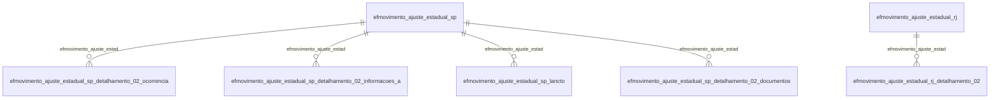

# Modelo — Fiscal - movimento (rascunho em lote)

> Gerado por `src/model/gerar_docs_modelo.py` a partir de `src/model/modulos/fiscal_movimento.yaml`, do catálogo e do perfil de colunas. **Não edite à mão.**

18 entidades. A coluna *Preench.* é o % de linhas com valor útil (nem nulo, nem em branco, nem zero, nem 1900-01-01; para colunas de código o zero conta como valor).

## Diagrama

## Entidades

| Entidade | Tabela | Linhas | Volume | Filtro obrigatório |
|---|---|---|---|---|
| [efmovimento_ajuste_estadual_sp](#efmovimento_ajuste_estadual_sp) | `EFMOVIMENTO_AJUSTE_ESTADUAL_SP` | 38 | pequeno | empresa |
| [efmovimento_ajuste_estadual_sp_detalhamento_02_ocorrencia](#efmovimento_ajuste_estadual_sp_detalhamento_02_ocorrencia) | `EFMOVIMENTO_AJUSTE_ESTADUAL_SP_DETALHAMENTO_02_OCORRENCIA` | 35 | pequeno | empresa |
| [efmovimento_ajuste_estadual_mg](#efmovimento_ajuste_estadual_mg) | `EFMOVIMENTO_AJUSTE_ESTADUAL_MG` | 34 | pequeno | empresa |
| [efmovimento_ajuste_estadual_mg_lancto](#efmovimento_ajuste_estadual_mg_lancto) | `EFMOVIMENTO_AJUSTE_ESTADUAL_MG_LANCTO` | 30 | pequeno | empresa |
| [efmovimento_ajuste_estadual_pe](#efmovimento_ajuste_estadual_pe) | `EFMOVIMENTO_AJUSTE_ESTADUAL_PE` | 21 | pequeno | empresa |
| [efmovimento_ajuste_estadual_sp_detalhamento_02_informacoes_a](#efmovimento_ajuste_estadual_sp_detalhamento_02_informacoes_a) | `EFMOVIMENTO_AJUSTE_ESTADUAL_SP_DETALHAMENTO_02_INFORMACOES_ADICIONAIS` | 8 | pequeno | empresa |
| [efmovimento_ajuste_estadual_mg_detalhamento_11](#efmovimento_ajuste_estadual_mg_detalhamento_11) | `EFMOVIMENTO_AJUSTE_ESTADUAL_MG_DETALHAMENTO_11` | 3 | pequeno | empresa |
| [efmovimento_ajuste_estadual_pr](#efmovimento_ajuste_estadual_pr) | `EFMOVIMENTO_AJUSTE_ESTADUAL_PR` | 3 | pequeno | empresa |
| [efmovimento_ajuste_estadual_rj](#efmovimento_ajuste_estadual_rj) | `EFMOVIMENTO_AJUSTE_ESTADUAL_RJ` | 3 | pequeno | empresa |
| [efmovimento_ajuste_estadual_rj_detalhamento_02](#efmovimento_ajuste_estadual_rj_detalhamento_02) | `EFMOVIMENTO_AJUSTE_ESTADUAL_RJ_DETALHAMENTO_02` | 3 | pequeno | empresa |
| [efmovimento_ajuste_estadual_ce](#efmovimento_ajuste_estadual_ce) | `EFMOVIMENTO_AJUSTE_ESTADUAL_CE` | 3 | pequeno | empresa |
| [efmovimento_ajuste_estadual_sp_lancto](#efmovimento_ajuste_estadual_sp_lancto) | `EFMOVIMENTO_AJUSTE_ESTADUAL_SP_LANCTO` | 3 | pequeno | empresa |
| [efmovimento_ajuste_estadual_mg_detalhamento_09](#efmovimento_ajuste_estadual_mg_detalhamento_09) | `EFMOVIMENTO_AJUSTE_ESTADUAL_MG_DETALHAMENTO_09` | 2 | pequeno | empresa |
| [efmovimento_ajuste_federal](#efmovimento_ajuste_federal) | `EFMOVIMENTO_AJUSTE_FEDERAL` | 2 | pequeno | empresa |
| [efmovimento_ajuste_federal_detalhamento_03](#efmovimento_ajuste_federal_detalhamento_03) | `EFMOVIMENTO_AJUSTE_FEDERAL_DETALHAMENTO_03` | 2 | pequeno | empresa |
| [efmovimento_ajuste_estadual_ce_complementar](#efmovimento_ajuste_estadual_ce_complementar) | `EFMOVIMENTO_AJUSTE_ESTADUAL_CE_COMPLEMENTAR` | 2 | pequeno | empresa |
| [efmovimento_ajuste_estadual_ce_lancto](#efmovimento_ajuste_estadual_ce_lancto) | `EFMOVIMENTO_AJUSTE_ESTADUAL_CE_LANCTO` | 2 | pequeno | empresa |
| [efmovimento_ajuste_estadual_sp_detalhamento_02_documentos](#efmovimento_ajuste_estadual_sp_detalhamento_02_documentos) | `EFMOVIMENTO_AJUSTE_ESTADUAL_SP_DETALHAMENTO_02_DOCUMENTOS` | 1 | pequeno | empresa |

## efmovimento_ajuste_estadual_sp

**SP - Ajuste Impostos lançados estaduais - Geral** — tabela `EFMOVIMENTO_AJUSTE_ESTADUAL_SP` (38 linhas)

SP - Ajuste Impostos lançados estaduais - Geral. 38 linhas no catálogo; chave: CODI_EMP, I_AJUSTE.

- **Chave:** `CODI_EMP, I_AJUSTE`
- **Empresa:** `CODI_EMP`
- **Período:** `DATA_AJUSTE`
- **Ordem padrão:** `DATA_AJUSTE desc`, `I_AJUSTE asc`

**Regras de negócio validadas:**

- Medido em 2026-10-18: 38 linhas, 19 empresa(s), DATA_AJUSTE de 2013-01-31 a 2026-08-01.
- Colunas expostas nulas em 100% das linhas (1): codigo_do_ajuste_do_sped.
- Vínculo efajustes (efajustes): 0 de 2 linhas sem registro relacionado (empresa 364).
- Vínculo geempre (geempre): 0 de 2 linhas sem registro relacionado (empresa 364).
- Vínculo geestado (geestado): 0 de 2 linhas sem registro relacionado (empresa 364).

| Campo | Coluna | Tipo | Preench. | Domínio | Descrição (banco) |
|---|---|---|---|---|---|
| codigo_da_empresa | `codi_emp` | integer(4) |  |  | Código da empresa |
| sequencial_do_movimento_do_ajuste | `i_ajuste` | integer(4) |  |  | Sequencial do movimento do ajuste |
| data | `data_ajuste` | date(4) |  |  | Data |
| codigo_do_ajuste | `codi_aju` | integer(4) |  |  | Código do ajuste |
| valor | `valor` | numeric(13) |  |  | Valor |
| descricao_no_livro | `descricao_livro_tipo` | char(1) |  |  | Descrição no livro |
| observacao | `observacao` | varchar(250) |  |  | Observação |
| codigo_do_estado | `codigo_uf` | integer(4) |  |  | Código do estado |
| codigo_do_ajuste_do_sped | `codigo_ajuste_sped` | char(8) |  |  | Código do ajuste do SPED |
| sistema_de_origem_do_movimento_variaveis | `sistema_origem` | integer(4) |  |  | Sistema de origem do movimento(Variáveis globais do sistema) |
| codigo_de_receita | `codigo_receita` | varchar(6) |  |  | Código de receita |

**Vínculos (LEFT JOIN, acrescentam colunas legíveis):**

- `efajustes` → `efajustes` por `codi_emp` = `codi_emp` e `codi_aju` = `codi_aju`; colunas: `efajustes_nome`
- `geempre` → `geempre` por `codi_emp` = `codi_emp`; colunas: `geempre_nome`
- `geestado` → `geestado` por `codigo_uf` = `codigo_uf`; colunas: `geestado_nome`

**Filtros:** `sequencial_do_movimento_do_ajuste` (eq/in), `data` (entre/gte/lte), `codigo_do_ajuste` (eq/in), `descricao_no_livro` (eq/in), `observacao` (contem/prefixo), `codigo_do_estado` (eq/in), `codigo_do_ajuste_do_sped` (eq/in), `codigo_de_receita` (eq/in)

## efmovimento_ajuste_estadual_sp_detalhamento_02_ocorrencia

**SP - Ajuste Impostos lançados estaduais – Detalhamento 02 ocorrência** — tabela `EFMOVIMENTO_AJUSTE_ESTADUAL_SP_DETALHAMENTO_02_OCORRENCIA` (35 linhas)

SP - Ajuste Impostos lançados estaduais – Detalhamento 02 ocorrência. 35 linhas no catálogo; chave: CODI_EMP, I_AJUSTE.

- **Chave:** `CODI_EMP, I_AJUSTE`
- **Empresa:** `CODI_EMP`
- **Período:** `—`
- **Ordem padrão:** `I_AJUSTE asc`

**Regras de negócio validadas:**

- Medido em 2026-10-18: 35 linhas, 18 empresa(s).
- operacao_1_propria_2_substituicao_tribut: todos os valores reais estão no comentário do banco (1=35).
- Vínculo efmovimento_ajuste_estad (EFMOVIMENTO_AJUSTE_ESTADUAL_SP): 0 de 2 linhas sem registro relacionado (empresa 364).

| Campo | Coluna | Tipo | Preench. | Domínio | Descrição (banco) |
|---|---|---|---|---|---|
| codigo_da_empresa | `codi_emp` | integer(4) |  |  | Código da empresa |
| sequencial_do_movimento_do_ajuste | `i_ajuste` | integer(4) |  |  | Sequencial do movimento do ajuste |
| operacao_1_propria_2_substituicao_tribut | `operacao` | integer(4) |  | efmovimento_ajuste_estadual_sp_detalhamento_02_ocorrencia_operacao_1_p | Operacao (1 - Propria / 2 - Substituicao tributaria) |
| codigo_do_subitem | `subitem` | integer(4) |  |  | Codigo do SubItem |
| ocorrencia | `ocorrencia` | varchar(300) |  |  | Ocorrencia |
| fundamento_legal | `fundamentacao_legal` | varchar(100) |  |  | Fundamento legal |

**Vínculos (LEFT JOIN, acrescentam colunas legíveis):**

- `efmovimento_ajuste_estad` → `EFMOVIMENTO_AJUSTE_ESTADUAL_SP` por `codi_emp` = `codi_emp` e `i_ajuste` = `i_ajuste`; colunas: `efmovimento_ajuste_estad_nome`

**Filtros:** `sequencial_do_movimento_do_ajuste` (eq/in), `ocorrencia` (contem/prefixo), `fundamento_legal` (contem/prefixo)

## efmovimento_ajuste_estadual_mg

**MG - Ajuste Impostos lançados estaduais - Geral** — tabela `EFMOVIMENTO_AJUSTE_ESTADUAL_MG` (34 linhas)

MG - Ajuste Impostos lançados estaduais - Geral. 34 linhas no catálogo; chave: CODI_EMP, I_AJUSTE.

- **Chave:** `CODI_EMP, I_AJUSTE`
- **Empresa:** `CODI_EMP`
- **Período:** `DATA_AJUSTE`
- **Ordem padrão:** `DATA_AJUSTE desc`, `I_AJUSTE asc`

**Regras de negócio validadas:**

- Medido em 2026-10-18: 34 linhas, 1 empresa(s), DATA_AJUSTE de 2025-05-01 a 2026-01-01.
- Colunas expostas nulas em 100% das linhas (2): codigo_do_estado, sequencial_do_codigo_de_recolhimento.
- Vínculo efajustes (efajustes): 0 de 34 linhas sem registro relacionado (empresa 1473).
- Vínculo eftabela_movaju_ajuste_s (EFTABELA_MOVAJU_AJUSTE_SPED): 0 de 34 linhas sem registro relacionado (empresa 1473).
- Vínculo geempre (geempre): 0 de 34 linhas sem registro relacionado (empresa 1473).
- Vínculo geestado (geestado): 0 de 34 linhas sem registro relacionado (empresa 1473).

| Campo | Coluna | Tipo | Preench. | Domínio | Descrição (banco) |
|---|---|---|---|---|---|
| codigo_da_empresa | `codi_emp` | integer(4) |  |  | Código da empresa |
| sequencial_do_movimento_do_ajuste | `i_ajuste` | integer(4) |  |  | Sequencial do movimento do ajuste |
| data | `data_ajuste` | date(4) |  |  | Data |
| codigo_do_ajuste | `codi_aju` | integer(4) |  |  | Código do ajuste |
| valor | `valor` | numeric(13) |  |  | Valor |
| observacao | `observacao` | varchar(250) |  |  | Observação |
| codigo_do_estado | `codigo_uf` | integer(4) |  |  | Código do estado |
| codigo_do_ajuste_do_sped | `codigo_ajuste_sped` | char(8) |  |  | Código do ajuste do SPED |
| sistema_de_origem_do_movimento_variaveis | `sistema_origem` | integer(4) |  |  | Sistema de origem do movimento(Variáveis globais do sistema) |
| operacao_regime_especial_de_tributacao_r | `operacao_regime_especial_tributacao` | char(1) |  |  | Operação Regime Especial de Tributação - RET - Sub-Apuração |
| i_sub_apuracao | `i_sub_apuracao` | integer(4) |  |  | Operação Regime Especial de Tributação - RET - Sub-Apuração Código |
| codigo_de_receita | `codigo_receita` | varchar(6) |  |  | Código de receita |
| sequencial_do_codigo_de_recolhimento | `i_recolhimento` | integer(4) |  |  | Sequencial do código de recolhimento |

**Vínculos (LEFT JOIN, acrescentam colunas legíveis):**

- `efajustes` → `efajustes` por `codi_emp` = `codi_emp` e `codi_aju` = `codi_aju`; colunas: `efajustes_nome`
- `eftabela_movaju_ajuste_s` → `EFTABELA_MOVAJU_AJUSTE_SPED` por `codigo_ajuste_sped` = `codigo`; colunas: `eftabela_movaju_ajuste_s_nome`
- `geempre` → `geempre` por `codi_emp` = `codi_emp`; colunas: `geempre_nome`
- `geestado` → `geestado` por `codigo_uf` = `codigo_uf`; colunas: `geestado_nome`

**Filtros:** `sequencial_do_movimento_do_ajuste` (eq/in), `data` (entre/gte/lte), `codigo_do_ajuste` (eq/in), `observacao` (contem/prefixo), `codigo_do_estado` (eq/in), `codigo_do_ajuste_do_sped` (eq/in), `operacao_regime_especial_de_tributacao_r` (eq/in), `i_sub_apuracao` (eq/in), `codigo_de_receita` (eq/in), `sequencial_do_codigo_de_recolhimento` (eq/in)

## efmovimento_ajuste_estadual_mg_lancto

**MG - Ajuste Impostos lançados estaduais - Lançamentos contábeis** — tabela `EFMOVIMENTO_AJUSTE_ESTADUAL_MG_LANCTO` (30 linhas)

MG - Ajuste Impostos lançados estaduais - Lançamentos contábeis. 30 linhas no catálogo; chave: FILI_LAN, I_AJUSTE, CODI_EMP, NUME_LAN.

- **Chave:** `FILI_LAN, I_AJUSTE, CODI_EMP, NUME_LAN`
- **Empresa:** `CODI_EMP`
- **Período:** `—`
- **Ordem padrão:** `FILI_LAN asc`, `I_AJUSTE asc`

**Regras de negócio validadas:**

- Medido em 2026-10-18: 30 linhas, 1 empresa(s).

| Campo | Coluna | Tipo | Preench. | Domínio | Descrição (banco) |
|---|---|---|---|---|---|
| empresa_do_movimento | `fili_lan` | integer(4) |  |  | Empresa do movimento |
| sequencial_do_movimento_do_ajuste | `i_ajuste` | integer(4) |  |  | Sequencial do movimento do ajuste |
| empresa_do_lancamento | `codi_emp` | integer(4) |  |  | Empresa do lançamento |
| numero_do_lancamento | `nume_lan` | integer(4) |  |  | Número do lançamento |
| tipo_do_lancamento | `tipo` | integer(4) |  |  | Tipo do lançamento |

**Filtros:** `empresa_do_movimento` (eq/in), `sequencial_do_movimento_do_ajuste` (eq/in), `numero_do_lancamento` (eq/in), `tipo_do_lancamento` (eq/in)

## efmovimento_ajuste_estadual_pe

**PE - Ajuste Impostos lançados estaduais - Geral** — tabela `EFMOVIMENTO_AJUSTE_ESTADUAL_PE` (21 linhas)

PE - Ajuste Impostos lançados estaduais - Geral. 21 linhas no catálogo; chave: CODI_EMP, I_AJUSTE.

- **Chave:** `CODI_EMP, I_AJUSTE`
- **Empresa:** `CODI_EMP`
- **Período:** `DATA_AJUSTE`
- **Ordem padrão:** `DATA_AJUSTE desc`, `I_AJUSTE asc`

**Regras de negócio validadas:**

- Medido em 2026-10-18: 21 linhas, 3 empresa(s), DATA_AJUSTE de 2018-01-01 a 2026-01-01.
- Colunas expostas nulas em 100% das linhas (2): codigo_do_estado, calcular_prodepe_codigo_da_apuracao.
- Vínculo geempre (geempre): 0 de 6 linhas sem registro relacionado (empresa 1447).
- Vínculo efajustes (efajustes): 0 de 6 linhas sem registro relacionado (empresa 1447).
- Vínculo geestado (geestado): 0 de 6 linhas sem registro relacionado (empresa 1447).
- Vínculo eftabela_movaju_ajuste_s (EFTABELA_MOVAJU_AJUSTE_SPED): 0 de 6 linhas sem registro relacionado (empresa 1447).
- Vínculo eftabela_pe_ajuste_sef (EFTABELA_PE_AJUSTE_SEF): 0 de 6 linhas sem registro relacionado (empresa 1447).

| Campo | Coluna | Tipo | Preench. | Domínio | Descrição (banco) |
|---|---|---|---|---|---|
| codigo_da_empresa | `codi_emp` | integer(4) |  |  | Código da empresa |
| sequencial_do_movimento_do_ajuste | `i_ajuste` | integer(4) |  |  | Sequencial do movimento do ajuste |
| data | `data_ajuste` | date(4) |  |  | Data |
| codigo_do_ajuste | `codi_aju` | integer(4) |  |  | Código do ajuste |
| valor | `valor` | numeric(13) |  |  | Valor |
| observacao | `observacao` | varchar(250) |  |  | Observação |
| codigo_do_estado | `codigo_uf` | integer(4) |  |  | Código do estado |
| codigo_do_ajuste_do_sped | `codigo_ajuste_sped` | char(8) |  |  | Código do ajuste do SPED |
| codigo_do_ajuste_sef | `i_ajuste_sef` | integer(4) |  |  | Código do ajuste SEF |
| sistema_de_origem_do_movimento_variaveis | `sistema_origem` | integer(4) |  |  | Sistema de origem do movimento(Variáveis globais do sistema) |
| operacao_vinculada_ao_incentivo_prodepe | `operacao_vinculada_prodepe` | char(1) |  |  | Operação vinculada ao incentivo PRODEPE |
| calcular_prodepe_codigo_da_apuracao | `i_prodepe_apuracao` | integer(4) |  |  | Calcular PRODEPE - Código da apuração |

**Vínculos (LEFT JOIN, acrescentam colunas legíveis):**

- `geempre` → `geempre` por `codi_emp` = `codi_emp`; colunas: `geempre_nome`
- `efajustes` → `efajustes` por `codi_emp` = `codi_emp` e `codi_aju` = `codi_aju`; colunas: `efajustes_nome`
- `geestado` → `geestado` por `codigo_uf` = `codigo_uf`; colunas: `geestado_nome`
- `eftabela_movaju_ajuste_s` → `EFTABELA_MOVAJU_AJUSTE_SPED` por `codigo_ajuste_sped` = `codigo`; colunas: `eftabela_movaju_ajuste_s_nome`
- `eftabela_pe_ajuste_sef` → `EFTABELA_PE_AJUSTE_SEF` por `i_ajuste_sef` = `i_ajuste_sef`; colunas: `eftabela_pe_ajuste_sef_nome`

**Filtros:** `sequencial_do_movimento_do_ajuste` (eq/in), `data` (entre/gte/lte), `codigo_do_ajuste` (eq/in), `observacao` (contem/prefixo), `codigo_do_estado` (eq/in), `codigo_do_ajuste_do_sped` (eq/in), `codigo_do_ajuste_sef` (eq/in), `operacao_vinculada_ao_incentivo_prodepe` (eq/in), `calcular_prodepe_codigo_da_apuracao` (eq/in)

## efmovimento_ajuste_estadual_sp_detalhamento_02_informacoes_a

**SP - Ajuste Impostos lançados estaduais - Detalhamento 02 - Adicionais** — tabela `EFMOVIMENTO_AJUSTE_ESTADUAL_SP_DETALHAMENTO_02_INFORMACOES_ADICIONAIS` (8 linhas)

SP - Ajuste Impostos lançados estaduais - Detalhamento 02 - Adicionais. 8 linhas no catálogo; chave: CODI_EMP, I_AJUSTE.

- **Chave:** `CODI_EMP, I_AJUSTE`
- **Empresa:** `CODI_EMP`
- **Período:** `—`
- **Ordem padrão:** `I_AJUSTE asc`

**Regras de negócio validadas:**

- Medido em 2026-10-18: 8 linhas, 6 empresa(s).
- Colunas expostas nulas em 100% das linhas (4): especie, cliente_fornecedor, numero_documento, chave_nfe_nfce_ou_cte.
- Vínculo efmovimento_ajuste_estad (EFMOVIMENTO_AJUSTE_ESTADUAL_SP): 0 de 1 linhas sem registro relacionado (empresa 1507).

| Campo | Coluna | Tipo | Preench. | Domínio | Descrição (banco) |
|---|---|---|---|---|---|
| codigo_da_empresa | `codi_emp` | integer(4) |  |  | Código da empresa |
| sequencial_do_movimento_do_ajuste | `i_ajuste` | integer(4) |  |  | Sequencial do movimento do ajuste |
| especie | `codi_esp` | integer(4) |  |  | Espécie |
| participante | `tipo_cliente_fornecedor` | char(1) |  |  | Participante |
| cliente_fornecedor | `codigo_cliente_fornecedor` | integer(4) |  |  | Cliente/Fornecedor |
| numero_documento | `numero_documento` | integer(4) |  |  | Numero documento |
| serie | `serie` | varchar(7) |  |  | Série |
| subserie | `subserie` | integer(4) |  |  | Subsérie |
| chave_nfe_nfce_ou_cte | `chave_nfe_cte` | varchar(44) |  |  | Chave NFe, NFCe ou CTe |
| numero_do_documento_de_arrecadacao | `numero_documento_arrecadacao` | char(10) |  |  | Número do documento de arrecadação |
| numero_do_processo | `numero_processo` | char(60) |  |  | Número do processo |
| origem | `origem` | char(1) |  |  | Origem |
| descricao | `descricao` | char(255) |  |  | Descrição |

**Vínculos (LEFT JOIN, acrescentam colunas legíveis):**

- `efmovimento_ajuste_estad` → `EFMOVIMENTO_AJUSTE_ESTADUAL_SP` por `codi_emp` = `codi_emp` e `i_ajuste` = `i_ajuste`; colunas: `efmovimento_ajuste_estad_nome`

**Filtros:** `sequencial_do_movimento_do_ajuste` (eq/in), `especie` (eq/in), `participante` (eq/in), `cliente_fornecedor` (eq/in), `serie` (eq/in), `chave_nfe_nfce_ou_cte` (contem/prefixo), `numero_do_documento_de_arrecadacao` (eq/in), `numero_do_processo` (contem/prefixo), `origem` (eq/in), `descricao` (contem/prefixo)

## efmovimento_ajuste_estadual_mg_detalhamento_11

**MG - Ajuste Impostos lançados estaduais - Detalhamento 11** — tabela `EFMOVIMENTO_AJUSTE_ESTADUAL_MG_DETALHAMENTO_11` (3 linhas)

MG - Ajuste Impostos lançados estaduais - Detalhamento 11. 3 linhas no catálogo; chave: CODI_EMP, I_AJUSTE.

- **Chave:** `CODI_EMP, I_AJUSTE`
- **Empresa:** `CODI_EMP`
- **Período:** `DATA_EMISSAO`
- **Ordem padrão:** `DATA_EMISSAO desc`, `I_AJUSTE asc`

**Regras de negócio validadas:**

- Medido em 2026-10-18: 3 linhas, 1 empresa(s).
- Colunas expostas nulas em 100% das linhas (3): nota_fiscal, data_emissao, auto_de_infracao.

| Campo | Coluna | Tipo | Preench. | Domínio | Descrição (banco) |
|---|---|---|---|---|---|
| codigo_da_empresa | `codi_emp` | integer(4) |  |  | Código da empresa |
| sequencial_do_movimento_do_ajuste | `i_ajuste` | integer(4) |  |  | Sequencial do movimento do ajuste |
| tipo_r_o_t_d_a | `tipo` | char(1) |  |  | Tipo (R/ O/ T/ D/ A) |
| nota_fiscal | `nota_fiscal` | integer(4) |  |  | Nota fiscal |
| serie | `serie` | varchar(8) |  |  | Série |
| data_emissao | `data_emissao` | date(4) |  |  | Data emissão |
| auto_de_infracao | `auto_de_infracao` | varchar(14) |  |  | Auto de infração |

**Filtros:** `sequencial_do_movimento_do_ajuste` (eq/in), `data_emissao` (entre/gte/lte), `tipo_r_o_t_d_a` (eq/in), `serie` (eq/in), `auto_de_infracao` (eq/in)

## efmovimento_ajuste_estadual_pr

**PR - Ajuste Impostos lançados estaduais - Geral** — tabela `EFMOVIMENTO_AJUSTE_ESTADUAL_PR` (3 linhas)

PR - Ajuste Impostos lançados estaduais - Geral. 3 linhas no catálogo; chave: CODI_EMP, I_AJUSTE.

- **Chave:** `CODI_EMP, I_AJUSTE`
- **Empresa:** `CODI_EMP`
- **Período:** `DATA_AJUSTE`
- **Ordem padrão:** `DATA_AJUSTE desc`, `I_AJUSTE asc`

**Regras de negócio validadas:**

- Medido em 2026-10-18: 3 linhas, 2 empresa(s), DATA_AJUSTE de 2023-08-01 a 2025-05-31.
- Colunas expostas nulas em 100% das linhas (1): codigo_do_estado.
- Vínculo efajustes (efajustes): 0 de 2 linhas sem registro relacionado (empresa 1367).
- Vínculo geempre (geempre): 0 de 2 linhas sem registro relacionado (empresa 1367).
- Vínculo geestado (geestado): 0 de 2 linhas sem registro relacionado (empresa 1367).
- Vínculo eftabela_movaju_ajuste_s (EFTABELA_MOVAJU_AJUSTE_SPED): 0 de 2 linhas sem registro relacionado (empresa 1367).

| Campo | Coluna | Tipo | Preench. | Domínio | Descrição (banco) |
|---|---|---|---|---|---|
| codigo_da_empresa | `codi_emp` | integer(4) |  |  | Código da empresa |
| sequencial_do_movimento_do_ajuste | `i_ajuste` | integer(4) |  |  | Sequencial do movimento do ajuste |
| data | `data_ajuste` | date(4) |  |  | Data |
| codigo_do_ajuste | `codi_aju` | integer(4) |  |  | Código do ajuste |
| valor | `valor` | numeric(13) |  |  | Valor |
| observacao | `observacao` | varchar(250) |  |  | Observação |
| codigo_do_estado | `codigo_uf` | integer(4) |  |  | Código do estado |
| codigo_do_ajuste_do_sped | `codigo_ajuste_sped` | char(8) |  |  | Código do ajuste do SPED |
| sistema_de_origem_do_movimento_variaveis | `sistema_origem` | integer(4) |  |  | Sistema de origem do movimento(Variáveis globais do sistema) |

**Vínculos (LEFT JOIN, acrescentam colunas legíveis):**

- `efajustes` → `efajustes` por `codi_emp` = `codi_emp` e `codi_aju` = `codi_aju`; colunas: `efajustes_nome`
- `geempre` → `geempre` por `codi_emp` = `codi_emp`; colunas: `geempre_nome`
- `geestado` → `geestado` por `codigo_uf` = `codigo_uf`; colunas: `geestado_nome`
- `eftabela_movaju_ajuste_s` → `EFTABELA_MOVAJU_AJUSTE_SPED` por `codigo_ajuste_sped` = `codigo`; colunas: `eftabela_movaju_ajuste_s_nome`

**Filtros:** `sequencial_do_movimento_do_ajuste` (eq/in), `data` (entre/gte/lte), `codigo_do_ajuste` (eq/in), `observacao` (contem/prefixo), `codigo_do_estado` (eq/in), `codigo_do_ajuste_do_sped` (eq/in)

## efmovimento_ajuste_estadual_rj

**RJ - Ajuste Impostos lançados estaduais - Geral** — tabela `EFMOVIMENTO_AJUSTE_ESTADUAL_RJ` (3 linhas)

RJ - Ajuste Impostos lançados estaduais - Geral. 3 linhas no catálogo; chave: CODI_EMP, I_AJUSTE.

- **Chave:** `CODI_EMP, I_AJUSTE`
- **Empresa:** `CODI_EMP`
- **Período:** `DATA_AJUSTE`
- **Ordem padrão:** `DATA_AJUSTE desc`, `I_AJUSTE asc`

**Regras de negócio validadas:**

- Medido em 2026-10-18: 3 linhas, 3 empresa(s), DATA_AJUSTE de 2018-01-01 a 2024-09-01.
- Colunas expostas nulas em 100% das linhas (1): codigo_do_estado.
- Vínculo efajustes (efajustes): 0 de 1 linhas sem registro relacionado (empresa 357).
- Vínculo eftabela_movaju_ajuste_s (EFTABELA_MOVAJU_AJUSTE_SPED): 0 de 1 linhas sem registro relacionado (empresa 357).
- Vínculo geempre (geempre): 0 de 1 linhas sem registro relacionado (empresa 357).
- Vínculo geestado (geestado): 0 de 1 linhas sem registro relacionado (empresa 357).

| Campo | Coluna | Tipo | Preench. | Domínio | Descrição (banco) |
|---|---|---|---|---|---|
| codigo_da_empresa | `codi_emp` | integer(4) |  |  | Código da empresa |
| sequencial_do_movimento_do_ajuste | `i_ajuste` | integer(4) |  |  | Sequencial do movimento do ajuste |
| data | `data_ajuste` | date(4) |  |  | Data |
| codigo_do_ajuste | `codi_aju` | integer(4) |  |  | Código do ajuste |
| valor | `valor` | numeric(13) |  |  | Valor |
| descricao_no_livro | `tipo_descricao_livro` | char(1) |  |  | Descrição no livro |
| observacao | `observacao` | varchar(250) |  |  | Observação |
| codigo_do_estado | `codigo_uf` | integer(4) |  |  | Código do estado |
| codigo_do_ajuste_do_sped | `codigo_ajuste_sped` | char(8) |  |  | Código do ajuste do SPED |
| sistema_de_origem_do_movimento_variaveis | `sistema_origem` | integer(4) |  |  | Sistema de origem do movimento(Variáveis globais do sistema) |

**Vínculos (LEFT JOIN, acrescentam colunas legíveis):**

- `efajustes` → `efajustes` por `codi_emp` = `codi_emp` e `codi_aju` = `codi_aju`; colunas: `efajustes_nome`
- `eftabela_movaju_ajuste_s` → `EFTABELA_MOVAJU_AJUSTE_SPED` por `codigo_ajuste_sped` = `codigo`; colunas: `eftabela_movaju_ajuste_s_nome`
- `geempre` → `geempre` por `codi_emp` = `codi_emp`; colunas: `geempre_nome`
- `geestado` → `geestado` por `codigo_uf` = `codigo_uf`; colunas: `geestado_nome`

**Filtros:** `sequencial_do_movimento_do_ajuste` (eq/in), `data` (entre/gte/lte), `codigo_do_ajuste` (eq/in), `descricao_no_livro` (eq/in), `observacao` (contem/prefixo), `codigo_do_estado` (eq/in), `codigo_do_ajuste_do_sped` (eq/in)

## efmovimento_ajuste_estadual_rj_detalhamento_02

**RJ - Ajuste Impostos lançados estaduais - Detalhamento 02** — tabela `EFMOVIMENTO_AJUSTE_ESTADUAL_RJ_DETALHAMENTO_02` (3 linhas)

RJ - Ajuste Impostos lançados estaduais - Detalhamento 02. 3 linhas no catálogo; chave: CODI_EMP, I_AJUSTE.

- **Chave:** `CODI_EMP, I_AJUSTE`
- **Empresa:** `CODI_EMP`
- **Período:** `DATA_PAGAMENTO`
- **Ordem padrão:** `DATA_PAGAMENTO desc`, `I_AJUSTE asc`

**Regras de negócio validadas:**

- Medido em 2026-10-18: 3 linhas, 3 empresa(s).
- Colunas expostas nulas em 100% das linhas (1): data_de_pagamento.
- Vínculo efmovimento_ajuste_estad (EFMOVIMENTO_AJUSTE_ESTADUAL_RJ): 0 de 1 linhas sem registro relacionado (empresa 357).

| Campo | Coluna | Tipo | Preench. | Domínio | Descrição (banco) |
|---|---|---|---|---|---|
| codigo_da_empresa | `codi_emp` | integer(4) |  |  | Código da empresa |
| sequencial_do_movimento_do_ajuste | `i_ajuste` | integer(4) |  |  | Sequencial do movimento do ajuste |
| codigo_do_detalhamento | `codigo` | integer(4) |  |  | Código do detalhamento |
| descricao | `descricao_ocorrencia` | varchar(120) |  |  | Descrição |
| legislacao_tributaria | `legislacao_tributaria` | varchar(120) |  |  | Legislação Tributária |
| numero_do_banco | `numero_banco` | integer(4) |  |  | Número do banco |
| data_de_pagamento | `data_pagamento` | date(4) |  |  | Data de Pagamento |

**Vínculos (LEFT JOIN, acrescentam colunas legíveis):**

- `efmovimento_ajuste_estad` → `EFMOVIMENTO_AJUSTE_ESTADUAL_RJ` por `codi_emp` = `codi_emp` e `i_ajuste` = `i_ajuste`; colunas: `efmovimento_ajuste_estad_nome`

**Filtros:** `sequencial_do_movimento_do_ajuste` (eq/in), `data_de_pagamento` (entre/gte/lte), `codigo_do_detalhamento` (eq/in), `descricao` (contem/prefixo), `legislacao_tributaria` (contem/prefixo)

## efmovimento_ajuste_estadual_ce

**CE - Ajuste Impostos lançados estaduais - Geral** — tabela `EFMOVIMENTO_AJUSTE_ESTADUAL_CE` (3 linhas)

CE - Ajuste Impostos lançados estaduais - Geral. 3 linhas no catálogo; chave: CODI_EMP, I_AJUSTE.

- **Chave:** `CODI_EMP, I_AJUSTE`
- **Empresa:** `CODI_EMP`
- **Período:** `DATA_AJUSTE`
- **Ordem padrão:** `DATA_AJUSTE desc`, `I_AJUSTE asc`

**Regras de negócio validadas:**

- Medido em 2026-10-18: 3 linhas, 2 empresa(s), DATA_AJUSTE de 2023-10-13 a 2024-09-01.
- Colunas expostas nulas em 100% das linhas (1): codigo_do_estado.
- Vínculo geempre (geempre): 0 de 2 linhas sem registro relacionado (empresa 1474).
- Vínculo efajustes (efajustes): 0 de 2 linhas sem registro relacionado (empresa 1474).
- Vínculo geestado (geestado): 0 de 2 linhas sem registro relacionado (empresa 1474).
- Vínculo eftabela_movaju_ajuste_s (EFTABELA_MOVAJU_AJUSTE_SPED): 0 de 2 linhas sem registro relacionado (empresa 1474).

| Campo | Coluna | Tipo | Preench. | Domínio | Descrição (banco) |
|---|---|---|---|---|---|
| codigo_da_empresa | `codi_emp` | integer(4) |  |  | Código da empresa |
| sequencial_do_movimento_do_ajuste | `i_ajuste` | integer(4) |  |  | Sequencial do movimento do ajuste |
| data | `data_ajuste` | date(4) |  |  | Data |
| codigo_do_ajuste | `codi_aju` | integer(4) |  |  | Código do ajuste |
| valor | `valor` | numeric(13) |  |  | Valor |
| observacao | `observacao` | varchar(250) |  |  | Observação |
| codigo_do_estado | `codigo_uf` | integer(4) |  |  | Código do estado |
| sistema_de_origem_do_movimento_variaveis | `sistema_origem` | integer(4) |  |  | Sistema de origem do movimento(Variáveis globais do sistema) |
| codigo_do_ajuste_do_sped | `codigo_ajuste_sped` | char(8) |  |  | Codigo do ajuste do SPED |

**Vínculos (LEFT JOIN, acrescentam colunas legíveis):**

- `geempre` → `geempre` por `codi_emp` = `codi_emp`; colunas: `geempre_nome`
- `efajustes` → `efajustes` por `codi_emp` = `codi_emp` e `codi_aju` = `codi_aju`; colunas: `efajustes_nome`
- `geestado` → `geestado` por `codigo_uf` = `codigo_uf`; colunas: `geestado_nome`
- `eftabela_movaju_ajuste_s` → `EFTABELA_MOVAJU_AJUSTE_SPED` por `codigo_ajuste_sped` = `codigo`; colunas: `eftabela_movaju_ajuste_s_nome`

**Filtros:** `sequencial_do_movimento_do_ajuste` (eq/in), `data` (entre/gte/lte), `codigo_do_ajuste` (eq/in), `observacao` (contem/prefixo), `codigo_do_estado` (eq/in), `codigo_do_ajuste_do_sped` (eq/in)

## efmovimento_ajuste_estadual_sp_lancto

**SP - Ajuste Impostos lançados estaduais – Lançamentos contábeis** — tabela `EFMOVIMENTO_AJUSTE_ESTADUAL_SP_LANCTO` (3 linhas)

SP - Ajuste Impostos lançados estaduais – Lançamentos contábeis. 3 linhas no catálogo; chave: FILI_LAN, I_AJUSTE, CODI_EMP, NUME_LAN.

- **Chave:** `FILI_LAN, I_AJUSTE, CODI_EMP, NUME_LAN`
- **Empresa:** `CODI_EMP`
- **Período:** `—`
- **Ordem padrão:** `FILI_LAN asc`, `I_AJUSTE asc`

**Regras de negócio validadas:**

- Medido em 2026-10-18: 3 linhas, 1 empresa(s).
- Vínculo efmovimento_ajuste_estad (EFMOVIMENTO_AJUSTE_ESTADUAL_SP): 0 de 3 linhas sem registro relacionado (empresa 9997).

| Campo | Coluna | Tipo | Preench. | Domínio | Descrição (banco) |
|---|---|---|---|---|---|
| empresa_do_movimento | `fili_lan` | integer(4) |  |  | Empresa do movimento |
| sequencial_do_movimento_do_ajuste | `i_ajuste` | integer(4) |  |  | Sequencial do movimento do ajuste |
| empresa_do_lancamento | `codi_emp` | integer(4) |  |  | Empresa do lançamento |
| numero_do_lancamento | `nume_lan` | integer(4) |  |  | Número do lançamento |
| tipo_do_lancamento | `tipo` | integer(4) |  |  | Tipo do lançamento |

**Vínculos (LEFT JOIN, acrescentam colunas legíveis):**

- `efmovimento_ajuste_estad` → `EFMOVIMENTO_AJUSTE_ESTADUAL_SP` por `fili_lan` = `codi_emp` e `i_ajuste` = `i_ajuste`; colunas: `efmovimento_ajuste_estad_nome`

**Filtros:** `empresa_do_movimento` (eq/in), `sequencial_do_movimento_do_ajuste` (eq/in), `numero_do_lancamento` (eq/in), `tipo_do_lancamento` (eq/in)

## efmovimento_ajuste_estadual_mg_detalhamento_09

**MG - Ajuste Impostos lançados estaduais - Detalhamento 09** — tabela `EFMOVIMENTO_AJUSTE_ESTADUAL_MG_DETALHAMENTO_09` (2 linhas)

MG - Ajuste Impostos lançados estaduais - Detalhamento 09. 2 linhas no catálogo; chave: CODI_EMP, I_AJUSTE.

- **Chave:** `CODI_EMP, I_AJUSTE`
- **Empresa:** `CODI_EMP`
- **Período:** `DATA_EMISSAO`
- **Ordem padrão:** `DATA_EMISSAO desc`, `I_AJUSTE asc`

**Regras de negócio validadas:**

- Medido em 2026-10-18: 2 linhas, 1 empresa(s).
- Colunas expostas nulas em 100% das linhas (3): codigo_da_especie, codigo_do_cliente, data_emissao.

| Campo | Coluna | Tipo | Preench. | Domínio | Descrição (banco) |
|---|---|---|---|---|---|
| codigo_da_empresa | `codi_emp` | integer(4) |  |  | Código da empresa |
| sequencial_do_movimento_do_ajuste | `i_ajuste` | integer(4) |  |  | Sequencial do movimento do ajuste |
| tipo_o_s_a_e_t_r | `tipo` | char(1) |  |  | Tipo (O/ S/ A/ E/ T/ R) |
| codigo_da_especie | `codi_esp` | integer(4) |  |  | Código da espécie |
| codigo_do_cliente | `codi_cli` | integer(4) |  |  | Código do cliente |
| data_emissao | `data_emissao` | date(4) |  |  | Data emissão |
| nota_fiscal | `nota_fiscal` | integer(4) |  |  | Nota fiscal |
| serie | `serie` | varchar(3) |  |  | Série |
| justificativa | `justificativa` | varchar(60) |  |  | Justificativa |
| chave_nfe_ou_cte | `chave_nfe_cte` | varchar(44) |  |  | Chave NFe ou CTe |

**Filtros:** `sequencial_do_movimento_do_ajuste` (eq/in), `data_emissao` (entre/gte/lte), `tipo_o_s_a_e_t_r` (eq/in), `codigo_da_especie` (eq/in), `codigo_do_cliente` (eq/in), `serie` (eq/in), `justificativa` (contem/prefixo), `chave_nfe_ou_cte` (contem/prefixo)

## efmovimento_ajuste_federal

**Ajuste Impostos lançados federais - Geral** — tabela `EFMOVIMENTO_AJUSTE_FEDERAL` (2 linhas)

Ajuste Impostos lançados federais - Geral. 2 linhas no catálogo; chave: CODI_EMP, I_AJUSTE.

- **Chave:** `CODI_EMP, I_AJUSTE`
- **Empresa:** `CODI_EMP`
- **Período:** `DATA_AJUSTE`
- **Ordem padrão:** `DATA_AJUSTE desc`, `I_AJUSTE asc`

**Regras de negócio validadas:**

- Medido em 2026-10-18: 2 linhas, 1 empresa(s), DATA_AJUSTE de 2026-06-01 a 2026-08-01.
- origem_do_credito_i_interno_e_externo: todos os valores reais estão no comentário do banco (I=2).
- Vínculo efajustes (efajustes): 0 de 2 linhas sem registro relacionado (empresa 1676).
- Vínculo geempre (geempre): 0 de 2 linhas sem registro relacionado (empresa 1676).
- Vínculo eftabela_movaju_ajuste_s (EFTABELA_MOVAJU_AJUSTE_SPED): 0 de 2 linhas sem registro relacionado (empresa 1676).

| Campo | Coluna | Tipo | Preench. | Domínio | Descrição (banco) |
|---|---|---|---|---|---|
| codigo_da_empresa | `codi_emp` | integer(4) |  |  | Código da empresa |
| sequencial_do_movimento_do_ajuste | `i_ajuste` | integer(4) |  |  | Sequencial do movimento do ajuste |
| data | `data_ajuste` | date(4) |  |  | Data |
| codigo_do_ajuste | `codi_aju` | integer(4) |  |  | Código do ajuste |
| valor | `valor` | numeric(13) |  |  | Valor |
| observacao | `observacao` | varchar(250) |  |  | Observação |
| sequencial_do_codigo_de_recolhimento | `i_recolhimento` | integer(4) |  |  | Sequencial do código de recolhimento |
| codigo_de_receita | `codigo_receita` | char(8) |  |  | Código de receita |
| origem_do_credito_i_interno_e_externo | `origem_credito` | char(1) |  | efmovimento_ajuste_federal_origem_do_c | Origem do credito (I-interno/E-externo) |
| codigo_do_ajuste_do_sped | `codigo_ajuste_sped` | char(8) |  |  | Código do ajuste do SPED |

**Vínculos (LEFT JOIN, acrescentam colunas legíveis):**

- `efajustes` → `efajustes` por `codi_emp` = `codi_emp` e `codi_aju` = `codi_aju`; colunas: `efajustes_nome`
- `geempre` → `geempre` por `codi_emp` = `codi_emp`; colunas: `geempre_nome`
- `eftabela_movaju_ajuste_s` → `EFTABELA_MOVAJU_AJUSTE_SPED` por `codigo_ajuste_sped` = `codigo`; colunas: `eftabela_movaju_ajuste_s_nome`

**Filtros:** `sequencial_do_movimento_do_ajuste` (eq/in), `data` (entre/gte/lte), `codigo_do_ajuste` (eq/in), `observacao` (contem/prefixo), `sequencial_do_codigo_de_recolhimento` (eq/in), `codigo_de_receita` (eq/in), `origem_do_credito_i_interno_e_externo` (eq/in), `codigo_do_ajuste_do_sped` (eq/in)

## efmovimento_ajuste_federal_detalhamento_03

**Ajuste Impostos lançados federais - Detalhamento 03** — tabela `EFMOVIMENTO_AJUSTE_FEDERAL_DETALHAMENTO_03` (2 linhas)

Ajuste Impostos lançados federais - Detalhamento 03. 2 linhas no catálogo; chave: CODI_EMP, I_AJUSTE.

- **Chave:** `CODI_EMP, I_AJUSTE`
- **Empresa:** `CODI_EMP`
- **Período:** `—`
- **Ordem padrão:** `I_AJUSTE asc`

**Regras de negócio validadas:**

- Medido em 2026-10-18: 2 linhas, 1 empresa(s).

| Campo | Coluna | Tipo | Preench. | Domínio | Descrição (banco) |
|---|---|---|---|---|---|
| codigo_da_empresa | `codi_emp` | integer(4) |  |  | Código da empresa |
| sequencial_do_movimento_do_ajuste | `i_ajuste` | integer(4) |  |  | Sequencial do movimento do ajuste |
| origem_documento | `origem_documento` | integer(4) |  |  | ORIGEM DOCUMENTO (0/1/2/3/9) |
| numero_do_processo | `numero_processo` | varchar(25) |  |  | Número do processo |

**Filtros:** `sequencial_do_movimento_do_ajuste` (eq/in), `numero_do_processo` (contem/prefixo)

## efmovimento_ajuste_estadual_ce_complementar

**CE - Ajuste Impostos lançados estaduais - Complementar** — tabela `EFMOVIMENTO_AJUSTE_ESTADUAL_CE_COMPLEMENTAR` (2 linhas)

CE - Ajuste Impostos lançados estaduais - Complementar. 2 linhas no catálogo; chave: CODI_EMP, I_AJUSTE.

- **Chave:** `CODI_EMP, I_AJUSTE`
- **Empresa:** `CODI_EMP`
- **Período:** `DATA_VENCIMENTO`
- **Ordem padrão:** `DATA_VENCIMENTO desc`, `I_AJUSTE asc`

**Regras de negócio validadas:**

- Medido em 2026-10-18: 2 linhas, 2 empresa(s).
- Colunas expostas nulas em 100% das linhas (4): numero_da_dae, numero_da_ida, sequencial_do_codigo_do_recolhimento, data_de_vencimento.

| Campo | Coluna | Tipo | Preench. | Domínio | Descrição (banco) |
|---|---|---|---|---|---|
| codigo_da_empresa | `codi_emp` | integer(4) |  |  | Código da empresa |
| sequencial_do_movimento_do_ajuste | `i_ajuste` | integer(4) |  |  | Sequencial do movimento do ajuste |
| codigo_da_especie | `codigo_especie` | integer(4) |  |  | Código da espécie |
| numero_da_dae | `numero_dae` | numeric(15) |  |  | Número da DAE |
| numero_da_ida | `numero_ida` | numeric(15) |  |  | Numero da IDA |
| descricao | `descricao` | varchar(100) |  |  | Descrição |
| codigo_de_receita | `codigo_receita` | varchar(6) |  |  | Código de receita |
| sequencial_do_codigo_do_recolhimento | `i_recolhimento` | integer(4) |  |  | Sequencial do código do recolhimento |
| data_de_vencimento | `data_vencimento` | date(4) |  |  | Data de vencimento |

**Filtros:** `sequencial_do_movimento_do_ajuste` (eq/in), `data_de_vencimento` (entre/gte/lte), `codigo_da_especie` (eq/in), `descricao` (contem/prefixo), `codigo_de_receita` (eq/in), `sequencial_do_codigo_do_recolhimento` (eq/in)

## efmovimento_ajuste_estadual_ce_lancto

**CE - Ajuste Impostos lançados estaduais - Lançamentos contábeis** — tabela `EFMOVIMENTO_AJUSTE_ESTADUAL_CE_LANCTO` (2 linhas)

CE - Ajuste Impostos lançados estaduais - Lançamentos contábeis. 2 linhas no catálogo; chave: FILI_LAN, I_AJUSTE, CODI_EMP, NUME_LAN.

- **Chave:** `FILI_LAN, I_AJUSTE, CODI_EMP, NUME_LAN`
- **Empresa:** `CODI_EMP`
- **Período:** `—`
- **Ordem padrão:** `FILI_LAN asc`, `I_AJUSTE asc`

**Regras de negócio validadas:**

- Medido em 2026-10-18: 2 linhas, 1 empresa(s).

| Campo | Coluna | Tipo | Preench. | Domínio | Descrição (banco) |
|---|---|---|---|---|---|
| empresa_do_movimento | `fili_lan` | integer(4) |  |  | Empresa do movimento |
| sequencial_do_movimento_do_ajuste | `i_ajuste` | integer(4) |  |  | Sequencial do movimento do ajuste |
| empresa_do_lancamento | `codi_emp` | integer(4) |  |  | Empresa do lançamento |
| numero_do_lancamento | `nume_lan` | integer(4) |  |  | Número do lançamento |
| tipo_do_lancamento | `tipo` | integer(4) |  |  | Tipo do lançamento |

**Filtros:** `empresa_do_movimento` (eq/in), `sequencial_do_movimento_do_ajuste` (eq/in), `numero_do_lancamento` (eq/in), `tipo_do_lancamento` (eq/in)

## efmovimento_ajuste_estadual_sp_detalhamento_02_documentos

**SP - Ajuste Impostos lançados estaduais - Detalhamento 2 - Documentos** — tabela `EFMOVIMENTO_AJUSTE_ESTADUAL_SP_DETALHAMENTO_02_DOCUMENTOS` (1 linhas)

SP - Ajuste Impostos lançados estaduais - Detalhamento 2 - Documentos. 1 linhas no catálogo; chave: CODI_EMP, I_AJUSTE, I_DETALHAMENTO.

- **Chave:** `CODI_EMP, I_AJUSTE, I_DETALHAMENTO`
- **Empresa:** `CODI_EMP`
- **Período:** `DATA_NOTA`
- **Ordem padrão:** `DATA_NOTA desc`, `I_AJUSTE asc`, `I_DETALHAMENTO asc`

**Regras de negócio validadas:**

- Medido em 2026-10-18: 1 linhas, 1 empresa(s), DATA_NOTA de 2026-03-17 a 2026-03-17.
- Colunas expostas nulas em 100% das linhas (1): subserie.
- Vínculo efmovimento_ajuste_estad (EFMOVIMENTO_AJUSTE_ESTADUAL_SP): 0 de 1 linhas sem registro relacionado (empresa 1676).

| Campo | Coluna | Tipo | Preench. | Domínio | Descrição (banco) |
|---|---|---|---|---|---|
| codigo_da_empresa | `codi_emp` | integer(4) |  |  | Código da empresa |
| sequencial_do_movimento_do_ajuste | `i_ajuste` | integer(4) |  |  | Sequencial do movimento do ajuste |
| sequencial_do_detalhamento_do_movimento | `i_detalhamento` | integer(4) |  |  | Sequencial do detalhamento do movimento do ajuste |
| especie | `codi_esp` | integer(4) |  |  | Espécie |
| serie | `serie` | varchar(7) |  |  | Série |
| subserie | `subserie` | integer(4) |  |  | Subsérie |
| data | `data_nota` | date(4) |  |  | Data |
| numero_do_documento | `numero_documento` | numeric(15) |  |  | Número do documento |
| participante | `tipo_cliente_fornecedor` | char(1) |  |  | Participante |
| cliente_fornecedor | `codigo_cliente_fornecedor` | integer(4) |  |  | Cliente/Fornecedor |
| valor_documento | `valor_documento` | numeric(13) |  |  | Valor documento |
| chave_nfe_ou_cte | `chave_nfe_cte` | varchar(44) |  |  | Chave NFe ou CTe |
| codigo_do_produto | `codigo_produto` | char(14) |  |  | Código do produto |

**Vínculos (LEFT JOIN, acrescentam colunas legíveis):**

- `efmovimento_ajuste_estad` → `EFMOVIMENTO_AJUSTE_ESTADUAL_SP` por `codi_emp` = `codi_emp` e `i_ajuste` = `i_ajuste`; colunas: `efmovimento_ajuste_estad_nome`

**Filtros:** `sequencial_do_movimento_do_ajuste` (eq/in), `sequencial_do_detalhamento_do_movimento` (eq/in), `data` (entre/gte/lte), `especie` (eq/in), `serie` (eq/in), `participante` (eq/in), `cliente_fornecedor` (eq/in), `chave_nfe_ou_cte` (contem/prefixo), `codigo_do_produto` (eq/in)

## Domínios (significado dos códigos)

`confirmado`: **sim** = vem do comentário do banco e/ou foi conferido nos dados; **parcial** = parte dos valores; **não** = hipótese, não use como regra.

### status_empresa

Situação da empresa no cadastro (geempre.stat_emp)

Confirmado: sim

| Código | Significado |
|---|---|
| A | Ativa |
| I | Inativa |
| C | Em constituição |
| M | Ativo sem movimento |
| B | Em processo de baixa |
| E | Excluindo |

### motivo_inatividade

Motivo da inatividade (geempre.tipoi_emp). Só aparece em empresas inativas.

Confirmado: sim

| Código | Significado |
|---|---|
| 1 | Outros |
| 2 | Baixada |
| 3 | Transferida |
| 4 | Inadimplente |

### tipo_inscricao

Tipo da inscrição (CNPJ/CPF/CEI/CAEPF)

Confirmado: sim

| Código | Significado |
|---|---|
| 1 | CNPJ |
| 2 | CPF |
| 3 | CEI |
| 6 | CAEPF |

### regime_federal_empresa

Regime federal da folha (geempre.rfed_emp)

Confirmado: parcial

| Código | Significado |
|---|---|
| 1 | Normal |
| 2 | Microempresa |
| 3 | Empresa de pequeno porte |

### tipo_honorario_empresa

Como a empresa usa o módulo Honorários (geempre.honorario_tipo)

Confirmado: sim

| Código | Significado |
|---|---|
| E | Escritório (quem fatura) |
| C | Cliente |

### sim_nao_texto

Confirmado: sim

| Código | Significado |
|---|---|
| S | Sim |
| N | Não |

### sim_nao_numerico

Confirmado: sim

| Código | Significado |
|---|---|
| 1 | Sim |
| 0 | Não |

### efmovimento_ajuste_estadual_sp_detalhamento_02_ocorrencia_operacao_1_p

Confirmado: sim

> Todos os valores observados em EFMOVIMENTO_AJUSTE_ESTADUAL_SP_DETALHAMENTO_02_OCORRENCIA.OPERACAO estão no comentário do banco (2026-10-18). Distribuição: 1=35.

| Código | Significado |
|---|---|
| 1 | Propria |
| 2 | Substituicao tributaria |

### efmovimento_ajuste_federal_origem_do_c

Confirmado: sim

> Todos os valores observados em EFMOVIMENTO_AJUSTE_FEDERAL.ORIGEM_CREDITO estão no comentário do banco (2026-10-18). Distribuição: I=2.

| Código | Significado |
|---|---|
| I | interno |
| E | externo |

