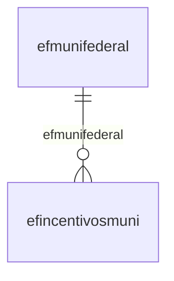

# Modelo — Fiscal - nucleo (rascunho em lote)

> Gerado por `src/model/gerar_docs_modelo.py` a partir de `src/model/modulos/fiscal_nucleo.yaml`, do catálogo e do perfil de colunas. **Não edite à mão.**

37 entidades. A coluna *Preench.* é o % de linhas com valor útil (nem nulo, nem em branco, nem zero, nem 1900-01-01; para colunas de código o zero conta como valor).

## Diagrama

## Entidades

| Entidade | Tabela | Linhas | Volume | Filtro obrigatório |
|---|---|---|---|---|
| [efapuracao](#efapuracao) | `efapuracao` | 63.964 | medio | empresa |
| [efmvvpro](#efmvvpro) | `EFMVVPRO` | 53.933 | medio | empresa |
| [efcfghistorico](#efcfghistorico) | `efcfghistorico` | 38.445 | medio | empresa |
| [efsdosubtri](#efsdosubtri) | `efsdosubtri` | 28.512 | medio | empresa |
| [efindices](#efindices) | `efindices` | 19.901 | medio | — |
| [efgrupopdi](#efgrupopdi) | `efgrupopdi` | 19.625 | medio | empresa |
| [efncm](#efncm) | `EFNCM` | 15.899 | medio | — |
| [efmunifederal](#efmunifederal) | `efmunifederal` | 5.559 | pequeno | — |
| [efnbs](#efnbs) | `EFNBS` | 1.237 | pequeno | — |
| [efunidades](#efunidades) | `efunidades` | 876 | pequeno | — |
| [efindmed](#efindmed) | `efindmed` | 720 | pequeno | — |
| [efimoveis](#efimoveis) | `EFIMOVEIS` | 612 | pequeno | empresa |
| [efmunici](#efmunici) | `efmunici` | 476 | pequeno | — |
| [eftabfax](#eftabfax) | `eftabfax` | 460 | pequeno | — |
| [efmovacu](#efmovacu) | `efmovacu` | 171 | pequeno | empresa |
| [efmtisentas](#efmtisentas) | `efmtisentas` | 150 | pequeno | — |
| [eftabelas](#eftabelas) | `eftabelas` | 54 | pequeno | — |
| [efmgtransferencias](#efmgtransferencias) | `efmgtransferencias` | 53 | pequeno | — |
| [efmgexclusoes](#efmgexclusoes) | `efmgexclusoes` | 47 | pequeno | — |
| [efceespecies](#efceespecies) | `efceespecies` | 35 | pequeno | — |
| [efimportando](#efimportando) | `EFIMPORTANDO` | 33 | pequeno | empresa |
| [efalespecies](#efalespecies) | `efalespecies` | 29 | pequeno | — |
| [efestados](#efestados) | `efestados` | 28 | pequeno | — |
| [efexclusoes](#efexclusoes) | `efexclusoes` | 19 | pequeno | — |
| [efmaqecf](#efmaqecf) | `efmaqecf` | 8 | pequeno | empresa |
| [eftabelamuni](#eftabelamuni) | `eftabelamuni` | 6 | pequeno | — |
| [efobsnota](#efobsnota) | `efobsnota` | 6 | pequeno | empresa |
| [efmovaju](#efmovaju) | `efmovaju` | 3 | pequeno | empresa |
| [eftabaju](#eftabaju) | `eftabaju` | 3 | pequeno | empresa |
| [efincentivosmuni](#efincentivosmuni) | `efincentivosmuni` | 2 | pequeno | — |
| [efdesenvolve](#efdesenvolve) | `efdesenvolve` | 2 | pequeno | empresa |
| [efcalculando](#efcalculando) | `efcalculando` | 1 | pequeno | empresa |
| [efconversao](#efconversao) | `efconversao` | 1 | pequeno | — |
| [atmovimp](#atmovimp) | `atmovimp` | 3.412 | pequeno | empresa |
| [attabinss](#attabinss) | `attabinss` | 549 | pequeno | — |
| [attab13](#attab13) | `attab13` | 33 | pequeno | — |
| [atferiados](#atferiados) | `atferiados` | 11 | pequeno | — |

## efapuracao

**Parametros de Apuracao** — tabela `efapuracao` (63.964 linhas)

Parametros de Apuracao. 63.964 linhas no catálogo; chave: codi_emp, data_apu.

- **Chave:** `codi_emp, data_apu`
- **Empresa:** `codi_emp`
- **Período:** `data_apu`
- **Ordem padrão:** `data_apu desc`

**Regras de negócio validadas:**

- Medido em 2026-10-18: 64.002 linhas, 1.384 empresa(s), data_apu de 2007-04-01 a 2026-09-01.
- Vínculo geempre (geempre): 0 de 33 linhas sem registro relacionado (empresa 1447).

| Campo | Coluna | Tipo | Preench. | Domínio | Descrição (banco) |
|---|---|---|---|---|---|
| empresa | `codi_emp` | integer(4) |  |  | Empresa |
| data_da_apuracao | `data_apu` | date(4) |  |  | Data da apuracao. |
| calcula_fundosocial | `fundosocial_apu` | char(1) |  |  | Calcula Fundosocial |
| calcula_seitec | `seitec_apu` | char(1) |  |  | Calcula SEITEC |
| efetua_doacao_para_o_fundosocial_substit | `fundosocial_subtri_apu` | char(1) |  |  | Efetua doação para o Fundosocial - Substituição tributária (S/N) |
| calcular_credito_adicional_fundosocial_i | `adicional_fundosocial_apu` | char(1) |  |  | Calcular crédito adicional FundoSocial - ICMS Normal |
| calcula_estoque_diario | `calcula_estoque_diario` | char(1) |  |  | Calcula estoque diário |
| realizar_apuracao_previdenciaria | `realiza_apuracao_previdenciaria` | char(1) |  |  | Realizar apuração previdenciária |
| calcular_adicional_de_icms_estimativa_ar | `calcula_adicional_icms_estimativa` | char(1) |  |  | Calcular adicional de ICMS Estimativa - Art. 157-A, II, RICMS/MT |
| periodo_apurado | `periodo_apurado` | char(1) |  |  | Período apurado |
| calcula_prodec | `prodec_apu` | char(1) |  |  | Calcula PRODEC |

**Vínculos (LEFT JOIN, acrescentam colunas legíveis):**

- `geempre` → `geempre` por `codi_emp` = `codi_emp`; colunas: `geempre_nome`

**Filtros:** `data_da_apuracao` (eq/in), `calcula_fundosocial` (eq/in), `calcula_seitec` (eq/in), `efetua_doacao_para_o_fundosocial_substit` (eq/in), `calcular_credito_adicional_fundosocial_i` (eq/in), `calcula_estoque_diario` (eq/in), `realizar_apuracao_previdenciaria` (eq/in), `calcular_adicional_de_icms_estimativa_ar` (eq/in), `periodo_apurado` (eq/in), `calcula_prodec` (eq/in)

## efmvvpro

**Notas Fiscais de Serviços - Produtos** — tabela `EFMVVPRO` (53.933 linhas)

Notas Fiscais de Serviços - Produtos. 53.933 linhas no catálogo; chave: CODI_EMP, CODI_SER, NUME_MVP.

- **Chave:** `CODI_EMP, CODI_SER, NUME_MVP`
- **Empresa:** `CODI_EMP`
- **Período:** `DATA_MVP`
- **Ordem padrão:** `DATA_MVP desc`, `CODI_SER asc`, `NUME_MVP asc`

**Regras de negócio validadas:**

- Medido em 2026-10-18: 54.046 linhas, 101 empresa(s), DATA_MVP de 2013-01-01 a 2026-10-01.
- Vínculo eftabela_natureza_receit (EFTABELA_NATUREZA_RECEITA): 0 de 16 linhas sem registro relacionado (empresa 832).

| Campo | Coluna | Tipo | Preench. | Domínio | Descrição (banco) |
|---|---|---|---|---|---|
| empresa | `codi_emp` | integer(4) |  |  | Empresa |
| codigo | `codi_ser` | integer(4) |  |  | Código |
| sequencial | `nume_mvp` | integer(4) |  |  | Sequencial |
| produto | `codi_pdi` | char(14) |  |  | Produto |
| data | `data_mvp` | date(4) |  |  | Data |
| quantidade | `qtde_mvp` | numeric(13) |  |  | Quantidade |
| valor_do_produto | `vpro_mvp` | numeric(13) |  |  | Valor do Produto |
| valor_do_desconto | `vdes_mvp` | numeric(13) |  |  | Valor do Desconto |
| valor_unitario | `valor_unit_mvp` | numeric(15) |  |  | Valor unitário |
| cst_do_issqn | `cst_issqn_mvp` | integer(4) |  |  | CST do ISSQN |
| base_de_calculo_issqn | `bc_issqn_mvp` | numeric(13) |  |  | Base de cálculo ISSQN |
| aliquota_de_issqn | `aliq_issqn_mvp` | numeric(5) |  |  | Alíquota de ISSQN |
| valor_issqn | `valor_issqn_mvp` | numeric(13) |  |  | Valor ISSQN |
| isentas_de_iss | `isentas_issqn_mvp` | numeric(13) |  |  | Isentas de ISS |
| nao_incidencia_de_iss | `nao_incidencia_issqn_mvp` | numeric(13) |  |  | Não incidência de ISS |
| iss_retido | `iss_retido_mvp` | numeric(13) |  |  | ISS retido |
| quantidade_cancelada | `qtde_cancelada_mvp` | numeric(15) |  |  | Quantidade cancelada |
| valor_do_cancelamento | `valor_cancel_mvp` | numeric(13) |  |  | Valor do cancelamento |
| origem_do_registro_0_sistema_1_imp_tabel | `origem_reg` | integer(4) |  |  | Origem do registro 0 - Sistema, 1 - Imp. Tabelas, 2 - Imp. Layout, 3- Imp. Tabelas Concorrentes |
| cst_do_pis | `cst_pis_mvp` | integer(4) |  |  | CST do PIS |
| base_de_calculo_do_pis | `bc_pis_mvp` | numeric(13) |  |  | Base de cálculo do PIS |
| aliquota_do_pis | `aliq_pis_mvp` | numeric(7) |  |  | Alíquota do PIS |
| valor_do_pis | `valor_pis_mvp` | numeric(13) |  |  | Valor do PIS |
| cst_do_cofins | `cst_cofins_mvp` | integer(4) |  |  | CST do COFINS |
| base_de_calculo_do_cofins | `bc_cofins_mvp` | numeric(13) |  |  | Base de cálculo do COFINS |
| aliquota_do_cofins | `aliq_cofins_mvp` | numeric(7) |  |  | Alíquota do COFINS |
| valor_do_cofins | `valor_cofins_mvp` | numeric(13) |  |  | Valor do COFINS |
| valor_contabil_produto | `valor_contabil_mvp` | numeric(13) |  |  | Valor contabil produto |
| dados_referente_ao_pis_cofins_ok_s_n | `dados_piscofins_ok` | char(1) |  |  | Dados referente ao PIS/COFINS OK (S/N) |
| descricao_complementar | `descricao_complementar_mvp` | varchar(255) |  |  | Descrição complementar |
| natureza_da_receita_do_pis | `natureza_receita_pis_mvp` | integer(4) |  |  | Natureza da receita do PIS |
| natureza_da_receita_do_cofins | `natureza_receita_cofins_mvp` | integer(4) |  |  | Natureza da receita do COFINS |
| exclusao_cooperativa | `exclusao_cooperativa_mvp` | numeric(13) |  |  | Exclusão cooperativa |
| percentual_reducao_base_calculo_pis | `percentual_reducao_bc_pis_mvp` | numeric(5) |  |  | Percentual Redução Base Cálculo PIS |
| percentual_reducao_base_calculo_cofins | `percentual_reducao_bc_cofins_mvp` | numeric(5) |  |  | Percentual Redução Base Cálculo COFINS |
| codigo_sequencial_do_recolhimento_do_pis | `i_recolhimento_pis` | integer(4) |  |  | Código Sequencial do Recolhimento do PIS |
| codigo_do_recolhimento_do_pis | `codigo_recolhimento_pis` | char(6) |  |  | Código do Recolhimento do PIS |
| codigo_sequencial_do_recolhimento_do_cof | `i_recolhimento_cofins` | integer(4) |  |  | Código Sequencial do Recolhimento do COFINS |
| codigo_do_recolhimento_do_cofins | `codigo_recolhimento_cofins` | char(6) |  |  | Código do Recolhimento do COFINS |
| valor_iss_retido | `valor_issret_mvp` | numeric(13) |  |  | Valor ISS Retido |

**Vínculos (LEFT JOIN, acrescentam colunas legíveis):**

- `eftabela_natureza_receit` → `EFTABELA_NATUREZA_RECEITA` por `natureza_receita_pis_mvp` = `codigo` e `cst_pis_mvp` = `codigo_cst`; colunas: `eftabela_natureza_receit_nome`

**Filtros:** `codigo` (eq/in), `sequencial` (eq/in), `data` (entre/gte/lte), `produto` (eq/in), `dados_referente_ao_pis_cofins_ok_s_n` (eq/in), `descricao_complementar` (contem/prefixo), `codigo_sequencial_do_recolhimento_do_pis` (eq/in), `codigo_do_recolhimento_do_pis` (eq/in), `codigo_sequencial_do_recolhimento_do_cof` (eq/in), `codigo_do_recolhimento_do_cofins` (eq/in)

## efcfghistorico

**Configuracao de historico** — tabela `efcfghistorico` (38.445 linhas)

Configuracao de historico. 38.445 linhas no catálogo; chave: codi_emp, i_tipo.

- **Chave:** `codi_emp, i_tipo`
- **Empresa:** `codi_emp`
- **Período:** `—`
- **Ordem padrão:** `i_tipo asc`

**Regras de negócio validadas:**

- Medido em 2026-10-18: 38.445 linhas, 1.445 empresa(s).
- tipo_1_entradas_2_entradas_sintetica_3_e: valores reais fora do comentário do banco (35=1.408, 38=1.408, 15=1.408, 31=1.408, 32=1.408, 34=1.408); tratar o domínio como hipótese.
- Vínculo geempre (geempre): 0 de 27 linhas sem registro relacionado (empresa 658).

| Campo | Coluna | Tipo | Preench. | Domínio | Descrição (banco) |
|---|---|---|---|---|---|
| empresa | `codi_emp` | integer(4) |  |  | Empresa |
| tipo_1_entradas_2_entradas_sintetica_3_e | `i_tipo` | integer(4) |  | efcfghistorico_tipo_1_entradas_2_entrad | Tipo (1=Entradas/2=Entradas Sintetica/3=Entradas Imposto/4=Saidas/5=Saidas Sintetica/6=Saidas Imposto/7=Servicos/8=Servicos Sintetica/9=Servicos Imposto/10=Apuracao/11=Pagamento de Impostos/12=Pagamento de Parcelas) |
| historico | `historico` | varchar(200) |  |  | Historico |
| origem_do_registro_0_sistema_1_imp_tabel | `origem_reg` | tinyint(1) |  |  | Origem do registro 0 - Sistema, 1 - Imp. Tabelas, 2 - Imp. Layout, 3- Imp. Tabelas Concorrentes |

**Vínculos (LEFT JOIN, acrescentam colunas legíveis):**

- `geempre` → `geempre` por `codi_emp` = `codi_emp`; colunas: `geempre_nome`

**Filtros:** `tipo_1_entradas_2_entradas_sintetica_3_e` (eq/in), `historico` (contem/prefixo)

## efsdosubtri

**Saldo da Substituicao Tributaria por Estado** — tabela `efsdosubtri` (28.512 linhas)

Saldo da Substituicao Tributaria por Estado. 28.512 linhas no catálogo; chave: codi_emp, codi_imp, data_sim, pdic_sim, sigl_est.

- **Chave:** `codi_emp, codi_imp, data_sim, pdic_sim, sigl_est`
- **Empresa:** `codi_emp`
- **Período:** `data_sim`
- **Ordem padrão:** `data_sim desc`, `codi_imp asc`, `pdic_sim asc`

**Regras de negócio validadas:**

- Medido em 2026-10-18: 28.512 linhas, 35 empresa(s), data_sim de 2010-01-01 a 2026-09-01.

| Campo | Coluna | Tipo | Preench. | Domínio | Descrição (banco) |
|---|---|---|---|---|---|
| empresa | `codi_emp` | integer(4) |  |  | Empresa |
| imposto | `codi_imp` | integer(4) |  |  | Imposto |
| competencia | `data_sim` | date(4) |  |  | Competencia |
| pdic_sim | `pdic_sim` | integer(4) |  |  | Periodicidade (1=1D, 2=2D, 3=3D, 4=1Q, 5=2Q, 6=M, 7=T, 11=1S, 12=2S, 13=3S, 14=4S, 15=5S) |
| estado | `sigl_est` | char(2) |  |  | Estado |
| saldo_devedor | `sdev_sst` | numeric(13) |  |  | Saldo devedor |
| saldo_credor | `scre_sst` | numeric(13) |  |  | Saldo Credor |
| valor_contabil_das_entradas | `vcoe_sst` | numeric(13) |  |  | Valor Contabil das Entradas |
| base_calculo_das_entradas | `bcae_sst` | numeric(13) |  |  | Base Calculo das Entradas |
| valor_imposto_das_entradas | `vime_sst` | numeric(13) |  |  | Valor Imposto das Entradas |
| valor_contabil_das_saidas | `vcos_sst` | numeric(13) |  |  | Valor Contabil das Saidas |
| base_calculo_das_saidas | `bcas_sst` | numeric(13) |  |  | Base Calculo das Saidas |
| valor_imposto_das_saidas | `vims_sst` | numeric(13) |  |  | Valor Imposto das Saidas |
| origem_do_registro_0_sistema_1_imp_tabel | `origem_reg` | tinyint(1) |  |  | Origem do registro 0 - Sistema, 1 - Imp. Tabelas, 2 - Imp. Layout, 3- Imp. Tabelas Concorrentes |
| valor_do_ressarcimento | `ressarcimento_sst` | numeric(13) |  |  | Valor do ressarcimento |
| valor_do_ressarcimento_icms_st | `ressarcimento_icms_sst` | numeric(13) |  |  | Valor do ressarcimento ICMS ST |
| saldo_inferior_a_quantidade_minima_para | `saldo_inferior_quant_minima_recolhimento_sst` | numeric(13) |  |  | Saldo inferior a quantidade mínima para recolhimento |
| saldo_anterior_inferior_a_quantidade_min | `saldo_ant_inferior_quant_minima_recolhimento_sst` | numeric(13) |  |  | Saldo anterior inferior a quantidade mínima para recolhimento |
| saldo_credor_anterior_de_icms_st_utiliza | `saldo_credor_ant_util_para_comp_deb_icms_proprio` | numeric(13) |  |  | Saldo credor anterior de ICMS ST utilizado para compensar débitos de ICMS próprio |

**Filtros:** `imposto` (eq/in), `competencia` (eq/in), `pdic_sim` (eq/in), `estado` (eq/in)

## efindices

**Indices Diarios - Cadastro** — tabela `efindices` (19.901 linhas)

Indices Diarios - Cadastro. 19.901 linhas no catálogo; chave: data_ind, codi_ind.

- **Chave:** `data_ind, codi_ind`
- **Empresa:** `não se aplica (tabela global)`
- **Período:** `data_ind`
- **Ordem padrão:** `data_ind desc`, `codi_ind asc`

**Regras de negócio validadas:**

- Medido em 2026-10-18: 19.901 linhas, data_ind de 1964-10-01 a 2011-12-31.

| Campo | Coluna | Tipo | Preench. | Domínio | Descrição (banco) |
|---|---|---|---|---|---|
| data | `data_ind` | date(4) |  |  | Data |
| codigo | `codi_ind` | integer(4) |  |  | Codigo |
| nome | `nome_ind` | char(8) |  |  | Nome |
| valor | `vlor_ind` | numeric(13) |  |  | Valor |
| origem_do_registro_0_sistema_1_imp_tabel | `origem_reg` | tinyint(1) |  |  | Origem do registro 0 - Sistema, 1 - Imp. Tabelas, 2 - Imp. Layout, 3- Imp. Tabelas Concorrentes |

**Filtros:** `data` (eq/in), `codigo` (eq/in), `nome` (eq/in)

## efgrupopdi

**Grupos de Produtos - Cadastro** — tabela `efgrupopdi` (19.625 linhas)

Grupos de Produtos - Cadastro. 19.625 linhas no catálogo; chave: codi_emp, codi_gru.

- **Chave:** `codi_emp, codi_gru`
- **Empresa:** `codi_emp`
- **Período:** `—`
- **Ordem padrão:** `codi_gru asc`

**Regras de negócio validadas:**

- Medido em 2026-10-18: 19.625 linhas, 1.400 empresa(s).

| Campo | Coluna | Tipo | Preench. | Domínio | Descrição (banco) |
|---|---|---|---|---|---|
| empresa | `codi_emp` | integer(4) |  |  | Empresa |
| codigo | `codi_gru` | integer(4) |  |  | Codigo |
| nome | `nome_gru` | char(40) |  |  | Nome |
| origem_do_registro_0_sistema_1_imp_tabel | `origem_reg` | tinyint(1) |  |  | Origem do registro 0 - Sistema, 1 - Imp. Tabelas, 2 - Imp. Layout, 3- Imp. Tabelas Concorrentes |

**Filtros:** `codigo` (eq/in), `nome` (contem/prefixo)

## efncm

**TABELA DE NCM** — tabela `EFNCM` (15.899 linhas)

TABELA DE NCM. 15.899 linhas no catálogo; chave: NCM.

- **Chave:** `NCM`
- **Empresa:** `não se aplica (tabela global)`
- **Período:** `—`
- **Ordem padrão:** `NCM asc`

**Regras de negócio validadas:**

- Medido em 2026-10-18: 15.899 linhas.

| Campo | Coluna | Tipo | Preench. | Domínio | Descrição (banco) |
|---|---|---|---|---|---|
| ncm | `ncm` | char(8) |  |  | NCM |
| descricao | `descricao` | varchar(1024) |  |  | Descrição |

**Filtros:** `ncm` (eq/in), `descricao` (contem/prefixo)

## efmunifederal

**Municipios Federais - Cadastro** — tabela `efmunifederal` (5.559 linhas)

Municipios Federais - Cadastro. 5.559 linhas no catálogo; chave: sigl_est, codigo_fed.

- **Chave:** `sigl_est, codigo_fed`
- **Empresa:** `não se aplica (tabela global)`
- **Período:** `—`
- **Ordem padrão:** `sigl_est asc`, `codigo_fed asc`

**Regras de negócio validadas:**

- Medido em 2026-10-18: 5.559 linhas.

| Campo | Coluna | Tipo | Preench. | Domínio | Descrição (banco) |
|---|---|---|---|---|---|
| estado | `sigl_est` | char(2) |  |  | Estado |
| codigo | `codigo_fed` | integer(4) |  |  | Codigo |
| nome | `nome_fed` | varchar(40) |  |  | Nome |
| origem_do_registro_0_sistema_1_imp_tabel | `origem_reg` | tinyint(1) |  |  | Origem do registro 0 - Sistema, 1 - Imp. Tabelas, 2 - Imp. Layout, 3- Imp. Tabelas Concorrentes |

**Filtros:** `estado` (eq/in), `codigo` (eq/in), `nome` (contem/prefixo)

## efnbs

**Tabela de NBS** — tabela `EFNBS` (1.237 linhas)

Tabela de NBS. 1.237 linhas no catálogo; chave: NBS.

- **Chave:** `NBS`
- **Empresa:** `não se aplica (tabela global)`
- **Período:** `—`
- **Ordem padrão:** `NBS asc`

**Regras de negócio validadas:**

- Medido em 2026-10-18: 1.237 linhas.

| Campo | Coluna | Tipo | Preench. | Domínio | Descrição (banco) |
|---|---|---|---|---|---|
| nbs | `nbs` | char(9) |  |  | NBS |
| descricao | `descricao` | varchar(1000) |  |  | Descrição |

**Filtros:** `nbs` (eq/in), `descricao` (contem/prefixo)

## efunidades

**Unidades de medida - Cadastro** — tabela `efunidades` (876 linhas)

Unidades de medida - Cadastro. 876 linhas no catálogo; chave: codigo_unidade.

- **Chave:** `codigo_unidade`
- **Empresa:** `não se aplica (tabela global)`
- **Período:** `—`
- **Ordem padrão:** `codigo_unidade asc`

**Regras de negócio validadas:**

- Medido em 2026-10-18: 876 linhas.

| Campo | Coluna | Tipo | Preench. | Domínio | Descrição (banco) |
|---|---|---|---|---|---|
| codigo | `codigo_unidade` | integer(4) |  |  | Codigo |
| unidade | `unidade` | char(6) |  |  | Unidade |
| descricao | `descricao` | char(128) |  |  | Descricao |

**Filtros:** `codigo` (eq/in), `unidade` (eq/in), `descricao` (contem/prefixo)

## efindmed

**Indices Medios - Cadastro** — tabela `efindmed` (720 linhas)

Indices Medios - Cadastro. 720 linhas no catálogo; chave: data_ind, codi_ind.

- **Chave:** `data_ind, codi_ind`
- **Empresa:** `não se aplica (tabela global)`
- **Período:** `data_ind`
- **Ordem padrão:** `data_ind desc`, `codi_ind asc`

**Regras de negócio validadas:**

- Medido em 2026-10-18: 720 linhas, data_ind de 1964-10-01 a 2011-12-01.

| Campo | Coluna | Tipo | Preench. | Domínio | Descrição (banco) |
|---|---|---|---|---|---|
| data_ind | `data_ind` | date(4) |  |  | Data (sempre dia 01) |
| codigo | `codi_ind` | integer(4) |  |  | Codigo |
| nome | `nome_ind` | char(8) |  |  | Nome |
| valor | `vlor_ind` | numeric(13) |  |  | Valor |
| origem_do_registro_0_sistema_1_imp_tabel | `origem_reg` | tinyint(1) |  |  | Origem do registro 0 - Sistema, 1 - Imp. Tabelas, 2 - Imp. Layout, 3- Imp. Tabelas Concorrentes |

**Filtros:** `data_ind` (eq/in), `codigo` (eq/in), `nome` (eq/in)

## efimoveis

**Imóveis - Cadastro** — tabela `EFIMOVEIS` (612 linhas)

Imóveis - Cadastro. 612 linhas no catálogo; chave: CODI_EMP, I_IMOVEL.

- **Chave:** `CODI_EMP, I_IMOVEL`
- **Empresa:** `CODI_EMP`
- **Período:** `DATA_CADASTRO_IMOVEL`
- **Ordem padrão:** `DATA_CADASTRO_IMOVEL desc`, `I_IMOVEL asc`

**Regras de negócio validadas:**

- Medido em 2026-10-18: 612 linhas, 52 empresa(s), DATA_CADASTRO_IMOVEL de 2012-11-29 a 4201-01-01.
- Vínculo geempre (geempre): 0 de 3 linhas sem registro relacionado (empresa 766).
- Vínculo efclientes (efclientes): 0 de 3 linhas sem registro relacionado (empresa 766).
- Vínculo gemunicipio (gemunicipio): 0 de 3 linhas sem registro relacionado (empresa 766).

| Campo | Coluna | Tipo | Preench. | Domínio | Descrição (banco) |
|---|---|---|---|---|---|
| empresa | `codi_emp` | integer(4) |  |  | Empresa |
| codigo_do_imovel | `i_imovel` | integer(4) |  |  | Código do imóvel |
| descricao_do_imovel | `descricao_imovel` | varchar(250) |  |  | Descrição do imóvel |
| data_do_imovel | `data_cadastro_imovel` | date(4) |  |  | Data do imóvel |
| cliente_do_imovel | `codi_cli` | integer(4) |  |  | Cliente do imóvel |
| endereco_do_imovel 🔒 | `endereco_imovel` | varchar(60) |  |  | Endereço do imóvel |
| numero_do_imovel | `numero_imovel` | integer(4) |  |  | Número do imóvel |
| complemento_do_imovel | `complemento_imovel` | varchar(250) |  |  | Complemento do imóvel |
| cep_do_imovel 🔒 | `cep_imovel` | char(8) |  |  | CEP do imóvel |
| bairro_do_imovel 🔒 | `bairro_imovel` | varchar(250) |  |  | Bairro do imóvel |
| tipo_do_imovel_u_r | `tipo_imovel` | char(1) |  |  | Tipo do imóvel (U/R) |
| municipio_do_imovel | `codigo_municipio_imovel` | integer(4) |  |  | Município do imóvel |
| uf_do_imovel | `uf_imovel` | char(2) |  |  | UF do imóvel |

**Vínculos (LEFT JOIN, acrescentam colunas legíveis):**

- `geempre` → `geempre` por `codi_emp` = `codi_emp`; colunas: `geempre_nome`
- `efclientes` → `efclientes` por `codi_emp` = `codi_emp` e `codi_cli` = `codi_cli`; colunas: `efclientes_nome`
- `gemunicipio` → `gemunicipio` por `codigo_municipio_imovel` = `codigo_municipio`; colunas: `gemunicipio_nome`

**Filtros:** `codigo_do_imovel` (eq/in), `data_do_imovel` (entre/gte/lte), `descricao_do_imovel` (contem/prefixo), `cliente_do_imovel` (eq/in), `endereco_do_imovel` (contem/prefixo), `complemento_do_imovel` (contem/prefixo), `cep_do_imovel` (eq/in), `bairro_do_imovel` (contem/prefixo), `tipo_do_imovel_u_r` (eq/in), `municipio_do_imovel` (eq/in), `uf_do_imovel` (eq/in)

## efmunici

**Municipios - Cadastro** — tabela `efmunici` (476 linhas)

Municipios - Cadastro. 476 linhas no catálogo; chave: codi_mun.

- **Chave:** `codi_mun`
- **Empresa:** `não se aplica (tabela global)`
- **Período:** `—`
- **Ordem padrão:** `codi_mun asc`

**Regras de negócio validadas:**

- Medido em 2026-10-18: 476 linhas.

| Campo | Coluna | Tipo | Preench. | Domínio | Descrição (banco) |
|---|---|---|---|---|---|
| codigo | `codi_mun` | integer(4) |  |  | Codigo |
| estado | `sigl_est` | char(2) |  |  | Estado |
| nome | `nome_mun` | char(30) |  |  | Nome |
| origem_do_registro_0_sistema_1_imp_tabel | `origem_reg` | tinyint(1) |  |  | Origem do registro 0 - Sistema, 1 - Imp. Tabelas, 2 - Imp. Layout, 3- Imp. Tabelas Concorrentes |

**Filtros:** `codigo` (eq/in), `estado` (eq/in), `nome` (contem/prefixo)

## eftabfax

**Incentivos - Cadastro - Faixas** — tabela `eftabfax` (460 linhas)

Incentivos - Cadastro - Faixas. 460 linhas no catálogo; chave: codi_tab, vigi_tab, sequ_fax.

- **Chave:** `codi_tab, vigi_tab, sequ_fax`
- **Empresa:** `não se aplica (tabela global)`
- **Período:** `vigi_tab`
- **Ordem padrão:** `vigi_tab desc`, `codi_tab asc`, `sequ_fax asc`

**Regras de negócio validadas:**

- Medido em 2026-10-18: 460 linhas, vigi_tab de 1990-01-01 a 2007-01-01.
- tipo_v_valor_p_percentual: todos os valores reais estão no comentário do banco (P=441, V=19).

| Campo | Coluna | Tipo | Preench. | Domínio | Descrição (banco) |
|---|---|---|---|---|---|
| codigo_da_tabela | `codi_tab` | integer(4) |  |  | Codigo da tabela |
| vigencia | `vigi_tab` | date(4) |  |  | Vigencia |
| faixa | `sequ_fax` | smallint(2) |  |  | Faixa |
| faixa_inicial | `inic_fax` | numeric(10) |  |  | Faixa inicial |
| faixa_final | `fina_fax` | numeric(10) |  |  | Faixa final |
| tax1_fax | `tax1_fax` | numeric(8) |  |  | Taxa 1 |
| tax2_fax | `tax2_fax` | numeric(8) |  |  | Taxa 2 |
| tax3_fax | `tax3_fax` | numeric(8) |  |  | Taxa 3 |
| tax4_fax | `tax4_fax` | numeric(8) |  |  | Taxa 4 |
| tipo_v_valor_p_percentual | `tipo_fax` | char(1) |  | eftabfax_tipo_v_valor_p_percentu | Tipo (V - Valor/P - Percentual) |
| origem_do_registro_0_sistema_1_imp_tabel | `origem_reg` | tinyint(1) |  |  | Origem do registro 0 - Sistema, 1 - Imp. Tabelas, 2 - Imp. Layout, 3- Imp. Tabelas Concorrentes |

**Filtros:** `codigo_da_tabela` (eq/in), `vigencia` (eq/in), `faixa` (eq/in), `tipo_v_valor_p_percentual` (eq/in)

## efmovacu

**Outros Movimentos - Impostos Calculados** — tabela `efmovacu` (171 linhas)

Outros Movimentos - Impostos Calculados. 171 linhas no catálogo; chave: codi_emp, CODI_MAC.

- **Chave:** `codi_emp, CODI_MAC`
- **Empresa:** `codi_emp`
- **Período:** `data_mac`
- **Ordem padrão:** `data_mac desc`, `CODI_MAC asc`

**Regras de negócio validadas:**

- Medido em 2026-10-18: 171 linhas, 18 empresa(s), data_mac de 2018-01-01 a 2026-03-31.
- Colunas expostas nulas em 100% das linhas (4): tipo_de_credito_do_pis_e_cofins, municipio, sequencial_do_scp, produto_vinculado_a_deducao.
- origem_das_receitas_despesas_i_interna_e: todos os valores reais estão no comentário do banco (I=171).
- Vínculo gemunicipio (gemunicipio): 0 de 6 linhas sem registro relacionado (empresa 1534).

| Campo | Coluna | Tipo | Preench. | Domínio | Descrição (banco) |
|---|---|---|---|---|---|
| empresa | `codi_emp` | integer(4) |  |  | Empresa |
| codigo | `codi_mac` | integer(4) |  |  | Codigo |
| acumulador | `codi_acu` | integer(4) |  |  | Acumulador |
| data | `data_mac` | date(4) |  |  | Data |
| valor | `vlor_mac` | numeric(13) |  |  | Valor |
| operacao | `oper_mac` | integer(4) |  |  | Operacao |
| observacao | `obse_mac` | varchar(60) |  |  | Observacao |
| origem_do_registro_0_sistema_1_imp_tabel | `origem_reg` | tinyint(1) |  |  | Origem do registro 0 - Sistema, 1 - Imp. Tabelas, 2 - Imp. Layout, 3- Imp. Tabelas Concorrentes |
| ganhos_lucros_e_aplicacoes_financeiras | `ganhos_mac` | tinyint(1) |  |  | Ganhos/Lucros e Aplicações Financeiras |
| origem_das_receitas_despesas_i_interna_e | `dacon_origem_mac` | char(1) |  | efmovacu_origem_das_r | Origem das receitas/despesas (I-interna/E-externa) |
| valor_do_imposto_gerado_no_patrimonio | `imposto_patrimonio_mac` | numeric(13) |  |  | Valor do imposto gerado no patrimônio |
| tipo_de_credito_do_pis_e_cofins | `tipo_credito_mac` | integer(4) |  |  | Tipo de crédito do PIS e COFINS |
| movimento_efetuado_pelo_patrimonio_s_n | `movimento_patrimonio_mac` | char(1) |  |  | Movimento efetuado pelo Patrimonio (S/N) |
| municipio | `codigo_municipio` | integer(4) |  |  | Município |
| sequencial_do_scp | `i_scp` | integer(4) |  |  | Sequencial do SCP |
| produto_vinculado_a_deducao | `codi_pdi_vinculado_deducao` | char(14) |  |  | Produto vinculado a dedução |

**Vínculos (LEFT JOIN, acrescentam colunas legíveis):**

- `gemunicipio` → `gemunicipio` por `codigo_municipio` = `codigo_municipio`; colunas: `gemunicipio_nome`

**Filtros:** `codigo` (eq/in), `data` (entre/gte/lte), `acumulador` (eq/in), `observacao` (contem/prefixo), `origem_das_receitas_despesas_i_interna_e` (eq/in), `tipo_de_credito_do_pis_e_cofins` (eq/in), `movimento_efetuado_pelo_patrimonio_s_n` (eq/in), `municipio` (eq/in), `sequencial_do_scp` (eq/in), `produto_vinculado_a_deducao` (eq/in)

## efmtisentas

**Codigos de detalhamentos de isentas - MT** — tabela `efmtisentas` (150 linhas)

Codigos de detalhamentos de isentas - MT. 150 linhas no catálogo; chave: codigo_mtisentas.

- **Chave:** `codigo_mtisentas`
- **Empresa:** `não se aplica (tabela global)`
- **Período:** `—`
- **Ordem padrão:** `codigo_mtisentas asc`

**Regras de negócio validadas:**

- Medido em 2026-10-18: 150 linhas.

| Campo | Coluna | Tipo | Preench. | Domínio | Descrição (banco) |
|---|---|---|---|---|---|
| codigo | `codigo_mtisentas` | integer(4) |  |  | Codigo |
| descricao | `descricao` | varchar(512) |  |  | Descricao |

**Filtros:** `codigo` (eq/in), `descricao` (contem/prefixo)

## eftabelas

**Incentivos - Cadastro** — tabela `eftabelas` (54 linhas)

Incentivos - Cadastro. 54 linhas no catálogo; chave: codi_tab, vigi_tab.

- **Chave:** `codi_tab, vigi_tab`
- **Empresa:** `não se aplica (tabela global)`
- **Período:** `vigi_tab`
- **Ordem padrão:** `vigi_tab desc`, `codi_tab asc`

**Regras de negócio validadas:**

- Medido em 2026-10-18: 54 linhas, vigi_tab de 1990-01-01 a 2007-01-01.

| Campo | Coluna | Tipo | Preench. | Domínio | Descrição (banco) |
|---|---|---|---|---|---|
| codigo | `codi_tab` | integer(4) |  |  | Codigo |
| vigencia | `vigi_tab` | date(4) |  |  | Vigencia |
| indice_moeda | `indi_tab` | char(8) |  |  | Indice (moeda) |
| origem_do_registro_0_sistema_1_imp_tabel | `origem_reg` | tinyint(1) |  |  | Origem do registro 0 - Sistema, 1 - Imp. Tabelas, 2 - Imp. Layout, 3- Imp. Tabelas Concorrentes |

**Filtros:** `codigo` (eq/in), `vigencia` (eq/in), `indice_moeda` (eq/in)

## efmgtransferencias

**Motivos de Transferencias - Cadastro - MG** — tabela `efmgtransferencias` (53 linhas)

Motivos de Transferencias - Cadastro - MG. 53 linhas no catálogo; chave: codigo_mgt.

- **Chave:** `codigo_mgt`
- **Empresa:** `não se aplica (tabela global)`
- **Período:** `—`
- **Ordem padrão:** `codigo_mgt asc`

**Regras de negócio validadas:**

- Medido em 2026-10-18: 53 linhas.

| Campo | Coluna | Tipo | Preench. | Domínio | Descrição (banco) |
|---|---|---|---|---|---|
| codigo | `codigo_mgt` | integer(4) |  |  | Codigo |
| artigo | `artigo_mgt` | char(6) |  |  | Artigo |
| inciso | `inciso_mgt` | char(15) |  |  | Inciso |
| paragrafo | `paragrafo_mgt` | char(15) |  |  | Paragrafo |
| item | `item_mgt` | char(1) |  |  | Item |
| motivo | `motivo_mgt` | varchar(150) |  |  | Motivo |
| destino | `destino_mgt` | varchar(150) |  |  | Destino |
| competencia | `competencia_mgt` | char(15) |  |  | Competencia |
| requisito | `requisito_mgt` | varchar(40) |  |  | Requisito |
| normal_legal | `norma_legal` | char(50) |  |  | Normal legal |

**Filtros:** `codigo` (eq/in), `artigo` (eq/in), `inciso` (eq/in), `paragrafo` (eq/in), `item` (eq/in), `motivo` (contem/prefixo), `destino` (contem/prefixo), `competencia` (eq/in), `requisito` (contem/prefixo), `normal_legal` (contem/prefixo)

## efmgexclusoes

**Exclusoes - Cadastro - MG** — tabela `efmgexclusoes` (47 linhas)

Exclusoes - Cadastro - MG. 47 linhas no catálogo; chave: tipo_emg, regime_emg, codigo_emg.

- **Chave:** `tipo_emg, regime_emg, codigo_emg`
- **Empresa:** `não se aplica (tabela global)`
- **Período:** `—`
- **Ordem padrão:** `tipo_emg asc`, `regime_emg asc`

**Regras de negócio validadas:**

- Medido em 2026-10-18: 47 linhas.
- tipo_da_exclusao_e_entradas_s_saidas: todos os valores reais estão no comentário do banco (E=28, S=19).
- regime_da_exclusao_2_me_4_epp: todos os valores reais estão no comentário do banco (4=28, 2=19).

| Campo | Coluna | Tipo | Preench. | Domínio | Descrição (banco) |
|---|---|---|---|---|---|
| tipo_da_exclusao_e_entradas_s_saidas | `tipo_emg` | char(1) |  | efmgexclusoes_tipo_da_exclusao_e_entradas_ | Tipo da Exclusao(E - Entradas/S - Saidas) |
| regime_da_exclusao_2_me_4_epp | `regime_emg` | tinyint(1) |  | efmgexclusoes_regime_da_exclusao_2_me_4_ep | Regime da exclusao (2 - ME/4 - EPP) |
| codigo | `codigo_emg` | integer(4) |  |  | Codigo |
| descricao | `descricao_emg` | varchar(120) |  |  | Descricao |

**Filtros:** `tipo_da_exclusao_e_entradas_s_saidas` (eq/in), `regime_da_exclusao_2_me_4_epp` (eq/in), `codigo` (eq/in), `descricao` (contem/prefixo)

## efceespecies

**Especies - Cadastro - CE** — tabela `efceespecies` (35 linhas)

Especies - Cadastro - CE. 35 linhas no catálogo; chave: i_especie.

- **Chave:** `i_especie`
- **Empresa:** `não se aplica (tabela global)`
- **Período:** `—`
- **Ordem padrão:** `i_especie asc`

**Regras de negócio validadas:**

- Medido em 2026-10-18: 35 linhas.

| Campo | Coluna | Tipo | Preench. | Domínio | Descrição (banco) |
|---|---|---|---|---|---|
| codigo | `i_especie` | tinyint(1) |  |  | Codigo |
| descricao | `descricao_esp` | varchar(255) |  |  | Descricao |
| modelo | `modelo_esp` | char(3) |  |  | Modelo |
| modelo_geral | `modelo_relac_esp` | char(3) |  |  | Modelo geral |

**Filtros:** `codigo` (eq/in), `descricao` (contem/prefixo), `modelo` (eq/in), `modelo_geral` (eq/in)

## efimportando

**Usuários importando** — tabela `EFIMPORTANDO` (33 linhas)

Usuários importando. 33 linhas no catálogo; chave: CODI_EMP, USUARIO, TABELA_IMPORTADA, CONNECTION_ID.

- **Chave:** `CODI_EMP, USUARIO, TABELA_IMPORTADA, CONNECTION_ID`
- **Empresa:** `CODI_EMP`
- **Período:** `—`
- **Ordem padrão:** `USUARIO asc`, `TABELA_IMPORTADA asc`

**Regras de negócio validadas:**

- Medido em 2026-10-18: 42 linhas, 14 empresa(s).
- Vínculo geempre (geempre): 0 de 1 linhas sem registro relacionado (empresa 1021).

| Campo | Coluna | Tipo | Preench. | Domínio | Descrição (banco) |
|---|---|---|---|---|---|
| empresa | `codi_emp` | integer(4) |  |  | Empresa |
| usuario | `usuario` | varchar(128) |  |  | Usuário |
| tabela_que_esta_sendo_importada | `tabela_importada` | varchar(128) |  |  | Tabela que está sendo importada |
| identificador_da_conexao | `connection_id` | integer(4) |  |  | Identificador da conexão |
| propriedade_logintime_do_connection_id | `login_time` | varchar(32) |  |  | Propriedade LoginTime do connection ID |

**Vínculos (LEFT JOIN, acrescentam colunas legíveis):**

- `geempre` → `geempre` por `codi_emp` = `codi_emp`; colunas: `geempre_nome`

**Filtros:** `usuario` (eq/in), `tabela_que_esta_sendo_importada` (eq/in), `identificador_da_conexao` (eq/in), `propriedade_logintime_do_connection_id` (contem/prefixo)

## efalespecies

**Especies - Cadastro - AL** — tabela `efalespecies` (29 linhas)

Especies - Cadastro - AL. 29 linhas no catálogo; chave: i_especie.

- **Chave:** `i_especie`
- **Empresa:** `não se aplica (tabela global)`
- **Período:** `—`
- **Ordem padrão:** `i_especie asc`

**Regras de negócio validadas:**

- Medido em 2026-10-18: 29 linhas.

| Campo | Coluna | Tipo | Preench. | Domínio | Descrição (banco) |
|---|---|---|---|---|---|
| codigo | `i_especie` | tinyint(1) |  |  | Codigo |
| descricao | `descricao_esp` | varchar(255) |  |  | Descricao |
| modelo | `modelo_esp` | char(3) |  |  | Modelo |

**Filtros:** `codigo` (eq/in), `descricao` (contem/prefixo), `modelo` (eq/in)

## efestados

**Estados - Cadastro** — tabela `efestados` (28 linhas)

Estados - Cadastro. 28 linhas no catálogo; chave: sigl_est.

- **Chave:** `sigl_est`
- **Empresa:** `não se aplica (tabela global)`
- **Período:** `—`
- **Ordem padrão:** `sigl_est asc`

**Regras de negócio validadas:**

- Medido em 2026-10-18: 28 linhas.

| Campo | Coluna | Tipo | Preench. | Domínio | Descrição (banco) |
|---|---|---|---|---|---|
| sigla | `sigl_est` | char(2) |  |  | Sigla |
| codigo | `codi_est` | integer(4) |  |  | Codigo |
| nome | `nome_est` | char(40) |  |  | Nome |
| aliquota | `aliq_est` | numeric(7) |  |  | Aliquota |
| regiao | `regi_est` | integer(4) |  |  | Regiao |
| origem_do_registro_0_sistema_1_imp_tabel | `origem_reg` | tinyint(1) |  |  | Origem do registro 0 - Sistema, 1 - Imp. Tabelas, 2 - Imp. Layout, 3- Imp. Tabelas Concorrentes |

**Filtros:** `sigla` (eq/in), `codigo` (eq/in), `nome` (contem/prefixo)

## efexclusoes

**Exclusoes DIEF e GIA B - Cadastro** — tabela `efexclusoes` (19 linhas)

Exclusoes DIEF e GIA B - Cadastro. 19 linhas no catálogo; chave: codi_exc.

- **Chave:** `codi_exc`
- **Empresa:** `não se aplica (tabela global)`
- **Período:** `—`
- **Ordem padrão:** `codi_exc asc`

**Regras de negócio validadas:**

- Medido em 2026-10-18: 19 linhas.

| Campo | Coluna | Tipo | Preench. | Domínio | Descrição (banco) |
|---|---|---|---|---|---|
| codigo | `codi_exc` | integer(4) |  |  | Codigo |
| descricao | `nome_exc` | varchar(40) |  |  | Descricao |

**Filtros:** `codigo` (eq/in), `descricao` (contem/prefixo)

## efmaqecf

**Maquinas ECF** — tabela `efmaqecf` (8 linhas)

Maquinas ECF. 8 linhas no catálogo; chave: codi_emp, codi_mec.

- **Chave:** `codi_emp, codi_mec`
- **Empresa:** `codi_emp`
- **Período:** `—`
- **Ordem padrão:** `codi_mec asc`

**Regras de negócio validadas:**

- Medido em 2026-10-18: 8 linhas, 8 empresa(s).
- Colunas expostas nulas em 100% das linhas (2): nro_do_ultimo_contador_final_digitado, valor_acumulado_no_contador_de_reinicio.
- tipo_de_equipamento_1_ecf_mr_2_ecf_if_in: todos os valores reais estão no comentário do banco (3=8).
- Vínculo geempre (geempre): 0 de 1 linhas sem registro relacionado (empresa 10055).
- Vínculo efmodelo_especie (EFMODELO_ESPECIE): 0 de 1 linhas sem registro relacionado (empresa 10055).

| Campo | Coluna | Tipo | Preench. | Domínio | Descrição (banco) |
|---|---|---|---|---|---|
| codi_emp | `codi_emp` | integer(4) |  |  | codi_emp |
| codi_mec | `codi_mec` | integer(4) |  |  | codi_mec |
| nser_mec | `nser_mec` | char(21) |  |  | nser_mec |
| desc_mec | `desc_mec` | char(40) |  |  | desc_mec |
| sald_mec | `sald_mec` | numeric(16) |  |  | sald_mec |
| nro_do_ultimo_contador_final_digitado | `contadorf_mec` | integer(4) |  |  | Nro do ultimo contador final digitado |
| modelo_do_documento_fiscal | `reducaoz_mec` | integer(4) |  |  | Modelo do documento fiscal |
| valor_acumulado_no_contador_de_reinicio | `cro_mec` | integer(4) |  |  | Valor Acumulado no Contador de Reinicio de Operacao |
| origem_do_registro_0_sistema_1_imp_tabel | `origem_reg` | tinyint(1) |  |  | Origem do registro 0 - Sistema, 1 - Imp. Tabelas, 2 - Imp. Layout, 3- Imp. Tabelas Concorrentes |
| tipo_de_equipamento_1_ecf_mr_2_ecf_if_in | `tipo_mec` | tinyint(1) |  | efmaqecf_tipo_de_equipamento_1_ecf_mr_2_ecf_if | Tipo de equipamento (1-ECF-MR/2-ECF-IF-INTERLIGADO A UAP/3-OUTROS/4-ECF-PDV) |
| modelo | `modelo_mec` | char(100) |  |  | Modelo |
| codigo_da_especie | `i_modelo_especie` | char(2) |  |  | Código da espécie |
| detalhar_a_ordem_das_aliquotas_s_n | `detalhar_ordem_aliquota` | char(1) |  |  | Detalhar a ordem das alíquotas (S/N) |

**Vínculos (LEFT JOIN, acrescentam colunas legíveis):**

- `geempre` → `geempre` por `codi_emp` = `codi_emp`; colunas: `geempre_nome`
- `efmodelo_especie` → `EFMODELO_ESPECIE` por `i_modelo_especie` = `i_modelo_especie`; colunas: `efmodelo_especie_nome`

**Filtros:** `codi_mec` (eq/in), `nser_mec` (contem/prefixo), `desc_mec` (contem/prefixo), `tipo_de_equipamento_1_ecf_mr_2_ecf_if_in` (eq/in), `modelo` (contem/prefixo), `codigo_da_especie` (eq/in), `detalhar_a_ordem_das_aliquotas_s_n` (eq/in)

## eftabelamuni

**Tabelas Municipais - Cadastro** — tabela `eftabelamuni` (6 linhas)

Tabelas Municipais - Cadastro. 6 linhas no catálogo; chave: i_tabela.

- **Chave:** `i_tabela`
- **Empresa:** `não se aplica (tabela global)`
- **Período:** `—`
- **Ordem padrão:** `i_tabela asc`

**Regras de negócio validadas:**

- Medido em 2026-10-18: 6 linhas.
- tipo_i_selecao_de_itens_l_campo_livre: todos os valores reais estão no comentário do banco (I=6).
- formato_c_caracter_d_data_v_valor: todos os valores reais estão no comentário do banco (C=6).

| Campo | Coluna | Tipo | Preench. | Domínio | Descrição (banco) |
|---|---|---|---|---|---|
| codigo | `i_tabela` | integer(4) |  |  | Codigo |
| estado | `sigl_est` | char(2) |  |  | Estado |
| codigo_do_municipio_federal | `codigo_fed` | integer(4) |  |  | Codigo do municipio federal |
| descricao | `descricao` | char(60) |  |  | Descricao |
| origem_do_registro_0_sistema_1_imp_tabel | `origem_reg` | tinyint(1) |  |  | Origem do registro 0 - Sistema, 1 - Imp. Tabelas, 2 - Imp. Layout, 3- Imp. Tabelas Concorrentes |
| tipo_i_selecao_de_itens_l_campo_livre | `tipo` | char(1) |  | eftabelamuni_tipo_i_selecao_de_iten | Tipo(I=Selecao de itens/L=Campo livre) |
| formato_c_caracter_d_data_v_valor | `formato` | char(1) |  | eftabelamuni_formato_c_caracter_d_d | Formato(C=Caracter/D=Data/V=Valor) |

**Filtros:** `codigo` (eq/in), `estado` (eq/in), `codigo_do_municipio_federal` (eq/in), `descricao` (contem/prefixo), `tipo_i_selecao_de_itens_l_campo_livre` (eq/in), `formato_c_caracter_d_data_v_valor` (eq/in)

## efobsnota

**Observacoes das notas - Cadastro** — tabela `efobsnota` (6 linhas)

Observacoes das notas - Cadastro. 6 linhas no catálogo; chave: codi_emp, codi_obs.

- **Chave:** `codi_emp, codi_obs`
- **Empresa:** `codi_emp`
- **Período:** `—`
- **Ordem padrão:** `codi_obs asc`

**Regras de negócio validadas:**

- Medido em 2026-10-18: 6 linhas, 5 empresa(s).
- Vínculo geempre (geempre): 0 de 1 linhas sem registro relacionado (empresa 1672).

| Campo | Coluna | Tipo | Preench. | Domínio | Descrição (banco) |
|---|---|---|---|---|---|
| empresa | `codi_emp` | integer(4) |  |  | Empresa |
| codigo | `codi_obs` | integer(4) |  |  | Codigo |
| descricao | `descricao` | varchar(300) |  |  | Descricao |
| origem_do_registro_0_sistema_1_imp_tabel | `origem_reg` | tinyint(1) |  |  | Origem do registro 0 - Sistema, 1 - Imp. Tabelas, 2 - Imp. Layout, 3- Imp. Tabelas Concorrentes |

**Vínculos (LEFT JOIN, acrescentam colunas legíveis):**

- `geempre` → `geempre` por `codi_emp` = `codi_emp`; colunas: `geempre_nome`

**Filtros:** `codigo` (eq/in), `descricao` (contem/prefixo)

## efmovaju

**Outros Movimentos - Impostos Lancados** — tabela `efmovaju` (3 linhas)

Outros Movimentos - Impostos Lancados. 3 linhas no catálogo; chave: codi_emp, codi_aju, data_maj.

- **Chave:** `codi_emp, codi_aju, data_maj`
- **Empresa:** `codi_emp`
- **Período:** `data_maj`
- **Ordem padrão:** `data_maj desc`, `codi_aju asc`

**Regras de negócio validadas:**

- Medido em 2026-10-18: 3 linhas, 1 empresa(s), data_maj de 2013-01-31 a 2013-03-31.
- Colunas expostas nulas em 100% das linhas (19): codigo_da_receita, observacao, classe_de_vencimento, data_de_vencimento, descricao_dos_debitos_dime_sc, codigo_da_especie, dae_ou_ida, descricao_de_outro_credito, numero_do_processo_dime_sc, codigo_do_estado, dispositivo_protege_go, numero_do_tare_protege_go ....
- descricao_no_livro_n_nome_do_ajuste_o_ob: todos os valores reais estão no comentário do banco (N=3).
- origem_do_credito_i_interno_e_externo: todos os valores reais estão no comentário do banco (I=3).
- fomentar_operacao_fiscal_n_nao_incentiva: todos os valores reais estão no comentário do banco (N=3).
- Vínculo geestado (geestado): 0 de 3 linhas sem registro relacionado (empresa 9997).
- Vínculo eftabela_movaju_ajuste_s (EFTABELA_MOVAJU_AJUSTE_SPED): 0 de 3 linhas sem registro relacionado (empresa 9997).
- Vínculo eftabela_pe_ajuste_sef (EFTABELA_PE_AJUSTE_SEF): 0 de 3 linhas sem registro relacionado (empresa 9997).

| Campo | Coluna | Tipo | Preench. | Domínio | Descrição (banco) |
|---|---|---|---|---|---|
| empresa | `codi_emp` | integer(4) |  |  | Empresa |
| ajuste | `codi_aju` | integer(4) |  |  | Ajuste |
| data | `data_maj` | date(4) |  |  | Data |
| valor | `vlor_maj` | numeric(13) |  |  | Valor |
| codigo_da_receita | `crec_maj` | char(6) |  |  | Codigo da receita |
| observacao | `obse_maj` | varchar(250) |  |  | Observacao |
| origem_do_registro_0_sistema_1_imp_tabel | `origem_reg` | tinyint(1) |  |  | Origem do registro 0 - Sistema, 1 - Imp. Tabelas, 2 - Imp. Layout, 3- Imp. Tabelas Concorrentes |
| classe_de_vencimento | `classe_maj` | integer(4) |  |  | Classe de vencimento |
| data_de_vencimento | `vcto_maj` | date(4) |  |  | Data de vencimento |
| descricao_dos_debitos_dime_sc | `descdeb_maj` | tinyint(1) |  |  | Descricao dos debitos (DIME - SC) |
| descricao_no_livro_n_nome_do_ajuste_o_ob | `desc_livro_maj` | char(1) |  | efmovaju_descricao_no_l | Descricao no livro (N - Nome do ajuste/O - Observacao do movimento) |
| codigo_da_especie | `cod_especie_maj` | tinyint(1) |  |  | Codigo da especie |
| dae_ou_ida | `numero_maj` | double(8) |  |  | DAE ou IDA |
| descricao_de_outro_credito | `descricao_ce_maj` | varchar(100) |  |  | Descricao de outro credito |
| numero_do_processo_dime_sc | `processo_maj` | char(15) |  |  | Numero do processo (DIME - SC) |
| codigo_do_estado | `codigo_uf` | integer(4) |  |  | Codigo do estado |
| valor_pago_do_debito | `valor_pago_maj` | numeric(13) |  |  | Valor pago do debito |
| numero_do_acordo_dime_sc | `acordo_maj` | numeric(15) |  |  | Numero do acordo (DIME - SC) |
| origem_do_credito_i_interno_e_externo | `dacon_origem_maj` | char(1) |  | efmovaju_origem_do_cred | Origem do credito(I-interno/E-externo) |
| fomentar_operacao_fiscal_n_nao_incentiva | `fomentar_operacao_maj` | char(1) |  | efmovaju_fomentar_opera | Fomentar - Operação Fiscal(N - Nao incentivada/I - Incentivada/F - Não financiada) |
| incide_protege_go_s_n | `protege_maj` | char(1) |  |  | Incide PROTEGE/GO (S/N) |
| dispositivo_protege_go | `protege_dispositivo_maj` | integer(4) |  |  | Dispositivo - PROTEGE/GO |
| numero_do_tare_protege_go | `protege_tare_maj` | char(20) |  |  | Numero do TARE - PROTEGE/GO |
| detalhamento_do_movimento_de_ajuste_rs | `detalhamento_maj` | integer(4) |  |  | Detalhamento do movimento de ajuste(RS) |
| codigo_da_tabela_de_ajustes_sped | `codigo_ajuste_sped_maj` | char(8) |  |  | Codigo da tabela de ajustes sped |
| numero_guia_dar | `numero_guia_dar_maj` | numeric(14) |  |  | Numero guia DAR |
| numero_de_parcelas | `numero_parcela_maj` | integer(4) |  |  | Numero de parcelas |
| operacao_nao_vinculada_ao_projeto_desenv | `ba_operacao_projeto_desenvolve` | char(1) |  |  | Operação não vinculada ao Projeto DESENVOLVE |
| sequencial_do_codigo_de_recolhimento | `i_recolhimento` | integer(4) |  |  | Sequencial do código de recolhimento |
| i_ajuste_sef | `i_ajuste_sef` | integer(4) |  |  | Código sequencial do Ajuste do SEF 2012 |
| descricao_do_credito | `descricao_credito` | integer(4) |  |  | Descrição do crédito |
| operacao_nao_vinculada_ao_psdi_programa | `se_operacao_vinculada_psdi` | char(1) |  |  | Operação não vinculada ao PSDI - Programa Sergipano de Desenvolvimento Industrial |
| ms_operacao_vinculada_ao_beneficio_do_pr | `ms_oper_vinculada_beneficio_programa_fomento` | char(1) |  |  | MS - Operação vinculada ao benefício do Programa de Fomento à Industrialização - Lei Comp. nº 93/2001 |
| df_ajuste_referente_lei_5005 | `df_ajuste_referente_lei_5005` | char(1) |  |  | DF - Ajuste referente a Lei 5.005/2012 |
| registro_convertido_para_a_nova_tela_de | `registro_convertido` | char(1) |  |  | Registro convertido para a nova tela de lançamento de ajuste |
| sistema_de_origem_do_movimento_variaveis | `sistema_origem` | integer(4) |  |  | Sistema de origem do movimento(Variáveis globais do sistema) |

**Vínculos (LEFT JOIN, acrescentam colunas legíveis):**

- `geestado` → `geestado` por `codigo_uf` = `codigo_uf`; colunas: `geestado_nome`
- `eftabela_movaju_ajuste_s` → `EFTABELA_MOVAJU_AJUSTE_SPED` por `codigo_ajuste_sped_maj` = `codigo`; colunas: `eftabela_movaju_ajuste_s_nome`
- `eftabela_pe_ajuste_sef` → `EFTABELA_PE_AJUSTE_SEF` por `i_ajuste_sef` = `i_ajuste_sef`; colunas: `eftabela_pe_ajuste_sef_nome`

**Filtros:** `ajuste` (eq/in), `data` (eq/in), `data_de_vencimento` (entre/gte/lte), `codigo_da_receita` (eq/in), `observacao` (contem/prefixo), `descricao_no_livro_n_nome_do_ajuste_o_ob` (eq/in), `codigo_da_especie` (eq/in), `descricao_de_outro_credito` (contem/prefixo), `numero_do_processo_dime_sc` (eq/in), `codigo_do_estado` (eq/in), `origem_do_credito_i_interno_e_externo` (eq/in), `fomentar_operacao_fiscal_n_nao_incentiva` (eq/in), `incide_protege_go_s_n` (eq/in), `numero_do_tare_protege_go` (eq/in)

## eftabaju

**Outros Movimentos - Impostos Lancados - Detalhamento de Ajustes - RS** — tabela `eftabaju` (3 linhas)

Outros Movimentos - Impostos Lancados - Detalhamento de Ajustes - RS. 3 linhas no catálogo; chave: codi_emp, codi_aju, codi_taj, cgce_taj, data_maj.

- **Chave:** `codi_emp, codi_aju, codi_taj, cgce_taj, data_maj`
- **Empresa:** `codi_emp`
- **Período:** `data_maj`
- **Ordem padrão:** `data_maj desc`, `codi_aju asc`, `codi_taj asc`

**Regras de negócio validadas:**

- Medido em 2026-10-18: 3 linhas, 1 empresa(s), data_maj de 2013-01-31 a 2013-03-31.
- Colunas expostas nulas em 100% das linhas (5): dia_final, valor_devido, valor_pago, inscricao_estadual, dispositivo_legal_regulamentador_da_tran.
- Vínculo efajustes (efajustes): 0 de 3 linhas sem registro relacionado (empresa 9997).

| Campo | Coluna | Tipo | Preench. | Domínio | Descrição (banco) |
|---|---|---|---|---|---|
| empresa | `codi_emp` | integer(4) |  |  | Empresa |
| ajuste | `codi_aju` | integer(4) |  |  | Ajuste |
| codigo | `codi_taj` | integer(4) |  |  | Codigo |
| cnpj 🔒 | `cgce_taj` | char(20) |  |  | CNPJ |
| data | `data_maj` | date(4) |  |  | Data |
| periodo_de_referencia | `peri_taj` | date(4) |  |  | Periodo de referencia |
| dia_final | `diaf_taj` | integer(4) |  |  | Dia final |
| data_de_vencimento | `dvct_taj` | date(4) |  |  | Data de vencimento |
| valor_devido | `vdev_taj` | numeric(13) |  |  | Valor devido |
| valor_pago | `vpag_taj` | numeric(13) |  |  | Valor pago |
| inscricao_estadual 🔒 | `iest_taj` | char(14) |  |  | Inscricao estadual |
| dispositivo_legal_regulamentador_da_tran | `disp_taj` | varchar(100) |  |  | Dispositivo Legal Regulamentador da transferencia - AL |
| modelo_da_nota_de_transferencia_se | `modelo_taj` | integer(4) |  |  | Modelo da nota de transferencia - SE |
| serie_da_nota_de_transferencia_se | `serie_taj` | char(3) |  |  | Serie da nota de transferencia - SE |
| numero_da_nota_de_transferencia_se | `numero_taj` | integer(4) |  |  | Numero da nota de transferencia - SE |
| origem_do_registro_0_sistema_1_imp_tabel | `origem_reg` | tinyint(1) |  |  | Origem do registro 0 - Sistema, 1 - Imp. Tabelas, 2 - Imp. Layout, 3- Imp. Tabelas Concorrentes |

**Vínculos (LEFT JOIN, acrescentam colunas legíveis):**

- `efajustes` → `efajustes` por `codi_emp` = `codi_emp` e `codi_aju` = `codi_aju`; colunas: `efajustes_nome`

**Filtros:** `ajuste` (eq/in), `codigo` (eq/in), `cnpj` (eq/in), `data` (eq/in), `periodo_de_referencia` (entre/gte/lte), `data_de_vencimento` (entre/gte/lte), `inscricao_estadual` (eq/in), `dispositivo_legal_regulamentador_da_tran` (contem/prefixo), `serie_da_nota_de_transferencia_se` (eq/in)

## efincentivosmuni

**Incentivos Municipais - Cadastro** — tabela `efincentivosmuni` (2 linhas)

Incentivos Municipais - Cadastro. 2 linhas no catálogo; chave: codigo_fed, sigl_est, vigencia_inc.

- **Chave:** `codigo_fed, sigl_est, vigencia_inc`
- **Empresa:** `não se aplica (tabela global)`
- **Período:** `vigencia_inc`
- **Ordem padrão:** `vigencia_inc desc`, `codigo_fed asc`, `sigl_est asc`

**Regras de negócio validadas:**

- Medido em 2026-10-18: 2 linhas, vigencia_inc de 2004-01-01 a 2009-01-01.
- tipo_de_calculo_c_cascata_d_direto: todos os valores reais estão no comentário do banco (D=1, C=1).
- valores_a_anual_m_mensal: todos os valores reais estão no comentário do banco (A=2).
- base_de_calculo_r_receita_bruta_q_quanti: todos os valores reais estão no comentário do banco (R=1, Q=1).
- Vínculo efmunifederal (efmunifederal): 0 de 2 linhas sem registro relacionado.

| Campo | Coluna | Tipo | Preench. | Domínio | Descrição (banco) |
|---|---|---|---|---|---|
| codigo_do_municipio_federal | `codigo_fed` | integer(4) |  |  | Codigo do municipio federal |
| sigla_do_estado | `sigl_est` | char(2) |  |  | Sigla do estado |
| vigencia | `vigencia_inc` | date(4) |  |  | Vigencia |
| indice | `indice_inc` | char(8) |  |  | Indice |
| tipo_de_calculo_c_cascata_d_direto | `tipocalc_inc` | char(1) |  | efincentivosmuni_tipo_de_calculo_c_c | Tipo de calculo (C - Cascata/D - Direto) |
| valores_a_anual_m_mensal | `valores_inc` | char(1) |  | efincentivosmuni_valores_a_anual_m_m | Valores (A=Anual/M=Mensal) |
| base_de_calculo_r_receita_bruta_q_quanti | `base_calculo_inc` | char(1) |  | efincentivosmuni_base_de_calculo_r_r | Base de calculo (R=Receita bruta / Q=Quantidade de profissional habilitado) |

**Vínculos (LEFT JOIN, acrescentam colunas legíveis):**

- `efmunifederal` → `efmunifederal` por `sigl_est` = `sigl_est` e `codigo_fed` = `codigo_fed`; colunas: `efmunifederal_nome`

**Filtros:** `codigo_do_municipio_federal` (eq/in), `sigla_do_estado` (eq/in), `vigencia` (eq/in), `indice` (eq/in), `tipo_de_calculo_c_cascata_d_direto` (eq/in), `valores_a_anual_m_mensal` (eq/in), `base_de_calculo_r_receita_bruta_q_quanti` (eq/in)

## efdesenvolve

**DESENVOLVE - BA** — tabela `efdesenvolve` (2 linhas)

DESENVOLVE - BA. 2 linhas no catálogo; chave: codi_emp, sequencial.

- **Chave:** `codi_emp, sequencial`
- **Empresa:** `codi_emp`
- **Período:** `inicial`
- **Ordem padrão:** `inicial desc`, `sequencial asc`

**Regras de negócio validadas:**

- Medido em 2026-10-18: 2 linhas, 2 empresa(s), inicial de 2015-01-01 a 2015-01-01.
- Vínculo geempre (geempre): 0 de 1 linhas sem registro relacionado (empresa 10101).

| Campo | Coluna | Tipo | Preench. | Domínio | Descrição (banco) |
|---|---|---|---|---|---|
| empresa | `codi_emp` | integer(4) |  |  | Empresa |
| sequencial | `sequencial` | integer(4) |  |  | Sequencial |
| periodo_inicial | `inicial` | date(4) |  |  | Periodo inicial |
| periodo_final | `final` | date(4) |  |  | Periodo final |
| mes_base_da_correcao | `mes_base` | tinyint(1) |  |  | Mes base da correcao |
| percentual_do_incentivo | `percentual` | numeric(5) |  |  | Percentual do incentivo |
| carencia | `carencia` | tinyint(1) |  |  | Carencia |
| vencimento | `vencimento` | tinyint(1) |  |  | Vencimento |
| resolucao | `resolucao` | char(30) |  |  | Resolucao |
| empreendimentos_ja_instalados_s_n | `empreendimentos` | char(1) |  |  | Empreendimentos ja instalados (S/N) |

**Vínculos (LEFT JOIN, acrescentam colunas legíveis):**

- `geempre` → `geempre` por `codi_emp` = `codi_emp`; colunas: `geempre_nome`

**Filtros:** `sequencial` (eq/in), `periodo_inicial` (entre/gte/lte), `periodo_final` (entre/gte/lte), `resolucao` (contem/prefixo), `empreendimentos_ja_instalados_s_n` (eq/in)

## efcalculando

**Usuarios calculando apuracao** — tabela `efcalculando` (1 linhas)

Usuarios calculando apuracao. 1 linhas no catálogo; chave: codi_emp, usuario, connection_id.

- **Chave:** `codi_emp, usuario, connection_id`
- **Empresa:** `codi_emp`
- **Período:** `—`
- **Ordem padrão:** `usuario asc`, `connection_id asc`

**Regras de negócio validadas:**

- Tabela sem linhas na data da medição.

| Campo | Coluna | Tipo | Preench. | Domínio | Descrição (banco) |
|---|---|---|---|---|---|
| empresa | `codi_emp` | integer(4) |  |  | Empresa |
| usuario | `usuario` | char(30) |  |  | Usuario |
| identificador_da_conexao | `connection_id` | integer(4) |  |  | Identificador da conexao |
| propriedade_logintime_do_connection_id | `login_time` | varchar(32) |  |  | Propriedade LoginTime do connection ID |

**Vínculos (LEFT JOIN, acrescentam colunas legíveis):**

- `geempre` → `geempre` por `codi_emp` = `codi_emp`; colunas: `geempre_nome`

**Filtros:** `usuario` (eq/in), `identificador_da_conexao` (eq/in), `propriedade_logintime_do_connection_id` (contem/prefixo)

## efconversao

**Conversao de municpios de clientes e fornecedores** — tabela `efconversao` (1 linhas)

Conversao de municpios de clientes e fornecedores. 1 linhas no catálogo; chave: status_cnv.

- **Chave:** `status_cnv`
- **Empresa:** `não se aplica (tabela global)`
- **Período:** `—`
- **Ordem padrão:** `status_cnv asc`

**Regras de negócio validadas:**

- Medido em 2026-10-18: 1 linhas.
- indica_como_esta_o_processo_de_conversao: todos os valores reais estão no comentário do banco (1=1).

| Campo | Coluna | Tipo | Preench. | Domínio | Descrição (banco) |
|---|---|---|---|---|---|
| indica_como_esta_o_processo_de_conversao | `status_cnv` | tinyint(1) |  | efconversao_indica_como | Indica como esta o processo de conversao(0-Nao definido/1-Dados convertidos) |

**Filtros:** `indica_como_esta_o_processo_de_conversao` (eq/in)

## atmovimp

**Movimentacao dos Impostos em atraso** — tabela `atmovimp` (3.412 linhas)

Movimentacao dos Impostos em atraso. 3.412 linhas no catálogo; chave: codi_emp, comp_mov, pdic_imp, codi_imp, codigorec_mov, codigofilial_mov, codigoservico_mov, tiposervico_mov, tipoguia_mov, CODI_REC, CODI_FOR, DOCUMENTO_ENTRADA, NUMERO_PARCELA, I_SCP, I_EMPREGADO, I_SINDICATO.

- **Chave:** `codi_emp, comp_mov, pdic_imp, codi_imp, codigorec_mov, codigofilial_mov, codigoservico_mov, tiposervico_mov, tipoguia_mov, CODI_REC, CODI_FOR, DOCUMENTO_ENTRADA, NUMERO_PARCELA, I_SCP, I_EMPREGADO, I_SINDICATO`
- **Empresa:** `codi_emp`
- **Período:** `vecn_mov`
- **Ordem padrão:** `vecn_mov desc`, `comp_mov asc`, `pdic_imp asc`

**Regras de negócio validadas:**

- Medido em 2026-10-18: 3.412 linhas, 358 empresa(s), vecn_mov de 2016-03-24 a 2025-01-31.
- Vínculo geempre (geempre): 0 de 4 linhas sem registro relacionado (empresa 695).
- Vínculo geimposto (geimposto): 0 de 4 linhas sem registro relacionado (empresa 695).

| Campo | Coluna | Tipo | Preench. | Domínio | Descrição (banco) |
|---|---|---|---|---|---|
| empresa | `codi_emp` | integer(4) |  |  | Empresa |
| competencia | `comp_mov` | date(4) |  |  | Competencia |
| pdic_imp | `pdic_imp` | integer(4) |  |  | Periodicidade (1=1D, 2=2D, 3=3D, 4=1Q, 5=1Q, 6=Mensal, 7=Tri, 8=Sem, 11=1S, 12=2S, 13=3S, 14=4S, 15=5S, 51=Comp, 52=13Sal) |
| imposto | `codi_imp` | integer(4) |  |  | Imposto |
| codigo_de_recolhimento_gps | `codigorec_mov` | integer(4) |  |  | Codigo de recolhimento GPS |
| codigo_da_filial_da_folha | `codigofilial_mov` | integer(4) |  |  | Codigo da filial da folha |
| codigo_do_servico_da_folha | `codigoservico_mov` | integer(4) |  |  | Codigo do servico da folha |
| tipo_do_servico | `tiposervico_mov` | integer(4) |  |  | Tipo do servico |
| tipo_da_guia | `tipoguia_mov` | integer(4) |  |  | Tipo da guia |
| codigo_de_recolhimento | `codi_rec` | varchar(6) |  |  | Codigo de Recolhimento |
| codigo_do_fornecedor | `codi_for` | integer(4) |  |  | Código do fornecedor |
| numero_do_documento_da_nota_de_entrada | `documento_entrada` | numeric(15) |  |  | Número do documento da nota de entrada |
| numero_da_parcela | `numero_parcela` | integer(4) |  |  | Número da parcela |
| codigo_do_scp | `i_scp` | integer(4) |  |  | Código do SCP |
| codigo_do_empregado | `i_empregado` | integer(4) |  |  | Código do Empregado |
| codigo_do_sindicato | `i_sindicato` | integer(4) |  |  | Código do Sindicato |
| vencimento | `vecn_mov` | date(4) |  |  | Vencimento |
| data_pagamento | `pgto_mov` | date(4) |  |  | Data Pagamento |
| valor_devido | `vldv_mov` | numeric(13) |  |  | Valor devido |
| valor_em_real | `vreal_mov` | numeric(13) |  |  | Valor em Real |
| atualizacao_monetaria | `vlatua_mov` | numeric(13) |  |  | Atualizacao monetaria |
| juros | `vljuro_mov` | numeric(13) |  |  | Juros |
| multa | `vlmult_mov` | numeric(13) |  |  | Multa |
| valor_total | `vlto_mov` | numeric(13) |  |  | Valor Total |
| percentual_de_juros | `juro_mov` | numeric(13) |  |  | Percentual de juros |
| percentual_de_multa | `mult_mov` | numeric(13) |  |  | Percentual de multa |
| valor_de_outras_entidades | `voutent_mov` | numeric(13) |  |  | Valor de Outras Entidades |
| valor_real_de_outras_entidades | `vrealent_mov` | numeric(13) |  |  | Valor Real de Outras Entidades |
| atualizacao_monetaria_de_outras_entidade | `vatuaent_mov` | numeric(13) |  |  | Atualizacao  Monetaria de Outras Entidades |
| origem_do_registro_0_sistema_1_imp_tabel | `origem_reg` | tinyint(1) |  |  | Origem do registro 0 - Sistema, 1 - Imp. Tabelas, 2 - Imp. Layout, 3- Imp. Tabelas Concorrentes |

**Vínculos (LEFT JOIN, acrescentam colunas legíveis):**

- `geempre` → `geempre` por `codi_emp` = `codi_emp`; colunas: `geempre_nome`
- `geimposto` → `geimposto` por `codi_emp` = `codi_emp` e `codi_imp` = `codi_imp`; colunas: `geimposto_nome`

**Filtros:** `competencia` (eq/in), `pdic_imp` (eq/in), `imposto` (eq/in), `codigo_de_recolhimento_gps` (eq/in), `codigo_da_filial_da_folha` (eq/in), `codigo_do_servico_da_folha` (eq/in), `tipo_do_servico` (eq/in), `tipo_da_guia` (eq/in), `codigo_de_recolhimento` (eq/in), `codigo_do_fornecedor` (eq/in), `numero_do_documento_da_nota_de_entrada` (eq/in), `numero_da_parcela` (eq/in), `codigo_do_scp` (eq/in), `codigo_do_empregado` (eq/in)

## attabinss

**SELIC - Cadastro** — tabela `attabinss` (549 linhas)

SELIC - Cadastro. 549 linhas no catálogo; chave: comp_tin.

- **Chave:** `comp_tin`
- **Empresa:** `não se aplica (tabela global)`
- **Período:** `comp_tin`
- **Ordem padrão:** `comp_tin desc`

**Regras de negócio validadas:**

- Medido em 2026-10-18: 549 linhas, comp_tin de 1981-01-01 a 2026-09-01.

| Campo | Coluna | Tipo | Preench. | Domínio | Descrição (banco) |
|---|---|---|---|---|---|
| competencia | `comp_tin` | date(4) |  |  | Competencia |
| coeficiente_de_ufir | `cufi_tin` | numeric(10) |  |  | Coeficiente de UFIR |
| percentual_de_juros | `juro_tin` | numeric(6) |  |  | Percentual de juros |
| valor_da_selic | `valor_sel` | numeric(13) |  |  | Valor da Selic |
| origem_do_registro_0_sistema_1_imp_tabel | `origem_reg` | tinyint(1) |  |  | Origem do registro 0 - Sistema, 1 - Imp. Tabelas, 2 - Imp. Layout, 3- Imp. Tabelas Concorrentes |

**Filtros:** `competencia` (eq/in)

## attab13

**INSS - Cadastro - 13o. Salario** — tabela `attab13` (33 linhas)

INSS - Cadastro - 13o. Salario. 33 linhas no catálogo; chave: comp_t13.

- **Chave:** `comp_t13`
- **Empresa:** `não se aplica (tabela global)`
- **Período:** `comp_t13`
- **Ordem padrão:** `comp_t13 desc`

**Regras de negócio validadas:**

- Medido em 2026-10-18: 33 linhas, comp_t13 de 1993-01-01 a 2025-01-01.

| Campo | Coluna | Tipo | Preench. | Domínio | Descrição (banco) |
|---|---|---|---|---|---|
| competencia | `comp_t13` | date(4) |  |  | Competencia |
| coeficiente_de_ufir | `cufi_t13` | numeric(10) |  |  | Coeficiente de UFIR |
| percentual_de_juros | `juro_t13` | numeric(6) |  |  | Percentual de juros |
| origem_do_registro_0_sistema_1_imp_tabel | `origem_reg` | tinyint(1) |  |  | Origem do registro 0 - Sistema, 1 - Imp. Tabelas, 2 - Imp. Layout, 3- Imp. Tabelas Concorrentes |

**Filtros:** `competencia` (eq/in)

## atferiados

**Feriados - Cadastro** — tabela `atferiados` (11 linhas)

Feriados - Cadastro. 11 linhas no catálogo; chave: data_fer.

- **Chave:** `data_fer`
- **Empresa:** `não se aplica (tabela global)`
- **Período:** `data_fer`
- **Ordem padrão:** `data_fer desc`

**Regras de negócio validadas:**

- Medido em 2026-10-18: 11 linhas, data_fer de 2005-01-01 a 2005-12-25.

| Campo | Coluna | Tipo | Preench. | Domínio | Descrição (banco) |
|---|---|---|---|---|---|
| data | `data_fer` | date(4) |  |  | Data |
| origem_do_registro_0_sistema_1_imp_tabel | `origem_reg` | tinyint(1) |  |  | Origem do registro 0 - Sistema, 1 - Imp. Tabelas, 2 - Imp. Layout, 3- Imp. Tabelas Concorrentes |

**Filtros:** `data` (eq/in)

## Domínios (significado dos códigos)

`confirmado`: **sim** = vem do comentário do banco e/ou foi conferido nos dados; **parcial** = parte dos valores; **não** = hipótese, não use como regra.

### status_empresa

Situação da empresa no cadastro (geempre.stat_emp)

Confirmado: sim

| Código | Significado |
|---|---|
| A | Ativa |
| I | Inativa |
| C | Em constituição |
| M | Ativo sem movimento |
| B | Em processo de baixa |
| E | Excluindo |

### motivo_inatividade

Motivo da inatividade (geempre.tipoi_emp). Só aparece em empresas inativas.

Confirmado: sim

| Código | Significado |
|---|---|
| 1 | Outros |
| 2 | Baixada |
| 3 | Transferida |
| 4 | Inadimplente |

### tipo_inscricao

Tipo da inscrição (CNPJ/CPF/CEI/CAEPF)

Confirmado: sim

| Código | Significado |
|---|---|
| 1 | CNPJ |
| 2 | CPF |
| 3 | CEI |
| 6 | CAEPF |

### regime_federal_empresa

Regime federal da folha (geempre.rfed_emp)

Confirmado: parcial

| Código | Significado |
|---|---|
| 1 | Normal |
| 2 | Microempresa |
| 3 | Empresa de pequeno porte |

### tipo_honorario_empresa

Como a empresa usa o módulo Honorários (geempre.honorario_tipo)

Confirmado: sim

| Código | Significado |
|---|---|
| E | Escritório (quem fatura) |
| C | Cliente |

### sim_nao_texto

Confirmado: sim

| Código | Significado |
|---|---|
| S | Sim |
| N | Não |

### sim_nao_numerico

Confirmado: sim

| Código | Significado |
|---|---|
| 1 | Sim |
| 0 | Não |

### efcfghistorico_tipo_1_entradas_2_entrad

Confirmado: parcial

> Valores em efcfghistorico.i_tipo fora do comentário do banco: 35=1.408, 38=1.408, 15=1.408, 31=1.408, 32=1.408, 34=1.408, 17=1.408, 16=1.408. Distribuição: 1=1.427, 12=1.408, 35=1.408, 38=1.408, 15=1.408, 31=1.408, 32=1.408, 34=1.408 (2026-10-18).

| Código | Significado |
|---|---|
| 1 | Entradas |
| 2 | Entradas Sintetica |
| 3 | Entradas Imposto |
| 4 | Saidas |
| 5 | Saidas Sintetica |
| 6 | Saidas Imposto |
| 7 | Servicos |
| 8 | Servicos Sintetica |
| 9 | Servicos Imposto |
| 10 | Apuracao |
| 11 | Pagamento de Impostos |
| 12 | Pagamento de Parcelas |

### eftabfax_tipo_v_valor_p_percentu

Confirmado: sim

> Todos os valores observados em eftabfax.tipo_fax estão no comentário do banco (2026-10-18). Distribuição: P=441, V=19.

| Código | Significado |
|---|---|
| V | Valor |
| P | Percentual |

### efmovacu_origem_das_r

Confirmado: sim

> Todos os valores observados em efmovacu.dacon_origem_mac estão no comentário do banco (2026-10-18). Distribuição: I=171.

| Código | Significado |
|---|---|
| I | interna |
| E | externa |

### efmgexclusoes_tipo_da_exclusao_e_entradas_

Confirmado: sim

> Todos os valores observados em efmgexclusoes.tipo_emg estão no comentário do banco (2026-10-18). Distribuição: E=28, S=19.

| Código | Significado |
|---|---|
| E | Entradas |
| S | Saidas |

### efmgexclusoes_regime_da_exclusao_2_me_4_ep

Confirmado: sim

> Todos os valores observados em efmgexclusoes.regime_emg estão no comentário do banco (2026-10-18). Distribuição: 4=28, 2=19.

| Código | Significado |
|---|---|
| 2 | ME |
| 4 | EPP |

### efmaqecf_tipo_de_equipamento_1_ecf_mr_2_ecf_if

Confirmado: sim

> Todos os valores observados em efmaqecf.tipo_mec estão no comentário do banco (2026-10-18). Distribuição: 3=8.

| Código | Significado |
|---|---|
| 1 | ECF-MR |
| 2 | ECF-IF-INTERLIGADO A UAP |
| 3 | OUTROS |
| 4 | ECF-PDV |

### eftabelamuni_tipo_i_selecao_de_iten

Confirmado: sim

> Todos os valores observados em eftabelamuni.tipo estão no comentário do banco (2026-10-18). Distribuição: I=6.

| Código | Significado |
|---|---|
| I | Selecao de itens |
| L | Campo livre |

### eftabelamuni_formato_c_caracter_d_d

Confirmado: sim

> Todos os valores observados em eftabelamuni.formato estão no comentário do banco (2026-10-18). Distribuição: C=6.

| Código | Significado |
|---|---|
| C | Caracter |
| D | Data |
| V | Valor |

### efmovaju_descricao_no_l

Confirmado: sim

> Todos os valores observados em efmovaju.desc_livro_maj estão no comentário do banco (2026-10-18). Distribuição: N=3.

| Código | Significado |
|---|---|
| N | Nome do ajuste |
| O | Observacao do movimento |

### efmovaju_origem_do_cred

Confirmado: sim

> Todos os valores observados em efmovaju.dacon_origem_maj estão no comentário do banco (2026-10-18). Distribuição: I=3.

| Código | Significado |
|---|---|
| I | interno |
| E | externo |

### efmovaju_fomentar_opera

Confirmado: sim

> Todos os valores observados em efmovaju.fomentar_operacao_maj estão no comentário do banco (2026-10-18). Distribuição: N=3.

| Código | Significado |
|---|---|
| N | Nao incentivada |
| I | Incentivada |
| F | Não financiada |

### efincentivosmuni_tipo_de_calculo_c_c

Confirmado: sim

> Todos os valores observados em efincentivosmuni.tipocalc_inc estão no comentário do banco (2026-10-18). Distribuição: D=1, C=1.

| Código | Significado |
|---|---|
| C | Cascata |
| D | Direto |

### efincentivosmuni_valores_a_anual_m_m

Confirmado: sim

> Todos os valores observados em efincentivosmuni.valores_inc estão no comentário do banco (2026-10-18). Distribuição: A=2.

| Código | Significado |
|---|---|
| A | Anual |
| M | Mensal |

### efincentivosmuni_base_de_calculo_r_r

Confirmado: sim

> Todos os valores observados em efincentivosmuni.BASE_CALCULO_INC estão no comentário do banco (2026-10-18). Distribuição: R=1, Q=1.

| Código | Significado |
|---|---|
| R | Receita bruta |
| Q | Quantidade de profissional habilitado |

### efconversao_indica_como

Confirmado: sim

> Todos os valores observados em efconversao.status_cnv estão no comentário do banco (2026-10-18). Distribuição: 1=1.

| Código | Significado |
|---|---|
| 0 | Nao definido |
| 1 | Dados convertidos |

