# Modelo — Fiscal - outros (rascunho em lote)

> Gerado por `src/model/gerar_docs_modelo.py` a partir de `src/model/modulos/fiscal_outros.yaml`, do catálogo e do perfil de colunas. **Não edite à mão.**

103 entidades. A coluna *Preench.* é o % de linhas com valor útil (nem nulo, nem em branco, nem zero, nem 1900-01-01; para colunas de código o zero conta como valor).

## Diagrama

```mermaid
erDiagram
    eflocatarios_compradores ||--o{ efdimob_outros_dados_ficha_locacao : "eflocatarios_compradores"
    eflocatarios_compradores ||--o{ efdimob_outros_dados_ficha_intermediacao : "eflocatarios_compradores"
    efoperadora_plano_saude ||--o{ efdespesa_plano_saude : "efoperadora_plano_saude"
    effornece_dependentes ||--o{ efdespesa_plano_saude_dependentes : "effornece_dependentes"
    efoutros_creditos_piscofins_imobilizado ||--o{ efoutros_creditos_piscofins_imobilizado_base_piscofins : "efoutros_creditos_piscof"
    efmodelo_especie ||--o{ efsat_cf_e : "efmodelo_especie"
    efajuste_piscofins_movimento_produto ||--o{ efajuste_piscofins_movimento_produto_detalhamento : "efajuste_piscofins_movim"
    efprofissional_habilitado_classe ||--o{ efprofissional_habilitado_tabela : "efprofissional_habilitad"
    eflancamentos_lucros_dividendos_tributaveis_distribuicao ||--o{ eflucros_dividendos_tributaveis_distribuicao_contas_param : "eflancamentos_lucros_div"
    eflancamentos_lucros_dividendos_tributaveis_distribuicao ||--o{ eflucros_dividendos_tributaveis_distribuicao_contas : "eflancamentos_lucros_div"
```

## Entidades

| Entidade | Tabela | Linhas | Volume | Filtro obrigatório |
|---|---|---|---|---|
| [efcupom_fiscal_eletronico_estoque_apuracao_estoque](#efcupom_fiscal_eletronico_estoque_apuracao_estoque) | `EFCUPOM_FISCAL_ELETRONICO_ESTOQUE_APURACAO_ESTOQUE` | 12.412.414 | grande | empresa; um de: codigo_do_cf_e |
| [efcupom_fiscal_eletronico_parcelas](#efcupom_fiscal_eletronico_parcelas) | `EFCUPOM_FISCAL_ELETRONICO_PARCELAS` | 378 | pequeno | empresa |
| [efcupom_fiscal_eletronico_pagamentos](#efcupom_fiscal_eletronico_pagamentos) | `EFCUPOM_FISCAL_ELETRONICO_PAGAMENTOS` | 376 | pequeno | empresa |
| [efservicospar_pis_cofins](#efservicospar_pis_cofins) | `EFSERVICOSPAR_PIS_COFINS` | 50.838 | medio | empresa |
| [efservicospag_lancto](#efservicospag_lancto) | `efservicospag_lancto` | 47.850 | medio | empresa |
| [efcontrole_emissao_relatorio](#efcontrole_emissao_relatorio) | `EFCONTROLE_EMISSAO_RELATORIO` | 45.480 | medio | empresa |
| [efpagimp_lancto](#efpagimp_lancto) | `efpagimp_lancto` | 36.128 | medio | empresa |
| [efpagimp_dados_pagamento](#efpagimp_dados_pagamento) | `EFPAGIMP_DADOS_PAGAMENTO` | 5.589 | pequeno | empresa |
| [efpagimp_publicar_documento](#efpagimp_publicar_documento) | `EFPAGIMP_PUBLICAR_DOCUMENTO` | 192 | pequeno | empresa |
| [efperiodo_trabalho_usuario](#efperiodo_trabalho_usuario) | `EFPERIODO_TRABALHO_USUARIO` | 30.786 | medio | empresa |
| [efperiodo_trabalho](#efperiodo_trabalho) | `EFPERIODO_TRABALHO` | 481 | pequeno | empresa |
| [efentradaspag_lancto](#efentradaspag_lancto) | `efentradaspag_lancto` | 28.525 | medio | empresa |
| [efsimples_nacional_folha_anterior](#efsimples_nacional_folha_anterior) | `efsimples_nacional_folha_anterior` | 12.559 | medio | empresa |
| [efsimples_nacional_informacao_estadual](#efsimples_nacional_informacao_estadual) | `EFSIMPLES_NACIONAL_INFORMACAO_ESTADUAL` | 196 | pequeno | — |
| [efdimob_outros_dados_ficha_locacao_rendimentos](#efdimob_outros_dados_ficha_locacao_rendimentos) | `EFDIMOB_OUTROS_DADOS_FICHA_LOCACAO_RENDIMENTOS` | 10.632 | medio | empresa |
| [efdimob_outros_dados_ficha_locacao](#efdimob_outros_dados_ficha_locacao) | `EFDIMOB_OUTROS_DADOS_FICHA_LOCACAO` | 889 | pequeno | empresa |
| [efdimob_outros_dados_ficha_intermediacao](#efdimob_outros_dados_ficha_intermediacao) | `EFDIMOB_OUTROS_DADOS_FICHA_INTERMEDIACAO` | 229 | pequeno | empresa |
| [efclientes_alteracao](#efclientes_alteracao) | `EFCLIENTES_ALTERACAO` | 9.264 | pequeno | empresa |
| [effornece_alteracao](#effornece_alteracao) | `EFFORNECE_ALTERACAO` | 4.362 | pequeno | empresa |
| [effornece_natureza_rendimento](#effornece_natureza_rendimento) | `EFFORNECE_NATUREZA_RENDIMENTO` | 1.950 | pequeno | empresa |
| [effornece_dependentes](#effornece_dependentes) | `EFFORNECE_DEPENDENTES` | 5 | pequeno | empresa |
| [efconf_int_ctb_cont_prev_vigencia](#efconf_int_ctb_cont_prev_vigencia) | `EFCONF_INT_CTB_CONT_PREV_VIGENCIA` | 2.522 | pequeno | empresa |
| [efconf_int_ctb_cont_prev](#efconf_int_ctb_cont_prev) | `EFCONF_INT_CTB_CONT_PREV` | 1.283 | pequeno | empresa |
| [efdasn_economico_fiscais](#efdasn_economico_fiscais) | `efdasn_economico_fiscais` | 2.349 | pequeno | empresa |
| [efdasn_socios](#efdasn_socios) | `efdasn_socios` | 2.104 | pequeno | empresa |
| [efdasn_mudanca_municipio](#efdasn_mudanca_municipio) | `EFDASN_MUDANCA_MUNICIPIO` | 1.399 | pequeno | empresa |
| [efcnae_fortaleza](#efcnae_fortaleza) | `EFCNAE_FORTALEZA` | 2.087 | pequeno | — |
| [efparcelar_imposto](#efparcelar_imposto) | `EFPARCELAR_IMPOSTO` | 1.557 | pequeno | empresa |
| [efsaidaspar_pis_cofins](#efsaidaspar_pis_cofins) | `EFSAIDASPAR_PIS_COFINS` | 1.288 | pequeno | empresa |
| [efnatureza_rendimentos](#efnatureza_rendimentos) | `EFNATUREZA_RENDIMENTOS` | 1.158 | pequeno | — |
| [efnatureza_rendimentos_isentos](#efnatureza_rendimentos_isentos) | `EFNATUREZA_RENDIMENTOS_ISENTOS` | 7 | pequeno | — |
| [efposse_produtos_competencia_produtos](#efposse_produtos_competencia_produtos) | `EFPOSSE_PRODUTOS_COMPETENCIA_PRODUTOS` | 792 | pequeno | empresa |
| [efposse_produtos_competencia_produtos_posse](#efposse_produtos_competencia_produtos_posse) | `EFPOSSE_PRODUTOS_COMPETENCIA_PRODUTOS_POSSE` | 246 | pequeno | empresa |
| [efposse_produtos_competencia](#efposse_produtos_competencia) | `EFPOSSE_PRODUTOS_COMPETENCIA` | 6 | pequeno | empresa |
| [efonbalance_empresas](#efonbalance_empresas) | `EFONBALANCE_EMPRESAS` | 778 | pequeno | — |
| [efonbalance_empresas_historico](#efonbalance_empresas_historico) | `EFONBALANCE_EMPRESAS_HISTORICO` | 7 | pequeno | — |
| [efonbalance_configuracoes](#efonbalance_configuracoes) | `EFONBALANCE_CONFIGURACOES` | 1 | pequeno | — |
| [eflocatarios_compradores](#eflocatarios_compradores) | `EFLOCATARIOS_COMPRADORES` | 680 | pequeno | empresa |
| [eftabelamuni_itens](#eftabelamuni_itens) | `eftabelamuni_itens` | 630 | pequeno | — |
| [efrsgmb_anexo5](#efrsgmb_anexo5) | `efrsgmb_anexo5` | 554 | pequeno | — |
| [efam_codigo_tributacao_produto_aliquota](#efam_codigo_tributacao_produto_aliquota) | `EFAM_CODIGO_TRIBUTACAO_PRODUTO_ALIQUOTA` | 514 | pequeno | — |
| [efam_codigo_tributacao_produto](#efam_codigo_tributacao_produto) | `EFAM_CODIGO_TRIBUTACAO_PRODUTO` | 2 | pequeno | — |
| [efsaidaspag_lancto](#efsaidaspag_lancto) | `efsaidaspag_lancto` | 322 | pequeno | empresa |
| [efapuracao_empreendimento_imobiliario_poc](#efapuracao_empreendimento_imobiliario_poc) | `EFAPURACAO_EMPREENDIMENTO_IMOBILIARIO_POC` | 295 | pequeno | empresa |
| [efmvvpro_ibs_iva](#efmvvpro_ibs_iva) | `EFMVVPRO_IBS_IVA` | 253 | pequeno | empresa |
| [efmvvpro_cbs_iva](#efmvvpro_cbs_iva) | `EFMVVPRO_CBS_IVA` | 253 | pequeno | empresa |
| [efmvvpro_federal](#efmvvpro_federal) | `EFMVVPRO_FEDERAL` | 2 | pequeno | empresa |
| [efdeducao_pis_cofins](#efdeducao_pis_cofins) | `EFDEDUCAO_PIS_COFINS` | 177 | pequeno | empresa |
| [efdeducao_pis_cofins_lancto](#efdeducao_pis_cofins_lancto) | `EFDEDUCAO_PIS_COFINS_LANCTO` | 22 | pequeno | empresa |
| [efimposto_padrao_vigencia_recolhimento](#efimposto_padrao_vigencia_recolhimento) | `EFIMPOSTO_PADRAO_VIGENCIA_RECOLHIMENTO` | 158 | pequeno | — |
| [efimposto_padrao](#efimposto_padrao) | `EFIMPOSTO_PADRAO` | 33 | pequeno | — |
| [efimposto_padrao_vigencia](#efimposto_padrao_vigencia) | `EFIMPOSTO_PADRAO_VIGENCIA` | 32 | pequeno | — |
| [efinformacoes_inventario](#efinformacoes_inventario) | `EFINFORMACOES_INVENTARIO` | 153 | pequeno | empresa |
| [efinformacoes_complementares](#efinformacoes_complementares) | `EFINFORMACOES_COMPLEMENTARES` | 1 | pequeno | empresa |
| [efcompensacao_imposto_federal_compensacao](#efcompensacao_imposto_federal_compensacao) | `EFCOMPENSACAO_IMPOSTO_FEDERAL_COMPENSACAO` | 135 | pequeno | empresa |
| [efcompensacao_imposto_federal](#efcompensacao_imposto_federal) | `EFCOMPENSACAO_IMPOSTO_FEDERAL` | 126 | pequeno | empresa |
| [efcompensacao_imposto_federal_lancto](#efcompensacao_imposto_federal_lancto) | `EFCOMPENSACAO_IMPOSTO_FEDERAL_LANCTO` | 14 | pequeno | empresa |
| [efproban_tabela_servico](#efproban_tabela_servico) | `EFPROBAN_TABELA_SERVICO` | 122 | pequeno | — |
| [efdespesa_plano_saude](#efdespesa_plano_saude) | `EFDESPESA_PLANO_SAUDE` | 119 | pequeno | empresa |
| [efdespesa_plano_saude_dependentes](#efdespesa_plano_saude_dependentes) | `EFDESPESA_PLANO_SAUDE_DEPENDENTES` | 45 | pequeno | empresa |
| [efcodigo_recolhimento_am](#efcodigo_recolhimento_am) | `efcodigo_recolhimento_am` | 98 | pequeno | — |
| [efoutros_creditos_piscofins_imobilizado_base_piscofins](#efoutros_creditos_piscofins_imobilizado_base_piscofins) | `EFOUTROS_CREDITOS_PISCOFINS_IMOBILIZADO_BASE_PISCOFINS` | 96 | pequeno | empresa |
| [efoutros_creditos_piscofins_imobilizado](#efoutros_creditos_piscofins_imobilizado) | `EFOUTROS_CREDITOS_PISCOFINS_IMOBILIZADO` | 48 | pequeno | empresa |
| [efoutros_dados_planejamento_tributario_geral](#efoutros_dados_planejamento_tributario_geral) | `EFOUTROS_DADOS_PLANEJAMENTO_TRIBUTARIO_GERAL` | 2 | pequeno | empresa |
| [efoutros_dados_planejamento_tributario_iva](#efoutros_dados_planejamento_tributario_iva) | `EFOUTROS_DADOS_PLANEJAMENTO_TRIBUTARIO_IVA` | 1 | pequeno | empresa |
| [efmunicipio_es_dief](#efmunicipio_es_dief) | `EFMUNICIPIO_ES_DIEF` | 78 | pequeno | — |
| [efsat_cf_e](#efsat_cf_e) | `EFSAT_CF_E` | 73 | pequeno | empresa |
| [efbase_legal_to](#efbase_legal_to) | `efbase_legal_to` | 66 | pequeno | — |
| [efselecao_scp](#efselecao_scp) | `EFSELECAO_SCP` | 54 | pequeno | empresa |
| [efsp_produtos](#efsp_produtos) | `efsp_produtos` | 40 | pequeno | — |
| [eflancamentos_lucros_dividendos_tributaveis_distribuicao](#eflancamentos_lucros_dividendos_tributaveis_distribuicao) | `EFLANCAMENTOS_LUCROS_DIVIDENDOS_TRIBUTAVEIS_DISTRIBUICAO` | 35 | pequeno | empresa |
| [eflancamentos_lucros_dividendos_tributaveis](#eflancamentos_lucros_dividendos_tributaveis) | `EFLANCAMENTOS_LUCROS_DIVIDENDOS_TRIBUTAVEIS` | 25 | pequeno | empresa |
| [efregerando_lanctos_contabeis](#efregerando_lanctos_contabeis) | `EFREGERANDO_LANCTOS_CONTABEIS` | 30 | pequeno | empresa |
| [efgoinformacoes_ipm](#efgoinformacoes_ipm) | `efgoinformacoes_ipm` | 28 | pequeno | — |
| [atjuros_icms_sp](#atjuros_icms_sp) | `ATJUROS_ICMS_SP` | 28 | pequeno | — |
| [efsped_fiscal_e311](#efsped_fiscal_e311) | `EFSPED_FISCAL_E311` | 27 | pequeno | — |
| [efsped_contas_analiticas](#efsped_contas_analiticas) | `EFSPED_CONTAS_ANALITICAS` | 1 | pequeno | empresa |
| [efajuste_piscofins_movimento_produto](#efajuste_piscofins_movimento_produto) | `EFAJUSTE_PISCOFINS_MOVIMENTO_PRODUTO` | 24 | pequeno | empresa |
| [efajuste_piscofins_movimento_produto_detalhamento](#efajuste_piscofins_movimento_produto_detalhamento) | `EFAJUSTE_PISCOFINS_MOVIMENTO_PRODUTO_DETALHAMENTO` | 2 | pequeno | empresa |
| [efespecificacao_am](#efespecificacao_am) | `efespecificacao_am` | 18 | pequeno | — |
| [efmovacu_detalhamento_retencoes](#efmovacu_detalhamento_retencoes) | `EFMOVACU_DETALHAMENTO_RETENCOES` | 18 | pequeno | empresa |
| [efmovacu_compensacoes](#efmovacu_compensacoes) | `efmovacu_compensacoes` | 2 | pequeno | empresa |
| [efmovacu_lancto](#efmovacu_lancto) | `EFMOVACU_LANCTO` | 2 | pequeno | empresa |
| [efdarj_envio_arquivos](#efdarj_envio_arquivos) | `EFDARJ_ENVIO_ARQUIVOS` | 11 | pequeno | empresa |
| [efprofissional_habilitado_classe](#efprofissional_habilitado_classe) | `EFPROFISSIONAL_HABILITADO_CLASSE` | 10 | pequeno | — |
| [efprofissional_habilitado_tabela_faixa](#efprofissional_habilitado_tabela_faixa) | `EFPROFISSIONAL_HABILITADO_TABELA_FAIXA` | 4 | pequeno | — |
| [efprofissional_habilitado_tabela](#efprofissional_habilitado_tabela) | `EFPROFISSIONAL_HABILITADO_TABELA` | 1 | pequeno | — |
| [efcomplemento_cfop_cat_17_99](#efcomplemento_cfop_cat_17_99) | `EFCOMPLEMENTO_CFOP_CAT_17_99` | 8 | pequeno | — |
| [efincentivosmuni_faixas](#efincentivosmuni_faixas) | `efincentivosmuni_faixas` | 6 | pequeno | — |
| [efmodelo_especie](#efmodelo_especie) | `EFMODELO_ESPECIE` | 6 | pequeno | — |
| [efoperadora_plano_saude](#efoperadora_plano_saude) | `EFOPERADORA_PLANO_SAUDE` | 6 | pequeno | empresa |
| [efdesenvolve_media](#efdesenvolve_media) | `efdesenvolve_media` | 4 | pequeno | empresa |
| [efincentivo_municipal_faixa](#efincentivo_municipal_faixa) | `EFINCENTIVO_MUNICIPAL_FAIXA` | 2 | pequeno | — |
| [efincentivo_municipal](#efincentivo_municipal) | `EFINCENTIVO_MUNICIPAL` | 1 | pequeno | — |
| [efperfil_contribuinte](#efperfil_contribuinte) | `EFPERFIL_CONTRIBUINTE` | 2 | pequeno | empresa |
| [efremetente_destinatario](#efremetente_destinatario) | `efremetente_destinatario` | 1 | pequeno | empresa |
| [efoutras_deducoes_pis_cofins](#efoutras_deducoes_pis_cofins) | `EFOUTRAS_DEDUCOES_PIS_COFINS` | 1 | pequeno | empresa |
| [atcontrole_tabela_selic](#atcontrole_tabela_selic) | `ATCONTROLE_TABELA_SELIC` | 1 | pequeno | — |
| [efdarf_irrf](#efdarf_irrf) | `EFDARF_IRRF` | 1 | pequeno | empresa |
| [eflucros_dividendos_tributaveis_distribuicao_contas_param](#eflucros_dividendos_tributaveis_distribuicao_contas_param) | `EFLUCROS_DIVIDENDOS_TRIBUTAVEIS_DISTRIBUICAO_CONTAS_PARAM` | 1 | pequeno | empresa |
| [eflucros_dividendos_tributaveis_distribuicao_contas](#eflucros_dividendos_tributaveis_distribuicao_contas) | `EFLUCROS_DIVIDENDOS_TRIBUTAVEIS_DISTRIBUICAO_CONTAS` | 1 | pequeno | empresa |
| [efcupom_fiscal_eletronico_estoque_total](#efcupom_fiscal_eletronico_estoque_total) | `EFCUPOM_FISCAL_ELETRONICO_ESTOQUE_TOTAL` | 7.235.118 | grande | empresa; um de: codigo_do_cf_e |
| [efd_reinf_retorno_arquivos_r2099](#efd_reinf_retorno_arquivos_r2099) | `EFD_REINF_RETORNO_ARQUIVOS_R2099` | 11.575 | medio | empresa |

## efcupom_fiscal_eletronico_estoque_apuracao_estoque

**Cupom Fiscal Eletrônico - CF-e - Estoque - Apuração - Estoque** — tabela `EFCUPOM_FISCAL_ELETRONICO_ESTOQUE_APURACAO_ESTOQUE` (12.412.414 linhas)

Cupom Fiscal Eletrônico - CF-e - Estoque - Apuração - Estoque. 12.412.414 linhas no catálogo; chave: CODI_EMP, I_CFE, I_ESTOQUE.

- **Chave:** `CODI_EMP, I_CFE, I_ESTOQUE`
- **Empresa:** `CODI_EMP`
- **Período:** `DATA_MOVIMENTACAO` · exige um de: `codigo_do_cf_e`
- **Ordem padrão:** `DATA_MOVIMENTACAO desc`, `I_CFE asc`, `I_ESTOQUE asc`

**Regras de negócio validadas:**

- Medido em 2026-10-18: 12.412.414 linhas, 40 empresa(s), DATA_MOVIMENTACAO de 2017-07-01 a 2026-01-25.

| Campo | Coluna | Tipo | Preench. | Domínio | Descrição (banco) |
|---|---|---|---|---|---|
| codigo_da_empresa | `codi_emp` | integer(4) |  |  | Código da empresa |
| codigo_do_cf_e | `i_cfe` | integer(4) |  |  | Código do CF-e |
| sequencial_do_estoque | `i_estoque` | integer(4) |  |  | Sequencial do estoque |
| data_da_movimentacao | `data_movimentacao` | date(4) |  |  | Data da movimentação |
| produto | `codi_pdi` | char(14) |  |  | Produto |
| quantidade | `quantidade` | numeric(13) |  |  | Quantidade |
| valor_unitario | `valor_unitario` | numeric(15) |  |  | Valor unitário |
| valor_total | `valor_total` | numeric(15) |  |  | Valor total |
| quantidade_acumulado | `quantidade_acumulada` | numeric(13) |  |  | Quantidade acumulado |
| valor_unitario_medio | `valor_unitario_medio` | numeric(15) |  |  | Valor unitário médio |
| valor_acumulado | `valor_acumulado` | numeric(15) |  |  | Valor acumulado |
| valor_do_icms_unitario | `icms_unitario` | numeric(19) |  |  | Valor do ICMS unitário |
| valor_do_icms_total | `icms_total` | numeric(13) |  |  | Valor do ICMS total |
| valor_do_icms_unitario_medio | `icms_unitario_medio` | numeric(19) |  |  | Valor do ICMS unitário médio |
| valor_do_icms_acumulado | `icms_acumulado` | numeric(13) |  |  | Valor do ICMS acumulado |
| quantidade_icms_st | `icms_st_quantidade` | numeric(13) |  |  | Quantidade ICMS ST |
| valor_do_icms_st_unitario | `icms_st_unitario` | numeric(19) |  |  | Valor do ICMS ST unitário |
| valor_do_icms_st_total | `icms_st_total` | numeric(13) |  |  | Valor do ICMS ST total |
| quantidade_icms_st_acumulado | `icms_st_quantidade_acumulado` | numeric(13) |  |  | Quantidade ICMS ST acumulado |
| valor_do_icms_st_unitario_medio | `icms_st_unitario_medio` | numeric(19) |  |  | Valor do ICMS ST unitário médio |
| icms_st_acumulado | `icms_st_acumulado` | numeric(13) |  |  | Valor do ICMS acumulado |

**Filtros:** `codigo_do_cf_e` (eq/in), `sequencial_do_estoque` (eq/in), `data_da_movimentacao` (entre/gte/lte), `produto` (eq/in)

## efcupom_fiscal_eletronico_parcelas

**Cupom Fiscal Eletrônico - CF-e - Parcelas** — tabela `EFCUPOM_FISCAL_ELETRONICO_PARCELAS` (378 linhas)

Cupom Fiscal Eletrônico - CF-e - Parcelas. 378 linhas no catálogo; chave: CODI_EMP, I_CFE, I_PARCELA.

- **Chave:** `CODI_EMP, I_CFE, I_PARCELA`
- **Empresa:** `CODI_EMP`
- **Período:** `VENCIMENTO`
- **Ordem padrão:** `VENCIMENTO desc`, `I_CFE asc`, `I_PARCELA asc`

**Regras de negócio validadas:**

- Medido em 2026-10-18: 378 linhas, 1 empresa(s), VENCIMENTO de 2020-05-11 a 2020-05-31.
- Colunas expostas nulas em 100% das linhas (1): acumulador.
- Vínculo efacumulador (EFACUMULADOR): 378 de 378 linhas sem registro relacionado (empresa 894).

| Campo | Coluna | Tipo | Preench. | Domínio | Descrição (banco) |
|---|---|---|---|---|---|
| codigo_da_empresa | `codi_emp` | integer(4) |  |  | Código da empresa |
| codigo_do_cf_e | `i_cfe` | integer(4) |  |  | Código do CF-e |
| numero_da_parcela | `i_parcela` | integer(4) |  |  | Número da parcela |
| data_de_vencimento_da_parcela | `vencimento` | date(4) |  |  | Data de vencimento da parcela |
| valor_da_parcela | `valor` | numeric(13) |  |  | Valor da Parcela |
| numero_do_titulo | `numero_titulo` | varchar(60) |  |  | Número do título |
| acumulador | `codi_acu` | integer(4) |  |  | Acumulador |

**Vínculos (LEFT JOIN, acrescentam colunas legíveis):**

- `efacumulador` → `EFACUMULADOR` por `codi_emp` = `codi_emp` e `codi_acu` = `codi_acu`; colunas: `efacumulador_nome`

**Filtros:** `codigo_do_cf_e` (eq/in), `numero_da_parcela` (eq/in), `data_de_vencimento_da_parcela` (entre/gte/lte), `numero_do_titulo` (contem/prefixo), `acumulador` (eq/in)

## efcupom_fiscal_eletronico_pagamentos

**Cupom Fiscal Eletrônico - CF-e - Parcelas - Pagamentos** — tabela `EFCUPOM_FISCAL_ELETRONICO_PAGAMENTOS` (376 linhas)

Cupom Fiscal Eletrônico - CF-e - Parcelas - Pagamentos. 376 linhas no catálogo; chave: CODI_EMP, I_CFE, I_PARCELA, I_PAGAMENTO.

- **Chave:** `CODI_EMP, I_CFE, I_PARCELA, I_PAGAMENTO`
- **Empresa:** `CODI_EMP`
- **Período:** `DATA_PAGAMENTO`
- **Ordem padrão:** `DATA_PAGAMENTO desc`, `I_CFE asc`, `I_PARCELA asc`

**Regras de negócio validadas:**

- Medido em 2026-10-18: 376 linhas, 1 empresa(s), DATA_PAGAMENTO de 2020-05-11 a 2020-05-31.
- Colunas expostas nulas em 100% das linhas (3): historico_de_recebimento, codigo_da_nota_de_devolucao, sequencial_da_nota_de_devolucao.
- origem_do_pagamento_b_baixa_l_lancamento: todos os valores reais estão no comentário do banco (L=370, B=6).

| Campo | Coluna | Tipo | Preench. | Domínio | Descrição (banco) |
|---|---|---|---|---|---|
| codigo_da_empresa | `codi_emp` | integer(4) |  |  | Código da empresa |
| codigo_do_cf_e | `i_cfe` | integer(4) |  |  | Código do CF-e |
| numero_da_parcela | `i_parcela` | integer(4) |  |  | Número da parcela |
| numero_do_pagamento | `i_pagamento` | integer(4) |  |  | Número do pagamento |
| data_do_pagamento | `data_pagamento` | date(4) |  |  | Data do pagamento |
| numero_do_titulo | `numero_titulo` | varchar(60) |  |  | Número do título |
| valor_do_pagamento | `valor_pago` | numeric(13) |  |  | Valor do pagamento |
| valor_dos_juros | `valor_juros` | numeric(13) |  |  | Valor dos juros |
| valor_da_multa | `valor_multa` | numeric(13) |  |  | Valor da multa |
| valor_de_outras | `valor_outras` | numeric(13) |  |  | Valor de outras |
| valor_do_desconto | `valor_desconto` | numeric(13) |  |  | Valor do desconto |
| valor_da_devolucao | `valor_devolucao` | numeric(13) |  |  | Valor da devolução |
| acumulador | `codi_acu` | integer(4) |  |  | Acumulador |
| origem_do_pagamento_b_baixa_l_lancamento | `origem_baixa` | char(1) |  | efcupom_fiscal_eletronico_pagamentos_origem_do_pa | Origem do pagamento (B - Baixa/L - Lançamento) |
| historico_de_recebimento | `historico_de_recebimento` | varchar(200) |  |  | Histórico de recebimento |
| codigo_da_nota_de_devolucao | `codi_ent` | integer(4) |  |  | Código da Nota de devolução |
| sequencial_da_nota_de_devolucao | `i_nota_devolvida` | integer(4) |  |  | Sequencial da Nota de devolução |

**Filtros:** `codigo_do_cf_e` (eq/in), `numero_da_parcela` (eq/in), `numero_do_pagamento` (eq/in), `data_do_pagamento` (entre/gte/lte), `numero_do_titulo` (contem/prefixo), `acumulador` (eq/in), `origem_do_pagamento_b_baixa_l_lancamento` (eq/in), `historico_de_recebimento` (contem/prefixo), `codigo_da_nota_de_devolucao` (eq/in), `sequencial_da_nota_de_devolucao` (eq/in)

## efservicospar_pis_cofins

**Notas Fiscais de Servico - Pagamento das Parcelas - PIS/COFINS** — tabela `EFSERVICOSPAR_PIS_COFINS` (50.838 linhas)

Notas Fiscais de Servico - Pagamento das Parcelas - PIS/COFINS. 50.838 linhas no catálogo; chave: CODI_EMP, CODI_SER, PARC_SERP, I_PIS_COFINS, NROPAG_SERP.

- **Chave:** `CODI_EMP, CODI_SER, PARC_SERP, I_PIS_COFINS, NROPAG_SERP`
- **Empresa:** `CODI_EMP`
- **Período:** `DATA_PAGAMENTO`
- **Ordem padrão:** `DATA_PAGAMENTO desc`, `CODI_SER asc`, `PARC_SERP asc`

**Regras de negócio validadas:**

- Medido em 2026-10-18: 50.906 linhas, 54 empresa(s), DATA_PAGAMENTO de 2017-07-03 a 2501-09-10.
- Colunas expostas nulas em 100% das linhas (1): codigo_do_beneficio_dirbi.
- Vínculo eftabela_natureza_receit (EFTABELA_NATUREZA_RECEITA): 0 de 208 linhas sem registro relacionado (empresa 1057).

| Campo | Coluna | Tipo | Preench. | Domínio | Descrição (banco) |
|---|---|---|---|---|---|
| empresa | `codi_emp` | integer(4) |  |  | Empresa |
| codigo_do_servico | `codi_ser` | integer(4) |  |  | Código do serviço |
| numero_da_parcela | `parc_serp` | tinyint(1) |  |  | Número da parcela |
| sequencial | `i_pis_cofins` | integer(4) |  |  | Sequencial |
| numero_do_pagamento_sequencial | `nropag_serp` | integer(4) |  |  | Número do pagamento(sequencial) |
| data_do_pagamento | `data_pagamento` | date(4) |  |  | Data do pagamento |
| cst | `cst` | integer(4) |  |  | CST |
| natureza_da_receita | `natureza_receita` | integer(4) |  |  | Natureza da receita |
| valor_contabil | `valor_contabil` | numeric(13) |  |  | Valor contábil |
| exclusoes | `exclusoes` | numeric(13) |  |  | Exclusões |
| base_de_calculo | `base_calculo` | numeric(13) |  |  | Base de cálculo |
| aliquota_do_pis | `aliquota_pis` | numeric(7) |  |  | Alíquota do PIS |
| aliquota_da_cofins | `aliquota_cofins` | numeric(7) |  |  | Alíquota da COFINS |
| quantidade_tributada | `quantidade_tributada` | numeric(13) |  |  | Quantidade tributada |
| valor_por_unidade_do_pis_por_unidade_de | `valor_unidade_medida_pis` | numeric(13) |  |  | Valor por unidade do PIS por unidade de medida |
| valor_por_unidade_da_cofins_por_unidade | `valor_unidade_medida_cofins` | numeric(13) |  |  | Valor por unidade da COFINS por unidade de medida |
| valor_do_pis | `valor_pis` | numeric(13) |  |  | Valor do PIS |
| valor_da_cofins | `valor_cofins` | numeric(13) |  |  | Valor da COFINS |
| percentual_reducao_base_calculo | `percentual_reducao_bc` | numeric(5) |  |  | Percentual Redução Base Cálculo |
| codigo_do_beneficio_dirbi | `codigo_beneficio_dirbi` | integer(4) |  |  | Código do Benefício DIRBI |

**Vínculos (LEFT JOIN, acrescentam colunas legíveis):**

- `eftabela_natureza_receit` → `EFTABELA_NATUREZA_RECEITA` por `natureza_receita` = `codigo` e `cst` = `codigo_cst`; colunas: `eftabela_natureza_receit_nome`

**Filtros:** `codigo_do_servico` (eq/in), `numero_da_parcela` (eq/in), `sequencial` (eq/in), `numero_do_pagamento_sequencial` (eq/in), `data_do_pagamento` (entre/gte/lte), `codigo_do_beneficio_dirbi` (eq/in)

## efservicospag_lancto

**Baixas de servicos X Lancamentos contabeis** — tabela `efservicospag_lancto` (47.850 linhas)

Baixas de servicos X Lancamentos contabeis. 47.850 linhas no catálogo; chave: codi_emp, nume_lan, fili_lan, codi_ser, pgto_serp, tipo_serp, parc_serp, nropag_serp, grupo.

- **Chave:** `codi_emp, nume_lan, fili_lan, codi_ser, pgto_serp, tipo_serp, parc_serp, nropag_serp, grupo`
- **Empresa:** `codi_emp`
- **Período:** `pgto_serp`
- **Ordem padrão:** `pgto_serp desc`, `nume_lan asc`, `fili_lan asc`

**Regras de negócio validadas:**

- Medido em 2026-10-18: 47.854 linhas, 145 empresa(s), pgto_serp de 2018-01-01 a 2026-10-01.
- tipo_1_normal_2_juros_3_multa_4_desconto: todos os valores reais estão no comentário do banco (7=10.853, 8=10.853, 6=10.850, 9=9.964, 1=4.502, 4=470, 2=362).
- origem_do_lancamento_da_baixa_i_individu: todos os valores reais estão no comentário do banco (nulo=24.676, G=21.028, I=2.150).

| Campo | Coluna | Tipo | Preench. | Domínio | Descrição (banco) |
|---|---|---|---|---|---|
| empresa_do_lancamento | `codi_emp` | integer(4) |  |  | Empresa do lancamento |
| numero_do_lancamento | `nume_lan` | integer(4) |  |  | Numero do lancamento |
| empresa_do_pagamento | `fili_lan` | integer(4) |  |  | Empresa do pagamento |
| codigo_da_nota | `codi_ser` | integer(4) |  |  | Codigo da nota |
| data_do_pagamento | `pgto_serp` | date(4) |  |  | Data do pagamento |
| tipo_1_normal_2_juros_3_multa_4_desconto | `tipo_serp` | tinyint(1) |  | efservicospag_lancto_tipo_1_norm | TIPO (1-NORMAL/ 2-JUROS/ 3-MULTA/ 4-DESCONTO/ 5-DEVOLUCAO/ 6-PIS/ 7-COFINS/ 8-CSLL/ 9-IRRF/ 11-PISOP/ 12-COFINSOP/ 13-CSLLOP/ 14-IRPJOP/ 15-IRRFP/ 16-JUROS VALOR PRESENTE/ 17-OUTRAS/ 18-PROFISSIONAL PARCEIRO) |
| numero_da_parcela | `parc_serp` | tinyint(1) |  |  | Numero da parcela |
| numero_do_pagamento_sequencial | `nropag_serp` | tinyint(1) |  |  | Numero do pagamento(sequencial) |
| grupo_do_lancamento | `grupo` | integer(4) |  |  | Grupo do lancamento |
| tipo_do_lancamento | `tipo` | tinyint(1) |  |  | Tipo do lancamento |
| codigo_do_lancamento_contrapartida_para | `contra_partida` | integer(4) |  |  | Codigo do lancamento contrapartida para pagamentos em grupo |
| origem_do_lancamento_da_baixa_i_individu | `origem_lan` | char(1) |  | efservicospag_lancto_origem_do_l | Origem do lançamento da baixa (I - Individual / G - Grupo) |

**Filtros:** `numero_do_lancamento` (eq/in), `empresa_do_pagamento` (eq/in), `codigo_da_nota` (eq/in), `data_do_pagamento` (eq/in), `tipo_1_normal_2_juros_3_multa_4_desconto` (eq/in), `numero_da_parcela` (eq/in), `numero_do_pagamento_sequencial` (eq/in), `grupo_do_lancamento` (eq/in), `tipo_do_lancamento` (eq/in), `origem_do_lancamento_da_baixa_i_individu` (eq/in)

## efcontrole_emissao_relatorio

**Controle de relatórios emitidos da Escrita** — tabela `EFCONTROLE_EMISSAO_RELATORIO` (45.480 linhas)

Controle de relatórios emitidos da Escrita. 45.480 linhas no catálogo; chave: CODI_EMP, COMPETENCIA, RELATORIO.

- **Chave:** `CODI_EMP, COMPETENCIA, RELATORIO`
- **Empresa:** `CODI_EMP`
- **Período:** `COMPETENCIA`
- **Ordem padrão:** `COMPETENCIA desc`, `RELATORIO asc`

**Regras de negócio validadas:**

- Medido em 2026-10-18: 45.490 linhas, 1.034 empresa(s), COMPETENCIA de 2018-01-01 a 2026-09-01.
- Vínculo geempre (geempre): 0 de 26 linhas sem registro relacionado (empresa 1363).

| Campo | Coluna | Tipo | Preench. | Domínio | Descrição (banco) |
|---|---|---|---|---|---|
| empresa | `codi_emp` | integer(4) |  |  | Empresa |
| competencia | `competencia` | date(4) |  |  | Competência |
| descricao_do_relatorio | `relatorio` | varchar(100) |  |  | Descrição do relatório |
| codigo_do_imposto | `codi_imp` | integer(4) |  |  | Código do imposto |

**Vínculos (LEFT JOIN, acrescentam colunas legíveis):**

- `geempre` → `geempre` por `codi_emp` = `codi_emp`; colunas: `geempre_nome`

**Filtros:** `competencia` (eq/in), `descricao_do_relatorio` (eq/in), `codigo_do_imposto` (eq/in)

## efpagimp_lancto

**Pagamento de impostos X Lancamentos contabeis** — tabela `efpagimp_lancto` (36.128 linhas)

Pagamento de impostos X Lancamentos contabeis. 36.128 linhas no catálogo; chave: codi_emp, nume_lan, fili_lan, codi_imp, data_pim, pdic_pim, parc_pim, nbaixa_pim, grupo, IMPOSTO_PARCELADO, I_PARCELAMENTO, I_PARCELAMENTO_PARCELA_PARCELAMENTO, I_PARCELAMENTO_PARCELA_PARCELA.

- **Chave:** `codi_emp, nume_lan, fili_lan, codi_imp, data_pim, pdic_pim, parc_pim, nbaixa_pim, grupo, IMPOSTO_PARCELADO, I_PARCELAMENTO, I_PARCELAMENTO_PARCELA_PARCELAMENTO, I_PARCELAMENTO_PARCELA_PARCELA`
- **Empresa:** `codi_emp`
- **Período:** `data_pim`
- **Ordem padrão:** `data_pim desc`, `nume_lan asc`, `fili_lan asc`

**Regras de negócio validadas:**

- Medido em 2026-10-18: 36.128 linhas, 467 empresa(s), data_pim de 2013-01-01 a 2025-03-01.
- tipo_do_lancamento_0_usuario_1_principal: todos os valores reais estão no comentário do banco (1=30.656, 3=2.596, 2=2.591, 0=284, 4=1).
- Vínculo efpagimp (efpagimp): 0 de 31 linhas sem registro relacionado (empresa 292).

| Campo | Coluna | Tipo | Preench. | Domínio | Descrição (banco) |
|---|---|---|---|---|---|
| empresa_do_lancamento | `codi_emp` | integer(4) |  |  | Empresa do lancamento |
| numero | `nume_lan` | integer(4) |  |  | Numero |
| empresa_do_pagamento | `fili_lan` | integer(4) |  |  | Empresa do pagamento |
| imposto | `codi_imp` | integer(4) |  |  | Imposto |
| competencia | `data_pim` | date(4) |  |  | Competencia |
| periodicidade | `pdic_pim` | integer(4) |  |  | Periodicidade |
| parcela | `parc_pim` | integer(4) |  |  | Parcela |
| numero_da_baixa | `nbaixa_pim` | integer(4) |  |  | Numero da baixa |
| grupo_do_lancamento | `grupo` | integer(4) |  |  | Grupo do lancamento |
| imposto_parcelado | `imposto_parcelado` | char(1) |  |  | Imposto parcelado |
| sequencial_do_parcelamento | `i_parcelamento` | integer(4) |  |  | Sequencial do parcelamento |
| sequencial_do_parcelamento_parcela | `i_parcelamento_parcela_parcelamento` | integer(4) |  |  | Sequencial do parcelamento parcela |
| sequencial_do_parcelamento_parcela_parce | `i_parcelamento_parcela_parcela` | integer(4) |  |  | Sequencial do parcelamento parcela parcela |
| tipo_do_lancamento_0_usuario_1_principal | `tipo` | tinyint(1) |  | efpagimp_lancto_tipo_do_lan | Tipo do lancamento(0 - Usuario/1 - Principal/2 - Juros/3 - Multa/4-Valor pago a maior/5 - Correção/6 - Desconto) |
| codigo_do_lancamento_contrapartida_para | `contra_partida` | integer(4) |  |  | Codigo do lancamento contrapartida para pagamentos em grupo |

**Vínculos (LEFT JOIN, acrescentam colunas legíveis):**

- `efpagimp` → `efpagimp` por `fili_lan` = `codi_emp` e `codi_imp` = `codi_imp` e `data_pim` = `data_pim` e `pdic_pim` = `pdic_pim` e `parc_pim` = `parc_pim` e `nbaixa_pim` = `nbaixa_pim` e `imposto_parcelado` = `imposto_parcelado` e `i_parcelamento` = `i_parcelamento` e `i_parcelamento_parcela_parcelamento` = `i_parcelamento_parcela_parcelamento` e `i_parcelamento_parcela_parcela` = `i_parcelamento_parcela_parcela`; colunas: `efpagimp_nome`

**Filtros:** `numero` (eq/in), `empresa_do_pagamento` (eq/in), `imposto` (eq/in), `competencia` (eq/in), `periodicidade` (eq/in), `parcela` (eq/in), `numero_da_baixa` (eq/in), `grupo_do_lancamento` (eq/in), `imposto_parcelado` (eq/in), `sequencial_do_parcelamento` (eq/in), `sequencial_do_parcelamento_parcela` (eq/in), `sequencial_do_parcelamento_parcela_parce` (eq/in), `tipo_do_lancamento_0_usuario_1_principal` (eq/in)

## efpagimp_dados_pagamento

**Pagamentos de Impostos - guia** — tabela `EFPAGIMP_DADOS_PAGAMENTO` (5.589 linhas)

Pagamentos de Impostos - guia. 5.589 linhas no catálogo; chave: CODI_EMP, I_PAGAMENTO_DOCUMENTO.

- **Chave:** `CODI_EMP, I_PAGAMENTO_DOCUMENTO`
- **Empresa:** `CODI_EMP`
- **Período:** `COMPETENCIA`
- **Ordem padrão:** `COMPETENCIA desc`, `I_PAGAMENTO_DOCUMENTO asc`

**Regras de negócio validadas:**

- Medido em 2026-10-18: 5.599 linhas, 586 empresa(s), COMPETENCIA de 2024-04-01 a 2026-09-01.
- Colunas expostas nulas em 100% das linhas (1): codigo_pix.
- Vínculo geempre (geempre): 0 de 7 linhas sem registro relacionado (empresa 1071).

| Campo | Coluna | Tipo | Preench. | Domínio | Descrição (banco) |
|---|---|---|---|---|---|
| empresa | `codi_emp` | integer(4) |  |  | Empresa |
| sequencial | `i_pagamento_documento` | integer(4) |  |  | Sequencial |
| imposto | `codi_imp` | integer(4) |  |  | Imposto |
| competencia | `competencia` | date(4) |  |  | Competencia |
| periodicidade | `periodicidade` | integer(4) |  |  | Periodicidade |
| parcela | `parcela` | integer(4) |  |  | Parcela |
| valor | `valor` | numeric(13) |  |  | Valor |
| sequencial_scp | `i_scp` | integer(4) |  |  | Sequencial SCP |
| codigo_recolhimento | `codigo_recolhimento` | varchar(6) |  |  | Codigo recolhimento |
| codigo_pix | `pix` | varchar(2048) |  |  | Codigo PIX |
| codigo_de_barras | `linha_digitavel` | varchar(2048) |  |  | Codigo de barras |
| valor_gerado_na_emissao_da_guia | `valor_guia` | decimal(13) |  |  | Valor gerado na emissão da guia. |
| vencimento_gerado_na_emissao_da_guia | `vencimento_guia` | date(4) |  |  | Vencimento gerado na emissão da guia |

**Vínculos (LEFT JOIN, acrescentam colunas legíveis):**

- `geempre` → `geempre` por `codi_emp` = `codi_emp`; colunas: `geempre_nome`

**Filtros:** `sequencial` (eq/in), `competencia` (entre/gte/lte), `vencimento_gerado_na_emissao_da_guia` (entre/gte/lte), `imposto` (eq/in), `sequencial_scp` (eq/in), `codigo_recolhimento` (eq/in), `codigo_pix` (contem/prefixo), `codigo_de_barras` (contem/prefixo)

## efpagimp_publicar_documento

**Pagamentos de Impostos - Publicação** — tabela `EFPAGIMP_PUBLICAR_DOCUMENTO` (192 linhas)

Pagamentos de Impostos - Publicação. 192 linhas no catálogo; chave: CODI_EMP, I_PAGAMENTO_DOCUMENTO.

- **Chave:** `CODI_EMP, I_PAGAMENTO_DOCUMENTO`
- **Empresa:** `CODI_EMP`
- **Período:** `COMPETENCIA`
- **Ordem padrão:** `COMPETENCIA desc`, `I_PAGAMENTO_DOCUMENTO asc`

**Regras de negócio validadas:**

- Medido em 2026-10-18: 196 linhas, 79 empresa(s), COMPETENCIA de 2022-02-01 a 2026-09-01.
- Vínculo geempre (geempre): 0 de 2 linhas sem registro relacionado (empresa 851).
- Vínculo geatendimento_publicar_d (GEATENDIMENTO_PUBLICAR_DOCUMENTOS): 0 de 2 linhas sem registro relacionado (empresa 851).

| Campo | Coluna | Tipo | Preench. | Domínio | Descrição (banco) |
|---|---|---|---|---|---|
| empresa | `codi_emp` | integer(4) |  |  | Empresa |
| sequencial | `i_pagamento_documento` | integer(4) |  |  | Sequencial |
| imposto | `codi_imp` | integer(4) |  |  | Imposto |
| competencia | `competencia` | date(4) |  |  | Competencia |
| periodicidade | `periodicidade` | integer(4) |  |  | Periodicidade |
| parcela | `parcela` | integer(4) |  |  | Parcela |
| valor | `valor` | numeric(13) |  |  | Valor |
| sequencial_da_publicacao_do_documento | `i_documento` | integer(4) |  |  | Sequencial da publicação do documento |
| sequencial_scp | `i_scp` | integer(4) |  |  | Sequencial SCP |
| codigo_recolhimento | `codigo_recolhimento` | varchar(6) |  |  | Codigo recolhimento |

**Vínculos (LEFT JOIN, acrescentam colunas legíveis):**

- `geempre` → `geempre` por `codi_emp` = `codi_emp`; colunas: `geempre_nome`
- `geatendimento_publicar_d` → `GEATENDIMENTO_PUBLICAR_DOCUMENTOS` por `i_documento` = `i_documento`; colunas: `geatendimento_publicar_d_nome`

**Filtros:** `sequencial` (eq/in), `competencia` (entre/gte/lte), `imposto` (eq/in), `sequencial_da_publicacao_do_documento` (eq/in), `sequencial_scp` (eq/in), `codigo_recolhimento` (eq/in)

## efperiodo_trabalho_usuario

**Período de Trabalho - Usuário** — tabela `EFPERIODO_TRABALHO_USUARIO` (30.786 linhas)

Período de Trabalho - Usuário. 30.786 linhas no catálogo; chave: CODI_EMP, I_PERIODO.

- **Chave:** `CODI_EMP, I_PERIODO`
- **Empresa:** `CODI_EMP`
- **Período:** `—`
- **Ordem padrão:** `I_PERIODO asc`

**Regras de negócio validadas:**

- Medido em 2026-10-18: 30.786 linhas, 464 empresa(s).
- Vínculo usconfusuario (usConfUsuario): 0 de 61 linhas sem registro relacionado (empresa 1161).

| Campo | Coluna | Tipo | Preench. | Domínio | Descrição (banco) |
|---|---|---|---|---|---|
| empresa | `codi_emp` | integer(4) |  |  | Empresa |
| sequencial | `i_periodo` | integer(4) |  |  | Sequencial |
| responsavel | `i_responsavel` | integer(4) |  |  | Responsável |
| responsavel_tipo | `responsavel_tipo` | smallint(2) |  |  | Responsável Tipo |
| lancamento_em_data_diferente | `lancamento_em_data_diferente` | char(1) |  |  | Lançamento em data diferente |

**Vínculos (LEFT JOIN, acrescentam colunas legíveis):**

- `usconfusuario` → `usConfUsuario` por `responsavel_tipo` = `tipo` e `i_responsavel` = `i_confusuario`; colunas: `usconfusuario_nome`

**Filtros:** `sequencial` (eq/in), `responsavel` (eq/in), `responsavel_tipo` (eq/in), `lancamento_em_data_diferente` (eq/in)

## efperiodo_trabalho

**Período de Trabalho** — tabela `EFPERIODO_TRABALHO` (481 linhas)

Período de Trabalho. 481 linhas no catálogo; chave: CODI_EMP.

- **Chave:** `CODI_EMP`
- **Empresa:** `CODI_EMP`
- **Período:** `DATA_INICIAL`
- **Ordem padrão:** `DATA_INICIAL desc`

**Regras de negócio validadas:**

- Medido em 2026-10-18: 481 linhas, 481 empresa(s), DATA_INICIAL de 2013-01-01 a 2026-12-01.
- Vínculo geempre (geempre): 0 de 1 linhas sem registro relacionado (empresa 904).

| Campo | Coluna | Tipo | Preench. | Domínio | Descrição (banco) |
|---|---|---|---|---|---|
| empresa | `codi_emp` | integer(4) |  |  | Empresa |
| periodo_inicial | `data_inicial` | date(4) |  |  | Período inicial |
| periodo_final | `data_final` | date(4) |  |  | Período final |
| definir_permissao_de_lancamentos_em_data | `definir_permissao_lanctos_data_diferente_por_usuarios` | char(1) |  |  | Definir permissão de lançamentos em data diferente por usuários |
| lancamento_em_data_diferente_em_periodo | `lancamento_em_data_diferente_em_periodo_aberto` | char(1) |  |  | Lançamento em data diferente em período aberto |

**Vínculos (LEFT JOIN, acrescentam colunas legíveis):**

- `geempre` → `geempre` por `codi_emp` = `codi_emp`; colunas: `geempre_nome`

**Filtros:** `periodo_inicial` (entre/gte/lte), `periodo_final` (entre/gte/lte), `definir_permissao_de_lancamentos_em_data` (eq/in), `lancamento_em_data_diferente_em_periodo` (eq/in)

## efentradaspag_lancto

**Baixas de entradas X Lancamentos contabeis** — tabela `efentradaspag_lancto` (28.525 linhas)

Baixas de entradas X Lancamentos contabeis. 28.525 linhas no catálogo; chave: codi_emp, nume_lan, fili_lan, codi_ent, pgto_entp, tipo_entp, parc_entp, nropag_entp, grupo.

- **Chave:** `codi_emp, nume_lan, fili_lan, codi_ent, pgto_entp, tipo_entp, parc_entp, nropag_entp, grupo`
- **Empresa:** `codi_emp`
- **Período:** `pgto_entp`
- **Ordem padrão:** `pgto_entp desc`, `nume_lan asc`, `fili_lan asc`

**Regras de negócio validadas:**

- Medido em 2026-10-18: 28.501 linhas, 644 empresa(s), pgto_entp de 2013-01-10 a 2202-02-10.
- tipo_entp: todos os valores reais estão no comentário do banco (9=15.985, 1=12.293, 10=69, 6=52, 7=42, 11=39, 4=15, 2=6).
- origem_do_lancamento_da_baixa_i_individu: todos os valores reais estão no comentário do banco (nulo=28.292, I=122, G=87).
- Vínculo efentradaspag (efentradaspag): 0 de 14 linhas sem registro relacionado (empresa 1417).

| Campo | Coluna | Tipo | Preench. | Domínio | Descrição (banco) |
|---|---|---|---|---|---|
| empresa_do_lancamento | `codi_emp` | integer(4) |  |  | Empresa do lancamento |
| numero_do_lancamento | `nume_lan` | integer(4) |  |  | Numero do lancamento |
| empresa_do_pagamento | `fili_lan` | integer(4) |  |  | Empresa do pagamento |
| codigo_da_nota | `codi_ent` | integer(4) |  |  | Codigo da nota |
| data_do_pagamento | `pgto_entp` | date(4) |  |  | Data do pagamento |
| tipo_entp | `tipo_entp` | tinyint(1) |  | efentradaspag_lancto_tipo_1_norm | Tipo (1-Normal/ 2-Juros/ 3-Multa/ 4-Descto/ 5-Devolucao/ 6-PIS/ 7-COFINS/ 8-CSOC/ 9-CRF/ 10-IRRF/ 11-IRRFPF/ 12-Juros Valor Presente/ 13-ISS/ 14-Outras) |
| numero_da_parcela | `parc_entp` | integer(4) |  |  | Numero da parcela |
| numero_do_pagamento_sequencial | `nropag_entp` | tinyint(1) |  |  | Numero do pagamento(sequencial) |
| grupo_do_lancamento | `grupo` | integer(4) |  |  | Grupo do lancamento |
| tipo_do_lancamento | `tipo` | tinyint(1) |  |  | Tipo do lancamento |
| codigo_do_lancamento_contrapartida_para | `contra_partida` | integer(4) |  |  | Codigo do lancamento contrapartida para pagamentos em grupo |
| origem_do_lancamento_da_baixa_i_individu | `origem_lan` | char(1) |  | efentradaspag_lancto_origem_do_l | Origem do lançamento da baixa (I - Individual / G - Grupo) |

**Vínculos (LEFT JOIN, acrescentam colunas legíveis):**

- `efentradaspag` → `efentradaspag` por `fili_lan` = `codi_emp` e `codi_ent` = `codi_ent` e `pgto_entp` = `pgto_entp` e `tipo_entp` = `tipo_entp` e `parc_entp` = `parc_entp` e `nropag_entp` = `nropag_entp`; colunas: `efentradaspag_nome`

**Filtros:** `numero_do_lancamento` (eq/in), `empresa_do_pagamento` (eq/in), `codigo_da_nota` (eq/in), `data_do_pagamento` (eq/in), `tipo_entp` (eq/in), `numero_da_parcela` (eq/in), `numero_do_pagamento_sequencial` (eq/in), `grupo_do_lancamento` (eq/in), `tipo_do_lancamento` (eq/in), `origem_do_lancamento_da_baixa_i_individu` (eq/in)

## efsimples_nacional_folha_anterior

**Simples Nacional - Valores da folha dos peridoso anteriores** — tabela `efsimples_nacional_folha_anterior` (12.559 linhas)

Simples Nacional - Valores da folha dos peridoso anteriores. 12.559 linhas no catálogo; chave: codi_emp, periodo.

- **Chave:** `codi_emp, periodo`
- **Empresa:** `codi_emp`
- **Período:** `periodo`
- **Ordem padrão:** `periodo desc`

**Regras de negócio validadas:**

- Medido em 2026-10-18: 12.559 linhas, 520 empresa(s), periodo de 2017-01-01 a 2026-08-01.
- Vínculo geempre (geempre): 0 de 16 linhas sem registro relacionado (empresa 1198).

| Campo | Coluna | Tipo | Preench. | Domínio | Descrição (banco) |
|---|---|---|---|---|---|
| empresa | `codi_emp` | integer(4) |  |  | Empresa |
| periodo | `periodo` | date(4) |  |  | Periodo |
| valor_da_folha | `valor` | numeric(13) |  |  | Valor da folha |
| conferido_s_n | `conferido` | char(1) |  |  | Conferido (S/N) |
| inss_cpp | `valor_inss_cpp` | numeric(13) |  |  | INSS/CPP |

**Vínculos (LEFT JOIN, acrescentam colunas legíveis):**

- `geempre` → `geempre` por `codi_emp` = `codi_emp`; colunas: `geempre_nome`

**Filtros:** `periodo` (eq/in), `conferido_s_n` (eq/in)

## efsimples_nacional_informacao_estadual

**Informações Estaduais do Simples Nacional** — tabela `EFSIMPLES_NACIONAL_INFORMACAO_ESTADUAL` (196 linhas)

Informações Estaduais do Simples Nacional. 196 linhas no catálogo; chave: CODIGO_UF, VIGENCIA.

- **Chave:** `CODIGO_UF, VIGENCIA`
- **Empresa:** `não se aplica (tabela global)`
- **Período:** `VIGENCIA`
- **Ordem padrão:** `VIGENCIA desc`, `CODIGO_UF asc`

**Regras de negócio validadas:**

- Medido em 2026-10-18: 196 linhas, VIGENCIA de 2007-07-01 a 2022-01-01.
- aliquota_do_icms_g_tabela_geral_p_tabela: todos os valores reais estão no comentário do banco (P=138, G=58).
- tabela_g_geral_r_conforme_regime: todos os valores reais estão no comentário do banco (G=196).
- valor_fixo_por_e_empresa_u_uf: todos os valores reais estão no comentário do banco (E=110, U=86).
- tipo_do_valor_fixo_f_faixa_u_unico: todos os valores reais estão no comentário do banco (U=196).
- Vínculo geestado (geestado): 0 de 196 linhas sem registro relacionado.

| Campo | Coluna | Tipo | Preench. | Domínio | Descrição (banco) |
|---|---|---|---|---|---|
| codigo_do_estado | `codigo_uf` | integer(4) |  |  | Código do estado |
| vigencia | `vigencia` | date(4) |  |  | Vigência |
| descricao | `descricao` | varchar(40) |  |  | Descrição |
| aliquota_do_icms_g_tabela_geral_p_tabela | `aliquota_icms` | char(1) |  | efsimples_nacional_informacao_estadual_aliquota_do | Alíquota do ICMS (G - Tabela geral/P - Tabela do próprio estado) |
| tabela_g_geral_r_conforme_regime | `tabela` | char(1) |  | efsimples_nacional_informacao_estadual_tabela_g_ge | Tabela (G - Geral/R - Conforme regime) |
| utiliza_sub_limites_s_n | `utiliza_sub_limite` | char(1) |  |  | Utiliza sub-limites (S/N) |
| sub_limite_ate | `sub_limite_ate` | numeric(13) |  |  | Sub-limite até 1.200.000,00, 1.260.000,00, 1.800.000,00 ou 2.520.000,00 |
| permite_recolhimento_com_valor_fixo_s_n | `permite_recolhimento_valor_fixo` | char(1) |  |  | Permite recolhimento com valor fixo (S/N) |
| valor_fixo_por_e_empresa_u_uf | `valor_fixo_por` | char(1) |  | efsimples_nacional_informacao_estadual_valor_fixo_ | Valor fixo por (E - empresa/U - UF) |
| tipo_do_valor_fixo_f_faixa_u_unico | `tipo_valor_fixo_por` | char(1) |  | efsimples_nacional_informacao_estadual_tipo_do_val | Tipo do valor fixo (F - Faixa/U - Único) |

**Vínculos (LEFT JOIN, acrescentam colunas legíveis):**

- `geestado` → `geestado` por `codigo_uf` = `codigo_uf`; colunas: `geestado_nome`

**Filtros:** `codigo_do_estado` (eq/in), `vigencia` (eq/in), `descricao` (contem/prefixo), `aliquota_do_icms_g_tabela_geral_p_tabela` (eq/in), `tabela_g_geral_r_conforme_regime` (eq/in), `utiliza_sub_limites_s_n` (eq/in), `permite_recolhimento_com_valor_fixo_s_n` (eq/in), `valor_fixo_por_e_empresa_u_uf` (eq/in), `tipo_do_valor_fixo_f_faixa_u_unico` (eq/in)

## efdimob_outros_dados_ficha_locacao_rendimentos

**DIMOB - Outras Dados - Ficha de Locação - Rendimentos** — tabela `EFDIMOB_OUTROS_DADOS_FICHA_LOCACAO_RENDIMENTOS` (10.632 linhas)

DIMOB - Outras Dados - Ficha de Locação - Rendimentos. 10.632 linhas no catálogo; chave: CODI_EMP, PERIODO, I_LOCACAO, I_RENDIMENTOS.

- **Chave:** `CODI_EMP, PERIODO, I_LOCACAO, I_RENDIMENTOS`
- **Empresa:** `CODI_EMP`
- **Período:** `COMPETENCIA_RENDIMENTOS`
- **Ordem padrão:** `COMPETENCIA_RENDIMENTOS desc`, `PERIODO asc`, `I_LOCACAO asc`

**Regras de negócio validadas:**

- Medido em 2026-10-18: 10.632 linhas, 44 empresa(s), COMPETENCIA_RENDIMENTOS de 2018-01-01 a 2025-12-01.

| Campo | Coluna | Tipo | Preench. | Domínio | Descrição (banco) |
|---|---|---|---|---|---|
| empresa | `codi_emp` | integer(4) |  |  | Empresa |
| periodo | `periodo` | date(4) |  |  | Período |
| codigo_da_locacao | `i_locacao` | integer(4) |  |  | Código da Locação |
| codigo_do_rendimento | `i_rendimentos` | integer(4) |  |  | Código do Rendimento |
| competetencia | `competencia_rendimentos` | date(4) |  |  | Competetência |
| valor_rendimento_bruto | `valor_rendimento_bruto` | numeric(13) |  |  | Valor Rendimento Bruto |
| valor_comissao | `valor_comissao` | numeric(13) |  |  | Valor Comissão |
| valor_imposto_retido | `valor_imposto_retido` | numeric(13) |  |  | Valor Imposto Retido |

**Filtros:** `periodo_referencia` (eq/in), `codigo_da_locacao` (eq/in), `codigo_do_rendimento` (eq/in), `competetencia` (entre/gte/lte)

## efdimob_outros_dados_ficha_locacao

**DIMOB - Outras Dados - Ficha de Locação** — tabela `EFDIMOB_OUTROS_DADOS_FICHA_LOCACAO` (889 linhas)

DIMOB - Outras Dados - Ficha de Locação. 889 linhas no catálogo; chave: CODI_EMP, PERIODO, I_LOCACAO.

- **Chave:** `CODI_EMP, PERIODO, I_LOCACAO`
- **Empresa:** `CODI_EMP`
- **Período:** `DATA_CONTRATO_LOCACAO`
- **Ordem padrão:** `DATA_CONTRATO_LOCACAO desc`, `PERIODO asc`, `I_LOCACAO asc`

**Regras de negócio validadas:**

- Medido em 2026-10-18: 889 linhas, 44 empresa(s), DATA_CONTRATO_LOCACAO de 1988-12-16 a 2025-11-04.
- Vínculo geempre (geempre): 0 de 7 linhas sem registro relacionado (empresa 727).
- Vínculo efimoveis (EFIMOVEIS): 0 de 7 linhas sem registro relacionado (empresa 727).
- Vínculo eflocatarios_compradores (EFLOCATARIOS_COMPRADORES): 0 de 7 linhas sem registro relacionado (empresa 727).

| Campo | Coluna | Tipo | Preench. | Domínio | Descrição (banco) |
|---|---|---|---|---|---|
| empresa | `codi_emp` | integer(4) |  |  | Empresa |
| periodo | `periodo` | date(4) |  |  | Período |
| codigo_da_locacao | `i_locacao` | integer(4) |  |  | Código da Locação |
| numero_contrato_da_locacao | `numero_contrato_locacao` | varchar(6) |  |  | Número Contrato da Locação |
| data_contrato_da_locacao | `data_contrato_locacao` | date(4) |  |  | Data Contrato da Locação |
| codigo_do_imovel | `i_imovel` | integer(4) |  |  | Código do Imóvel |
| codigo_do_locatorio_compradores | `i_locatario` | integer(4) |  |  | Código do Locatório/Compradores |

**Vínculos (LEFT JOIN, acrescentam colunas legíveis):**

- `geempre` → `geempre` por `codi_emp` = `codi_emp`; colunas: `geempre_nome`
- `efimoveis` → `EFIMOVEIS` por `codi_emp` = `codi_emp` e `i_imovel` = `i_imovel`; colunas: `efimoveis_nome`
- `eflocatarios_compradores` → `EFLOCATARIOS_COMPRADORES` por `codi_emp` = `codi_emp` e `i_locatario` = `i_locatario`; colunas: `eflocatarios_compradores_nome`

**Filtros:** `periodo_referencia` (eq/in), `codigo_da_locacao` (eq/in), `data_contrato_da_locacao` (entre/gte/lte), `numero_contrato_da_locacao` (eq/in), `codigo_do_imovel` (eq/in), `codigo_do_locatorio_compradores` (eq/in)

## efdimob_outros_dados_ficha_intermediacao

**DIMOB - Outras Dados - Ficha de Intermediação** — tabela `EFDIMOB_OUTROS_DADOS_FICHA_INTERMEDIACAO` (229 linhas)

DIMOB - Outras Dados - Ficha de Intermediação. 229 linhas no catálogo; chave: CODI_EMP, PERIODO, I_INTERMEDIACAO.

- **Chave:** `CODI_EMP, PERIODO, I_INTERMEDIACAO`
- **Empresa:** `CODI_EMP`
- **Período:** `DATA_CONTRATO_INTERMEDIACAO`
- **Ordem padrão:** `DATA_CONTRATO_INTERMEDIACAO desc`, `PERIODO asc`, `I_INTERMEDIACAO asc`

**Regras de negócio validadas:**

- Medido em 2026-10-18: 229 linhas, 19 empresa(s), DATA_CONTRATO_INTERMEDIACAO de 2019-01-01 a 2025-10-21.
- Vínculo geempre (geempre): 0 de 2 linhas sem registro relacionado (empresa 728).
- Vínculo efimoveis (EFIMOVEIS): 0 de 2 linhas sem registro relacionado (empresa 728).
- Vínculo eflocatarios_compradores (EFLOCATARIOS_COMPRADORES): 0 de 2 linhas sem registro relacionado (empresa 728).

| Campo | Coluna | Tipo | Preench. | Domínio | Descrição (banco) |
|---|---|---|---|---|---|
| empresa | `codi_emp` | integer(4) |  |  | Empresa |
| periodo | `periodo` | date(4) |  |  | Período |
| codigo_de_intermediacao | `i_intermediacao` | integer(4) |  |  | Código de Intermediação |
| numero_contrato_da_locacao | `numero_contrato_intermediacao` | varchar(6) |  |  | Número Contrato da Locação |
| data_contrato_da_locacao | `data_contrato_intermediacao` | date(4) |  |  | Data Contrato da Locação |
| codigo_do_imovel | `i_imovel` | integer(4) |  |  | Código do Imóvel |
| codigo_do_locatorio_compradores | `i_locatario` | integer(4) |  |  | Código do Locatório/Compradores |
| valor_venda | `valor_venda` | numeric(13) |  |  | Valor Venda |
| valor_comissao | `valor_comissao` | numeric(13) |  |  | Valor Comissão |

**Vínculos (LEFT JOIN, acrescentam colunas legíveis):**

- `geempre` → `geempre` por `codi_emp` = `codi_emp`; colunas: `geempre_nome`
- `efimoveis` → `EFIMOVEIS` por `codi_emp` = `codi_emp` e `i_imovel` = `i_imovel`; colunas: `efimoveis_nome`
- `eflocatarios_compradores` → `EFLOCATARIOS_COMPRADORES` por `codi_emp` = `codi_emp` e `i_locatario` = `i_locatario`; colunas: `eflocatarios_compradores_nome`

**Filtros:** `periodo_referencia` (eq/in), `codigo_de_intermediacao` (eq/in), `data_contrato_da_locacao` (entre/gte/lte), `numero_contrato_da_locacao` (eq/in), `codigo_do_imovel` (eq/in), `codigo_do_locatorio_compradores` (eq/in)

## efclientes_alteracao

**Clientes - Alteracoes - Cadastro** — tabela `EFCLIENTES_ALTERACAO` (9.264 linhas)

Clientes - Alteracoes - Cadastro. 9.264 linhas no catálogo; chave: CODI_EMP, CODI_CLI, DATA_ALTERACAO, CAMPO.

- **Chave:** `CODI_EMP, CODI_CLI, DATA_ALTERACAO, CAMPO`
- **Empresa:** `CODI_EMP`
- **Período:** `DATA_ALTERACAO`
- **Ordem padrão:** `DATA_ALTERACAO desc`, `CODI_CLI asc`, `CAMPO asc`

**Regras de negócio validadas:**

- Medido em 2026-10-18: 9.264 linhas, 709 empresa(s), DATA_ALTERACAO de 2018-01-15 a 2026-09-28.
- campo_alterado_1_razao_social_2_endereco: todos os valores reais estão no comentário do banco (1=1.776, 2=1.771, 4=1.523, 3=1.375, 5=1.372, 10=719, 12=306, 6=278).
- Vínculo efclientes (efclientes): 0 de 11 linhas sem registro relacionado (empresa 404).

| Campo | Coluna | Tipo | Preench. | Domínio | Descrição (banco) |
|---|---|---|---|---|---|
| empresa | `codi_emp` | integer(4) |  |  | Empresa |
| cliente | `codi_cli` | integer(4) |  |  | Cliente |
| data_da_alteracao | `data_alteracao` | date(4) |  |  | Data da alteracao |
| campo_alterado_1_razao_social_2_endereco | `campo` | tinyint(1) |  | efclientes_alteracao_campo_alterado_1_raza | CAMPO ALTERADO (1=RAZAO SOCIAL/ 2=ENDERECO/ 3=COMPLEMENTO/ 4=NUMERO/ 5=BAIRRO/ 6=MUNICIPIO/ 7=PAIS/ 8=INSCRICAO ESTADUAL/ 9=INSCRICAO SUFRAMA/ 10=INCRIÇÃO/ 11=PERCENTUAL CARGA MÉDIA/12=ALÍQUOTA ICMS) |
| valor_anterior_a_alteracao | `de` | varchar(150) |  |  | Valor anterior a alteracao |
| valor_posterior_a_aleracao | `para` | varchar(150) |  |  | Valor posterior a aleracao |

**Vínculos (LEFT JOIN, acrescentam colunas legíveis):**

- `efclientes` → `efclientes` por `codi_emp` = `codi_emp` e `codi_cli` = `codi_cli`; colunas: `efclientes_nome`

**Filtros:** `cliente` (eq/in), `data_da_alteracao` (eq/in), `campo_alterado_1_razao_social_2_endereco` (eq/in), `valor_anterior_a_alteracao` (contem/prefixo), `valor_posterior_a_aleracao` (contem/prefixo)

## effornece_alteracao

**Fornecedores - Alteracoes - Cadastro** — tabela `EFFORNECE_ALTERACAO` (4.362 linhas)

Fornecedores - Alteracoes - Cadastro. 4.362 linhas no catálogo; chave: CODI_EMP, CODI_FOR, DATA_ALTERACAO, CAMPO.

- **Chave:** `CODI_EMP, CODI_FOR, DATA_ALTERACAO, CAMPO`
- **Empresa:** `CODI_EMP`
- **Período:** `DATA_ALTERACAO`
- **Ordem padrão:** `DATA_ALTERACAO desc`, `CODI_FOR asc`, `CAMPO asc`

**Regras de negócio validadas:**

- Medido em 2026-10-18: 4.362 linhas, 721 empresa(s), DATA_ALTERACAO de 2018-01-12 a 2026-09-14.
- campo_alterado_1_razao_social_2_endereco: todos os valores reais estão no comentário do banco (2=815, 3=796, 5=791, 4=787, 10=741, 1=311, 6=110, 7=9).
- Vínculo effornece (effornece): 0 de 5 linhas sem registro relacionado (empresa 151).

| Campo | Coluna | Tipo | Preench. | Domínio | Descrição (banco) |
|---|---|---|---|---|---|
| empresa | `codi_emp` | integer(4) |  |  | Empresa |
| fornecedor | `codi_for` | integer(4) |  |  | Fornecedor |
| data_da_alteracao | `data_alteracao` | date(4) |  |  | Data da alteracao |
| campo_alterado_1_razao_social_2_endereco | `campo` | tinyint(1) |  | effornece_alteracao_campo_alterado_1_ | CAMPO ALTERADO (1=RAZAO SOCIAL/ 2=ENDERECO/ 3=COMPLEMENTO/ 4=NUMERO/ 5=BAIRRO/ 6=MUNICIPIO/ 7=PAIS/ 8=INSCRICAO ESTADUAL/ 9=INSCRICAO SUFRAMA/ 10=INSCRIÇÃO/ 11=POSSUI TRIBUTAÇÃO SOBRE A FOLHA DE PAGAMENTO/ 12=DATA NASCIMENTO) |
| valor_anterior_a_alteracao | `de` | varchar(150) |  |  | Valor anterior a alteracao |
| valor_posterior_a_aleracao | `para` | varchar(150) |  |  | Valor posterior a aleracao |

**Vínculos (LEFT JOIN, acrescentam colunas legíveis):**

- `effornece` → `effornece` por `codi_emp` = `codi_emp` e `codi_for` = `codi_for`; colunas: `effornece_nome`

**Filtros:** `fornecedor` (eq/in), `data_da_alteracao` (eq/in), `campo_alterado_1_razao_social_2_endereco` (eq/in), `valor_anterior_a_alteracao` (contem/prefixo), `valor_posterior_a_aleracao` (contem/prefixo)

## effornece_natureza_rendimento

**Fornecedores - Cadastro - Natureza de Rendimento** — tabela `EFFORNECE_NATUREZA_RENDIMENTO` (1.950 linhas)

Fornecedores - Cadastro - Natureza de Rendimento. 1.950 linhas no catálogo; chave: CODI_EMP, CODI_FOR, I_NATUREZA_RENDIMENTO.

- **Chave:** `CODI_EMP, CODI_FOR, I_NATUREZA_RENDIMENTO`
- **Empresa:** `CODI_EMP`
- **Período:** `—`
- **Ordem padrão:** `CODI_FOR asc`, `I_NATUREZA_RENDIMENTO asc`

**Regras de negócio validadas:**

- Medido em 2026-10-18: 1.950 linhas, 461 empresa(s).
- Colunas expostas nulas em 100% das linhas (2): tipo_de_isencao_para_rendimentos_isentos, descricao_de_isencao_para_rendimentos_is.
- Vínculo effornece (effornece): 0 de 2 linhas sem registro relacionado (empresa 999).

| Campo | Coluna | Tipo | Preench. | Domínio | Descrição (banco) |
|---|---|---|---|---|---|
| codigo_de_empresa | `codi_emp` | integer(4) |  |  | Código de empresa |
| codigo_do_fornecedor | `codi_for` | integer(4) |  |  | Código do fornecedor |
| sequencial_da_natureza_de_rendimento | `i_natureza_rendimento` | integer(4) |  |  | Sequencial da natureza de rendimento |
| codigo_do_imposto | `codi_imp` | integer(4) |  |  | Código do imposto |
| codigo_da_natureza_de_rendimento | `codi_nat_rendimento` | integer(4) |  |  | Código da natureza de rendimento |
| tipo_de_isencao_para_rendimentos_isentos | `tipo_isencao` | integer(4) |  |  | Tipo de isenção para rendimentos isentos |
| descricao_de_isencao_para_rendimentos_is | `descricao_isencao` | varchar(100) |  |  | Descrição de isenção para rendimentos isentos |

**Vínculos (LEFT JOIN, acrescentam colunas legíveis):**

- `effornece` → `effornece` por `codi_emp` = `codi_emp` e `codi_for` = `codi_for`; colunas: `effornece_nome`

**Filtros:** `codigo_do_fornecedor` (eq/in), `sequencial_da_natureza_de_rendimento` (eq/in), `codigo_do_imposto` (eq/in), `codigo_da_natureza_de_rendimento` (eq/in), `tipo_de_isencao_para_rendimentos_isentos` (eq/in), `descricao_de_isencao_para_rendimentos_is` (contem/prefixo)

## effornece_dependentes

**Fornecedores - Cadastro - Dependentes** — tabela `EFFORNECE_DEPENDENTES` (5 linhas)

Fornecedores - Cadastro - Dependentes. 5 linhas no catálogo; chave: CODI_EMP, CODI_FOR, I_DEPENDENTE.

- **Chave:** `CODI_EMP, CODI_FOR, I_DEPENDENTE`
- **Empresa:** `CODI_EMP`
- **Período:** `DATA_NASCIMENTO`
- **Ordem padrão:** `DATA_NASCIMENTO desc`, `CODI_FOR asc`, `I_DEPENDENTE asc`

**Regras de negócio validadas:**

- Medido em 2026-10-18: 5 linhas, 2 empresa(s), DATA_NASCIMENTO de 1969-09-23 a 2024-07-04.
- Colunas expostas nulas em 100% das linhas (1): descricao_da_dependencia.
- Vínculo effornece (effornece): 0 de 3 linhas sem registro relacionado (empresa 1424).

| Campo | Coluna | Tipo | Preench. | Domínio | Descrição (banco) |
|---|---|---|---|---|---|
| empresa | `codi_emp` | integer(4) |  |  | Empresa |
| codigo_do_fornecedor | `codi_for` | integer(4) |  |  | Código do fornecedor |
| sequencial | `i_dependente` | integer(4) |  |  | Sequencial |
| nome | `nome` | char(60) |  |  | Nome |
| data_de_nascimento | `data_nascimento` | date(4) |  |  | Data de nascimento |
| dependente_ate | `dependente_ate` | integer(4) |  |  | Dependente até |
| cpf_do_dependente 🔒 | `cpf_dependente` | varchar(14) |  |  | CPF do dependente |
| relacao_de_dependencia | `relacao_dependencia` | integer(4) |  |  | Relação de dependencia |
| descricao_da_dependencia | `descricao_dependencia` | varchar(50) |  |  | Descrição da dependencia |

**Vínculos (LEFT JOIN, acrescentam colunas legíveis):**

- `effornece` → `effornece` por `codi_emp` = `codi_emp` e `codi_for` = `codi_for`; colunas: `effornece_nome`

**Filtros:** `codigo_do_fornecedor` (eq/in), `sequencial` (eq/in), `data_de_nascimento` (entre/gte/lte), `nome` (contem/prefixo), `cpf_do_dependente` (eq/in), `descricao_da_dependencia` (contem/prefixo)

## efconf_int_ctb_cont_prev_vigencia

**Configuração Integração Contábil das Contribuições Previdenciárias - Vigência** — tabela `EFCONF_INT_CTB_CONT_PREV_VIGENCIA` (2.522 linhas)

Configuração Integração Contábil das Contribuições Previdenciárias - Vigência. 2.522 linhas no catálogo; chave: CODI_EMP, I_CONF_INT_CTB_CONT_PREV, VIGENCIA.

- **Chave:** `CODI_EMP, I_CONF_INT_CTB_CONT_PREV, VIGENCIA`
- **Empresa:** `CODI_EMP`
- **Período:** `VIGENCIA`
- **Ordem padrão:** `VIGENCIA desc`, `I_CONF_INT_CTB_CONT_PREV asc`

**Regras de negócio validadas:**

- Medido em 2026-10-18: 2.522 linhas, 1.283 empresa(s), VIGENCIA de 2013-01-01 a 2025-11-01.
- Colunas expostas nulas em 100% das linhas (39): inss_folha_mensal_segurados_conta_debito, inss_folha_mensal_segurados_historico, inss_folha_mensal_contribuintes_conta_de, inss_folha_mensal_contribuintes_historic, inss_folha_mensal_rat_empresa_terceiros, ch_inss_folha_mensal_rat_emp_terc, inss_folha_13_salario_segurados_conta_de, inss_folha_13_salario_segurados_historic, inss_folha_13_salario_contribuintes_cont, inss_folha_13_salario_contribuintes_hist, inss_folha_13_salario_rat_empresa_tercei, ch_inss_folha_13_sal_rat_emp_terc ....

| Campo | Coluna | Tipo | Preench. | Domínio | Descrição (banco) |
|---|---|---|---|---|---|
| codigo_da_empresa | `codi_emp` | integer(4) |  |  | Código da empresa |
| codigo_da_configuracao | `i_conf_int_ctb_cont_prev` | integer(4) |  |  | Código da configuração |
| vigencia | `vigencia` | date(4) |  |  | Vigência |
| descricao | `descricao` | varchar(80) |  |  | Descrição |
| conta_inss_a_recolher | `ct_inss_recolher` | integer(4) |  |  | Conta INSS a recolher |
| conta_inss_a_compensar | `ct_inss_compensar` | integer(4) |  |  | Conta INSS a compensar |
| inss_folha_mensal_contabilizar_de_forma | `contabiliza_agrupada_inss_folha_mensal` | char(1) |  |  | INSS Folha Mensal - Contabilizar de forma agrupada conforme apuração previdenciária |
| inss_folha_mensal_segurados_conta_debito | `ctb_inss_folha_mensal_segurados` | integer(4) |  |  | INSS Folha Mensal - Segurados - Conta débito |
| inss_folha_mensal_segurados_historico | `ch_inss_folha_mensal_segurados` | integer(4) |  |  | INSS Folha Mensal - Segurados - Histórico |
| inss_folha_mensal_contribuintes_conta_de | `ctb_inss_folha_mensal_contribuintes` | integer(4) |  |  | INSS Folha Mensal - Contribuintes - Conta débito |
| inss_folha_mensal_contribuintes_historic | `ch_inss_folha_mensal_contribuintes` | integer(4) |  |  | INSS Folha Mensal - Contribuintes - Histórico |
| inss_folha_mensal_rat_empresa_terceiros | `ctb_inss_folha_mensal_rat_emp_terc` | integer(4) |  |  | INSS Folha Mensal - RAT/Empresa/Terceiros - Conta débito |
| ch_inss_folha_mensal_rat_emp_terc | `ch_inss_folha_mensal_rat_emp_terc` | integer(4) |  |  | INSS Folha Mensal - RAT/Empresa/Terceiros - Histórico |
| inss_folha_13_salario_contabilizar_de_fo | `contabiliza_agrupada_inss_folha_13_sal` | char(1) |  |  | INSS Folha 13 Salario - Contabilizar de forma agrupada conforme apuração previdenciária |
| inss_folha_13_salario_segurados_conta_de | `ctb_inss_folha_13_sal_segurados` | integer(4) |  |  | INSS Folha 13 Salario - Segurados - Conta débito |
| inss_folha_13_salario_segurados_historic | `ch_inss_folha_13_sal_segurados` | integer(4) |  |  | INSS Folha 13 Salario - Segurados - Histórico |
| inss_folha_13_salario_contribuintes_cont | `ctb_inss_folha_13_sal_contribuintes` | integer(4) |  |  | INSS Folha 13 Salario - Contribuintes - Conta débito |
| inss_folha_13_salario_contribuintes_hist | `ch_inss_folha_13_sal_contribuintes` | integer(4) |  |  | INSS Folha 13 Salario - Contribuintes - Histórico |
| inss_folha_13_salario_rat_empresa_tercei | `ctb_inss_folha_13_sal_rat_emp_terc` | integer(4) |  |  | INSS Folha 13 Salario - RAT/Empresa/Terceiros - Conta débito |
| ch_inss_folha_13_sal_rat_emp_terc | `ch_inss_folha_13_sal_rat_emp_terc` | integer(4) |  |  | INSS Folha 13 Salario - RAT/Empresa/Terceiros - Histórico |
| inss_retido_contabilizar_de_forma_agrupa | `contabiliza_agrupada_inss_ret` | char(1) |  |  | INSS Retido - Contabilizar de forma agrupada conforme apuração previdenciária |
| inss_retido_encargo_a_recolher_conta_deb | `ctb_inss_ret_recolher` | integer(4) |  |  | INSS Retido - Encargo a Recolher - Conta débito |
| inss_retido_encargo_a_recolher_historico | `ch_inss_ret_recolher` | integer(4) |  |  | INSS Retido - Encargo a Recolher - Histórico |
| funrural_contabilizar_de_forma_agrupada | `contabiliza_agrupada_funrural` | char(1) |  |  | FUNRURAL - Contabilizar de forma agrupada conforme apuração previdenciária |
| funrural_encargo_a_recolher_conta_debito | `ctb_funrural_recolher` | integer(4) |  |  | FUNRURAL - Encargo a Recolher - Conta débito |
| funrural_encargo_a_recolher_historico | `ch_funrural_recolher` | integer(4) |  |  | FUNRURAL - Encargo a Recolher - Histórico |
| inss_rb_contabilizar_de_forma_agrupada_c | `contabiliza_agrupada_inss_rb` | char(1) |  |  | INSS RB - Contabilizar de forma agrupada conforme apuração previdenciária |
| inss_rb_encargo_a_recolher_conta_debito | `ctb_inss_rb_recolher` | integer(4) |  |  | INSS RB - Encargo a Recolher - Conta débito |
| inss_rb_encargo_a_recolher_historico | `ch_inss_rb_recolher` | integer(4) |  |  | INSS RB - Encargo a Recolher - Histórico |
| saldo_a_compensar_contabilizar_de_forma | `contabiliza_agrupada_saldo_compensar` | char(1) |  |  | Saldo a compensar - Contabilizar de forma agrupada conforme apuração previdenciária |
| saldo_a_compensar_compensacao_dcomp_cont | `ctc_saldo_compensar_dcomp` | integer(4) |  |  | Saldo a compensar - Compensação DCOMP - Conta crédito |
| saldo_a_compensar_compensacao_dcomp_hist | `ch_saldo_compensar_dcomp` | integer(4) |  |  | Saldo a compensar - Compensação DCOMP - Histórico |
| saldo_a_compensar_salario_familia_conta | `ctc_saldo_compensar_sal_familia` | integer(4) |  |  | Saldo a compensar - Salário Família - Conta crédito |
| saldo_a_compensar_salario_familia_histor | `ch_saldo_compensar_sal_familia` | integer(4) |  |  | Saldo a compensar - Salário Família - Histórico |
| saldo_a_compensar_salario_maternidade_co | `ctc_saldo_compensar_sal_maternidade` | integer(4) |  |  | Saldo a compensar - Salário Maternidade - Conta crédito |
| saldo_a_compensar_salario_maternidade_hi | `ch_saldo_compensar_sal_maternidade` | integer(4) |  |  | Saldo a compensar - Salário Maternidade - Histórico |
| saldo_a_compensar_retencoes_conta_credit | `ctc_saldo_compensar_retencoes` | integer(4) |  |  | Saldo a compensar - Retenções - Conta crédito |
| saldo_a_compensar_retencoes_historico | `ch_saldo_compensar_retencoes` | integer(4) |  |  | Saldo a compensar - Retenções - Histórico |
| pagamento_valor_principal_conta_credito | `ctc_pagamento_valor_principal` | integer(4) |  |  | Pagamento - Valor Principal - Conta crédito |
| pagamento_valor_principal_historico | `ch_pagamento_valor_principal` | integer(4) |  |  | Pagamento - Valor Principal - Histórico |
| pagamento_multa_conta_debito | `ctb_pagamento_multa` | integer(4) |  |  | Pagamento - Multa - Conta débito |
| pagamento_multa_conta_credito | `ctc_pagamento_multa` | integer(4) |  |  | Pagamento - Multa - Conta crédito |
| pagamento_multa_historico | `ch_pagamento_multa` | integer(4) |  |  | Pagamento - Multa - Histórico |
| pagamento_juros_conta_debito | `ctb_pagamento_juros` | integer(4) |  |  | Pagamento - Juros - Conta débito |
| pagamento_juros_conta_credito | `ctc_pagamento_juros` | integer(4) |  |  | Pagamento - Juros - Conta crédito |
| pagamento_juros_historico | `ch_pagamento_juros` | integer(4) |  |  | Pagamento - Juros - Histórico |
| pagamento_valor_pago_a_maior_conta_debit | `ctb_pagamento_valor_pago_maior` | integer(4) |  |  | Pagamento - Valor pago a maior - Conta débito |
| pagamento_valor_pago_a_maior_conta_credi | `ctc_pagamento_valor_pago_maior` | integer(4) |  |  | Pagamento - Valor pago a maior - Conta crédito |
| pagamento_valor_pago_a_maior_historico | `ch_pagamento_valor_pago_maior` | integer(4) |  |  | Pagamento - Valor pago a maior - Histórico |
| irrf_folha_encargo_a_recolher_conta_debi | `ctb_irrf_folha_encargo_recolher` | integer(4) |  |  | IRRF Folha - Encargo a recolher - Conta débito |
| irrf_folha_encargo_a_recolher_conta_cred | `ctc_irrf_folha_encargo_recolher` | integer(4) |  |  | IRRF Folha - Encargo a recolher - Conta crédito |
| irrf_folha_encargo_a_recolher_historico | `ch_irrf_folha_encargo_recolher` | integer(4) |  |  | IRRF Folha - Encargo a recolher - Histórico |
| inss_folha_mensal_inss_sest_senat_folha | `ctb_inss_folha_mensal_sest_senat` | integer(4) |  |  | INSS Folha Mensal - INSS SEST/SENAT Folha - Conta débito |
| ch_inss_folha_mensal_sest_senat | `ch_inss_folha_mensal_sest_senat` | integer(4) |  |  | INSS Folha Mensal - INSS SEST/SENAT Folha - Histórico |
| inss_folha_mensal_inss_empresas_e_rat_fo | `ctb_inss_folha_mensal_empresas_rat` | integer(4) |  |  | INSS Folha Mensal - INSS Empresas e RAT Folha - Conta débito |
| ch_inss_folha_mensal_empresas_rat | `ch_inss_folha_mensal_empresas_rat` | integer(4) |  |  | INSS Folha Mensal - INSS Empresas e RAT Folha - Histórico |
| inss_folha_mensal_inss_terceiros_conta_d | `ctb_inss_folha_mensal_terceiros` | integer(4) |  |  | INSS Folha Mensal - INSS Terceiros - Conta débito |
| inss_folha_mensal_inss_terceiros_histori | `ch_inss_folha_mensal_terceiros` | integer(4) |  |  | INSS Folha Mensal - INSS Terceiros - Histórico |
| irrf_folha_contabilizar_de_forma_agrupad | `contabiliza_agrupada_irrf_folha` | char(1) |  |  | IRRF Folha - Contabilizar de forma agrupada conforme apuração dos Tributos Federais |
| inss_folha_13_salario_inss_empresas_e_ra | `ctb_inss_folha_13_sal_empresas_rat` | integer(4) |  |  | INSS Folha 13 Salario - INSS Empresas e RAT Folha - Conta débito |

**Filtros:** `codigo_da_configuracao` (eq/in), `vigencia` (eq/in), `descricao` (contem/prefixo), `inss_folha_mensal_contabilizar_de_forma` (eq/in), `inss_folha_13_salario_contabilizar_de_fo` (eq/in), `inss_retido_contabilizar_de_forma_agrupa` (eq/in), `funrural_contabilizar_de_forma_agrupada` (eq/in), `inss_rb_contabilizar_de_forma_agrupada_c` (eq/in), `saldo_a_compensar_contabilizar_de_forma` (eq/in), `irrf_folha_contabilizar_de_forma_agrupad` (eq/in)

## efconf_int_ctb_cont_prev

**Configuração Integração Contábil das Contribuições Previdenciárias** — tabela `EFCONF_INT_CTB_CONT_PREV` (1.283 linhas)

Configuração Integração Contábil das Contribuições Previdenciárias. 1.283 linhas no catálogo; chave: CODI_EMP, I_CONF_INT_CTB_CONT_PREV.

- **Chave:** `CODI_EMP, I_CONF_INT_CTB_CONT_PREV`
- **Empresa:** `CODI_EMP`
- **Período:** `—`
- **Ordem padrão:** `I_CONF_INT_CTB_CONT_PREV asc`

**Regras de negócio validadas:**

- Medido em 2026-10-18: 1.283 linhas, 1.283 empresa(s).
- Vínculo geempre (geempre): 0 de 1 linhas sem registro relacionado (empresa 888).

| Campo | Coluna | Tipo | Preench. | Domínio | Descrição (banco) |
|---|---|---|---|---|---|
| codigo_da_empresa | `codi_emp` | integer(4) |  |  | Código da Empresa |
| codigo_da_configuracao | `i_conf_int_ctb_cont_prev` | integer(4) |  |  | Código da Configuração |

**Vínculos (LEFT JOIN, acrescentam colunas legíveis):**

- `geempre` → `geempre` por `codi_emp` = `codi_emp`; colunas: `geempre_nome`

**Filtros:** `codigo_da_configuracao` (eq/in)

## efdasn_economico_fiscais

**DASN - outros dados economico-fiscais** — tabela `efdasn_economico_fiscais` (2.349 linhas)

DASN - outros dados economico-fiscais. 2.349 linhas no catálogo; chave: codi_emp, competencia, i_informativos, filial.

- **Chave:** `codi_emp, competencia, i_informativos, filial`
- **Empresa:** `codi_emp`
- **Período:** `competencia`
- **Ordem padrão:** `competencia desc`, `i_informativos asc`, `filial asc`

**Regras de negócio validadas:**

- Medido em 2026-10-18: 2.349 linhas, 416 empresa(s), competencia de 2017-01-01 a 2026-01-01.

| Campo | Coluna | Tipo | Preench. | Domínio | Descrição (banco) |
|---|---|---|---|---|---|
| empresa | `codi_emp` | integer(4) |  |  | Empresa |
| competencia | `competencia` | date(4) |  |  | Competencia |
| informativo | `i_informativos` | integer(4) |  |  | Informativo |
| codigo_da_filial | `filial` | integer(4) |  |  | Codigo da filial |
| estoque_inicial | `estoque_inicial` | numeric(13) |  |  | Estoque inicial |
| estoque_inicial_contas | `estoque_inicial_ctb` | varchar(1000) |  |  | Estoque inicial - contas |
| estoque_final | `estoque_final` | numeric(13) |  |  | Estoque final |
| estoque_final_contas | `estoque_final_ctb` | varchar(1000) |  |  | Estoque final - contas |
| caixa_inicial | `caixa_inicial` | numeric(13) |  |  | Caixa inicial |
| caixa_inicial_contas | `caixa_inicial_ctb` | varchar(1000) |  |  | Caixa inicial - contas |
| caixa_final | `caixa_final` | numeric(13) |  |  | Caixa final |
| caixa_final_contas | `caixa_final_ctb` | varchar(1000) |  |  | Caixa final - contas |
| despesas | `despesas` | numeric(13) |  |  | Despesas |
| despesas_contas | `despesas_ctb` | varchar(1000) |  |  | Despesas - contas |

**Filtros:** `competencia` (eq/in), `informativo` (eq/in), `codigo_da_filial` (eq/in), `estoque_inicial_contas` (contem/prefixo), `estoque_final_contas` (contem/prefixo), `caixa_inicial_contas` (contem/prefixo), `caixa_final_contas` (contem/prefixo), `despesas_contas` (contem/prefixo)

## efdasn_socios

**DASN - outros dados socios** — tabela `efdasn_socios` (2.104 linhas)

DASN - outros dados socios. 2.104 linhas no catálogo; chave: codi_emp, data, i_socio, tipo, ano.

- **Chave:** `codi_emp, data, i_socio, tipo, ano`
- **Empresa:** `codi_emp`
- **Período:** `data`
- **Ordem padrão:** `data desc`, `i_socio asc`, `tipo asc`

**Regras de negócio validadas:**

- Medido em 2026-10-18: 2.104 linhas, 410 empresa(s), data de 1967-07-27 a 2025-11-11.
- tipo_s_socio_a_administrador_r_represent: todos os valores reais estão no comentário do banco (S=1.997, E=107).
- Vínculo gequadrosocietario_socio (gequadrosocietario_socios): 0 de 3 linhas sem registro relacionado (empresa 395).

| Campo | Coluna | Tipo | Preench. | Domínio | Descrição (banco) |
|---|---|---|---|---|---|
| empresa | `codi_emp` | integer(4) |  |  | Empresa |
| data | `data` | date(4) |  |  | Data |
| socio | `i_socio` | integer(4) |  |  | Socio |
| tipo_s_socio_a_administrador_r_represent | `tipo` | char(1) |  | efdasn_socios_tipo_s_socio_a_administra | Tipo (S - Socio/A - Administrador/R - Representante Legal/E - Empresario) |
| ano_do_informativo | `ano` | integer(4) |  |  | Ano do informativo |
| rendimentos_isentos | `isentos` | numeric(13) |  |  | Rendimentos isentos |
| rendimentos_tributaveis | `tributaveis` | numeric(13) |  |  | Rendimentos tributaveis |
| imposto_de_renda_retido_na_fonte | `irrf` | numeric(13) |  |  | Imposto de renda retido na fonte |
| participacao_no_capital_social | `participacao` | numeric(5) |  |  | Participacao no capital social |

**Vínculos (LEFT JOIN, acrescentam colunas legíveis):**

- `gequadrosocietario_socio` → `gequadrosocietario_socios` por `codi_emp` = `codi_emp` e `data` = `data` e `i_socio` = `i_socio` e `tipo` = `tipo`; colunas: `gequadrosocietario_socio_nome`

**Filtros:** `data` (eq/in), `socio` (eq/in), `tipo_s_socio_a_administrador_r_represent` (eq/in), `ano_do_informativo` (eq/in)

## efdasn_mudanca_municipio

**DASN - outros dados mudanca de municipio** — tabela `EFDASN_MUDANCA_MUNICIPIO` (1.399 linhas)

DASN - outros dados mudanca de municipio. 1.399 linhas no catálogo; chave: CODI_EMP, COMPETENCIA, I_INFORMATIVOS, FILIAL.

- **Chave:** `CODI_EMP, COMPETENCIA, I_INFORMATIVOS, FILIAL`
- **Empresa:** `CODI_EMP`
- **Período:** `COMPETENCIA`
- **Ordem padrão:** `COMPETENCIA desc`, `I_INFORMATIVOS asc`, `FILIAL asc`

**Regras de negócio validadas:**

- Medido em 2026-10-18: 1.399 linhas, 416 empresa(s), COMPETENCIA de 2017-01-01 a 2026-01-01.

| Campo | Coluna | Tipo | Preench. | Domínio | Descrição (banco) |
|---|---|---|---|---|---|
| empresa | `codi_emp` | integer(4) |  |  | Empresa |
| competencia | `competencia` | date(4) |  |  | Competencia |
| informativo | `i_informativos` | integer(4) |  |  | Informativo |
| filial | `filial` | integer(4) |  |  | Filial |
| mudanca_de_municipio_no_periodo_s_n | `mudanca` | char(1) |  |  | Mudanca de municipio no periodo(S/N) |

**Filtros:** `competencia` (eq/in), `informativo` (eq/in), `filial` (eq/in), `mudanca_de_municipio_no_periodo_s_n` (eq/in)

## efcnae_fortaleza

**Tabela do CNAE Fortaleza** — tabela `EFCNAE_FORTALEZA` (2.087 linhas)

Tabela do CNAE Fortaleza. 2.087 linhas no catálogo; chave: I_CNAE_FORTALEZA.

- **Chave:** `I_CNAE_FORTALEZA`
- **Empresa:** `não se aplica (tabela global)`
- **Período:** `—`
- **Ordem padrão:** `I_CNAE_FORTALEZA asc`

**Regras de negócio validadas:**

- Medido em 2026-10-18: 2.087 linhas.

| Campo | Coluna | Tipo | Preench. | Domínio | Descrição (banco) |
|---|---|---|---|---|---|
| codigo_cnae_fortaleza | `i_cnae_fortaleza` | char(15) |  |  | Codigo CNAE Fortaleza |
| descricao | `descricao` | varchar(300) |  |  | Descricao |

**Filtros:** `codigo_cnae_fortaleza` (eq/in), `descricao` (contem/prefixo)

## efparcelar_imposto

**Parcelar Imposto** — tabela `EFPARCELAR_IMPOSTO` (1.557 linhas)

Parcelar Imposto. 1.557 linhas no catálogo; chave: CODI_EMP, COMPETENCIA, CODI_IMP.

- **Chave:** `CODI_EMP, COMPETENCIA, CODI_IMP`
- **Empresa:** `CODI_EMP`
- **Período:** `COMPETENCIA`
- **Ordem padrão:** `COMPETENCIA desc`, `CODI_IMP asc`

**Regras de negócio validadas:**

- Medido em 2026-10-18: 1.557 linhas, 63 empresa(s), COMPETENCIA de 2017-12-01 a 2026-03-01.
- Vínculo geempre (geempre): 0 de 22 linhas sem registro relacionado (empresa 1117).

| Campo | Coluna | Tipo | Preench. | Domínio | Descrição (banco) |
|---|---|---|---|---|---|
| codigo_da_empresa | `codi_emp` | integer(4) |  |  | Código da empresa |
| competencia | `competencia` | date(4) |  |  | Competência |
| codigo_do_imposto | `codi_imp` | integer(4) |  |  | Código do imposto |
| quantidade_de_parcelas | `quantidade_parcela` | integer(4) |  |  | Quantidade de parcelas |

**Vínculos (LEFT JOIN, acrescentam colunas legíveis):**

- `geempre` → `geempre` por `codi_emp` = `codi_emp`; colunas: `geempre_nome`

**Filtros:** `competencia` (eq/in), `codigo_do_imposto` (eq/in)

## efsaidaspar_pis_cofins

**Notas Fiscais de Saida - Pagamento das Parcelas - PIS/COFINS** — tabela `EFSAIDASPAR_PIS_COFINS` (1.288 linhas)

Notas Fiscais de Saida - Pagamento das Parcelas - PIS/COFINS. 1.288 linhas no catálogo; chave: CODI_EMP, CODI_SAI, PARC_SAIP, I_PIS_COFINS, NROPAG_SAIP.

- **Chave:** `CODI_EMP, CODI_SAI, PARC_SAIP, I_PIS_COFINS, NROPAG_SAIP`
- **Empresa:** `CODI_EMP`
- **Período:** `DATA_PAGAMENTO`
- **Ordem padrão:** `DATA_PAGAMENTO desc`, `CODI_SAI asc`, `PARC_SAIP asc`

**Regras de negócio validadas:**

- Medido em 2026-10-18: 1.288 linhas, 17 empresa(s), DATA_PAGAMENTO de 2019-01-01 a 2026-10-01.
- Colunas expostas nulas em 100% das linhas (1): codigo_do_beneficio_dirbi.
- Vínculo eftabela_natureza_receit (EFTABELA_NATUREZA_RECEITA): 0 de 8 linhas sem registro relacionado (empresa 374).

| Campo | Coluna | Tipo | Preench. | Domínio | Descrição (banco) |
|---|---|---|---|---|---|
| empresa | `codi_emp` | integer(4) |  |  | Empresa |
| codigo_da_saida | `codi_sai` | integer(4) |  |  | Código da saída |
| numero_da_parcela | `parc_saip` | integer(4) |  |  | Número da parcela |
| sequencial | `i_pis_cofins` | integer(4) |  |  | Sequencial |
| numero_do_pagamento_sequencial | `nropag_saip` | tinyint(1) |  |  | Número do pagamento(sequencial) |
| data_do_pagamento | `data_pagamento` | date(4) |  |  | Data do pagamento |
| cst | `cst` | integer(4) |  |  | CST |
| natureza_da_receita | `natureza_receita` | integer(4) |  |  | Natureza da receita |
| valor_contabil | `valor_contabil` | numeric(13) |  |  | Valor contábil |
| exclusoes | `exclusoes` | numeric(13) |  |  | Exclusões |
| base_de_calculo | `base_calculo` | numeric(13) |  |  | Base de cálculo |
| aliquota_do_pis | `aliquota_pis` | numeric(7) |  |  | Alíquota do PIS |
| aliquota_da_cofins | `aliquota_cofins` | numeric(7) |  |  | Alíquota da COFINS |
| quantidade_tributada | `quantidade_tributada` | numeric(13) |  |  | Quantidade tributada |
| valor_por_unidade_do_pis_por_unidade_de | `valor_unidade_medida_pis` | numeric(13) |  |  | Valor por unidade do PIS por unidade de medida |
| valor_por_unidade_da_cofins_por_unidade | `valor_unidade_medida_cofins` | numeric(13) |  |  | Valor por unidade da COFINS por unidade de medida |
| valor_do_pis | `valor_pis` | numeric(13) |  |  | Valor do PIS |
| valor_da_cofins | `valor_cofins` | numeric(13) |  |  | Valor da COFINS |
| percentual_reducao_base_calculo | `percentual_reducao_bc` | numeric(5) |  |  | Percentual Redução Base Cálculo |
| valor_do_fethab | `valor_fethab` | numeric(13) |  |  | Valor do FETHAB |
| codigo_do_beneficio_dirbi | `codigo_beneficio_dirbi` | integer(4) |  |  | Código do Benefício DIRBI |

**Vínculos (LEFT JOIN, acrescentam colunas legíveis):**

- `eftabela_natureza_receit` → `EFTABELA_NATUREZA_RECEITA` por `natureza_receita` = `codigo` e `cst` = `codigo_cst`; colunas: `eftabela_natureza_receit_nome`

**Filtros:** `codigo_da_saida` (eq/in), `numero_da_parcela` (eq/in), `sequencial` (eq/in), `numero_do_pagamento_sequencial` (eq/in), `data_do_pagamento` (entre/gte/lte), `codigo_do_beneficio_dirbi` (eq/in)

## efnatureza_rendimentos

**Tabela com a natureza de rendimento** — tabela `EFNATUREZA_RENDIMENTOS` (1.158 linhas)

Tabela com a natureza de rendimento. 1.158 linhas no catálogo; chave: CODI_IMP, CODI_NAT_RENDIMENTO.

- **Chave:** `CODI_IMP, CODI_NAT_RENDIMENTO`
- **Empresa:** `não se aplica (tabela global)`
- **Período:** `—`
- **Ordem padrão:** `CODI_IMP asc`, `CODI_NAT_RENDIMENTO asc`

**Regras de negócio validadas:**

- Medido em 2026-10-18: 1.158 linhas.

| Campo | Coluna | Tipo | Preench. | Domínio | Descrição (banco) |
|---|---|---|---|---|---|
| codigo_do_imposto | `codi_imp` | integer(4) |  |  | Código do Imposto |
| codigo_da_natureza_de_rendimento | `codi_nat_rendimento` | integer(4) |  |  | Código da Natureza de Rendimento |
| descricao_da_natureza_de_rendimentos | `descricao` | varchar(500) |  |  | Descrição da natureza de rendimentos |

**Filtros:** `codigo_do_imposto` (eq/in), `codigo_da_natureza_de_rendimento` (eq/in), `descricao_da_natureza_de_rendimentos` (contem/prefixo)

## efnatureza_rendimentos_isentos

**Natureza de rendimento - isentos** — tabela `EFNATUREZA_RENDIMENTOS_ISENTOS` (7 linhas)

Natureza de rendimento - isentos. 7 linhas no catálogo; chave: CODI_NAT_RENDIMENTO.

- **Chave:** `CODI_NAT_RENDIMENTO`
- **Empresa:** `não se aplica (tabela global)`
- **Período:** `—`
- **Ordem padrão:** `CODI_NAT_RENDIMENTO asc`

**Regras de negócio validadas:**

- Medido em 2026-10-18: 7 linhas.

| Campo | Coluna | Tipo | Preench. | Domínio | Descrição (banco) |
|---|---|---|---|---|---|
| codigo_da_natureza_de_rendimento | `codi_nat_rendimento` | integer(4) |  |  | Código da Natureza de Rendimento |
| descricao_da_natureza_de_rendimentos | `descricao` | varchar(500) |  |  | Descrição da natureza de rendimentos |

**Filtros:** `codigo_da_natureza_de_rendimento` (eq/in), `descricao_da_natureza_de_rendimentos` (contem/prefixo)

## efposse_produtos_competencia_produtos

**Posse dos Produtos - Produtos** — tabela `EFPOSSE_PRODUTOS_COMPETENCIA_PRODUTOS` (792 linhas)

Posse dos Produtos - Produtos. 792 linhas no catálogo; chave: CODI_EMP, I_POSSE, CODI_PDI.

- **Chave:** `CODI_EMP, I_POSSE, CODI_PDI`
- **Empresa:** `CODI_EMP`
- **Período:** `—`
- **Ordem padrão:** `I_POSSE asc`, `CODI_PDI asc`

**Regras de negócio validadas:**

- Medido em 2026-10-18: 792 linhas, 1 empresa(s).
- Vínculo efprodutos (efprodutos): 0 de 792 linhas sem registro relacionado (empresa 10).

| Campo | Coluna | Tipo | Preench. | Domínio | Descrição (banco) |
|---|---|---|---|---|---|
| codigo_da_empresa | `codi_emp` | integer(4) |  |  | Código da empresa |
| codigo_da_posse | `i_posse` | integer(4) |  |  | Código da posse |
| produto | `codi_pdi` | char(14) |  |  | Produto |

**Vínculos (LEFT JOIN, acrescentam colunas legíveis):**

- `efprodutos` → `efprodutos` por `codi_pdi` = `codi_pdi` e `codi_emp` = `codi_emp`; colunas: `efprodutos_nome`

**Filtros:** `codigo_da_posse` (eq/in), `produto` (eq/in)

## efposse_produtos_competencia_produtos_posse

**Posse dos Produtos - Produtos - Posse** — tabela `EFPOSSE_PRODUTOS_COMPETENCIA_PRODUTOS_POSSE` (246 linhas)

Posse dos Produtos - Produtos - Posse. 246 linhas no catálogo; chave: CODI_EMP, I_POSSE, CODI_PDI, I_SEQUENCIAL.

- **Chave:** `CODI_EMP, I_POSSE, CODI_PDI, I_SEQUENCIAL`
- **Empresa:** `CODI_EMP`
- **Período:** `DATA_INVENTARIO`
- **Ordem padrão:** `DATA_INVENTARIO desc`, `I_POSSE asc`, `CODI_PDI asc`

**Regras de negócio validadas:**

- Medido em 2026-10-18: 246 linhas, 1 empresa(s), DATA_INVENTARIO de 2022-05-31 a 5022-05-31.
- Colunas expostas nulas em 100% das linhas (1): codigo_da_conta_contabil.

| Campo | Coluna | Tipo | Preench. | Domínio | Descrição (banco) |
|---|---|---|---|---|---|
| codigo_da_empresa | `codi_emp` | integer(4) |  |  | Código da empresa |
| codigo_da_posse | `i_posse` | integer(4) |  |  | Código da posse |
| produto | `codi_pdi` | char(14) |  |  | Produto |
| sequencial | `i_sequencial` | integer(4) |  |  | Sequêncial |
| data_do_iventario | `data_inventario` | date(4) |  |  | Data do iventário |
| indicador_propriedade | `indicador_propriedade` | integer(4) |  |  | Indicador de propriedade (0/ 1/ 2/ 3/ 4) |
| tipo_possuidor_c_f | `tipo_possuidor` | char(1) |  |  | Tipo possuidor (C/ F ) |
| codigo_do_possuidor | `codigo_possuidor` | integer(4) |  |  | Código do possuidor |
| quantidade | `quantidade` | numeric(17) |  |  | Quantidade |
| valor_total | `valor_total` | numeric(13) |  |  | Valor total |
| codigo_da_conta_contabil | `codi_cta` | integer(4) |  |  | Codigo da conta contábil |
| origem_do_registro_0_sistema_1_imp_tabel | `origem_reg` | integer(4) |  |  | Origem do registro 0 - Sistema, 1 - Imp. Tabelas, 2 - Imp. Layout, 3- Imp. Tabelas Concorrentes |

**Filtros:** `codigo_da_posse` (eq/in), `produto` (eq/in), `sequencial` (eq/in), `data_do_iventario` (entre/gte/lte), `tipo_possuidor_c_f` (eq/in), `codigo_do_possuidor` (eq/in), `codigo_da_conta_contabil` (eq/in)

## efposse_produtos_competencia

**Posse dos Produtos** — tabela `EFPOSSE_PRODUTOS_COMPETENCIA` (6 linhas)

Posse dos Produtos. 6 linhas no catálogo; chave: CODI_EMP, I_POSSE.

- **Chave:** `CODI_EMP, I_POSSE`
- **Empresa:** `CODI_EMP`
- **Período:** `PERIODO`
- **Ordem padrão:** `PERIODO desc`, `I_POSSE asc`

**Regras de negócio validadas:**

- Medido em 2026-10-18: 6 linhas, 1 empresa(s), PERIODO de 2022-05-01 a 5022-05-01.
- Vínculo geempre (geempre): 0 de 6 linhas sem registro relacionado (empresa 10).

| Campo | Coluna | Tipo | Preench. | Domínio | Descrição (banco) |
|---|---|---|---|---|---|
| codigo_da_empresa | `codi_emp` | integer(4) |  |  | Código da empresa |
| codigo_da_posse | `i_posse` | integer(4) |  |  | Código da posse |
| periodo | `periodo` | date(4) |  |  | Período |

**Vínculos (LEFT JOIN, acrescentam colunas legíveis):**

- `geempre` → `geempre` por `codi_emp` = `codi_emp`; colunas: `geempre_nome`

**Filtros:** `codigo_da_posse` (eq/in), `periodo` (entre/gte/lte)

## efonbalance_empresas

**OnBalance - Licença das empresas** — tabela `EFONBALANCE_EMPRESAS` (778 linhas)

OnBalance - Licença das empresas. 778 linhas no catálogo; chave: CODI_SEQ_ATENDIMENTO.

- **Chave:** `CODI_SEQ_ATENDIMENTO`
- **Empresa:** `não se aplica (tabela global)`
- **Período:** `—`
- **Ordem padrão:** `CODI_SEQ_ATENDIMENTO asc`

**Regras de negócio validadas:**

- Medido em 2026-10-18: 787 linhas.

| Campo | Coluna | Tipo | Preench. | Domínio | Descrição (banco) |
|---|---|---|---|---|---|
| codigo_sequencial_da_empresa_no_atendim | `codi_seq_atendimento` | integer(4) |  |  | Código sequencial da empresa no Atendimento |
| tipo_da_licenaa | `tipo_licenca` | integer(4) |  |  | Tipo da licença |
| enviar_clientes | `enviar_clientes` | integer(4) |  |  |  |
| enviar_fornecedores | `enviar_fornecedores` | integer(4) |  |  |  |
| enviar_produtos | `enviar_produtos` | integer(4) |  |  |  |
| enviar_icms_interestadual | `enviar_icms_interestadual` | integer(4) |  |  |  |
| enviar_icms_simples | `enviar_icms_simples` | integer(4) |  |  |  |
| envio_concluido | `envio_concluido` | integer(4) |  |  |  |
| empresa_ativo_no_onbalance | `ativa` | integer(4) |  |  | Empresa Ativo no OnBalance |

**Filtros:** `codigo_sequencial_da_empresa_no_atendim` (eq/in), `tipo_da_licenaa` (eq/in)

## efonbalance_empresas_historico

**log de alterações da tabela EFONBALANCE_EMPRESAS** — tabela `EFONBALANCE_EMPRESAS_HISTORICO` (7 linhas)

log de alterações da tabela EFONBALANCE_EMPRESAS. 7 linhas no catálogo; chave: CODIGO.

- **Chave:** `CODIGO`
- **Empresa:** `não se aplica (tabela global)`
- **Período:** `—`
- **Ordem padrão:** `CODIGO asc`

**Regras de negócio validadas:**

- Medido em 2026-10-18: 10 linhas.
- Colunas expostas nulas em 100% das linhas (9): envio_concluido_antes, tipo_licenca_antes, enviar_produtos_antes, enviar_icms_simples_antes, enviar_icms_interestadual_antes, enviar_fornecedores_antes, enviar_clientes_antes, empresa_ativa_onbalance_antes, codi_seq_atendimento_antes.

| Campo | Coluna | Tipo | Preench. | Domínio | Descrição (banco) |
|---|---|---|---|---|---|
| codigo | `codigo` | integer(4) |  |  |  |
| tipo_operacao | `tipo_operacao` | integer(4) |  |  |  |
| usuario_responsavel_pelo_log_gerado | `usuario` | char(128) |  |  | Usuário responsável pelo log gerado |
| envio_concluido_antes | `envio_concluido_antes` | integer(4) |  |  |  |
| envio_concluido_depois | `envio_concluido_depois` | integer(4) |  |  |  |
| tipo_licenca_antes | `tipo_licenca_antes` | integer(4) |  |  |  |
| tipo_licenca_depois | `tipo_licenca_depois` | integer(4) |  |  |  |
| enviar_produtos_antes | `enviar_produtos_antes` | integer(4) |  |  |  |
| enviar_produtos_depois | `enviar_produtos_depois` | integer(4) |  |  |  |
| enviar_icms_simples_antes | `enviar_icms_simples_antes` | integer(4) |  |  |  |
| enviar_icms_simples_depois | `enviar_icms_simples_depois` | integer(4) |  |  |  |
| enviar_icms_interestadual_antes | `enviar_icms_interestadual_antes` | integer(4) |  |  |  |
| enviar_icms_interestadual_depois | `enviar_icms_interestadual_depois` | integer(4) |  |  |  |
| enviar_fornecedores_antes | `enviar_fornecedores_antes` | integer(4) |  |  |  |
| enviar_fornecedores_depois | `enviar_fornecedores_depois` | integer(4) |  |  |  |
| enviar_clientes_antes | `enviar_clientes_antes` | integer(4) |  |  |  |
| enviar_clientes_depois | `enviar_clientes_depois` | integer(4) |  |  |  |
| empresa_ativa_onbalance_antes | `empresa_ativa_onbalance_antes` | integer(4) |  |  |  |
| empresa_ativa_onbalance_depois | `empresa_ativa_onbalance_depois` | integer(4) |  |  |  |
| codi_seq_atendimento_antes | `codi_seq_atendimento_antes` | integer(4) |  |  |  |
| codi_seq_atendimento_depois | `codi_seq_atendimento_depois` | integer(4) |  |  |  |

**Filtros:** `codigo` (eq/in), `tipo_operacao` (eq/in), `usuario_responsavel_pelo_log_gerado` (contem/prefixo), `tipo_licenca_antes` (eq/in), `tipo_licenca_depois` (eq/in), `codi_seq_atendimento_antes` (eq/in), `codi_seq_atendimento_depois` (eq/in)

## efonbalance_configuracoes

**Tabela com configurações do OnBalance.** — tabela `EFONBALANCE_CONFIGURACOES` (1 linhas)

Tabela com configurações do OnBalance.. 1 linhas no catálogo; chave: CODIGO.

- **Chave:** `CODIGO`
- **Empresa:** `não se aplica (tabela global)`
- **Período:** `—`
- **Ordem padrão:** `CODIGO asc`

**Regras de negócio validadas:**

- Medido em 2026-10-18: 1 linhas.

| Campo | Coluna | Tipo | Preench. | Domínio | Descrição (banco) |
|---|---|---|---|---|---|
| codigo_sequencial_das_configuracoes | `codigo` | integer(4) |  |  | Código sequencial das configurações. |
| exibe_onbalance | `exibe_onbalance` | smallint(2) |  |  |  |

**Filtros:** `codigo_sequencial_das_configuracoes` (eq/in)

## eflocatarios_compradores

**Locatários/Compradores - Cadastro** — tabela `EFLOCATARIOS_COMPRADORES` (680 linhas)

Locatários/Compradores - Cadastro. 680 linhas no catálogo; chave: CODI_EMP, I_LOCATARIO.

- **Chave:** `CODI_EMP, I_LOCATARIO`
- **Empresa:** `CODI_EMP`
- **Período:** `DATA_CADASTRO_LOCATARIO`
- **Ordem padrão:** `DATA_CADASTRO_LOCATARIO desc`, `I_LOCATARIO asc`

**Regras de negócio validadas:**

- Medido em 2026-10-18: 680 linhas, 54 empresa(s), DATA_CADASTRO_LOCATARIO de 2007-07-15 a 2200-01-01.
- Vínculo geempre (geempre): 0 de 4 linhas sem registro relacionado (empresa 803).

| Campo | Coluna | Tipo | Preench. | Domínio | Descrição (banco) |
|---|---|---|---|---|---|
| empresa | `codi_emp` | integer(4) |  |  | Empresa |
| codigo_do_locatorio_compradores | `i_locatario` | integer(4) |  |  | Código do Locatório/Compradores |
| data_do_locatorio_compradores | `data_cadastro_locatario` | date(4) |  |  | Data do Locatório/Compradores |
| tipo_de_inscricao_do_locatorio_comprador 🔒 | `tins_locatario` | integer(4) |  |  | Tipo de Inscrição do Locatório/Compradores (1/2) |
| inscricao_do_locatorio_compradores 🔒 | `inscricao_locatario` | varchar(14) |  |  | Inscrição do Locatório/Compradores |
| nome_do_locatorio_compradores | `nome_locatario` | varchar(60) |  |  | Nome do Locatório/Compradores |
| endereco_do_locatorio_compradores 🔒 | `endereco_locatario` | varchar(250) |  |  | Endereço do Locatório/Compradores |
| numero_do_locatorio_compradores | `numero_locatario` | integer(4) |  |  | Número do Locatório/Compradores |
| complemento_do_locatorio_compradores | `complemento_locatario` | varchar(250) |  |  | Complemento do Locatório/Compradores |
| bairro_do_locatorio_compradores 🔒 | `bairro_locatario` | varchar(250) |  |  | Bairro do Locatório/Compradores |
| cep_do_locatorio_compradores 🔒 | `cep_locatario` | char(8) |  |  | CEP do Locatório/Compradores |
| municipio_do_locatorio_compradores | `codigo_municipio_locatario` | integer(4) |  |  | Município do Locatório/Compradores |
| uf_do_locatorio_compradores | `uf_locatario` | char(2) |  |  | UF do Locatório/Compradores |
| pais_do_empreendimento_imobiliario | `codigo_pais` | integer(4) |  |  | País do Empreendimento Imobiliário |
| ddd_do_locatorio_compradores | `ddd_locatario` | integer(4) |  |  | DDD do Locatório/Compradores |
| fone_do_locatorio_compradores 🔒 | `fone_locatario` | char(14) |  |  | Fone do Locatório/Compradores |
| fax_do_locatorio_compradores | `fax_locatario` | char(14) |  |  | FAX do Locatório/Compradores |

**Vínculos (LEFT JOIN, acrescentam colunas legíveis):**

- `geempre` → `geempre` por `codi_emp` = `codi_emp`; colunas: `geempre_nome`

**Filtros:** `codigo_do_locatorio_compradores` (eq/in), `data_do_locatorio_compradores` (entre/gte/lte), `inscricao_do_locatorio_compradores` (eq/in), `nome_do_locatorio_compradores` (contem/prefixo), `endereco_do_locatorio_compradores` (contem/prefixo), `complemento_do_locatorio_compradores` (contem/prefixo), `bairro_do_locatorio_compradores` (contem/prefixo), `cep_do_locatorio_compradores` (eq/in), `municipio_do_locatorio_compradores` (eq/in), `uf_do_locatorio_compradores` (eq/in), `pais_do_empreendimento_imobiliario` (eq/in), `fone_do_locatorio_compradores` (eq/in), `fax_do_locatorio_compradores` (eq/in)

## eftabelamuni_itens

**Tabelas Municipais - Cadastro - Itens** — tabela `eftabelamuni_itens` (630 linhas)

Tabelas Municipais - Cadastro - Itens. 630 linhas no catálogo; chave: i_tabela, i_item.

- **Chave:** `i_tabela, i_item`
- **Empresa:** `não se aplica (tabela global)`
- **Período:** `—`
- **Ordem padrão:** `i_tabela asc`, `i_item asc`

**Regras de negócio validadas:**

- Medido em 2026-10-18: 630 linhas.
- Vínculo eftabelamuni (eftabelamuni): 0 de 630 linhas sem registro relacionado.

| Campo | Coluna | Tipo | Preench. | Domínio | Descrição (banco) |
|---|---|---|---|---|---|
| codigo_da_tabela_municipal | `i_tabela` | integer(4) |  |  | Codigo da Tabela Municipal |
| valor_do_item | `i_item` | char(20) |  |  | Valor do item |
| descricao | `descricao` | char(60) |  |  | Descricao |
| valor_padrao_s_n | `padrao` | char(1) |  |  | Valor padrao (S/N) |
| origem_do_registro_0_sistema_1_imp_tabel | `origem_reg` | tinyint(1) |  |  | Origem do registro 0 - Sistema, 1 - Imp. Tabelas, 2 - Imp. Layout, 3- Imp. Tabelas Concorrentes |

**Vínculos (LEFT JOIN, acrescentam colunas legíveis):**

- `eftabelamuni` → `eftabelamuni` por `i_tabela` = `i_tabela`; colunas: `eftabelamuni_nome`

**Filtros:** `codigo_da_tabela_municipal` (eq/in), `valor_do_item` (eq/in), `descricao` (contem/prefixo), `valor_padrao_s_n` (eq/in)

## efrsgmb_anexo5

**GMB - Tabela de Codigos Fiscais** — tabela `efrsgmb_anexo5` (554 linhas)

GMB - Tabela de Codigos Fiscais. 554 linhas no catálogo; chave: i_cfop, competencia.

- **Chave:** `i_cfop, competencia`
- **Empresa:** `não se aplica (tabela global)`
- **Período:** `competencia`
- **Ordem padrão:** `competencia desc`, `i_cfop asc`

**Regras de negócio validadas:**

- Medido em 2026-10-18: 554 linhas, competencia de 2006-01-01 a 2014-09-01.
- permite_valor_contabil_1_sim_0_nao: todos os valores reais estão no comentário do banco (1=533, 0=21).
- permite_base_calculo_1_sim_0_nao: todos os valores reais estão no comentário do banco (1=539, 0=15).
- permite_isentas_1_sim_0_nao: todos os valores reais estão no comentário do banco (1=532, 0=22).
- permite_outras_1_sim_0_nao: todos os valores reais estão no comentário do banco (1=532, 0=22).
- permite_excluidas_1_sim_0_nao: todos os valores reais estão no comentário do banco (0=309, 1=245).
- forma_de_geracao_das_excluidas_1_valor_c: todos os valores reais estão no comentário do banco (1=374, 2=180).

| Campo | Coluna | Tipo | Preench. | Domínio | Descrição (banco) |
|---|---|---|---|---|---|
| cfop | `i_cfop` | integer(4) |  |  | CFOP |
| competencia | `competencia` | date(4) |  |  | Competencia |
| permite_valor_contabil_1_sim_0_nao | `valor_contabil` | tinyint(1) |  | efrsgmb_anexo5_permite_valor_contab | Permite valor contabil (1=Sim/0=Nao) |
| permite_base_calculo_1_sim_0_nao | `base_calculo` | tinyint(1) |  | efrsgmb_anexo5_permite_base_calculo | Permite base calculo (1=Sim/0=Nao) |
| permite_isentas_1_sim_0_nao | `isentas` | tinyint(1) |  | efrsgmb_anexo5_permite_isentas_1_si | Permite isentas (1=Sim/0=Nao) |
| permite_outras_1_sim_0_nao | `outras` | tinyint(1) |  | efrsgmb_anexo5_permite_outras_1_sim | Permite outras (1=Sim/0=Nao) |
| permite_excluidas_1_sim_0_nao | `excluidas` | tinyint(1) |  | efrsgmb_anexo5_permite_excluidas_1_ | Permite excluidas (1=Sim/0=Nao) |
| forma_de_geracao_das_excluidas_1_valor_c | `forma_geracao_excluidas` | integer(4) |  | efrsgmb_anexo5_forma_de_geracao_das | Forma de geração das excluídas(1-Valor Contábil/2-Base de cálculo+isentas+outras) |

**Filtros:** `cfop` (eq/in), `competencia` (eq/in)

## efam_codigo_tributacao_produto_aliquota

**AM - Código de Tributação do Produto - DIA - Alíquotas** — tabela `EFAM_CODIGO_TRIBUTACAO_PRODUTO_ALIQUOTA` (514 linhas)

AM - Código de Tributação do Produto - DIA - Alíquotas. 514 linhas no catálogo; chave: I_TRIBUTACAO, VIGENCIA, I_CODIGO_TRIBUTACAO.

- **Chave:** `I_TRIBUTACAO, VIGENCIA, I_CODIGO_TRIBUTACAO`
- **Empresa:** `não se aplica (tabela global)`
- **Período:** `VIGENCIA`
- **Ordem padrão:** `VIGENCIA desc`, `I_TRIBUTACAO asc`, `I_CODIGO_TRIBUTACAO asc`

**Regras de negócio validadas:**

- Medido em 2026-10-18: 514 linhas, VIGENCIA de 2011-01-01 a 2016-01-01.

| Campo | Coluna | Tipo | Preench. | Domínio | Descrição (banco) |
|---|---|---|---|---|---|
| sequencial | `i_tributacao` | integer(4) |  |  | Sequencial |
| vigencia | `vigencia` | date(4) |  |  | Vigência |
| sequencial_do_codigo | `i_codigo_tributacao` | integer(4) |  |  | Sequencial do Código |
| codigo | `codigo_tributacao` | varchar(10) |  |  | Código |
| descricao | `descricao` | varchar(1024) |  |  | Descrição |
| amazonas_aliquota_n_ne_co | `amazonas_aliquota_n_ne_co` | numeric(7) |  |  | Amazonas Alíquota N, NE, CO |
| amazonas_aliquota_s_se | `amazonas_aliquota_s_se` | numeric(7) |  |  | Amazonas Alíquota S, SE |
| amazonas_aliquota_4_c | `amazonas_aliquota_4` | numeric(7) |  |  | Amazonas Alíquota 4% |
| zona_franca_aliquota_n_ne_co | `zona_franca_aliquota_n_ne_co` | numeric(7) |  |  | Zona Franca Alíquota N, NE, CO |
| zona_franca_aliquota_s_se | `zona_franca_aliquota_s_se` | numeric(7) |  |  | Zona Franca Alíquota S, SE |
| zona_franca_aliquota_4_c | `zona_franca_aliquota_4` | numeric(7) |  |  | Zona Franca Alíquota 4% |
| imposto_relacionado | `imposto_relacionado` | integer(4) |  |  | Imposto Relacionado |

**Filtros:** `sequencial` (eq/in), `vigencia` (eq/in), `sequencial_do_codigo` (eq/in), `codigo` (eq/in), `descricao` (contem/prefixo)

## efam_codigo_tributacao_produto

**AM - Código de Tributação do Produto - DIA** — tabela `EFAM_CODIGO_TRIBUTACAO_PRODUTO` (2 linhas)

AM - Código de Tributação do Produto - DIA. 2 linhas no catálogo; chave: I_TRIBUTACAO, VIGENCIA.

- **Chave:** `I_TRIBUTACAO, VIGENCIA`
- **Empresa:** `não se aplica (tabela global)`
- **Período:** `VIGENCIA`
- **Ordem padrão:** `VIGENCIA desc`, `I_TRIBUTACAO asc`

**Regras de negócio validadas:**

- Medido em 2026-10-18: 2 linhas, VIGENCIA de 2011-01-01 a 2016-01-01.

| Campo | Coluna | Tipo | Preench. | Domínio | Descrição (banco) |
|---|---|---|---|---|---|
| sequencial | `i_tributacao` | integer(4) |  |  | Sequencial |
| vigencia | `vigencia` | date(4) |  |  | Vigência |

**Filtros:** `sequencial` (eq/in), `vigencia` (eq/in)

## efsaidaspag_lancto

**Baixas de saidas X Lancamentos contabeis** — tabela `efsaidaspag_lancto` (322 linhas)

Baixas de saidas X Lancamentos contabeis. 322 linhas no catálogo; chave: codi_emp, nume_lan, fili_lan, codi_sai, pgto_saip, tipo_saip, parc_saip, nropag_saip, grupo.

- **Chave:** `codi_emp, nume_lan, fili_lan, codi_sai, pgto_saip, tipo_saip, parc_saip, nropag_saip, grupo`
- **Empresa:** `codi_emp`
- **Período:** `pgto_saip`
- **Ordem padrão:** `pgto_saip desc`, `nume_lan asc`, `fili_lan asc`

**Regras de negócio validadas:**

- Medido em 2026-10-18: 336 linhas, 13 empresa(s), pgto_saip de 2013-02-15 a 2026-10-01.
- tipo_1_normal_2_juros_3_multa_4_desconto: todos os valores reais estão no comentário do banco (1=330, 4=6).
- origem_do_lancamento_da_baixa_i_individu: todos os valores reais estão no comentário do banco (nulo=335, I=1).

| Campo | Coluna | Tipo | Preench. | Domínio | Descrição (banco) |
|---|---|---|---|---|---|
| empresa_do_lancamento | `codi_emp` | integer(4) |  |  | Empresa do lancamento |
| numero_do_lancamento | `nume_lan` | integer(4) |  |  | Numero do lancamento |
| empresa_do_pagamento | `fili_lan` | integer(4) |  |  | Empresa do pagamento |
| codigo_da_nota | `codi_sai` | integer(4) |  |  | Codigo da nota |
| data_do_pagamento | `pgto_saip` | date(4) |  |  | Data do pagamento |
| tipo_1_normal_2_juros_3_multa_4_desconto | `tipo_saip` | tinyint(1) |  | efsaidaspag_lancto_tipo_1_norm | TIPO (1-NORMAL/ 2-JUROS/ 3-MULTA/ 4-DESCONTO/ 5-DEVOLUCAO/ 6-PIS/ 7-COFINS/ 8-CSLL/ 9-IRRF/ 11-PISOP/ 12-COFINSOP/ 13-CSLLOP/ 14-IRPJOP/ 15-IRRFP/ 16-JUROS VALOR PRESENTE/ 17-OUTRAS/ 18-PROFISSIONAL PARCEIRO) |
| numero_da_parcela | `parc_saip` | integer(4) |  |  | Numero da parcela |
| numero_do_pagamento_sequencial | `nropag_saip` | tinyint(1) |  |  | Numero do pagamento(sequencial) |
| grupo_do_lancamento | `grupo` | integer(4) |  |  | Grupo do lancamento |
| tipo_do_lancamento | `tipo` | tinyint(1) |  |  | Tipo do lancamento |
| codigo_do_lancamento_contrapartida_para | `contra_partida` | integer(4) |  |  | Codigo do lancamento contrapartida para pagamentos em grupo |
| origem_do_lancamento_da_baixa_i_individu | `origem_lan` | char(1) |  | efsaidaspag_lancto_origem_do_l | Origem do lançamento da baixa (I - Individual / G - Grupo) |

**Filtros:** `numero_do_lancamento` (eq/in), `empresa_do_pagamento` (eq/in), `codigo_da_nota` (eq/in), `data_do_pagamento` (eq/in), `tipo_1_normal_2_juros_3_multa_4_desconto` (eq/in), `numero_da_parcela` (eq/in), `numero_do_pagamento_sequencial` (eq/in), `grupo_do_lancamento` (eq/in), `tipo_do_lancamento` (eq/in), `origem_do_lancamento_da_baixa_i_individu` (eq/in)

## efapuracao_empreendimento_imobiliario_poc

**Empreendimentos imobiliários - Percentual de Obra Concluída** — tabela `EFAPURACAO_EMPREENDIMENTO_IMOBILIARIO_POC` (295 linhas)

Empreendimentos imobiliários - Percentual de Obra Concluída. 295 linhas no catálogo; chave: CODI_EMP, I_EMPREENDIMENTO, COMPETENCIA.

- **Chave:** `CODI_EMP, I_EMPREENDIMENTO, COMPETENCIA`
- **Empresa:** `CODI_EMP`
- **Período:** `COMPETENCIA`
- **Ordem padrão:** `COMPETENCIA desc`, `I_EMPREENDIMENTO asc`

**Regras de negócio validadas:**

- Medido em 2026-10-18: 295 linhas, 6 empresa(s), COMPETENCIA de 2020-01-01 a 2026-09-01.
- Vínculo geempre (geempre): 0 de 49 linhas sem registro relacionado (empresa 1001).

| Campo | Coluna | Tipo | Preench. | Domínio | Descrição (banco) |
|---|---|---|---|---|---|
| empresa | `codi_emp` | integer(4) |  |  | Empresa |
| empreendimento | `i_empreendimento` | integer(4) |  |  | Empreendimento |
| competencia | `competencia` | date(4) |  |  | Competencia |
| custo_incorrido_total | `custo_incorrido_total` | numeric(13) |  |  | Custo Incorrido Total |
| custo_orcado_total | `custo_orcado_total` | numeric(13) |  |  | Custo Orçado Total |
| percentual_de_obra_concluida | `percentual_obra_concluida` | numeric(22) |  |  | Percentual de Obra Concluída |
| custo_incorrido_total_acumulado | `custo_incorrido_total_acumulado` | numeric(13) |  |  | Custo Incorrido Total Acumulado |
| custo_orcado_total_acumulado | `custo_orcado_total_acumulado` | numeric(13) |  |  | Custo Orçado Total acumulado |
| percentual_de_obra_concluida_acumulado_d | `percentual_obra_concluida_acumulado` | numeric(22) |  |  | Percentual de obra concluida acumulado do periodo |

**Vínculos (LEFT JOIN, acrescentam colunas legíveis):**

- `geempre` → `geempre` por `codi_emp` = `codi_emp`; colunas: `geempre_nome`

**Filtros:** `empreendimento` (eq/in), `competencia` (eq/in)

## efmvvpro_ibs_iva

**Notas Fiscais de Serviços - Produtos** — tabela `EFMVVPRO_IBS_IVA` (253 linhas)

Notas Fiscais de Serviços - Produtos. 253 linhas no catálogo; chave: CODI_EMP, CODI_SER, NUME_MVP.

- **Chave:** `CODI_EMP, CODI_SER, NUME_MVP`
- **Empresa:** `CODI_EMP`
- **Período:** `—`
- **Ordem padrão:** `CODI_SER asc`, `NUME_MVP asc`

**Regras de negócio validadas:**

- Medido em 2026-10-18: 253 linhas, 3 empresa(s).
- Vínculo efmvvpro (EFMVVPRO): 0 de 1 linhas sem registro relacionado (empresa 802).

| Campo | Coluna | Tipo | Preench. | Domínio | Descrição (banco) |
|---|---|---|---|---|---|
| empresa | `codi_emp` | integer(4) |  |  | Empresa |
| codigo | `codi_ser` | integer(4) |  |  | Código |
| sequencial | `nume_mvp` | integer(4) |  |  | Sequencial |
| codigo_cclasstrib | `i_cclasstrib` | char(6) |  |  | Código cClassTrib |
| base_de_calculo | `base_calculo` | numeric(13) |  |  | Base de cálculo |
| aliquota | `aliquota` | numeric(5) |  |  | Alíquota |
| valor | `valor` | numeric(13) |  |  | Valor |

**Vínculos (LEFT JOIN, acrescentam colunas legíveis):**

- `efmvvpro` → `EFMVVPRO` por `codi_emp` = `codi_emp` e `codi_ser` = `codi_ser` e `nume_mvp` = `nume_mvp`; colunas: `efmvvpro_nome`

**Filtros:** `codigo` (eq/in), `sequencial` (eq/in), `codigo_cclasstrib` (eq/in)

## efmvvpro_cbs_iva

**Notas Fiscais de Serviços - Produtos** — tabela `EFMVVPRO_CBS_IVA` (253 linhas)

Notas Fiscais de Serviços - Produtos. 253 linhas no catálogo; chave: CODI_EMP, CODI_SER, NUME_MVP.

- **Chave:** `CODI_EMP, CODI_SER, NUME_MVP`
- **Empresa:** `CODI_EMP`
- **Período:** `—`
- **Ordem padrão:** `CODI_SER asc`, `NUME_MVP asc`

**Regras de negócio validadas:**

- Medido em 2026-10-18: 253 linhas, 3 empresa(s).
- Vínculo efmvvpro (EFMVVPRO): 0 de 1 linhas sem registro relacionado (empresa 802).

| Campo | Coluna | Tipo | Preench. | Domínio | Descrição (banco) |
|---|---|---|---|---|---|
| empresa | `codi_emp` | integer(4) |  |  | Empresa |
| codigo | `codi_ser` | integer(4) |  |  | Código |
| sequencial | `nume_mvp` | integer(4) |  |  | Sequencial |
| codigo_cclasstrib | `i_cclasstrib` | char(6) |  |  | Codigo cClassTrib |
| base_de_calculo | `base_calculo` | numeric(13) |  |  | Base de cálculo |
| aliquota | `aliquota` | numeric(5) |  |  | Alíquota |
| valor | `valor` | numeric(13) |  |  | Valor |

**Vínculos (LEFT JOIN, acrescentam colunas legíveis):**

- `efmvvpro` → `EFMVVPRO` por `codi_emp` = `codi_emp` e `codi_ser` = `codi_ser` e `nume_mvp` = `nume_mvp`; colunas: `efmvvpro_nome`

**Filtros:** `codigo` (eq/in), `sequencial` (eq/in), `codigo_cclasstrib` (eq/in)

## efmvvpro_federal

**Notas Fiscais de Serviços - Produtos - Federal** — tabela `EFMVVPRO_FEDERAL` (2 linhas)

Notas Fiscais de Serviços - Produtos - Federal. 2 linhas no catálogo; chave: CODI_EMP, CODI_SER, NUME_MVP.

- **Chave:** `CODI_EMP, CODI_SER, NUME_MVP`
- **Empresa:** `CODI_EMP`
- **Período:** `—`
- **Ordem padrão:** `CODI_SER asc`, `NUME_MVP asc`

**Regras de negócio validadas:**

- Medido em 2026-10-18: 2 linhas, 1 empresa(s).
- Vínculo efmvvpro (EFMVVPRO): 0 de 2 linhas sem registro relacionado (empresa 1683).

| Campo | Coluna | Tipo | Preench. | Domínio | Descrição (banco) |
|---|---|---|---|---|---|
| codigo_da_empresa | `codi_emp` | integer(4) |  |  | Código da empresa |
| codigo_do_servico | `codi_ser` | integer(4) |  |  | Código do Serviço |
| numero_sequencial_do_estoque | `nume_mvp` | integer(4) |  |  | Número sequêncial do estoque |
| valores_repassados_pelas_agencias_de_pro | `valor_deducao_propaganda_publicidade` | numeric(15) |  |  | Valores repassados pelas agências de propaganda a empresas de rádio, televisão e outros |

**Vínculos (LEFT JOIN, acrescentam colunas legíveis):**

- `efmvvpro` → `EFMVVPRO` por `codi_emp` = `codi_emp` e `codi_ser` = `codi_ser` e `nume_mvp` = `nume_mvp`; colunas: `efmvvpro_nome`

**Filtros:** `codigo_do_servico` (eq/in), `numero_sequencial_do_estoque` (eq/in)

## efdeducao_pis_cofins

**Restituição, Ressarcimento e Compensação de PIS/COFINS - Deduções** — tabela `EFDEDUCAO_PIS_COFINS` (177 linhas)

Restituição, Ressarcimento e Compensação de PIS/COFINS - Deduções. 177 linhas no catálogo; chave: CODI_EMP, I_DEDUCAO.

- **Chave:** `CODI_EMP, I_DEDUCAO`
- **Empresa:** `CODI_EMP`
- **Período:** `PERIODO`
- **Ordem padrão:** `PERIODO desc`, `I_DEDUCAO asc`

**Regras de negócio validadas:**

- Medido em 2026-10-18: 177 linhas, 31 empresa(s), PERIODO de 2019-01-01 a 2025-11-23.
- Colunas expostas nulas em 100% das linhas (4): sequencial_do_scp, deduzir_ipi_apuracao_imposto, codigo_de_recolhimento_para_o_imposto_ip, codigo_sequencial_do_recolhimento.
- deduzir_ipi_apuracao_imposto: coluna sem nenhum valor preenchido; o domínio do comentário do banco não pôde ser verificado.
- demonstrar_os_valores_de_deducoes_a_na_t: todos os valores reais estão no comentário do banco (A=177).
- Vínculo geempre (geempre): 0 de 4 linhas sem registro relacionado (empresa 577).
- Vínculo geimposto (geimposto): 0 de 4 linhas sem registro relacionado (empresa 577).

| Campo | Coluna | Tipo | Preench. | Domínio | Descrição (banco) |
|---|---|---|---|---|---|
| codigo | `codi_emp` | integer(4) |  |  | Codigo |
| i_deducao | `i_deducao` | integer(4) |  |  | Código |
| periodo | `periodo` | date(4) |  |  | Período |
| imposto | `codi_imp` | integer(4) |  |  | Imposto |
| tipo_de_credito | `tipo_credito` | integer(4) |  |  | Tipo de crédito |
| formalizacao_do_pedido | `formalizacao_pedido` | integer(4) |  |  | Formalização do pedido |
| numero_do_dcomp_ou_processo | `numero_dcomp_processo` | varchar(24) |  |  | Número do DComp ou processo |
| valor | `valor` | numeric(13) |  |  | Valor |
| sequencial_do_scp | `i_scp` | integer(4) |  |  | Sequencial do SCP |
| deduzir_o_valor_do_ressarcimento_de_ipi | `deduzir_ipi_apuracao` | char(1) |  |  | Deduzir o valor do ressarcimento de IPI na apuração |
| deduzir_ipi_apuracao_imposto | `deduzir_ipi_apuracao_imposto` | integer(4) |  | efdeducao_pis_cofins_deduzir_o_v | Deduzir o valor do ressarcimento de IPI na apuração - Opções (2-IPI / 30-IPI-M) |
| codigo_de_recolhimento_para_o_imposto_ip | `i_recolhimento_ipi` | integer(4) |  |  | Código de recolhimento para o imposto IPI |
| deduzir_o_credito_na_competencia | `deduzir_ipi_credito_na_competencia` | date(4) |  |  | Deduzir o crédito na competência |
| codigo_sequencial_do_recolhimento | `i_recolhimento` | integer(4) |  |  | Código Sequencial do Recolhimento |
| codigo_do_recolhimento | `codigo_recolhimento` | char(6) |  |  | Código do Recolhimento |
| periodo_para_apuracao | `periodo_para_apuracao` | date(4) |  |  | Período para apuração |
| demonstrar_os_valores_de_deducoes_a_na_t | `demonstrar_valores_deducoes` | char(1) |  | efdeducao_pis_cofins_demonstrar_ | Demonstrar os valores de deduções (A - Na tela de apuração do imposto/P - Somente no pagamento do imposto) |

**Vínculos (LEFT JOIN, acrescentam colunas legíveis):**

- `geempre` → `geempre` por `codi_emp` = `codi_emp`; colunas: `geempre_nome`
- `geimposto` → `geimposto` por `codi_emp` = `codi_emp` e `codi_imp` = `codi_imp`; colunas: `geimposto_nome`

**Filtros:** `i_deducao` (eq/in), `periodo` (entre/gte/lte), `deduzir_o_credito_na_competencia` (entre/gte/lte), `periodo_para_apuracao` (entre/gte/lte), `imposto` (eq/in), `tipo_de_credito` (eq/in), `numero_do_dcomp_ou_processo` (contem/prefixo), `sequencial_do_scp` (eq/in), `deduzir_o_valor_do_ressarcimento_de_ipi` (eq/in), `codigo_de_recolhimento_para_o_imposto_ip` (eq/in), `codigo_sequencial_do_recolhimento` (eq/in), `codigo_do_recolhimento` (eq/in), `demonstrar_os_valores_de_deducoes_a_na_t` (eq/in)

## efdeducao_pis_cofins_lancto

**Restituição, Ressarcimento e Compensação de PIS/COFINS - Deduções - Lançamentos contábeis** — tabela `EFDEDUCAO_PIS_COFINS_LANCTO` (22 linhas)

Restituição, Ressarcimento e Compensação de PIS/COFINS - Deduções - Lançamentos contábeis. 22 linhas no catálogo; chave: CODI_EMP, I_DEDUCAO, NUME_LAN, FILI_LAN.

- **Chave:** `CODI_EMP, I_DEDUCAO, NUME_LAN, FILI_LAN`
- **Empresa:** `CODI_EMP`
- **Período:** `—`
- **Ordem padrão:** `I_DEDUCAO asc`, `NUME_LAN asc`

**Regras de negócio validadas:**

- Medido em 2026-10-18: 22 linhas, 6 empresa(s).

| Campo | Coluna | Tipo | Preench. | Domínio | Descrição (banco) |
|---|---|---|---|---|---|
| empresa_do_lancamento | `codi_emp` | integer(4) |  |  | Empresa do lancamento |
| codigo_da_deducao | `i_deducao` | integer(4) |  |  | Codigo da dedução |
| numero_do_lancamento | `nume_lan` | integer(4) |  |  | Numero do lancamento |
| empresa_do_ajuste_no_calculo_do_pis_cofi | `fili_lan` | integer(4) |  |  | Empresa do ajuste no calculo do PIS/COFINS por movimento de produtos |
| tipo_do_lancamento | `tipo` | tinyint(1) |  |  | Tipo do lancamento |

**Filtros:** `codigo_da_deducao` (eq/in), `numero_do_lancamento` (eq/in), `empresa_do_ajuste_no_calculo_do_pis_cofi` (eq/in), `tipo_do_lancamento` (eq/in)

## efimposto_padrao_vigencia_recolhimento

**Tabela de Imposto Padrão - Vigência - Recolhimento** — tabela `EFIMPOSTO_PADRAO_VIGENCIA_RECOLHIMENTO` (158 linhas)

Tabela de Imposto Padrão - Vigência - Recolhimento. 158 linhas no catálogo; chave: CODI_IMP, UF, VIGENCIA_IMP, I_RECOLHIMENTO.

- **Chave:** `CODI_IMP, UF, VIGENCIA_IMP, I_RECOLHIMENTO`
- **Empresa:** `não se aplica (tabela global)`
- **Período:** `VIGENCIA_IMP`
- **Ordem padrão:** `VIGENCIA_IMP desc`, `CODI_IMP asc`, `UF asc`

**Regras de negócio validadas:**

- Medido em 2026-10-18: 158 linhas, VIGENCIA_IMP de 1900-01-01 a 1900-01-01.
- Colunas expostas nulas em 100% das linhas (4): codigo_sped_fiscal, destda_icmsa, detalhamento_receita, credito_presumido.
- guia_1_gare_icms_2_gnre: todos os valores reais estão no comentário do banco (1=158).
- periodicidade_1_mensal_2_quinzenal_3_dec: todos os valores reais estão no comentário do banco (1=106, 7=52).
- tipo_1_normal_2_ttd: todos os valores reais estão no comentário do banco (1=158).
- forma_de_recolhimento_1_junto_com_o_icms: todos os valores reais estão no comentário do banco (1=158).
- gera_credito_icms_s_sim_n_nao: todos os valores reais estão no comentário do banco (N=158).
- apropriacao_do_credito_1_data_do_recolhi: todos os valores reais estão no comentário do banco (1=158).
- tipo_de_antecipacao_1_aquisicao_de_arroz: todos os valores reais estão no comentário do banco (1=158).

| Campo | Coluna | Tipo | Preench. | Domínio | Descrição (banco) |
|---|---|---|---|---|---|
| codigo | `codi_imp` | integer(4) |  |  | Codigo |
| uf | `uf` | char(2) |  |  | UF |
| vigencia | `vigencia_imp` | date(4) |  |  | Vigencia |
| sequencial | `i_recolhimento` | integer(4) |  |  | Sequencial |
| codigo_do_recolhimento | `codigo_recolhimento` | char(6) |  |  | Código do recolhimento |
| guia_1_gare_icms_2_gnre | `guia` | integer(4) |  | efimposto_padrao_vigencia_recolhimento_guia_1_gare | Guia (1-GARE-ICMS / 2-GNRE) |
| periodicidade_1_mensal_2_quinzenal_3_dec | `periodicidade` | integer(4) |  | efimposto_padrao_vigencia_recolhimento_periodicida | Periodicidade (1-Mensal/2-Quinzenal/3-Decendial/4-Trimestral/5-Semanal/6-Semestral/7-Por Nota/8-Trimestral/Mensal/9-Por Vencimento/10-Diária) |
| periodo_subsequente | `periodo_subsequente` | integer(4) |  |  | Período subsequente |
| forma_de_vencimento | `forma_vencimento` | integer(4) |  |  | Forma de vencimento |
| dia_vencimento_1 | `dia_vencimento_1` | integer(4) |  |  | Dia do vencimento 1 |
| dia_vencimento_2 | `dia_vencimento_2` | integer(4) |  |  | Dia do vencimento 2 |
| dia_vencimento_3 | `dia_vencimento_3` | integer(4) |  |  | Dia do vencimento 3 |
| dia_vencimento_4 | `dia_vencimento_4` | integer(4) |  |  | Dia do vencimento 4 |
| dia_vencimento_5 | `dia_vencimento_5` | integer(4) |  |  | Dia do vencimento 5 |
| descricao | `descricao` | varchar(255) |  |  | Descrição |
| classe_vencimento_1 | `classe_vencimento_1` | integer(4) |  |  | Classe do vencimento 1 |
| classe_vencimento_2 | `classe_vencimento_2` | integer(4) |  |  | Classe do vencimento 2 |
| classe_vencimento_3 | `classe_vencimento_3` | integer(4) |  |  | Classe do vencimento 3 |
| classe_vencimento_4 | `classe_vencimento_4` | integer(4) |  |  | Classe do vencimento 4 |
| classe_vencimento_5 | `classe_vencimento_5` | integer(4) |  |  | Classe do vencimento 5 |
| numero_do_acordo_ttd_para_o_primeiro_ven | `numero_ttd_1` | char(20) |  |  | Número do acordo TTD para o primeiro vencimento do imposto |
| numero_do_acordo_ttd_para_o_segundo_venc | `numero_ttd_2` | char(20) |  |  | Número do acordo TTD para o segundo vencimento do imposto |
| numero_do_acordo_ttd_para_o_terceiro_ven | `numero_ttd_3` | char(20) |  |  | Número do acordo TTD para o terceiro vencimento do imposto |
| numero_do_acordo_ttd_para_o_quarto_venci | `numero_ttd_4` | char(20) |  |  | Número do acordo TTD para o quarto vencimento do imposto |
| numero_do_acordo_ttd_para_o_quinto_venci | `numero_ttd_5` | char(20) |  |  | Número do acordo TTD para o quinto vencimento do imposto |
| codigo_sped_fiscal | `i_recolhimento_sped_fiscal` | integer(4) |  |  | Código SPED Fiscal |
| aliquota | `aliquota` | numeric(5) |  |  | Alíquota |
| tipo_1_normal_2_ttd | `tipo` | integer(4) |  | efimposto_padrao_vigencia_recolhimento_tipo_1_norm | Tipo(1-Normal / 2-TTD) |
| utilizar_credito_apuracao_icms | `utilizar_credito_apuracao_icms` | integer(4) |  |  | Utilizar o crédito na apuração do ICMS (0/1/2) |
| forma_de_recolhimento_1_junto_com_o_icms | `forma_recolhimento` | integer(4) |  | efimposto_padrao_vigencia_recolhimento_forma_de_re | Forma de Recolhimento(1-Junto com o ICMS Normal/2-Guia de Recolhimentos Especiais) |
| destda_icmsa | `destda_icmsa` | integer(4) |  |  | DeSTDA ICMSA |
| gera_credito_icms_s_sim_n_nao | `gera_credito_icms` | char(1) |  | efimposto_padrao_vigencia_recolhimento_gera_credit | Gera crédito ICMS (S-Sim/N-Não) |
| fundamentacao_legal | `fundamentacao_legal` | char(194) |  |  | Fundamentação Legal |
| apropriacao_do_credito_1_data_do_recolhi | `apropriacao_credito` | integer(4) |  | efimposto_padrao_vigencia_recolhimento_apropriacao | Apropriação do Crédito (1 - Data do Recolhimento / 2 - Data de Entrada) |
| tipo_de_antecipacao_1_aquisicao_de_arroz | `tipo_antecipacao` | integer(4) |  | efimposto_padrao_vigencia_recolhimento_tipo_de_ant | Tipo de Antecipação (1-Aquisição de arroz - Art. 4º, Anexo XVI do RICMS/2-Outras antecipações) |
| irrf_de_cooperativas | `irrf_cooperativa` | char(1) |  |  | IRRF de cooperativas |
| uf_favorecida | `uf_favorecida` | char(2) |  |  | UF Favorecida |
| calcula_adicional_fcp | `calcula_adicional_fcp` | char(1) |  |  | Calcula Adicional FCP |
| destda | `mg_destda` | integer(4) |  |  | DeSTDA |
| detalhamento_receita | `i_detalhamento_receita` | integer(4) |  |  | Detalhamento receita |
| calcular_na_devolucao | `calcular_devolucao` | char(1) |  |  | Calcular na devolução |
| pe_considerar_a_data_de_emissao_do_docum | `pe_considerar_data_emissao_para_vencimento_imposto` | char(1) |  |  | PE - Considerar a data de emissão do documento fiscal para o vencimento do imposto |
| credito_presumido | `credito_presumido` | integer(4) |  |  | Crédito presumido |
| aliquota_credito_presumido | `aliquota_credito_presumido` | numeric(5) |  |  | Alíquota Crédito presumido |
| considerar_data_emissao_para_vencimento | `considerar_data_emissao_para_vencimento_imposto` | char(1) |  |  | PE - Considerar a data de emissão do documento fiscal para o vencimento do imposto |

**Filtros:** `codigo` (eq/in), `uf` (eq/in), `vigencia` (eq/in), `sequencial` (eq/in), `codigo_do_recolhimento` (eq/in), `descricao` (contem/prefixo), `numero_do_acordo_ttd_para_o_primeiro_ven` (eq/in), `numero_do_acordo_ttd_para_o_segundo_venc` (eq/in), `numero_do_acordo_ttd_para_o_terceiro_ven` (eq/in), `numero_do_acordo_ttd_para_o_quarto_venci` (eq/in), `numero_do_acordo_ttd_para_o_quinto_venci` (eq/in), `codigo_sped_fiscal` (eq/in), `tipo_1_normal_2_ttd` (eq/in), `gera_credito_icms_s_sim_n_nao` (eq/in)

## efimposto_padrao

**Tabela de Imposto Padrão** — tabela `EFIMPOSTO_PADRAO` (33 linhas)

Tabela de Imposto Padrão. 33 linhas no catálogo; chave: CODI_IMP, UF.

- **Chave:** `CODI_IMP, UF`
- **Empresa:** `não se aplica (tabela global)`
- **Período:** `—`
- **Ordem padrão:** `CODI_IMP asc`, `UF asc`

**Regras de negócio validadas:**

- Medido em 2026-10-18: 33 linhas.

| Campo | Coluna | Tipo | Preench. | Domínio | Descrição (banco) |
|---|---|---|---|---|---|
| imposto | `codi_imp` | integer(4) |  |  | Imposto |
| uf | `uf` | char(2) |  |  | UF |
| nome_imposto | `nome_imp` | varchar(250) |  |  | Nome Imposto |
| sigla_imposto | `sigl_imp` | char(8) |  |  | Sigla Imposto |
| codigo_do_sistema | `codi_sis` | integer(4) |  |  | Codigo do Sistema |
| o_atualizar_atualiza_este_imposto_s_n | `atlz_imp` | char(1) |  |  | O Atualizar atualiza este imposto (S/N) |
| nome_resumido | `nome_resumido` | varchar(250) |  |  | Nome Resumido |

**Filtros:** `imposto` (eq/in), `uf` (eq/in), `nome_imposto` (contem/prefixo), `sigla_imposto` (eq/in), `codigo_do_sistema` (eq/in), `o_atualizar_atualiza_este_imposto_s_n` (eq/in), `nome_resumido` (contem/prefixo)

## efimposto_padrao_vigencia

**Tabela de Imposto Padrão - Vigência** — tabela `EFIMPOSTO_PADRAO_VIGENCIA` (32 linhas)

Tabela de Imposto Padrão - Vigência. 32 linhas no catálogo; chave: CODI_IMP, UF, VIGENCIA_IMP.

- **Chave:** `CODI_IMP, UF, VIGENCIA_IMP`
- **Empresa:** `não se aplica (tabela global)`
- **Período:** `VIGENCIA_IMP`
- **Ordem padrão:** `VIGENCIA_IMP desc`, `CODI_IMP asc`, `UF asc`

**Regras de negócio validadas:**

- Medido em 2026-10-18: 32 linhas, VIGENCIA_IMP de 1900-01-01 a 1900-01-01.
- competencia_f_federal_e_estadual_m_munic: todos os valores reais estão no comentário do banco (E=32).
- periodicidade_1_mensal_2_quinzenal_3_dec: todos os valores reais estão no comentário do banco (1=32).
- forma_de_vencimento_1_dias_corridos_ante: todos os valores reais estão no comentário do banco (1=16, 4=10, 2=6).
- tipo_l_lancado_por_nota_p_lancado_por_pr: todos os valores reais estão no comentário do banco (L=23, C=8, P=1).
- diferenca_da_base_de_calculo_com_valor_c: todos os valores reais estão no comentário do banco (1=27, nulo=5).

| Campo | Coluna | Tipo | Preench. | Domínio | Descrição (banco) |
|---|---|---|---|---|---|
| codigo | `codi_imp` | integer(4) |  |  | Codigo |
| uf | `uf` | char(2) |  |  | UF |
| vigencia | `vigencia_imp` | date(4) |  |  | Vigência |
| descricao | `descricao_imp` | char(80) |  |  | Descricao |
| indexador_para_atualizacao_monetaria | `irec_imp` | char(8) |  |  | Indexador para atualizacao monetaria |
| aliquota_da_base_de_calculo | `abas_imp` | numeric(5) |  |  | Aliquota da base de calculo |
| aliquota_do_imposto | `aliq_imp` | numeric(6) |  |  | Aliquota do imposto |
| competencia_f_federal_e_estadual_m_munic | `comp_imp` | char(1) |  | efimposto_padrao_vigencia_competencia_f_fe | Competencia (F - federal/E - estadual/M - municipal) |
| periodicidade_1_mensal_2_quinzenal_3_dec | `pdic_imp` | integer(4) |  | efimposto_padrao_vigencia_periodicidade_1_ | Periodicidade (1 - Mensal/2 - Quinzenal/3 - Decendial/4 - Trimestral/5 - Semanal/6 - Semestral) |
| forma_de_vencimento_1_dias_corridos_ante | `fven_imp` | integer(4) |  | efimposto_padrao_vigencia_forma_de_vencime | Forma de vencimento (1 - Dias corridos antecipado/2 - Dias corridos adiados/3 - Dias uteis/4 - Dias corridos direto/5 - Ultimo dia util) |
| dias_para_o_vencimento | `ndiv_imp` | integer(4) |  |  | Dias para o vencimento |
| codigo_de_recolhimento | `cdrn_imp` | char(6) |  |  | Codigo de recolhimento |
| codigo_de_recolhimento_para_os_juros | `cdrj_imp` | char(6) |  |  | Codigo de recolhimento para os juros |
| codigo_de_recolhimento_para_a_multa | `cdrm_imp` | char(6) |  |  | Codigo de recolhimento para a multa |
| codigo_de_recolhimento_para_a_atualizaca | `cdrc_imp` | char(6) |  |  | Codigo de recolhimento para a atualizacao monetaria |
| tipo_l_lancado_por_nota_p_lancado_por_pr | `tcal_imp` | char(1) |  | efimposto_padrao_vigencia_tipo_l_lancado_p | Tipo (L-Lancado por Nota / P-Lançado por Produto / C-Calculado) |
| conta_contabil_do_imposto_a_recolher | `ctrc_imp` | integer(4) |  |  | Conta contabil do imposto a recolher |
| historico_padrao_do_imposto_a_recolher | `chip_imp` | integer(4) |  |  | Historico padrao do imposto a recolher |
| conta_contabil_do_imposto_a_recuperar | `ctrp_imp` | integer(4) |  |  | Conta contabil do imposto a recuperar |
| historico_padrao_do_imposto_a_recuperar | `chir_imp` | integer(4) |  |  | Historico padrao do imposto a recuperar |
| pede_base_de_calculo_no_lancamento_s_n | `pbca_imp` | char(1) |  |  | Pede base de calculo no lancamento (S/N) |
| pede_aliquota_no_lancamento_s_n | `pali_imp` | char(1) |  |  | Pede aliquota no lancamento (S/N) |
| pede_valor_do_imposto_no_lancamento_s_n | `pvim_imp` | char(1) |  |  | Pede valor do imposto no lancamento (S/N) |
| pede_valor_de_isentas_no_lancamento_s_n | `pvis_imp` | char(1) |  |  | Pede valor de isentas no lancamento (S/N) |
| pede_valor_de_outras_no_lancamento_s_n | `pvou_imp` | char(1) |  |  | Pede valor de outras no lancamento (S/N) |
| gera_lancamentos_contabeis_por_nota_s_n | `lanc_imp` | char(1) |  |  | Gera lancamentos contabeis por nota (S/N) |
| conta_contabil_para_o_imposto_sobre_vend | `ctvd_imp` | integer(4) |  |  | Conta contabil para o imposto sobre vendas |
| conta_contabil_para_o_imposto_sobre_comp | `ctcp_imp` | integer(4) |  |  | Conta contabil para o imposto sobre compras |
| quantidade_minima_em_indice_para_recolhi | `qtdi_imp` | numeric(7) |  |  | Quantidade minima em indice para recolhimento |
| diferenca_da_base_de_calculo_com_valor_c | `bczr_imp` | integer(4) |  | efimposto_padrao_vigencia_diferenca_da_bas | Diferenca da base de calculo com valor contabil lancar em (1-Isentas/2-Outras/3-Nao lancar) |
| conta_do_incentivo_da_epp_icms | `ctinc_imp` | integer(4) |  |  | Conta do incentivo da EPP(ICMS) |
| nro_de_dias_do_vencimento_do_2o_dec_2a_q | `ndiv2_imp` | integer(4) |  |  | Nro de dias do vencimento do 2o Dec., 2a Quia=nz. ou 2a Sem. |
| ndiv3_imp | `ndiv3_imp` | integer(4) |  |  | Nro de dias do vencimento do 3o Dec. ou 3a Sem. |
| nro_de_dias_do_vencimento_da_4a_sem | `ndiv4_imp` | integer(4) |  |  | Nro de dias do vencimento da 4a Sem. |
| nro_de_dias_do_vencimento_da_5a_sem | `ndiv5_imp` | integer(4) |  |  | Nro de dias do vencimento da 5a Sem. |
| a_partir_de_quantos_meses_vence_o_impost | `nmes_imp` | integer(4) |  |  | A partir de quantos meses vence o imposto(1o mes, 2o mes, 3o mes,...) |
| conta_de_devolucao_de_vendas | `ctdv_imp` | integer(4) |  |  | Conta de devolucao de vendas |
| aliquota_do_inss_para_o_imposto_funrural | `aliqinss_imp` | numeric(5) |  |  | Aliquota do INSS para o imposto Funrural |
| aliquota_outras_entidades_para_calculo_d | `aliqoutras_imp` | numeric(6) |  |  | Aliquota Outras Entidades para calculo do Funrural |
| pede_valor_de_ipi_no_lancamento_s_n | `pipi_imp` | char(1) |  |  | Pede valor de IPI no lancamento (S/N) |
| pede_valor_de_sub_trib_no_lancamento_s_n | `psubtri_imp` | char(1) |  |  | Pede valor de Sub.Trib. no lancamento (S/N) |
| classe_de_vencimento | `classe_imp` | integer(4) |  |  | Classe de vencimento |
| conta_do_adicional_do_fundosocial | `ctadicfsoc_imp` | integer(4) |  |  | Conta do Adicional do FundoSocial |
| historico_do_adicional_do_fundosocial | `chadicfsoc_imp` | integer(4) |  |  | Historico do Adicional do FundoSocial |
| conta_devolucao_de_compras | `ctdevcompra_imp` | integer(4) |  |  | Conta devolucao de compras |
| historico_devolucao_de_compras | `chdevcompra_imp` | integer(4) |  |  | Historico devolucao de compras |
| classe_de_vencimento_do_2o_dec_2a_qui_ou | `classe2_imp` | integer(4) |  |  | Classe de vencimento do 2o Dec., 2a Qui. ou 2a Sem. |
| classe_de_vencimento_do_3o_dec_ou_3a_sem | `classe3_imp` | integer(4) |  |  | Classe de vencimento do 3o Dec. ou 3a Sem. |
| classe_de_vencimento_da_4a_sem | `classe4_imp` | integer(4) |  |  | Classe de vencimento da 4a Sem. |
| classe_de_vencimento_da_5a_sem | `classe5_imp` | integer(4) |  |  | Classe de vencimento da 5a Sem. |
| compensa_pis_na_crfop_s_n | `piscrfop_imp` | char(1) |  |  | Compensa PIS na CRFOP (S/N) |
| aliquota_do_pis_a_compensar_na_crfop | `apiscrfop_imp` | numeric(5) |  |  | Aliquota do PIS a compensar na CRFOP |
| compensa_cofins_na_crfop_s_n | `cofcrfop_imp` | char(1) |  |  | Compensa COFINS na CRFOP (S/N) |
| aliquota_da_cofins_a_compensar_na_crfop | `acofcrfop_imp` | numeric(5) |  |  | Aliquota da COFINS a compensar na CRFOP |
| compensa_csll_na_crfop_s_n | `csoccrfop_imp` | char(1) |  |  | Compensa CSLL na CRFOP (S/N) |
| aliquota_da_csll_a_compensar_na_crfop | `acsoccrfop_imp` | numeric(5) |  |  | Aliquota da CSLL a compensar na CRFOP |
| compensa_irpj_na_crfop_s_n | `irpjcrfop_imp` | char(1) |  |  | Compensa IRPJ na CRFOP (S/N) |
| aliquota_do_irpj_a_compensar_na_crfop | `airpjcrfop_imp` | numeric(5) |  |  | Aliquota do IRPJ a compensar na CRFOP |
| codigo_de_recolhimento_para_o_excedente | `codexced_imp` | char(6) |  |  | Codigo de recolhimento para o excedente |
| contabiliza_iss_retido_s_n | `contabiliza_issr_imp` | char(1) |  |  | Contabiliza ISS Retido (S/N) |

**Filtros:** `codigo` (eq/in), `uf` (eq/in), `vigencia` (eq/in), `descricao` (contem/prefixo), `indexador_para_atualizacao_monetaria` (eq/in), `competencia_f_federal_e_estadual_m_munic` (eq/in), `codigo_de_recolhimento` (eq/in), `codigo_de_recolhimento_para_os_juros` (eq/in), `codigo_de_recolhimento_para_a_multa` (eq/in), `codigo_de_recolhimento_para_a_atualizaca` (eq/in), `tipo_l_lancado_por_nota_p_lancado_por_pr` (eq/in), `pede_base_de_calculo_no_lancamento_s_n` (eq/in), `pede_aliquota_no_lancamento_s_n` (eq/in), `pede_valor_do_imposto_no_lancamento_s_n` (eq/in)

## efinformacoes_inventario

**Tabela de Informações do Inventário** — tabela `EFINFORMACOES_INVENTARIO` (153 linhas)

Tabela de Informações do Inventário. 153 linhas no catálogo; chave: CODI_EMP, COMPETENCIA.

- **Chave:** `CODI_EMP, COMPETENCIA`
- **Empresa:** `CODI_EMP`
- **Período:** `DATA_LEVANTAMENTO`
- **Ordem padrão:** `DATA_LEVANTAMENTO desc`, `COMPETENCIA asc`

**Regras de negócio validadas:**

- Medido em 2026-10-18: 153 linhas, 82 empresa(s), DATA_LEVANTAMENTO de 2015-03-31 a 2100-01-31.
- tipo_de_saldo_m_saldo_do_movimento_p_sal: todos os valores reais estão no comentário do banco (P=148, M=5).
- Vínculo geempre (geempre): 0 de 1 linhas sem registro relacionado (empresa 1020).

| Campo | Coluna | Tipo | Preench. | Domínio | Descrição (banco) |
|---|---|---|---|---|---|
| codigo_da_empresa | `codi_emp` | integer(4) |  |  | Código da empresa |
| competencia | `competencia` | date(4) |  |  | Competência |
| gerar_inventario_s_n | `gerar_inventario` | char(1) |  |  | Gerar inventário (S/N) |
| data_do_levantamento | `data_levantamento` | date(4) |  |  | Data do levantamento |
| motivo | `motivo` | integer(4) |  |  | Motivo (1/3/5) |
| tipo_de_saldo_m_saldo_do_movimento_p_sal | `tipo_saldo` | char(1) |  | efinformacoes_inventario_tipo_de_saldo_ | Tipo de saldo (M - Saldo do movimento/P - Saldo do produto) |
| gerar_inventario_subtri_s_n | `gerar_inventario_incluidas_subtri` | char(1) |  |  | Gerar inventário SUBTRI (S/N) |
| data_do_levantamento_subtri | `data_levantamento_incluidas_subtri` | date(4) |  |  | Data do levantamento SUBTRI |
| gerar_inventario_sn_s_n | `gerar_inventario_excluidas_simples_nacional` | char(1) |  |  | Gerar inventário SN (S/N) |
| data_do_levantamento_sn | `data_levantamento_excluidas_simples_nacional` | date(4) |  |  | Data do levantamento SN |
| gerar_o_inventario_dos_produtos_incluido | `gerar_inventario_incluidos_credito_presumido` | char(1) |  |  | Gerar o inventário dos produtos incluídos no Crédito Presumido |
| mes_do_levantamento_dos_estoques_credito | `data_levantamento_incluidos_credito_presumido` | date(4) |  |  | Mês do levantamento dos estoques Crédito Presumido |
| tipo_item | `lista_tipo_item` | char(50) |  |  | Tipo Item |
| gerar_o_inventario_das_mercadorias_tribu | `gerar_inventario_mercadorias_tributadas_regime_estimativa_simplificado` | char(1) |  |  | Gerar o inventário das mercadorias tributadas pelo regime de Estimativa Simplificado |
| data_das_mercadorias_tributadas_pelo_reg | `data_levantamento_mercadorias_tributadas_regime_estimativa_simplificado` | date(4) |  |  | Data das mercadorias tributadas pelo regime de Estimativa Simplificado |
| gerar_o_inventario_dos_produtos_tributad | `gerar_inventario_produtos_tributados_antes_regime_especial` | char(1) |  |  | Gerar o inventário dos produtos tributados antes do Regime Especial - Dec. 22.199/11 |
| data_dos_produtos_tributados_antes_do_re | `data_levantamento_produtos_tributados_antes_regime_especial` | date(4) |  |  | Data dos produtos tributados antes do Regime Especial - Dec. 22.199/11 |
| gerar_registro_de_inventario_mensal_e_an | `mg_gerar_registro_inventario_mensal_anual` | char(1) |  |  | Gerar registro de inventário mensal e anual empresa Atacadista - Decreto n 48.244/2021 |
| gerar_inventario_produtos_incluidos_regi | `gerar_inventario_produtos_incluidos_regime_trib_monofasica_icms` | char(1) |  |  | Gerar o inventário dos produtos incluídos no regime de trib. Monofásica do ICMS |
| data_dos_produtos_incluidos_no_regime_de | `data_levantamento_produtos_incluidos_regime_trib_monofasica_icms` | date(4) |  |  | Data dos produtos incluídos no regime de trib. Monofásica do ICMS |
| somar_o_icms_recuperavel_ao_valor_final | `gerar_soma_icms_recuperavel` | char(1) |  |  | Somar o ICMS Recuperável ao valor final do produto no campo 6 do H010 |
| gerar_inventario_produtos_sistematica_es | `gerar_inventario_produtos_sistematica_especial_decreto_38455_12` | char(1) |  |  | Gerar o inventário dos produtos incluídos na sistematica do decreto 38.455/2012 |
| data_do_inventario_dos_produtos_incluido | `data_levantamento_produtos_sistematica_especial_decreto_38455_12` | date(4) |  |  | Data do inventário dos produtos incluídos na sistematica do decreto 38.455/2012 |
| sc_gerar_registro_inventario_mensal_anua | `sc_gerar_registro_inventario_mensal_anual` | char(1) |  |  | Gerar registro de inventário mensal e anual - Art. 24, §9, do Anexo 11, do RICMS/SC |

**Vínculos (LEFT JOIN, acrescentam colunas legíveis):**

- `geempre` → `geempre` por `codi_emp` = `codi_emp`; colunas: `geempre_nome`

**Filtros:** `competencia` (eq/in), `data_do_levantamento` (entre/gte/lte), `data_do_levantamento_subtri` (entre/gte/lte), `data_do_levantamento_sn` (entre/gte/lte), `mes_do_levantamento_dos_estoques_credito` (entre/gte/lte), `data_das_mercadorias_tributadas_pelo_reg` (entre/gte/lte), `data_dos_produtos_tributados_antes_do_re` (entre/gte/lte), `data_dos_produtos_incluidos_no_regime_de` (entre/gte/lte), `data_do_inventario_dos_produtos_incluido` (entre/gte/lte), `gerar_inventario_s_n` (eq/in), `tipo_de_saldo_m_saldo_do_movimento_p_sal` (eq/in), `gerar_inventario_subtri_s_n` (eq/in), `gerar_inventario_sn_s_n` (eq/in), `gerar_o_inventario_dos_produtos_incluido` (eq/in)

## efinformacoes_complementares

**Impostos** — tabela `EFINFORMACOES_COMPLEMENTARES` (1 linhas)

Impostos. 1 linhas no catálogo; chave: CODI_EMP, CODIGO_INFORMACAO.

- **Chave:** `CODI_EMP, CODIGO_INFORMACAO`
- **Empresa:** `CODI_EMP`
- **Período:** `—`
- **Ordem padrão:** `CODIGO_INFORMACAO asc`

**Regras de negócio validadas:**

- Medido em 2026-10-18: 1 linhas, 1 empresa(s).
- Colunas expostas nulas em 100% das linhas (1): identificador.
- Vínculo geempre (geempre): 0 de 1 linhas sem registro relacionado (empresa 648).

| Campo | Coluna | Tipo | Preench. | Domínio | Descrição (banco) |
|---|---|---|---|---|---|
| empresa | `codi_emp` | integer(4) |  |  | Empresa |
| codigo_da_informacao_complementar | `codigo_informacao` | integer(4) |  |  | Código da informação complementar |
| descricao | `descricao` | varchar(1000) |  |  | Descrição |
| identificador | `identificador_sped` | varchar(6) |  |  | Identificador |

**Vínculos (LEFT JOIN, acrescentam colunas legíveis):**

- `geempre` → `geempre` por `codi_emp` = `codi_emp`; colunas: `geempre_nome`

**Filtros:** `codigo_da_informacao_complementar` (eq/in), `descricao` (contem/prefixo), `identificador` (eq/in)

## efcompensacao_imposto_federal_compensacao

**Compensações de Impostos Federais - Compensação** — tabela `EFCOMPENSACAO_IMPOSTO_FEDERAL_COMPENSACAO` (135 linhas)

Compensações de Impostos Federais - Compensação. 135 linhas no catálogo; chave: CODI_EMP, I_COMPENSACAO, I_COMPENSACAO_SEQUENCIAL.

- **Chave:** `CODI_EMP, I_COMPENSACAO, I_COMPENSACAO_SEQUENCIAL`
- **Empresa:** `CODI_EMP`
- **Período:** `COMPETENCIA`
- **Ordem padrão:** `COMPETENCIA desc`, `I_COMPENSACAO asc`, `I_COMPENSACAO_SEQUENCIAL asc`

**Regras de negócio validadas:**

- Medido em 2026-10-18: 135 linhas, 26 empresa(s), COMPETENCIA de 2018-06-01 a 2024-12-01.

| Campo | Coluna | Tipo | Preench. | Domínio | Descrição (banco) |
|---|---|---|---|---|---|
| codigo_da_empresa | `codi_emp` | integer(4) |  |  | Código da empresa |
| sequencial_da_compensacao | `i_compensacao` | integer(4) |  |  | Sequencial da compensação |
| sequencial | `i_compensacao_sequencial` | integer(4) |  |  | Sequencial |
| imposto | `codi_imp` | integer(4) |  |  | Imposto |
| competencia | `competencia` | date(4) |  |  | Competência |
| parcela | `parcela` | integer(4) |  |  | Parcela |
| vencimento | `vencimento` | date(4) |  |  | Vencimento |
| valor_em_aberto | `valor_em_aberto` | numeric(13) |  |  | Valor em aberto |
| valor_compensacoes | `valor_compensacoes` | numeric(13) |  |  | Valor compensações |
| valor_parcela | `valor_parcela` | numeric(13) |  |  | Valor parcela |
| sequencial_do_recolhimento | `i_recolhimento` | integer(4) |  |  | Sequencial do Recolhimento |
| periodicidade | `periodicidade` | integer(4) |  |  | Periodicidade (1=1D, 2=2D, 3=3D, 4=1Q, 5=2Q, 6=M, 7=T, 11=1S, 12=2S, 13=3S, 14=4S, 15=5S, 51=Complementar, 52=13Sal) |
| codigo_cno | `i_cno` | integer(4) |  |  | Código CNO |
| valor_de_juros | `valor_juros` | numeric(13) |  |  | Valor de Juros |
| valor_de_multa | `valor_multa` | numeric(13) |  |  | Valor de Multa |

**Filtros:** `sequencial_da_compensacao` (eq/in), `sequencial` (eq/in), `competencia` (entre/gte/lte), `vencimento` (entre/gte/lte), `imposto` (eq/in), `sequencial_do_recolhimento` (eq/in), `codigo_cno` (eq/in)

## efcompensacao_imposto_federal

**Compensações de Impostos Federais** — tabela `EFCOMPENSACAO_IMPOSTO_FEDERAL` (126 linhas)

Compensações de Impostos Federais. 126 linhas no catálogo; chave: CODI_EMP, I_COMPENSACAO.

- **Chave:** `CODI_EMP, I_COMPENSACAO`
- **Empresa:** `CODI_EMP`
- **Período:** `DATA_COMPENSACAO`
- **Ordem padrão:** `DATA_COMPENSACAO desc`, `I_COMPENSACAO asc`

**Regras de negócio validadas:**

- Medido em 2026-10-18: 126 linhas, 26 empresa(s), DATA_COMPENSACAO de 2018-06-01 a 2025-02-26.
- Colunas expostas nulas em 100% das linhas (4): gerar_ressarcimento_credito_ipi_imposto, sequencial_do_scp, gerar_ressarcimento_compensacao_credito_c, sequencial_do_codigo_de_recolhimento_do.
- Vínculo geempre (geempre): 0 de 2 linhas sem registro relacionado (empresa 251).

| Campo | Coluna | Tipo | Preench. | Domínio | Descrição (banco) |
|---|---|---|---|---|---|
| codigo_da_empresa | `codi_emp` | integer(4) |  |  | Código da empresa |
| sequencial_da_compensacao | `i_compensacao` | integer(4) |  |  | Sequencial da compensação |
| data_da_compensacao | `data_compensacao` | date(4) |  |  | Data da compensação |
| valor_a_compensar | `valor_a_compensar` | numeric(13) |  |  | Valor a compensar |
| operacao | `operacao` | integer(4) |  |  | Operação (1/2) |
| tipo_credito | `tipo_credito` | integer(4) |  |  | Tipo crédito (1/2/3/4/5/6/7/8/9/10/11) |
| formalizacao_pedido | `formalizacao_pedido` | integer(4) |  |  | FORMALIZAÇÃO PEDIDO (1/2/3/4) |
| numero_dcomp_processo | `numero_dcomp_processo` | varchar(24) |  |  | Número DCOMP processo |
| observacao | `observacao` | varchar(250) |  |  | Observação |
| gerar_ressarcimento_credito_ipi_s_n_desc | `gerar_ressarcimento_credito_ipi` | char(1) |  |  | Gerar Ressarcimento Crédito IPI (S/N) - (Descontinuado) |
| gerar_ressarcimento_credito_ipi_imposto | `gerar_ressarcimento_credito_ipi_imposto` | integer(4) |  |  | Gerar Ressarcimento Crédito IPI - Imposto - (Descontinuado) |
| demonstrar_valor_de_compensacao | `demonstrar_valor_de_compensacao` | integer(4) |  |  | Demonstrar valor de compensação (1/2) |
| medida | `medida` | integer(4) |  |  | Medida (0/1/2/3/4) |
| vara | `vara` | char(2) |  |  | Vara |
| uf | `uf` | char(2) |  |  | UF |
| municipio | `municipio` | varchar(50) |  |  | Município |
| sequencial_do_scp | `i_scp` | integer(4) |  |  | Sequencial do SCP |
| gerar_ressarcimento_compensacao_credito | `gerar_ressarcimento_compensacao_credito` | char(1) |  |  | Gerar Ressarcimento Compensação Crédito (S/N) |
| gerar_ressarcimento_compensacao_credito_c | `gerar_ressarcimento_compensacao_credito_imposto` | integer(4) |  |  | Gerar Ressarcimento Compensação Crédito Imposto |
| sequencial_do_codigo_de_recolhimento_do | `i_recolhimento_ipi` | integer(4) |  |  | Sequencial do Código de Recolhimento do IPI |
| periodo_para_apuracao | `periodo_apuracao` | date(4) |  |  | Período para apuração |

**Vínculos (LEFT JOIN, acrescentam colunas legíveis):**

- `geempre` → `geempre` por `codi_emp` = `codi_emp`; colunas: `geempre_nome`

**Filtros:** `sequencial_da_compensacao` (eq/in), `data_da_compensacao` (entre/gte/lte), `periodo_para_apuracao` (entre/gte/lte), `tipo_credito` (eq/in), `numero_dcomp_processo` (contem/prefixo), `observacao` (contem/prefixo), `gerar_ressarcimento_credito_ipi_s_n_desc` (eq/in), `vara` (eq/in), `uf` (eq/in), `municipio` (contem/prefixo), `sequencial_do_scp` (eq/in), `gerar_ressarcimento_compensacao_credito` (eq/in), `sequencial_do_codigo_de_recolhimento_do` (eq/in)

## efcompensacao_imposto_federal_lancto

**Compensações de Impostos Federais - Lançamentos** — tabela `EFCOMPENSACAO_IMPOSTO_FEDERAL_LANCTO` (14 linhas)

Compensações de Impostos Federais - Lançamentos. 14 linhas no catálogo; chave: CODI_EMP, NUME_LAN, FILI_LAN, I_COMPENSACAO.

- **Chave:** `CODI_EMP, NUME_LAN, FILI_LAN, I_COMPENSACAO`
- **Empresa:** `CODI_EMP`
- **Período:** `—`
- **Ordem padrão:** `NUME_LAN asc`, `FILI_LAN asc`

**Regras de negócio validadas:**

- Medido em 2026-10-18: 14 linhas, 5 empresa(s).

| Campo | Coluna | Tipo | Preench. | Domínio | Descrição (banco) |
|---|---|---|---|---|---|
| empresa_do_lancamento | `codi_emp` | integer(4) |  |  | Empresa do lancamento |
| numero_do_lancamento | `nume_lan` | integer(4) |  |  | Número do lançamento |
| empresa_da_compensacao | `fili_lan` | integer(4) |  |  | Empresa da compensação |
| sequencial_da_compensacao | `i_compensacao` | integer(4) |  |  | Sequencial da compensação |
| tipo_do_lancamento | `tipo` | integer(4) |  |  | Tipo do lançamento |

**Filtros:** `numero_do_lancamento` (eq/in), `empresa_da_compensacao` (eq/in), `sequencial_da_compensacao` (eq/in), `tipo_do_lancamento` (eq/in)

## efproban_tabela_servico

**PROBAN - Tabela de serviços** — tabela `EFPROBAN_TABELA_SERVICO` (122 linhas)

PROBAN - Tabela de serviços. 122 linhas no catálogo; chave: I_SEQUENCIAL.

- **Chave:** `I_SEQUENCIAL`
- **Empresa:** `não se aplica (tabela global)`
- **Período:** `—`
- **Ordem padrão:** `I_SEQUENCIAL asc`

**Regras de negócio validadas:**

- Medido em 2026-10-18: 122 linhas.

| Campo | Coluna | Tipo | Preench. | Domínio | Descrição (banco) |
|---|---|---|---|---|---|
| sequencial | `i_sequencial` | integer(4) |  |  | Sequencial |
| numero_de_ordem | `nro_ordem` | char(6) |  |  | Número de ordem |
| descricao | `descricao` | varchar(500) |  |  | Descrição |

**Filtros:** `sequencial` (eq/in), `numero_de_ordem` (eq/in), `descricao` (contem/prefixo)

## efdespesa_plano_saude

**Despesas com Plano de Saúde** — tabela `EFDESPESA_PLANO_SAUDE` (119 linhas)

Despesas com Plano de Saúde. 119 linhas no catálogo; chave: CODI_EMP, I_DESPESA.

- **Chave:** `CODI_EMP, I_DESPESA`
- **Empresa:** `CODI_EMP`
- **Período:** `DATA_DESPESA`
- **Ordem padrão:** `DATA_DESPESA desc`, `I_DESPESA asc`

**Regras de negócio validadas:**

- Medido em 2026-10-18: 119 linhas, 6 empresa(s), DATA_DESPESA de 2025-01-02 a 2025-11-28.
- Vínculo geempre (geempre): 0 de 16 linhas sem registro relacionado (empresa 640).
- Vínculo efoperadora_plano_saude (EFOPERADORA_PLANO_SAUDE): 0 de 16 linhas sem registro relacionado (empresa 640).
- Vínculo effornece (effornece): 0 de 16 linhas sem registro relacionado (empresa 640).

| Campo | Coluna | Tipo | Preench. | Domínio | Descrição (banco) |
|---|---|---|---|---|---|
| codigo_da_empresa | `codi_emp` | integer(4) |  |  | Código da Empresa |
| codigo_da_despesa | `i_despesa` | integer(4) |  |  | Código da Despesa |
| data_da_despesa | `data_despesa` | date(4) |  |  | Data da Despesa |
| operadora_do_plano_de_saude | `i_operadora` | integer(4) |  |  | Operadora do Plano de Saúde |
| codigo_do_fornecedor_beneficiario | `codi_for` | integer(4) |  |  | Codigo do Fornecedor (Beneficiário) |
| valor_cooparticipacao_do_titular | `cooparticipacao_titular` | numeric(13) |  |  | Valor Cooparticipação do Titular |
| valor_cooparticipacao_dos_dependentes | `cooparticipacao_dependentes` | numeric(13) |  |  | Valor Cooparticipação dos Dependentes |
| gerar_no_quadro_informacoes_complementar | `gera_comprovante_ret` | char(1) |  |  | Gerar no quadro Informacoes Complementares do Comprovante Anual de Retencao |

**Vínculos (LEFT JOIN, acrescentam colunas legíveis):**

- `geempre` → `geempre` por `codi_emp` = `codi_emp`; colunas: `geempre_nome`
- `efoperadora_plano_saude` → `EFOPERADORA_PLANO_SAUDE` por `codi_emp` = `codi_emp` e `i_operadora` = `i_operadora`; colunas: `efoperadora_plano_saude_nome`
- `effornece` → `effornece` por `codi_emp` = `codi_emp` e `codi_for` = `codi_for`; colunas: `effornece_nome`

**Filtros:** `codigo_da_despesa` (eq/in), `data_da_despesa` (entre/gte/lte), `operadora_do_plano_de_saude` (eq/in), `codigo_do_fornecedor_beneficiario` (eq/in), `gerar_no_quadro_informacoes_complementar` (eq/in)

## efdespesa_plano_saude_dependentes

**Dependentes dos Beneficiários da Despesa com Plano de Saúde** — tabela `EFDESPESA_PLANO_SAUDE_DEPENDENTES` (45 linhas)

Dependentes dos Beneficiários da Despesa com Plano de Saúde. 45 linhas no catálogo; chave: CODI_EMP, I_DESPESA, I_DESPESA_DEPENDENTES.

- **Chave:** `CODI_EMP, I_DESPESA, I_DESPESA_DEPENDENTES`
- **Empresa:** `CODI_EMP`
- **Período:** `—`
- **Ordem padrão:** `I_DESPESA asc`, `I_DESPESA_DEPENDENTES asc`

**Regras de negócio validadas:**

- Medido em 2026-10-18: 45 linhas, 2 empresa(s).
- Vínculo effornece (effornece): 0 de 30 linhas sem registro relacionado (empresa 1424).
- Vínculo effornece_dependentes (EFFORNECE_DEPENDENTES): 0 de 30 linhas sem registro relacionado (empresa 1424).

| Campo | Coluna | Tipo | Preench. | Domínio | Descrição (banco) |
|---|---|---|---|---|---|
| codigo_da_empresa | `codi_emp` | integer(4) |  |  | Código da Empresa |
| codigo_da_despesa | `i_despesa` | integer(4) |  |  | Código da Despesa |
| sequencial_dos_dependentes | `i_despesa_dependentes` | integer(4) |  |  | Sequencial dos Dependentes |
| codigo_do_fornecedor_beneficiario | `codi_for` | integer(4) |  |  | Código do Fornecedor(Beneficiário) |
| codigo_do_dependente | `i_dependente` | integer(4) |  |  | Código do Dependente |
| valor_da_cooparticipacao_do_dependente | `cooparticipacao` | numeric(13) |  |  | Valor da Cooparticipação do Dependente |

**Vínculos (LEFT JOIN, acrescentam colunas legíveis):**

- `effornece` → `effornece` por `codi_emp` = `codi_emp` e `codi_for` = `codi_for`; colunas: `effornece_nome`
- `effornece_dependentes` → `EFFORNECE_DEPENDENTES` por `codi_emp` = `codi_emp` e `codi_for` = `codi_for` e `i_dependente` = `i_dependente`; colunas: `effornece_dependentes_nome`

**Filtros:** `codigo_da_despesa` (eq/in), `sequencial_dos_dependentes` (eq/in), `codigo_do_fornecedor_beneficiario` (eq/in), `codigo_do_dependente` (eq/in)

## efcodigo_recolhimento_am

**Codigos de recolhimento do ICMS - AM** — tabela `efcodigo_recolhimento_am` (98 linhas)

Codigos de recolhimento do ICMS - AM. 98 linhas no catálogo; chave: codigo.

- **Chave:** `codigo`
- **Empresa:** `não se aplica (tabela global)`
- **Período:** `—`
- **Ordem padrão:** `codigo asc`

**Regras de negócio validadas:**

- Medido em 2026-10-18: 98 linhas.

| Campo | Coluna | Tipo | Preench. | Domínio | Descrição (banco) |
|---|---|---|---|---|---|
| codigo_da_receita | `codigo` | char(6) |  |  | Codigo da receita |
| descricao | `descricao` | char(128) |  |  | Descricao |

**Filtros:** `codigo_da_receita` (eq/in), `descricao` (contem/prefixo)

## efoutros_creditos_piscofins_imobilizado_base_piscofins

**Outros creditos PIS/COFINS - Credito sobre imobilizado - Base PIS COFINS** — tabela `EFOUTROS_CREDITOS_PISCOFINS_IMOBILIZADO_BASE_PISCOFINS` (96 linhas)

Outros creditos PIS/COFINS - Credito sobre imobilizado - Base PIS COFINS. 96 linhas no catálogo; chave: CODI_EMP, I_IMOBILIZADO, CODI_IMP, TIPO_CREDITO.

- **Chave:** `CODI_EMP, I_IMOBILIZADO, CODI_IMP, TIPO_CREDITO`
- **Empresa:** `CODI_EMP`
- **Período:** `COMPETENCIA`
- **Ordem padrão:** `COMPETENCIA desc`, `I_IMOBILIZADO asc`, `CODI_IMP asc`

**Regras de negócio validadas:**

- Medido em 2026-10-18: 96 linhas, 1 empresa(s), COMPETENCIA de 2018-01-01 a 2021-12-01.
- Vínculo efoutros_creditos_piscof (EFOUTROS_CREDITOS_PISCOFINS_IMOBILIZADO): 0 de 96 linhas sem registro relacionado (empresa 606).

| Campo | Coluna | Tipo | Preench. | Domínio | Descrição (banco) |
|---|---|---|---|---|---|
| empresa | `codi_emp` | integer(4) |  |  | Empresa |
| codigo | `i_imobilizado` | integer(4) |  |  | Codigo |
| imposto | `codi_imp` | integer(4) |  |  | Imposto |
| tipo_de_credito | `tipo_credito` | integer(4) |  |  | Tipo de crédito |
| receita_nao_cumulativa | `receita_nao_cumulativa` | numeric(13) |  |  | Receita não cumulativa |
| interna_tributada | `interna_tributada` | numeric(13) |  |  | Interna tributada |
| interna_nao_tributada | `interna_nao_tributada` | numeric(13) |  |  | Interna não tributada |
| externa | `externa` | numeric(13) |  |  | Externa |
| competencia | `competencia` | date(4) |  |  | Competencia |

**Vínculos (LEFT JOIN, acrescentam colunas legíveis):**

- `efoutros_creditos_piscof` → `EFOUTROS_CREDITOS_PISCOFINS_IMOBILIZADO` por `codi_emp` = `codi_emp` e `i_imobilizado` = `i_imobilizado`; colunas: `efoutros_creditos_piscof_nome`

**Filtros:** `codigo` (eq/in), `imposto` (eq/in), `tipo_de_credito` (eq/in), `competencia` (entre/gte/lte)

## efoutros_creditos_piscofins_imobilizado

**Outros creditos PIS/COFINS - Credito sobre imobilizado** — tabela `EFOUTROS_CREDITOS_PISCOFINS_IMOBILIZADO` (48 linhas)

Outros creditos PIS/COFINS - Credito sobre imobilizado. 48 linhas no catálogo; chave: CODI_EMP, I_IMOBILIZADO.

- **Chave:** `CODI_EMP, I_IMOBILIZADO`
- **Empresa:** `CODI_EMP`
- **Período:** `DATA_IMOBILIZADO`
- **Ordem padrão:** `DATA_IMOBILIZADO desc`, `I_IMOBILIZADO asc`

**Regras de negócio validadas:**

- Medido em 2026-10-18: 48 linhas, 1 empresa(s), DATA_IMOBILIZADO de 2018-01-01 a 2021-12-31.
- Colunas expostas nulas em 100% das linhas (9): codi_bem, identificacao_do_processo, identificacao_da_secao_judiciaria, identificacao_da_vara, data_da_sentenca_decisao_judicial, natureza_da_acao_judicial, descricao_processo, i_bem, sequencial_do_scp.
- tipo_do_credito_9_credito_sobre_encargos: todos os valores reais estão no comentário do banco (9=48).
- especie_do_bem_1_edificacoes_e_benfeitor: todos os valores reais estão no comentário do banco (4=48).
- tipo_de_utilizacao_1_producao_de_bens_de: todos os valores reais estão no comentário do banco (9=48).
- origem_do_bem_n_nacional_i_importado: todos os valores reais estão no comentário do banco (N=48).
- origem_do_processo_1_justica_federal_3_s: todos os valores reais estão no comentário do banco (9=48).
- modulo_de_origem_e_escrita_fiscal_p_patr: todos os valores reais estão no comentário do banco (E=48).
- aproveitar_credito_proporcional_n_credit: todos os valores reais estão no comentário do banco (N=48).
- Vínculo pabens (pabens): 48 de 48 linhas sem registro relacionado (empresa 606).
- Vínculo pmbem (PMBEM): 48 de 48 linhas sem registro relacionado (empresa 606).

| Campo | Coluna | Tipo | Preench. | Domínio | Descrição (banco) |
|---|---|---|---|---|---|
| empresa | `codi_emp` | integer(4) |  |  | Empresa |
| codigo | `i_imobilizado` | integer(4) |  |  | Codigo |
| data | `data_imobilizado` | date(4) |  |  | Data |
| codi_bem | `codi_bem` | numeric(16) |  |  | Codigo do bem (Patrimônio 1) |
| data_da_aquisicao | `data_aquisicao` | date(4) |  |  | Data da aquisicao |
| descricao | `descricao` | varchar(80) |  |  | Descricao |
| tipo_do_credito_9_credito_sobre_encargos | `tipo_credito` | tinyint(1) |  | efoutros_creditos_piscofins_imobilizado_tipo_do_cre | Tipo do Credito (9=Credito sobre encargos de depreciacao/ 10=Credito com base no valor de aquisicao/ 11=Amortizacao e depreciacao de edificacoes e benfeitorias em imoveis) |
| especie_do_bem_1_edificacoes_e_benfeitor | `especie_bem` | tinyint(1) |  | efoutros_creditos_piscofins_imobilizado_especie_do_ | Especie do bem (1=Edificacoes e Benfeitorias em Imoveis Proprios/ 2=Edificacoes e Benfeitorias em Imoveis de Terceiros/ 3=Instalacoes/ 4=Maquinas/ 5=Equipamentos/ 6=Veiculos/ 99=Outros bens incorporados ao ativo imobilizado) |
| tipo_de_utilizacao_1_producao_de_bens_de | `tipo_utilizacao` | tinyint(1) |  | efoutros_creditos_piscofins_imobilizado_tipo_de_uti | Tipo de utilizacao (1=Producao de Bens Destinados a Venda/ 2=Prestacao de Servicos/ 3=Locacao a Terceiros/ 9=Outros) |
| origem_do_bem_n_nacional_i_importado | `origem_bem` | char(1) |  | efoutros_creditos_piscofins_imobilizado_origem_do_b | Origem do bem (N=Nacional/ I=Importado) |
| periodo_calculo | `periodo_calculo` | integer(4) |  |  | Periodo de calculo (12=1/12/ 24=1/24/ 48=1/48 540=Cfe. MP 540/11) |
| cst_pis_cofins | `codigo_cst` | integer(4) |  |  | CST PIS/COFINS |
| valor_de_aquisicao | `valor_aquisicao` | numeric(13) |  |  | Valor de aquisicao |
| base_de_calculo | `base_calculo` | numeric(13) |  |  | Base de calculo |
| aliquota_de_pis | `aliquota_pis` | numeric(5) |  |  | Aliquota de PIS |
| credito_de_pis | `credito_pis` | numeric(13) |  |  | Credito de PIS |
| aliquota_de_cofins | `aliquota_cofins` | numeric(5) |  |  | Aliquota de COFINS |
| credito_de_cofins | `credito_cofins` | numeric(13) |  |  | Credito de COFINS |
| conta_contabil_do_bem | `conta_bem` | integer(4) |  |  | Conta contabil do bem |
| descricao_complementar | `descricao_complementar` | varchar(80) |  |  | Descricao complementar |
| possui_processo_referenciado_s_n | `possui_processo_referenciado` | char(1) |  |  | Possui processo referenciado (S/N) |
| identificacao_do_processo | `identificacao_referenciado` | varchar(15) |  |  | Identificacao do processo |
| origem_do_processo_1_justica_federal_3_s | `origem_referenciado` | char(1) |  | efoutros_creditos_piscofins_imobilizado_origem_do_p | Origem do processo (1=Justica Federal/ 3=Secretaria da Receita Federal do Brasil/ 9=Outros) |
| modulo_de_origem_e_escrita_fiscal_p_patr | `modulo_origem` | char(1) |  | efoutros_creditos_piscofins_imobilizado_modulo_de_o | Modulo de origem (E=Escrita Fiscal/ P=Patrimonio) |
| identificacao_da_secao_judiciaria | `secao_judiciaria` | char(255) |  |  | Identificação da Seção judiciária |
| identificacao_da_vara | `vara` | char(2) |  |  | Identificação da Vara |
| data_da_sentenca_decisao_judicial | `data_sentenca` | date(4) |  |  | Data da Sentença/Decisão Judicial |
| natureza_da_acao_judicial | `natureza_acao` | char(2) |  |  | Natureza da ação judicial |
| descricao_processo | `descricao_processo` | char(100) |  |  | Descrição |
| aproveitar_credito_proporcional_n_credit | `aproveitar_credito_proporcional` | char(1) |  | efoutros_creditos_piscofins_imobilizado_aproveitar_ | Aproveitar crédito proporcional(N=Crédito vinculado somente as receitas Não Cumulativas/ S=Crédito vinculado as receitas Cumulativas e Não Cumulativas) |
| i_bem | `i_bem` | numeric(16) |  |  | Codigo do bem (Patrimônio 2) |
| codigo_sequencial_do_recolhimento_do_pis | `i_recolhimento_pis` | integer(4) |  |  | Código Sequencial do Recolhimento do PIS |
| codigo_do_recolhimento_do_pis | `codigo_recolhimento_pis` | char(6) |  |  | Código do Recolhimento do PIS |
| codigo_sequencial_do_recolhimento_do_cof | `i_recolhimento_cofins` | integer(4) |  |  | Código Sequencial do Recolhimento do COFINS |
| codigo_do_recolhimento_do_cofins | `codigo_recolhimento_cofins` | char(6) |  |  | Código do Recolhimento do COFINS |
| parcela_a_excluir_do_valor_de_aquisicao | `parcela_excluir_valor_aquisicao` | numeric(13) |  |  | Parcela a excluir do valor de aquisição |
| valor_da_base_de_calculo | `base_calculo_total` | numeric(13) |  |  | Valor da base de cálculo |
| encargos_de_depreciacao | `encargos_depreciacao` | numeric(13) |  |  | Encargos de depreciação |
| valor_de_exclusao | `valor_exclusao` | numeric(13) |  |  | Valor de exclusão |
| sequencial_do_scp | `i_scp` | integer(4) |  |  | Sequencial do SCP |

**Vínculos (LEFT JOIN, acrescentam colunas legíveis):**

- `pabens` → `pabens` por `codi_emp` = `codi_emp` e `codi_bem` = `codi_bem`; colunas: `pabens_nome`
- `pmbem` → `PMBEM` por `codi_emp` = `codi_emp` e `i_bem` = `i_bem`; colunas: `pmbem_nome`

**Filtros:** `codigo` (eq/in), `data` (entre/gte/lte), `data_da_aquisicao` (entre/gte/lte), `data_da_sentenca_decisao_judicial` (entre/gte/lte), `descricao` (contem/prefixo), `tipo_do_credito_9_credito_sobre_encargos` (eq/in), `tipo_de_utilizacao_1_producao_de_bens_de` (eq/in), `origem_do_bem_n_nacional_i_importado` (eq/in), `cst_pis_cofins` (eq/in), `descricao_complementar` (contem/prefixo), `possui_processo_referenciado_s_n` (eq/in), `identificacao_do_processo` (eq/in), `origem_do_processo_1_justica_federal_3_s` (eq/in), `modulo_de_origem_e_escrita_fiscal_p_patr` (eq/in)

## efoutros_dados_planejamento_tributario_geral

**Outros Dados - Planejamento Tributário - Geral** — tabela `EFOUTROS_DADOS_PLANEJAMENTO_TRIBUTARIO_GERAL` (2 linhas)

Outros Dados - Planejamento Tributário - Geral. 2 linhas no catálogo; chave: CODI_EMP, COMPETENCIA, I_INFORMATIVOS.

- **Chave:** `CODI_EMP, COMPETENCIA, I_INFORMATIVOS`
- **Empresa:** `CODI_EMP`
- **Período:** `COMPETENCIA`
- **Ordem padrão:** `COMPETENCIA desc`, `I_INFORMATIVOS asc`

**Regras de negócio validadas:**

- Medido em 2026-10-18: 2 linhas, 2 empresa(s), COMPETENCIA de 2026-01-01 a 2027-01-01.
- Vínculo efinformativos (efinformativos): 0 de 1 linhas sem registro relacionado (empresa 1649).
- Vínculo geempre (geempre): 0 de 1 linhas sem registro relacionado (empresa 1649).

| Campo | Coluna | Tipo | Preench. | Domínio | Descrição (banco) |
|---|---|---|---|---|---|
| empresa | `codi_emp` | integer(4) |  |  | Empresa |
| competencia | `competencia` | date(4) |  |  | Competencia |
| informativo | `i_informativos` | integer(4) |  |  | Informativo |
| percentual_rat_mais_terceiros | `percentual_rat_mais_terceiros` | numeric(5) |  |  | Percentual RAT mais Terceiros |
| nao_calcular_credito_dos_impostos_para_f | `nao_calcular_credito_dos_impostos_para_fornecedores_simples_nacional` | char(1) |  |  | Não calcular credito dos impostos para fornecedores do SN |
| deduzir_o_valor_do_icms_da_base_de_calcu | `deduzir_icms_base_pis_cofins` | char(1) |  |  | Deduzir o valor do ICMS da base de cálculo do PIS e COFINS |
| deduzir_o_valor_do_iss_da_base_de_calcul | `deduzir_iss_base_pis_cofins` | char(1) |  |  | Deduzir o valor do ISS da base de cálculo do PIS e COFINS |

**Vínculos (LEFT JOIN, acrescentam colunas legíveis):**

- `efinformativos` → `efinformativos` por `i_informativos` = `i_informativos`; colunas: `efinformativos_nome`
- `geempre` → `geempre` por `codi_emp` = `codi_emp`; colunas: `geempre_nome`

**Filtros:** `competencia` (eq/in), `informativo` (eq/in), `nao_calcular_credito_dos_impostos_para_f` (eq/in), `deduzir_o_valor_do_icms_da_base_de_calcu` (eq/in), `deduzir_o_valor_do_iss_da_base_de_calcul` (eq/in)

## efoutros_dados_planejamento_tributario_iva

**Outros Dados - Planejamento Tributário - IVA** — tabela `EFOUTROS_DADOS_PLANEJAMENTO_TRIBUTARIO_IVA` (1 linhas)

Outros Dados - Planejamento Tributário - IVA. 1 linhas no catálogo; chave: CODI_EMP, COMPETENCIA, I_INFORMATIVOS.

- **Chave:** `CODI_EMP, COMPETENCIA, I_INFORMATIVOS`
- **Empresa:** `CODI_EMP`
- **Período:** `COMPETENCIA`
- **Ordem padrão:** `COMPETENCIA desc`, `I_INFORMATIVOS asc`

**Regras de negócio validadas:**

- Medido em 2026-10-18: 1 linhas, 1 empresa(s), COMPETENCIA de 2027-01-01 a 2027-01-01.
- calcular_a_cbs_e_o_ibs_pelo_regime_regul: todos os valores reais estão no comentário do banco (N=1).
- Vínculo efinformativos (efinformativos): 0 de 1 linhas sem registro relacionado (empresa 1649).
- Vínculo geempre (geempre): 0 de 1 linhas sem registro relacionado (empresa 1649).

| Campo | Coluna | Tipo | Preench. | Domínio | Descrição (banco) |
|---|---|---|---|---|---|
| empresa | `codi_emp` | integer(4) |  |  | Empresa |
| competencia | `competencia` | date(4) |  |  | Competencia |
| informativo | `i_informativos` | integer(4) |  |  | Informativo |
| aliquota_cbs | `aliquota_cbs` | numeric(5) |  |  | Aliquota CBS |
| aliquota_ibs | `aliquota_ibs` | numeric(5) |  |  | Alíquota IBS |
| base_de_calculo_iva | `base_calculo_iva` | integer(4) |  |  | Base de Calculo IVA |
| atividade_com_reducao_de_aliquota | `atividade_com_reducao_aliquota` | char(1) |  |  | Atividade com redução de aliquota |
| calcular_a_cbs_e_o_ibs_pelo_regime_regul | `calcular_cbs_ibs_pelo_regime_regular_simples_nacional` | char(1) |  | efoutros_dados_planejamento_tributario_iva_calcular_a_ | Calcular a CBS e o IBS pelo regime regular no planejamento tributário para o Simples Nacional (N=Não/S=Sim) |
| considerar_saldo_das_contas_contabeis | `considerar_saldo_contas` | char(1) |  |  | Considerar saldo das contas contabeis |
| forma_de_importacao_do_saldo_das_contas | `forma_importacao` | char(1) |  |  | Forma de importação do saldo das contas |
| forma_de_calculo | `forma_calculo` | char(1) |  |  | Forma de Calculo |

**Vínculos (LEFT JOIN, acrescentam colunas legíveis):**

- `efinformativos` → `efinformativos` por `i_informativos` = `i_informativos`; colunas: `efinformativos_nome`
- `geempre` → `geempre` por `codi_emp` = `codi_emp`; colunas: `geempre_nome`

**Filtros:** `competencia` (eq/in), `informativo` (eq/in), `atividade_com_reducao_de_aliquota` (eq/in), `calcular_a_cbs_e_o_ibs_pelo_regime_regul` (eq/in), `considerar_saldo_das_contas_contabeis` (eq/in), `forma_de_importacao_do_saldo_das_contas` (eq/in), `forma_de_calculo` (eq/in)

## efmunicipio_es_dief

**Cadastro de Município - Relacionamento de código estadual com código na DIEF - ES** — tabela `EFMUNICIPIO_ES_DIEF` (78 linhas)

Cadastro de Município - Relacionamento de código estadual com código na DIEF - ES. 78 linhas no catálogo; chave: CODIGO_ESTADUAL.

- **Chave:** `CODIGO_ESTADUAL`
- **Empresa:** `não se aplica (tabela global)`
- **Período:** `—`
- **Ordem padrão:** `CODIGO_ESTADUAL asc`

**Regras de negócio validadas:**

- Medido em 2026-10-18: 78 linhas.

| Campo | Coluna | Tipo | Preench. | Domínio | Descrição (banco) |
|---|---|---|---|---|---|
| codigo_estadual_do_municipio | `codigo_estadual` | integer(4) |  |  | Código estadual do município |
| codigo_na_dief_do_municipio | `codigo_dief` | integer(4) |  |  | Código na DIEF do município |

**Filtros:** `codigo_estadual_do_municipio` (eq/in), `codigo_na_dief_do_municipio` (eq/in)

## efsat_cf_e

**SAT CF-e** — tabela `EFSAT_CF_E` (73 linhas)

SAT CF-e. 73 linhas no catálogo; chave: CODI_EMP, I_SAT_CF_E.

- **Chave:** `CODI_EMP, I_SAT_CF_E`
- **Empresa:** `CODI_EMP`
- **Período:** `—`
- **Ordem padrão:** `I_SAT_CF_E asc`

**Regras de negócio validadas:**

- Medido em 2026-10-18: 73 linhas, 40 empresa(s).
- Vínculo geempre (geempre): 0 de 1 linhas sem registro relacionado (empresa 1016).
- Vínculo efmodelo_especie (EFMODELO_ESPECIE): 0 de 1 linhas sem registro relacionado (empresa 1016).

| Campo | Coluna | Tipo | Preench. | Domínio | Descrição (banco) |
|---|---|---|---|---|---|
| codigo_da_empresa | `codi_emp` | integer(4) |  |  | Código da empresa |
| numero | `i_sat_cf_e` | integer(4) |  |  | Número |
| nro_de_serie | `numero_serie` | varchar(9) |  |  | Nro. de série |
| descricao | `descricao` | varchar(40) |  |  | Descrição |
| i_modelo_especie | `i_modelo_especie` | char(2) |  |  | Modelo da espécie (2D/13/14/15/16) |

**Vínculos (LEFT JOIN, acrescentam colunas legíveis):**

- `geempre` → `geempre` por `codi_emp` = `codi_emp`; colunas: `geempre_nome`
- `efmodelo_especie` → `EFMODELO_ESPECIE` por `i_modelo_especie` = `i_modelo_especie`; colunas: `efmodelo_especie_nome`

**Filtros:** `numero` (eq/in), `nro_de_serie` (eq/in), `descricao` (contem/prefixo), `i_modelo_especie` (eq/in)

## efbase_legal_to

**Base legal do outros creditos - TO** — tabela `efbase_legal_to` (66 linhas)

Base legal do outros creditos - TO. 66 linhas no catálogo; chave: codigo, OPERACAO.

- **Chave:** `codigo, OPERACAO`
- **Empresa:** `não se aplica (tabela global)`
- **Período:** `—`
- **Ordem padrão:** `codigo asc`, `OPERACAO asc`

**Regras de negócio validadas:**

- Medido em 2026-10-18: 66 linhas.

| Campo | Coluna | Tipo | Preench. | Domínio | Descrição (banco) |
|---|---|---|---|---|---|
| codigo | `codigo` | integer(4) |  |  | Codigo |
| operacao | `operacao` | integer(4) |  |  | Operação |
| descricao | `descricao` | char(128) |  |  | Descricao |

**Filtros:** `codigo` (eq/in), `operacao` (eq/in), `descricao` (contem/prefixo)

## efselecao_scp

**Seleção de Sociedade em Conta de Participação - SCP - Escrita Fiscal** — tabela `EFSELECAO_SCP` (54 linhas)

Seleção de Sociedade em Conta de Participação - SCP - Escrita Fiscal. 54 linhas no catálogo; chave: CODI_EMP, I_SEQUENCIAL, USUARIO.

- **Chave:** `CODI_EMP, I_SEQUENCIAL, USUARIO`
- **Empresa:** `CODI_EMP`
- **Período:** `—`
- **Ordem padrão:** `I_SEQUENCIAL asc`, `USUARIO asc`

**Regras de negócio validadas:**

- Medido em 2026-10-18: 54 linhas, 4 empresa(s).
- Vínculo geempre (geempre): 0 de 10 linhas sem registro relacionado (empresa 763).
- Vínculo gescp (GESCP): 0 de 10 linhas sem registro relacionado (empresa 763).

| Campo | Coluna | Tipo | Preench. | Domínio | Descrição (banco) |
|---|---|---|---|---|---|
| empresa | `codi_emp` | integer(4) |  |  | Empresa |
| sequencial | `i_sequencial` | integer(4) |  |  | Sequencial |
| usuario | `usuario` | varchar(128) |  |  | Usuario |
| empresa_do_scp | `filial` | integer(4) |  |  | Empresa do SCP |
| scp | `i_scp` | integer(4) |  |  | SCP |

**Vínculos (LEFT JOIN, acrescentam colunas legíveis):**

- `geempre` → `geempre` por `codi_emp` = `codi_emp`; colunas: `geempre_nome`
- `gescp` → `GESCP` por `filial` = `codi_emp` e `i_scp` = `i_scp`; colunas: `gescp_nome`

**Filtros:** `sequencial` (eq/in), `usuario` (eq/in), `scp` (eq/in)

## efsp_produtos

**Tabela de Produtos - Combustível / Solvente** — tabela `efsp_produtos` (40 linhas)

Tabela de Produtos - Combustível / Solvente. 40 linhas no catálogo; chave: codigo_spp, uf_spp.

- **Chave:** `codigo_spp, uf_spp`
- **Empresa:** `não se aplica (tabela global)`
- **Período:** `—`
- **Ordem padrão:** `codigo_spp asc`, `uf_spp asc`

**Regras de negócio validadas:**

- Medido em 2026-10-18: 40 linhas.

| Campo | Coluna | Tipo | Preench. | Domínio | Descrição (banco) |
|---|---|---|---|---|---|
| codigo_do_produtos | `codigo_spp` | integer(4) |  |  | Codigo do produtos |
| estado | `uf_spp` | char(2) |  |  | Estado |
| descricao_do_produto | `descricao_spp` | varchar(50) |  |  | Descricao do produto |
| origem_do_registro_0_sistema_1_imp_tabel | `origem_reg` | tinyint(1) |  |  | Origem do registro 0 - Sistema, 1 - Imp. Tabelas, 2 - Imp. Layout, 3- Imp. Tabelas Concorrentes |

**Filtros:** `codigo_do_produtos` (eq/in), `estado` (eq/in), `descricao_do_produto` (contem/prefixo)

## eflancamentos_lucros_dividendos_tributaveis_distribuicao

**Distribuição de lucros e dividendos tributáveis** — tabela `EFLANCAMENTOS_LUCROS_DIVIDENDOS_TRIBUTAVEIS_DISTRIBUICAO` (35 linhas)

Distribuição de lucros e dividendos tributáveis. 35 linhas no catálogo; chave: CODI_EMP, I_LANC_LUCROS_DIVIDENDOS_TRIBUTAVEIS, I_SEQUENCIAL_DISTRIBUICAO.

- **Chave:** `CODI_EMP, I_LANC_LUCROS_DIVIDENDOS_TRIBUTAVEIS, I_SEQUENCIAL_DISTRIBUICAO`
- **Empresa:** `CODI_EMP`
- **Período:** `DATA_LANCAMENTO`
- **Ordem padrão:** `DATA_LANCAMENTO desc`, `I_LANC_LUCROS_DIVIDENDOS_TRIBUTAVEIS asc`, `I_SEQUENCIAL_DISTRIBUICAO asc`

**Regras de negócio validadas:**

- Medido em 2026-10-18: 35 linhas, 8 empresa(s), DATA_LANCAMENTO de 2026-03-16 a 2026-09-30.
- tipo_de_inscricao_do_beneficiario_1_cnpj: todos os valores reais estão no comentário do banco (2=35).

| Campo | Coluna | Tipo | Preench. | Domínio | Descrição (banco) |
|---|---|---|---|---|---|
| empresa | `codi_emp` | integer(4) |  |  | Empresa |
| codigo_lancamentos_de_distribuicao_de_lu | `i_lanc_lucros_dividendos_tributaveis` | integer(4) |  |  | Codigo Lançamentos de Distribuição de Lucros e Dividendos Tributáveis |
| sequencial | `i_sequencial_distribuicao` | integer(4) |  |  | Sequencial |
| data_do_lancamento | `data_lancamento` | date(4) |  |  | Data do Lancamento |
| pais | `codigo_pais` | integer(4) |  |  | País |
| codigo_natureza_de_rendimento | `codi_nat_rendimento` | integer(4) |  |  | Código natureza de rendimento |
| valor | `valor_tributado` | numeric(13) |  |  | Valor |
| aliquota | `aliquota` | numeric(5) |  |  | Alíquota |
| irrf | `irrf` | numeric(13) |  |  | IRRF |
| sequencial_do_codigo_de_recolhimento | `i_recolhimento` | integer(4) |  |  | Sequencial do código de recolhimento |
| codigo_recolhimento | `codigo_recolhimento` | char(6) |  |  | Codigo Recolhimento |
| importado_pela_contabilidade_s_n | `origem_contabilidade` | char(1) |  |  | Importado pela contabilidade (S/N) |
| controle_de_informacoes_importadas_da_fo | `importado_folha` | char(1) |  |  | Controle de informações importadas da folha |
| cpf_cnpj_do_beneficiario 🔒 | `inscricao_beneficiario` | char(14) |  |  | CPF/CNPJ do beneficiário |
| descricao_do_beneficiario | `descricao` | char(40) |  |  | Descrição do beneficiário |
| tipo_de_inscricao_do_beneficiario_1_cnpj 🔒 | `tipo_inscricao_beneficiario` | integer(4) |  | eflancamentos_lucros_dividendos_tributaveis_distribuicao_tipo_de_ins | Tipo de inscrição do beneficiário (1-CNPJ/2-CPF) |

**Filtros:** `codigo_lancamentos_de_distribuicao_de_lu` (eq/in), `sequencial` (eq/in), `data_do_lancamento` (entre/gte/lte), `pais` (eq/in), `codigo_natureza_de_rendimento` (eq/in), `sequencial_do_codigo_de_recolhimento` (eq/in), `codigo_recolhimento` (eq/in), `importado_pela_contabilidade_s_n` (eq/in), `controle_de_informacoes_importadas_da_fo` (eq/in), `cpf_cnpj_do_beneficiario` (eq/in), `descricao_do_beneficiario` (contem/prefixo), `tipo_de_inscricao_do_beneficiario_1_cnpj` (eq/in)

## eflancamentos_lucros_dividendos_tributaveis

**Outros Lançamentos de Lucros e Dividendos Tributáveis** — tabela `EFLANCAMENTOS_LUCROS_DIVIDENDOS_TRIBUTAVEIS` (25 linhas)

Outros Lançamentos de Lucros e Dividendos Tributáveis. 25 linhas no catálogo; chave: CODI_EMP, I_LANC_LUCROS_DIVIDENDOS_TRIBUTAVEIS.

- **Chave:** `CODI_EMP, I_LANC_LUCROS_DIVIDENDOS_TRIBUTAVEIS`
- **Empresa:** `CODI_EMP`
- **Período:** `COMPETENCIA`
- **Ordem padrão:** `COMPETENCIA desc`, `I_LANC_LUCROS_DIVIDENDOS_TRIBUTAVEIS asc`

**Regras de negócio validadas:**

- Medido em 2026-10-18: 25 linhas, 8 empresa(s), COMPETENCIA de 2026-03-01 a 2026-09-01.
- Vínculo geempre (geempre): 0 de 3 linhas sem registro relacionado (empresa 509).

| Campo | Coluna | Tipo | Preench. | Domínio | Descrição (banco) |
|---|---|---|---|---|---|
| empresa | `codi_emp` | integer(4) |  |  | Empresa |
| codigo_de_lancamentos_de_lucros_e_divide | `i_lanc_lucros_dividendos_tributaveis` | integer(4) |  |  | Código de Lançamentos de Lucros e Dividendos Tributáveis |
| competencia | `competencia` | date(4) |  |  | Competência |

**Vínculos (LEFT JOIN, acrescentam colunas legíveis):**

- `geempre` → `geempre` por `codi_emp` = `codi_emp`; colunas: `geempre_nome`

**Filtros:** `codigo_de_lancamentos_de_lucros_e_divide` (eq/in), `competencia` (entre/gte/lte)

## efregerando_lanctos_contabeis

**Regerar Lançamentos Contábeis** — tabela `EFREGERANDO_LANCTOS_CONTABEIS` (30 linhas)

Regerar Lançamentos Contábeis. 30 linhas no catálogo; chave: CODI_EMP, USUARIO, DATA_INICIAL, DATA_FINAL, LANCAMENTOS_ENTRADAS, LANCAMENTOS_SAIDAS, LANCAMENTOS_SERVICOS, LANCAMENTOS_REDUCAO_Z, LANCAMENTOS_REDUCAO_Z_BILHETE_PASSAGEM, LANCAMENTOS_RESUMO_MOVIMENTO_DIARIO, LANCAMENTOS_BILHETE_PASSAGEM, PARCELAMENTO_IMPOSTOS, LANCAMENTOS_AJUSTE_IMPOSTOS_CALCULADOS, LANCAMENTOS_COMPENSACAO_IMPOSTOS_FEDERAIS, LANCAMENTOS_SUSPENSACAO_IMPOSTOS_FEDERAIS, BAIXAS_ENTRADAS, BAIXAS_SAIDAS, BAIXAS_SERVICOS, BAIXAS_CUPONS_FISCAIS, BAIXAS_IMPOSTOS, PARCELAMENTO_IMPOSTO_SN, LANCAMENTOS_CONTRATOS_IMOBILIARIOS, BAIXAS_CONTRATOS_IMOBILIARIOS, LANCAMENTOS_MOVIMENTO_AJUSTE_ESTADUAL, LANCAMENTOS_MOVIMENTO_AJUSTE_FEDERAL, COMPENSACAO_SN, LANCAMENTOS_MOVIMENTO_AJUSTE_MUNICIPAL, LANCAMENTOS_CFE, BAIXAS_CFE, CONTROLE_PRODUCAO_ESTOQUE, CONTROLE_DESMONTAGEM_ESTOQUE, CORRECAO_APONTAMENTO_ESTOQUE, LANCAMENTOS_CUPOM_MEIO_PAGAMENTO, LANCAMENTOS_CONTRATOS_FOMENTO_MERCANTIL, BAIXAS_CONTRATOS_FOMENTO_MERCANTIL, LANCAMENTOS_CONTRATOS_EMPRESA_SIMPLES_CREDITO, BAIXAS_CONTRATOS_EMPRESA_SIMPLES_CREDITO.

- **Chave:** `CODI_EMP, USUARIO, DATA_INICIAL, DATA_FINAL, LANCAMENTOS_ENTRADAS, LANCAMENTOS_SAIDAS, LANCAMENTOS_SERVICOS, LANCAMENTOS_REDUCAO_Z, LANCAMENTOS_REDUCAO_Z_BILHETE_PASSAGEM, LANCAMENTOS_RESUMO_MOVIMENTO_DIARIO, LANCAMENTOS_BILHETE_PASSAGEM, PARCELAMENTO_IMPOSTOS, LANCAMENTOS_AJUSTE_IMPOSTOS_CALCULADOS, LANCAMENTOS_COMPENSACAO_IMPOSTOS_FEDERAIS, LANCAMENTOS_SUSPENSACAO_IMPOSTOS_FEDERAIS, BAIXAS_ENTRADAS, BAIXAS_SAIDAS, BAIXAS_SERVICOS, BAIXAS_CUPONS_FISCAIS, BAIXAS_IMPOSTOS, PARCELAMENTO_IMPOSTO_SN, LANCAMENTOS_CONTRATOS_IMOBILIARIOS, BAIXAS_CONTRATOS_IMOBILIARIOS, LANCAMENTOS_MOVIMENTO_AJUSTE_ESTADUAL, LANCAMENTOS_MOVIMENTO_AJUSTE_FEDERAL, COMPENSACAO_SN, LANCAMENTOS_MOVIMENTO_AJUSTE_MUNICIPAL, LANCAMENTOS_CFE, BAIXAS_CFE, CONTROLE_PRODUCAO_ESTOQUE, CONTROLE_DESMONTAGEM_ESTOQUE, CORRECAO_APONTAMENTO_ESTOQUE, LANCAMENTOS_CUPOM_MEIO_PAGAMENTO, LANCAMENTOS_CONTRATOS_FOMENTO_MERCANTIL, BAIXAS_CONTRATOS_FOMENTO_MERCANTIL, LANCAMENTOS_CONTRATOS_EMPRESA_SIMPLES_CREDITO, BAIXAS_CONTRATOS_EMPRESA_SIMPLES_CREDITO`
- **Empresa:** `CODI_EMP`
- **Período:** `DATA_INICIAL`
- **Ordem padrão:** `DATA_INICIAL desc`, `USUARIO asc`, `DATA_FINAL asc`

**Regras de negócio validadas:**

- Medido em 2026-10-18: 31 linhas, 26 empresa(s), DATA_INICIAL de 2018-09-18 a 2026-09-23.
- Vínculo geempre (geempre): 0 de 1 linhas sem registro relacionado (empresa 1205).

| Campo | Coluna | Tipo | Preench. | Domínio | Descrição (banco) |
|---|---|---|---|---|---|
| codigo_da_empresa | `codi_emp` | integer(4) |  |  | Código da Empresa |
| usuario | `usuario` | varchar(30) |  |  | Usuário |
| data_inicial_da_competencia | `data_inicial` | date(4) |  |  | Data Inicial da competência |
| data_final_da_competencia | `data_final` | date(4) |  |  | Data Final da competência |
| lancamentos_de_entrada | `lancamentos_entradas` | char(1) |  |  | Lançamentos de entrada |
| lancamentos_de_saidas | `lancamentos_saidas` | char(1) |  |  | Lançamentos de saídas |
| lancamentos_de_servicos | `lancamentos_servicos` | char(1) |  |  | Lançamentos de serviços |
| lancamentos_de_reducao_z | `lancamentos_reducao_z` | char(1) |  |  | Lançamentos de redução Z |
| lancamentos_de_reducao_z_bilhetes_de_pas | `lancamentos_reducao_z_bilhete_passagem` | char(1) |  |  | Lançamentos de reducao Z - bilhetes de passagem |
| lancamentos_de_movimento_diario | `lancamentos_resumo_movimento_diario` | char(1) |  |  | Lançamentos de movimento diario |
| lancamentos_de_bilhetes_de_passagem | `lancamentos_bilhete_passagem` | char(1) |  |  | Lançamentos de bilhetes de passagem |
| parcelamento_de_impostos | `parcelamento_impostos` | char(1) |  |  | Parcelamento de impostos |
| lancamentos_de_ajustes | `lancamentos_ajuste_impostos_calculados` | char(1) |  |  | Lançamentos de ajustes |
| lancamentos_de_compensacao_de_impostos | `lancamentos_compensacao_impostos_federais` | char(1) |  |  | Lançamentos de compensação de impostos |
| lancamentos_de_suspensao_de_impostos | `lancamentos_suspensacao_impostos_federais` | char(1) |  |  | Lançamentos de suspensão de impostos |
| baixas_de_entradas | `baixas_entradas` | char(1) |  |  | Baixas de entradas |
| baixas_de_saidas | `baixas_saidas` | char(1) |  |  | Baixas de saídas |
| baixas_de_servicos | `baixas_servicos` | char(1) |  |  | Baixas de serviços |
| baixas_de_cupons_fiscais | `baixas_cupons_fiscais` | char(1) |  |  | Baixas de cupons fiscais |
| baixas_de_impostos | `baixas_impostos` | char(1) |  |  | Baixas de impostos |
| parcelamento_de_simples_nacional | `parcelamento_imposto_sn` | char(1) |  |  | Parcelamento de Simples Nacional |
| lancamentos_de_contratos_imobiliarios | `lancamentos_contratos_imobiliarios` | char(1) |  |  | Lançamentos de Contratos Imobiliarios |
| baixas_de_contratos_imobiliarios | `baixas_contratos_imobiliarios` | char(1) |  |  | Baixas de Contratos Imobiliarios |
| lancamentos_de_movimento_de_ajuste_estad | `lancamentos_movimento_ajuste_estadual` | char(1) |  |  | Lançamentos de movimento de ajuste estadual |
| lancamentos_de_movimento_de_ajuste_feder | `lancamentos_movimento_ajuste_federal` | char(1) |  |  | Lançamentos de movimento de ajuste federal |
| compensacao_do_simples_nacional | `compensacao_sn` | char(1) |  |  | Compensação do Simples Nacional |
| lancamentos_de_movimento_de_ajuste_munic | `lancamentos_movimento_ajuste_municipal` | char(1) |  |  | Lançamentos de movimento de ajuste municipal |
| lancamentos_cupom_fiscal_eletronico_cf_e | `lancamentos_cfe` | char(1) |  |  | Lançamentos Cupom fiscal eletrônico - CF-e |
| baixas_cupom_fiscal_eletronico_cf_e | `baixas_cfe` | char(1) |  |  | Baixas Cupom fiscal eletrônico - CF-e |
| controle_da_producao_e_do_estoque | `controle_producao_estoque` | char(1) |  |  | Controle da produção e do estoque |
| controle_da_desmontagem_e_do_estoque | `controle_desmontagem_estoque` | char(1) |  |  | Controle da desmontagem e do estoque |
| correcao_de_apontamento_do_estoque | `correcao_apontamento_estoque` | char(1) |  |  | Correção de Apontamento do estoque |
| lancamentos_de_cupom_fiscal_meio_pagamen | `lancamentos_cupom_meio_pagamento` | char(1) |  |  | Lançamentos de cupom fiscal meio pagamento |
| lancamentos_de_contratos_fomento_mercant | `lancamentos_contratos_fomento_mercantil` | char(1) |  |  | Lançamentos de contratos fomento mercantil |
| baixas_de_contratos_fomento_mercantil | `baixas_contratos_fomento_mercantil` | char(1) |  |  | Baixas de contratos fomento mercantil |
| lancamentos_de_contratos_empresa_simples | `lancamentos_contratos_empresa_simples_credito` | char(1) |  |  | Lançamentos de contratos empresa simples de crédito |
| baixas_de_contratos_empresa_simples_de_c | `baixas_contratos_empresa_simples_credito` | char(1) |  |  | Baixas de contratos empresa simples de crédito |
| identificador_da_conexao | `connection_id` | integer(4) |  |  | Identificador da conexão |
| propriedade_logintime_do_connection_id | `login_time` | varchar(32) |  |  | Propriedade LoginTime do connection ID |

**Vínculos (LEFT JOIN, acrescentam colunas legíveis):**

- `geempre` → `geempre` por `codi_emp` = `codi_emp`; colunas: `geempre_nome`

**Filtros:** `usuario` (eq/in), `data_inicial_da_competencia` (eq/in), `data_final_da_competencia` (eq/in), `lancamentos_de_entrada` (eq/in), `lancamentos_de_saidas` (eq/in), `lancamentos_de_servicos` (eq/in), `lancamentos_de_reducao_z` (eq/in), `lancamentos_de_reducao_z_bilhetes_de_pas` (eq/in), `lancamentos_de_movimento_diario` (eq/in), `lancamentos_de_bilhetes_de_passagem` (eq/in), `parcelamento_de_impostos` (eq/in), `lancamentos_de_ajustes` (eq/in), `lancamentos_de_compensacao_de_impostos` (eq/in), `lancamentos_de_suspensao_de_impostos` (eq/in)

## efgoinformacoes_ipm

**Informacoes Complementares do IPM da DPI - GO** — tabela `efgoinformacoes_ipm` (28 linhas)

Informacoes Complementares do IPM da DPI - GO. 28 linhas no catálogo; chave: codigo.

- **Chave:** `codigo`
- **Empresa:** `não se aplica (tabela global)`
- **Período:** `—`
- **Ordem padrão:** `codigo asc`

**Regras de negócio validadas:**

- Medido em 2026-10-18: 28 linhas.

| Campo | Coluna | Tipo | Preench. | Domínio | Descrição (banco) |
|---|---|---|---|---|---|
| codigo | `codigo` | tinyint(1) |  |  | Codigo |
| descricao | `descricao` | char(50) |  |  | Descricao |

**Filtros:** `codigo` (eq/in), `descricao` (contem/prefixo)

## atjuros_icms_sp

**Tabela de juros de ICMS para SP** — tabela `ATJUROS_ICMS_SP` (28 linhas)

Tabela de juros de ICMS para SP. 28 linhas no catálogo; chave: COMPETENCIA.

- **Chave:** `COMPETENCIA`
- **Empresa:** `não se aplica (tabela global)`
- **Período:** `COMPETENCIA`
- **Ordem padrão:** `COMPETENCIA desc`

**Regras de negócio validadas:**

- Medido em 2026-10-18: 28 linhas, COMPETENCIA de 2009-12-01 a 2012-03-01.

| Campo | Coluna | Tipo | Preench. | Domínio | Descrição (banco) |
|---|---|---|---|---|---|
| competencia | `competencia` | date(4) |  |  | Competência |
| taxa_ao_dia | `taxa_juros` | numeric(5) |  |  | Taxa ao dia % |

**Filtros:** `competencia` (eq/in)

## efsped_fiscal_e311

**Contém os códigos referente ao registro E311** — tabela `EFSPED_FISCAL_E311` (27 linhas)

Contém os códigos referente ao registro E311. 27 linhas no catálogo; chave: CODIGO, UF.

- **Chave:** `CODIGO, UF`
- **Empresa:** `não se aplica (tabela global)`
- **Período:** `—`
- **Ordem padrão:** `CODIGO asc`, `UF asc`

**Regras de negócio validadas:**

- Medido em 2026-10-18: 27 linhas.

| Campo | Coluna | Tipo | Preench. | Domínio | Descrição (banco) |
|---|---|---|---|---|---|
| cod_aj_apur | `codigo` | char(8) |  |  | COD_AJ_APUR |
| uf | `uf` | char(2) |  |  | UF |
| emite_msg_de_bloqueio | `emite_msg_bloqueio` | char(1) |  |  | Emite MSG de bloqueio |

**Filtros:** `cod_aj_apur` (eq/in), `uf` (eq/in), `emite_msg_de_bloqueio` (eq/in)

## efsped_contas_analiticas

**Contas SPED Analíticas** — tabela `EFSPED_CONTAS_ANALITICAS` (1 linhas)

Contas SPED Analíticas. 1 linhas no catálogo; chave: CODI_EMP, COMPETENCIA, REGISTRO.

- **Chave:** `CODI_EMP, COMPETENCIA, REGISTRO`
- **Empresa:** `CODI_EMP`
- **Período:** `COMPETENCIA`
- **Ordem padrão:** `COMPETENCIA desc`, `REGISTRO asc`

**Regras de negócio validadas:**

- Medido em 2026-10-18: 1 linhas, 1 empresa(s), COMPETENCIA de 2021-02-01 a 2021-02-01.
- registro_1_c170_2_c510_3_d100_4_d500: todos os valores reais estão no comentário do banco (1=1).
- Vínculo geempre (geempre): 0 de 1 linhas sem registro relacionado (empresa 607).

| Campo | Coluna | Tipo | Preench. | Domínio | Descrição (banco) |
|---|---|---|---|---|---|
| empresa | `codi_emp` | integer(4) |  |  | Empresa |
| competencia | `competencia` | date(4) |  |  | Competência |
| registro_1_c170_2_c510_3_d100_4_d500 | `registro` | integer(4) |  | efsped_contas_analiticas_registro_1_c170_2_c510_3_d1 | Registro (1-C170/2-C510/3-D100/4-D500) |
| gerar_a_conta_contabil_informada_no_cada | `gerar_conta_contabil_cadastro_produto` | char(1) |  |  | Gerar a conta contábil informada no cadastro do produto |

**Vínculos (LEFT JOIN, acrescentam colunas legíveis):**

- `geempre` → `geempre` por `codi_emp` = `codi_emp`; colunas: `geempre_nome`

**Filtros:** `competencia` (eq/in), `registro_1_c170_2_c510_3_d100_4_d500` (eq/in), `gerar_a_conta_contabil_informada_no_cada` (eq/in)

## efajuste_piscofins_movimento_produto

**Ajuste no calculo do PIS/COFINS por movimento de produtos** — tabela `EFAJUSTE_PISCOFINS_MOVIMENTO_PRODUTO` (24 linhas)

Ajuste no calculo do PIS/COFINS por movimento de produtos. 24 linhas no catálogo; chave: CODI_EMP, I_AJUSTE.

- **Chave:** `CODI_EMP, I_AJUSTE`
- **Empresa:** `CODI_EMP`
- **Período:** `DATA_AJUSTE`
- **Ordem padrão:** `DATA_AJUSTE desc`, `I_AJUSTE asc`

**Regras de negócio validadas:**

- Medido em 2026-10-18: 24 linhas, 8 empresa(s), DATA_AJUSTE de 2017-07-31 a 2026-07-31.
- Colunas expostas nulas em 100% das linhas (5): origem_da_deducao_1_credito_presumido_me, sequencial_do_scp, codigo_sequencial_do_recolhimento, natureza_da_acao, data_da_sentenca_ou_despacho.
- operacao_1_ajuste_de_credito_2_ajuste_de: todos os valores reais estão no comentário do banco (1=14, 2=10).
- tipo_de_ajuste_a_acrescimo_r_reducao: todos os valores reais estão no comentário do banco (A=18, R=6).
- origem_do_credito_m_mercado_interno_i_im: todos os valores reais estão no comentário do banco (M=24).
- origem_da_deducao_1_credito_presumido_me: coluna sem nenhum valor preenchido; o domínio do comentário do banco não pôde ser verificado.
- Vínculo eftabela_codigo_contribu (EFTABELA_CODIGO_CONTRIBUICAO_SOCIAL_APURADA): 0 de 4 linhas sem registro relacionado (empresa 1334).
- Vínculo eftabela_codigo_tipo_cre (EFTABELA_CODIGO_TIPO_CREDITO): 0 de 4 linhas sem registro relacionado (empresa 1334).
- Vínculo geempre (geempre): 0 de 4 linhas sem registro relacionado (empresa 1334).
- Vínculo geimposto (geimposto): 0 de 4 linhas sem registro relacionado (empresa 1334).

| Campo | Coluna | Tipo | Preench. | Domínio | Descrição (banco) |
|---|---|---|---|---|---|
| empresa | `codi_emp` | integer(4) |  |  | Empresa |
| codigo | `i_ajuste` | integer(4) |  |  | Codigo |
| data | `data_ajuste` | date(4) |  |  | Data |
| data_de_referencia | `data_referencia` | date(4) |  |  | Data de referencia |
| imposto | `codi_imp` | integer(4) |  |  | Imposto |
| operacao_1_ajuste_de_credito_2_ajuste_de | `operacao` | tinyint(1) |  | efajuste_piscofins_movimento_produto_operacao_1_ | OPERACAO (1=AJUSTE DE CREDITO/ 2=AJUSTE DE DEBITO/ 3=OUTRAS DEDUCOES/ 4=AJUSTE DE DÉBITO - SALDO DIFERIDO ANTERIOR) |
| tipo_de_ajuste_a_acrescimo_r_reducao | `tipo_ajuste` | char(1) |  | efajuste_piscofins_movimento_produto_tipo_de_aju | Tipo de ajuste (A=Acrescimo/ R=Reducao) |
| origem_do_credito_m_mercado_interno_i_im | `origem_credito` | char(1) |  | efajuste_piscofins_movimento_produto_origem_do_c | Origem do credito (M=Mercado Interno/ I=Importacao) |
| tipo_de_credito | `tipo_credito` | integer(4) |  |  | Tipo de credito |
| tipo_de_contribuicao | `tipo_contribuicao` | integer(4) |  |  | Tipo de contribuicao |
| origem_do_ajuste | `origem_ajuste` | tinyint(1) |  |  | Origem do ajuste |
| origem_da_deducao_1_credito_presumido_me | `origem_deducao` | tinyint(1) |  | efajuste_piscofins_movimento_produto_origem_da_d | Origem da deducao (1=Credito presumido-Medicamentos/ 2=Creditos admitidos no regime cumulativo-Bebidas frias/ 3=Contribuicao para pelo substituto tributario-ZFM/ 4=Substituicao tributaria-Nao ocorrencia do fato gerador presumido/ 99=Outras Deducoes) |
| numero_do_documento | `numero_documento` | varchar(255) |  |  | Numero do documento |
| base_de_calculo | `base_calculo` | numeric(13) |  |  | Base de calculo |
| aliquota | `aliquota` | numeric(13) |  |  | Aliquota |
| valor | `valor` | numeric(13) |  |  | Valor |
| sequencial_do_scp | `i_scp` | integer(4) |  |  | Sequencial do SCP |
| descricao_do_ajuste | `descricao_ajuste` | varchar(250) |  |  | Descrição do ajuste |
| codigo_sequencial_do_recolhimento | `i_recolhimento` | integer(4) |  |  | Código Sequencial do Recolhimento |
| codigo_do_recolhimento | `codigo_recolhimento` | char(6) |  |  | Código do Recolhimento |
| detalhar_ajustes_do_pis_e_cofins_s_n | `detalhar_ajuste_pis_cofins` | char(1) |  |  | Detalhar ajustes do PIS e COFINS (S/N) |
| possui_processo_referenciado_s_n | `possui_processo_referenciado` | char(1) |  |  | Possui processo referenciado (S/N) |
| identificacao | `identificacao` | char(20) |  |  | Identificação |
| secao_judiciaria | `secao_judiciaria` | varchar(255) |  |  | Seção judiciária |
| vara | `vara` | char(2) |  |  | Vara |
| natureza_da_acao | `natureza_acao` | integer(4) |  |  | Natureza da ação |
| data_da_sentenca_ou_despacho | `data_sentenca_despacho` | date(4) |  |  | Data da sentença ou despacho |
| descricao_do_processo | `descricao_processo` | varchar(100) |  |  | Descrição do processo |
| ajuste_no_a | `ajuste_no` | char(1) |  |  | Ajuste no(a) |

**Vínculos (LEFT JOIN, acrescentam colunas legíveis):**

- `eftabela_codigo_contribu` → `EFTABELA_CODIGO_CONTRIBUICAO_SOCIAL_APURADA` por `tipo_contribuicao` = `codigo`; colunas: `eftabela_codigo_contribu_nome`
- `eftabela_codigo_tipo_cre` → `EFTABELA_CODIGO_TIPO_CREDITO` por `tipo_credito` = `codigo`; colunas: `eftabela_codigo_tipo_cre_nome`
- `geempre` → `geempre` por `codi_emp` = `codi_emp`; colunas: `geempre_nome`
- `geimposto` → `geimposto` por `codi_emp` = `codi_emp` e `codi_imp` = `codi_imp`; colunas: `geimposto_nome`

**Filtros:** `codigo` (eq/in), `data` (entre/gte/lte), `data_de_referencia` (entre/gte/lte), `data_da_sentenca_ou_despacho` (entre/gte/lte), `imposto` (eq/in), `tipo_de_ajuste_a_acrescimo_r_reducao` (eq/in), `origem_do_credito_m_mercado_interno_i_im` (eq/in), `tipo_de_credito` (eq/in), `tipo_de_contribuicao` (eq/in), `numero_do_documento` (contem/prefixo), `sequencial_do_scp` (eq/in), `descricao_do_ajuste` (contem/prefixo), `codigo_sequencial_do_recolhimento` (eq/in), `codigo_do_recolhimento` (eq/in)

## efajuste_piscofins_movimento_produto_detalhamento

**Ajuste no calculo do PIS/COFINS por movimento de produtos - Detalhamento** — tabela `EFAJUSTE_PISCOFINS_MOVIMENTO_PRODUTO_DETALHAMENTO` (2 linhas)

Ajuste no calculo do PIS/COFINS por movimento de produtos - Detalhamento. 2 linhas no catálogo; chave: CODI_EMP, I_AJUSTE, I_DETALHAMENTO.

- **Chave:** `CODI_EMP, I_AJUSTE, I_DETALHAMENTO`
- **Empresa:** `CODI_EMP`
- **Período:** `DATA_OPERACAO`
- **Ordem padrão:** `DATA_OPERACAO desc`, `I_AJUSTE asc`, `I_DETALHAMENTO asc`

**Regras de negócio validadas:**

- Medido em 2026-10-18: 2 linhas, 1 empresa(s), DATA_OPERACAO de 2017-07-31 a 2017-07-31.
- Colunas expostas nulas em 100% das linhas (3): codigo_ajuste, tipo_inscricao_estabelicimento, inscricao_do_estabelicimento.
- Vínculo efajuste_piscofins_movim (EFAJUSTE_PISCOFINS_MOVIMENTO_PRODUTO): 0 de 2 linhas sem registro relacionado (empresa 606).

| Campo | Coluna | Tipo | Preench. | Domínio | Descrição (banco) |
|---|---|---|---|---|---|
| empresa | `codi_emp` | integer(4) |  |  | Empresa |
| codigo | `i_ajuste` | integer(4) |  |  | Codigo |
| sequencial | `i_detalhamento` | integer(4) |  |  | Sequencial |
| data_da_operacao | `data_operacao` | date(4) |  |  | Data da operacao |
| valor | `valor` | numeric(13) |  |  | Valor |
| tipo_de_contribuicao | `tipo_contribuicao` | integer(4) |  |  | Tipo de contribuicao |
| base_de_calculo | `base_calculo` | numeric(13) |  |  | Base de calculo |
| aliquota | `aliquota` | numeric(7) |  |  | Aliquota |
| descricao_da_operacao | `descricao_operacao` | varchar(255) |  |  | Descricao da operacao |
| codigo_da_conta | `codi_cta` | integer(4) |  |  | Codigo da conta |
| informacao_complementar | `informacao_complementar` | varchar(255) |  |  | Informacao complementar |
| codigo_ajuste | `codigo_ajuste` | integer(4) |  |  | Código Ajuste |
| tipo_inscricao_estabelicimento 🔒 | `tipo_inscricao_estabelecimento` | integer(4) |  |  | Tipo Inscrição Estabelicimento |
| inscricao_do_estabelicimento 🔒 | `inscricao_estabelecimento` | varchar(14) |  |  | Inscrição do Estabelicimento |

**Vínculos (LEFT JOIN, acrescentam colunas legíveis):**

- `efajuste_piscofins_movim` → `EFAJUSTE_PISCOFINS_MOVIMENTO_PRODUTO` por `codi_emp` = `codi_emp` e `i_ajuste` = `i_ajuste`; colunas: `efajuste_piscofins_movim_nome`

**Filtros:** `codigo` (eq/in), `sequencial` (eq/in), `data_da_operacao` (entre/gte/lte), `tipo_de_contribuicao` (eq/in), `descricao_da_operacao` (contem/prefixo), `codigo_da_conta` (eq/in), `informacao_complementar` (contem/prefixo), `codigo_ajuste` (eq/in), `tipo_inscricao_estabelicimento` (eq/in), `inscricao_do_estabelicimento` (eq/in)

## efespecificacao_am

**Lista de especificacoes do detalhamento de ajuste - AM** — tabela `efespecificacao_am` (18 linhas)

Lista de especificacoes do detalhamento de ajuste - AM. 18 linhas no catálogo; chave: codigo.

- **Chave:** `codigo`
- **Empresa:** `não se aplica (tabela global)`
- **Período:** `—`
- **Ordem padrão:** `codigo asc`

**Regras de negócio validadas:**

- Medido em 2026-10-18: 18 linhas.

| Campo | Coluna | Tipo | Preench. | Domínio | Descrição (banco) |
|---|---|---|---|---|---|
| codigo | `codigo` | integer(4) |  |  | Codigo |
| descricao | `descricao` | char(128) |  |  | Descricao |

**Filtros:** `codigo` (eq/in), `descricao` (contem/prefixo)

## efmovacu_detalhamento_retencoes

**Detalhamento das retenções dos movimentos de acumuladores** — tabela `EFMOVACU_DETALHAMENTO_RETENCOES` (18 linhas)

Detalhamento das retenções dos movimentos de acumuladores. 18 linhas no catálogo; chave: CODI_EMP, CODI_MAC.

- **Chave:** `CODI_EMP, CODI_MAC`
- **Empresa:** `CODI_EMP`
- **Período:** `—`
- **Ordem padrão:** `CODI_MAC asc`

**Regras de negócio validadas:**

- Medido em 2026-10-18: 18 linhas, 5 empresa(s).
- Colunas expostas nulas em 100% das linhas (1): codigo_sequencial_do_recolhimento_a_comp.
- Vínculo efclientes (efclientes): 0 de 2 linhas sem registro relacionado (empresa 374).

| Campo | Coluna | Tipo | Preench. | Domínio | Descrição (banco) |
|---|---|---|---|---|---|
| empresa | `codi_emp` | integer(4) |  |  | Empresa |
| codigo_do_movimento_de_acumulador | `codi_mac` | integer(4) |  |  | Código do movimento de acumulador |
| codigo_do_cliente | `codi_cli` | integer(4) |  |  | Código do cliente |
| valor_do_rendimento | `valor_rendimento` | numeric(13) |  |  | Valor do rendimento |
| codigo_de_recolhimento | `codigo_recolhimento` | char(6) |  |  | Código de recolhimento |
| codigo_sequencial_do_recolhimento_a_comp | `i_recolhimento_compensar` | integer(4) |  |  | Código Sequencial do Recolhimento a Compensar |
| codigo_do_recolhimento_a_compensar | `codigo_recolhimento_compensar` | char(6) |  |  | Código do Recolhimento a Compensar |

**Vínculos (LEFT JOIN, acrescentam colunas legíveis):**

- `efclientes` → `efclientes` por `codi_emp` = `codi_emp` e `codi_cli` = `codi_cli`; colunas: `efclientes_nome`

**Filtros:** `codigo_do_movimento_de_acumulador` (eq/in), `codigo_do_cliente` (eq/in), `codigo_de_recolhimento` (eq/in), `codigo_sequencial_do_recolhimento_a_comp` (eq/in), `codigo_do_recolhimento_a_compensar` (eq/in)

## efmovacu_compensacoes

**Outros Movimentos - Impostos Calculados - Outras compensacoes** — tabela `efmovacu_compensacoes` (2 linhas)

Outros Movimentos - Impostos Calculados - Outras compensacoes. 2 linhas no catálogo; chave: codi_emp, CODI_MAC.

- **Chave:** `codi_emp, CODI_MAC`
- **Empresa:** `codi_emp`
- **Período:** `periodo_origem`
- **Ordem padrão:** `periodo_origem desc`, `CODI_MAC asc`

**Regras de negócio validadas:**

- Medido em 2026-10-18: 2 linhas, 1 empresa(s).
- Colunas expostas nulas em 100% das linhas (2): periodo_origem_de_credito, imposto_origem_de_credito.

| Campo | Coluna | Tipo | Preench. | Domínio | Descrição (banco) |
|---|---|---|---|---|---|
| empresa | `codi_emp` | integer(4) |  |  | Empresa |
| codigo | `codi_mac` | integer(4) |  |  | Codigo |
| tipo_do_credito | `tipo` | tinyint(1) |  |  | Tipo do credito |
| formalizacao_do_pedido | `formalizacao` | tinyint(1) |  |  | Formalizacao do pedido |
| numero_do_perdcomp_ou_processo | `numero` | char(24) |  |  | Numero do PERDCOMP ou processo |
| medida_judicial | `medida` | tinyint(1) |  |  | Medida judicial |
| vara | `vara` | char(2) |  |  | Vara |
| uf | `uf` | char(2) |  |  | UF |
| municipio | `municipio` | char(50) |  |  | Municipio |
| origem_do_registro_0_sistema_1_imp_tabel | `origem_reg` | tinyint(1) |  |  | Origem do registro 0 - Sistema, 1 - Imp. Tabelas, 2 - Imp. Layout, 3- Imp. Tabelas Concorrentes |
| periodo_origem_de_credito | `periodo_origem` | date(4) |  |  | Periodo origem de credito |
| imposto_origem_de_credito | `imposto` | integer(4) |  |  | Imposto origem de credito |
| gera_ressarcimento_de_credito_de_ipi_s_n | `gera_ressarcimento_ipi` | char(1) |  |  | Gera ressarcimento de credito de IPI(S/N) |

**Filtros:** `codigo` (eq/in), `periodo_origem_de_credito` (entre/gte/lte), `tipo_do_credito` (eq/in), `numero_do_perdcomp_ou_processo` (contem/prefixo), `vara` (eq/in), `uf` (eq/in), `municipio` (contem/prefixo), `gera_ressarcimento_de_credito_de_ipi_s_n` (eq/in)

## efmovacu_lancto

**Outros Movimentos - Impostos Calculados - Lançamentos Contabeis** — tabela `EFMOVACU_LANCTO` (2 linhas)

Outros Movimentos - Impostos Calculados - Lançamentos Contabeis. 2 linhas no catálogo; chave: CODI_EMP, NUME_LAN, FILI_LAN, CODI_MAC.

- **Chave:** `CODI_EMP, NUME_LAN, FILI_LAN, CODI_MAC`
- **Empresa:** `CODI_EMP`
- **Período:** `—`
- **Ordem padrão:** `NUME_LAN asc`, `FILI_LAN asc`

**Regras de negócio validadas:**

- Medido em 2026-10-18: 2 linhas, 1 empresa(s).

| Campo | Coluna | Tipo | Preench. | Domínio | Descrição (banco) |
|---|---|---|---|---|---|
| empresa_do_lancamento | `codi_emp` | integer(4) |  |  | Empresa do Lançamento |
| numero_do_lancamento | `nume_lan` | integer(4) |  |  | Número do Lançamento |
| empresa_do_movimento | `fili_lan` | integer(4) |  |  | Empresa do Movimento |
| codigo_do_movimento | `codi_mac` | integer(4) |  |  | Código do Movimento |
| tipo_do_lancamento | `tipo` | tinyint(1) |  |  | Tipo do Lançamento |

**Filtros:** `numero_do_lancamento` (eq/in), `empresa_do_movimento` (eq/in), `codigo_do_movimento` (eq/in), `tipo_do_lancamento` (eq/in)

## efdarj_envio_arquivos

**DARJ - Envio dos Arquivos** — tabela `EFDARJ_ENVIO_ARQUIVOS` (11 linhas)

DARJ - Envio dos Arquivos. 11 linhas no catálogo; chave: CODI_EMP, I_ENVIO.

- **Chave:** `CODI_EMP, I_ENVIO`
- **Empresa:** `CODI_EMP`
- **Período:** `DATA_ENVIO`
- **Ordem padrão:** `DATA_ENVIO desc`, `I_ENVIO asc`

**Regras de negócio validadas:**

- Medido em 2026-10-18: 11 linhas, 5 empresa(s), DATA_ENVIO de 2024-11-11 a 2026-04-09.
- situacao_processo_0_nao_emitida_1_em_pro: todos os valores reais estão no comentário do banco (3=11).

| Campo | Coluna | Tipo | Preench. | Domínio | Descrição (banco) |
|---|---|---|---|---|---|
| codigo_da_empresa | `codi_emp` | integer(4) |  |  | Código da empresa |
| codigo_sequencial_de_envio_dos_arquivos | `i_envio` | integer(4) |  |  | Código sequencial de envio dos arquivos |
| codigo_do_imposto | `codi_imp` | integer(4) |  |  | Código do imposto |
| periodicidade | `pdic_sim` | integer(4) |  |  | Periodicidade |
| competencia | `competencia` | date(4) |  |  | Competência |
| data_de_envio | `data_envio` | date(4) |  |  | Data de envio |
| hora_de_envio | `horario_envio` | time(8) |  |  | Hora de envio |
| situacao_processo_0_nao_emitida_1_em_pro | `situacao` | integer(4) |  | efdarj_envio_arquivos_situacao_processo_0_nao_em | Situação processo (0-Não Emitida/1-Em processamento/2-Não processada/3-Processada) |
| id_da_sessao | `id_sessao` | integer(4) |  |  | Id da Sessao |
| data_de_pagamento | `data_pagamento` | date(4) |  |  | Data de pagamento |
| codigo_de_barras | `codigo_barras` | varchar(44) |  |  | Código de barras |
| nosso_numero | `nosso_numero` | varchar(25) |  |  | Nosso número |
| valor_principal | `valor_principal` | decimal(12) |  |  | Valor principal |
| valor_da_multa | `valor_multa` | decimal(12) |  |  | Valor da Multa |
| valor_dos_juros | `valor_juros` | decimal(12) |  |  | Valor dos Juros |
| valor_total | `valor_total` | decimal(12) |  |  | Valor total |

**Filtros:** `codigo_sequencial_de_envio_dos_arquivos` (eq/in), `competencia` (entre/gte/lte), `data_de_envio` (entre/gte/lte), `data_de_pagamento` (entre/gte/lte), `codigo_do_imposto` (eq/in), `situacao_processo_0_nao_emitida_1_em_pro` (eq/in), `codigo_de_barras` (contem/prefixo), `nosso_numero` (contem/prefixo)

## efprofissional_habilitado_classe

**Profissionais Habilitados - Classes** — tabela `EFPROFISSIONAL_HABILITADO_CLASSE` (10 linhas)

Profissionais Habilitados - Classes. 10 linhas no catálogo; chave: I_CLASSE.

- **Chave:** `I_CLASSE`
- **Empresa:** `não se aplica (tabela global)`
- **Período:** `—`
- **Ordem padrão:** `I_CLASSE asc`

**Regras de negócio validadas:**

- Medido em 2026-10-18: 10 linhas.

| Campo | Coluna | Tipo | Preench. | Domínio | Descrição (banco) |
|---|---|---|---|---|---|
| codigo | `i_classe` | integer(4) |  |  | Código |
| descricao | `descricao` | varchar(255) |  |  | Descrição |

**Filtros:** `codigo` (eq/in), `descricao` (contem/prefixo)

## efprofissional_habilitado_tabela_faixa

**Profissionais Habilitados - Tabelas - Faixas** — tabela `EFPROFISSIONAL_HABILITADO_TABELA_FAIXA` (4 linhas)

Profissionais Habilitados - Tabelas - Faixas. 4 linhas no catálogo; chave: CODIGO_MUNICIPIO, I_CLASSE, VIGENCIA, FAIXA.

- **Chave:** `CODIGO_MUNICIPIO, I_CLASSE, VIGENCIA, FAIXA`
- **Empresa:** `não se aplica (tabela global)`
- **Período:** `VIGENCIA`
- **Ordem padrão:** `VIGENCIA desc`, `CODIGO_MUNICIPIO asc`, `I_CLASSE asc`

**Regras de negócio validadas:**

- Medido em 2026-10-18: 4 linhas, VIGENCIA de 2009-01-01 a 2009-01-01.

| Campo | Coluna | Tipo | Preench. | Domínio | Descrição (banco) |
|---|---|---|---|---|---|
| municipio | `codigo_municipio` | integer(4) |  |  | Município |
| classe_do_profissional_habilitado | `i_classe` | integer(4) |  |  | Classe do profissional habilitado |
| vigencia | `vigencia` | date(4) |  |  | Vigência |
| faixa | `faixa` | integer(4) |  |  | Faixa |
| inicial | `inicial` | numeric(13) |  |  | De |
| ate | `final` | numeric(13) |  |  | Até |
| valor | `valor` | numeric(14) |  |  | Valor |

**Filtros:** `municipio` (eq/in), `classe_do_profissional_habilitado` (eq/in), `vigencia` (eq/in), `faixa` (eq/in)

## efprofissional_habilitado_tabela

**Profissionais Habilitados - Tabelas** — tabela `EFPROFISSIONAL_HABILITADO_TABELA` (1 linhas)

Profissionais Habilitados - Tabelas. 1 linhas no catálogo; chave: CODIGO_MUNICIPIO, I_CLASSE, VIGENCIA.

- **Chave:** `CODIGO_MUNICIPIO, I_CLASSE, VIGENCIA`
- **Empresa:** `não se aplica (tabela global)`
- **Período:** `VIGENCIA`
- **Ordem padrão:** `VIGENCIA desc`, `CODIGO_MUNICIPIO asc`, `I_CLASSE asc`

**Regras de negócio validadas:**

- Medido em 2026-10-18: 1 linhas, VIGENCIA de 2009-01-01 a 2009-01-01.
- Vínculo gemunicipio (gemunicipio): 0 de 1 linhas sem registro relacionado.
- Vínculo efprofissional_habilitad (EFPROFISSIONAL_HABILITADO_CLASSE): 0 de 1 linhas sem registro relacionado.
- Vínculo geindice (GEINDICE): 0 de 1 linhas sem registro relacionado.

| Campo | Coluna | Tipo | Preench. | Domínio | Descrição (banco) |
|---|---|---|---|---|---|
| municipio | `codigo_municipio` | integer(4) |  |  | Município |
| classe_do_profissional_habilitado | `i_classe` | integer(4) |  |  | Classe do profissional habilitado |
| vigencia | `vigencia` | date(4) |  |  | Vigência |
| indice | `indice` | char(8) |  |  | Índice |
| codigo_do_indice | `i_indice` | integer(4) |  |  | Código do Índice |
| tipo_calculo | `tipo_calculo` | integer(4) |  |  | Tipo cálculo |
| calcular_o_iss_do_profissional_habilitad | `calcular_iss_profissional_habilitado` | char(1) |  |  | Calcular o ISS do profissional Habilitado cfe. Lei 17.719/21 |

**Vínculos (LEFT JOIN, acrescentam colunas legíveis):**

- `gemunicipio` → `gemunicipio` por `codigo_municipio` = `codigo_municipio`; colunas: `gemunicipio_nome`
- `efprofissional_habilitad` → `EFPROFISSIONAL_HABILITADO_CLASSE` por `i_classe` = `i_classe`; colunas: `efprofissional_habilitad_nome`
- `geindice` → `GEINDICE` por `i_indice` = `i_indice`; colunas: `geindice_nome`

**Filtros:** `municipio` (eq/in), `classe_do_profissional_habilitado` (eq/in), `vigencia` (eq/in), `indice` (eq/in), `codigo_do_indice` (eq/in), `tipo_calculo` (eq/in), `calcular_o_iss_do_profissional_habilitad` (eq/in)

## efcomplemento_cfop_cat_17_99

**COMPLEMENTO DA CFOP - PORTARIA CAT Nº 17/99** — tabela `EFCOMPLEMENTO_CFOP_CAT_17_99` (8 linhas)

COMPLEMENTO DA CFOP - PORTARIA CAT Nº 17/99. 8 linhas no catálogo; chave: COMPLEMENTO_CFOP_CAT_17_99.

- **Chave:** `COMPLEMENTO_CFOP_CAT_17_99`
- **Empresa:** `não se aplica (tabela global)`
- **Período:** `—`
- **Ordem padrão:** `COMPLEMENTO_CFOP_CAT_17_99 asc`

**Regras de negócio validadas:**

- Medido em 2026-10-18: 8 linhas.

| Campo | Coluna | Tipo | Preench. | Domínio | Descrição (banco) |
|---|---|---|---|---|---|
| complemento_cfop_cat_17_99 | `complemento_cfop_cat_17_99` | integer(4) |  |  | Complemento da CFOP - Portaria Cat nº 17/99 |
| descricao | `descricao` | varchar(512) |  |  | Descrição |

**Filtros:** `complemento_cfop_cat_17_99` (eq/in), `descricao` (contem/prefixo)

## efincentivosmuni_faixas

**Incentivos Municipais - Cadastro - Faixas** — tabela `efincentivosmuni_faixas` (6 linhas)

Incentivos Municipais - Cadastro - Faixas. 6 linhas no catálogo; chave: codigo_fed, sigl_est, vigencia_inc, sequ_fax.

- **Chave:** `codigo_fed, sigl_est, vigencia_inc, sequ_fax`
- **Empresa:** `não se aplica (tabela global)`
- **Período:** `vigencia_inc`
- **Ordem padrão:** `vigencia_inc desc`, `codigo_fed asc`, `sigl_est asc`

**Regras de negócio validadas:**

- Medido em 2026-10-18: 6 linhas, vigencia_inc de 2004-01-01 a 2009-01-01.
- origem_i_informar_c_do_cadastro_n_da_not: todos os valores reais estão no comentário do banco (I=5, C=1).

| Campo | Coluna | Tipo | Preench. | Domínio | Descrição (banco) |
|---|---|---|---|---|---|
| codigo_do_municipio_federal | `codigo_fed` | integer(4) |  |  | Codigo do municipio federal |
| sigla_do_estado | `sigl_est` | char(2) |  |  | Sigla do estado |
| vigencia | `vigencia_inc` | date(4) |  |  | Vigencia |
| sequencial | `sequ_fax` | smallint(2) |  |  | Sequencial |
| valor_inicial | `inic_fax` | numeric(10) |  |  | Valor inicial |
| valor_final | `fina_fax` | numeric(10) |  |  | Valor final |
| valor_ou_percentual | `taxa_fax` | numeric(8) |  |  | Valor ou Percentual |
| tipo_v_valor_i_percentual_de_imposto_ou | `tipo_fax` | char(1) |  |  | Tipo (V=Valor, I=Percentual de Imposto ou D=Percentual de Desconto) |
| origem_i_informar_c_do_cadastro_n_da_not | `origem_fax` | char(1) |  | efincentivosmuni_faixas_origem_i_inf | Origem (I=Informar/C=Do cadastro/N=Da nota) |

**Filtros:** `codigo_do_municipio_federal` (eq/in), `sigla_do_estado` (eq/in), `vigencia` (eq/in), `sequencial` (eq/in), `tipo_v_valor_i_percentual_de_imposto_ou` (eq/in), `origem_i_informar_c_do_cadastro_n_da_not` (eq/in)

## efmodelo_especie

**Modelos das espécies** — tabela `EFMODELO_ESPECIE` (6 linhas)

Modelos das espécies. 6 linhas no catálogo; chave: I_MODELO_ESPECIE.

- **Chave:** `I_MODELO_ESPECIE`
- **Empresa:** `não se aplica (tabela global)`
- **Período:** `—`
- **Ordem padrão:** `I_MODELO_ESPECIE asc`

**Regras de negócio validadas:**

- Medido em 2026-10-18: 6 linhas.

| Campo | Coluna | Tipo | Preench. | Domínio | Descrição (banco) |
|---|---|---|---|---|---|
| codigo_do_modelo_da_especie | `i_modelo_especie` | char(2) |  |  | Código do modelo da espécie |
| descricao | `descricao` | varchar(60) |  |  | Descrição |

**Filtros:** `codigo_do_modelo_da_especie` (eq/in), `descricao` (contem/prefixo)

## efoperadora_plano_saude

**Operadoras de Plano de Saúde** — tabela `EFOPERADORA_PLANO_SAUDE` (6 linhas)

Operadoras de Plano de Saúde. 6 linhas no catálogo; chave: CODI_EMP, I_OPERADORA.

- **Chave:** `CODI_EMP, I_OPERADORA`
- **Empresa:** `CODI_EMP`
- **Período:** `—`
- **Ordem padrão:** `I_OPERADORA asc`

**Regras de negócio validadas:**

- Medido em 2026-10-18: 6 linhas, 6 empresa(s).
- Vínculo geempre (geempre): 0 de 1 linhas sem registro relacionado (empresa 1424).

| Campo | Coluna | Tipo | Preench. | Domínio | Descrição (banco) |
|---|---|---|---|---|---|
| empresa | `codi_emp` | integer(4) |  |  | Empresa |
| codigo_da_operadora_de_plano_de_saude | `i_operadora` | integer(4) |  |  | Código da Operadora de Plano de Saúde |
| nome_da_operadora_de_plano_de_saude | `nome_operadora` | varchar(50) |  |  | Nome da Operadora de Plano de Saúde |
| cnpj_da_operadora_de_plano_de_saude 🔒 | `cnpj_operadora` | char(14) |  |  | CNPJ da Operadora de Plano de Saúde |
| registro_ans_da_operadora_de_plano_de_sa | `registro_ans` | char(6) |  |  | Registro ANS da Operadora de Plano de Saúde |

**Vínculos (LEFT JOIN, acrescentam colunas legíveis):**

- `geempre` → `geempre` por `codi_emp` = `codi_emp`; colunas: `geempre_nome`

**Filtros:** `codigo_da_operadora_de_plano_de_saude` (eq/in), `nome_da_operadora_de_plano_de_saude` (contem/prefixo), `cnpj_da_operadora_de_plano_de_saude` (eq/in), `registro_ans_da_operadora_de_plano_de_sa` (eq/in)

## efdesenvolve_media

**DESENVOLVE - BA - Media mensal atualizada** — tabela `efdesenvolve_media` (4 linhas)

DESENVOLVE - BA - Media mensal atualizada. 4 linhas no catálogo; chave: codi_emp, sequencial, periodo.

- **Chave:** `codi_emp, sequencial, periodo`
- **Empresa:** `codi_emp`
- **Período:** `periodo`
- **Ordem padrão:** `periodo desc`, `sequencial asc`

**Regras de negócio validadas:**

- Medido em 2026-10-18: 4 linhas, 2 empresa(s), periodo de 2015-01-01 a 2017-01-01.

| Campo | Coluna | Tipo | Preench. | Domínio | Descrição (banco) |
|---|---|---|---|---|---|
| empresa | `codi_emp` | integer(4) |  |  | Empresa |
| sequencial | `sequencial` | integer(4) |  |  | Sequencial |
| periodo | `periodo` | date(4) |  |  | Periodo |
| valor | `valor` | numeric(13) |  |  | Valor |

**Filtros:** `sequencial` (eq/in), `periodo` (eq/in)

## efincentivo_municipal_faixa

**Incentivos Municipais - Faixas - Cadastro** — tabela `EFINCENTIVO_MUNICIPAL_FAIXA` (2 linhas)

Incentivos Municipais - Faixas - Cadastro. 2 linhas no catálogo; chave: CODIGO_MUNICIPIO, VIGENCIA, FAIXA.

- **Chave:** `CODIGO_MUNICIPIO, VIGENCIA, FAIXA`
- **Empresa:** `não se aplica (tabela global)`
- **Período:** `VIGENCIA`
- **Ordem padrão:** `VIGENCIA desc`, `CODIGO_MUNICIPIO asc`, `FAIXA asc`

**Regras de negócio validadas:**

- Medido em 2026-10-18: 2 linhas, VIGENCIA de 2004-01-01 a 2004-01-01.

| Campo | Coluna | Tipo | Preench. | Domínio | Descrição (banco) |
|---|---|---|---|---|---|
| codigo_do_municipio | `codigo_municipio` | integer(4) |  |  | Código do município |
| vigencia | `vigencia` | date(4) |  |  | Vigência |
| faixa | `faixa` | integer(4) |  |  | Faixa |
| inicial | `inicial` | numeric(13) |  |  | Inicial |
| final | `final` | numeric(13) |  |  | Final |
| tipo | `tipo` | integer(4) |  |  | Tipo |
| origem_da_aliquota | `origem` | integer(4) |  |  | Origem da alíquota |
| valor_percentual | `valor_percentual` | numeric(13) |  |  | Valor/Percentual |

**Filtros:** `codigo_do_municipio` (eq/in), `vigencia` (eq/in), `faixa` (eq/in), `tipo` (eq/in)

## efincentivo_municipal

**Incentivos Municipais - Cadastro** — tabela `EFINCENTIVO_MUNICIPAL` (1 linhas)

Incentivos Municipais - Cadastro. 1 linhas no catálogo; chave: CODIGO_MUNICIPIO, VIGENCIA.

- **Chave:** `CODIGO_MUNICIPIO, VIGENCIA`
- **Empresa:** `não se aplica (tabela global)`
- **Período:** `VIGENCIA`
- **Ordem padrão:** `VIGENCIA desc`, `CODIGO_MUNICIPIO asc`

**Regras de negócio validadas:**

- Medido em 2026-10-18: 1 linhas, VIGENCIA de 2004-01-01 a 2004-01-01.
- Vínculo gemunicipio (gemunicipio): 0 de 1 linhas sem registro relacionado.

| Campo | Coluna | Tipo | Preench. | Domínio | Descrição (banco) |
|---|---|---|---|---|---|
| codigo_do_municipio | `codigo_municipio` | integer(4) |  |  | Código do município |
| vigencia | `vigencia` | date(4) |  |  | Vigência |
| tipo_do_calculo | `tipo_calculo` | integer(4) |  |  | Tipo do cálculo |
| valores | `valores` | integer(4) |  |  | Valores |

**Vínculos (LEFT JOIN, acrescentam colunas legíveis):**

- `gemunicipio` → `gemunicipio` por `codigo_municipio` = `codigo_municipio`; colunas: `gemunicipio_nome`

**Filtros:** `codigo_do_municipio` (eq/in), `vigencia` (eq/in), `tipo_do_calculo` (eq/in)

## efperfil_contribuinte

**DeSTDA - Perfil do contribuinte** — tabela `EFPERFIL_CONTRIBUINTE` (2 linhas)

DeSTDA - Perfil do contribuinte. 2 linhas no catálogo; chave: CODI_EMP, I_PERFIL.

- **Chave:** `CODI_EMP, I_PERFIL`
- **Empresa:** `CODI_EMP`
- **Período:** `VIGENCIA`
- **Ordem padrão:** `VIGENCIA desc`, `I_PERFIL asc`

**Regras de negócio validadas:**

- Medido em 2026-10-18: 2 linhas, 2 empresa(s), VIGENCIA de 2018-01-01 a 2019-02-01.
- Vínculo geempre (geempre): 0 de 1 linhas sem registro relacionado (empresa 650).

| Campo | Coluna | Tipo | Preench. | Domínio | Descrição (banco) |
|---|---|---|---|---|---|
| empresa | `codi_emp` | integer(4) |  |  | Empresa |
| sequencial | `i_perfil` | integer(4) |  |  | Sequencial |
| periodo | `vigencia` | date(4) |  |  | Período |
| exigibilidade_do_registro_de_impressao_d | `exigibilidade_registro_impressao_documento_fiscais` | char(1) |  |  | Exigibilidade do Registro de Impressão de Documentos Fiscais |
| exigibilidade_do_registro_de_utilizacao | `exigibilidade_registro_utilizacao_documento_fiscais` | char(1) |  |  | Exigibilidade do Registro de Utilização de Documentos Fiscais |
| exigibilidade_do_livro_de_movimentacao_d | `exigibilidade_livro_movimentacao_combustiveis` | char(1) |  |  | Exigibilidade do Livro de Movimentação de Combustíveis |
| exigibilidade_do_registro_de_veiculos | `exigibilidade_registro_veiculos` | char(1) |  |  | Exigibilidade do Registro de Veículos |
| exigibilidade_anual_do_registro_de_inven | `exigibilidade_anual_registro_inventario` | char(1) |  |  | Exigibilidade anual do Registro de Inventário |
| possui_operacoes_sujeitas_a_iss | `possui_operacao_sujeita_iss` | char(1) |  |  | Possui operações sujeitas a ISS |
| possui_operacoes_sujeitas_a_retencao_tri | `possui_operacao_sujeita_retencao_iss` | char(1) |  |  | Possui operações sujeitas a retenção tributária do ISS, contribuinte substituído |
| possui_operacoes_sujeitas_ao_icms | `possui_operacao_sujeita_icms` | char(1) |  |  | Possui operações sujeitas ao ICMS |
| possui_operacoes_sujeitas_a_substituicao | `possui_operacao_sujeita_st_icms` | char(1) |  |  | Possui operações sujeitas a substituição tributária do ICMS, contribuinte substituto |
| possui_operacoes_sujeitas_a_antecipacao | `possui_operacao_sujeita_antecipacao_icms` | char(1) |  |  | Possui operações sujeitas a antecipação tributária do ICMS, nas entradas |
| possui_operacoes_sujeitas_ao_ipi | `possui_operacao_sujeita_ipi` | char(1) |  |  | Possui operações sujeitas ao IPI |
| apresentacao_avulsa_do_registro_de_inven | `apresentacao_avulsa_registro_inventario` | char(1) |  |  | Apresentação avulsa do Registro de Inventário |
| exigibilidade_da_escrituracao_do_iss | `exigibilidade_escrituracao_iss` | char(1) |  |  | Exigibilidade da Escrituração do ISS |
| exigibilidade_da_escrituracao_do_icms | `exigibilidade_escrituracao_icms` | char(1) |  |  | Exigibilidade da Escrituração do ICMS |
| indicador_de_apresentacao_da_escrituraca | `indicador_apresentacao_escrituracao_contabil` | char(1) |  |  | Indicador de apresentação da escrituração contábil |

**Vínculos (LEFT JOIN, acrescentam colunas legíveis):**

- `geempre` → `geempre` por `codi_emp` = `codi_emp`; colunas: `geempre_nome`

**Filtros:** `sequencial` (eq/in), `periodo` (entre/gte/lte), `exigibilidade_do_registro_de_impressao_d` (eq/in), `exigibilidade_do_registro_de_utilizacao` (eq/in), `exigibilidade_do_livro_de_movimentacao_d` (eq/in), `exigibilidade_do_registro_de_veiculos` (eq/in), `exigibilidade_anual_do_registro_de_inven` (eq/in), `possui_operacoes_sujeitas_a_iss` (eq/in), `possui_operacoes_sujeitas_a_retencao_tri` (eq/in), `possui_operacoes_sujeitas_ao_icms` (eq/in), `possui_operacoes_sujeitas_a_substituicao` (eq/in), `possui_operacoes_sujeitas_a_antecipacao` (eq/in), `possui_operacoes_sujeitas_ao_ipi` (eq/in), `apresentacao_avulsa_do_registro_de_inven` (eq/in)

## efremetente_destinatario

**REMETENTES/DESTINATARIOS - CADASTRO** — tabela `efremetente_destinatario` (1 linhas)

REMETENTES/DESTINATARIOS - CADASTRO. 1 linhas no catálogo; chave: codi_emp, codigo.

- **Chave:** `codi_emp, codigo`
- **Empresa:** `codi_emp`
- **Período:** `—`
- **Ordem padrão:** `codigo asc`

**Regras de negócio validadas:**

- Medido em 2026-10-18: 1 linhas, 1 empresa(s).
- Colunas expostas nulas em 100% das linhas (1): tipo_contribuinte.
- tipo_da_inscricao_1_cnpj_2_cpf_3_cei_4_o: todos os valores reais estão no comentário do banco (1=1).
- Vínculo geempre (geempre): 0 de 1 linhas sem registro relacionado (empresa 718).
- Vínculo gemunicipio (gemunicipio): 0 de 1 linhas sem registro relacionado (empresa 718).

| Campo | Coluna | Tipo | Preench. | Domínio | Descrição (banco) |
|---|---|---|---|---|---|
| empresa | `codi_emp` | integer(4) |  |  | EMPRESA |
| sequencial | `codigo` | integer(4) |  |  | SEQUENCIAL |
| municipio | `codigo_municipio` | integer(4) |  |  | MUNICIPIO |
| tipo_da_inscricao_1_cnpj_2_cpf_3_cei_4_o 🔒 | `tipo_inscricao` | integer(4) |  | efremetente_destinatario_tipo_da_inscrica | TIPO DA INSCRIÇÃO (1 - CNPJ/2 - CPF/3 - CEI/4 - OUTROS/6 - CAEPF) |
| cnpj_cpf 🔒 | `cnpj` | char(14) |  |  | CNPJ/CPF |
| inscricao_estadual 🔒 | `inscricao` | char(20) |  |  | INSCRICAO ESTADUAL |
| uf | `uf` | char(2) |  |  | UF |
| nome | `nome` | char(40) |  |  | NOME |
| endereco 🔒 | `endereco` | char(80) |  |  | ENDERECO |
| tipo_contribuinte | `tipo_contribuinte` | integer(4) |  |  | Tipo contribuinte |

**Vínculos (LEFT JOIN, acrescentam colunas legíveis):**

- `geempre` → `geempre` por `codi_emp` = `codi_emp`; colunas: `geempre_nome`
- `gemunicipio` → `gemunicipio` por `codigo_municipio` = `codigo_municipio`; colunas: `gemunicipio_nome`

**Filtros:** `sequencial` (eq/in), `municipio` (eq/in), `tipo_da_inscricao_1_cnpj_2_cpf_3_cei_4_o` (eq/in), `cnpj_cpf` (eq/in), `inscricao_estadual` (eq/in), `uf` (eq/in), `nome` (contem/prefixo), `endereco` (contem/prefixo), `tipo_contribuinte` (eq/in)

## efoutras_deducoes_pis_cofins

**Outras Deduções de PIS/COFINS** — tabela `EFOUTRAS_DEDUCOES_PIS_COFINS` (1 linhas)

Outras Deduções de PIS/COFINS. 1 linhas no catálogo; chave: CODI_EMP, I_OUTRA_DEDUCAO.

- **Chave:** `CODI_EMP, I_OUTRA_DEDUCAO`
- **Empresa:** `CODI_EMP`
- **Período:** `DATA_AJUSTE`
- **Ordem padrão:** `DATA_AJUSTE desc`, `I_OUTRA_DEDUCAO asc`

**Regras de negócio validadas:**

- Medido em 2026-10-18: 1 linhas, 1 empresa(s), DATA_AJUSTE de 2020-10-31 a 2020-10-31.
- Colunas expostas nulas em 100% das linhas (1): cnpj_da_pessoa_relacionada.
- Vínculo geempre (geempre): 0 de 1 linhas sem registro relacionado (empresa 909).

| Campo | Coluna | Tipo | Preench. | Domínio | Descrição (banco) |
|---|---|---|---|---|---|
| codigo_da_empresa | `codi_emp` | integer(4) |  |  | Código da empresa |
| codigo_sequencial | `i_outra_deducao` | integer(4) |  |  | Código sequencial |
| data_do_ajuste | `data_ajuste` | date(4) |  |  | Data do ajuste |
| natureza_da_deducao | `natureza_deducao` | integer(4) |  |  | Natureza da dedução |
| origem_da_deducao | `oridem_deducao` | integer(4) |  |  | Origem da dedução |
| informacao_complementar | `informacao_complementar` | varchar(255) |  |  | Informação complementar |
| base_de_calculo | `base_calculo` | numeric(13) |  |  | Base de cálculo |
| aliquota_pis | `aliquota_pis` | numeric(7) |  |  | Alíquota PIS |
| aliquota_cofins | `aliquota_cofins` | numeric(7) |  |  | Alíquota COFINS |
| valor_pis | `valor_pis` | numeric(13) |  |  | Valor PIS |
| valor_cofins | `valor_cofins` | numeric(13) |  |  | Valor COFINS |
| cnpj_da_pessoa_relacionada 🔒 | `cnpj` | varchar(14) |  |  | CNPJ da pessoa relacionada |
| codigo_sequencial_do_recolhimento_do_pis | `i_recolhimento_pis` | integer(4) |  |  | Código Sequencial do Recolhimento do PIS |
| codigo_do_recolhimento_do_pis | `codigo_recolhimento_pis` | char(6) |  |  | Código do Recolhimento do PIS |
| codigo_sequencial_do_recolhimento_do_cof | `i_recolhimento_cofins` | integer(4) |  |  | Código Sequencial do Recolhimento do COFINS |
| codigo_do_recolhimento_do_cofins | `codigo_recolhimento_cofins` | char(6) |  |  | Código do Recolhimento do COFINS |

**Vínculos (LEFT JOIN, acrescentam colunas legíveis):**

- `geempre` → `geempre` por `codi_emp` = `codi_emp`; colunas: `geempre_nome`

**Filtros:** `codigo_sequencial` (eq/in), `data_do_ajuste` (entre/gte/lte), `informacao_complementar` (contem/prefixo), `cnpj_da_pessoa_relacionada` (eq/in), `codigo_sequencial_do_recolhimento_do_pis` (eq/in), `codigo_do_recolhimento_do_pis` (eq/in), `codigo_sequencial_do_recolhimento_do_cof` (eq/in), `codigo_do_recolhimento_do_cofins` (eq/in)

## atcontrole_tabela_selic

**Controle de atualização da tabela SELIC** — tabela `ATCONTROLE_TABELA_SELIC` (1 linhas)

Controle de atualização da tabela SELIC. 1 linhas no catálogo; chave: DATA_HORA_CONTROLE.

- **Chave:** `DATA_HORA_CONTROLE, USUARIO, CONNECTION_ID, SITUACAO`
- **Empresa:** `não se aplica (tabela global)`
- **Período:** `—`
- **Ordem padrão:** `DATA_HORA_CONTROLE asc`

**Regras de negócio validadas:**

- Medido em 2026-10-18: 1 linhas.

| Campo | Coluna | Tipo | Preench. | Domínio | Descrição (banco) |
|---|---|---|---|---|---|
| data_e_hora_do_controle | `data_hora_controle` | timestamp(8) |  |  | Data e hora do controle |
| usuario | `usuario` | varchar(128) |  |  | Usuário |
| identificador_da_conexao | `connection_id` | integer(4) |  |  | Identificador da conexao |
| situacao_do_controle | `situacao` | char(1) |  |  | Situação do controle |

**Filtros:** `data_e_hora_do_controle` (eq/in), `usuario` (contem/prefixo), `situacao_do_controle` (eq/in)

## efdarf_irrf

**DARF IRRF Por Nota** — tabela `EFDARF_IRRF` (1 linhas)

DARF IRRF Por Nota. 1 linhas no catálogo; chave: CODI_EMP, CODI_IMP, DATA_SIM, PDIC_SIM, CODIGO_NOTA, I_RECOLHIMENTO.

- **Chave:** `CODI_EMP, CODI_IMP, DATA_SIM, PDIC_SIM, CODIGO_NOTA, I_RECOLHIMENTO`
- **Empresa:** `CODI_EMP`
- **Período:** `DATA_SIM`
- **Ordem padrão:** `DATA_SIM desc`, `CODI_IMP asc`, `PDIC_SIM asc`

**Regras de negócio validadas:**

- Medido em 2026-10-18: 1 linhas, 1 empresa(s), DATA_SIM de 2024-06-01 a 2024-06-01.
- Vínculo geempre (geempre): 0 de 1 linhas sem registro relacionado (empresa 555).
- Vínculo geimposto (geimposto): 0 de 1 linhas sem registro relacionado (empresa 555).

| Campo | Coluna | Tipo | Preench. | Domínio | Descrição (banco) |
|---|---|---|---|---|---|
| empresa | `codi_emp` | integer(4) |  |  | Empresa |
| imposto | `codi_imp` | integer(4) |  |  | Imposto |
| competencia | `data_sim` | date(4) |  |  | Competência |
| periodicidade | `pdic_sim` | integer(4) |  |  | Periodicidade |
| sequencial_da_nota | `codigo_nota` | integer(4) |  |  | Sequencial da nota |
| sequencial_do_recolhimento | `i_recolhimento` | integer(4) |  |  | Sequencial do recolhimento |
| valor_do_imposto | `valor_imposto` | numeric(13) |  |  | Valor do imposto |
| valor_da_deducao | `deducao` | numeric(13) |  |  | Valor da dedução |
| valor_diferido | `diferido` | numeric(13) |  |  | Valor diferido |
| valor_a_recolher | `valor_recolher` | numeric(13) |  |  | Valor a recolher |
| emitido_s_n | `emitido` | char(1) |  |  | Emitido(S/N) |

**Vínculos (LEFT JOIN, acrescentam colunas legíveis):**

- `geempre` → `geempre` por `codi_emp` = `codi_emp`; colunas: `geempre_nome`
- `geimposto` → `geimposto` por `codi_emp` = `codi_emp` e `codi_imp` = `codi_imp`; colunas: `geimposto_nome`

**Filtros:** `imposto` (eq/in), `competencia` (eq/in), `periodicidade` (eq/in), `sequencial_da_nota` (eq/in), `sequencial_do_recolhimento` (eq/in), `emitido_s_n` (eq/in)

## eflucros_dividendos_tributaveis_distribuicao_contas_param

**Distribuição de lucros e dividendos tributáveis - Contas parâmetros** — tabela `EFLUCROS_DIVIDENDOS_TRIBUTAVEIS_DISTRIBUICAO_CONTAS_PARAM` (1 linhas)

Distribuição de lucros e dividendos tributáveis - Contas parâmetros. 1 linhas no catálogo; chave: CODI_EMP, I_LANC_LUCROS_DIVIDENDOS_TRIBUTAVEIS, I_SEQUENCIAL_DISTRIBUICAO.

- **Chave:** `CODI_EMP, I_LANC_LUCROS_DIVIDENDOS_TRIBUTAVEIS, I_SEQUENCIAL_DISTRIBUICAO`
- **Empresa:** `CODI_EMP`
- **Período:** `PERIODO_INICIAL`
- **Ordem padrão:** `PERIODO_INICIAL desc`, `I_LANC_LUCROS_DIVIDENDOS_TRIBUTAVEIS asc`, `I_SEQUENCIAL_DISTRIBUICAO asc`

**Regras de negócio validadas:**

- Medido em 2026-10-18: 1 linhas, 1 empresa(s), PERIODO_INICIAL de 2026-07-01 a 2026-07-01.
- Vínculo eflancamentos_lucros_div (EFLANCAMENTOS_LUCROS_DIVIDENDOS_TRIBUTAVEIS_DISTRIBUICAO): 0 de 1 linhas sem registro relacionado (empresa 1374).

| Campo | Coluna | Tipo | Preench. | Domínio | Descrição (banco) |
|---|---|---|---|---|---|
| empresa | `codi_emp` | integer(4) |  |  | Empresa |
| codigo_de_lancamento_de_lucros_e_dividen | `i_lanc_lucros_dividendos_tributaveis` | integer(4) |  |  | Código de Lancamento de Lucros e Dividendos Tributáveis |
| sequencial_distribuicao | `i_sequencial_distribuicao` | integer(4) |  |  | Sequencial Distribuição |
| periodo_inicial | `periodo_inicial` | date(4) |  |  | Período inicial |
| periodo_final | `periodo_final` | date(4) |  |  | Período final |
| determinar_a_forma_de_importar_o_saldo_d | `forma_importar_saldo` | integer(4) |  |  | Determinar a forma de importar o saldo das contas contábeis |

**Vínculos (LEFT JOIN, acrescentam colunas legíveis):**

- `eflancamentos_lucros_div` → `EFLANCAMENTOS_LUCROS_DIVIDENDOS_TRIBUTAVEIS_DISTRIBUICAO` por `codi_emp` = `codi_emp` e `i_lanc_lucros_dividendos_tributaveis` = `i_lanc_lucros_dividendos_tributaveis` e `i_sequencial_distribuicao` = `i_sequencial_distribuicao`; colunas: `eflancamentos_lucros_div_nome`

**Filtros:** `codigo_de_lancamento_de_lucros_e_dividen` (eq/in), `sequencial_distribuicao` (eq/in), `periodo_inicial` (entre/gte/lte), `periodo_final` (entre/gte/lte)

## eflucros_dividendos_tributaveis_distribuicao_contas

**Distribuição de lucros e dividendos tributáveis - Contas** — tabela `EFLUCROS_DIVIDENDOS_TRIBUTAVEIS_DISTRIBUICAO_CONTAS` (1 linhas)

Distribuição de lucros e dividendos tributáveis - Contas. 1 linhas no catálogo; chave: CODI_EMP, I_LANC_LUCROS_DIVIDENDOS_TRIBUTAVEIS, I_SEQUENCIAL_DISTRIBUICAO, CONTA.

- **Chave:** `CODI_EMP, I_LANC_LUCROS_DIVIDENDOS_TRIBUTAVEIS, I_SEQUENCIAL_DISTRIBUICAO, CONTA`
- **Empresa:** `CODI_EMP`
- **Período:** `—`
- **Ordem padrão:** `I_LANC_LUCROS_DIVIDENDOS_TRIBUTAVEIS asc`, `I_SEQUENCIAL_DISTRIBUICAO asc`

**Regras de negócio validadas:**

- Medido em 2026-10-18: 1 linhas, 1 empresa(s).
- Vínculo eflancamentos_lucros_div (EFLANCAMENTOS_LUCROS_DIVIDENDOS_TRIBUTAVEIS_DISTRIBUICAO): 0 de 1 linhas sem registro relacionado (empresa 1374).

| Campo | Coluna | Tipo | Preench. | Domínio | Descrição (banco) |
|---|---|---|---|---|---|
| empresa | `codi_emp` | integer(4) |  |  | Empresa |
| codigo_de_lancamento_de_lucros_e_dividen | `i_lanc_lucros_dividendos_tributaveis` | integer(4) |  |  | Código de Lancamento de Lucros e Dividendos Tributáveis |
| sequencial_distribuicao | `i_sequencial_distribuicao` | integer(4) |  |  | Sequencial Distribuição |
| conta | `conta` | integer(4) |  |  | Conta |

**Vínculos (LEFT JOIN, acrescentam colunas legíveis):**

- `eflancamentos_lucros_div` → `EFLANCAMENTOS_LUCROS_DIVIDENDOS_TRIBUTAVEIS_DISTRIBUICAO` por `codi_emp` = `codi_emp` e `i_lanc_lucros_dividendos_tributaveis` = `i_lanc_lucros_dividendos_tributaveis` e `i_sequencial_distribuicao` = `i_sequencial_distribuicao`; colunas: `eflancamentos_lucros_div_nome`

**Filtros:** `codigo_de_lancamento_de_lucros_e_dividen` (eq/in), `sequencial_distribuicao` (eq/in), `conta` (eq/in)

## efcupom_fiscal_eletronico_estoque_total

**Cupom Fiscal Eletrônico - CF-e - Estoque - Total** — tabela `EFCUPOM_FISCAL_ELETRONICO_ESTOQUE_TOTAL` (7.235.118 linhas)

Cupom Fiscal Eletrônico - CF-e - Estoque - Total. 7.235.118 linhas no catálogo; chave: CODI_EMP, I_CFE.

- **Chave:** `CODI_EMP, I_CFE`
- **Empresa:** `CODI_EMP`
- **Período:** `—` · exige um de: `codigo_do_cf_e`
- **Ordem padrão:** `I_CFE asc`

**Regras de negócio validadas:**

- Medido em 2026-10-18: 7.235.118 linhas, 40 empresa(s).

| Campo | Coluna | Tipo | Preench. | Domínio | Descrição (banco) |
|---|---|---|---|---|---|
| codigo_da_empresa | `codi_emp` | integer(4) |  |  | Código da empresa |
| codigo_do_cf_e | `i_cfe` | integer(4) |  |  | Código do CF-e |
| valor_dos_produtos | `valor_produtos` | numeric(13) |  |  | Valor dos produtos |
| valor_do_desconto | `valor_desconto` | numeric(13) |  |  | Valor do desconto |
| valor_do_acrescimo | `valor_acrescimo` | numeric(13) |  |  | Valor do acréscimo |
| valor_total | `valor_total` | numeric(13) |  |  | Valor total |

**Filtros:** `codigo_do_cf_e` (eq/in)

## efd_reinf_retorno_arquivos_r2099

**EFD-Reinf - Retorno do Web Service - R-2099** — tabela `EFD_REINF_RETORNO_ARQUIVOS_R2099` (11.575 linhas)

EFD-Reinf - Retorno do Web Service - R-2099. 11.575 linhas no catálogo; chave: CODI_EMP, I_ENVIO, I_FILIAL.

- **Chave:** `CODI_EMP, I_ENVIO, I_FILIAL`
- **Empresa:** `CODI_EMP`
- **Período:** `—`
- **Ordem padrão:** `I_ENVIO asc`, `I_FILIAL asc`

**Regras de negócio validadas:**

- Medido em 2026-10-18: 11.625 linhas, 802 empresa(s).

| Campo | Coluna | Tipo | Preench. | Domínio | Descrição (banco) |
|---|---|---|---|---|---|
| empresa | `codi_emp` | integer(4) |  |  | Empresa |
| sequencial_envio | `i_envio` | integer(4) |  |  | Sequencial envio |
| filial | `i_filial` | integer(4) |  |  | Filial |
| indicador_se_possui_movimentacao | `possui_movimento` | char(1) |  |  | Indicador se possui movimentação |

**Filtros:** `sequencial_envio` (eq/in), `filial` (eq/in), `indicador_se_possui_movimentacao` (eq/in)

## Domínios (significado dos códigos)

`confirmado`: **sim** = vem do comentário do banco e/ou foi conferido nos dados; **parcial** = parte dos valores; **não** = hipótese, não use como regra.

### status_empresa

Situação da empresa no cadastro (geempre.stat_emp)

Confirmado: sim

| Código | Significado |
|---|---|
| A | Ativa |
| I | Inativa |
| C | Em constituição |
| M | Ativo sem movimento |
| B | Em processo de baixa |
| E | Excluindo |

### motivo_inatividade

Motivo da inatividade (geempre.tipoi_emp). Só aparece em empresas inativas.

Confirmado: sim

| Código | Significado |
|---|---|
| 1 | Outros |
| 2 | Baixada |
| 3 | Transferida |
| 4 | Inadimplente |

### tipo_inscricao

Tipo da inscrição (CNPJ/CPF/CEI/CAEPF)

Confirmado: sim

| Código | Significado |
|---|---|
| 1 | CNPJ |
| 2 | CPF |
| 3 | CEI |
| 6 | CAEPF |

### regime_federal_empresa

Regime federal da folha (geempre.rfed_emp)

Confirmado: parcial

| Código | Significado |
|---|---|
| 1 | Normal |
| 2 | Microempresa |
| 3 | Empresa de pequeno porte |

### tipo_honorario_empresa

Como a empresa usa o módulo Honorários (geempre.honorario_tipo)

Confirmado: sim

| Código | Significado |
|---|---|
| E | Escritório (quem fatura) |
| C | Cliente |

### sim_nao_texto

Confirmado: sim

| Código | Significado |
|---|---|
| S | Sim |
| N | Não |

### sim_nao_numerico

Confirmado: sim

| Código | Significado |
|---|---|
| 1 | Sim |
| 0 | Não |

### efcupom_fiscal_eletronico_pagamentos_origem_do_pa

Confirmado: sim

> Todos os valores observados em EFCUPOM_FISCAL_ELETRONICO_PAGAMENTOS.ORIGEM_BAIXA estão no comentário do banco (2026-10-18). Distribuição: L=370, B=6.

| Código | Significado |
|---|---|
| B | Baixa |
| L | Lançamento |

### efservicospag_lancto_tipo_1_norm

Confirmado: sim

> Todos os valores observados em efservicospag_lancto.tipo_serp estão no comentário do banco (2026-10-18). Distribuição: 7=10.853, 8=10.853, 6=10.850, 9=9.964, 1=4.502, 4=470, 2=362.

| Código | Significado |
|---|---|
| 1 | NORMAL |
| 2 | JUROS |
| 3 | MULTA |
| 4 | DESCONTO |
| 5 | DEVOLUCAO |
| 6 | PIS |
| 7 | COFINS |
| 8 | CSLL |
| 9 | IRRF |
| 11 | PISOP |
| 12 | COFINSOP |
| 13 | CSLLOP |
| 14 | IRPJOP |
| 15 | IRRFP |
| 16 | JUROS VALOR PRESENTE |
| 17 | OUTRAS |
| 18 | PROFISSIONAL PARCEIRO |

### efservicospag_lancto_origem_do_l

Confirmado: sim

> Todos os valores observados em efservicospag_lancto.ORIGEM_LAN estão no comentário do banco (2026-10-18). Distribuição: nulo=24.676, G=21.028, I=2.150.

| Código | Significado |
|---|---|
| I | Individual |
| G | Grupo |

### efpagimp_lancto_tipo_do_lan

Confirmado: sim

> Todos os valores observados em efpagimp_lancto.tipo estão no comentário do banco (2026-10-18). Distribuição: 1=30.656, 3=2.596, 2=2.591, 0=284, 4=1.

| Código | Significado |
|---|---|
| 0 | Usuario |
| 1 | Principal |
| 2 | Juros |
| 3 | Multa |
| 4 | Valor pago a maior |
| 5 | Correção |
| 6 | Desconto |

### efentradaspag_lancto_tipo_1_norm

Confirmado: sim

> Todos os valores observados em efentradaspag_lancto.tipo_entp estão no comentário do banco (2026-10-18). Distribuição: 9=15.985, 1=12.293, 10=69, 6=52, 7=42, 11=39, 4=15, 2=6.

| Código | Significado |
|---|---|
| 1 | Normal |
| 2 | Juros |
| 3 | Multa |
| 4 | Descto |
| 5 | Devolucao |
| 6 | PIS |
| 7 | COFINS |
| 8 | CSOC |
| 9 | CRF |
| 10 | IRRF |
| 11 | IRRFPF |
| 12 | Juros Valor Presente |
| 13 | ISS |
| 14 | Outras |

### efentradaspag_lancto_origem_do_l

Confirmado: sim

> Todos os valores observados em efentradaspag_lancto.ORIGEM_LAN estão no comentário do banco (2026-10-18). Distribuição: nulo=28.292, I=122, G=87.

| Código | Significado |
|---|---|
| I | Individual |
| G | Grupo |

### efsimples_nacional_informacao_estadual_aliquota_do

Confirmado: sim

> Todos os valores observados em EFSIMPLES_NACIONAL_INFORMACAO_ESTADUAL.ALIQUOTA_ICMS estão no comentário do banco (2026-10-18). Distribuição: P=138, G=58.

| Código | Significado |
|---|---|
| G | Tabela geral |
| P | Tabela do próprio estado |

### efsimples_nacional_informacao_estadual_tabela_g_ge

Confirmado: sim

> Todos os valores observados em EFSIMPLES_NACIONAL_INFORMACAO_ESTADUAL.TABELA estão no comentário do banco (2026-10-18). Distribuição: G=196.

| Código | Significado |
|---|---|
| G | Geral |
| R | Conforme regime |

### efsimples_nacional_informacao_estadual_valor_fixo_

Confirmado: sim

> Todos os valores observados em EFSIMPLES_NACIONAL_INFORMACAO_ESTADUAL.VALOR_FIXO_POR estão no comentário do banco (2026-10-18). Distribuição: E=110, U=86.

| Código | Significado |
|---|---|
| E | empresa |
| U | UF |

### efsimples_nacional_informacao_estadual_tipo_do_val

Confirmado: sim

> Todos os valores observados em EFSIMPLES_NACIONAL_INFORMACAO_ESTADUAL.TIPO_VALOR_FIXO_POR estão no comentário do banco (2026-10-18). Distribuição: U=196.

| Código | Significado |
|---|---|
| F | Faixa |
| U | Único |

### efclientes_alteracao_campo_alterado_1_raza

Confirmado: sim

> Todos os valores observados em EFCLIENTES_ALTERACAO.CAMPO estão no comentário do banco (2026-10-18). Distribuição: 1=1.776, 2=1.771, 4=1.523, 3=1.375, 5=1.372, 10=719, 12=306, 6=278.

| Código | Significado |
|---|---|
| 1 | RAZAO SOCIAL |
| 2 | ENDERECO |
| 3 | COMPLEMENTO |
| 4 | NUMERO |
| 5 | BAIRRO |
| 6 | MUNICIPIO |
| 7 | PAIS |
| 8 | INSCRICAO ESTADUAL |
| 9 | INSCRICAO SUFRAMA |
| 10 | INCRIÇÃO |
| 11 | PERCENTUAL CARGA MÉDIA |
| 12 | ALÍQUOTA ICMS |

### effornece_alteracao_campo_alterado_1_

Confirmado: sim

> Todos os valores observados em EFFORNECE_ALTERACAO.CAMPO estão no comentário do banco (2026-10-18). Distribuição: 2=815, 3=796, 5=791, 4=787, 10=741, 1=311, 6=110, 7=9.

| Código | Significado |
|---|---|
| 1 | RAZAO SOCIAL |
| 2 | ENDERECO |
| 3 | COMPLEMENTO |
| 4 | NUMERO |
| 5 | BAIRRO |
| 6 | MUNICIPIO |
| 7 | PAIS |
| 8 | INSCRICAO ESTADUAL |
| 9 | INSCRICAO SUFRAMA |
| 10 | INSCRIÇÃO |
| 11 | POSSUI TRIBUTAÇÃO SOBRE A FOLHA DE PAGAMENTO |
| 12 | DATA NASCIMENTO |

### efdasn_socios_tipo_s_socio_a_administra

Confirmado: sim

> Todos os valores observados em efdasn_socios.tipo estão no comentário do banco (2026-10-18). Distribuição: S=1.997, E=107.

| Código | Significado |
|---|---|
| S | Socio |
| A | Administrador |
| R | Representante Legal |
| E | Empresario |

### efrsgmb_anexo5_permite_valor_contab

Confirmado: sim

> Todos os valores observados em efrsgmb_anexo5.valor_contabil estão no comentário do banco (2026-10-18). Distribuição: 1=533, 0=21.

| Código | Significado |
|---|---|
| 1 | Sim |
| 0 | Nao |

### efrsgmb_anexo5_permite_base_calculo

Confirmado: sim

> Todos os valores observados em efrsgmb_anexo5.base_calculo estão no comentário do banco (2026-10-18). Distribuição: 1=539, 0=15.

| Código | Significado |
|---|---|
| 1 | Sim |
| 0 | Nao |

### efrsgmb_anexo5_permite_isentas_1_si

Confirmado: sim

> Todos os valores observados em efrsgmb_anexo5.isentas estão no comentário do banco (2026-10-18). Distribuição: 1=532, 0=22.

| Código | Significado |
|---|---|
| 1 | Sim |
| 0 | Nao |

### efrsgmb_anexo5_permite_outras_1_sim

Confirmado: sim

> Todos os valores observados em efrsgmb_anexo5.outras estão no comentário do banco (2026-10-18). Distribuição: 1=532, 0=22.

| Código | Significado |
|---|---|
| 1 | Sim |
| 0 | Nao |

### efrsgmb_anexo5_permite_excluidas_1_

Confirmado: sim

> Todos os valores observados em efrsgmb_anexo5.excluidas estão no comentário do banco (2026-10-18). Distribuição: 0=309, 1=245.

| Código | Significado |
|---|---|
| 1 | Sim |
| 0 | Nao |

### efrsgmb_anexo5_forma_de_geracao_das

Confirmado: sim

> Todos os valores observados em efrsgmb_anexo5.FORMA_GERACAO_EXCLUIDAS estão no comentário do banco (2026-10-18). Distribuição: 1=374, 2=180.

| Código | Significado |
|---|---|
| 1 | Valor Contábil |
| 2 | Base de cálculo+isentas+outras |

### efsaidaspag_lancto_tipo_1_norm

Confirmado: sim

> Todos os valores observados em efsaidaspag_lancto.tipo_saip estão no comentário do banco (2026-10-18). Distribuição: 1=330, 4=6.

| Código | Significado |
|---|---|
| 1 | NORMAL |
| 2 | JUROS |
| 3 | MULTA |
| 4 | DESCONTO |
| 5 | DEVOLUCAO |
| 6 | PIS |
| 7 | COFINS |
| 8 | CSLL |
| 9 | IRRF |
| 11 | PISOP |
| 12 | COFINSOP |
| 13 | CSLLOP |
| 14 | IRPJOP |
| 15 | IRRFP |
| 16 | JUROS VALOR PRESENTE |
| 17 | OUTRAS |
| 18 | PROFISSIONAL PARCEIRO |

### efsaidaspag_lancto_origem_do_l

Confirmado: sim

> Todos os valores observados em efsaidaspag_lancto.ORIGEM_LAN estão no comentário do banco (2026-10-18). Distribuição: nulo=335, I=1.

| Código | Significado |
|---|---|
| I | Individual |
| G | Grupo |

### efdeducao_pis_cofins_deduzir_o_v

Confirmado: parcial

> Coluna EFDEDUCAO_PIS_COFINS.DEDUZIR_IPI_APURACAO_IMPOSTO só tem valores nulos na data da medição (2026-10-18): sem evidência para confirmar o comentário do banco.

| Código | Significado |
|---|---|
| 2 | IPI |
| 30 | IPI-M |

### efdeducao_pis_cofins_demonstrar_

Confirmado: sim

> Todos os valores observados em EFDEDUCAO_PIS_COFINS.DEMONSTRAR_VALORES_DEDUCOES estão no comentário do banco (2026-10-18). Distribuição: A=177.

| Código | Significado |
|---|---|
| A | Na tela de apuração do imposto |
| P | Somente no pagamento do imposto |

### efimposto_padrao_vigencia_recolhimento_guia_1_gare

Confirmado: sim

> Todos os valores observados em EFIMPOSTO_PADRAO_VIGENCIA_RECOLHIMENTO.GUIA estão no comentário do banco (2026-10-18). Distribuição: 1=158.

| Código | Significado |
|---|---|
| 1 | GARE-ICMS |
| 2 | GNRE |

### efimposto_padrao_vigencia_recolhimento_periodicida

Confirmado: sim

> Todos os valores observados em EFIMPOSTO_PADRAO_VIGENCIA_RECOLHIMENTO.PERIODICIDADE estão no comentário do banco (2026-10-18). Distribuição: 1=106, 7=52.

| Código | Significado |
|---|---|
| 1 | Mensal |
| 2 | Quinzenal |
| 3 | Decendial |
| 4 | Trimestral |
| 5 | Semanal |
| 6 | Semestral |
| 7 | Por Nota |
| 8 | Trimestral |
| 9 | Por Vencimento |
| 10 | Diária |

### efimposto_padrao_vigencia_recolhimento_tipo_1_norm

Confirmado: sim

> Todos os valores observados em EFIMPOSTO_PADRAO_VIGENCIA_RECOLHIMENTO.TIPO estão no comentário do banco (2026-10-18). Distribuição: 1=158.

| Código | Significado |
|---|---|
| 1 | Normal |
| 2 | TTD |

### efimposto_padrao_vigencia_recolhimento_forma_de_re

Confirmado: sim

> Todos os valores observados em EFIMPOSTO_PADRAO_VIGENCIA_RECOLHIMENTO.FORMA_RECOLHIMENTO estão no comentário do banco (2026-10-18). Distribuição: 1=158.

| Código | Significado |
|---|---|
| 1 | Junto com o ICMS Normal |
| 2 | Guia de Recolhimentos Especiais |

### efimposto_padrao_vigencia_recolhimento_gera_credit

Confirmado: sim

> Todos os valores observados em EFIMPOSTO_PADRAO_VIGENCIA_RECOLHIMENTO.GERA_CREDITO_ICMS estão no comentário do banco (2026-10-18). Distribuição: N=158.

| Código | Significado |
|---|---|
| S | Sim |
| N | Não |

### efimposto_padrao_vigencia_recolhimento_apropriacao

Confirmado: sim

> Todos os valores observados em EFIMPOSTO_PADRAO_VIGENCIA_RECOLHIMENTO.APROPRIACAO_CREDITO estão no comentário do banco (2026-10-18). Distribuição: 1=158.

| Código | Significado |
|---|---|
| 1 | Data do Recolhimento |
| 2 | Data de Entrada |

### efimposto_padrao_vigencia_recolhimento_tipo_de_ant

Confirmado: sim

> Todos os valores observados em EFIMPOSTO_PADRAO_VIGENCIA_RECOLHIMENTO.TIPO_ANTECIPACAO estão no comentário do banco (2026-10-18). Distribuição: 1=158.

| Código | Significado |
|---|---|
| 1 | Aquisição de arroz - Art. 4º, Anexo XVI do RICMS |
| 2 | Outras antecipações |

### efimposto_padrao_vigencia_competencia_f_fe

Confirmado: sim

> Todos os valores observados em EFIMPOSTO_PADRAO_VIGENCIA.COMP_IMP estão no comentário do banco (2026-10-18). Distribuição: E=32.

| Código | Significado |
|---|---|
| F | federal |
| E | estadual |
| M | municipal |

### efimposto_padrao_vigencia_periodicidade_1_

Confirmado: sim

> Todos os valores observados em EFIMPOSTO_PADRAO_VIGENCIA.PDIC_IMP estão no comentário do banco (2026-10-18). Distribuição: 1=32.

| Código | Significado |
|---|---|
| 1 | Mensal |
| 2 | Quinzenal |
| 3 | Decendial |
| 4 | Trimestral |
| 5 | Semanal |
| 6 | Semestral |

### efimposto_padrao_vigencia_forma_de_vencime

Confirmado: sim

> Todos os valores observados em EFIMPOSTO_PADRAO_VIGENCIA.FVEN_IMP estão no comentário do banco (2026-10-18). Distribuição: 1=16, 4=10, 2=6.

| Código | Significado |
|---|---|
| 1 | Dias corridos antecipado |
| 2 | Dias corridos adiados |
| 3 | Dias uteis |
| 4 | Dias corridos direto |
| 5 | Ultimo dia util |

### efimposto_padrao_vigencia_tipo_l_lancado_p

Confirmado: sim

> Todos os valores observados em EFIMPOSTO_PADRAO_VIGENCIA.TCAL_IMP estão no comentário do banco (2026-10-18). Distribuição: L=23, C=8, P=1.

| Código | Significado |
|---|---|
| L | Lancado por Nota |
| P | Lançado por Produto |
| C | Calculado |

### efimposto_padrao_vigencia_diferenca_da_bas

Confirmado: sim

> Todos os valores observados em EFIMPOSTO_PADRAO_VIGENCIA.BCZR_IMP estão no comentário do banco (2026-10-18). Distribuição: 1=27, nulo=5.

| Código | Significado |
|---|---|
| 1 | Isentas |
| 2 | Outras |
| 3 | Nao lancar |

### efinformacoes_inventario_tipo_de_saldo_

Confirmado: sim

> Todos os valores observados em EFINFORMACOES_INVENTARIO.TIPO_SALDO estão no comentário do banco (2026-10-18). Distribuição: P=148, M=5.

| Código | Significado |
|---|---|
| M | Saldo do movimento |
| P | Saldo do produto |

### efoutros_creditos_piscofins_imobilizado_tipo_do_cre

Confirmado: sim

> Todos os valores observados em EFOUTROS_CREDITOS_PISCOFINS_IMOBILIZADO.TIPO_CREDITO estão no comentário do banco (2026-10-18). Distribuição: 9=48.

| Código | Significado |
|---|---|
| 9 | Credito sobre encargos de depreciacao |
| 10 | Credito com base no valor de aquisicao |
| 11 | Amortizacao e depreciacao de edificacoes e benfeitorias em imoveis |

### efoutros_creditos_piscofins_imobilizado_especie_do_

Confirmado: sim

> Todos os valores observados em EFOUTROS_CREDITOS_PISCOFINS_IMOBILIZADO.ESPECIE_BEM estão no comentário do banco (2026-10-18). Distribuição: 4=48.

| Código | Significado |
|---|---|
| 1 | Edificacoes e Benfeitorias em Imoveis Proprios |
| 2 | Edificacoes e Benfeitorias em Imoveis de Terceiros |
| 3 | Instalacoes |
| 4 | Maquinas |
| 5 | Equipamentos |
| 6 | Veiculos |
| 99 | Outros bens incorporados ao ativo imobilizado |

### efoutros_creditos_piscofins_imobilizado_tipo_de_uti

Confirmado: sim

> Todos os valores observados em EFOUTROS_CREDITOS_PISCOFINS_IMOBILIZADO.TIPO_UTILIZACAO estão no comentário do banco (2026-10-18). Distribuição: 9=48.

| Código | Significado |
|---|---|
| 1 | Producao de Bens Destinados a Venda |
| 2 | Prestacao de Servicos |
| 3 | Locacao a Terceiros |
| 9 | Outros |

### efoutros_creditos_piscofins_imobilizado_origem_do_b

Confirmado: sim

> Todos os valores observados em EFOUTROS_CREDITOS_PISCOFINS_IMOBILIZADO.ORIGEM_BEM estão no comentário do banco (2026-10-18). Distribuição: N=48.

| Código | Significado |
|---|---|
| N | Nacional |
| I | Importado |

### efoutros_creditos_piscofins_imobilizado_origem_do_p

Confirmado: sim

> Todos os valores observados em EFOUTROS_CREDITOS_PISCOFINS_IMOBILIZADO.ORIGEM_REFERENCIADO estão no comentário do banco (2026-10-18). Distribuição: 9=48.

| Código | Significado |
|---|---|
| 1 | Justica Federal |
| 3 | Secretaria da Receita Federal do Brasil |
| 9 | Outros |

### efoutros_creditos_piscofins_imobilizado_modulo_de_o

Confirmado: sim

> Todos os valores observados em EFOUTROS_CREDITOS_PISCOFINS_IMOBILIZADO.MODULO_ORIGEM estão no comentário do banco (2026-10-18). Distribuição: E=48.

| Código | Significado |
|---|---|
| E | Escrita Fiscal |
| P | Patrimonio |

### efoutros_creditos_piscofins_imobilizado_aproveitar_

Confirmado: sim

> Todos os valores observados em EFOUTROS_CREDITOS_PISCOFINS_IMOBILIZADO.APROVEITAR_CREDITO_PROPORCIONAL estão no comentário do banco (2026-10-18). Distribuição: N=48.

| Código | Significado |
|---|---|
| N | Crédito vinculado somente as receitas Não Cumulativas |
| S | Crédito vinculado as receitas Cumulativas e Não Cumulativas |

### efoutros_dados_planejamento_tributario_iva_calcular_a_

Confirmado: sim

> Todos os valores observados em EFOUTROS_DADOS_PLANEJAMENTO_TRIBUTARIO_IVA.CALCULAR_CBS_IBS_PELO_REGIME_REGULAR_SIMPLES_NACIONAL estão no comentário do banco (2026-10-18). Distribuição: N=1.

| Código | Significado |
|---|---|
| N | Não |
| S | Sim |

### eflancamentos_lucros_dividendos_tributaveis_distribuicao_tipo_de_ins

Confirmado: sim

> Todos os valores observados em EFLANCAMENTOS_LUCROS_DIVIDENDOS_TRIBUTAVEIS_DISTRIBUICAO.TIPO_INSCRICAO_BENEFICIARIO estão no comentário do banco (2026-10-18). Distribuição: 2=35.

| Código | Significado |
|---|---|
| 1 | CNPJ |
| 2 | CPF |

### efsped_contas_analiticas_registro_1_c170_2_c510_3_d1

Confirmado: sim

> Todos os valores observados em EFSPED_CONTAS_ANALITICAS.REGISTRO estão no comentário do banco (2026-10-18). Distribuição: 1=1.

| Código | Significado |
|---|---|
| 1 | C170 |
| 2 | C510 |
| 3 | D100 |
| 4 | D500 |

### efajuste_piscofins_movimento_produto_operacao_1_

Confirmado: sim

> Todos os valores observados em EFAJUSTE_PISCOFINS_MOVIMENTO_PRODUTO.OPERACAO estão no comentário do banco (2026-10-18). Distribuição: 1=14, 2=10.

| Código | Significado |
|---|---|
| 1 | AJUSTE DE CREDITO |
| 2 | AJUSTE DE DEBITO |
| 3 | OUTRAS DEDUCOES |
| 4 | AJUSTE DE DÉBITO - SALDO DIFERIDO ANTERIOR |

### efajuste_piscofins_movimento_produto_tipo_de_aju

Confirmado: sim

> Todos os valores observados em EFAJUSTE_PISCOFINS_MOVIMENTO_PRODUTO.TIPO_AJUSTE estão no comentário do banco (2026-10-18). Distribuição: A=18, R=6.

| Código | Significado |
|---|---|
| A | Acrescimo |
| R | Reducao |

### efajuste_piscofins_movimento_produto_origem_do_c

Confirmado: sim

> Todos os valores observados em EFAJUSTE_PISCOFINS_MOVIMENTO_PRODUTO.ORIGEM_CREDITO estão no comentário do banco (2026-10-18). Distribuição: M=24.

| Código | Significado |
|---|---|
| M | Mercado Interno |
| I | Importacao |

### efajuste_piscofins_movimento_produto_origem_da_d

Confirmado: parcial

> Coluna EFAJUSTE_PISCOFINS_MOVIMENTO_PRODUTO.ORIGEM_DEDUCAO só tem valores nulos na data da medição (2026-10-18): sem evidência para confirmar o comentário do banco.

| Código | Significado |
|---|---|
| 1 | Credito presumido-Medicamentos |
| 2 | Creditos admitidos no regime cumulativo-Bebidas frias |
| 3 | Contribuicao para pelo substituto tributario-ZFM |
| 4 | Substituicao tributaria-Nao ocorrencia do fato gerador presumido |
| 99 | Outras Deducoes |

### efdarj_envio_arquivos_situacao_processo_0_nao_em

Confirmado: sim

> Todos os valores observados em EFDARJ_ENVIO_ARQUIVOS.SITUACAO estão no comentário do banco (2026-10-18). Distribuição: 3=11.

| Código | Significado |
|---|---|
| 0 | Não Emitida |
| 1 | Em processamento |
| 2 | Não processada |
| 3 | Processada |

### efincentivosmuni_faixas_origem_i_inf

Confirmado: sim

> Todos os valores observados em efincentivosmuni_faixas.origem_fax estão no comentário do banco (2026-10-18). Distribuição: I=5, C=1.

| Código | Significado |
|---|---|
| I | Informar |
| C | Do cadastro |
| N | Da nota |

### efremetente_destinatario_tipo_da_inscrica

Confirmado: sim

> Todos os valores observados em efremetente_destinatario.tipo_inscricao estão no comentário do banco (2026-10-18). Distribuição: 1=1.

| Código | Significado |
|---|---|
| 1 | CNPJ |
| 2 | CPF |
| 3 | CEI |
| 4 | OUTROS |
| 6 | CAEPF |

