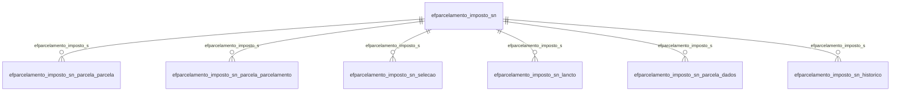

# Modelo — Fiscal - parcelamento (rascunho em lote)

> Gerado por `src/model/gerar_docs_modelo.py` a partir de `src/model/modulos/fiscal_parcelamento.yaml`, do catálogo e do perfil de colunas. **Não edite à mão.**

7 entidades. A coluna *Preench.* é o % de linhas com valor útil (nem nulo, nem em branco, nem zero, nem 1900-01-01; para colunas de código o zero conta como valor).

## Diagrama

## Entidades

| Entidade | Tabela | Linhas | Volume | Filtro obrigatório |
|---|---|---|---|---|
| [efparcelamento_imposto_sn_parcela_parcela](#efparcelamento_imposto_sn_parcela_parcela) | `EFPARCELAMENTO_IMPOSTO_SN_PARCELA_PARCELA` | 60 | pequeno | empresa |
| [efparcelamento_imposto_sn_parcela_parcelamento](#efparcelamento_imposto_sn_parcela_parcelamento) | `EFPARCELAMENTO_IMPOSTO_SN_PARCELA_PARCELAMENTO` | 12 | pequeno | empresa |
| [efparcelamento_imposto_sn_selecao](#efparcelamento_imposto_sn_selecao) | `EFPARCELAMENTO_IMPOSTO_SN_SELECAO` | 12 | pequeno | empresa |
| [efparcelamento_imposto_sn](#efparcelamento_imposto_sn) | `EFPARCELAMENTO_IMPOSTO_SN` | 1 | pequeno | empresa |
| [efparcelamento_imposto_sn_lancto](#efparcelamento_imposto_sn_lancto) | `EFPARCELAMENTO_IMPOSTO_SN_LANCTO` | 1 | pequeno | empresa |
| [efparcelamento_imposto_sn_parcela_dados](#efparcelamento_imposto_sn_parcela_dados) | `EFPARCELAMENTO_IMPOSTO_SN_PARCELA_DADOS` | 1 | pequeno | empresa |
| [efparcelamento_imposto_sn_historico](#efparcelamento_imposto_sn_historico) | `EFPARCELAMENTO_IMPOSTO_SN_HISTORICO` | 1 | pequeno | empresa |

## efparcelamento_imposto_sn_parcela_parcela

**Parcelamento de Impostos Simples Nacional - Parcela** — tabela `EFPARCELAMENTO_IMPOSTO_SN_PARCELA_PARCELA` (60 linhas)

Parcelamento de Impostos Simples Nacional - Parcela. 60 linhas no catálogo; chave: CODI_EMP, I_PARCELAMENTO_SN, I_PARCELAMENTO_SN_PARCELA_PARCELA, TIPO_PARCELAMENTO.

- **Chave:** `CODI_EMP, I_PARCELAMENTO_SN, I_PARCELAMENTO_SN_PARCELA_PARCELA, TIPO_PARCELAMENTO`
- **Empresa:** `CODI_EMP`
- **Período:** `VENCIMENTO`
- **Ordem padrão:** `VENCIMENTO desc`, `I_PARCELAMENTO_SN asc`, `I_PARCELAMENTO_SN_PARCELA_PARCELA asc`

**Regras de negócio validadas:**

- Medido em 2026-10-18: 60 linhas, 1 empresa(s), VENCIMENTO de 2019-01-23 a 2023-12-29.
- Vínculo efparcelamento_imposto_s (EFPARCELAMENTO_IMPOSTO_SN): 0 de 60 linhas sem registro relacionado (empresa 596).

| Campo | Coluna | Tipo | Preench. | Domínio | Descrição (banco) |
|---|---|---|---|---|---|
| empresa | `codi_emp` | integer(4) |  |  | Empresa |
| sequencial_do_parcelamento_simples_nacin | `i_parcelamento_sn` | integer(4) |  |  | Sequencial do parcelamento Simples Nacinal |
| sequencial_da_parcela_do_parcelamento_si | `i_parcelamento_sn_parcela_parcela` | integer(4) |  |  | Sequencial da parcela do parcelamento Simples Nacinal |
| tipo_parcela_1_parcela_2_parcela_da_entr | `tipo_parcelamento` | integer(4) |  |  | Tipo Parcela: 1-Parcela / 2-Parcela da Entrada |
| numero_da_parcela | `numero_parcela` | integer(4) |  |  | Número da parcela |
| data_de_vencimento | `vencimento` | date(4) |  |  | Data de vencimento |
| valor_principal | `valor_principal` | numeric(13) |  |  | Valor principal |
| valor_multa | `valor_multa` | numeric(13) |  |  | Valor multa |
| valor_juros | `valor_juro` | numeric(13) |  |  | Valor juros |
| valor_total | `valor_total` | numeric(13) |  |  | Valor total |
| valor_pago | `valor_pago` | numeric(13) |  |  | Valor pago |
| competencia | `competencia` | date(4) |  |  | Competência |
| valor_encargos_honorarios | `valor_encargos_honorarios` | numeric(13) |  |  | Valor encargos/honorários |

**Vínculos (LEFT JOIN, acrescentam colunas legíveis):**

- `efparcelamento_imposto_s` → `EFPARCELAMENTO_IMPOSTO_SN` por `codi_emp` = `codi_emp` e `i_parcelamento_sn` = `i_parcelamento_sn`; colunas: `efparcelamento_imposto_s_nome`

**Filtros:** `sequencial_do_parcelamento_simples_nacin` (eq/in), `sequencial_da_parcela_do_parcelamento_si` (eq/in), `tipo_parcela_1_parcela_2_parcela_da_entr` (eq/in), `data_de_vencimento` (entre/gte/lte), `competencia` (entre/gte/lte)

## efparcelamento_imposto_sn_parcela_parcelamento

**Parcelamento de Impostos Simples Nacional - Parcelamento** — tabela `EFPARCELAMENTO_IMPOSTO_SN_PARCELA_PARCELAMENTO` (12 linhas)

Parcelamento de Impostos Simples Nacional - Parcelamento. 12 linhas no catálogo; chave: CODI_EMP, I_PARCELAMENTO_SN, I_PARCELAMENTO_SN_PARCELA_PARCELAMENTO, TIPO_PARCELAMENTO.

- **Chave:** `CODI_EMP, I_PARCELAMENTO_SN, I_PARCELAMENTO_SN_PARCELA_PARCELAMENTO, TIPO_PARCELAMENTO`
- **Empresa:** `CODI_EMP`
- **Período:** `DATA_VENCIMENTO`
- **Ordem padrão:** `DATA_VENCIMENTO desc`, `I_PARCELAMENTO_SN asc`, `I_PARCELAMENTO_SN_PARCELA_PARCELAMENTO asc`

**Regras de negócio validadas:**

- Medido em 2026-10-18: 12 linhas, 1 empresa(s), DATA_VENCIMENTO de 2016-08-22 a 2018-12-20.
- Vínculo efparcelamento_imposto_s (EFPARCELAMENTO_IMPOSTO_SN): 0 de 12 linhas sem registro relacionado (empresa 596).

| Campo | Coluna | Tipo | Preench. | Domínio | Descrição (banco) |
|---|---|---|---|---|---|
| empresa | `codi_emp` | integer(4) |  |  | Empresa |
| sequencial_do_parcelamento_simples_nacin | `i_parcelamento_sn` | integer(4) |  |  | Sequencial do parcelamento Simples Nacinal |
| sequencial_da_parcela_do_parcelamento_si | `i_parcelamento_sn_parcela_parcelamento` | integer(4) |  |  | Sequencial da parcela do parcelamento Simples Nacinal |
| tipo_parcela_1_parcela_2_parcela_da_entr | `tipo_parcelamento` | integer(4) |  |  | Tipo Parcela: 1-Parcela / 2-Parcela da Entrada |
| competencia | `competencia` | date(4) |  |  | Competência |
| vencimento | `data_vencimento` | date(4) |  |  | Vencimento |
| valor_principal | `valor_principal` | numeric(13) |  |  | Valor principal |
| valor_multa | `valor_multa` | numeric(13) |  |  | Valor multa |
| valor_juros | `valor_juro` | numeric(13) |  |  | Valor juros |
| valor_total | `valor_total` | numeric(13) |  |  | Valor total |
| valor_encargos_honorarios | `valor_encargos_honorarios` | numeric(13) |  |  | Valor encargos/honorários |

**Vínculos (LEFT JOIN, acrescentam colunas legíveis):**

- `efparcelamento_imposto_s` → `EFPARCELAMENTO_IMPOSTO_SN` por `codi_emp` = `codi_emp` e `i_parcelamento_sn` = `i_parcelamento_sn`; colunas: `efparcelamento_imposto_s_nome`

**Filtros:** `sequencial_do_parcelamento_simples_nacin` (eq/in), `sequencial_da_parcela_do_parcelamento_si` (eq/in), `tipo_parcela_1_parcela_2_parcela_da_entr` (eq/in), `competencia` (entre/gte/lte), `vencimento` (entre/gte/lte)

## efparcelamento_imposto_sn_selecao

**Parcelamento de Impostos Simples Nacional - Seleção** — tabela `EFPARCELAMENTO_IMPOSTO_SN_SELECAO` (12 linhas)

Parcelamento de Impostos Simples Nacional - Seleção. 12 linhas no catálogo; chave: CODI_EMP, I_PARCELAMENTO_SN, I_PARCELAMENTO_SN_SELECAO.

- **Chave:** `CODI_EMP, I_PARCELAMENTO_SN, I_PARCELAMENTO_SN_SELECAO`
- **Empresa:** `CODI_EMP`
- **Período:** `DATA_VENCIMENTO`
- **Ordem padrão:** `DATA_VENCIMENTO desc`, `I_PARCELAMENTO_SN asc`, `I_PARCELAMENTO_SN_SELECAO asc`

**Regras de negócio validadas:**

- Medido em 2026-10-18: 12 linhas, 1 empresa(s), DATA_VENCIMENTO de 2016-08-22 a 2018-12-20.
- Vínculo efparcelamento_imposto_s (EFPARCELAMENTO_IMPOSTO_SN): 0 de 12 linhas sem registro relacionado (empresa 596).

| Campo | Coluna | Tipo | Preench. | Domínio | Descrição (banco) |
|---|---|---|---|---|---|
| empresa | `codi_emp` | integer(4) |  |  | Empresa |
| sequencial_do_parcelamento_simples_nacin | `i_parcelamento_sn` | integer(4) |  |  | Sequencial do parcelamento Simples Nacinal |
| sequencial_da_selecao_do_parcelamento_si | `i_parcelamento_sn_selecao` | integer(4) |  |  | Sequencial da seleção do parcelamento Simples Nacinal |
| competencia | `competencia` | date(4) |  |  | Competência |
| vencimento | `data_vencimento` | date(4) |  |  | Vencimento |
| saldo_devedor | `saldo_devedor` | numeric(13) |  |  | Saldo devedor |
| valo_em_aberto | `valor_em_aberto` | numeric(13) |  |  | Valo em aberto |
| valor_nao_parcelar | `valor_nao_parcelar` | numeric(13) |  |  | Valor não parcelar |
| valor_parcelar | `valor_parcelar` | numeric(13) |  |  | Valor parcelar |
| codigo_do_parcelamento | `i_parcelamento_debito_nao_calculado` | integer(4) |  |  | Código do parcelamento |

**Vínculos (LEFT JOIN, acrescentam colunas legíveis):**

- `efparcelamento_imposto_s` → `EFPARCELAMENTO_IMPOSTO_SN` por `codi_emp` = `codi_emp` e `i_parcelamento_sn` = `i_parcelamento_sn`; colunas: `efparcelamento_imposto_s_nome`

**Filtros:** `sequencial_do_parcelamento_simples_nacin` (eq/in), `sequencial_da_selecao_do_parcelamento_si` (eq/in), `competencia` (entre/gte/lte), `vencimento` (entre/gte/lte), `codigo_do_parcelamento` (eq/in)

## efparcelamento_imposto_sn

**Parcelamento de Impostos Simples Nacional** — tabela `EFPARCELAMENTO_IMPOSTO_SN` (1 linhas)

Parcelamento de Impostos Simples Nacional. 1 linhas no catálogo; chave: CODI_EMP, I_PARCELAMENTO_SN.

- **Chave:** `CODI_EMP, I_PARCELAMENTO_SN`
- **Empresa:** `CODI_EMP`
- **Período:** `DATA_PARCELAMENTO`
- **Ordem padrão:** `DATA_PARCELAMENTO desc`, `I_PARCELAMENTO_SN asc`

**Regras de negócio validadas:**

- Medido em 2026-10-18: 1 linhas, 1 empresa(s), DATA_PARCELAMENTO de 2019-01-23 a 2019-01-23.
- Colunas expostas nulas em 100% das linhas (3): estado, municipio, data_situacao.
- Vínculo geempre (geempre): 0 de 1 linhas sem registro relacionado (empresa 596).
- Vínculo geestado (geestado): 0 de 1 linhas sem registro relacionado (empresa 596).
- Vínculo gemunicipio (gemunicipio): 0 de 1 linhas sem registro relacionado (empresa 596).

| Campo | Coluna | Tipo | Preench. | Domínio | Descrição (banco) |
|---|---|---|---|---|---|
| empresa | `codi_emp` | integer(4) |  |  | Empresa |
| sequencial_do_parcelamento_simples_nacin | `i_parcelamento_sn` | integer(4) |  |  | Sequencial do parcelamento Simples Nacinal |
| descricao | `descricao` | varchar(255) |  |  | Descrição |
| data_do_parcelamento | `data_parcelamento` | date(4) |  |  | Data do parcelamento |
| parcelar_somente_imposto | `parcelar_somente_imposto` | integer(4) |  |  | PARCELAR SOMENTE OS IMPOSTOS (1/ 2/ 3/ 4/ 5/ 6) |
| estado | `codigo_uf` | integer(4) |  |  | Estado |
| municipio | `codigo_municipio` | integer(4) |  |  | Munícipio |
| c_1_em_parcelamento_2_encerrado_a_pedido | `situacao` | tinyint(1) |  |  | 1-EM PARCELAMENTO/2-ENCERRADO A PEDIDO DO CONTRIBUINTE/3-ENCERRADO POR RESCISÃO/4-PARCELAMENTO QUITADO/5-ENCERRADO POR LIQUIDAÇÃO |
| data_situacao | `data_situacao` | date(4) |  |  |  |
| c_1_normal_ate_60_parcelas_2_especial_at | `tipo_parcelamento` | tinyint(1) |  |  | 1-NORMAL-ATÉ 60 PARCELAS/2-ESPECIAL-ATÉ 120 PARCELAS/3-ESPECIAL-ATÉ 175 PARCELAS/4-ESPECIAL-ATÉ 145 PARCELAS/5-GERAL - DÍVIDA ATIVA PGFN |

**Vínculos (LEFT JOIN, acrescentam colunas legíveis):**

- `geempre` → `geempre` por `codi_emp` = `codi_emp`; colunas: `geempre_nome`
- `geestado` → `geestado` por `codigo_uf` = `codigo_uf`; colunas: `geestado_nome`
- `gemunicipio` → `gemunicipio` por `codigo_municipio` = `codigo_municipio`; colunas: `gemunicipio_nome`

**Filtros:** `sequencial_do_parcelamento_simples_nacin` (eq/in), `data_do_parcelamento` (entre/gte/lte), `data_situacao` (entre/gte/lte), `descricao` (contem/prefixo), `estado` (eq/in), `municipio` (eq/in), `c_1_em_parcelamento_2_encerrado_a_pedido` (eq/in), `c_1_normal_ate_60_parcelas_2_especial_at` (eq/in)

## efparcelamento_imposto_sn_lancto

**Parcelamento de Impostos Simples Nacional - Lançamentos** — tabela `EFPARCELAMENTO_IMPOSTO_SN_LANCTO` (1 linhas)

Parcelamento de Impostos Simples Nacional - Lançamentos. 1 linhas no catálogo; chave: CODI_EMP, NUME_LAN, FILI_LAN, I_PARCELAMENTO_SN.

- **Chave:** `CODI_EMP, NUME_LAN, FILI_LAN, I_PARCELAMENTO_SN`
- **Empresa:** `CODI_EMP`
- **Período:** `—`
- **Ordem padrão:** `NUME_LAN asc`, `FILI_LAN asc`

**Regras de negócio validadas:**

- Medido em 2026-10-18: 1 linhas, 1 empresa(s).
- Vínculo efparcelamento_imposto_s (EFPARCELAMENTO_IMPOSTO_SN): 0 de 1 linhas sem registro relacionado (empresa 596).

| Campo | Coluna | Tipo | Preench. | Domínio | Descrição (banco) |
|---|---|---|---|---|---|
| empresa_do_lancamento | `codi_emp` | integer(4) |  |  | Empresa do lançamento |
| numero_do_lancamento | `nume_lan` | integer(4) |  |  | Numero do lançamento |
| empresa_do_parcelamento | `fili_lan` | integer(4) |  |  | Empresa do parcelamento |
| sequencial_do_parcelamento_simples_nacin | `i_parcelamento_sn` | integer(4) |  |  | Sequencial do parcelamento Simples Nacinal |
| tipo_do_lancamento | `tipo` | integer(4) |  |  | Tipo do lancamento |

**Vínculos (LEFT JOIN, acrescentam colunas legíveis):**

- `efparcelamento_imposto_s` → `EFPARCELAMENTO_IMPOSTO_SN` por `fili_lan` = `codi_emp` e `i_parcelamento_sn` = `i_parcelamento_sn`; colunas: `efparcelamento_imposto_s_nome`

**Filtros:** `numero_do_lancamento` (eq/in), `empresa_do_parcelamento` (eq/in), `sequencial_do_parcelamento_simples_nacin` (eq/in), `tipo_do_lancamento` (eq/in)

## efparcelamento_imposto_sn_parcela_dados

**Parcelamento de Impostos Simples Nacional - Dados** — tabela `EFPARCELAMENTO_IMPOSTO_SN_PARCELA_DADOS` (1 linhas)

Parcelamento de Impostos Simples Nacional - Dados. 1 linhas no catálogo; chave: CODI_EMP, I_PARCELAMENTO_SN, TIPO_PARCELAMENTO.

- **Chave:** `CODI_EMP, I_PARCELAMENTO_SN, TIPO_PARCELAMENTO`
- **Empresa:** `CODI_EMP`
- **Período:** `VENCIMENTO_INICIAL`
- **Ordem padrão:** `VENCIMENTO_INICIAL desc`, `I_PARCELAMENTO_SN asc`, `TIPO_PARCELAMENTO asc`

**Regras de negócio validadas:**

- Medido em 2026-10-18: 1 linhas, 1 empresa(s), VENCIMENTO_INICIAL de 2019-01-23 a 2019-01-23.
- Vínculo efparcelamento_imposto_s (EFPARCELAMENTO_IMPOSTO_SN): 0 de 1 linhas sem registro relacionado (empresa 596).

| Campo | Coluna | Tipo | Preench. | Domínio | Descrição (banco) |
|---|---|---|---|---|---|
| empresa | `codi_emp` | integer(4) |  |  | Empresa |
| sequencial_do_parcelamento_simples_nacin | `i_parcelamento_sn` | integer(4) |  |  | Sequencial do parcelamento Simples Nacinal |
| tipo_parcela_1_parcela_2_parcela_da_entr | `tipo_parcelamento` | integer(4) |  |  | Tipo Parcela: 1-Parcela / 2-Parcela da Entrada |
| total_parcelado | `total_parcelado` | numeric(13) |  |  | Total parcelado |
| numero_de_parcelas | `numero_de_parcela` | integer(4) |  |  | Número de parcelas |
| valor_da_parcela | `valor_parcela` | numeric(13) |  |  | Valor da parcela |
| vencimento_inicial | `vencimento_inicial` | date(4) |  |  | Vencimento inicial |
| percentual_da_entrada | `percentual_entrada` | numeric(6) |  |  | Percentual da Entrada |
| percentual_da_entrada_todas_casas_decima | `percentual_entrada_calculado` | numeric(23) |  |  | Percentual da Entrada - Todas Casas decimais |
| valor_principal | `valor_principal` | numeric(13) |  |  | Valor Principal |
| valor_multa | `valor_multa` | numeric(13) |  |  | Valor Multa |
| valor_juros | `valor_juro` | numeric(13) |  |  | Valor Juros |
| valor_encargos_honorarios | `valor_encargos_honorarios` | numeric(13) |  |  | Valor Encargos Honorarios |
| valor_total | `valor_total` | numeric(13) |  |  | Valor Total |
| percentual_da_primeira_parcela | `percentual_primeira_parcela` | numeric(5) |  |  | Percentual da primeira parcela |
| valor_da_primeira_parcela | `valor_primeira_parcela` | numeric(13) |  |  | Valor da primeira parcela |

**Vínculos (LEFT JOIN, acrescentam colunas legíveis):**

- `efparcelamento_imposto_s` → `EFPARCELAMENTO_IMPOSTO_SN` por `codi_emp` = `codi_emp` e `i_parcelamento_sn` = `i_parcelamento_sn`; colunas: `efparcelamento_imposto_s_nome`

**Filtros:** `sequencial_do_parcelamento_simples_nacin` (eq/in), `tipo_parcela_1_parcela_2_parcela_da_entr` (eq/in), `vencimento_inicial` (entre/gte/lte)

## efparcelamento_imposto_sn_historico

**Parcelamento de Impostos Simples Nacional - Histórico** — tabela `EFPARCELAMENTO_IMPOSTO_SN_HISTORICO` (1 linhas)

Parcelamento de Impostos Simples Nacional - Histórico. 1 linhas no catálogo; chave: CODI_EMP, I_PARCELAMENTO_SN.

- **Chave:** `CODI_EMP, I_PARCELAMENTO_SN`
- **Empresa:** `CODI_EMP`
- **Período:** `—`
- **Ordem padrão:** `I_PARCELAMENTO_SN asc`

**Regras de negócio validadas:**

- Medido em 2026-10-18: 1 linhas, 1 empresa(s).
- Vínculo efparcelamento_imposto_s (EFPARCELAMENTO_IMPOSTO_SN): 0 de 1 linhas sem registro relacionado (empresa 596).

| Campo | Coluna | Tipo | Preench. | Domínio | Descrição (banco) |
|---|---|---|---|---|---|
| empresa | `codi_emp` | integer(4) |  |  | Empresa |
| sequencial_do_parcelamento_simples_nacio | `i_parcelamento_sn` | integer(4) |  |  | Sequencial do parcelamento Simples Nacional |
| observacao | `observacao` | varchar(255) |  |  | Observação |

**Vínculos (LEFT JOIN, acrescentam colunas legíveis):**

- `efparcelamento_imposto_s` → `EFPARCELAMENTO_IMPOSTO_SN` por `codi_emp` = `codi_emp` e `i_parcelamento_sn` = `i_parcelamento_sn`; colunas: `efparcelamento_imposto_s_nome`

**Filtros:** `sequencial_do_parcelamento_simples_nacio` (eq/in), `observacao` (contem/prefixo)

## Domínios (significado dos códigos)

`confirmado`: **sim** = vem do comentário do banco e/ou foi conferido nos dados; **parcial** = parte dos valores; **não** = hipótese, não use como regra.

### status_empresa

Situação da empresa no cadastro (geempre.stat_emp)

Confirmado: sim

| Código | Significado |
|---|---|
| A | Ativa |
| I | Inativa |
| C | Em constituição |
| M | Ativo sem movimento |
| B | Em processo de baixa |
| E | Excluindo |

### motivo_inatividade

Motivo da inatividade (geempre.tipoi_emp). Só aparece em empresas inativas.

Confirmado: sim

| Código | Significado |
|---|---|
| 1 | Outros |
| 2 | Baixada |
| 3 | Transferida |
| 4 | Inadimplente |

### tipo_inscricao

Tipo da inscrição (CNPJ/CPF/CEI/CAEPF)

Confirmado: sim

| Código | Significado |
|---|---|
| 1 | CNPJ |
| 2 | CPF |
| 3 | CEI |
| 6 | CAEPF |

### regime_federal_empresa

Regime federal da folha (geempre.rfed_emp)

Confirmado: parcial

| Código | Significado |
|---|---|
| 1 | Normal |
| 2 | Microempresa |
| 3 | Empresa de pequeno porte |

### tipo_honorario_empresa

Como a empresa usa o módulo Honorários (geempre.honorario_tipo)

Confirmado: sim

| Código | Significado |
|---|---|
| E | Escritório (quem fatura) |
| C | Cliente |

### sim_nao_texto

Confirmado: sim

| Código | Significado |
|---|---|
| S | Sim |
| N | Não |

### sim_nao_numerico

Confirmado: sim

| Código | Significado |
|---|---|
| 1 | Sim |
| 0 | Não |

