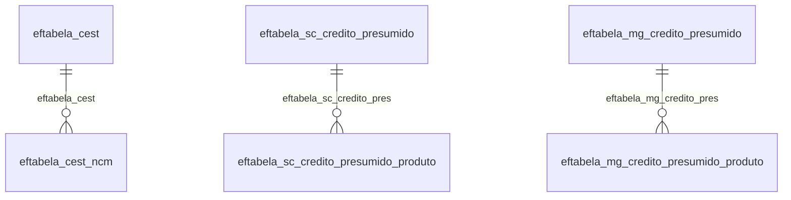

# Modelo — Fiscal - tabela (rascunho em lote)

> Gerado por `src/model/gerar_docs_modelo.py` a partir de `src/model/modulos/fiscal_tabela.yaml`, do catálogo e do perfil de colunas. **Não edite à mão.**

155 entidades. A coluna *Preench.* é o % de linhas com valor útil (nem nulo, nem em branco, nem zero, nem 1900-01-01; para colunas de código o zero conta como valor).

## Diagrama

## Entidades

| Entidade | Tabela | Linhas | Volume | Filtro obrigatório |
|---|---|---|---|---|
| [eftabela_credito_presumido_faixa](#eftabela_credito_presumido_faixa) | `eftabela_credito_presumido_faixa` | 121.574 | medio | empresa |
| [eftabela_simples_nacional_estadual](#eftabela_simples_nacional_estadual) | `eftabela_simples_nacional_estadual` | 75.965 | medio | — |
| [eftabela_aliquota_icms_vigencia_aliquota](#eftabela_aliquota_icms_vigencia_aliquota) | `EFTABELA_ALIQUOTA_ICMS_VIGENCIA_ALIQUOTA` | 75.114 | medio | empresa |
| [eftabela_credito_presumido](#eftabela_credito_presumido) | `eftabela_credito_presumido` | 47.017 | medio | empresa |
| [eftabela_vinculo_ncm_nbs_cclasstrib](#eftabela_vinculo_ncm_nbs_cclasstrib) | `EFTABELA_VINCULO_NCM_NBS_CCLASSTRIB` | 13.292 | medio | — |
| [eftabela_simples_nacional_municipal](#eftabela_simples_nacional_municipal) | `eftabela_simples_nacional_municipal` | 11.151 | medio | — |
| [eftabela_atividade_servico_folha_vigencia](#eftabela_atividade_servico_folha_vigencia) | `EFTABELA_ATIVIDADE_SERVICO_FOLHA_VIGENCIA` | 10.076 | medio | — |
| [eftabela_percentual_mistura_combustiveis](#eftabela_percentual_mistura_combustiveis) | `EFTABELA_PERCENTUAL_MISTURA_COMBUSTIVEIS` | 7.872 | pequeno | empresa |
| [eftabela_percentual_mistura_combustiveis_vigencia](#eftabela_percentual_mistura_combustiveis_vigencia) | `EFTABELA_PERCENTUAL_MISTURA_COMBUSTIVEIS_VIGENCIA` | 7.872 | pequeno | empresa |
| [eftabela_simples_nacional_federal](#eftabela_simples_nacional_federal) | `eftabela_simples_nacional_federal` | 5.782 | pequeno | — |
| [eftabela_icms_st_carga_media_vigencia](#eftabela_icms_st_carga_media_vigencia) | `EFTABELA_ICMS_ST_CARGA_MEDIA_VIGENCIA` | 5.364 | pequeno | empresa |
| [eftabela_atividade_servico_folha](#eftabela_atividade_servico_folha) | `EFTABELA_ATIVIDADE_SERVICO_FOLHA` | 4.948 | pequeno | — |
| [eftabela_movaju_ajuste_sped](#eftabela_movaju_ajuste_sped) | `EFTABELA_MOVAJU_AJUSTE_SPED` | 2.846 | pequeno | — |
| [eftabela_aliquota_icms_vigencia](#eftabela_aliquota_icms_vigencia) | `EFTABELA_ALIQUOTA_ICMS_VIGENCIA` | 2.782 | pequeno | empresa |
| [eftabela_marca_grupo_bebida](#eftabela_marca_grupo_bebida) | `EFTABELA_MARCA_GRUPO_BEBIDA` | 2.634 | pequeno | — |
| [eftabela_aliquota_icms](#eftabela_aliquota_icms) | `EFTABELA_ALIQUOTA_ICMS` | 1.970 | pequeno | empresa |
| [eftabela_cest_ncm](#eftabela_cest_ncm) | `EFTABELA_CEST_NCM` | 1.897 | pequeno | — |
| [eftabela_icms_st_carga_media_padrao](#eftabela_icms_st_carga_media_padrao) | `EFTABELA_ICMS_ST_CARGA_MEDIA_PADRAO` | 1.341 | pequeno | — |
| [eftabela_cest](#eftabela_cest) | `EFTABELA_CEST` | 1.085 | pequeno | — |
| [eftabela_vinculo_cclasstrib_vigencia_itens_padrao](#eftabela_vinculo_cclasstrib_vigencia_itens_padrao) | `EFTABELA_VINCULO_CCLASSTRIB_VIGENCIA_ITENS_PADRAO` | 1.051 | pequeno | — |
| [eftabela_rj_valores_declaratorios_icms](#eftabela_rj_valores_declaratorios_icms) | `EFTABELA_RJ_VALORES_DECLARATORIOS_ICMS` | 922 | pequeno | — |
| [eftabela_dacon_tipo_produto](#eftabela_dacon_tipo_produto) | `EFTABELA_DACON_TIPO_PRODUTO` | 770 | pequeno | — |
| [eftabela_aliquota_efetiva_icms_st_at_vigencia_atacadista](#eftabela_aliquota_efetiva_icms_st_at_vigencia_atacadista) | `EFTABELA_ALIQUOTA_EFETIVA_ICMS_ST_AT_VIGENCIA_ATACADISTA` | 680 | pequeno | empresa |
| [eftabela_aliquota_efetiva_icms_st_at_vigencia_varejista](#eftabela_aliquota_efetiva_icms_st_at_vigencia_varejista) | `EFTABELA_ALIQUOTA_EFETIVA_ICMS_ST_AT_VIGENCIA_VAREJISTA` | 680 | pequeno | empresa |
| [eftabela_atividade_economica](#eftabela_atividade_economica) | `EFTABELA_ATIVIDADE_ECONOMICA` | 672 | pequeno | — |
| [eftabela_atividade_gestta_processos](#eftabela_atividade_gestta_processos) | `EFTABELA_ATIVIDADE_GESTTA_PROCESSOS` | 600 | pequeno | — |
| [eftabela_pe_natureza_operacao](#eftabela_pe_natureza_operacao) | `EFTABELA_PE_NATUREZA_OPERACAO` | 553 | pequeno | — |
| [eftabela_sc_valores_declaratorios_icms](#eftabela_sc_valores_declaratorios_icms) | `EFTABELA_SC_VALORES_DECLARATORIOS_ICMS` | 530 | pequeno | — |
| [eftabela_pr_valores_declaratorios_icms](#eftabela_pr_valores_declaratorios_icms) | `EFTABELA_PR_VALORES_DECLARATORIOS_ICMS` | 505 | pequeno | — |
| [eftabela_natureza_receita](#eftabela_natureza_receita) | `EFTABELA_NATUREZA_RECEITA` | 457 | pequeno | — |
| [eftabela_ba_dmd](#eftabela_ba_dmd) | `EFTABELA_BA_DMD` | 383 | pequeno | — |
| [eftabela_simples_nacional_tabela](#eftabela_simples_nacional_tabela) | `eftabela_simples_nacional_tabela` | 317 | pequeno | — |
| [eftabela_sp_valores_declaratorios_icms](#eftabela_sp_valores_declaratorios_icms) | `EFTABELA_SP_VALORES_DECLARATORIOS_ICMS` | 309 | pequeno | — |
| [eftabela_cst_vigencia](#eftabela_cst_vigencia) | `EFTABELA_CST_VIGENCIA` | 308 | pequeno | — |
| [eftabela_df_valores_declaratorios_icms](#eftabela_df_valores_declaratorios_icms) | `EFTABELA_DF_VALORES_DECLARATORIOS_ICMS` | 297 | pequeno | — |
| [eftabela_go_valores_declaratorios_icms](#eftabela_go_valores_declaratorios_icms) | `EFTABELA_GO_VALORES_DECLARATORIOS_ICMS` | 297 | pequeno | — |
| [eftabela_mt_ajustes_sped](#eftabela_mt_ajustes_sped) | `EFTABELA_MT_AJUSTES_SPED` | 295 | pequeno | — |
| [eftabela_rn_tributacao](#eftabela_rn_tributacao) | `EFTABELA_RN_TRIBUTACAO` | 257 | pequeno | — |
| [eftabela_cst_icms_vigencia](#eftabela_cst_icms_vigencia) | `EFTABELA_CST_ICMS_VIGENCIA` | 256 | pequeno | — |
| [eftabela_receitas_7_1_3](#eftabela_receitas_7_1_3) | `EFTABELA_RECEITAS_7_1_3` | 250 | pequeno | — |
| [eftabela_es_valores_declaratorios_icms](#eftabela_es_valores_declaratorios_icms) | `EFTABELA_ES_VALORES_DECLARATORIOS_ICMS` | 245 | pequeno | — |
| [eftabela_dispositivo_credito_presumido_rs](#eftabela_dispositivo_credito_presumido_rs) | `EFTABELA_DISPOSITIVO_CREDITO_PRESUMIDO_RS` | 214 | pequeno | — |
| [eftabela_ro_ajuste_sped_fiscal](#eftabela_ro_ajuste_sped_fiscal) | `EFTABELA_RO_AJUSTE_SPED_FISCAL` | 202 | pequeno | — |
| [eftabela_receitas_7_1_4](#eftabela_receitas_7_1_4) | `EFTABELA_RECEITAS_7_1_4` | 202 | pequeno | — |
| [eftabela_servicos](#eftabela_servicos) | `eftabela_servicos` | 200 | pequeno | — |
| [eftabela_rj_codigo_item_ipm](#eftabela_rj_codigo_item_ipm) | `EFTABELA_RJ_CODIGO_ITEM_IPM` | 192 | pequeno | — |
| [eftabela_classificacao_tributaria_ibs_cbs](#eftabela_classificacao_tributaria_ibs_cbs) | `EFTABELA_CLASSIFICACAO_TRIBUTARIA_IBS_CBS` | 161 | pequeno | — |
| [eftabela_aliquota_efetiva_icms_st_at](#eftabela_aliquota_efetiva_icms_st_at) | `EFTABELA_ALIQUOTA_EFETIVA_ICMS_ST_AT` | 160 | pequeno | empresa |
| [eftabela_aliquota_efetiva_icms_st_at_vigencia](#eftabela_aliquota_efetiva_icms_st_at_vigencia) | `EFTABELA_ALIQUOTA_EFETIVA_ICMS_ST_AT_VIGENCIA` | 160 | pequeno | empresa |
| [eftabela_aliquota_efetiva_icms_st_at_vigencia_produto_inform](#eftabela_aliquota_efetiva_icms_st_at_vigencia_produto_inform) | `EFTABELA_ALIQUOTA_EFETIVA_ICMS_ST_AT_VIGENCIA_PRODUTO_INFORMATICA` | 160 | pequeno | empresa |
| [eftabela_pe_ajuste_sef](#eftabela_pe_ajuste_sef) | `EFTABELA_PE_AJUSTE_SEF` | 157 | pequeno | — |
| [eftabela_simp_operacao](#eftabela_simp_operacao) | `EFTABELA_SIMP_OPERACAO` | 151 | pequeno | — |
| [eftabela_rs_transferencia_credito](#eftabela_rs_transferencia_credito) | `EFTABELA_RS_TRANSFERENCIA_CREDITO` | 146 | pequeno | — |
| [eftabela_cst](#eftabela_cst) | `eftabela_cst` | 138 | pequeno | — |
| [eftabela_rn_identificador_tarifa](#eftabela_rn_identificador_tarifa) | `EFTABELA_RN_IDENTIFICADOR_TARIFA` | 130 | pequeno | — |
| [eftabela_dcip](#eftabela_dcip) | `EFTABELA_DCIP` | 125 | pequeno | — |
| [eftabela_receitas_7_1_1](#eftabela_receitas_7_1_1) | `EFTABELA_RECEITAS_7_1_1` | 122 | pequeno | — |
| [eftabela_simples_nacional_secao](#eftabela_simples_nacional_secao) | `eftabela_simples_nacional_secao` | 105 | pequeno | — |
| [eftabela_classe_consumo](#eftabela_classe_consumo) | `EFTABELA_CLASSE_CONSUMO` | 101 | pequeno | — |
| [eftabela_genero_mercadoria](#eftabela_genero_mercadoria) | `eftabela_genero_mercadoria` | 100 | pequeno | — |
| [eftabela_exclusoes_7_1_2](#eftabela_exclusoes_7_1_2) | `EFTABELA_EXCLUSOES_7_1_2` | 88 | pequeno | — |
| [eftabela_classificacao_sped](#eftabela_classificacao_sped) | `eftabela_classificacao_sped` | 87 | pequeno | — |
| [eftabela_gnre_avulsa_produtos](#eftabela_gnre_avulsa_produtos) | `EFTABELA_GNRE_AVULSA_PRODUTOS` | 84 | pequeno | — |
| [eftabela_vinculo_cclasstrib_vigencia_itens_excecao_padrao](#eftabela_vinculo_cclasstrib_vigencia_itens_excecao_padrao) | `EFTABELA_VINCULO_CCLASSTRIB_VIGENCIA_ITENS_EXCECAO_PADRAO` | 82 | pequeno | — |
| [eftabela_gnre_avulsa_detalhamento](#eftabela_gnre_avulsa_detalhamento) | `EFTABELA_GNRE_AVULSA_DETALHAMENTO` | 79 | pequeno | — |
| [eftabela_al_codigo_item_ipm](#eftabela_al_codigo_item_ipm) | `EFTABELA_AL_CODIGO_ITEM_IPM` | 75 | pequeno | — |
| [eftabela_al_quadro_iii_dac](#eftabela_al_quadro_iii_dac) | `EFTABELA_AL_QUADRO_III_DAC` | 73 | pequeno | — |
| [eftabela_grupo_st_estoque_rs](#eftabela_grupo_st_estoque_rs) | `EFTABELA_GRUPO_ST_ESTOQUE_RS` | 70 | pequeno | — |
| [eftabela_protege_dispositivo](#eftabela_protege_dispositivo) | `EFTABELA_PROTEGE_DISPOSITIVO` | 66 | pequeno | — |
| [eftabela_simp_serie](#eftabela_simp_serie) | `EFTABELA_SIMP_SERIE` | 66 | pequeno | — |
| [eftabela_credito_presumido_faixa_original](#eftabela_credito_presumido_faixa_original) | `EFTABELA_CREDITO_PRESUMIDO_FAIXA_ORIGINAL` | 60 | pequeno | — |
| [eftabela_classificacao_servicos](#eftabela_classificacao_servicos) | `eftabela_classificacao_servicos` | 59 | pequeno | — |
| [eftabela_recolhimento_sped_fiscal](#eftabela_recolhimento_sped_fiscal) | `EFTABELA_RECOLHIMENTO_SPED_FISCAL` | 55 | pequeno | — |
| [eftabela_veiculo_marca](#eftabela_veiculo_marca) | `EFTABELA_VEICULO_MARCA` | 48 | pequeno | — |
| [eftabela_pa_codigo_item_ipm](#eftabela_pa_codigo_item_ipm) | `EFTABELA_PA_CODIGO_ITEM_IPM` | 47 | pequeno | — |
| [eftabela_ba_codigo_item_ipm](#eftabela_ba_codigo_item_ipm) | `EFTABELA_BA_CODIGO_ITEM_IPM` | 44 | pequeno | — |
| [eftabela_diferencial_aliquota_ma_faixa](#eftabela_diferencial_aliquota_ma_faixa) | `EFTABELA_DIFERENCIAL_ALIQUOTA_MA_FAIXA` | 42 | pequeno | — |
| [eftabela_sc_credito_presumido_produto](#eftabela_sc_credito_presumido_produto) | `EFTABELA_SC_CREDITO_PRESUMIDO_PRODUTO` | 40 | pequeno | — |
| [eftabela_dif_formato_papel](#eftabela_dif_formato_papel) | `EFTABELA_DIF_FORMATO_PAPEL` | 37 | pequeno | — |
| [eftabela_pb_valores_declaratorios_icms](#eftabela_pb_valores_declaratorios_icms) | `EFTABELA_PB_VALORES_DECLARATORIOS_ICMS` | 35 | pequeno | — |
| [eftabela_situacao_tributaria](#eftabela_situacao_tributaria) | `eftabela_situacao_tributaria` | 33 | pequeno | — |
| [eftabela_natureza_acao_processo_referenciado](#eftabela_natureza_acao_processo_referenciado) | `EFTABELA_NATUREZA_ACAO_PROCESSO_REFERENCIADO` | 31 | pequeno | — |
| [eftabela_classe_enquadramento_ipi](#eftabela_classe_enquadramento_ipi) | `EFTABELA_CLASSE_ENQUADRAMENTO_IPI` | 31 | pequeno | — |
| [eftabela_es_codigo_item_ipm](#eftabela_es_codigo_item_ipm) | `EFTABELA_ES_CODIGO_ITEM_IPM` | 31 | pequeno | — |
| [eftabela_esocial_tipo_servico](#eftabela_esocial_tipo_servico) | `EFTABELA_ESOCIAL_TIPO_SERVICO` | 30 | pequeno | — |
| [eftabela_classificacao_tributaria_is](#eftabela_classificacao_tributaria_is) | `EFTABELA_CLASSIFICACAO_TRIBUTARIA_IS` | 30 | pequeno | — |
| [eftabela_codigo_tipo_credito](#eftabela_codigo_tipo_credito) | `EFTABELA_CODIGO_TIPO_CREDITO` | 28 | pequeno | — |
| [eftabela_dere_uf](#eftabela_dere_uf) | `EFTABELA_DERE_UF` | 28 | pequeno | — |
| [eftabela_aliquota_icms_original](#eftabela_aliquota_icms_original) | `EFTABELA_ALIQUOTA_ICMS_ORIGINAL` | 27 | pequeno | — |
| [eftabela_sc_codigo_item_ipm](#eftabela_sc_codigo_item_ipm) | `EFTABELA_SC_CODIGO_ITEM_IPM` | 26 | pequeno | — |
| [eftabela_dere_servicos_financeiros](#eftabela_dere_servicos_financeiros) | `EFTABELA_DERE_SERVICOS_FINANCEIROS` | 26 | pequeno | — |
| [eftabela_cfps](#eftabela_cfps) | `eftabela_cfps` | 25 | pequeno | — |
| [eftabela_pb_recolhimento_feef](#eftabela_pb_recolhimento_feef) | `EFTABELA_PB_RECOLHIMENTO_FEEF` | 25 | pequeno | — |
| [eftabela_especie_servico_transporte](#eftabela_especie_servico_transporte) | `EFTABELA_ESPECIE_SERVICO_TRANSPORTE` | 24 | pequeno | — |
| [eftabela_natureza_acao](#eftabela_natureza_acao) | `EFTABELA_NATUREZA_ACAO` | 24 | pequeno | — |
| [eftabela_gnre_avulsa_documentos_origem](#eftabela_gnre_avulsa_documentos_origem) | `EFTABELA_GNRE_AVULSA_DOCUMENTOS_ORIGEM` | 23 | pequeno | — |
| [eftabela_credito_presumido_original](#eftabela_credito_presumido_original) | `EFTABELA_CREDITO_PRESUMIDO_ORIGINAL` | 23 | pequeno | — |
| [eftabela_simples_nacional_anexo](#eftabela_simples_nacional_anexo) | `eftabela_simples_nacional_anexo` | 22 | pequeno | — |
| [eftabela_tipo_conhecimento](#eftabela_tipo_conhecimento) | `eftabela_tipo_conhecimento` | 22 | pequeno | — |
| [eftabela_sc_credito_presumido](#eftabela_sc_credito_presumido) | `EFTABELA_SC_CREDITO_PRESUMIDO` | 22 | pequeno | — |
| [eftabela_to_codigo_item_ipm](#eftabela_to_codigo_item_ipm) | `EFTABELA_TO_CODIGO_ITEM_IPM` | 22 | pequeno | — |
| [eftabela_rn_codigo_item_ipm](#eftabela_rn_codigo_item_ipm) | `EFTABELA_RN_CODIGO_ITEM_IPM` | 22 | pequeno | — |
| [eftabela_finalidade_arquivo](#eftabela_finalidade_arquivo) | `eftabela_finalidade_arquivo` | 20 | pequeno | — |
| [eftabela_piscofins_sped_tabela](#eftabela_piscofins_sped_tabela) | `EFTABELA_PISCOFINS_SPED_TABELA` | 20 | pequeno | — |
| [eftabela_ac_codigo_item_ipm](#eftabela_ac_codigo_item_ipm) | `EFTABELA_AC_CODIGO_ITEM_IPM` | 20 | pequeno | — |
| [eftabela_codigo_base_calculo_credito](#eftabela_codigo_base_calculo_credito) | `EFTABELA_CODIGO_BASE_CALCULO_CREDITO` | 18 | pequeno | — |
| [eftabela_mt_gia_meios_producao](#eftabela_mt_gia_meios_producao) | `EFTABELA_MT_GIA_MEIOS_PRODUCAO` | 18 | pequeno | — |
| [eftabela_simp_recipiente_glp](#eftabela_simp_recipiente_glp) | `EFTABELA_SIMP_RECIPIENTE_GLP` | 17 | pequeno | — |
| [eftabela_gnre_avulsa_receita](#eftabela_gnre_avulsa_receita) | `EFTABELA_GNRE_AVULSA_RECEITA` | 17 | pequeno | — |
| [eftabela_tipo_receita](#eftabela_tipo_receita) | `EFTABELA_TIPO_RECEITA` | 16 | pequeno | — |
| [eftabela_mg_credito_presumido_produto](#eftabela_mg_credito_presumido_produto) | `EFTABELA_MG_CREDITO_PRESUMIDO_PRODUTO` | 16 | pequeno | — |
| [eftabela_credito_presumido_faixa_rs](#eftabela_credito_presumido_faixa_rs) | `EFTABELA_CREDITO_PRESUMIDO_FAIXA_RS` | 15 | pequeno | — |
| [eftabela_mg_incentivo_ret_faixas](#eftabela_mg_incentivo_ret_faixas) | `EFTABELA_MG_INCENTIVO_RET_FAIXAS` | 15 | pequeno | empresa |
| [eftabela_codigo_tributacao](#eftabela_codigo_tributacao) | `eftabela_codigo_tributacao` | 14 | pequeno | — |
| [eftabela_cst_ipi_vigencia](#eftabela_cst_ipi_vigencia) | `EFTABELA_CST_IPI_VIGENCIA` | 14 | pequeno | — |
| [eftabela_codigo_contribuicao_social_apurada](#eftabela_codigo_contribuicao_social_apurada) | `EFTABELA_CODIGO_CONTRIBUICAO_SOCIAL_APURADA` | 13 | pequeno | — |
| [eftabela_suspensao_impostos_federais_motivo_suspensao](#eftabela_suspensao_impostos_federais_motivo_suspensao) | `EFTABELA_SUSPENSAO_IMPOSTOS_FEDERAIS_MOTIVO_SUSPENSAO` | 13 | pequeno | — |
| [eftabela_sp_codigo_item_ipm](#eftabela_sp_codigo_item_ipm) | `EFTABELA_SP_CODIGO_ITEM_IPM` | 12 | pequeno | — |
| [eftabela_motivo_desoneracao_icms](#eftabela_motivo_desoneracao_icms) | `EFTABELA_MOTIVO_DESONERACAO_ICMS` | 12 | pequeno | — |
| [eftabela_rs_utilizacao_credito](#eftabela_rs_utilizacao_credito) | `EFTABELA_RS_UTILIZACAO_CREDITO` | 11 | pequeno | — |
| [eftabela_ba_valores_declaratorios_icms](#eftabela_ba_valores_declaratorios_icms) | `EFTABELA_BA_VALORES_DECLARATORIOS_ICMS` | 11 | pequeno | — |
| [eftabela_credito_presumido_faixa_mg](#eftabela_credito_presumido_faixa_mg) | `EFTABELA_CREDITO_PRESUMIDO_FAIXA_MG` | 10 | pequeno | — |
| [eftabela_cst_simples_nacional_vigencia](#eftabela_cst_simples_nacional_vigencia) | `EFTABELA_CST_SIMPLES_NACIONAL_VIGENCIA` | 10 | pequeno | — |
| [eftabela_rs_credito_presumido_produto](#eftabela_rs_credito_presumido_produto) | `EFTABELA_RS_CREDITO_PRESUMIDO_PRODUTO` | 10 | pequeno | — |
| [eftabela_dif_unidade_medida](#eftabela_dif_unidade_medida) | `EFTABELA_DIF_UNIDADE_MEDIDA` | 10 | pequeno | — |
| [eftabela_go_dispositivo_credito](#eftabela_go_dispositivo_credito) | `EFTABELA_GO_DISPOSITIVO_CREDITO` | 9 | pequeno | — |
| [eftabela_dif_periodicidade](#eftabela_dif_periodicidade) | `EFTABELA_DIF_PERIODICIDADE` | 9 | pequeno | — |
| [eftabela_sub_apuracoes_prodepe_pe](#eftabela_sub_apuracoes_prodepe_pe) | `EFTABELA_SUB_APURACOES_PRODEPE_PE` | 8 | pequeno | — |
| [eftabela_siscomex](#eftabela_siscomex) | `EFTABELA_SISCOMEX` | 8 | pequeno | — |
| [eftabela_pe_codigo_item_ipm](#eftabela_pe_codigo_item_ipm) | `EFTABELA_PE_CODIGO_ITEM_IPM` | 8 | pequeno | — |
| [eftabela_dere_planos_saude](#eftabela_dere_planos_saude) | `EFTABELA_DERE_PLANOS_SAUDE` | 8 | pequeno | — |
| [eftabela_simples_nacional_mei](#eftabela_simples_nacional_mei) | `EFTABELA_SIMPLES_NACIONAL_MEI` | 7 | pequeno | — |
| [eftabela_ma_codigo_item_ipm](#eftabela_ma_codigo_item_ipm) | `EFTABELA_MA_CODIGO_ITEM_IPM` | 7 | pequeno | — |
| [eftabela_pr_codigo_item_ipm](#eftabela_pr_codigo_item_ipm) | `EFTABELA_PR_CODIGO_ITEM_IPM` | 7 | pequeno | — |
| [eftabela_dere_concursos](#eftabela_dere_concursos) | `EFTABELA_DERE_CONCURSOS` | 7 | pequeno | — |
| [eftabela_mg_codigo_item_ipm](#eftabela_mg_codigo_item_ipm) | `EFTABELA_MG_CODIGO_ITEM_IPM` | 6 | pequeno | — |
| [eftabela_rs_codigo_item_ipm](#eftabela_rs_codigo_item_ipm) | `EFTABELA_RS_CODIGO_ITEM_IPM` | 6 | pequeno | — |
| [eftabela_credito_presumido_faixa_pr](#eftabela_credito_presumido_faixa_pr) | `eftabela_credito_presumido_faixa_pr` | 5 | pequeno | — |
| [eftabela_mg_credito_presumido](#eftabela_mg_credito_presumido) | `EFTABELA_MG_CREDITO_PRESUMIDO` | 5 | pequeno | — |
| [eftabela_mg_incentivo_ret](#eftabela_mg_incentivo_ret) | `EFTABELA_MG_INCENTIVO_RET` | 5 | pequeno | empresa |
| [eftabela_credito_presumido_rs](#eftabela_credito_presumido_rs) | `EFTABELA_CREDITO_PRESUMIDO_RS` | 4 | pequeno | — |
| [eftabela_am_sub_apuracao](#eftabela_am_sub_apuracao) | `EFTABELA_AM_SUB_APURACAO` | 4 | pequeno | — |
| [eftabela_icms_st_carga_media](#eftabela_icms_st_carga_media) | `EFTABELA_ICMS_ST_CARGA_MEDIA` | 4 | pequeno | empresa |
| [eftabela_rs_valores_declaratorios_icms](#eftabela_rs_valores_declaratorios_icms) | `EFTABELA_RS_VALORES_DECLARATORIOS_ICMS` | 4 | pequeno | — |
| [eftabela_vinculo_credito_pis_cofins](#eftabela_vinculo_credito_pis_cofins) | `EFTABELA_VINCULO_CREDITO_PIS_COFINS` | 4 | pequeno | — |
| [eftabela_percentual_mistura_combustiveis_original](#eftabela_percentual_mistura_combustiveis_original) | `EFTABELA_PERCENTUAL_MISTURA_COMBUSTIVEIS_ORIGINAL` | 4 | pequeno | — |
| [eftabela_percentual_mistura_combustiveis_vigencia_original](#eftabela_percentual_mistura_combustiveis_vigencia_original) | `EFTABELA_PERCENTUAL_MISTURA_COMBUSTIVEIS_VIGENCIA_ORIGINAL` | 4 | pequeno | — |
| [eftabela_credito_presumido_pr](#eftabela_credito_presumido_pr) | `eftabela_credito_presumido_pr` | 3 | pequeno | — |
| [eftabela_credito_presumido_mg](#eftabela_credito_presumido_mg) | `EFTABELA_CREDITO_PRESUMIDO_MG` | 2 | pequeno | — |
| [eftabela_mg_sub_apuracao](#eftabela_mg_sub_apuracao) | `EFTABELA_MG_SUB_APURACAO` | 2 | pequeno | — |
| [eftabela_planilha_cfe](#eftabela_planilha_cfe) | `EFTABELA_PLANILHA_CFE` | 2 | pequeno | — |
| [eftabela_diferencial_aliquota_ma](#eftabela_diferencial_aliquota_ma) | `EFTABELA_DIFERENCIAL_ALIQUOTA_MA` | 2 | pequeno | — |
| [eftabela_es_sub_apuracao](#eftabela_es_sub_apuracao) | `EFTABELA_ES_SUB_APURACAO` | 2 | pequeno | — |
| [eftabela_planilha_stda](#eftabela_planilha_stda) | `EFTABELA_PLANILHA_STDA` | 1 | pequeno | — |
| [eftabela_vinculo_cclasstrib_vigencia_padrao](#eftabela_vinculo_cclasstrib_vigencia_padrao) | `EFTABELA_VINCULO_CCLASSTRIB_VIGENCIA_PADRAO` | 1 | pequeno | — |

## eftabela_credito_presumido_faixa

**Credito Presumido Importacao - Faixas** — tabela `eftabela_credito_presumido_faixa` (121.574 linhas)

Credito Presumido Importacao - Faixas. 121.574 linhas no catálogo; chave: vigencia, aliquota, TABELA, CODI_EMP, OPERACAO.

- **Chave:** `vigencia, aliquota, TABELA, CODI_EMP, OPERACAO`
- **Empresa:** `CODI_EMP`
- **Período:** `vigencia`
- **Ordem padrão:** `vigencia desc`, `aliquota asc`, `TABELA asc`

**Regras de negócio validadas:**

- Medido em 2026-10-18: 121.574 linhas, 1.968 empresa(s), vigencia de 2006-03-01 a 2022-04-01.
- Vínculo geempre (geempre): 0 de 62 linhas sem registro relacionado (empresa 1129).

| Campo | Coluna | Tipo | Preench. | Domínio | Descrição (banco) |
|---|---|---|---|---|---|
| vigencia | `vigencia` | date(4) |  |  | Vigencia |
| aliquota | `aliquota` | numeric(5) |  |  | Aliquota |
| tabela | `tabela` | integer(4) |  |  | TABELA CRÉDITO PRESUMIDO (1 / 2 / 3 / 4 / 5 / 6 / 7 / 8 / 9 / 10 / 11 / 12 / 13 / 17 / 18 / 21 / 22 / 26 / 28/ 31/ 34/ 39/40) |
| codigo_empresa | `codi_emp` | integer(4) |  |  | Codigo Empresa |
| operacao_i_interna_e_interestadual_a_amb | `operacao` | char(1) |  |  | Operação (I - Interna, E - Interestadual, A - Ambas) |
| percentual_de_credito | `percentual` | numeric(6) |  |  | Percentual de credito |

**Vínculos (LEFT JOIN, acrescentam colunas legíveis):**

- `geempre` → `geempre` por `codi_emp` = `codi_emp`; colunas: `geempre_nome`

**Filtros:** `vigencia` (eq/in), `aliquota` (eq/in), `tabela` (eq/in), `operacao_i_interna_e_interestadual_a_amb` (eq/in)

## eftabela_simples_nacional_estadual

**Tabela de calculo do Simples Nacional - Impostos Estaduais** — tabela `eftabela_simples_nacional_estadual` (75.965 linhas)

Tabela de calculo do Simples Nacional - Impostos Estaduais. 75.965 linhas no catálogo; chave: uf, vigencia, anexo, secao, tabela, faixa, PORTE.

- **Chave:** `uf, vigencia, anexo, secao, tabela, faixa, PORTE`
- **Empresa:** `não se aplica (tabela global)`
- **Período:** `VALIDADE`
- **Ordem padrão:** `VALIDADE desc`, `uf asc`, `vigencia asc`

**Regras de negócio validadas:**

- Medido em 2026-10-18: 75.965 linhas, VALIDADE de 2008-12-31 a 2024-10-01.
- porte_e_epp_m_me_n_normal_t_todos: todos os valores reais estão no comentário do banco (T=72.065, M=1.300, N=1.300, E=1.300).

| Campo | Coluna | Tipo | Preench. | Domínio | Descrição (banco) |
|---|---|---|---|---|---|
| sigla_da_uf | `uf` | char(2) |  |  | Sigla da UF |
| vigencia | `vigencia` | date(4) |  |  | Vigencia |
| anexo | `anexo` | tinyint(1) |  |  | Anexo |
| secao | `secao` | tinyint(1) |  |  | Secao |
| tabela | `tabela` | tinyint(1) |  |  | Tabela |
| numero_da_faixa | `faixa` | integer(4) |  |  | Numero da faixa |
| porte_e_epp_m_me_n_normal_t_todos | `porte` | char(1) |  | eftabela_simples_nacional_estadual_porte_e_epp_ | Porte (E - EPP/M - ME/N - Normal/T - Todos) |
| valor_inicial_da_faixa | `inicial` | numeric(13) |  |  | Valor inicial da faixa |
| valor_final_da_faixa | `final` | numeric(13) |  |  | Valor final da faixa |
| aliquota_do_icms | `icms` | numeric(5) |  |  | Aliquota do ICMS |
| base_de_calculo_do_imposto | `base_calculo` | numeric(13) |  |  | Base de calculo do imposto |
| data_de_validade_da_tabela | `validade` | date(4) |  |  | Data de validade da tabela |
| aliquota_nominal | `aliquota_nominal` | numeric(7) |  |  | Alíquota Nominal |
| valor_a_deduzir | `valor_a_deduzir` | numeric(13) |  |  | Valor a Deduzir |
| pr_quando_enquadrada_na_6_faixa_aplicar | `pr_usar_5_faixa_para_calcular_aliquota_efetiva_icms` | char(1) |  |  | PR - Quando enquadrada na 6° faixa, aplicar a redução da 5° faixa na base de cálculo do ICMS |
| base_de_calculo_do_imposto_regime_de_cai | `base_calculo_regime_caixa` | numeric(13) |  |  | Base de calculo do imposto - Regime de Caixa |

**Filtros:** `sigla_da_uf` (eq/in), `vigencia` (eq/in), `anexo` (eq/in), `secao` (eq/in), `tabela` (eq/in), `numero_da_faixa` (eq/in), `porte_e_epp_m_me_n_normal_t_todos` (eq/in), `data_de_validade_da_tabela` (entre/gte/lte), `pr_quando_enquadrada_na_6_faixa_aplicar` (eq/in)

## eftabela_aliquota_icms_vigencia_aliquota

**Tabela de Alíquota Interestadual de ICMS - Vigência - Alíquota** — tabela `EFTABELA_ALIQUOTA_ICMS_VIGENCIA_ALIQUOTA` (75.114 linhas)

Tabela de Alíquota Interestadual de ICMS - Vigência - Alíquota. 75.114 linhas no catálogo; chave: CODI_EMP, I_TABELA_ICMS, VIGENCIA_ICMS, UF_ORIGEM.

- **Chave:** `CODI_EMP, I_TABELA_ICMS, VIGENCIA_ICMS, UF_ORIGEM`
- **Empresa:** `CODI_EMP`
- **Período:** `VIGENCIA_ICMS`
- **Ordem padrão:** `VIGENCIA_ICMS desc`, `I_TABELA_ICMS asc`, `UF_ORIGEM asc`

**Regras de negócio validadas:**

- Medido em 2026-10-18: 75.114 linhas, 1.968 empresa(s), VIGENCIA_ICMS de 0060-12-01 a 2026-10-01.

| Campo | Coluna | Tipo | Preench. | Domínio | Descrição (banco) |
|---|---|---|---|---|---|
| codigo_da_empresa | `codi_emp` | integer(4) |  |  | Código da Empresa |
| sequencial | `i_tabela_icms` | integer(4) |  |  | Sequencial |
| vigencia | `vigencia_icms` | date(4) |  |  | Vigência |
| uf_origem | `uf_origem` | char(2) |  |  | UF Origem |
| aliquota_uf_destino_ac | `aliquota_uf_destino_ac` | numeric(5) |  |  | Alíquota UF Destino AC |
| aliquota_uf_destino_al | `aliquota_uf_destino_al` | numeric(5) |  |  | Alíquota UF Destino AL |
| aliquota_uf_destino_am | `aliquota_uf_destino_am` | numeric(5) |  |  | Alíquota UF Destino AM |
| aliquota_uf_destino_ap | `aliquota_uf_destino_ap` | numeric(5) |  |  | Alíquota UF Destino AP |
| aliquota_uf_destino_ba | `aliquota_uf_destino_ba` | numeric(5) |  |  | Alíquota UF Destino BA |
| aliquota_uf_destino_ce | `aliquota_uf_destino_ce` | numeric(5) |  |  | Alíquota UF Destino CE |
| aliquota_uf_destino_df | `aliquota_uf_destino_df` | numeric(5) |  |  | Alíquota UF Destino DF |
| aliquota_uf_destino_es | `aliquota_uf_destino_es` | numeric(5) |  |  | Alíquota UF Destino ES |
| aliquota_uf_destino_go | `aliquota_uf_destino_go` | numeric(5) |  |  | Alíquota UF Destino GO |
| aliquota_uf_destino_ma | `aliquota_uf_destino_ma` | numeric(5) |  |  | Alíquota UF Destino MA |
| aliquota_uf_destino_mg | `aliquota_uf_destino_mg` | numeric(5) |  |  | Alíquota UF Destino MG |
| aliquota_uf_destino_ms | `aliquota_uf_destino_ms` | numeric(5) |  |  | Alíquota UF Destino MS |
| aliquota_uf_destino_mt | `aliquota_uf_destino_mt` | numeric(5) |  |  | Alíquota UF Destino MT |
| aliquota_uf_destino_pa | `aliquota_uf_destino_pa` | numeric(5) |  |  | Alíquota UF Destino PA |
| aliquota_uf_destino_pb | `aliquota_uf_destino_pb` | numeric(5) |  |  | Alíquota UF Destino PB |
| aliquota_uf_destino_pe | `aliquota_uf_destino_pe` | numeric(5) |  |  | Alíquota UF Destino PE |
| aliquota_uf_destino_pi | `aliquota_uf_destino_pi` | numeric(5) |  |  | Alíquota UF Destino PI |
| aliquota_uf_destino_pr | `aliquota_uf_destino_pr` | numeric(5) |  |  | Alíquota UF Destino PR |
| aliquota_uf_destino_rj | `aliquota_uf_destino_rj` | numeric(5) |  |  | Alíquota UF Destino RJ |
| aliquota_uf_destino_rn | `aliquota_uf_destino_rn` | numeric(5) |  |  | Alíquota UF Destino RN |
| aliquota_uf_destino_ro | `aliquota_uf_destino_ro` | numeric(5) |  |  | Alíquota UF Destino RO |
| aliquota_uf_destino_rr | `aliquota_uf_destino_rr` | numeric(5) |  |  | Alíquota UF Destino RR |
| aliquota_uf_destino_rs | `aliquota_uf_destino_rs` | numeric(5) |  |  | Alíquota UF Destino RS |
| aliquota_uf_destino_sc | `aliquota_uf_destino_sc` | numeric(5) |  |  | Alíquota UF Destino SC |
| aliquota_uf_destino_se | `aliquota_uf_destino_se` | numeric(5) |  |  | Alíquota UF Destino SE |
| aliquota_uf_destino_sp | `aliquota_uf_destino_sp` | numeric(5) |  |  | Alíquota UF Destino SP |
| aliquota_uf_destino_to | `aliquota_uf_destino_to` | numeric(5) |  |  | Alíquota UF Destino TO |

**Filtros:** `sequencial` (eq/in), `vigencia` (eq/in), `uf_origem` (eq/in)

## eftabela_credito_presumido

**Credito Presumido Importacao** — tabela `eftabela_credito_presumido` (47.017 linhas)

Credito Presumido Importacao. 47.017 linhas no catálogo; chave: vigencia, TABELA, CODI_EMP.

- **Chave:** `vigencia, TABELA, CODI_EMP`
- **Empresa:** `CODI_EMP`
- **Período:** `vigencia`
- **Ordem padrão:** `vigencia desc`, `TABELA asc`

**Regras de negócio validadas:**

- Medido em 2026-10-18: 47.017 linhas, 1.968 empresa(s), vigencia de 2006-03-01 a 2022-04-01.
- Vínculo geempre (geempre): 0 de 24 linhas sem registro relacionado (empresa 1129).

| Campo | Coluna | Tipo | Preench. | Domínio | Descrição (banco) |
|---|---|---|---|---|---|
| vigencia | `vigencia` | date(4) |  |  | Vigencia |
| tabela | `tabela` | integer(4) |  |  | TABELA CRÉDITO PRESUMIDO (1 / 2 / 3 / 4 / 5 / 6 / 7 / 8 / 9 / 10 / 11 / 12 / 13 / 17 / 18 / 21 / 22 / 26 / 28/ 39/ 40/ 41/ 42) |
| codigo_empresa | `codi_emp` | integer(4) |  |  | Codigo Empresa |
| tratamento_tributario_diferenciado | `ttd` | char(20) |  |  | Tratamento tributário diferenciado |
| codigo_dcip | `i_dcip` | integer(4) |  |  | Código DCIP |

**Vínculos (LEFT JOIN, acrescentam colunas legíveis):**

- `geempre` → `geempre` por `codi_emp` = `codi_emp`; colunas: `geempre_nome`

**Filtros:** `vigencia` (eq/in), `tabela` (eq/in), `tratamento_tributario_diferenciado` (eq/in), `codigo_dcip` (eq/in)

## eftabela_vinculo_ncm_nbs_cclasstrib

**Tabela de Vínculo de NCM/NBS e cClassTrib** — tabela `EFTABELA_VINCULO_NCM_NBS_CCLASSTRIB` (13.292 linhas)

Tabela de Vínculo de NCM/NBS e cClassTrib. 13.292 linhas no catálogo; chave: I_TABELA_IBS_CBS, VIGENCIA, CCLASSTRIB, I_SEQUENCIAL.

- **Chave:** `I_TABELA_IBS_CBS, VIGENCIA, CCLASSTRIB, I_SEQUENCIAL`
- **Empresa:** `não se aplica (tabela global)`
- **Período:** `VIGENCIA`
- **Ordem padrão:** `VIGENCIA desc`, `I_TABELA_IBS_CBS asc`, `CCLASSTRIB asc`

**Regras de negócio validadas:**

- Medido em 2026-10-18: 13.292 linhas, VIGENCIA de 2025-01-01 a 2025-01-01.

| Campo | Coluna | Tipo | Preench. | Domínio | Descrição (banco) |
|---|---|---|---|---|---|
| sequencial_da_tabela | `i_tabela_ibs_cbs` | integer(4) |  |  | Sequencial da Tabela |
| vigencia_do_vinculo | `vigencia` | date(4) |  |  | Vigencia do Vinculo |
| classificacao_tributaria | `cclasstrib` | varchar(6) |  |  | Classificação Tributária |
| sequencial_do_vinculo | `i_sequencial` | integer(4) |  |  | Sequencial do Vinculo |
| tipo_do_vinculo | `tipo_vinculo` | integer(4) |  |  | Tipo do Vinculo |
| codigo_do_ncm_nbs | `codigo_ncm_nbs` | char(9) |  |  | Codigo do NCM / NBS |

**Filtros:** `sequencial_da_tabela` (eq/in), `vigencia_do_vinculo` (eq/in), `classificacao_tributaria` (eq/in), `sequencial_do_vinculo` (eq/in), `tipo_do_vinculo` (eq/in), `codigo_do_ncm_nbs` (eq/in)

## eftabela_simples_nacional_municipal

**Tabela de calculo do Simples Nacional - Impostos Municipais** — tabela `eftabela_simples_nacional_municipal` (11.151 linhas)

Tabela de calculo do Simples Nacional - Impostos Municipais. 11.151 linhas no catálogo; chave: municipio, vigencia, faixa, anexo, secao, tabela.

- **Chave:** `municipio, vigencia, faixa, anexo, secao, tabela`
- **Empresa:** `não se aplica (tabela global)`
- **Período:** `VALIDADE`
- **Ordem padrão:** `VALIDADE desc`, `municipio asc`, `vigencia asc`

**Regras de negócio validadas:**

- Medido em 2026-10-18: 11.151 linhas, VALIDADE de 2008-12-31 a 2021-03-31.

| Campo | Coluna | Tipo | Preench. | Domínio | Descrição (banco) |
|---|---|---|---|---|---|
| codigo_federal_do_municipio | `municipio` | integer(4) |  |  | Codigo federal do municipio |
| vigencia | `vigencia` | date(4) |  |  | Vigencia |
| numero_da_faixa | `faixa` | integer(4) |  |  | Numero da faixa |
| anexo | `anexo` | tinyint(1) |  |  | Anexo |
| secao | `secao` | tinyint(1) |  |  | Secao |
| tabela | `tabela` | tinyint(1) |  |  | Tabela |
| valor_inicial_da_faixa | `inicial` | numeric(13) |  |  | Valor inicial da faixa |
| valor_final_da_faixa | `final` | numeric(13) |  |  | Valor final da faixa |
| aliquota_do_iss | `iss` | numeric(5) |  |  | Aliquota do ISS |
| base_de_calculo_do_imposto | `base_calculo` | numeric(13) |  |  | Base de calculo do imposto |
| data_de_validade_da_tabela | `validade` | date(4) |  |  | Data de validade da tabela |
| reducao_iss | `reducao_iss` | char(1) |  |  | Redução ISS |
| percentual_de_reducao_do_iss_aliquota | `aliquota_reducao_iss` | numeric(5) |  |  | Percentual de redução do ISS - Alíquota |
| percentual_de_reducao_do_iss_percentual | `percentual_reducao_iss` | numeric(5) |  |  | Percentual de redução do ISS - Percentual |

**Filtros:** `codigo_federal_do_municipio` (eq/in), `vigencia` (eq/in), `numero_da_faixa` (eq/in), `anexo` (eq/in), `secao` (eq/in), `tabela` (eq/in), `data_de_validade_da_tabela` (entre/gte/lte), `reducao_iss` (eq/in)

## eftabela_atividade_servico_folha_vigencia

**Tabela de Atividades de Serviços da Folha - Vigência** — tabela `EFTABELA_ATIVIDADE_SERVICO_FOLHA_VIGENCIA` (10.076 linhas)

Tabela de Atividades de Serviços da Folha - Vigência. 10.076 linhas no catálogo; chave: I_ATIVIDADE, VIGENCIA.

- **Chave:** `I_ATIVIDADE, VIGENCIA`
- **Empresa:** `não se aplica (tabela global)`
- **Período:** `DATA_FINAL`
- **Ordem padrão:** `DATA_FINAL desc`, `I_ATIVIDADE asc`, `VIGENCIA asc`

**Regras de negócio validadas:**

- Medido em 2026-10-18: 10.076 linhas, DATA_FINAL de 2012-07-31 a 2050-12-31.

| Campo | Coluna | Tipo | Preench. | Domínio | Descrição (banco) |
|---|---|---|---|---|---|
| codigo_da_atividade | `i_atividade` | char(8) |  |  | Código da atividade |
| vigencia | `vigencia` | date(4) |  |  | Vigência |
| data_final | `data_final` | date(4) |  |  | Data final |
| aliquota | `aliquota` | numeric(7) |  |  | Alíquota |
| obras_com_matricula_cei_a_partir | `cei_inicial` | date(4) |  |  | Obras com matrícula CEI a partir |
| obras_com_matricula_cei_ate | `cei_final` | date(4) |  |  | Obras com matrícula CEI até |
| codigo_da_atividade_pra_ser_gerado_no_re | `i_atividade_reinf` | char(8) |  |  | Código da atividade pra ser gerado no REINF |

**Filtros:** `codigo_da_atividade` (eq/in), `vigencia` (eq/in), `data_final` (entre/gte/lte), `obras_com_matricula_cei_a_partir` (entre/gte/lte), `obras_com_matricula_cei_ate` (entre/gte/lte), `codigo_da_atividade_pra_ser_gerado_no_re` (eq/in)

## eftabela_percentual_mistura_combustiveis

**Tabela dos Percentuais de Mistura dos Combustíveis** — tabela `EFTABELA_PERCENTUAL_MISTURA_COMBUSTIVEIS` (7.872 linhas)

Tabela dos Percentuais de Mistura dos Combustíveis. 7.872 linhas no catálogo; chave: CODI_EMP, TIPO_PRODUTO.

- **Chave:** `CODI_EMP, TIPO_PRODUTO`
- **Empresa:** `CODI_EMP`
- **Período:** `—`
- **Ordem padrão:** `TIPO_PRODUTO asc`

**Regras de negócio validadas:**

- Medido em 2026-10-18: 7.872 linhas, 1.968 empresa(s).
- Vínculo geempre (geempre): 0 de 4 linhas sem registro relacionado (empresa 379).

| Campo | Coluna | Tipo | Preench. | Domínio | Descrição (banco) |
|---|---|---|---|---|---|
| codigo_empresa | `codi_emp` | integer(4) |  |  | Codigo Empresa |
| tipo_produto | `tipo_produto` | integer(4) |  |  | Tipo Produto -  (1, 2, 3, 4) |

**Vínculos (LEFT JOIN, acrescentam colunas legíveis):**

- `geempre` → `geempre` por `codi_emp` = `codi_emp`; colunas: `geempre_nome`

**Filtros:** `tipo_produto` (eq/in)

## eftabela_percentual_mistura_combustiveis_vigencia

**Tabela dos Percentuais de Mistura dos Combustíveis - Vigencia** — tabela `EFTABELA_PERCENTUAL_MISTURA_COMBUSTIVEIS_VIGENCIA` (7.872 linhas)

Tabela dos Percentuais de Mistura dos Combustíveis - Vigencia. 7.872 linhas no catálogo; chave: CODI_EMP, TIPO_PRODUTO, VIGENCIA_PERC_MISTURA_COMBUSTIVEL.

- **Chave:** `CODI_EMP, TIPO_PRODUTO, VIGENCIA_PERC_MISTURA_COMBUSTIVEL`
- **Empresa:** `CODI_EMP`
- **Período:** `VIGENCIA_PERC_MISTURA_COMBUSTIVEL`
- **Ordem padrão:** `VIGENCIA_PERC_MISTURA_COMBUSTIVEL desc`, `TIPO_PRODUTO asc`

**Regras de negócio validadas:**

- Medido em 2026-10-18: 7.872 linhas, 1.968 empresa(s), VIGENCIA_PERC_MISTURA_COMBUSTIVEL de 2023-05-01 a 2023-05-01.

| Campo | Coluna | Tipo | Preench. | Domínio | Descrição (banco) |
|---|---|---|---|---|---|
| codigo_empresa | `codi_emp` | integer(4) |  |  | Codigo Empresa |
| tipo_produto | `tipo_produto` | integer(4) |  |  | Tipo Produto -  (1, 2, 3, 4) |
| vigencia | `vigencia_perc_mistura_combustivel` | date(4) |  |  | Vigencia |
| embasamento_legal | `embasamento_legal` | varchar(250) |  |  | Embasamento legal |
| percentual | `percentual` | numeric(5) |  |  | Percentual (%) |

**Filtros:** `tipo_produto` (eq/in), `vigencia` (eq/in), `embasamento_legal` (contem/prefixo)

## eftabela_simples_nacional_federal

**Tabela de calculo do Simples Nacional - Impostos Federais** — tabela `eftabela_simples_nacional_federal` (5.782 linhas)

Tabela de calculo do Simples Nacional - Impostos Federais. 5.782 linhas no catálogo; chave: vigencia, faixa, anexo, secao, tabela.

- **Chave:** `vigencia, faixa, anexo, secao, tabela`
- **Empresa:** `não se aplica (tabela global)`
- **Período:** `VALIDADE`
- **Ordem padrão:** `VALIDADE desc`, `vigencia asc`, `faixa asc`

**Regras de negócio validadas:**

- Medido em 2026-10-18: 5.782 linhas, VALIDADE de 2008-12-31 a 2021-03-31.
- tipo_dos_percentuais_a_aliquota_p_partil: todos os valores reais estão no comentário do banco (P=2.922, A=2.860).

| Campo | Coluna | Tipo | Preench. | Domínio | Descrição (banco) |
|---|---|---|---|---|---|
| vigencia | `vigencia` | date(4) |  |  | Vigencia |
| numero_da_faixa | `faixa` | integer(4) |  |  | Numero da faixa |
| anexo | `anexo` | tinyint(1) |  |  | Anexo |
| secao | `secao` | tinyint(1) |  |  | Secao |
| tabela | `tabela` | tinyint(1) |  |  | Tabela |
| valor_inicial_da_faixa | `inicial` | numeric(13) |  |  | Valor inicial da faixa |
| valor_final_da_faixa | `final` | numeric(13) |  |  | Valor final da faixa |
| aliquota_total | `aliquota` | numeric(5) |  |  | Aliquota total |
| aliquota_do_irpj | `irpj` | numeric(5) |  |  | Aliquota do IRPJ |
| aliquota_da_csll | `csll` | numeric(5) |  |  | Aliquota da CSLL |
| aliquota_da_cofins | `cofins` | numeric(5) |  |  | Aliquota da COFINS |
| aliquota_do_pis | `pis` | numeric(5) |  |  | Aliquota do PIS |
| aliquota_do_inss | `inss` | numeric(6) |  |  | Aliquota do INSS |
| aliquota_do_ipi | `ipi` | numeric(5) |  |  | Aliquota do IPI |
| tipo_dos_percentuais_a_aliquota_p_partil | `tipo` | char(1) |  | eftabela_simples_nacional_federal_tipo_dos_per | Tipo dos percentuais(A- Aliquota/P - Partilha) |
| data_de_validade_da_tabela | `validade` | date(4) |  |  | Data de validade da tabela |
| valor_a_deduzir | `valor_a_deduzir` | numeric(13) |  |  | Valor a Deduzir |

**Filtros:** `vigencia` (eq/in), `numero_da_faixa` (eq/in), `anexo` (eq/in), `secao` (eq/in), `tabela` (eq/in), `data_de_validade_da_tabela` (entre/gte/lte), `tipo_dos_percentuais_a_aliquota_p_partil` (eq/in)

## eftabela_icms_st_carga_media_vigencia

**Tabela ICMS ST Estimativa Simplificado - Carga Média - Vigência** — tabela `EFTABELA_ICMS_ST_CARGA_MEDIA_VIGENCIA` (5.364 linhas)

Tabela ICMS ST Estimativa Simplificado - Carga Média - Vigência. 5.364 linhas no catálogo; chave: CODI_EMP, I_TABELA, DATA_TABELA, I_SEQUENCIAL.

- **Chave:** `CODI_EMP, I_TABELA, DATA_TABELA, I_SEQUENCIAL`
- **Empresa:** `CODI_EMP`
- **Período:** `DATA_TABELA`
- **Ordem padrão:** `DATA_TABELA desc`, `I_TABELA asc`, `I_SEQUENCIAL asc`

**Regras de negócio validadas:**

- Medido em 2026-10-18: 5.364 linhas, 4 empresa(s), DATA_TABELA de 2013-01-01 a 2026-07-01.

| Campo | Coluna | Tipo | Preench. | Domínio | Descrição (banco) |
|---|---|---|---|---|---|
| empresa | `codi_emp` | integer(4) |  |  | Empresa |
| sequencial | `i_tabela` | integer(4) |  |  | Sequencial |
| data | `data_tabela` | date(4) |  |  | Data |
| sequencial_item | `i_sequencial` | integer(4) |  |  | Sequencial item |
| i_cnae20 | `i_cnae20` | char(20) |  |  | CNAE 2.2 |
| percentual_mva | `percentual_mva` | numeric(5) |  |  | Percentual MVA |
| percentual_carga_media | `percentual_carga_media` | numeric(5) |  |  | Percentual Carga Média |

**Filtros:** `sequencial` (eq/in), `data` (eq/in), `sequencial_item` (eq/in), `i_cnae20` (eq/in)

## eftabela_atividade_servico_folha

**Tabela de Atividades de Serviços da Folha** — tabela `EFTABELA_ATIVIDADE_SERVICO_FOLHA` (4.948 linhas)

Tabela de Atividades de Serviços da Folha. 4.948 linhas no catálogo; chave: I_ATIVIDADE.

- **Chave:** `I_ATIVIDADE`
- **Empresa:** `não se aplica (tabela global)`
- **Período:** `DATA_INICIO`
- **Ordem padrão:** `DATA_INICIO desc`, `I_ATIVIDADE asc`

**Regras de negócio validadas:**

- Medido em 2026-10-18: 4.948 linhas, DATA_INICIO de 2011-01-01 a 2024-04-01.
- tipo_da_atividade_1_industria_2_servico: valores reais fora do comentário do banco (4=8, 0=5); tratar o domínio como hipótese.

| Campo | Coluna | Tipo | Preench. | Domínio | Descrição (banco) |
|---|---|---|---|---|---|
| codigo_da_atividade | `i_atividade` | char(8) |  |  | Código da atividade |
| descricao_da_atividade | `descricao` | varchar(1024) |  |  | Descrição da atividade |
| data_de_inicio_da_atividade | `data_inicio` | date(4) |  |  | Data de início da atividade |
| tipo_da_atividade_1_industria_2_servico | `tipo` | integer(4) |  | eftabela_atividade_servico_folha_tipo_da_ati | Tipo da atividade (1=Indústria/2=Serviço/3=Comércio) |

**Filtros:** `codigo_da_atividade` (eq/in), `data_de_inicio_da_atividade` (entre/gte/lte), `descricao_da_atividade` (contem/prefixo), `tipo_da_atividade_1_industria_2_servico` (eq/in)

## eftabela_movaju_ajuste_sped

**Tabela de ajustes sped para lançamentos de ajustes** — tabela `EFTABELA_MOVAJU_AJUSTE_SPED` (2.846 linhas)

Tabela de ajustes sped para lançamentos de ajustes. 2.846 linhas no catálogo; chave: CODIGO.

- **Chave:** `CODIGO`
- **Empresa:** `não se aplica (tabela global)`
- **Período:** `DATA_AJUSTE`
- **Ordem padrão:** `DATA_AJUSTE desc`, `CODIGO asc`

**Regras de negócio validadas:**

- Medido em 2026-10-18: 2.846 linhas, DATA_AJUSTE de 1900-01-01 a 2026-04-01.

| Campo | Coluna | Tipo | Preench. | Domínio | Descrição (banco) |
|---|---|---|---|---|---|
| codigo | `codigo` | char(8) |  |  | Codigo |
| operacao_do_ajuste | `operacao` | integer(4) |  |  | Operacao do ajuste |
| descricao | `descricao` | varchar(512) |  |  | Descricao |
| data_a_partir | `data_ajuste` | date(4) |  |  | Data a partir |
| data_de_validade | `data_validade` | date(4) |  |  | Data de validade |
| operacao_fiscal | `operacao_fiscal` | char(4) |  |  | Operação fiscal |
| codigo_do_imposto | `codi_imp` | integer(4) |  |  | Código do imposto |
| sequencial_do_prodepe | `i_prodepe_apuracao` | integer(4) |  |  | Sequencial do PRODEPE |

**Filtros:** `codigo` (eq/in), `data_a_partir` (entre/gte/lte), `data_de_validade` (entre/gte/lte), `descricao` (contem/prefixo), `operacao_fiscal` (eq/in), `codigo_do_imposto` (eq/in), `sequencial_do_prodepe` (eq/in)

## eftabela_aliquota_icms_vigencia

**Tabela de Alíquota Interestadual de ICMS - Vigência** — tabela `EFTABELA_ALIQUOTA_ICMS_VIGENCIA` (2.782 linhas)

Tabela de Alíquota Interestadual de ICMS - Vigência. 2.782 linhas no catálogo; chave: CODI_EMP, I_TABELA_ICMS, VIGENCIA_ICMS.

- **Chave:** `CODI_EMP, I_TABELA_ICMS, VIGENCIA_ICMS`
- **Empresa:** `CODI_EMP`
- **Período:** `VIGENCIA_ICMS`
- **Ordem padrão:** `VIGENCIA_ICMS desc`, `I_TABELA_ICMS asc`

**Regras de negócio validadas:**

- Medido em 2026-10-18: 2.782 linhas, 1.968 empresa(s), VIGENCIA_ICMS de 0060-12-01 a 2026-10-01.

| Campo | Coluna | Tipo | Preench. | Domínio | Descrição (banco) |
|---|---|---|---|---|---|
| codigo_da_empresa | `codi_emp` | integer(4) |  |  | Código da Empresa |
| sequencial | `i_tabela_icms` | integer(4) |  |  | Sequencial |
| vigencia | `vigencia_icms` | date(4) |  |  | Vigência |

**Filtros:** `sequencial` (eq/in), `vigencia` (eq/in)

## eftabela_marca_grupo_bebida

**Tabela Grupos por Marca Comercial** — tabela `EFTABELA_MARCA_GRUPO_BEBIDA` (2.634 linhas)

Tabela Grupos por Marca Comercial. 2.634 linhas no catálogo; chave: CODIGO, TABELA.

- **Chave:** `CODIGO, TABELA`
- **Empresa:** `não se aplica (tabela global)`
- **Período:** `INICIO_VALIDADE`
- **Ordem padrão:** `INICIO_VALIDADE desc`, `CODIGO asc`, `TABELA asc`

**Regras de negócio validadas:**

- Medido em 2026-10-18: 2.634 linhas, INICIO_VALIDADE de 2011-03-01 a 2012-10-01.

| Campo | Coluna | Tipo | Preench. | Domínio | Descrição (banco) |
|---|---|---|---|---|---|
| codigo | `codigo` | integer(4) |  |  | Codigo |
| tabela | `tabela` | integer(4) |  |  | Tabela |
| descricao | `descricao` | varchar(1000) |  |  | Descricao |
| marca | `grupo` | integer(4) |  |  | Marca |
| inicio_da_validade | `inicio_validade` | date(4) |  |  | Início da validade |
| fim_da_validade | `fim_validade` | date(4) |  |  | Fim da validade |

**Filtros:** `codigo` (eq/in), `tabela` (eq/in), `inicio_da_validade` (entre/gte/lte), `fim_da_validade` (entre/gte/lte), `descricao` (contem/prefixo)

## eftabela_aliquota_icms

**Tabela de Alíquota Interestadual de ICMS** — tabela `EFTABELA_ALIQUOTA_ICMS` (1.970 linhas)

Tabela de Alíquota Interestadual de ICMS. 1.970 linhas no catálogo; chave: CODI_EMP, I_TABELA_ICMS.

- **Chave:** `CODI_EMP, I_TABELA_ICMS`
- **Empresa:** `CODI_EMP`
- **Período:** `—`
- **Ordem padrão:** `I_TABELA_ICMS asc`

**Regras de negócio validadas:**

- Medido em 2026-10-18: 1.970 linhas, 1.968 empresa(s).
- Vínculo geempre (geempre): 0 de 1 linhas sem registro relacionado (empresa 635).

| Campo | Coluna | Tipo | Preench. | Domínio | Descrição (banco) |
|---|---|---|---|---|---|
| codigo_da_empresa | `codi_emp` | integer(4) |  |  | Código da Empresa |
| sequencial | `i_tabela_icms` | integer(4) |  |  | Sequencial |
| descricao | `descricao` | varchar(130) |  |  | Descrição |

**Vínculos (LEFT JOIN, acrescentam colunas legíveis):**

- `geempre` → `geempre` por `codi_emp` = `codi_emp`; colunas: `geempre_nome`

**Filtros:** `sequencial` (eq/in), `descricao` (contem/prefixo)

## eftabela_cest_ncm

**Tabela de CEST - Relacionamento NCM** — tabela `EFTABELA_CEST_NCM` (1.897 linhas)

Tabela de CEST - Relacionamento NCM. 1.897 linhas no catálogo; chave: CODIGO_CEST, NCM_CEST.

- **Chave:** `CODIGO_CEST, NCM_CEST`
- **Empresa:** `não se aplica (tabela global)`
- **Período:** `—`
- **Ordem padrão:** `CODIGO_CEST asc`, `NCM_CEST asc`

**Regras de negócio validadas:**

- Medido em 2026-10-18: 1.897 linhas.
- Vínculo eftabela_cest (EFTABELA_CEST): 0 de 1.897 linhas sem registro relacionado.

| Campo | Coluna | Tipo | Preench. | Domínio | Descrição (banco) |
|---|---|---|---|---|---|
| codigo_cest | `codigo_cest` | char(7) |  |  | Código CEST |
| codigo_ncm | `ncm_cest` | char(8) |  |  | Código NCM |

**Vínculos (LEFT JOIN, acrescentam colunas legíveis):**

- `eftabela_cest` → `EFTABELA_CEST` por `codigo_cest` = `codigo_cest`; colunas: `eftabela_cest_nome`

**Filtros:** `codigo_cest` (eq/in), `codigo_ncm` (eq/in)

## eftabela_icms_st_carga_media_padrao

**Tabela ICMS ST Estimativa Simplificado - Carga Média - Padrão** — tabela `EFTABELA_ICMS_ST_CARGA_MEDIA_PADRAO` (1.341 linhas)

Tabela ICMS ST Estimativa Simplificado - Carga Média - Padrão. 1.341 linhas no catálogo; chave: I_SEQUENCIAL.

- **Chave:** `I_SEQUENCIAL`
- **Empresa:** `não se aplica (tabela global)`
- **Período:** `—`
- **Ordem padrão:** `I_SEQUENCIAL asc`

**Regras de negócio validadas:**

- Medido em 2026-10-18: 1.341 linhas.

| Campo | Coluna | Tipo | Preench. | Domínio | Descrição (banco) |
|---|---|---|---|---|---|
| sequencial_item | `i_sequencial` | integer(4) |  |  | Sequencial item |
| i_cnae20 | `i_cnae20` | char(20) |  |  | CNAE 2.2 |
| percentual_mva | `percentual_mva` | numeric(5) |  |  | Percentual MVA |
| percentual_carga_media | `percentual_carga_media` | numeric(5) |  |  |  |

**Filtros:** `sequencial_item` (eq/in), `i_cnae20` (eq/in)

## eftabela_cest

**Tabaela de CEST** — tabela `EFTABELA_CEST` (1.085 linhas)

Tabaela de CEST. 1.085 linhas no catálogo; chave: CODIGO_CEST.

- **Chave:** `CODIGO_CEST`
- **Empresa:** `não se aplica (tabela global)`
- **Período:** `DATA_REVOGACAO`
- **Ordem padrão:** `DATA_REVOGACAO desc`, `CODIGO_CEST asc`

**Regras de negócio validadas:**

- Medido em 2026-10-18: 1.085 linhas, DATA_REVOGACAO de 2016-10-01 a 2021-06-01.

| Campo | Coluna | Tipo | Preench. | Domínio | Descrição (banco) |
|---|---|---|---|---|---|
| codigo_cest | `codigo_cest` | char(7) |  |  | Código CEST |
| codigo_do_item | `codigo_item` | char(30) |  |  | Código do item |
| ncm_sh | `ncm_sh` | varchar(125) |  |  | NCM/SH |
| descricao_do_cest | `descricao_cest` | varchar(1024) |  |  | Descriçaõ do CEST |
| data_revogacao | `data_revogacao` | date(4) |  |  | Data Revogação |

**Filtros:** `codigo_cest` (eq/in), `data_revogacao` (entre/gte/lte), `codigo_do_item` (contem/prefixo), `ncm_sh` (contem/prefixo), `descricao_do_cest` (contem/prefixo)

## eftabela_vinculo_cclasstrib_vigencia_itens_padrao

**Tabela de Vínculo de NCM/NBS por cClassTrib - Padrão** — tabela `EFTABELA_VINCULO_CCLASSTRIB_VIGENCIA_ITENS_PADRAO` (1.051 linhas)

Tabela de Vínculo de NCM/NBS por cClassTrib - Padrão. 1.051 linhas no catálogo; chave: VIGENCIA, I_SEQUENCIAL.

- **Chave:** `VIGENCIA, I_SEQUENCIAL`
- **Empresa:** `não se aplica (tabela global)`
- **Período:** `VIGENCIA`
- **Ordem padrão:** `VIGENCIA desc`, `I_SEQUENCIAL asc`

**Regras de negócio validadas:**

- Medido em 2026-10-18: 1.051 linhas, VIGENCIA de 2025-01-01 a 2025-01-01.

| Campo | Coluna | Tipo | Preench. | Domínio | Descrição (banco) |
|---|---|---|---|---|---|
| vigencia_do_vinculo | `vigencia` | date(4) |  |  | Vigencia do Vinculo |
| sequencial_do_vinculo | `i_sequencial` | integer(4) |  |  | Sequencial do Vinculo |
| tipo_do_vinculo | `tipo_vinculo` | integer(4) |  |  | Tipo do Vinculo |
| codigo_do_ncm_nbs | `codigo_ncm_nbs` | char(9) |  |  | Codigo do NCM / NBS |
| classificacao_tributaria | `cclasstrib` | varchar(6) |  |  | Classificação Tributária |

**Filtros:** `vigencia_do_vinculo` (eq/in), `sequencial_do_vinculo` (eq/in), `tipo_do_vinculo` (eq/in), `codigo_do_ncm_nbs` (eq/in), `classificacao_tributaria` (eq/in)

## eftabela_rj_valores_declaratorios_icms

**Tabela de Valores Declaratórios do ICMS - RJ** — tabela `EFTABELA_RJ_VALORES_DECLARATORIOS_ICMS` (922 linhas)

Tabela de Valores Declaratórios do ICMS - RJ. 922 linhas no catálogo; chave: I_SEQUENCIAL_BENEFICIO.

- **Chave:** `I_SEQUENCIAL_BENEFICIO`
- **Empresa:** `não se aplica (tabela global)`
- **Período:** `DATA_INICIAL`
- **Ordem padrão:** `DATA_INICIAL desc`, `I_SEQUENCIAL_BENEFICIO asc`

**Regras de negócio validadas:**

- Medido em 2026-10-18: 922 linhas, DATA_INICIAL de 2019-04-01 a 2026-07-01.

| Campo | Coluna | Tipo | Preench. | Domínio | Descrição (banco) |
|---|---|---|---|---|---|
| sequencial | `i_sequencial_beneficio` | integer(4) |  |  | Sequencial |
| codigo_beneficio | `codigo_beneficio` | varchar(10) |  |  | Codigo Beneficio |
| descircao_beneficio | `descricao_beneficio` | varchar(300) |  |  | Descirção Beneficio |
| data_inicial | `data_inicial` | date(4) |  |  | Data Inicial |
| data_final | `data_final` | date(4) |  |  | Data Final |
| tipo_beneficio | `tipo_beneficio` | integer(4) |  |  | Tipo Beneficio |
| tipo_movimento_e_s_v | `tipo_movimento` | char(1) |  |  | Tipo movimento E/S/V |

**Filtros:** `sequencial` (eq/in), `data_inicial` (entre/gte/lte), `data_final` (entre/gte/lte), `codigo_beneficio` (eq/in), `descircao_beneficio` (contem/prefixo), `tipo_beneficio` (eq/in), `tipo_movimento_e_s_v` (eq/in)

## eftabela_dacon_tipo_produto

**Tabela Auxiliar para o campo Tipo Produto da tabela de Produtos** — tabela `EFTABELA_DACON_TIPO_PRODUTO` (770 linhas)

Tabela Auxiliar para o campo Tipo Produto da tabela de Produtos. 770 linhas no catálogo; chave: SEQUENCIAL.

- **Chave:** `SEQUENCIAL`
- **Empresa:** `não se aplica (tabela global)`
- **Período:** `—`
- **Ordem padrão:** `SEQUENCIAL asc`

**Regras de negócio validadas:**

- Medido em 2026-10-18: 770 linhas.

| Campo | Coluna | Tipo | Preench. | Domínio | Descrição (banco) |
|---|---|---|---|---|---|
| sequencial | `sequencial` | integer(4) |  |  | Sequencial |
| tipo_do_produto | `tipo` | integer(4) |  |  | Tipo do produto |
| codigo_na_dacon | `codigo` | varchar(50) |  |  | Código na DACON |
| descricao_do_codigo_na_dacon | `descricao` | varchar(255) |  |  | Descrição do código na DACON |

**Filtros:** `sequencial` (eq/in), `tipo_do_produto` (eq/in), `codigo_na_dacon` (contem/prefixo), `descricao_do_codigo_na_dacon` (contem/prefixo)

## eftabela_aliquota_efetiva_icms_st_at_vigencia_atacadista

**Tabela de Alíquota Interestadual de ICMS - Vigência Atacadista** — tabela `EFTABELA_ALIQUOTA_EFETIVA_ICMS_ST_AT_VIGENCIA_ATACADISTA` (680 linhas)

Tabela de Alíquota Interestadual de ICMS - Vigência Atacadista. 680 linhas no catálogo; chave: CODI_EMP, I_TABELA_ICMS_STAT, VIGENCIA_ICMS_STAT, I_SEQUENCIAL.

- **Chave:** `CODI_EMP, I_TABELA_ICMS_STAT, VIGENCIA_ICMS_STAT, I_SEQUENCIAL`
- **Empresa:** `CODI_EMP`
- **Período:** `VIGENCIA_ICMS_STAT`
- **Ordem padrão:** `VIGENCIA_ICMS_STAT desc`, `I_TABELA_ICMS_STAT asc`, `I_SEQUENCIAL asc`

**Regras de negócio validadas:**

- Medido em 2026-10-18: 680 linhas, 40 empresa(s), VIGENCIA_ICMS_STAT de 2000-01-01 a 2016-01-01.

| Campo | Coluna | Tipo | Preench. | Domínio | Descrição (banco) |
|---|---|---|---|---|---|
| codigo_da_empresa | `codi_emp` | integer(4) |  |  | Codigo da Empresa |
| sequencial_da_tabela | `i_tabela_icms_stat` | integer(4) |  |  | Sequencial da Tabela |
| vigencia | `vigencia_icms_stat` | date(4) |  |  | Vigência |
| sequencial | `i_sequencial` | integer(4) |  |  | Sequencial |
| aliquota_mercadoria | `aliquota_mercadoria` | numeric(5) |  |  | Alíquota Mercadoria |
| aliquota_proprio_estado_e_importacao | `aliquota_proprio_estado_e_importacao` | numeric(5) |  |  | Alíquota próprio Estado e Importação |
| aliquota_norte_nordeste_centro_oeste_e_e | `aliquota_norte_nordeste_centro_oeste_e_es` | numeric(5) |  |  | Alíquota Norte, Nordeste, Centro Oeste e Espírito Santo |
| aliquota_sul_sudeste_e_exceto_espirito_s | `aliquota_sul_sudeste_exceto_es` | numeric(5) |  |  | Alíquota Sul, Sudeste e exceto Espírito Santo |
| aliquota_norte_nordeste_centro_oeste_e_e_c | `aliquota_norte_nordeste_centro_oeste_e_es_adic_prod_orig_estrang` | numeric(5) |  |  | Alíquota Norte, Nordeste, Centro Oeste e Espírito Santo Origem Estrangeiro |
| aliquota_sul_sudeste_exceto_es_adic_prod | `aliquota_sul_sudeste_exceto_es_adic_prod_orig_estrang` | numeric(5) |  |  | Alíquota Sul, Sudeste e exceto Espírito Santo Origem Estrangeiro |

**Filtros:** `sequencial_da_tabela` (eq/in), `vigencia` (eq/in), `sequencial` (eq/in)

## eftabela_aliquota_efetiva_icms_st_at_vigencia_varejista

**Tabela de Alíquota Interestadual de ICMS - Vigência Varejista** — tabela `EFTABELA_ALIQUOTA_EFETIVA_ICMS_ST_AT_VIGENCIA_VAREJISTA` (680 linhas)

Tabela de Alíquota Interestadual de ICMS - Vigência Varejista. 680 linhas no catálogo; chave: CODI_EMP, I_TABELA_ICMS_STAT, VIGENCIA_ICMS_STAT, I_SEQUENCIAL.

- **Chave:** `CODI_EMP, I_TABELA_ICMS_STAT, VIGENCIA_ICMS_STAT, I_SEQUENCIAL`
- **Empresa:** `CODI_EMP`
- **Período:** `VIGENCIA_ICMS_STAT`
- **Ordem padrão:** `VIGENCIA_ICMS_STAT desc`, `I_TABELA_ICMS_STAT asc`, `I_SEQUENCIAL asc`

**Regras de negócio validadas:**

- Medido em 2026-10-18: 680 linhas, 40 empresa(s), VIGENCIA_ICMS_STAT de 2000-01-01 a 2016-01-01.

| Campo | Coluna | Tipo | Preench. | Domínio | Descrição (banco) |
|---|---|---|---|---|---|
| codigo_da_empresa | `codi_emp` | integer(4) |  |  | Código da Empresa |
| sequencial_da_tabela | `i_tabela_icms_stat` | integer(4) |  |  | Sequencial da Tabela |
| vigencia | `vigencia_icms_stat` | date(4) |  |  | Vigência |
| sequencial | `i_sequencial` | integer(4) |  |  | Sequencial |
| aliquota_mercadoria | `aliquota_mercadoria` | numeric(5) |  |  | Alíquota Mercadoria |
| aliquota_proprio_estado_e_importacao | `aliquota_proprio_estado_e_importacao` | numeric(5) |  |  | Alíquota próprio Estado e Importação |
| aliquota_norte_nordeste_centro_oeste_e_e | `aliquota_norte_nordeste_centro_oeste_e_es` | numeric(5) |  |  | Alíquota Norte, Nordeste, Centro Oeste e Espírito Santo |
| aliquota_sul_sudeste_e_exceto_espirito_s | `aliquota_sul_sudeste_exceto_es` | numeric(5) |  |  | Alíquota Sul, Sudeste e exceto Espírito Santo |
| aliquota_norte_nordeste_centro_oeste_e_e_c | `aliquota_norte_nordeste_centro_oeste_e_es_adic_prod_orig_estrang` | numeric(5) |  |  | Alíquota Norte, Nordeste, Centro Oeste e Espírito Santo Origem Estrangeiro |
| aliquota_sul_sudeste_exceto_es_adic_prod | `aliquota_sul_sudeste_exceto_es_adic_prod_orig_estrang` | numeric(5) |  |  | Alíquota Sul, Sudeste e exceto Espírito Santo Origem Estrangeiro |

**Filtros:** `sequencial_da_tabela` (eq/in), `vigencia` (eq/in), `sequencial` (eq/in)

## eftabela_atividade_economica

**Tabela de Atividade Econômica** — tabela `EFTABELA_ATIVIDADE_ECONOMICA` (672 linhas)

Tabela de Atividade Econômica. 672 linhas no catálogo; chave: I_ATIVIDADE_ECONOMICA.

- **Chave:** `I_ATIVIDADE_ECONOMICA`
- **Empresa:** `não se aplica (tabela global)`
- **Período:** `—`
- **Ordem padrão:** `I_ATIVIDADE_ECONOMICA asc`

**Regras de negócio validadas:**

- Medido em 2026-10-18: 672 linhas.

| Campo | Coluna | Tipo | Preench. | Domínio | Descrição (banco) |
|---|---|---|---|---|---|
| codigo_da_atividade_economica | `i_atividade_economica` | integer(4) |  |  | Código da Atividade Economica |
| descricao | `descricao` | varchar(1024) |  |  | Descrição |

**Filtros:** `codigo_da_atividade_economica` (eq/in), `descricao` (contem/prefixo)

## eftabela_atividade_gestta_processos

**Atividades** — tabela `EFTABELA_ATIVIDADE_GESTTA_PROCESSOS` (600 linhas)

Atividades. 600 linhas no catálogo; chave: I_SEQUENCIAL.

- **Chave:** `I_SEQUENCIAL`
- **Empresa:** `não se aplica (tabela global)`
- **Período:** `—`
- **Ordem padrão:** `I_SEQUENCIAL asc`

**Regras de negócio validadas:**

- Medido em 2026-10-18: 600 linhas.

| Campo | Coluna | Tipo | Preench. | Domínio | Descrição (banco) |
|---|---|---|---|---|---|
| sequencial | `i_sequencial` | integer(4) |  |  | Sequencial |
| c_1_folha_2_escrita_fiscal_3_contabilida | `i_modulo` | integer(4) |  |  | 1-FOLHA\2-ESCRITA FISCAL\3-CONTABILIDADE\4-PATRIMÔNIO\5-HONORÁRIOS\6-LALUR |
| c_10_movimentos_20_processos_30_relatori | `i_menu` | integer(4) |  |  | 10-Movimentos\20-Processos\30-Relatórios\40-Utilitários |
| c_1_apuracao_2_parcelamento_de_impostos | `i_sub_menu` | integer(4) |  |  | 1-Apuração\2-Parcelamento de Impostos Trimestrais\3-Pagamentos de Impostos\4-Integração Contábil\5-Integração Honorários\6-Livros\7-Informativos Federais\8-Informativos Estaduais\9-Guias Federais\10-Guias Estaduais\11-Guias Municipais |
| opcao | `opcao` | varchar(256) |  |  | Opção |
| descricao | `opcao_descricao` | varchar(256) |  |  | Descrição |
| estado | `uf` | char(2) |  |  | Estado |
| s_sim_n_nao | `anexo` | char(1) |  |  | S-Sim\N-Não |
| arquivo | `arquivo` | char(1) |  |  | S-Sim\N-Não |
| a_opcao_representa_um_imposto_s_n | `conforme_imposto` | char(1) |  |  | A opção representa um imposto (S/N) |
| imposto | `codi_imp` | integer(4) |  |  | Imposto |

**Filtros:** `sequencial` (eq/in), `c_1_folha_2_escrita_fiscal_3_contabilida` (eq/in), `c_10_movimentos_20_processos_30_relatori` (eq/in), `c_1_apuracao_2_parcelamento_de_impostos` (eq/in), `opcao` (contem/prefixo), `descricao` (contem/prefixo), `estado` (eq/in), `s_sim_n_nao` (eq/in), `arquivo` (eq/in), `a_opcao_representa_um_imposto_s_n` (eq/in), `imposto` (eq/in)

## eftabela_pe_natureza_operacao

**Tabela de Natureza de operação - PE - SEF 2012 - 0400** — tabela `EFTABELA_PE_NATUREZA_OPERACAO` (553 linhas)

Tabela de Natureza de operação - PE - SEF 2012 - 0400. 553 linhas no catálogo; chave: I_NATUREZA_OPERACAO.

- **Chave:** `I_NATUREZA_OPERACAO`
- **Empresa:** `não se aplica (tabela global)`
- **Período:** `DATA_INICIAL`
- **Ordem padrão:** `DATA_INICIAL desc`, `I_NATUREZA_OPERACAO asc`

**Regras de negócio validadas:**

- Medido em 2026-10-18: 553 linhas, DATA_INICIAL de 1900-01-01 a 1900-01-01.

| Campo | Coluna | Tipo | Preench. | Domínio | Descrição (banco) |
|---|---|---|---|---|---|
| codigo_sequencial | `i_natureza_operacao` | integer(4) |  |  | Código sequencial |
| codigo_cop | `codigo_cop` | varchar(10) |  |  | Código COP |
| descricao | `descricao` | varchar(255) |  |  | Descrição |
| cfop | `cfop` | integer(4) |  |  | CFOP |
| data_inicial_permitida_para_o_cop_cfop | `data_inicial` | date(4) |  |  | Data inicial permitida para o COP/CFOP |
| data_final_permitida_para_o_cop_cfop | `data_final` | date(4) |  |  | Data final permitida para o COP/CFOP |

**Filtros:** `codigo_sequencial` (eq/in), `data_inicial_permitida_para_o_cop_cfop` (entre/gte/lte), `data_final_permitida_para_o_cop_cfop` (entre/gte/lte), `codigo_cop` (eq/in), `descricao` (contem/prefixo)

## eftabela_sc_valores_declaratorios_icms

**Tabela de Valores Declaratórios do ICMS - SC** — tabela `EFTABELA_SC_VALORES_DECLARATORIOS_ICMS` (530 linhas)

Tabela de Valores Declaratórios do ICMS - SC. 530 linhas no catálogo; chave: I_SEQUENCIAL_BENEFICIO.

- **Chave:** `I_SEQUENCIAL_BENEFICIO`
- **Empresa:** `não se aplica (tabela global)`
- **Período:** `DATA_INICIAL`
- **Ordem padrão:** `DATA_INICIAL desc`, `I_SEQUENCIAL_BENEFICIO asc`

**Regras de negócio validadas:**

- Medido em 2026-10-18: 530 linhas, DATA_INICIAL de 2023-01-01 a 2026-03-01.

| Campo | Coluna | Tipo | Preench. | Domínio | Descrição (banco) |
|---|---|---|---|---|---|
| sequencial | `i_sequencial_beneficio` | integer(4) |  |  | Sequencial |
| codigo_do_beneficio | `codigo_beneficio` | varchar(10) |  |  | Código do Benefício |
| descricao_do_beneficio | `descricao_beneficio` | varchar(300) |  |  | Descrição do Benefício |
| data_inicial | `data_inicial` | date(4) |  |  | Data Inicial |
| data_final | `data_final` | date(4) |  |  | Data Final |

**Filtros:** `sequencial` (eq/in), `data_inicial` (entre/gte/lte), `data_final` (entre/gte/lte), `codigo_do_beneficio` (eq/in), `descricao_do_beneficio` (contem/prefixo)

## eftabela_pr_valores_declaratorios_icms

**Tabela de Valores Declaratórios do ICMS - PR** — tabela `EFTABELA_PR_VALORES_DECLARATORIOS_ICMS` (505 linhas)

Tabela de Valores Declaratórios do ICMS - PR. 505 linhas no catálogo; chave: I_SEQUENCIAL_BENEFICIO.

- **Chave:** `I_SEQUENCIAL_BENEFICIO`
- **Empresa:** `não se aplica (tabela global)`
- **Período:** `DATA_INICIAL`
- **Ordem padrão:** `DATA_INICIAL desc`, `I_SEQUENCIAL_BENEFICIO asc`

**Regras de negócio validadas:**

- Medido em 2026-10-18: 505 linhas, DATA_INICIAL de 2017-09-29 a 2026-07-06.

| Campo | Coluna | Tipo | Preench. | Domínio | Descrição (banco) |
|---|---|---|---|---|---|
| sequencial | `i_sequencial_beneficio` | integer(4) |  |  | Sequencial |
| codigo_do_beneficio | `codigo_beneficio` | varchar(10) |  |  | Código do Benefício |
| descricao_do_beneficio | `descricao_beneficio` | varchar(300) |  |  | Descrição do Benefício |
| data_inicial | `data_inicial` | date(4) |  |  | Data Inicial |
| data_final | `data_final` | date(4) |  |  | Data Final |

**Filtros:** `sequencial` (eq/in), `data_inicial` (entre/gte/lte), `data_final` (entre/gte/lte), `codigo_do_beneficio` (eq/in), `descricao_do_beneficio` (contem/prefixo)

## eftabela_natureza_receita

**Tabela Natureza da Receita** — tabela `EFTABELA_NATUREZA_RECEITA` (457 linhas)

Tabela Natureza da Receita. 457 linhas no catálogo; chave: CODIGO, CODIGO_CST.

- **Chave:** `CODIGO, CODIGO_CST`
- **Empresa:** `não se aplica (tabela global)`
- **Período:** `—`
- **Ordem padrão:** `CODIGO asc`, `CODIGO_CST asc`

**Regras de negócio validadas:**

- Medido em 2026-10-18: 457 linhas.

| Campo | Coluna | Tipo | Preench. | Domínio | Descrição (banco) |
|---|---|---|---|---|---|
| codigo | `codigo` | integer(4) |  |  | Codigo |
| cst | `codigo_cst` | integer(4) |  |  | CST |
| descricao | `descricao` | varchar(1000) |  |  | Descricao |

**Filtros:** `codigo` (eq/in), `cst` (eq/in), `descricao` (contem/prefixo)

## eftabela_ba_dmd

**Tabela para os códigos do DMD da uf BA** — tabela `EFTABELA_BA_DMD` (383 linhas)

Tabela para os códigos do DMD da uf BA. 383 linhas no catálogo; chave: I_DMD.

- **Chave:** `I_DMD`
- **Empresa:** `não se aplica (tabela global)`
- **Período:** `—`
- **Ordem padrão:** `I_DMD asc`

**Regras de negócio validadas:**

- Medido em 2026-10-18: 383 linhas.

| Campo | Coluna | Tipo | Preench. | Domínio | Descrição (banco) |
|---|---|---|---|---|---|
| codigo_do_dmd | `i_dmd` | integer(4) |  |  | Código do DMD |
| descricao | `descricao` | varchar(1024) |  |  | Descrição |
| unidade | `unidade` | varchar(256) |  |  | Unidade |

**Filtros:** `codigo_do_dmd` (eq/in), `descricao` (contem/prefixo), `unidade` (contem/prefixo)

## eftabela_simples_nacional_tabela

**Simples Nacional - Tabelas** — tabela `eftabela_simples_nacional_tabela` (317 linhas)

Simples Nacional - Tabelas. 317 linhas no catálogo; chave: anexo, secao, tabela, VIGENCIA.

- **Chave:** `anexo, secao, tabela, VIGENCIA`
- **Empresa:** `não se aplica (tabela global)`
- **Período:** `VIGENCIA`
- **Ordem padrão:** `VIGENCIA desc`, `anexo asc`, `secao asc`

**Regras de negócio validadas:**

- Medido em 2026-10-18: 317 linhas, VIGENCIA de 2017-07-01 a 2021-04-01.

| Campo | Coluna | Tipo | Preench. | Domínio | Descrição (banco) |
|---|---|---|---|---|---|
| anexo | `anexo` | tinyint(1) |  |  | Anexo |
| secao | `secao` | tinyint(1) |  |  | Secao |
| tabela | `tabela` | tinyint(1) |  |  | Tabela |
| vigencia | `vigencia` | date(4) |  |  | Vigência |
| descricao | `descricao` | char(512) |  |  | Descricao |

**Filtros:** `anexo` (eq/in), `secao` (eq/in), `tabela` (eq/in), `vigencia` (eq/in), `descricao` (contem/prefixo)

## eftabela_sp_valores_declaratorios_icms

**Tabela de Valores Declaratórios do ICMS - SP** — tabela `EFTABELA_SP_VALORES_DECLARATORIOS_ICMS` (309 linhas)

Tabela de Valores Declaratórios do ICMS - SP. 309 linhas no catálogo; chave: I_SEQUENCIAL_BENEFICIO.

- **Chave:** `I_SEQUENCIAL_BENEFICIO`
- **Empresa:** `não se aplica (tabela global)`
- **Período:** `DATA_INICIAL`
- **Ordem padrão:** `DATA_INICIAL desc`, `I_SEQUENCIAL_BENEFICIO asc`

**Regras de negócio validadas:**

- Medido em 2026-10-18: 309 linhas, DATA_INICIAL de 2026-01-01 a 2026-01-01.
- Colunas expostas nulas em 100% das linhas (1): data_final.

| Campo | Coluna | Tipo | Preench. | Domínio | Descrição (banco) |
|---|---|---|---|---|---|
| sequencial | `i_sequencial_beneficio` | integer(4) |  |  | Sequencial |
| codigo_do_beneficio | `codigo_beneficio` | varchar(10) |  |  | Código do Benefício |
| descricao_do_beneficio | `descricao_beneficio` | varchar(2000) |  |  | Descrição do Benefício |
| data_inicial | `data_inicial` | date(4) |  |  | Data Inicial |
| data_final | `data_final` | date(4) |  |  | Data Final |

**Filtros:** `sequencial` (eq/in), `data_inicial` (entre/gte/lte), `data_final` (entre/gte/lte), `codigo_do_beneficio` (eq/in), `descricao_do_beneficio` (contem/prefixo)

## eftabela_cst_vigencia

**Tabela de Códigos Situação Tributária por vigência** — tabela `EFTABELA_CST_VIGENCIA` (308 linhas)

Tabela de Códigos Situação Tributária por vigência. 308 linhas no catálogo; chave: I_CST_VIGENCIA.

- **Chave:** `I_CST_VIGENCIA`
- **Empresa:** `não se aplica (tabela global)`
- **Período:** `VIGENCIA`
- **Ordem padrão:** `VIGENCIA desc`, `I_CST_VIGENCIA asc`

**Regras de negócio validadas:**

- Medido em 2026-10-18: 308 linhas, VIGENCIA de 1900-01-01 a 2023-02-14.
- tipo_da_nota_e_entrada_s_saida_a_entrada: todos os valores reais estão no comentário do banco (A=244, E=44, S=20).

| Campo | Coluna | Tipo | Preench. | Domínio | Descrição (banco) |
|---|---|---|---|---|---|
| codigo_sequencial | `i_cst_vigencia` | integer(4) |  |  | Código sequencial |
| codigo_do_imposto | `codi_imp` | integer(4) |  |  | Código do imposto |
| vigencia_da_tabela_cst | `vigencia` | date(4) |  |  | Vigência da tabela CST |
| codigo_de_situacao_tributaria | `codigo_cst` | integer(4) |  |  | Código de Situação Tributária |
| descricao_da_situacao_tributaria | `descricao` | varchar(512) |  |  | Descrição da Situação Tributária |
| tipo_da_nota_e_entrada_s_saida_a_entrada | `tipo_nota` | char(1) |  | eftabela_cst_vigencia_tipo_da_nota | Tipo da nota (E=Entrada/ S=Saida/ A=Entrada e saida) |

**Filtros:** `codigo_sequencial` (eq/in), `vigencia_da_tabela_cst` (entre/gte/lte), `codigo_do_imposto` (eq/in), `codigo_de_situacao_tributaria` (eq/in), `descricao_da_situacao_tributaria` (contem/prefixo), `tipo_da_nota_e_entrada_s_saida_a_entrada` (eq/in)

## eftabela_df_valores_declaratorios_icms

**Tabela de Valores Declaratórios do ICMS - DF** — tabela `EFTABELA_DF_VALORES_DECLARATORIOS_ICMS` (297 linhas)

Tabela de Valores Declaratórios do ICMS - DF. 297 linhas no catálogo; chave: I_SEQUENCIAL_BENEFICIO.

- **Chave:** `I_SEQUENCIAL_BENEFICIO`
- **Empresa:** `não se aplica (tabela global)`
- **Período:** `DATA_INICIAL`
- **Ordem padrão:** `DATA_INICIAL desc`, `I_SEQUENCIAL_BENEFICIO asc`

**Regras de negócio validadas:**

- Medido em 2026-10-18: 297 linhas, DATA_INICIAL de 2019-01-01 a 2023-06-01.

| Campo | Coluna | Tipo | Preench. | Domínio | Descrição (banco) |
|---|---|---|---|---|---|
| sequencial | `i_sequencial_beneficio` | integer(4) |  |  | Sequencial |
| codigo_beneficio | `codigo_beneficio` | varchar(10) |  |  | Codigo Beneficio |
| descricao_beneficio | `descricao_beneficio` | varchar(300) |  |  | Descrição Beneficio |
| data_inicial | `data_inicial` | date(4) |  |  | Data Inicial |
| data_final | `data_final` | date(4) |  |  | Data Final |

**Filtros:** `sequencial` (eq/in), `data_inicial` (entre/gte/lte), `data_final` (entre/gte/lte), `codigo_beneficio` (eq/in), `descricao_beneficio` (contem/prefixo)

## eftabela_go_valores_declaratorios_icms

**Tabela de Valores Declaratórios do ICMS - GO** — tabela `EFTABELA_GO_VALORES_DECLARATORIOS_ICMS` (297 linhas)

Tabela de Valores Declaratórios do ICMS - GO. 297 linhas no catálogo; chave: I_SEQUENCIAL_BENEFICIO.

- **Chave:** `I_SEQUENCIAL_BENEFICIO`
- **Empresa:** `não se aplica (tabela global)`
- **Período:** `DATA_INICIAL`
- **Ordem padrão:** `DATA_INICIAL desc`, `I_SEQUENCIAL_BENEFICIO asc`

**Regras de negócio validadas:**

- Medido em 2026-10-18: 297 linhas, DATA_INICIAL de 2023-01-01 a 2023-01-01.
- Colunas expostas nulas em 100% das linhas (1): data_final.

| Campo | Coluna | Tipo | Preench. | Domínio | Descrição (banco) |
|---|---|---|---|---|---|
| sequencial | `i_sequencial_beneficio` | integer(4) |  |  | Sequencial |
| codigo_do_beneficio | `codigo_beneficio` | varchar(10) |  |  | Código do Benefício |
| descricao_do_beneficio | `descricao_beneficio` | varchar(2000) |  |  | Descrição do Benefício |
| data_inicial | `data_inicial` | date(4) |  |  | Data Inicial |
| data_final | `data_final` | date(4) |  |  | Data Final |

**Filtros:** `sequencial` (eq/in), `data_inicial` (entre/gte/lte), `data_final` (entre/gte/lte), `codigo_do_beneficio` (eq/in), `descricao_do_beneficio` (contem/prefixo)

## eftabela_mt_ajustes_sped

**Tabela de Ajuste do SPED - MT** — tabela `EFTABELA_MT_AJUSTES_SPED` (295 linhas)

Tabela de Ajuste do SPED - MT. 295 linhas no catálogo; chave: SEQUENCIAL.

- **Chave:** `SEQUENCIAL`
- **Empresa:** `não se aplica (tabela global)`
- **Período:** `DATA_INICIAL`
- **Ordem padrão:** `DATA_INICIAL desc`, `SEQUENCIAL asc`

**Regras de negócio validadas:**

- Medido em 2026-10-18: 295 linhas, DATA_INICIAL de 2011-01-01 a 2025-05-01.

| Campo | Coluna | Tipo | Preench. | Domínio | Descrição (banco) |
|---|---|---|---|---|---|
| sequencial | `sequencial` | integer(4) |  |  | Sequencial |
| codigo_do_ajuste | `codigo_ajuste` | varchar(10) |  |  | Código do Ajuste |
| descricao_do_ajuste | `descricao` | varchar(512) |  |  | Descrição do Ajuste |
| data_inicial | `data_inicial` | date(4) |  |  | Data Inicial |
| data_final | `data_final` | date(4) |  |  | Data Final |

**Filtros:** `sequencial` (eq/in), `data_inicial` (entre/gte/lte), `data_final` (entre/gte/lte), `codigo_do_ajuste` (eq/in), `descricao_do_ajuste` (contem/prefixo)

## eftabela_rn_tributacao

**RN - Tabela Tributação** — tabela `EFTABELA_RN_TRIBUTACAO` (257 linhas)

RN - Tabela Tributação. 257 linhas no catálogo; chave: CODIGO_TRIBUTACAO.

- **Chave:** `CODIGO_TRIBUTACAO`
- **Empresa:** `não se aplica (tabela global)`
- **Período:** `—`
- **Ordem padrão:** `CODIGO_TRIBUTACAO asc`

**Regras de negócio validadas:**

- Medido em 2026-10-18: 257 linhas.

| Campo | Coluna | Tipo | Preench. | Domínio | Descrição (banco) |
|---|---|---|---|---|---|
| codigo_da_tributacao | `codigo_tributacao` | integer(4) |  |  | Código da tributação |
| classificacao | `classificacao_tributacao` | varchar(20) |  |  | Classificação |
| descricao | `descricao_tributacao` | varchar(250) |  |  | Descrição |

**Filtros:** `codigo_da_tributacao` (eq/in), `classificacao` (eq/in), `descricao` (contem/prefixo)

## eftabela_cst_icms_vigencia

**Tabela de CST - ICMS - Vigência** — tabela `EFTABELA_CST_ICMS_VIGENCIA` (256 linhas)

Tabela de CST - ICMS - Vigência. 256 linhas no catálogo; chave: CODIGO_CST, VIGENCIA.

- **Chave:** `CODIGO_CST, VIGENCIA`
- **Empresa:** `não se aplica (tabela global)`
- **Período:** `VIGENCIA`
- **Ordem padrão:** `VIGENCIA desc`, `CODIGO_CST asc`

**Regras de negócio validadas:**

- Medido em 2026-10-18: 256 linhas, VIGENCIA de 1900-01-01 a 2023-02-14.
- tipo_da_nota_e_entrada_s_saida_a_ambas: todos os valores reais estão no comentário do banco (A=256).

| Campo | Coluna | Tipo | Preench. | Domínio | Descrição (banco) |
|---|---|---|---|---|---|
| codigo_cst | `codigo_cst` | integer(4) |  |  | Código CST |
| vigencia | `vigencia` | date(4) |  |  | Vigência |
| descricao | `descricao` | varchar(512) |  |  | Descrição |
| tipo_da_nota_e_entrada_s_saida_a_ambas | `tipo_nota` | char(1) |  | eftabela_cst_icms_vigencia_tipo_da_nota_e_entrada | Tipo da Nota (E=Entrada / S=Saída / A=Ambas) |

**Filtros:** `codigo_cst` (eq/in), `vigencia` (eq/in), `descricao` (contem/prefixo), `tipo_da_nota_e_entrada_s_saida_a_ambas` (eq/in)

## eftabela_receitas_7_1_3

**Tabela de Receitas 7.1.3** — tabela `EFTABELA_RECEITAS_7_1_3` (250 linhas)

Tabela de Receitas 7.1.3. 250 linhas no catálogo; chave: CODIGO_DETALHAMENTO, VIGENCIA.

- **Chave:** `CODIGO_DETALHAMENTO, VIGENCIA`
- **Empresa:** `não se aplica (tabela global)`
- **Período:** `VALIDADE`
- **Ordem padrão:** `VALIDADE desc`, `CODIGO_DETALHAMENTO asc`, `VIGENCIA asc`

**Regras de negócio validadas:**

- Medido em 2026-10-18: 250 linhas, VALIDADE de 2050-01-01 a 2050-01-01.

| Campo | Coluna | Tipo | Preench. | Domínio | Descrição (banco) |
|---|---|---|---|---|---|
| codigo | `codigo_detalhamento` | varchar(15) |  |  | Código |
| vigencia | `vigencia` | date(4) |  |  | Vigência |
| descricao | `descricao` | varchar(512) |  |  | Descrição |
| ordem | `ordem` | integer(4) |  |  | Ordem |
| codigo_pai | `codigo_pai` | varchar(15) |  |  | Código |
| validade | `validade` | date(4) |  |  | Validade |

**Filtros:** `codigo` (eq/in), `vigencia` (eq/in), `validade` (entre/gte/lte), `descricao` (contem/prefixo), `codigo_pai` (eq/in)

## eftabela_es_valores_declaratorios_icms

**Tabela de Valores Declaratórios do ICMS - ES** — tabela `EFTABELA_ES_VALORES_DECLARATORIOS_ICMS` (245 linhas)

Tabela de Valores Declaratórios do ICMS - ES. 245 linhas no catálogo; chave: I_SEQUENCIAL_BENEFICIO.

- **Chave:** `I_SEQUENCIAL_BENEFICIO`
- **Empresa:** `não se aplica (tabela global)`
- **Período:** `DATA_INICIAL`
- **Ordem padrão:** `DATA_INICIAL desc`, `I_SEQUENCIAL_BENEFICIO asc`

**Regras de negócio validadas:**

- Medido em 2026-10-18: 245 linhas, DATA_INICIAL de 2024-07-01 a 2024-12-23.

| Campo | Coluna | Tipo | Preench. | Domínio | Descrição (banco) |
|---|---|---|---|---|---|
| sequencial | `i_sequencial_beneficio` | integer(4) |  |  | Sequencial |
| codigo_do_beneficio | `codigo_beneficio` | varchar(10) |  |  | Código do Benefício |
| descricao_do_beneficio | `descricao_beneficio` | varchar(300) |  |  | Descrição do Benefício |
| data_inicial | `data_inicial` | date(4) |  |  | Data Inicial |
| data_final | `data_final` | date(4) |  |  | Data Final |

**Filtros:** `sequencial` (eq/in), `data_inicial` (entre/gte/lte), `data_final` (entre/gte/lte), `codigo_do_beneficio` (eq/in), `descricao_do_beneficio` (contem/prefixo)

## eftabela_dispositivo_credito_presumido_rs

**Dispositivo do crédito presumido - RS** — tabela `EFTABELA_DISPOSITIVO_CREDITO_PRESUMIDO_RS` (214 linhas)

Dispositivo do crédito presumido - RS. 214 linhas no catálogo; chave: I_DISPOSITIVO.

- **Chave:** `I_DISPOSITIVO`
- **Empresa:** `não se aplica (tabela global)`
- **Período:** `VIGENCIA`
- **Ordem padrão:** `VIGENCIA desc`, `I_DISPOSITIVO asc`

**Regras de negócio validadas:**

- Medido em 2026-10-18: 214 linhas, VIGENCIA de 2007-12-27 a 2025-04-01.

| Campo | Coluna | Tipo | Preench. | Domínio | Descrição (banco) |
|---|---|---|---|---|---|
| codigo_do_dispositivo_do_credito_presumi | `i_dispositivo` | integer(4) |  |  | Código do dispositivo do crédito presumido |
| descricao_do_dispositivo_do_credito_pres | `descricao` | varchar(255) |  |  | Descrição do dispositivo do crédito presumido |
| codigo_do_ajuste_do_sped_fiscal | `codigo_ajuste_sped` | varchar(10) |  |  | Código do ajuste do SPED Fiscal |
| codigo_do_beneficio_da_gia | `codigo_beneficio_gia` | integer(4) |  |  | Código do benefício da GIA |
| vigencia | `vigencia` | date(4) |  |  | Vigência |
| data_final_da_vigencia | `vigencia_final` | date(4) |  |  | Data final da vigência |

**Filtros:** `codigo_do_dispositivo_do_credito_presumi` (eq/in), `vigencia` (entre/gte/lte), `data_final_da_vigencia` (entre/gte/lte), `descricao_do_dispositivo_do_credito_pres` (contem/prefixo), `codigo_do_ajuste_do_sped_fiscal` (eq/in), `codigo_do_beneficio_da_gia` (eq/in)

## eftabela_ro_ajuste_sped_fiscal

**Tabela de Relacionamento - RO - Ajuste SPED Fiscal** — tabela `EFTABELA_RO_AJUSTE_SPED_FISCAL` (202 linhas)

Tabela de Relacionamento - RO - Ajuste SPED Fiscal. 202 linhas no catálogo; chave: CODIGO_AJUSTE.

- **Chave:** `CODIGO_AJUSTE`
- **Empresa:** `não se aplica (tabela global)`
- **Período:** `—`
- **Ordem padrão:** `CODIGO_AJUSTE asc`

**Regras de negócio validadas:**

- Medido em 2026-10-18: 202 linhas.

| Campo | Coluna | Tipo | Preench. | Domínio | Descrição (banco) |
|---|---|---|---|---|---|
| sequencial | `codigo_ajuste` | integer(4) |  |  | Sequencial |
| ajuste_no_sped | `ajuste` | varchar(15) |  |  | Ajuste no SPED |
| descricao | `descricao` | varchar(512) |  |  | Descrição |

**Filtros:** `sequencial` (eq/in), `ajuste_no_sped` (eq/in), `descricao` (contem/prefixo)

## eftabela_receitas_7_1_4

**Tabela de Receitas 7.1.4** — tabela `EFTABELA_RECEITAS_7_1_4` (202 linhas)

Tabela de Receitas 7.1.4. 202 linhas no catálogo; chave: CODIGO_DETALHAMENTO, VIGENCIA.

- **Chave:** `CODIGO_DETALHAMENTO, VIGENCIA`
- **Empresa:** `não se aplica (tabela global)`
- **Período:** `VALIDADE`
- **Ordem padrão:** `VALIDADE desc`, `CODIGO_DETALHAMENTO asc`, `VIGENCIA asc`

**Regras de negócio validadas:**

- Medido em 2026-10-18: 202 linhas, VALIDADE de 2050-01-01 a 2050-01-01.

| Campo | Coluna | Tipo | Preench. | Domínio | Descrição (banco) |
|---|---|---|---|---|---|
| codigo | `codigo_detalhamento` | varchar(15) |  |  | Código |
| vigencia | `vigencia` | date(4) |  |  | Vigência |
| descricao | `descricao` | varchar(512) |  |  | Descrição |
| ordem | `ordem` | integer(4) |  |  | Ordem |
| codigo_pai | `codigo_pai` | varchar(15) |  |  | Código |
| validade | `validade` | date(4) |  |  | Validade |

**Filtros:** `codigo` (eq/in), `vigencia` (eq/in), `validade` (entre/gte/lte), `descricao` (contem/prefixo), `codigo_pai` (eq/in)

## eftabela_servicos

**Tabela Lista de Servicos** — tabela `eftabela_servicos` (200 linhas)

Tabela Lista de Servicos. 200 linhas no catálogo; chave: codigo.

- **Chave:** `codigo`
- **Empresa:** `não se aplica (tabela global)`
- **Período:** `—`
- **Ordem padrão:** `codigo asc`

**Regras de negócio validadas:**

- Medido em 2026-10-18: 200 linhas.

| Campo | Coluna | Tipo | Preench. | Domínio | Descrição (banco) |
|---|---|---|---|---|---|
| codigo | `codigo` | integer(4) |  |  | Codigo |
| descricao | `descricao` | varchar(512) |  |  | Descricao |

**Filtros:** `codigo` (eq/in), `descricao` (contem/prefixo)

## eftabela_rj_codigo_item_ipm

**Tabela de item para IPM - RJ** — tabela `EFTABELA_RJ_CODIGO_ITEM_IPM` (192 linhas)

Tabela de item para IPM - RJ. 192 linhas no catálogo; chave: I_SEQUENCIAL.

- **Chave:** `I_SEQUENCIAL`
- **Empresa:** `não se aplica (tabela global)`
- **Período:** `—`
- **Ordem padrão:** `I_SEQUENCIAL asc`

**Regras de negócio validadas:**

- Medido em 2026-10-18: 192 linhas.

| Campo | Coluna | Tipo | Preench. | Domínio | Descrição (banco) |
|---|---|---|---|---|---|
| sequencial | `i_sequencial` | integer(4) |  |  | Sequencial |
| codigo_do_item_para_ipm | `codigo_item_ipm` | varchar(50) |  |  | Código do item para IPM |

**Filtros:** `sequencial` (eq/in), `codigo_do_item_para_ipm` (contem/prefixo)

## eftabela_classificacao_tributaria_ibs_cbs

**Tabela de Classificação Tributária de IBS e CBS** — tabela `EFTABELA_CLASSIFICACAO_TRIBUTARIA_IBS_CBS` (161 linhas)

Tabela de Classificação Tributária de IBS e CBS. 161 linhas no catálogo; chave: I_TABELA_IBS_CBS, VIGENCIA, CCLASSTRIB.

- **Chave:** `I_TABELA_IBS_CBS, VIGENCIA, CCLASSTRIB`
- **Empresa:** `não se aplica (tabela global)`
- **Período:** `VIGENCIA`
- **Ordem padrão:** `VIGENCIA desc`, `I_TABELA_IBS_CBS asc`, `CCLASSTRIB asc`

**Regras de negócio validadas:**

- Medido em 2026-10-18: 161 linhas, VIGENCIA de 2025-01-01 a 2025-01-01.

| Campo | Coluna | Tipo | Preench. | Domínio | Descrição (banco) |
|---|---|---|---|---|---|
| sequencial_da_tabela | `i_tabela_ibs_cbs` | integer(4) |  |  | Sequencial da Tabela |
| vigencia_da_tabela | `vigencia` | date(4) |  |  | Vigencia da Tabela |
| classificacao_tributaria | `cclasstrib` | varchar(6) |  |  | Classificação Tributária |
| descricao_da_classificacao_tributaria | `descricao_cclasstrib` | varchar(2000) |  |  | Descrição da Classificação Tributária |
| cst | `cst` | integer(4) |  |  | CST |
| descricao_da_cst | `descricao_cst` | varchar(1000) |  |  | Descrição da CST |
| percentual_de_reducao_ibs | `percentual_reducao_ibs` | numeric(5) |  |  | Percentual de Redução IBS (%) |
| percentual_reducao_cbs | `percentual_reducao_cbs` | numeric(5) |  |  | Percentual de Redução IBS (%) |

**Filtros:** `sequencial_da_tabela` (eq/in), `vigencia_da_tabela` (eq/in), `classificacao_tributaria` (eq/in), `descricao_da_classificacao_tributaria` (contem/prefixo), `descricao_da_cst` (contem/prefixo)

## eftabela_aliquota_efetiva_icms_st_at

**Tabela de Alíquota Efetiva de ICMS STAT** — tabela `EFTABELA_ALIQUOTA_EFETIVA_ICMS_ST_AT` (160 linhas)

Tabela de Alíquota Efetiva de ICMS STAT. 160 linhas no catálogo; chave: CODI_EMP, I_TABELA_ICMS_STAT.

- **Chave:** `CODI_EMP, I_TABELA_ICMS_STAT`
- **Empresa:** `CODI_EMP`
- **Período:** `—`
- **Ordem padrão:** `I_TABELA_ICMS_STAT asc`

**Regras de negócio validadas:**

- Medido em 2026-10-18: 160 linhas, 40 empresa(s).
- Vínculo geempre (geempre): 0 de 4 linhas sem registro relacionado (empresa 10052).

| Campo | Coluna | Tipo | Preench. | Domínio | Descrição (banco) |
|---|---|---|---|---|---|
| codigo_da_empresa | `codi_emp` | integer(4) |  |  | Código da Empresa |
| sequencial_da_tabela | `i_tabela_icms_stat` | integer(4) |  |  | Sequencial da Tabela |
| descricao | `descricao` | varchar(200) |  |  | Descrição |

**Vínculos (LEFT JOIN, acrescentam colunas legíveis):**

- `geempre` → `geempre` por `codi_emp` = `codi_emp`; colunas: `geempre_nome`

**Filtros:** `sequencial_da_tabela` (eq/in), `descricao` (contem/prefixo)

## eftabela_aliquota_efetiva_icms_st_at_vigencia

**Tabela de Alíquota Efetiva de ICMS STAT - Vigência** — tabela `EFTABELA_ALIQUOTA_EFETIVA_ICMS_ST_AT_VIGENCIA` (160 linhas)

Tabela de Alíquota Efetiva de ICMS STAT - Vigência. 160 linhas no catálogo; chave: CODI_EMP, I_TABELA_ICMS_STAT, VIGENCIA_ICMS_STAT.

- **Chave:** `CODI_EMP, I_TABELA_ICMS_STAT, VIGENCIA_ICMS_STAT`
- **Empresa:** `CODI_EMP`
- **Período:** `VIGENCIA_ICMS_STAT`
- **Ordem padrão:** `VIGENCIA_ICMS_STAT desc`, `I_TABELA_ICMS_STAT asc`

**Regras de negócio validadas:**

- Medido em 2026-10-18: 160 linhas, 40 empresa(s), VIGENCIA_ICMS_STAT de 2000-01-01 a 2016-01-01.

| Campo | Coluna | Tipo | Preench. | Domínio | Descrição (banco) |
|---|---|---|---|---|---|
| codigo_da_empresa | `codi_emp` | integer(4) |  |  | Código da Empresa |
| sequencial_da_tabela | `i_tabela_icms_stat` | integer(4) |  |  | Sequencial da Tabela |
| vigencia | `vigencia_icms_stat` | date(4) |  |  | Vigência |

**Filtros:** `sequencial_da_tabela` (eq/in), `vigencia` (eq/in)

## eftabela_aliquota_efetiva_icms_st_at_vigencia_produto_inform

**Tabela de Alíquota Interestadual de ICMS - Vigência Informática** — tabela `EFTABELA_ALIQUOTA_EFETIVA_ICMS_ST_AT_VIGENCIA_PRODUTO_INFORMATICA` (160 linhas)

Tabela de Alíquota Interestadual de ICMS - Vigência Informática. 160 linhas no catálogo; chave: CODI_EMP, I_TABELA_ICMS_STAT, VIGENCIA_ICMS_STAT, I_SEQUENCIAL.

- **Chave:** `CODI_EMP, I_TABELA_ICMS_STAT, VIGENCIA_ICMS_STAT, I_SEQUENCIAL`
- **Empresa:** `CODI_EMP`
- **Período:** `VIGENCIA_ICMS_STAT`
- **Ordem padrão:** `VIGENCIA_ICMS_STAT desc`, `I_TABELA_ICMS_STAT asc`, `I_SEQUENCIAL asc`

**Regras de negócio validadas:**

- Medido em 2026-10-18: 160 linhas, 40 empresa(s), VIGENCIA_ICMS_STAT de 2000-01-01 a 2016-01-01.

| Campo | Coluna | Tipo | Preench. | Domínio | Descrição (banco) |
|---|---|---|---|---|---|
| codigo_da_empresa | `codi_emp` | integer(4) |  |  | Código da Empresa |
| sequencial_da_tabela | `i_tabela_icms_stat` | integer(4) |  |  | Sequencial da Tabela |
| vigencia | `vigencia_icms_stat` | date(4) |  |  | Vigência |
| sequencial | `i_sequencial` | integer(4) |  |  | Sequencial |
| aliquota_proprio_estado_e_importacao | `aliquota_proprio_estado_e_importacao` | numeric(5) |  |  | Alíquota próprio Estado e Importação |
| aliquota_norte_nordeste_centro_oeste_e_e | `aliquota_norte_nordeste_centro_oeste_e_es` | numeric(5) |  |  | Alíquota Norte, Nordeste, Centro Oeste e Espírito Santo |
| aliquota_sul_sudeste_e_exceto_espirito_s | `aliquota_sul_sudeste_exceto_es` | numeric(5) |  |  | Alíquota Sul, Sudeste e exceto Espírito Santo |
| aliquota_norte_nordeste_centro_oeste_e_e_c | `aliquota_norte_nordeste_centro_oeste_e_es_adic_prod_orig_estrang` | numeric(5) |  |  | Alíquota Norte, Nordeste, Centro Oeste e Espírito Santo Origem estrangeira |
| aliquota_sul_sudeste_exceto_es_adic_prod | `aliquota_sul_sudeste_exceto_es_adic_prod_orig_estrang` | numeric(5) |  |  | Alíquota Sul, Sudeste e exceto Espírito Santo Origem estrangeira |

**Filtros:** `sequencial_da_tabela` (eq/in), `vigencia` (eq/in), `sequencial` (eq/in)

## eftabela_pe_ajuste_sef

**Tabela de Ajustes - PE - SEF 2012** — tabela `EFTABELA_PE_AJUSTE_SEF` (157 linhas)

Tabela de Ajustes - PE - SEF 2012. 157 linhas no catálogo; chave: I_AJUSTE_SEF.

- **Chave:** `I_AJUSTE_SEF`
- **Empresa:** `não se aplica (tabela global)`
- **Período:** `DATA_INICIAL`
- **Ordem padrão:** `DATA_INICIAL desc`, `I_AJUSTE_SEF asc`

**Regras de negócio validadas:**

- Medido em 2026-10-18: 157 linhas, DATA_INICIAL de 1900-01-01 a 1900-01-01.

| Campo | Coluna | Tipo | Preench. | Domínio | Descrição (banco) |
|---|---|---|---|---|---|
| codigo_sequencial | `i_ajuste_sef` | integer(4) |  |  | Código sequencial |
| codigo_do_imposto_do_ajuste | `codi_imp` | integer(4) |  |  | Código do imposto do ajuste |
| codigo_da_operacao_do_ajuste | `operacao` | integer(4) |  |  | Código da operação do ajuste |
| data_inicial_permitida_para_o_ajuste | `data_inicial` | date(4) |  |  | Data inicial permitida para o ajuste |
| data_final_permitida_para_o_ajuste | `data_final` | date(4) |  |  | Data final permitida para o ajuste |
| codigo_sef | `codigo_sef` | integer(4) |  |  | Código do ajuste no SEF 2012 |
| descricao_do_ajuste | `descricao` | varchar(255) |  |  | Descrição do ajuste |

**Filtros:** `codigo_sequencial` (eq/in), `data_inicial_permitida_para_o_ajuste` (entre/gte/lte), `data_final_permitida_para_o_ajuste` (entre/gte/lte), `codigo_do_imposto_do_ajuste` (eq/in), `codigo_sef` (eq/in), `descricao_do_ajuste` (contem/prefixo)

## eftabela_simp_operacao

**Tabela de Operações - SIMP** — tabela `EFTABELA_SIMP_OPERACAO` (151 linhas)

Tabela de Operações - SIMP. 151 linhas no catálogo; chave: I_OPERACAO.

- **Chave:** `I_OPERACAO`
- **Empresa:** `não se aplica (tabela global)`
- **Período:** `—`
- **Ordem padrão:** `I_OPERACAO asc`

**Regras de negócio validadas:**

- Medido em 2026-10-18: 151 linhas.
- tipo_da_operacao_e_entrada_s_saida: valores reais fora do comentário do banco (A=33); tratar o domínio como hipótese.

| Campo | Coluna | Tipo | Preench. | Domínio | Descrição (banco) |
|---|---|---|---|---|---|
| sequencial_da_operacao | `i_operacao` | integer(4) |  |  | Sequencial da Operação |
| codigo_da_operacao | `codigo_operacao` | varchar(9) |  |  | Código da Operação |
| especificacao_da_operacao | `especificacao` | varchar(255) |  |  | Especificação da Operação |
| codigo_totalizador_por_operacao | `codigo_totalizador_operacao` | varchar(9) |  |  | Código Totalizador por Operação |
| codigo_totalizador_geral | `codigo_totalizador_geral` | varchar(9) |  |  | Código Totalizador Geral |
| tipo_da_operacao_e_entrada_s_saida | `tipo_operacao` | varchar(1) |  | eftabela_simp_operacao_tipo_da_operacao_e_entrad | Tipo da Operação (E - Entrada/ S - Saída) |

**Filtros:** `sequencial_da_operacao` (eq/in), `codigo_da_operacao` (eq/in), `especificacao_da_operacao` (contem/prefixo), `codigo_totalizador_por_operacao` (eq/in), `codigo_totalizador_geral` (eq/in), `tipo_da_operacao_e_entrada_s_saida` (eq/in)

## eftabela_rs_transferencia_credito

**Tabela para os códigos de RS020200 e RS000600 do lancamento de ajuste** — tabela `EFTABELA_RS_TRANSFERENCIA_CREDITO` (146 linhas)

Tabela para os códigos de RS020200 e RS000600 do lancamento de ajuste. 146 linhas no catálogo; chave: CODIGO.

- **Chave:** `CODIGO`
- **Empresa:** `não se aplica (tabela global)`
- **Período:** `—`
- **Ordem padrão:** `CODIGO asc`

**Regras de negócio validadas:**

- Medido em 2026-10-18: 146 linhas.

| Campo | Coluna | Tipo | Preench. | Domínio | Descrição (banco) |
|---|---|---|---|---|---|
| codigo_ajuste | `codigo` | integer(4) |  |  | Código Ajuste |
| descricao_do_ajuste | `descricao` | varchar(200) |  |  | Descrição do ajuste |
| codigo_do_ajuste | `codigo_ajuste` | varchar(100) |  |  | Código do ajuste |

**Filtros:** `codigo_ajuste` (eq/in), `descricao_do_ajuste` (contem/prefixo), `codigo_do_ajuste` (contem/prefixo)

## eftabela_cst

**Tabela de Codigos Situacao Tributaria** — tabela `eftabela_cst` (138 linhas)

Tabela de Codigos Situacao Tributaria. 138 linhas no catálogo; chave: I_SEQUENCIAL.

- **Chave:** `I_SEQUENCIAL`
- **Empresa:** `não se aplica (tabela global)`
- **Período:** `—`
- **Ordem padrão:** `I_SEQUENCIAL asc`

**Regras de negócio validadas:**

- Medido em 2026-10-18: 138 linhas.

| Campo | Coluna | Tipo | Preench. | Domínio | Descrição (banco) |
|---|---|---|---|---|---|
| sequencial | `i_sequencial` | integer(4) |  |  | Sequencial |
| codigo_cst | `i_cst` | integer(4) |  |  | Codigo CST |
| descricao | `descricao` | varchar(512) |  |  | Descricao |
| codigo_do_imposto | `codi_imp` | integer(4) |  |  | Código do Imposto |

**Filtros:** `sequencial` (eq/in), `codigo_cst` (eq/in), `descricao` (contem/prefixo), `codigo_do_imposto` (eq/in)

## eftabela_rn_identificador_tarifa

**RN - Tabela Identificador Tarifa** — tabela `EFTABELA_RN_IDENTIFICADOR_TARIFA` (130 linhas)

RN - Tabela Identificador Tarifa. 130 linhas no catálogo; chave: IDENTIFICADOR.

- **Chave:** `IDENTIFICADOR`
- **Empresa:** `não se aplica (tabela global)`
- **Período:** `—`
- **Ordem padrão:** `IDENTIFICADOR asc`

**Regras de negócio validadas:**

- Medido em 2026-10-18: 130 linhas.

| Campo | Coluna | Tipo | Preench. | Domínio | Descrição (banco) |
|---|---|---|---|---|---|
| identificador | `identificador` | char(4) |  |  | Identificador |
| grupo_identificador | `grupo_identificador` | varchar(250) |  |  | Grupo identificador |
| descricao_identificador | `descricao_identificador` | varchar(250) |  |  | Descrição identificador |

**Filtros:** `identificador` (eq/in), `grupo_identificador` (contem/prefixo), `descricao_identificador` (contem/prefixo)

## eftabela_dcip

**Tabela - Códigos DCIP** — tabela `EFTABELA_DCIP` (125 linhas)

Tabela - Códigos DCIP. 125 linhas no catálogo; chave: I_DCIP, TIPO.

- **Chave:** `I_DCIP, TIPO`
- **Empresa:** `não se aplica (tabela global)`
- **Período:** `VIGENCIA_INICIAL`
- **Ordem padrão:** `VIGENCIA_INICIAL desc`, `I_DCIP asc`, `TIPO asc`

**Regras de negócio validadas:**

- Medido em 2026-10-18: 125 linhas, VIGENCIA_INICIAL de 2001-09-01 a 2023-01-01.
- tipo_1_credito_presumido_2_estorno_de_de: todos os valores reais estão no comentário do banco (1=106, 2=16, 3=3).

| Campo | Coluna | Tipo | Preench. | Domínio | Descrição (banco) |
|---|---|---|---|---|---|
| codigo_dcip | `i_dcip` | integer(4) |  |  | Código DCIP |
| tipo_1_credito_presumido_2_estorno_de_de | `tipo` | integer(4) |  | eftabela_dcip_tipo_1_credito_presumido_2_est | TIPO (1 - CRÉDITO PRESUMIDO/2 - ESTORNO DE DÉBITO/3 - OUTROS CRÉDITOS) |
| descricao | `descricao` | varchar(512) |  |  | Descrição |
| vigencia_inicial | `vigencia_inicial` | date(4) |  |  | Vigência inicial |
| vigencia_final | `vigencia_final` | date(4) |  |  | Vigência final |
| dispositivo_legal | `dispositivo_legal` | varchar(512) |  |  | Dispositivo Legal |

**Filtros:** `codigo_dcip` (eq/in), `tipo_1_credito_presumido_2_estorno_de_de` (eq/in), `vigencia_inicial` (entre/gte/lte), `vigencia_final` (entre/gte/lte), `descricao` (contem/prefixo), `dispositivo_legal` (contem/prefixo)

## eftabela_receitas_7_1_1

**Tabela de Receitas 7.1.1** — tabela `EFTABELA_RECEITAS_7_1_1` (122 linhas)

Tabela de Receitas 7.1.1. 122 linhas no catálogo; chave: CODIGO, VIGENCIA.

- **Chave:** `CODIGO, VIGENCIA`
- **Empresa:** `não se aplica (tabela global)`
- **Período:** `VALIDADE`
- **Ordem padrão:** `VALIDADE desc`, `CODIGO asc`, `VIGENCIA asc`

**Regras de negócio validadas:**

- Medido em 2026-10-18: 122 linhas, VALIDADE de 2013-12-31 a 2050-01-01.
- tipo_1_sintetico_2_analitico: todos os valores reais estão no comentário do banco (2=100, 1=22).

| Campo | Coluna | Tipo | Preench. | Domínio | Descrição (banco) |
|---|---|---|---|---|---|
| codigo | `codigo` | varchar(15) |  |  | Código |
| vigencia | `vigencia` | date(4) |  |  | Vigência |
| descricao | `descricao` | varchar(512) |  |  | Descrição |
| tipo_1_sintetico_2_analitico | `tipo` | integer(4) |  | eftabela_receitas_7_1_1_tipo_1_sintetico_2_analit | Tipo (1- Sintético / 2 - Analítico) |
| ordem | `ordem` | integer(4) |  |  | Ordem |
| validade | `validade` | date(4) |  |  | Validade |

**Filtros:** `codigo` (eq/in), `vigencia` (eq/in), `validade` (entre/gte/lte), `descricao` (contem/prefixo), `tipo_1_sintetico_2_analitico` (eq/in)

## eftabela_simples_nacional_secao

**Simples Nacional - Secoes** — tabela `eftabela_simples_nacional_secao` (105 linhas)

Simples Nacional - Secoes. 105 linhas no catálogo; chave: anexo, secao, VIGENCIA.

- **Chave:** `anexo, secao, VIGENCIA`
- **Empresa:** `não se aplica (tabela global)`
- **Período:** `VIGENCIA`
- **Ordem padrão:** `VIGENCIA desc`, `anexo asc`, `secao asc`

**Regras de negócio validadas:**

- Medido em 2026-10-18: 105 linhas, VIGENCIA de 2017-07-01 a 2021-04-01.

| Campo | Coluna | Tipo | Preench. | Domínio | Descrição (banco) |
|---|---|---|---|---|---|
| anexo | `anexo` | tinyint(1) |  |  | Anexo |
| secao | `secao` | tinyint(1) |  |  | Secao |
| vigencia | `vigencia` | date(4) |  |  | Vigência |
| descricao | `descricao` | char(512) |  |  | Descricao |

**Filtros:** `anexo` (eq/in), `secao` (eq/in), `vigencia` (eq/in), `descricao` (contem/prefixo)

## eftabela_classe_consumo

**Tabela de Classe de Consumo - SPED e SEF 2012** — tabela `EFTABELA_CLASSE_CONSUMO` (101 linhas)

Tabela de Classe de Consumo - SPED e SEF 2012. 101 linhas no catálogo; chave: I_CLASSE_CONSUMO.

- **Chave:** `I_CLASSE_CONSUMO`
- **Empresa:** `não se aplica (tabela global)`
- **Período:** `—`
- **Ordem padrão:** `I_CLASSE_CONSUMO asc`

**Regras de negócio validadas:**

- Medido em 2026-10-18: 101 linhas.
- tipo: todos os valores reais estão no comentário do banco (1=58, 2=43).

| Campo | Coluna | Tipo | Preench. | Domínio | Descrição (banco) |
|---|---|---|---|---|---|
| codigo_sequencial | `i_classe_consumo` | integer(4) |  |  | Código sequencial |
| tipo | `tipo` | integer(4) |  | eftabela_classe_consumo_tipo_1_sped | Tipo (1=SPED / 2=SEF 2012) |
| especie | `especie` | char(2) |  |  | Espécie |
| descricao | `descricao` | varchar(255) |  |  | Descrição |
| codigo_sped | `codigo_sped` | integer(4) |  |  | Código SPED |
| codigo_sef | `codigo_sef` | integer(4) |  |  | Codigo SEF 2012 |

**Filtros:** `codigo_sequencial` (eq/in), `tipo` (eq/in), `especie` (eq/in), `descricao` (contem/prefixo), `codigo_sped` (eq/in), `codigo_sef` (eq/in)

## eftabela_genero_mercadoria

**Tabela Genero do Item de Mercadoria/Servico** — tabela `eftabela_genero_mercadoria` (100 linhas)

Tabela Genero do Item de Mercadoria/Servico. 100 linhas no catálogo; chave: codigo.

- **Chave:** `codigo`
- **Empresa:** `não se aplica (tabela global)`
- **Período:** `—`
- **Ordem padrão:** `codigo asc`

**Regras de negócio validadas:**

- Medido em 2026-10-18: 100 linhas.

| Campo | Coluna | Tipo | Preench. | Domínio | Descrição (banco) |
|---|---|---|---|---|---|
| codigo | `codigo` | integer(4) |  |  | Codigo |
| descricao | `descricao` | varchar(512) |  |  | Descricao |

**Filtros:** `codigo` (eq/in), `descricao` (contem/prefixo)

## eftabela_exclusoes_7_1_2

**Tabela de Exclusões/Deduções 7.1.2** — tabela `EFTABELA_EXCLUSOES_7_1_2` (88 linhas)

Tabela de Exclusões/Deduções 7.1.2. 88 linhas no catálogo; chave: CODIGO, VIGENCIA.

- **Chave:** `CODIGO, VIGENCIA`
- **Empresa:** `não se aplica (tabela global)`
- **Período:** `VALIDADE`
- **Ordem padrão:** `VALIDADE desc`, `CODIGO asc`, `VIGENCIA asc`

**Regras de negócio validadas:**

- Medido em 2026-10-18: 88 linhas, VALIDADE de 2013-12-31 a 2050-01-01.
- tipo_1_sintetico_2_analitico: todos os valores reais estão no comentário do banco (2=79, 1=9).

| Campo | Coluna | Tipo | Preench. | Domínio | Descrição (banco) |
|---|---|---|---|---|---|
| codigo | `codigo` | varchar(15) |  |  | Código |
| vigencia | `vigencia` | date(4) |  |  | Vigência |
| descricao | `descricao` | varchar(512) |  |  | Descrição |
| tipo_1_sintetico_2_analitico | `tipo` | integer(4) |  | eftabela_exclusoes_7_1_2_tipo_1_sintetic | Tipo (1- Sintético / 2 - Analítico) |
| ordem | `ordem` | integer(4) |  |  | Ordem |
| validade | `validade` | date(4) |  |  | Validade |

**Filtros:** `codigo` (eq/in), `vigencia` (eq/in), `validade` (entre/gte/lte), `descricao` (contem/prefixo), `tipo_1_sintetico_2_analitico` (eq/in)

## eftabela_classificacao_sped

**Tabela de classificacao de servicos do SPED fiscal** — tabela `eftabela_classificacao_sped` (87 linhas)

Tabela de classificacao de servicos do SPED fiscal. 87 linhas no catálogo; chave: codigo.

- **Chave:** `codigo`
- **Empresa:** `não se aplica (tabela global)`
- **Período:** `—`
- **Ordem padrão:** `codigo asc`

**Regras de negócio validadas:**

- Medido em 2026-10-18: 87 linhas.

| Campo | Coluna | Tipo | Preench. | Domínio | Descrição (banco) |
|---|---|---|---|---|---|
| codigo | `codigo` | integer(4) |  |  | Codigo |
| descricao | `descricao` | char(255) |  |  | Descricao |

**Filtros:** `codigo` (eq/in), `descricao` (contem/prefixo)

## eftabela_gnre_avulsa_produtos

**Tabela de produtos - GNRE Avulsa** — tabela `EFTABELA_GNRE_AVULSA_PRODUTOS` (84 linhas)

Tabela de produtos - GNRE Avulsa. 84 linhas no catálogo; chave: CODIGO_PRODUTO_GNRE.

- **Chave:** `CODIGO_PRODUTO_GNRE`
- **Empresa:** `não se aplica (tabela global)`
- **Período:** `—`
- **Ordem padrão:** `CODIGO_PRODUTO_GNRE asc`

**Regras de negócio validadas:**

- Medido em 2026-10-18: 84 linhas.

| Campo | Coluna | Tipo | Preench. | Domínio | Descrição (banco) |
|---|---|---|---|---|---|
| codigo_do_produto_da_receitar | `codigo_produto_gnre` | integer(4) |  |  | Código do produto da receitar |
| descricao_do_produto_da_receitar | `descricao` | varchar(255) |  |  | Descrição do produto da receitar |

**Filtros:** `codigo_do_produto_da_receitar` (eq/in), `descricao_do_produto_da_receitar` (contem/prefixo)

## eftabela_vinculo_cclasstrib_vigencia_itens_excecao_padrao

**Tabela de Vínculo de NCM/NBS por cClassTrib - Exceção - Padrão** — tabela `EFTABELA_VINCULO_CCLASSTRIB_VIGENCIA_ITENS_EXCECAO_PADRAO` (82 linhas)

Tabela de Vínculo de NCM/NBS por cClassTrib - Exceção - Padrão. 82 linhas no catálogo; chave: VIGENCIA, I_SEQUENCIAL, CODIGO_NCM_NBS_EXCECAO.

- **Chave:** `VIGENCIA, I_SEQUENCIAL, CODIGO_NCM_NBS_EXCECAO`
- **Empresa:** `não se aplica (tabela global)`
- **Período:** `VIGENCIA`
- **Ordem padrão:** `VIGENCIA desc`, `I_SEQUENCIAL asc`, `CODIGO_NCM_NBS_EXCECAO asc`

**Regras de negócio validadas:**

- Medido em 2026-10-18: 82 linhas, VIGENCIA de 2025-01-01 a 2025-01-01.

| Campo | Coluna | Tipo | Preench. | Domínio | Descrição (banco) |
|---|---|---|---|---|---|
| vigencia | `vigencia` | date(4) |  |  | Vigencia |
| sequencial | `i_sequencial` | integer(4) |  |  | Sequencial |
| excecao | `codigo_ncm_nbs_excecao` | char(9) |  |  | Exceção |

**Filtros:** `vigencia` (eq/in), `sequencial` (eq/in), `excecao` (eq/in)

## eftabela_gnre_avulsa_detalhamento

**Tabela de detalhamento - GNRE Avulsa** — tabela `EFTABELA_GNRE_AVULSA_DETALHAMENTO` (79 linhas)

Tabela de detalhamento - GNRE Avulsa. 79 linhas no catálogo; chave: CODIGO_DETALHAMENTO_RECEITA_GNRE.

- **Chave:** `CODIGO_DETALHAMENTO_RECEITA_GNRE`
- **Empresa:** `não se aplica (tabela global)`
- **Período:** `—`
- **Ordem padrão:** `CODIGO_DETALHAMENTO_RECEITA_GNRE asc`

**Regras de negócio validadas:**

- Medido em 2026-10-18: 79 linhas.

| Campo | Coluna | Tipo | Preench. | Domínio | Descrição (banco) |
|---|---|---|---|---|---|
| codigo_do_detalhamento_da_receita | `codigo_detalhamento_receita_gnre` | integer(4) |  |  | Código do detalhamento da receita |
| descricao_do_detalhamento_da_receita | `descricao` | varchar(255) |  |  | Descrição do detalhamento da receita |
| detalhamento_da_receita_rs | `rs_info_adicionais_detalhamento_receita` | varchar(100) |  |  | Detalhamento da receita RS |

**Filtros:** `codigo_do_detalhamento_da_receita` (eq/in), `descricao_do_detalhamento_da_receita` (contem/prefixo), `detalhamento_da_receita_rs` (contem/prefixo)

## eftabela_al_codigo_item_ipm

**Tabela de item para IPM - AL** — tabela `EFTABELA_AL_CODIGO_ITEM_IPM` (75 linhas)

Tabela de item para IPM - AL. 75 linhas no catálogo; chave: I_SEQUENCIAL.

- **Chave:** `I_SEQUENCIAL`
- **Empresa:** `não se aplica (tabela global)`
- **Período:** `—`
- **Ordem padrão:** `I_SEQUENCIAL asc`

**Regras de negócio validadas:**

- Medido em 2026-10-18: 75 linhas.

| Campo | Coluna | Tipo | Preench. | Domínio | Descrição (banco) |
|---|---|---|---|---|---|
| sequencial | `i_sequencial` | integer(4) |  |  | Sequencial |
| codigo_do_item_para_ipm | `codigo_item_ipm` | varchar(4) |  |  | Código do item para IPM |
| descricao_do_item_para_ipm | `descricao_item_ipm` | varchar(300) |  |  | Descrição do item para IPM |

**Filtros:** `sequencial` (eq/in), `codigo_do_item_para_ipm` (eq/in), `descricao_do_item_para_ipm` (contem/prefixo)

## eftabela_al_quadro_iii_dac

**Tabela do Quadro III do Informativo DAC - Tipo do Produto** — tabela `EFTABELA_AL_QUADRO_III_DAC` (73 linhas)

Tabela do Quadro III do Informativo DAC - Tipo do Produto. 73 linhas no catálogo; chave: I_PRODUTO_QUADRO_III_DAC.

- **Chave:** `I_PRODUTO_QUADRO_III_DAC`
- **Empresa:** `não se aplica (tabela global)`
- **Período:** `—`
- **Ordem padrão:** `I_PRODUTO_QUADRO_III_DAC asc`

**Regras de negócio validadas:**

- Medido em 2026-10-18: 73 linhas.

| Campo | Coluna | Tipo | Preench. | Domínio | Descrição (banco) |
|---|---|---|---|---|---|
| sequencial | `i_produto_quadro_iii_dac` | integer(4) |  |  | Sequencial |
| descricao | `descricao_produto_quadro_iii_dac` | varchar(128) |  |  | Descrição |
| unidade | `unidade_produto_quadro_iii_dac` | varchar(16) |  |  | Unidade |

**Filtros:** `sequencial` (eq/in), `descricao` (contem/prefixo), `unidade` (eq/in)

## eftabela_grupo_st_estoque_rs

**Tabela dos grupos da substituição tributário do estoque - RS** — tabela `EFTABELA_GRUPO_ST_ESTOQUE_RS` (70 linhas)

Tabela dos grupos da substituição tributário do estoque - RS. 70 linhas no catálogo; chave: CODIGO.

- **Chave:** `CODIGO`
- **Empresa:** `não se aplica (tabela global)`
- **Período:** `—`
- **Ordem padrão:** `CODIGO asc`

**Regras de negócio validadas:**

- Medido em 2026-10-18: 70 linhas.

| Campo | Coluna | Tipo | Preench. | Domínio | Descrição (banco) |
|---|---|---|---|---|---|
| codigo | `codigo` | integer(4) |  |  | Código |
| descricao | `descricao` | char(512) |  |  | Descrição |

**Filtros:** `codigo` (eq/in), `descricao` (contem/prefixo)

## eftabela_protege_dispositivo

**Tabela - de dispositivos do PROTEGE/GO** — tabela `EFTABELA_PROTEGE_DISPOSITIVO` (66 linhas)

Tabela - de dispositivos do PROTEGE/GO. 66 linhas no catálogo; chave: CODIGO.

- **Chave:** `CODIGO`
- **Empresa:** `não se aplica (tabela global)`
- **Período:** `—`
- **Ordem padrão:** `CODIGO asc`

**Regras de negócio validadas:**

- Medido em 2026-10-18: 66 linhas.

| Campo | Coluna | Tipo | Preench. | Domínio | Descrição (banco) |
|---|---|---|---|---|---|
| codigo | `codigo` | integer(4) |  |  | Codigo |
| descricao | `descricao` | varchar(1024) |  |  | Descricao |
| codigo_do_dispositivo_dpi | `dispositivo_dpi` | integer(4) |  |  | Código do dispositivo DPI |
| codigo_da_tabela_de_ajuste_sped | `codigo_ajuste_sped` | varchar(8) |  |  | Código da tabela de ajuste SPED |

**Filtros:** `codigo` (eq/in), `descricao` (contem/prefixo), `codigo_da_tabela_de_ajuste_sped` (eq/in)

## eftabela_simp_serie

**Tabela de Série - SIMP** — tabela `EFTABELA_SIMP_SERIE` (66 linhas)

Tabela de Série - SIMP. 66 linhas no catálogo; chave: SERIE.

- **Chave:** `SERIE`
- **Empresa:** `não se aplica (tabela global)`
- **Período:** `—`
- **Ordem padrão:** `SERIE asc`

**Regras de negócio validadas:**

- Medido em 2026-10-18: 66 linhas.

| Campo | Coluna | Tipo | Preench. | Domínio | Descrição (banco) |
|---|---|---|---|---|---|
| serie | `serie` | char(7) |  |  | Série |
| codigo_i_simp | `codigo_simp` | integer(4) |  |  | Código I-SIMP |

**Filtros:** `serie` (eq/in), `codigo_i_simp` (eq/in)

## eftabela_credito_presumido_faixa_original

**Credito Presumido Importacao - Faixas - Original** — tabela `EFTABELA_CREDITO_PRESUMIDO_FAIXA_ORIGINAL` (60 linhas)

Credito Presumido Importacao - Faixas - Original. 60 linhas no catálogo; chave: VIGENCIA, TABELA, ALIQUOTA.

- **Chave:** `VIGENCIA, TABELA, ALIQUOTA`
- **Empresa:** `não se aplica (tabela global)`
- **Período:** `VIGENCIA`
- **Ordem padrão:** `VIGENCIA desc`, `TABELA asc`, `ALIQUOTA asc`

**Regras de negócio validadas:**

- Medido em 2026-10-18: 60 linhas, VIGENCIA de 2006-03-01 a 2022-04-01.

| Campo | Coluna | Tipo | Preench. | Domínio | Descrição (banco) |
|---|---|---|---|---|---|
| vigencia | `vigencia` | date(4) |  |  | Vigencia |
| tabela | `tabela` | integer(4) |  |  | Tabela Credito Presumido (1 / 2 / 3 / 4 / 5 / 6 / 7 / 8 / 9 / 10 / 11 / 12 / 13 / 17 / 18 / 21 / 22 / 26 / 28) |
| aliquota | `aliquota` | numeric(5) |  |  | Aliquota |
| percentual_de_credito | `percentual` | numeric(6) |  |  | Percentual de credito |

**Filtros:** `vigencia` (eq/in), `tabela` (eq/in), `aliquota` (eq/in)

## eftabela_classificacao_servicos

**Tabela Classificacao de Itens dos Servicos de Comunicacao e Telecomunicacao** — tabela `eftabela_classificacao_servicos` (59 linhas)

Tabela Classificacao de Itens dos Servicos de Comunicacao e Telecomunicacao. 59 linhas no catálogo; chave: codigo.

- **Chave:** `codigo`
- **Empresa:** `não se aplica (tabela global)`
- **Período:** `—`
- **Ordem padrão:** `codigo asc`

**Regras de negócio validadas:**

- Medido em 2026-10-18: 59 linhas.

| Campo | Coluna | Tipo | Preench. | Domínio | Descrição (banco) |
|---|---|---|---|---|---|
| codigo | `codigo` | integer(4) |  |  | Codigo |
| descricao | `descricao` | varchar(512) |  |  | Descricao |

**Filtros:** `codigo` (eq/in), `descricao` (contem/prefixo)

## eftabela_recolhimento_sped_fiscal

**Código SPED Fiscal - Recolhimentos** — tabela `EFTABELA_RECOLHIMENTO_SPED_FISCAL` (55 linhas)

Código SPED Fiscal - Recolhimentos. 55 linhas no catálogo; chave: I_RECOLHIMENTO_SPED_FISCAL.

- **Chave:** `I_RECOLHIMENTO_SPED_FISCAL`
- **Empresa:** `não se aplica (tabela global)`
- **Período:** `—`
- **Ordem padrão:** `I_RECOLHIMENTO_SPED_FISCAL asc`

**Regras de negócio validadas:**

- Medido em 2026-10-18: 55 linhas.

| Campo | Coluna | Tipo | Preench. | Domínio | Descrição (banco) |
|---|---|---|---|---|---|
| codigo_sequencial | `i_recolhimento_sped_fiscal` | integer(4) |  |  | Código sequencial |
| uf | `uf` | char(2) |  |  | UF |
| codigo_do_imposto | `codi_imp` | integer(4) |  |  | Código do imposto |
| codigo_sped_fiscal | `codigo_sped_fiscal` | varchar(10) |  |  | Código Sped Fiscal |
| descricao | `descricao` | varchar(255) |  |  | Descrição |

**Filtros:** `codigo_sequencial` (eq/in), `uf` (eq/in), `codigo_do_imposto` (eq/in), `codigo_sped_fiscal` (eq/in), `descricao` (contem/prefixo)

## eftabela_veiculo_marca

**Marca de veículos** — tabela `EFTABELA_VEICULO_MARCA` (48 linhas)

Marca de veículos. 48 linhas no catálogo; chave: I_VEICULO_MARCA.

- **Chave:** `I_VEICULO_MARCA`
- **Empresa:** `não se aplica (tabela global)`
- **Período:** `—`
- **Ordem padrão:** `I_VEICULO_MARCA asc`

**Regras de negócio validadas:**

- Medido em 2026-10-18: 48 linhas.

| Campo | Coluna | Tipo | Preench. | Domínio | Descrição (banco) |
|---|---|---|---|---|---|
| codigo | `i_veiculo_marca` | integer(4) |  |  | Código |
| descricao | `descricao` | varchar(255) |  |  | Descrição |

**Filtros:** `codigo` (eq/in), `descricao` (contem/prefixo)

## eftabela_pa_codigo_item_ipm

**Tabela de item para IPM - PA** — tabela `EFTABELA_PA_CODIGO_ITEM_IPM` (47 linhas)

Tabela de item para IPM - PA. 47 linhas no catálogo; chave: I_SEQUENCIAL.

- **Chave:** `I_SEQUENCIAL`
- **Empresa:** `não se aplica (tabela global)`
- **Período:** `VIGENCIA_INICIAL`
- **Ordem padrão:** `VIGENCIA_INICIAL desc`, `I_SEQUENCIAL asc`

**Regras de negócio validadas:**

- Medido em 2026-10-18: 47 linhas, VIGENCIA_INICIAL de 2022-01-01 a 2022-01-01.
- Colunas expostas nulas em 100% das linhas (1): vigencia_final_do_item_para_ipm.

| Campo | Coluna | Tipo | Preench. | Domínio | Descrição (banco) |
|---|---|---|---|---|---|
| sequencial | `i_sequencial` | integer(4) |  |  | Sequencial |
| codigo_do_item_para_ipm | `codigo_item_ipm` | varchar(50) |  |  | Codigo do item para IPM |
| vigencia_inicial_do_item_para_ipm | `vigencia_inicial` | date(4) |  |  | Vigencia inicial do item para IPM |
| vigencia_final_do_item_para_ipm | `vigencia_final` | date(4) |  |  | Vigencia final do item para IPM |

**Filtros:** `sequencial` (eq/in), `vigencia_inicial_do_item_para_ipm` (entre/gte/lte), `vigencia_final_do_item_para_ipm` (entre/gte/lte), `codigo_do_item_para_ipm` (contem/prefixo)

## eftabela_ba_codigo_item_ipm

**Tabela de item para IPM - BA** — tabela `EFTABELA_BA_CODIGO_ITEM_IPM` (44 linhas)

Tabela de item para IPM - BA. 44 linhas no catálogo; chave: I_SEQUENCIAL.

- **Chave:** `I_SEQUENCIAL`
- **Empresa:** `não se aplica (tabela global)`
- **Período:** `VIGENCIA_INICIAL`
- **Ordem padrão:** `VIGENCIA_INICIAL desc`, `I_SEQUENCIAL asc`

**Regras de negócio validadas:**

- Medido em 2026-10-18: 44 linhas, VIGENCIA_INICIAL de 2018-01-01 a 2024-07-01.

| Campo | Coluna | Tipo | Preench. | Domínio | Descrição (banco) |
|---|---|---|---|---|---|
| sequencial | `i_sequencial` | integer(4) |  |  | Sequencial |
| codigo_do_item_para_ipm | `codigo_item_ipm` | varchar(50) |  |  | Código do item para IPM |
| vigencia_inicial_do_item_para_ipm | `vigencia_inicial` | date(4) |  |  | Vigencia inicial do item para IPM |
| vigencia_final_do_item_para_ipm | `vigencia_final` | date(4) |  |  | Vigencia final do item para IPM |

**Filtros:** `sequencial` (eq/in), `vigencia_inicial_do_item_para_ipm` (entre/gte/lte), `vigencia_final_do_item_para_ipm` (entre/gte/lte), `codigo_do_item_para_ipm` (contem/prefixo)

## eftabela_diferencial_aliquota_ma_faixa

**Tabela Diferencial de Alíquota MA - Faixas** — tabela `EFTABELA_DIFERENCIAL_ALIQUOTA_MA_FAIXA` (42 linhas)

Tabela Diferencial de Alíquota MA - Faixas. 42 linhas no catálogo; chave: VIGENCIA, FAIXA.

- **Chave:** `VIGENCIA, FAIXA`
- **Empresa:** `não se aplica (tabela global)`
- **Período:** `VIGENCIA`
- **Ordem padrão:** `VIGENCIA desc`, `FAIXA asc`

**Regras de negócio validadas:**

- Medido em 2026-10-18: 42 linhas, VIGENCIA de 2015-06-01 a 2019-01-01.

| Campo | Coluna | Tipo | Preench. | Domínio | Descrição (banco) |
|---|---|---|---|---|---|
| vigencia | `vigencia` | date(4) |  |  | Vigência |
| faixa | `faixa` | integer(4) |  |  | Faixa |
| faixa_inicial | `inicial` | numeric(13) |  |  | Faixa inicial |
| faixa_final | `final` | numeric(13) |  |  | Faixa final |
| aliquota | `aliquota` | numeric(5) |  |  | Alíquota |

**Filtros:** `vigencia` (eq/in), `faixa` (eq/in)

## eftabela_sc_credito_presumido_produto

**Tabela de Relacionamento - SC - Tipo de Crédito Presumido - Tipo do Produto** — tabela `EFTABELA_SC_CREDITO_PRESUMIDO_PRODUTO` (40 linhas)

Tabela de Relacionamento - SC - Tipo de Crédito Presumido - Tipo do Produto. 40 linhas no catálogo; chave: I_CREDITO_PRESUMIDO, I_TIPO_PRODUTO.

- **Chave:** `I_CREDITO_PRESUMIDO, I_TIPO_PRODUTO`
- **Empresa:** `não se aplica (tabela global)`
- **Período:** `—`
- **Ordem padrão:** `I_CREDITO_PRESUMIDO asc`, `I_TIPO_PRODUTO asc`

**Regras de negócio validadas:**

- Medido em 2026-10-18: 40 linhas.
- Vínculo eftabela_sc_credito_pres (EFTABELA_SC_CREDITO_PRESUMIDO): 0 de 40 linhas sem registro relacionado.

| Campo | Coluna | Tipo | Preench. | Domínio | Descrição (banco) |
|---|---|---|---|---|---|
| sequencial_do_tipo_de_credito_presumido | `i_credito_presumido` | integer(4) |  |  | Sequencial do Tipo de Crédito Presumido |
| sequencial_do_tipo_do_produto | `i_tipo_produto` | integer(4) |  |  | Sequencial do Tipo do Produto |
| descricao | `descricao` | varchar(512) |  |  | Descrição |

**Vínculos (LEFT JOIN, acrescentam colunas legíveis):**

- `eftabela_sc_credito_pres` → `EFTABELA_SC_CREDITO_PRESUMIDO` por `i_credito_presumido` = `i_credito_presumido`; colunas: `eftabela_sc_credito_pres_nome`

**Filtros:** `sequencial_do_tipo_de_credito_presumido` (eq/in), `sequencial_do_tipo_do_produto` (eq/in), `descricao` (contem/prefixo)

## eftabela_dif_formato_papel

**DIF - Papel Imune - Formato de Papel** — tabela `EFTABELA_DIF_FORMATO_PAPEL` (37 linhas)

DIF - Papel Imune - Formato de Papel. 37 linhas no catálogo; chave: I_DIF_FORMATO_PAPEL.

- **Chave:** `I_DIF_FORMATO_PAPEL`
- **Empresa:** `não se aplica (tabela global)`
- **Período:** `—`
- **Ordem padrão:** `I_DIF_FORMATO_PAPEL asc`

**Regras de negócio validadas:**

- Medido em 2026-10-18: 37 linhas.

| Campo | Coluna | Tipo | Preench. | Domínio | Descrição (banco) |
|---|---|---|---|---|---|
| sequencial | `i_dif_formato_papel` | integer(4) |  |  | Sequencial |
| descricao | `descricao` | char(10) |  |  | Descrição |

**Filtros:** `sequencial` (eq/in), `descricao` (eq/in)

## eftabela_pb_valores_declaratorios_icms

**PB - Tabela de valores declaratorios de ICMS** — tabela `EFTABELA_PB_VALORES_DECLARATORIOS_ICMS` (35 linhas)

PB - Tabela de valores declaratorios de ICMS. 35 linhas no catálogo; chave: CODIGO.

- **Chave:** `CODIGO`
- **Empresa:** `não se aplica (tabela global)`
- **Período:** `DATA_AJUSTE`
- **Ordem padrão:** `DATA_AJUSTE desc`, `CODIGO asc`

**Regras de negócio validadas:**

- Medido em 2026-10-18: 35 linhas, DATA_AJUSTE de 2014-01-01 a 2019-08-01.
- Colunas expostas nulas em 100% das linhas (1): data_de_validade_do_ajuste.

| Campo | Coluna | Tipo | Preench. | Domínio | Descrição (banco) |
|---|---|---|---|---|---|
| codigo_do_ajuste | `codigo` | char(8) |  |  | Código do Ajuste |
| descricao_do_ajuste | `descricao` | varchar(512) |  |  | Descrição do Ajuste |
| data_de_inicio_do_ajuste | `data_ajuste` | date(4) |  |  | Data de Início do Ajuste |
| data_de_validade_do_ajuste | `data_validade` | date(4) |  |  | Data de Validade do Ajuste |

**Filtros:** `codigo_do_ajuste` (eq/in), `data_de_inicio_do_ajuste` (entre/gte/lte), `data_de_validade_do_ajuste` (entre/gte/lte), `descricao_do_ajuste` (contem/prefixo)

## eftabela_situacao_tributaria

**Tabela Situacao Tributaria** — tabela `eftabela_situacao_tributaria` (33 linhas)

Tabela Situacao Tributaria. 33 linhas no catálogo; chave: codigo.

- **Chave:** `codigo`
- **Empresa:** `não se aplica (tabela global)`
- **Período:** `—`
- **Ordem padrão:** `codigo asc`

**Regras de negócio validadas:**

- Medido em 2026-10-18: 33 linhas.

| Campo | Coluna | Tipo | Preench. | Domínio | Descrição (banco) |
|---|---|---|---|---|---|
| codigo | `codigo` | integer(4) |  |  | Codigo |
| descricao | `descricao` | varchar(512) |  |  | Descricao |

**Filtros:** `codigo` (eq/in), `descricao` (contem/prefixo)

## eftabela_natureza_acao_processo_referenciado

**Tabela de natureza da ação dos processos referenciados** — tabela `EFTABELA_NATUREZA_ACAO_PROCESSO_REFERENCIADO` (31 linhas)

Tabela de natureza da ação dos processos referenciados. 31 linhas no catálogo; chave: ORIGEM, CODIGO.

- **Chave:** `ORIGEM, CODIGO`
- **Empresa:** `não se aplica (tabela global)`
- **Período:** `—`
- **Ordem padrão:** `ORIGEM asc`, `CODIGO asc`

**Regras de negócio validadas:**

- Medido em 2026-10-18: 31 linhas.

| Campo | Coluna | Tipo | Preench. | Domínio | Descrição (banco) |
|---|---|---|---|---|---|
| origem_do_processo | `origem` | char(1) |  |  | Origem do processo |
| codigo_da_natureza_da_acao | `codigo` | char(2) |  |  | Código da natureza da ação |
| descricao | `descricao` | char(255) |  |  | Descrição |

**Filtros:** `origem_do_processo` (eq/in), `codigo_da_natureza_da_acao` (eq/in), `descricao` (contem/prefixo)

## eftabela_classe_enquadramento_ipi

**Tabela de Classe Enquadramento - IPI** — tabela `EFTABELA_CLASSE_ENQUADRAMENTO_IPI` (31 linhas)

Tabela de Classe Enquadramento - IPI. 31 linhas no catálogo; chave: I_CLASSE_ENQUADRAMENTO.

- **Chave:** `I_CLASSE_ENQUADRAMENTO`
- **Empresa:** `não se aplica (tabela global)`
- **Período:** `—`
- **Ordem padrão:** `I_CLASSE_ENQUADRAMENTO asc`

**Regras de negócio validadas:**

- Medido em 2026-10-18: 31 linhas.

| Campo | Coluna | Tipo | Preench. | Domínio | Descrição (banco) |
|---|---|---|---|---|---|
| sequencial | `i_classe_enquadramento` | integer(4) |  |  | Sequencial |
| codigo | `codigo_enquadramento` | char(5) |  |  | Código |
| descricao | `descricao` | varchar(512) |  |  | Descrição |

**Filtros:** `sequencial` (eq/in), `codigo` (eq/in), `descricao` (contem/prefixo)

## eftabela_es_codigo_item_ipm

**Tabela de item para IPM - ES** — tabela `EFTABELA_ES_CODIGO_ITEM_IPM` (31 linhas)

Tabela de item para IPM - ES. 31 linhas no catálogo; chave: I_SEQUENCIAL.

- **Chave:** `I_SEQUENCIAL`
- **Empresa:** `não se aplica (tabela global)`
- **Período:** `VIGENCIA_INICIAL`
- **Ordem padrão:** `VIGENCIA_INICIAL desc`, `I_SEQUENCIAL asc`

**Regras de negócio validadas:**

- Medido em 2026-10-18: 31 linhas, VIGENCIA_INICIAL de 2015-10-01 a 2025-03-01.

| Campo | Coluna | Tipo | Preench. | Domínio | Descrição (banco) |
|---|---|---|---|---|---|
| sequencial | `i_sequencial` | integer(4) |  |  | Sequêncial |
| codigo_do_item_para_ipm | `codigo_item_ipm` | varchar(50) |  |  | Código do item para IPM |
| descricao_do_item_para_ipm | `descricao_item_ipm` | varchar(300) |  |  | Descrição do item para IPM |
| vigencia_inicial | `vigencia_inicial` | date(4) |  |  | Vigencia inicial |
| vigencia_final | `vigencia_final` | date(4) |  |  | Vigencia final |

**Filtros:** `sequencial` (eq/in), `vigencia_inicial` (entre/gte/lte), `vigencia_final` (entre/gte/lte), `codigo_do_item_para_ipm` (contem/prefixo), `descricao_do_item_para_ipm` (contem/prefixo)

## eftabela_esocial_tipo_servico

**Tabela e_Social Tipo de Serviço** — tabela `EFTABELA_ESOCIAL_TIPO_SERVICO` (30 linhas)

Tabela e_Social Tipo de Serviço. 30 linhas no catálogo; chave: I_TIPO_SERVICO.

- **Chave:** `I_TIPO_SERVICO`
- **Empresa:** `não se aplica (tabela global)`
- **Período:** `—`
- **Ordem padrão:** `I_TIPO_SERVICO asc`

**Regras de negócio validadas:**

- Medido em 2026-10-18: 30 linhas.

| Campo | Coluna | Tipo | Preench. | Domínio | Descrição (banco) |
|---|---|---|---|---|---|
| sequencial_do_tipo_de_servico | `i_tipo_servico` | integer(4) |  |  | Sequencial do Tipo de Serviço |
| descricao | `descricao` | varchar(1024) |  |  | Descrição |

**Filtros:** `sequencial_do_tipo_de_servico` (eq/in), `descricao` (contem/prefixo)

## eftabela_classificacao_tributaria_is

**Tabela Classificacao de classificação tributaria do imposto seletivo - IS** — tabela `EFTABELA_CLASSIFICACAO_TRIBUTARIA_IS` (30 linhas)

Tabela Classificacao de classificação tributaria do imposto seletivo - IS. 30 linhas no catálogo; chave: I_TABELA_IS, VIGENCIA, CCLASSTRIB.

- **Chave:** `I_TABELA_IS, VIGENCIA, CCLASSTRIB`
- **Empresa:** `não se aplica (tabela global)`
- **Período:** `VIGENCIA`
- **Ordem padrão:** `VIGENCIA desc`, `I_TABELA_IS asc`, `CCLASSTRIB asc`

**Regras de negócio validadas:**

- Medido em 2026-10-18: 30 linhas, VIGENCIA de 2025-01-01 a 2025-01-01.

| Campo | Coluna | Tipo | Preench. | Domínio | Descrição (banco) |
|---|---|---|---|---|---|
| sequencial_tabela_is | `i_tabela_is` | integer(4) |  |  | SEQUENCIAL TABELA IS |
| vigencia | `vigencia` | date(4) |  |  | Vigencia |
| codigo_classificacao_tributaria_is | `cclasstrib` | varchar(6) |  |  | Código Classificação tributaria IS |
| descricao_classificacao_tributaria | `descricao_cclasstrib` | varchar(2000) |  |  | Descrição classificação tributaria |
| cst | `cst` | integer(4) |  |  | CST |
| descricao_cst | `descricao_cst` | varchar(1000) |  |  | Descrição CST |

**Filtros:** `sequencial_tabela_is` (eq/in), `vigencia` (eq/in), `codigo_classificacao_tributaria_is` (eq/in), `descricao_classificacao_tributaria` (contem/prefixo), `descricao_cst` (contem/prefixo)

## eftabela_codigo_tipo_credito

**Tabela Codigo de Tipo de Credito** — tabela `EFTABELA_CODIGO_TIPO_CREDITO` (28 linhas)

Tabela Codigo de Tipo de Credito. 28 linhas no catálogo; chave: CODIGO.

- **Chave:** `CODIGO`
- **Empresa:** `não se aplica (tabela global)`
- **Período:** `—`
- **Ordem padrão:** `CODIGO asc`

**Regras de negócio validadas:**

- Medido em 2026-10-18: 28 linhas.

| Campo | Coluna | Tipo | Preench. | Domínio | Descrição (banco) |
|---|---|---|---|---|---|
| codigo | `codigo` | integer(4) |  |  | Codigo |
| descricao | `descricao` | varchar(1000) |  |  | Descricao |

**Filtros:** `codigo` (eq/in), `descricao` (contem/prefixo)

## eftabela_dere_uf

**DeRE - Unidades da Federação** — tabela `EFTABELA_DERE_UF` (28 linhas)

DeRE - Unidades da Federação. 28 linhas no catálogo; chave: I_SEQUENCIAL.

- **Chave:** `I_SEQUENCIAL`
- **Empresa:** `não se aplica (tabela global)`
- **Período:** `—`
- **Ordem padrão:** `I_SEQUENCIAL asc`

**Regras de negócio validadas:**

- Medido em 2026-10-18: 28 linhas.

| Campo | Coluna | Tipo | Preench. | Domínio | Descrição (banco) |
|---|---|---|---|---|---|
| sequencial | `i_sequencial` | integer(4) |  |  | Sequencial |
| codigo_ibge_da_uf | `codigo` | integer(4) |  |  | Código IBGE da UF |
| sigla_da_uf | `descricao` | varchar(20) |  |  | Sigla da UF |

**Filtros:** `sequencial` (eq/in), `codigo_ibge_da_uf` (eq/in), `sigla_da_uf` (eq/in)

## eftabela_aliquota_icms_original

**Tabela de Alíquota Interestadual de ICMS - Original** — tabela `EFTABELA_ALIQUOTA_ICMS_ORIGINAL` (27 linhas)

Tabela de Alíquota Interestadual de ICMS - Original. 27 linhas no catálogo; chave: I_TABELA_ICMS, UF_ORIGEM.

- **Chave:** `I_TABELA_ICMS, UF_ORIGEM`
- **Empresa:** `não se aplica (tabela global)`
- **Período:** `—`
- **Ordem padrão:** `I_TABELA_ICMS asc`, `UF_ORIGEM asc`

**Regras de negócio validadas:**

- Medido em 2026-10-18: 27 linhas.

| Campo | Coluna | Tipo | Preench. | Domínio | Descrição (banco) |
|---|---|---|---|---|---|
| sequencial | `i_tabela_icms` | integer(4) |  |  | Sequencial |
| uf_origem | `uf_origem` | char(2) |  |  | UF Origem |
| aliquota_uf_destino_ac | `aliquota_uf_destino_ac` | numeric(5) |  |  | Alíquota UF Destino AC |
| aliquota_uf_destino_al | `aliquota_uf_destino_al` | numeric(5) |  |  | Alíquota UF Destino AL |
| aliquota_uf_destino_am | `aliquota_uf_destino_am` | numeric(5) |  |  | Alíquota UF Destino AM |
| aliquota_uf_destino_ap | `aliquota_uf_destino_ap` | numeric(5) |  |  | Alíquota UF Destino AP |
| aliquota_uf_destino_ba | `aliquota_uf_destino_ba` | numeric(5) |  |  | Alíquota UF Destino BA |
| aliquota_uf_destino_ce | `aliquota_uf_destino_ce` | numeric(5) |  |  | Alíquota UF Destino CE |
| aliquota_uf_destino_df | `aliquota_uf_destino_df` | numeric(5) |  |  | Alíquota UF Destino DF |
| aliquota_uf_destino_es | `aliquota_uf_destino_es` | numeric(5) |  |  | Alíquota UF Destino ES |
| aliquota_uf_destino_go | `aliquota_uf_destino_go` | numeric(5) |  |  | Alíquota UF Destino GO |
| aliquota_uf_destino_ma | `aliquota_uf_destino_ma` | numeric(5) |  |  | Alíquota UF Destino MA |
| aliquota_uf_destino_mg | `aliquota_uf_destino_mg` | numeric(5) |  |  | Alíquota UF Destino MG |
| aliquota_uf_destino_ms | `aliquota_uf_destino_ms` | numeric(5) |  |  | Alíquota UF Destino MS |
| aliquota_uf_destino_mt | `aliquota_uf_destino_mt` | numeric(5) |  |  | Alíquota UF Destino MT |
| aliquota_uf_destino_pa | `aliquota_uf_destino_pa` | numeric(5) |  |  | Alíquota UF Destino PA |
| aliquota_uf_destino_pb | `aliquota_uf_destino_pb` | numeric(5) |  |  | Alíquota UF Destino PB |
| aliquota_uf_destino_pe | `aliquota_uf_destino_pe` | numeric(5) |  |  | Alíquota UF Destino PE |
| aliquota_uf_destino_pi | `aliquota_uf_destino_pi` | numeric(5) |  |  | Alíquota UF Destino PI |
| aliquota_uf_destino_pr | `aliquota_uf_destino_pr` | numeric(5) |  |  | Alíquota UF Destino PR |
| aliquota_uf_destino_rj | `aliquota_uf_destino_rj` | numeric(5) |  |  | Alíquota UF Destino RJ |
| aliquota_uf_destino_rn | `aliquota_uf_destino_rn` | numeric(5) |  |  | Alíquota UF Destino RN |
| aliquota_uf_destino_ro | `aliquota_uf_destino_ro` | numeric(5) |  |  | Alíquota UF Destino RO |
| aliquota_uf_destino_rr | `aliquota_uf_destino_rr` | numeric(5) |  |  | Alíquota UF Destino RR |
| aliquota_uf_destino_rs | `aliquota_uf_destino_rs` | numeric(5) |  |  | Alíquota UF Destino RS |
| aliquota_uf_destino_sc | `aliquota_uf_destino_sc` | numeric(5) |  |  | Alíquota UF Destino SC |
| aliquota_uf_destino_se | `aliquota_uf_destino_se` | numeric(5) |  |  | Alíquota UF Destino SE |
| aliquota_uf_destino_sp | `aliquota_uf_destino_sp` | numeric(5) |  |  | Alíquota UF Destino SP |
| aliquota_uf_destino_to | `aliquota_uf_destino_to` | numeric(5) |  |  | Alíquota UF Destino TO |

**Filtros:** `sequencial` (eq/in), `uf_origem` (eq/in)

## eftabela_sc_codigo_item_ipm

**Tabela de item para IPM - SC** — tabela `EFTABELA_SC_CODIGO_ITEM_IPM` (26 linhas)

Tabela de item para IPM - SC. 26 linhas no catálogo; chave: I_SEQUENCIAL.

- **Chave:** `I_SEQUENCIAL`
- **Empresa:** `não se aplica (tabela global)`
- **Período:** `VIGENCIA_INICIAL`
- **Ordem padrão:** `VIGENCIA_INICIAL desc`, `I_SEQUENCIAL asc`

**Regras de negócio validadas:**

- Medido em 2026-10-18: 26 linhas, VIGENCIA_INICIAL de 2020-01-01 a 2024-01-01.

| Campo | Coluna | Tipo | Preench. | Domínio | Descrição (banco) |
|---|---|---|---|---|---|
| sequencial | `i_sequencial` | integer(4) |  |  | Sequêncial |
| codigo_do_item_para_ipm | `codigo_item_ipm` | varchar(50) |  |  | Código do item para IPM |
| vigencia_inicial_do_item_para_ipm | `vigencia_inicial` | date(4) |  |  | Vigencia inicial do item para IPM |
| vigencia_final_do_item_para_ipm | `vigencia_final` | date(4) |  |  | Vigencia final do item para IPM |

**Filtros:** `sequencial` (eq/in), `vigencia_inicial_do_item_para_ipm` (entre/gte/lte), `vigencia_final_do_item_para_ipm` (entre/gte/lte), `codigo_do_item_para_ipm` (contem/prefixo)

## eftabela_dere_servicos_financeiros

**DeRE - Serviços financeiros** — tabela `EFTABELA_DERE_SERVICOS_FINANCEIROS` (26 linhas)

DeRE - Serviços financeiros. 26 linhas no catálogo; chave: I_SEQUENCIAL.

- **Chave:** `I_SEQUENCIAL`
- **Empresa:** `não se aplica (tabela global)`
- **Período:** `—`
- **Ordem padrão:** `I_SEQUENCIAL asc`

**Regras de negócio validadas:**

- Medido em 2026-10-18: 26 linhas.

| Campo | Coluna | Tipo | Preench. | Domínio | Descrição (banco) |
|---|---|---|---|---|---|
| sequencial | `i_sequencial` | integer(4) |  |  | Sequencial |
| codigo_da_atividade | `codigo` | varchar(3) |  |  | Código da atividade |
| descricao_da_atividade | `descricao` | varchar(500) |  |  | Descrição da atividade |

**Filtros:** `sequencial` (eq/in), `codigo_da_atividade` (eq/in), `descricao_da_atividade` (contem/prefixo)

## eftabela_cfps

**Tabela Codigo Fiscal de Prestacoes de Servicos** — tabela `eftabela_cfps` (25 linhas)

Tabela Codigo Fiscal de Prestacoes de Servicos. 25 linhas no catálogo; chave: codigo.

- **Chave:** `codigo`
- **Empresa:** `não se aplica (tabela global)`
- **Período:** `—`
- **Ordem padrão:** `codigo asc`

**Regras de negócio validadas:**

- Medido em 2026-10-18: 25 linhas.

| Campo | Coluna | Tipo | Preench. | Domínio | Descrição (banco) |
|---|---|---|---|---|---|
| codigo | `codigo` | integer(4) |  |  | Codigo |
| descricao | `descricao` | varchar(512) |  |  | Descricao |

**Filtros:** `codigo` (eq/in), `descricao` (contem/prefixo)

## eftabela_pb_recolhimento_feef

**Recolhimento FEEF** — tabela `EFTABELA_PB_RECOLHIMENTO_FEEF` (25 linhas)

Recolhimento FEEF. 25 linhas no catálogo; chave: I_SEQUENCIAL.

- **Chave:** `I_SEQUENCIAL`
- **Empresa:** `não se aplica (tabela global)`
- **Período:** `—`
- **Ordem padrão:** `I_SEQUENCIAL asc`

**Regras de negócio validadas:**

- Medido em 2026-10-18: 25 linhas.

| Campo | Coluna | Tipo | Preench. | Domínio | Descrição (banco) |
|---|---|---|---|---|---|
| sequencial | `i_sequencial` | integer(4) |  |  | Sequencial |
| codigo_recolhimento | `codigo_recolhimento` | char(6) |  |  | Código recolhimento |
| descricao | `descricao` | varchar(1024) |  |  | Descrição |

**Filtros:** `sequencial` (eq/in), `codigo_recolhimento` (eq/in), `descricao` (contem/prefixo)

## eftabela_especie_servico_transporte

**Tabela de Modelo de Espécie para Serviço de Transporte** — tabela `EFTABELA_ESPECIE_SERVICO_TRANSPORTE` (24 linhas)

Tabela de Modelo de Espécie para Serviço de Transporte. 24 linhas no catálogo; chave: MODELO.

- **Chave:** `MODELO`
- **Empresa:** `não se aplica (tabela global)`
- **Período:** `—`
- **Ordem padrão:** `MODELO asc`

**Regras de negócio validadas:**

- Medido em 2026-10-18: 24 linhas.

| Campo | Coluna | Tipo | Preench. | Domínio | Descrição (banco) |
|---|---|---|---|---|---|
| modelo | `modelo` | varchar(2) |  |  | Modelo |
| descricao | `descricao` | varchar(512) |  |  | Descrição |

**Filtros:** `modelo` (eq/in), `descricao` (contem/prefixo)

## eftabela_natureza_acao

**Ajustes PIS/COFINS - Natureza da ação** — tabela `EFTABELA_NATUREZA_ACAO` (24 linhas)

Ajustes PIS/COFINS - Natureza da ação. 24 linhas no catálogo; chave: ORIGEM_AJUSTE, I_NATUREZA_ACAO.

- **Chave:** `ORIGEM_AJUSTE, I_NATUREZA_ACAO`
- **Empresa:** `não se aplica (tabela global)`
- **Período:** `—`
- **Ordem padrão:** `ORIGEM_AJUSTE asc`, `I_NATUREZA_ACAO asc`

**Regras de negócio validadas:**

- Medido em 2026-10-18: 24 linhas.

| Campo | Coluna | Tipo | Preench. | Domínio | Descrição (banco) |
|---|---|---|---|---|---|
| origem_ajuste | `origem_ajuste` | integer(4) |  |  |  |
| natureza_da_acao | `i_natureza_acao` | integer(4) |  |  | Natureza da ação |
| descricao_da_natureza_da_acao | `descricao` | char(128) |  |  | Descricao da natureza da ação |

**Filtros:** `origem_ajuste` (eq/in), `natureza_da_acao` (eq/in), `descricao_da_natureza_da_acao` (contem/prefixo)

## eftabela_gnre_avulsa_documentos_origem

**Tabela de documentos de origem - GNRE Avulsa** — tabela `EFTABELA_GNRE_AVULSA_DOCUMENTOS_ORIGEM` (23 linhas)

Tabela de documentos de origem - GNRE Avulsa. 23 linhas no catálogo; chave: CODIGO_DOCUMENTO_ORIGEM_GNRE.

- **Chave:** `CODIGO_DOCUMENTO_ORIGEM_GNRE`
- **Empresa:** `não se aplica (tabela global)`
- **Período:** `—`
- **Ordem padrão:** `CODIGO_DOCUMENTO_ORIGEM_GNRE asc`

**Regras de negócio validadas:**

- Medido em 2026-10-18: 23 linhas.

| Campo | Coluna | Tipo | Preench. | Domínio | Descrição (banco) |
|---|---|---|---|---|---|
| codigo_do_documento_de_origem_da_receita | `codigo_documento_origem_gnre` | integer(4) |  |  | Código do documento de origem da receita |
| descricao_do_documento_de_origem_da_rece | `descricao` | varchar(255) |  |  | Descrição do documento de origem da receita |

**Filtros:** `codigo_do_documento_de_origem_da_receita` (eq/in), `descricao_do_documento_de_origem_da_rece` (contem/prefixo)

## eftabela_credito_presumido_original

**Credito Presumido Importacao - Original** — tabela `EFTABELA_CREDITO_PRESUMIDO_ORIGINAL` (23 linhas)

Credito Presumido Importacao - Original. 23 linhas no catálogo; chave: VIGENCIA, TABELA.

- **Chave:** `VIGENCIA, TABELA`
- **Empresa:** `não se aplica (tabela global)`
- **Período:** `VIGENCIA`
- **Ordem padrão:** `VIGENCIA desc`, `TABELA asc`

**Regras de negócio validadas:**

- Medido em 2026-10-18: 23 linhas, VIGENCIA de 2006-03-01 a 2022-04-01.

| Campo | Coluna | Tipo | Preench. | Domínio | Descrição (banco) |
|---|---|---|---|---|---|
| vigencia | `vigencia` | date(4) |  |  | Vigencia |
| tabela | `tabela` | integer(4) |  |  | Tabela Credito Presumido (1 / 2 / 3 / 4 / 5 / 6 / 7 / 8 / 9 / 10 / 11 / 12 / 13 / 17 / 18 / 21 / 22 / 26 / 28) |
| tratamento_tributario_diferenciado | `ttd` | char(20) |  |  | Tratamento tributario diferenciado |
| codigo_dcip | `i_dcip` | integer(4) |  |  | Codigo DCIP |

**Filtros:** `vigencia` (eq/in), `tabela` (eq/in), `tratamento_tributario_diferenciado` (eq/in), `codigo_dcip` (eq/in)

## eftabela_simples_nacional_anexo

**Simples Nacional - Anexos** — tabela `eftabela_simples_nacional_anexo` (22 linhas)

Simples Nacional - Anexos. 22 linhas no catálogo; chave: anexo, VIGENCIA.

- **Chave:** `anexo, VIGENCIA`
- **Empresa:** `não se aplica (tabela global)`
- **Período:** `VIGENCIA`
- **Ordem padrão:** `VIGENCIA desc`, `anexo asc`

**Regras de negócio validadas:**

- Medido em 2026-10-18: 22 linhas, VIGENCIA de 2017-07-01 a 2021-04-01.

| Campo | Coluna | Tipo | Preench. | Domínio | Descrição (banco) |
|---|---|---|---|---|---|
| anexo | `anexo` | tinyint(1) |  |  | Anexo |
| vigencia | `vigencia` | date(4) |  |  | Vigência |
| descricao | `descricao` | char(512) |  |  | Descricao |
| ordem | `ordem` | integer(4) |  |  | Ordem |

**Filtros:** `anexo` (eq/in), `vigencia` (eq/in), `descricao` (contem/prefixo)

## eftabela_tipo_conhecimento

**Tipo de conhecimento** — tabela `eftabela_tipo_conhecimento` (22 linhas)

Tipo de conhecimento. 22 linhas no catálogo; chave: codigo.

- **Chave:** `codigo`
- **Empresa:** `não se aplica (tabela global)`
- **Período:** `—`
- **Ordem padrão:** `codigo asc`

**Regras de negócio validadas:**

- Medido em 2026-10-18: 22 linhas.

| Campo | Coluna | Tipo | Preench. | Domínio | Descrição (banco) |
|---|---|---|---|---|---|
| codigo | `codigo` | integer(4) |  |  | Codigo |
| descricao | `descricao` | char(30) |  |  | Descricao |

**Filtros:** `codigo` (eq/in), `descricao` (contem/prefixo)

## eftabela_sc_credito_presumido

**Tabela de Relacionamento - SC - Tipo de Crédito Presumido** — tabela `EFTABELA_SC_CREDITO_PRESUMIDO` (22 linhas)

Tabela de Relacionamento - SC - Tipo de Crédito Presumido. 22 linhas no catálogo; chave: I_CREDITO_PRESUMIDO.

- **Chave:** `I_CREDITO_PRESUMIDO`
- **Empresa:** `não se aplica (tabela global)`
- **Período:** `—`
- **Ordem padrão:** `I_CREDITO_PRESUMIDO asc`

**Regras de negócio validadas:**

- Medido em 2026-10-18: 22 linhas.

| Campo | Coluna | Tipo | Preench. | Domínio | Descrição (banco) |
|---|---|---|---|---|---|
| sequencial | `i_credito_presumido` | integer(4) |  |  | Sequencial |
| descricao | `descricao` | varchar(512) |  |  | Descrição |

**Filtros:** `sequencial` (eq/in), `descricao` (contem/prefixo)

## eftabela_to_codigo_item_ipm

**Tabela de item para IPM - TO** — tabela `EFTABELA_TO_CODIGO_ITEM_IPM` (22 linhas)

Tabela de item para IPM - TO. 22 linhas no catálogo; chave: I_SEQUENCIAL.

- **Chave:** `I_SEQUENCIAL`
- **Empresa:** `não se aplica (tabela global)`
- **Período:** `—`
- **Ordem padrão:** `I_SEQUENCIAL asc`

**Regras de negócio validadas:**

- Medido em 2026-10-18: 22 linhas.

| Campo | Coluna | Tipo | Preench. | Domínio | Descrição (banco) |
|---|---|---|---|---|---|
| sequencial | `i_sequencial` | integer(4) |  |  | Sequêncial |
| codigo_do_item_para_ipm | `codigo_item_ipm` | varchar(50) |  |  | Código do item para IPM |

**Filtros:** `sequencial` (eq/in), `codigo_do_item_para_ipm` (contem/prefixo)

## eftabela_rn_codigo_item_ipm

**Tabela de item para IPM - RN** — tabela `EFTABELA_RN_CODIGO_ITEM_IPM` (22 linhas)

Tabela de item para IPM - RN. 22 linhas no catálogo; chave: I_SEQUENCIAL.

- **Chave:** `I_SEQUENCIAL`
- **Empresa:** `não se aplica (tabela global)`
- **Período:** `—`
- **Ordem padrão:** `I_SEQUENCIAL asc`

**Regras de negócio validadas:**

- Medido em 2026-10-18: 22 linhas.

| Campo | Coluna | Tipo | Preench. | Domínio | Descrição (banco) |
|---|---|---|---|---|---|
| sequencial | `i_sequencial` | integer(4) |  |  | Sequencial |
| codigo_do_item_para_ipm | `codigo_item_ipm` | varchar(50) |  |  | Codigo do item para IPM |

**Filtros:** `sequencial` (eq/in), `codigo_do_item_para_ipm` (contem/prefixo)

## eftabela_finalidade_arquivo

**Tabela Finalidade do Arquivo** — tabela `eftabela_finalidade_arquivo` (20 linhas)

Tabela Finalidade do Arquivo. 20 linhas no catálogo; chave: codigo.

- **Chave:** `codigo`
- **Empresa:** `não se aplica (tabela global)`
- **Período:** `—`
- **Ordem padrão:** `codigo asc`

**Regras de negócio validadas:**

- Medido em 2026-10-18: 20 linhas.

| Campo | Coluna | Tipo | Preench. | Domínio | Descrição (banco) |
|---|---|---|---|---|---|
| codigo | `codigo` | integer(4) |  |  | Codigo |
| descricao | `descricao` | varchar(512) |  |  | Descricao |

**Filtros:** `codigo` (eq/in), `descricao` (contem/prefixo)

## eftabela_piscofins_sped_tabela

**Tabela PIS/COFINS SPED** — tabela `EFTABELA_PISCOFINS_SPED_TABELA` (20 linhas)

Tabela PIS/COFINS SPED. 20 linhas no catálogo; chave: CODIGO.

- **Chave:** `CODIGO`
- **Empresa:** `não se aplica (tabela global)`
- **Período:** `—`
- **Ordem padrão:** `CODIGO asc`

**Regras de negócio validadas:**

- Medido em 2026-10-18: 20 linhas.

| Campo | Coluna | Tipo | Preench. | Domínio | Descrição (banco) |
|---|---|---|---|---|---|
| codigo | `codigo` | integer(4) |  |  | Codigo |
| descricao | `descricao` | varchar(1000) |  |  | Descricao |

**Filtros:** `codigo` (eq/in), `descricao` (contem/prefixo)

## eftabela_ac_codigo_item_ipm

**Tabela de item para IPM - AC** — tabela `EFTABELA_AC_CODIGO_ITEM_IPM` (20 linhas)

Tabela de item para IPM - AC. 20 linhas no catálogo; chave: I_SEQUENCIAL.

- **Chave:** `I_SEQUENCIAL`
- **Empresa:** `não se aplica (tabela global)`
- **Período:** `—`
- **Ordem padrão:** `I_SEQUENCIAL asc`

**Regras de negócio validadas:**

- Medido em 2026-10-18: 20 linhas.

| Campo | Coluna | Tipo | Preench. | Domínio | Descrição (banco) |
|---|---|---|---|---|---|
| sequencial | `i_sequencial` | integer(4) |  |  | Sequencial |
| codigo_do_item_para_ipm | `codigo_item_ipm` | varchar(50) |  |  | Código do item para IPM |

**Filtros:** `sequencial` (eq/in), `codigo_do_item_para_ipm` (contem/prefixo)

## eftabela_codigo_base_calculo_credito

**Tabela Codigo de Base de Calculo do Credito** — tabela `EFTABELA_CODIGO_BASE_CALCULO_CREDITO` (18 linhas)

Tabela Codigo de Base de Calculo do Credito. 18 linhas no catálogo; chave: CODIGO.

- **Chave:** `CODIGO`
- **Empresa:** `não se aplica (tabela global)`
- **Período:** `—`
- **Ordem padrão:** `CODIGO asc`

**Regras de negócio validadas:**

- Medido em 2026-10-18: 18 linhas.

| Campo | Coluna | Tipo | Preench. | Domínio | Descrição (banco) |
|---|---|---|---|---|---|
| codigo | `codigo` | integer(4) |  |  | Codigo |
| descricao | `descricao` | varchar(1000) |  |  | Descricao |

**Filtros:** `codigo` (eq/in), `descricao` (contem/prefixo)

## eftabela_mt_gia_meios_producao

**Tabela para os Códigos dos Meios de Produção da GIA do Estado MT** — tabela `EFTABELA_MT_GIA_MEIOS_PRODUCAO` (18 linhas)

Tabela para os Códigos dos Meios de Produção da GIA do Estado MT. 18 linhas no catálogo; chave: I_MEIOS_PRODUCAO.

- **Chave:** `I_MEIOS_PRODUCAO`
- **Empresa:** `não se aplica (tabela global)`
- **Período:** `—`
- **Ordem padrão:** `I_MEIOS_PRODUCAO asc`

**Regras de negócio validadas:**

- Medido em 2026-10-18: 18 linhas.

| Campo | Coluna | Tipo | Preench. | Domínio | Descrição (banco) |
|---|---|---|---|---|---|
| codigo_dos_meios_de_producao | `i_meios_producao` | integer(4) |  |  | Código dos Meios de Produção |
| descricao | `descricao` | varchar(1024) |  |  | Descrição |
| unidade_medida | `unidade` | varchar(256) |  |  | Unidade Medida |
| categoria | `categoria` | varchar(256) |  |  | Categoria |

**Filtros:** `codigo_dos_meios_de_producao` (eq/in), `descricao` (contem/prefixo), `unidade_medida` (contem/prefixo), `categoria` (contem/prefixo)

## eftabela_simp_recipiente_glp

**Tabela Recipiente GLP - SIMP** — tabela `EFTABELA_SIMP_RECIPIENTE_GLP` (17 linhas)

Tabela Recipiente GLP - SIMP. 17 linhas no catálogo; chave: CODIGO.

- **Chave:** `CODIGO`
- **Empresa:** `não se aplica (tabela global)`
- **Período:** `—`
- **Ordem padrão:** `CODIGO asc`

**Regras de negócio validadas:**

- Medido em 2026-10-18: 17 linhas.

| Campo | Coluna | Tipo | Preench. | Domínio | Descrição (banco) |
|---|---|---|---|---|---|
| codigo | `codigo` | integer(4) |  |  | Código |
| descricao | `descricao` | varchar(255) |  |  | Descrição |

**Filtros:** `codigo` (eq/in), `descricao` (contem/prefixo)

## eftabela_gnre_avulsa_receita

**Tabela de receita - GNRE Avulsa** — tabela `EFTABELA_GNRE_AVULSA_RECEITA` (17 linhas)

Tabela de receita - GNRE Avulsa. 17 linhas no catálogo; chave: CODIGO_RECEITA_GNRE.

- **Chave:** `CODIGO_RECEITA_GNRE`
- **Empresa:** `não se aplica (tabela global)`
- **Período:** `—`
- **Ordem padrão:** `CODIGO_RECEITA_GNRE asc`

**Regras de negócio validadas:**

- Medido em 2026-10-18: 17 linhas.

| Campo | Coluna | Tipo | Preench. | Domínio | Descrição (banco) |
|---|---|---|---|---|---|
| codigo_da_receita | `codigo_receita_gnre` | integer(4) |  |  | Código da receita |
| descricao_da_receita | `descricao` | varchar(255) |  |  | Descrição da receita |

**Filtros:** `codigo_da_receita` (eq/in), `descricao_da_receita` (contem/prefixo)

## eftabela_tipo_receita

**Tabela Tipo de Receita** — tabela `EFTABELA_TIPO_RECEITA` (16 linhas)

Tabela Tipo de Receita. 16 linhas no catálogo; chave: CODIGO.

- **Chave:** `CODIGO`
- **Empresa:** `não se aplica (tabela global)`
- **Período:** `—`
- **Ordem padrão:** `CODIGO asc`

**Regras de negócio validadas:**

- Medido em 2026-10-18: 16 linhas.

| Campo | Coluna | Tipo | Preench. | Domínio | Descrição (banco) |
|---|---|---|---|---|---|
| codigo_sequencial | `codigo` | integer(4) |  |  | Codigo sequencial |
| ordem_para_exibicao | `ordem_exibicao` | integer(4) |  |  | Ordem para exibicao |
| codigo_para_sped_fiscal | `sped_fiscal` | integer(4) |  |  | Codigo para SPED Fiscal |
| codigo_para_sped_pis_cofins | `sped_piscofins` | integer(4) |  |  | Codigo para SPED PIS/COFINS |
| codigo_para_sintegra | `sintegra` | integer(4) |  |  | Codigo para Sintegra |
| descricao | `descricao` | varchar(100) |  |  | Descricao |

**Filtros:** `codigo_sequencial` (eq/in), `descricao` (contem/prefixo)

## eftabela_mg_credito_presumido_produto

**Tabela de Relacionamento - MG - Tipo de Crédito Presumido - Tipo do Produto** — tabela `EFTABELA_MG_CREDITO_PRESUMIDO_PRODUTO` (16 linhas)

Tabela de Relacionamento - MG - Tipo de Crédito Presumido - Tipo do Produto. 16 linhas no catálogo; chave: I_CREDITO_PRESUMIDO, I_TIPO_PRODUTO.

- **Chave:** `I_CREDITO_PRESUMIDO, I_TIPO_PRODUTO`
- **Empresa:** `não se aplica (tabela global)`
- **Período:** `—`
- **Ordem padrão:** `I_CREDITO_PRESUMIDO asc`, `I_TIPO_PRODUTO asc`

**Regras de negócio validadas:**

- Medido em 2026-10-18: 16 linhas.
- Vínculo eftabela_mg_credito_pres (EFTABELA_MG_CREDITO_PRESUMIDO): 0 de 16 linhas sem registro relacionado.

| Campo | Coluna | Tipo | Preench. | Domínio | Descrição (banco) |
|---|---|---|---|---|---|
| sequencial_do_tipo_de_credito_presumido | `i_credito_presumido` | integer(4) |  |  | Sequencial do Tipo de Crédito Presumido |
| sequencial_do_tipo_do_produto | `i_tipo_produto` | integer(4) |  |  | Sequencial do Tipo do Produto |
| descricao | `descricao` | varchar(512) |  |  | Descrição |

**Vínculos (LEFT JOIN, acrescentam colunas legíveis):**

- `eftabela_mg_credito_pres` → `EFTABELA_MG_CREDITO_PRESUMIDO` por `i_credito_presumido` = `i_credito_presumido`; colunas: `eftabela_mg_credito_pres_nome`

**Filtros:** `sequencial_do_tipo_de_credito_presumido` (eq/in), `sequencial_do_tipo_do_produto` (eq/in), `descricao` (contem/prefixo)

## eftabela_credito_presumido_faixa_rs

**Crédito Presumido - Faixas - RS** — tabela `EFTABELA_CREDITO_PRESUMIDO_FAIXA_RS` (15 linhas)

Crédito Presumido - Faixas - RS. 15 linhas no catálogo; chave: VIGENCIA, TABELA, ALIQUOTA.

- **Chave:** `VIGENCIA, TABELA, ALIQUOTA`
- **Empresa:** `não se aplica (tabela global)`
- **Período:** `VIGENCIA`
- **Ordem padrão:** `VIGENCIA desc`, `TABELA asc`, `ALIQUOTA asc`

**Regras de negócio validadas:**

- Medido em 2026-10-18: 15 linhas, VIGENCIA de 2010-11-01 a 2017-07-01.

| Campo | Coluna | Tipo | Preench. | Domínio | Descrição (banco) |
|---|---|---|---|---|---|
| vigencia | `vigencia` | date(4) |  |  | Vigência |
| tabela | `tabela` | integer(4) |  |  | TABELA (2/3/8) |
| aliquota | `aliquota` | numeric(5) |  |  | Alíquota |
| percentual_de_credito | `percentual` | numeric(6) |  |  | Percentual de Crédito |
| faixa_inicial | `inicial` | numeric(14) |  |  | Faixa inicial |
| faixa_final | `final` | numeric(14) |  |  | Faixa final |

**Filtros:** `vigencia` (eq/in), `tabela` (eq/in), `aliquota` (eq/in)

## eftabela_mg_incentivo_ret_faixas

**Tabela de incentivos do Crédito Estímulo MG - Faixas** — tabela `EFTABELA_MG_INCENTIVO_RET_FAIXAS` (15 linhas)

Tabela de incentivos do Crédito Estímulo MG - Faixas. 15 linhas no catálogo; chave: CODI_EMP, VIGENCIA_PAR, SEQUENCIAL, I_SEQUENCIAL_INCENTIVO.

- **Chave:** `CODI_EMP, VIGENCIA_PAR, SEQUENCIAL, I_SEQUENCIAL_INCENTIVO`
- **Empresa:** `CODI_EMP`
- **Período:** `VIGENCIA_PAR`
- **Ordem padrão:** `VIGENCIA_PAR desc`, `SEQUENCIAL asc`, `I_SEQUENCIAL_INCENTIVO asc`

**Regras de negócio validadas:**

- Medido em 2026-10-18: 15 linhas, 1 empresa(s), VIGENCIA_PAR de 2025-05-01 a 2026-05-01.
- tipo_de_produto_i_inferior_s_superior_p: todos os valores reais estão no comentário do banco (D=15).
- destino_da_operacao_0_todos_1_contribuin: todos os valores reais estão no comentário do banco (0=15).
- sub_grupo_1_importados_2_demais_3_eletro: todos os valores reais estão no comentário do banco (2=15).

| Campo | Coluna | Tipo | Preench. | Domínio | Descrição (banco) |
|---|---|---|---|---|---|
| empresa | `codi_emp` | integer(4) |  |  | Empresa |
| vigencia | `vigencia_par` | date(4) |  |  | Vigência |
| sequencial_incentivo_faixa | `sequencial` | integer(4) |  |  | Sequencial incentivo faixa |
| sequencial_incentivo | `i_sequencial_incentivo` | integer(4) |  |  | Sequencial incentivo |
| tipo_de_produto_i_inferior_s_superior_p | `tipo_produto` | char(1) |  | eftabela_mg_incentivo_ret_faixas_tipo_de_pro | Tipo de produto (I-Inferior/S-Superior/P-Importados/D-Demais) |
| operacoes_internas | `operacoes_internas` | numeric(5) |  |  | Operações internas |
| operacoes_interestaduais | `operacoes_interestaduais` | numeric(5) |  |  | Operações interestaduais |
| destino_da_operacao_0_todos_1_contribuin | `destino_operacao` | integer(4) |  | eftabela_mg_incentivo_ret_faixas_destino_da_ | Destino da operação (0-Todos/1-Contribuinte/2-Não contribuinte/3-PJ não contribuinte/4-Transf. matriz/filial) |
| sub_grupo_1_importados_2_demais_3_eletro | `sub_grupo` | integer(4) |  | eftabela_mg_incentivo_ret_faixas_sub_grupo_1 | SUB-GRUPO (1-IMPORTADOS/2-DEMAIS/3-ELETRÔNICOS/4-FIOS/5-CAFÉ/6-SUCOS/7-CHÁ/8-TOMATE/9-FRUTAS/10-EXTRATOS/11-CEREAIS/12-MEDICAMENTOS) |
| criterio_de_utilizacao_da_aliquota_desta | `criterio_icms` | integer(4) |  |  | Criterio de utilização da aliquota destacado |
| aliquota_icms_destacado | `aliquota_icms` | numeric(5) |  |  | Aliquota ICMS Destacado |

**Filtros:** `vigencia` (eq/in), `sequencial_incentivo_faixa` (eq/in), `sequencial_incentivo` (eq/in), `tipo_de_produto_i_inferior_s_superior_p` (eq/in)

## eftabela_codigo_tributacao

**Tabela Codigo de Tributacao** — tabela `eftabela_codigo_tributacao` (14 linhas)

Tabela Codigo de Tributacao. 14 linhas no catálogo; chave: codigo.

- **Chave:** `codigo`
- **Empresa:** `não se aplica (tabela global)`
- **Período:** `—`
- **Ordem padrão:** `codigo asc`

**Regras de negócio validadas:**

- Medido em 2026-10-18: 14 linhas.
- tipo_da_nota_e_entrada_s_saida: todos os valores reais estão no comentário do banco (S=7, E=7).

| Campo | Coluna | Tipo | Preench. | Domínio | Descrição (banco) |
|---|---|---|---|---|---|
| codigo | `codigo` | integer(4) |  |  | Codigo |
| descricao | `descricao` | varchar(512) |  |  | Descricao |
| tipo_da_nota_e_entrada_s_saida | `tipo` | char(1) |  | eftabela_codigo_tributacao_tipo_da_nota_e_entrada | Tipo da nota (E = Entrada/ S = Saida) |

**Filtros:** `codigo` (eq/in), `descricao` (contem/prefixo), `tipo_da_nota_e_entrada_s_saida` (eq/in)

## eftabela_cst_ipi_vigencia

**Tabela de CST - IPI - Vigência** — tabela `EFTABELA_CST_IPI_VIGENCIA` (14 linhas)

Tabela de CST - IPI - Vigência. 14 linhas no catálogo; chave: CODIGO_CST, VIGENCIA.

- **Chave:** `CODIGO_CST, VIGENCIA`
- **Empresa:** `não se aplica (tabela global)`
- **Período:** `VIGENCIA`
- **Ordem padrão:** `VIGENCIA desc`, `CODIGO_CST asc`

**Regras de negócio validadas:**

- Medido em 2026-10-18: 14 linhas, VIGENCIA de 1900-01-01 a 1900-01-01.
- tipo_da_nota_e_entrada_s_saida_a_ambas: todos os valores reais estão no comentário do banco (S=7, E=7).

| Campo | Coluna | Tipo | Preench. | Domínio | Descrição (banco) |
|---|---|---|---|---|---|
| codigo_cst | `codigo_cst` | integer(4) |  |  | Código CST |
| vigencia | `vigencia` | date(4) |  |  | Vigência |
| descricao | `descricao` | varchar(512) |  |  | Descrição |
| tipo_da_nota_e_entrada_s_saida_a_ambas | `tipo_nota` | char(1) |  | eftabela_cst_ipi_vigencia_tipo_da_nota_e_entrada_ | Tipo da Nota (E=Entrada / S=Saída / A=Ambas) |

**Filtros:** `codigo_cst` (eq/in), `vigencia` (eq/in), `descricao` (contem/prefixo), `tipo_da_nota_e_entrada_s_saida_a_ambas` (eq/in)

## eftabela_codigo_contribuicao_social_apurada

**Tabela Codigo de Contribuicao Social Apurada** — tabela `EFTABELA_CODIGO_CONTRIBUICAO_SOCIAL_APURADA` (13 linhas)

Tabela Codigo de Contribuicao Social Apurada. 13 linhas no catálogo; chave: CODIGO.

- **Chave:** `CODIGO`
- **Empresa:** `não se aplica (tabela global)`
- **Período:** `—`
- **Ordem padrão:** `CODIGO asc`

**Regras de negócio validadas:**

- Medido em 2026-10-18: 13 linhas.

| Campo | Coluna | Tipo | Preench. | Domínio | Descrição (banco) |
|---|---|---|---|---|---|
| codigo | `codigo` | integer(4) |  |  | Codigo |
| descricao | `descricao` | varchar(1000) |  |  | Descricao |

**Filtros:** `codigo` (eq/in), `descricao` (contem/prefixo)

## eftabela_suspensao_impostos_federais_motivo_suspensao

**Tabela de motivo de suspenção - Suspensão de impostos federais** — tabela `EFTABELA_SUSPENSAO_IMPOSTOS_FEDERAIS_MOTIVO_SUSPENSAO` (13 linhas)

Tabela de motivo de suspenção - Suspensão de impostos federais. 13 linhas no catálogo; chave: I_MOTIVO_SUSPENSAO.

- **Chave:** `I_MOTIVO_SUSPENSAO`
- **Empresa:** `não se aplica (tabela global)`
- **Período:** `—`
- **Ordem padrão:** `I_MOTIVO_SUSPENSAO asc`

**Regras de negócio validadas:**

- Medido em 2026-10-18: 13 linhas.

| Campo | Coluna | Tipo | Preench. | Domínio | Descrição (banco) |
|---|---|---|---|---|---|
| sequencial_do_motivo_da_suspencao | `i_motivo_suspensao` | integer(4) |  |  | Sequencial do motivo da suspenção |
| descricao_do_motivo_da_suspencao | `descricao` | varchar(255) |  |  | Descrição do motivo da suspenção |
| codigo_gerado_na_dctf | `codigo_dctf` | integer(4) |  |  | Código gerado na DCTF |

**Filtros:** `sequencial_do_motivo_da_suspencao` (eq/in), `descricao_do_motivo_da_suspencao` (contem/prefixo), `codigo_gerado_na_dctf` (eq/in)

## eftabela_sp_codigo_item_ipm

**Tabela de item para IPM - SP** — tabela `EFTABELA_SP_CODIGO_ITEM_IPM` (12 linhas)

Tabela de item para IPM - SP. 12 linhas no catálogo; chave: I_SEQUENCIAL.

- **Chave:** `I_SEQUENCIAL`
- **Empresa:** `não se aplica (tabela global)`
- **Período:** `—`
- **Ordem padrão:** `I_SEQUENCIAL asc`

**Regras de negócio validadas:**

- Medido em 2026-10-18: 12 linhas.

| Campo | Coluna | Tipo | Preench. | Domínio | Descrição (banco) |
|---|---|---|---|---|---|
| sequencial | `i_sequencial` | integer(4) |  |  | Sequêncial |
| codigo_do_item_para_ipm | `codigo_item_ipm` | varchar(9) |  |  | Código do item para IPM |

**Filtros:** `sequencial` (eq/in), `codigo_do_item_para_ipm` (eq/in)

## eftabela_motivo_desoneracao_icms

**Motivo desoneração do ICMS** — tabela `EFTABELA_MOTIVO_DESONERACAO_ICMS` (12 linhas)

Motivo desoneração do ICMS. 12 linhas no catálogo; chave: I_MOTIVO_DESONERACAO.

- **Chave:** `I_MOTIVO_DESONERACAO`
- **Empresa:** `não se aplica (tabela global)`
- **Período:** `—`
- **Ordem padrão:** `I_MOTIVO_DESONERACAO asc`

**Regras de negócio validadas:**

- Medido em 2026-10-18: 12 linhas.

| Campo | Coluna | Tipo | Preench. | Domínio | Descrição (banco) |
|---|---|---|---|---|---|
| sequencial | `i_motivo_desoneracao` | integer(4) |  |  | Sequencial |
| descricao | `descricao` | varchar(128) |  |  | Descrição |

**Filtros:** `sequencial` (eq/in), `descricao` (contem/prefixo)

## eftabela_rs_utilizacao_credito

**Tabela de relacionamento - RS - Utilização de Crédito** — tabela `EFTABELA_RS_UTILIZACAO_CREDITO` (11 linhas)

Tabela de relacionamento - RS - Utilização de Crédito. 11 linhas no catálogo; chave: I_UTILIZACAO_CREDITO.

- **Chave:** `I_UTILIZACAO_CREDITO`
- **Empresa:** `não se aplica (tabela global)`
- **Período:** `—`
- **Ordem padrão:** `I_UTILIZACAO_CREDITO asc`

**Regras de negócio validadas:**

- Medido em 2026-10-18: 11 linhas.

| Campo | Coluna | Tipo | Preench. | Domínio | Descrição (banco) |
|---|---|---|---|---|---|
| sequencial | `i_utilizacao_credito` | integer(4) |  |  | Sequencial |
| codigo | `codigo` | varchar(4) |  |  | Código |
| descricao | `descricao` | varchar(512) |  |  | Descrição |

**Filtros:** `sequencial` (eq/in), `codigo` (eq/in), `descricao` (contem/prefixo)

## eftabela_ba_valores_declaratorios_icms

**BA - Tabela de valores declaratorios de ICMS** — tabela `EFTABELA_BA_VALORES_DECLARATORIOS_ICMS` (11 linhas)

BA - Tabela de valores declaratorios de ICMS. 11 linhas no catálogo; chave: CODIGO.

- **Chave:** `CODIGO`
- **Empresa:** `não se aplica (tabela global)`
- **Período:** `DATA_AJUSTE`
- **Ordem padrão:** `DATA_AJUSTE desc`, `CODIGO asc`

**Regras de negócio validadas:**

- Medido em 2026-10-18: 11 linhas, DATA_AJUSTE de 2014-07-01 a 2014-11-01.
- Colunas expostas nulas em 100% das linhas (1): data_de_validade_do_ajuste.

| Campo | Coluna | Tipo | Preench. | Domínio | Descrição (banco) |
|---|---|---|---|---|---|
| codigo_do_ajuste | `codigo` | char(8) |  |  | Código do Ajuste |
| descricao_do_ajuste | `descricao` | varchar(512) |  |  | Descrição do Ajuste |
| data_de_inicio_do_ajuste | `data_ajuste` | date(4) |  |  | Data de Início do Ajuste |
| data_de_validade_do_ajuste | `data_validade` | date(4) |  |  | Data de Validade do Ajuste |

**Filtros:** `codigo_do_ajuste` (eq/in), `data_de_inicio_do_ajuste` (entre/gte/lte), `data_de_validade_do_ajuste` (entre/gte/lte), `descricao_do_ajuste` (contem/prefixo)

## eftabela_credito_presumido_faixa_mg

**Crédito Presumido - Faixas - MG** — tabela `EFTABELA_CREDITO_PRESUMIDO_FAIXA_MG` (10 linhas)

Crédito Presumido - Faixas - MG. 10 linhas no catálogo; chave: VIGENCIA, TABELA, ALIQUOTA.

- **Chave:** `VIGENCIA, TABELA, ALIQUOTA`
- **Empresa:** `não se aplica (tabela global)`
- **Período:** `VIGENCIA`
- **Ordem padrão:** `VIGENCIA desc`, `TABELA asc`, `ALIQUOTA asc`

**Regras de negócio validadas:**

- Medido em 2026-10-18: 10 linhas, VIGENCIA de 2003-09-30 a 2013-01-01.

| Campo | Coluna | Tipo | Preench. | Domínio | Descrição (banco) |
|---|---|---|---|---|---|
| vigencia | `vigencia` | date(4) |  |  | Vigência |
| tabela_1_credito_presumido_importacao_ar | `tabela` | integer(4) |  |  | Tabela (1- Crédito presumido importação - Art. 75, XI do RICMS) |
| aliquota | `aliquota` | numeric(5) |  |  | Alíquota |
| percentual_operacao_interna | `percentual_interno` | numeric(5) |  |  | Percentual Operação Interna |
| percentual_operacao_interestadual | `percentual_interestadual` | numeric(5) |  |  | Percentual Operação Interestadual |

**Filtros:** `vigencia` (eq/in), `tabela_1_credito_presumido_importacao_ar` (eq/in), `aliquota` (eq/in)

## eftabela_cst_simples_nacional_vigencia

**Tabela de CST - Simples Nacional - Vigência** — tabela `EFTABELA_CST_SIMPLES_NACIONAL_VIGENCIA` (10 linhas)

Tabela de CST - Simples Nacional - Vigência. 10 linhas no catálogo; chave: CODIGO_CST, VIGENCIA.

- **Chave:** `CODIGO_CST, VIGENCIA`
- **Empresa:** `não se aplica (tabela global)`
- **Período:** `VIGENCIA`
- **Ordem padrão:** `VIGENCIA desc`, `CODIGO_CST asc`

**Regras de negócio validadas:**

- Medido em 2026-10-18: 10 linhas, VIGENCIA de 2010-10-01 a 2010-10-01.
- tipo_da_nota_e_entrada_s_saida_a_ambas: todos os valores reais estão no comentário do banco (A=10).

| Campo | Coluna | Tipo | Preench. | Domínio | Descrição (banco) |
|---|---|---|---|---|---|
| codigo_cst | `codigo_cst` | integer(4) |  |  | Código CST |
| vigencia | `vigencia` | date(4) |  |  | Vigência |
| descricao | `descricao` | varchar(512) |  |  | Descrição |
| tipo_da_nota_e_entrada_s_saida_a_ambas | `tipo_nota` | char(1) |  | eftabela_cst_simples_nacional_vigencia_tipo_da_not | Tipo da Nota (E=Entrada / S=Saída / A=Ambas) |

**Filtros:** `codigo_cst` (eq/in), `vigencia` (eq/in), `descricao` (contem/prefixo), `tipo_da_nota_e_entrada_s_saida_a_ambas` (eq/in)

## eftabela_rs_credito_presumido_produto

**RS - Tabela Crédito Presumido Produto** — tabela `EFTABELA_RS_CREDITO_PRESUMIDO_PRODUTO` (10 linhas)

RS - Tabela Crédito Presumido Produto. 10 linhas no catálogo; chave: I_CREDITO_PRESUMIDO, I_TIPO_PRODUTO.

- **Chave:** `I_CREDITO_PRESUMIDO, I_TIPO_PRODUTO`
- **Empresa:** `não se aplica (tabela global)`
- **Período:** `—`
- **Ordem padrão:** `I_CREDITO_PRESUMIDO asc`, `I_TIPO_PRODUTO asc`

**Regras de negócio validadas:**

- Medido em 2026-10-18: 10 linhas.

| Campo | Coluna | Tipo | Preench. | Domínio | Descrição (banco) |
|---|---|---|---|---|---|
| codigo_credito_presumido | `i_credito_presumido` | integer(4) |  |  | Código Crédito Presumido |
| codigo_tipo_produto | `i_tipo_produto` | integer(4) |  |  | Código Tipo Produto |
| descricao | `descricao` | varchar(512) |  |  | Descrição |

**Filtros:** `codigo_credito_presumido` (eq/in), `codigo_tipo_produto` (eq/in), `descricao` (contem/prefixo)

## eftabela_dif_unidade_medida

**DIF - Papel Imune - Unidade de Medida** — tabela `EFTABELA_DIF_UNIDADE_MEDIDA` (10 linhas)

DIF - Papel Imune - Unidade de Medida. 10 linhas no catálogo; chave: I_DIF_UNIDADE_MEDIDA.

- **Chave:** `I_DIF_UNIDADE_MEDIDA`
- **Empresa:** `não se aplica (tabela global)`
- **Período:** `—`
- **Ordem padrão:** `I_DIF_UNIDADE_MEDIDA asc`

**Regras de negócio validadas:**

- Medido em 2026-10-18: 10 linhas.

| Campo | Coluna | Tipo | Preench. | Domínio | Descrição (banco) |
|---|---|---|---|---|---|
| sequencial | `i_dif_unidade_medida` | integer(4) |  |  | Sequencial |
| descricao | `descricao` | char(10) |  |  | Descrição |

**Filtros:** `sequencial` (eq/in), `descricao` (eq/in)

## eftabela_go_dispositivo_credito

**Tabela de Relacionamento - GO - Dispositivo do crédito** — tabela `EFTABELA_GO_DISPOSITIVO_CREDITO` (9 linhas)

Tabela de Relacionamento - GO - Dispositivo do crédito. 9 linhas no catálogo; chave: I_DISPOSITIVO_CREDITO.

- **Chave:** `I_DISPOSITIVO_CREDITO`
- **Empresa:** `não se aplica (tabela global)`
- **Período:** `—`
- **Ordem padrão:** `I_DISPOSITIVO_CREDITO asc`

**Regras de negócio validadas:**

- Medido em 2026-10-18: 9 linhas.

| Campo | Coluna | Tipo | Preench. | Domínio | Descrição (banco) |
|---|---|---|---|---|---|
| dispositivo_do_credito | `i_dispositivo_credito` | integer(4) |  |  | Dispositivo do crédito |
| descricao | `descricao` | varchar(512) |  |  | Descrição |

**Filtros:** `dispositivo_do_credito` (eq/in), `descricao` (contem/prefixo)

## eftabela_dif_periodicidade

**DIF - Papel Imune - Periodicidades** — tabela `EFTABELA_DIF_PERIODICIDADE` (9 linhas)

DIF - Papel Imune - Periodicidades. 9 linhas no catálogo; chave: I_DIF_PERIODICIDADE.

- **Chave:** `I_DIF_PERIODICIDADE`
- **Empresa:** `não se aplica (tabela global)`
- **Período:** `—`
- **Ordem padrão:** `I_DIF_PERIODICIDADE asc`

**Regras de negócio validadas:**

- Medido em 2026-10-18: 9 linhas.

| Campo | Coluna | Tipo | Preench. | Domínio | Descrição (banco) |
|---|---|---|---|---|---|
| sequencial | `i_dif_periodicidade` | integer(4) |  |  | Sequencial |
| descricao | `descricao` | char(10) |  |  | Descrição |

**Filtros:** `sequencial` (eq/in), `descricao` (eq/in)

## eftabela_sub_apuracoes_prodepe_pe

**Tabela de Sub-Apurações PRODEPE - PE** — tabela `EFTABELA_SUB_APURACOES_PRODEPE_PE` (8 linhas)

Tabela de Sub-Apurações PRODEPE - PE. 8 linhas no catálogo; chave: I_PRODEPE_APURACAO.

- **Chave:** `I_PRODEPE_APURACAO`
- **Empresa:** `não se aplica (tabela global)`
- **Período:** `—`
- **Ordem padrão:** `I_PRODEPE_APURACAO asc`

**Regras de negócio validadas:**

- Medido em 2026-10-18: 8 linhas.

| Campo | Coluna | Tipo | Preench. | Domínio | Descrição (banco) |
|---|---|---|---|---|---|
| sequencial | `i_prodepe_apuracao` | integer(4) |  |  | Sequencial |
| descricao | `descricao` | varchar(255) |  |  | Descrição |

**Filtros:** `sequencial` (eq/in), `descricao` (contem/prefixo)

## eftabela_siscomex

**Tabela do SISCOMEX** — tabela `EFTABELA_SISCOMEX` (8 linhas)

Tabela do SISCOMEX. 8 linhas no catálogo; chave: I_SISCOMEX.

- **Chave:** `I_SISCOMEX`
- **Empresa:** `não se aplica (tabela global)`
- **Período:** `—`
- **Ordem padrão:** `I_SISCOMEX asc`

**Regras de negócio validadas:**

- Medido em 2026-10-18: 8 linhas.

| Campo | Coluna | Tipo | Preench. | Domínio | Descrição (banco) |
|---|---|---|---|---|---|
| sequencial | `i_siscomex` | integer(4) |  |  | Sequencial |
| descricao | `descricao` | varchar(1024) |  |  | Descrição |

**Filtros:** `sequencial` (eq/in), `descricao` (contem/prefixo)

## eftabela_pe_codigo_item_ipm

**Tabela de item para IPM - PE** — tabela `EFTABELA_PE_CODIGO_ITEM_IPM` (8 linhas)

Tabela de item para IPM - PE. 8 linhas no catálogo; chave: I_SEQUENCIAL.

- **Chave:** `I_SEQUENCIAL`
- **Empresa:** `não se aplica (tabela global)`
- **Período:** `—`
- **Ordem padrão:** `I_SEQUENCIAL asc`

**Regras de negócio validadas:**

- Medido em 2026-10-18: 8 linhas.

| Campo | Coluna | Tipo | Preench. | Domínio | Descrição (banco) |
|---|---|---|---|---|---|
| sequencial | `i_sequencial` | integer(4) |  |  | Sequencial |
| codigo_do_item_para_ipm | `codigo_item_ipm` | varchar(50) |  |  | Código do item para IPM |

**Filtros:** `sequencial` (eq/in), `codigo_do_item_para_ipm` (contem/prefixo)

## eftabela_dere_planos_saude

**DeRE - Planos de assistência à saúde** — tabela `EFTABELA_DERE_PLANOS_SAUDE` (8 linhas)

DeRE - Planos de assistência à saúde. 8 linhas no catálogo; chave: I_SEQUENCIAL.

- **Chave:** `I_SEQUENCIAL`
- **Empresa:** `não se aplica (tabela global)`
- **Período:** `—`
- **Ordem padrão:** `I_SEQUENCIAL asc`

**Regras de negócio validadas:**

- Medido em 2026-10-18: 8 linhas.

| Campo | Coluna | Tipo | Preench. | Domínio | Descrição (banco) |
|---|---|---|---|---|---|
| sequencial | `i_sequencial` | integer(4) |  |  | Sequencial |
| codigo_da_atividade | `codigo` | varchar(3) |  |  | Código da atividade |
| descricao_da_atividade | `descricao` | varchar(500) |  |  | Descrição da atividade |

**Filtros:** `sequencial` (eq/in), `codigo_da_atividade` (eq/in), `descricao_da_atividade` (contem/prefixo)

## eftabela_simples_nacional_mei

**Tabela de Calculo do Simples Nacional - MEI** — tabela `EFTABELA_SIMPLES_NACIONAL_MEI` (7 linhas)

Tabela de Calculo do Simples Nacional - MEI. 7 linhas no catálogo; chave: VIGENCIA.

- **Chave:** `VIGENCIA`
- **Empresa:** `não se aplica (tabela global)`
- **Período:** `VIGENCIA`
- **Ordem padrão:** `VIGENCIA desc`

**Regras de negócio validadas:**

- Medido em 2026-10-18: 7 linhas, VIGENCIA de 2009-07-01 a 2026-01-01.

| Campo | Coluna | Tipo | Preench. | Domínio | Descrição (banco) |
|---|---|---|---|---|---|
| vigencia | `vigencia` | date(4) |  |  | Vigencia |
| valor_do_inss | `inss` | numeric(13) |  |  | Valor do INSS |
| valor_do_icms | `icms` | numeric(13) |  |  | Valor do ICMS |
| valor_do_iss | `iss` | numeric(13) |  |  | Valor do ISS |
| valor_do_inss_mei_caminhoneiro | `inss_caminhoneiro` | numeric(13) |  |  | Valor do INSS MEI Caminhoneiro |
| valor_do_icms_mei_caminhoneiro | `icms_caminhoneiro` | numeric(13) |  |  | Valor do ICMS MEI Caminhoneiro |
| valor_do_iss_mei_caminhoneiro | `iss_caminhoneiro` | numeric(13) |  |  | Valor do ISS MEI Caminhoneiro |

**Filtros:** `vigencia` (eq/in)

## eftabela_ma_codigo_item_ipm

**Tabela de item para IPM - MA** — tabela `EFTABELA_MA_CODIGO_ITEM_IPM` (7 linhas)

Tabela de item para IPM - MA. 7 linhas no catálogo; chave: I_SEQUENCIAL.

- **Chave:** `I_SEQUENCIAL`
- **Empresa:** `não se aplica (tabela global)`
- **Período:** `—`
- **Ordem padrão:** `I_SEQUENCIAL asc`

**Regras de negócio validadas:**

- Medido em 2026-10-18: 7 linhas.

| Campo | Coluna | Tipo | Preench. | Domínio | Descrição (banco) |
|---|---|---|---|---|---|
| sequencial | `i_sequencial` | integer(4) |  |  | Sequencial |
| codigo_do_item_para_ipm | `codigo_item_ipm` | varchar(50) |  |  | Código do item para IPM |

**Filtros:** `sequencial` (eq/in), `codigo_do_item_para_ipm` (contem/prefixo)

## eftabela_pr_codigo_item_ipm

**Tabela de item para IPM - PR** — tabela `EFTABELA_PR_CODIGO_ITEM_IPM` (7 linhas)

Tabela de item para IPM - PR. 7 linhas no catálogo; chave: I_SEQUENCIAL.

- **Chave:** `I_SEQUENCIAL`
- **Empresa:** `não se aplica (tabela global)`
- **Período:** `—`
- **Ordem padrão:** `I_SEQUENCIAL asc`

**Regras de negócio validadas:**

- Medido em 2026-10-18: 7 linhas.

| Campo | Coluna | Tipo | Preench. | Domínio | Descrição (banco) |
|---|---|---|---|---|---|
| sequencial | `i_sequencial` | integer(4) |  |  | Sequencial |
| codigo_do_item_para_ipm | `codigo_item_ipm` | varchar(50) |  |  | Código do item para IPM |

**Filtros:** `sequencial` (eq/in), `codigo_do_item_para_ipm` (contem/prefixo)

## eftabela_dere_concursos

**DeRE - Concursos de prognósticos** — tabela `EFTABELA_DERE_CONCURSOS` (7 linhas)

DeRE - Concursos de prognósticos. 7 linhas no catálogo; chave: I_SEQUENCIAL.

- **Chave:** `I_SEQUENCIAL`
- **Empresa:** `não se aplica (tabela global)`
- **Período:** `—`
- **Ordem padrão:** `I_SEQUENCIAL asc`

**Regras de negócio validadas:**

- Medido em 2026-10-18: 7 linhas.

| Campo | Coluna | Tipo | Preench. | Domínio | Descrição (banco) |
|---|---|---|---|---|---|
| sequencial | `i_sequencial` | integer(4) |  |  | Sequencial |
| codigo_da_atividade | `codigo` | varchar(3) |  |  | Código da atividade |
| descricao_da_atividade | `descricao` | varchar(500) |  |  | Descrição da atividade |

**Filtros:** `sequencial` (eq/in), `codigo_da_atividade` (eq/in), `descricao_da_atividade` (contem/prefixo)

## eftabela_mg_codigo_item_ipm

**Tabela de item para IPM - MG** — tabela `EFTABELA_MG_CODIGO_ITEM_IPM` (6 linhas)

Tabela de item para IPM - MG. 6 linhas no catálogo; chave: I_SEQUENCIAL.

- **Chave:** `I_SEQUENCIAL`
- **Empresa:** `não se aplica (tabela global)`
- **Período:** `—`
- **Ordem padrão:** `I_SEQUENCIAL asc`

**Regras de negócio validadas:**

- Medido em 2026-10-18: 6 linhas.

| Campo | Coluna | Tipo | Preench. | Domínio | Descrição (banco) |
|---|---|---|---|---|---|
| sequencial | `i_sequencial` | integer(4) |  |  | Sequencial |
| codigo_do_item_para_ipm | `codigo_item_ipm` | varchar(50) |  |  | Código do item para IPM |

**Filtros:** `sequencial` (eq/in), `codigo_do_item_para_ipm` (contem/prefixo)

## eftabela_rs_codigo_item_ipm

**Tabela de item para IPM - RS** — tabela `EFTABELA_RS_CODIGO_ITEM_IPM` (6 linhas)

Tabela de item para IPM - RS. 6 linhas no catálogo; chave: I_SEQUENCIAL.

- **Chave:** `I_SEQUENCIAL`
- **Empresa:** `não se aplica (tabela global)`
- **Período:** `—`
- **Ordem padrão:** `I_SEQUENCIAL asc`

**Regras de negócio validadas:**

- Medido em 2026-10-18: 6 linhas.

| Campo | Coluna | Tipo | Preench. | Domínio | Descrição (banco) |
|---|---|---|---|---|---|
| sequencial | `i_sequencial` | integer(4) |  |  | Sequencial |
| codigo_do_item_para_ipm | `codigo_item_ipm` | varchar(50) |  |  | Código do item para IPM |

**Filtros:** `sequencial` (eq/in), `codigo_do_item_para_ipm` (contem/prefixo)

## eftabela_credito_presumido_faixa_pr

**Credito Presumido - Faixas - PR** — tabela `eftabela_credito_presumido_faixa_pr` (5 linhas)

Credito Presumido - Faixas - PR. 5 linhas no catálogo; chave: vigencia, aliquota, TABELA.

- **Chave:** `vigencia, aliquota, TABELA`
- **Empresa:** `não se aplica (tabela global)`
- **Período:** `vigencia`
- **Ordem padrão:** `vigencia desc`, `aliquota asc`, `TABELA asc`

**Regras de negócio validadas:**

- Medido em 2026-10-18: 5 linhas, vigencia de 2008-07-01 a 2011-09-01.
- tabela_1_feijao_2_textil_3_cafe_4_arroz: todos os valores reais estão no comentário do banco (2=2, 4=2, 3=1).

| Campo | Coluna | Tipo | Preench. | Domínio | Descrição (banco) |
|---|---|---|---|---|---|
| vigencia | `vigencia` | date(4) |  |  | Vigencia |
| aliquota | `aliquota` | numeric(5) |  |  | Aliquota |
| tabela_1_feijao_2_textil_3_cafe_4_arroz | `tabela` | integer(4) |  | eftabela_credito_presumido_faixa_pr_tabela_1_feijao_2_text | Tabela (1=Feijão/2=Textil/3=Café/4=Arroz) |
| percentual_de_credito | `percentual` | numeric(5) |  |  | Percentual de credito |

**Filtros:** `vigencia` (eq/in), `aliquota` (eq/in), `tabela_1_feijao_2_textil_3_cafe_4_arroz` (eq/in)

## eftabela_mg_credito_presumido

**Tabela de Relacionamento - MG - Tipo de Crédito Presumido** — tabela `EFTABELA_MG_CREDITO_PRESUMIDO` (5 linhas)

Tabela de Relacionamento - MG - Tipo de Crédito Presumido. 5 linhas no catálogo; chave: I_CREDITO_PRESUMIDO.

- **Chave:** `I_CREDITO_PRESUMIDO`
- **Empresa:** `não se aplica (tabela global)`
- **Período:** `—`
- **Ordem padrão:** `I_CREDITO_PRESUMIDO asc`

**Regras de negócio validadas:**

- Medido em 2026-10-18: 5 linhas.

| Campo | Coluna | Tipo | Preench. | Domínio | Descrição (banco) |
|---|---|---|---|---|---|
| sequencial | `i_credito_presumido` | integer(4) |  |  | Sequencial |
| descricao | `descricao` | varchar(512) |  |  | Descrição |

**Filtros:** `sequencial` (eq/in), `descricao` (contem/prefixo)

## eftabela_mg_incentivo_ret

**Tabela de incentivos do Crédito Estímulo MG** — tabela `EFTABELA_MG_INCENTIVO_RET` (5 linhas)

Tabela de incentivos do Crédito Estímulo MG. 5 linhas no catálogo; chave: CODI_EMP, VIGENCIA_PAR, I_SEQUENCIAL_INCENTIVO.

- **Chave:** `CODI_EMP, VIGENCIA_PAR, I_SEQUENCIAL_INCENTIVO`
- **Empresa:** `CODI_EMP`
- **Período:** `DATA_DEFERIMENTO`
- **Ordem padrão:** `DATA_DEFERIMENTO desc`, `VIGENCIA_PAR asc`, `I_SEQUENCIAL_INCENTIVO asc`

**Regras de negócio validadas:**

- Medido em 2026-10-18: 5 linhas, 1 empresa(s), DATA_DEFERIMENTO de 2024-06-21 a 2024-06-21.

| Campo | Coluna | Tipo | Preench. | Domínio | Descrição (banco) |
|---|---|---|---|---|---|
| empresa | `codi_emp` | integer(4) |  |  | Empresa |
| vigencia | `vigencia_par` | date(4) |  |  | Vigência |
| sequencial_incentivo | `i_sequencial_incentivo` | integer(4) |  |  | Sequencial incentivo |
| e_pta_re_no | `e_pta_re` | char(15) |  |  | E-PTA-RE nº |
| data_do_deferimento | `data_deferimento` | date(4) |  |  | Data do deferimento |
| calcular_incentivo_sobre | `calcular_incentivo_sobre` | char(1) |  |  | Calcular incentivo sobre |

**Filtros:** `vigencia` (eq/in), `sequencial_incentivo` (eq/in), `data_do_deferimento` (entre/gte/lte), `e_pta_re_no` (eq/in), `calcular_incentivo_sobre` (eq/in)

## eftabela_credito_presumido_rs

**Crédito Presumido - RS** — tabela `EFTABELA_CREDITO_PRESUMIDO_RS` (4 linhas)

Crédito Presumido - RS. 4 linhas no catálogo; chave: VIGENCIA, TABELA.

- **Chave:** `VIGENCIA, TABELA`
- **Empresa:** `não se aplica (tabela global)`
- **Período:** `VIGENCIA`
- **Ordem padrão:** `VIGENCIA desc`, `TABELA asc`

**Regras de negócio validadas:**

- Medido em 2026-10-18: 4 linhas, VIGENCIA de 2010-11-01 a 2017-07-01.

| Campo | Coluna | Tipo | Preench. | Domínio | Descrição (banco) |
|---|---|---|---|---|---|
| vigencia | `vigencia` | date(4) |  |  | Vigência |
| tabela | `tabela` | integer(4) |  |  | TABELA (2/3/8/17) |

**Filtros:** `vigencia` (eq/in), `tabela` (eq/in)

## eftabela_am_sub_apuracao

**Tabela de incentivos do Crédito Estímulo AM** — tabela `EFTABELA_AM_SUB_APURACAO` (4 linhas)

Tabela de incentivos do Crédito Estímulo AM. 4 linhas no catálogo; chave: I_SUB_APURACAO.

- **Chave:** `I_SUB_APURACAO`
- **Empresa:** `não se aplica (tabela global)`
- **Período:** `—`
- **Ordem padrão:** `I_SUB_APURACAO asc`

**Regras de negócio validadas:**

- Medido em 2026-10-18: 4 linhas.

| Campo | Coluna | Tipo | Preench. | Domínio | Descrição (banco) |
|---|---|---|---|---|---|
| sequencial | `i_sub_apuracao` | integer(4) |  |  | Sequencial |
| indicador | `indicador` | integer(4) |  |  | Indicador |
| sub_apuracao | `descricao` | varchar(30) |  |  | Sub-apuração |
| credito_estimulo | `credito_estimulo` | numeric(5) |  |  | Crédito estímulo |
| base_legal | `base_legal` | varchar(128) |  |  | Base legal |
| informacoes_adicionais | `informacoes_adicionais` | varchar(128) |  |  | Informações adicionais |

**Filtros:** `sequencial` (eq/in), `sub_apuracao` (contem/prefixo), `base_legal` (contem/prefixo), `informacoes_adicionais` (contem/prefixo)

## eftabela_icms_st_carga_media

**Tabela ICMS ST Estimativa Simplificado - Carga Média** — tabela `EFTABELA_ICMS_ST_CARGA_MEDIA` (4 linhas)

Tabela ICMS ST Estimativa Simplificado - Carga Média. 4 linhas no catálogo; chave: CODI_EMP, I_TABELA, DATA_TABELA.

- **Chave:** `CODI_EMP, I_TABELA, DATA_TABELA`
- **Empresa:** `CODI_EMP`
- **Período:** `DATA_TABELA`
- **Ordem padrão:** `DATA_TABELA desc`, `I_TABELA asc`

**Regras de negócio validadas:**

- Medido em 2026-10-18: 4 linhas, 4 empresa(s), DATA_TABELA de 2013-01-01 a 2026-07-01.
- Vínculo geempre (geempre): 0 de 1 linhas sem registro relacionado (empresa 466).

| Campo | Coluna | Tipo | Preench. | Domínio | Descrição (banco) |
|---|---|---|---|---|---|
| empresa | `codi_emp` | integer(4) |  |  | Empresa |
| sequencial | `i_tabela` | integer(4) |  |  | Sequencial |
| data | `data_tabela` | date(4) |  |  | Data |

**Vínculos (LEFT JOIN, acrescentam colunas legíveis):**

- `geempre` → `geempre` por `codi_emp` = `codi_emp`; colunas: `geempre_nome`

**Filtros:** `sequencial` (eq/in), `data` (eq/in)

## eftabela_rs_valores_declaratorios_icms

**RS - Tabela de valores declaratorios de ICMS** — tabela `EFTABELA_RS_VALORES_DECLARATORIOS_ICMS` (4 linhas)

RS - Tabela de valores declaratorios de ICMS. 4 linhas no catálogo; chave: CODIGO.

- **Chave:** `CODIGO`
- **Empresa:** `não se aplica (tabela global)`
- **Período:** `DATA_AJUSTE`
- **Ordem padrão:** `DATA_AJUSTE desc`, `CODIGO asc`

**Regras de negócio validadas:**

- Medido em 2026-10-18: 4 linhas, DATA_AJUSTE de 2022-01-01 a 2022-01-01.
- Colunas expostas nulas em 100% das linhas (1): data_de_validade_do_ajuste.

| Campo | Coluna | Tipo | Preench. | Domínio | Descrição (banco) |
|---|---|---|---|---|---|
| codigo_do_ajuste | `codigo` | char(8) |  |  | Código do Ajuste |
| descricao_do_ajuste | `descricao` | varchar(512) |  |  | Descrição do Ajuste |
| data_de_inicio_do_ajuste | `data_ajuste` | date(4) |  |  | Data de Início do Ajuste |
| data_de_validade_do_ajuste | `data_validade` | date(4) |  |  | Data de Validade do Ajuste |

**Filtros:** `codigo_do_ajuste` (eq/in), `data_de_inicio_do_ajuste` (entre/gte/lte), `data_de_validade_do_ajuste` (entre/gte/lte), `descricao_do_ajuste` (contem/prefixo)

## eftabela_vinculo_credito_pis_cofins

**Tabela de vínculos de crédito PIS/COFINS** — tabela `EFTABELA_VINCULO_CREDITO_PIS_COFINS` (4 linhas)

Tabela de vínculos de crédito PIS/COFINS. 4 linhas no catálogo; chave: I_VINCULO_CREDITO.

- **Chave:** `I_VINCULO_CREDITO`
- **Empresa:** `não se aplica (tabela global)`
- **Período:** `VIGENCIA_FINAL`
- **Ordem padrão:** `VIGENCIA_FINAL desc`, `I_VINCULO_CREDITO asc`

**Regras de negócio validadas:**

- Medido em 2026-10-18: 4 linhas, VIGENCIA_FINAL de 2023-03-31 a 2023-03-31.

| Campo | Coluna | Tipo | Preench. | Domínio | Descrição (banco) |
|---|---|---|---|---|---|
| vinculo_de_credito | `i_vinculo_credito` | integer(4) |  |  | Vínculo de crédito |
| descricao | `descricao` | varchar(250) |  |  | Descrição |
| vigencia_final | `vigencia_final` | date(4) |  |  | Vigência final |

**Filtros:** `vinculo_de_credito` (eq/in), `vigencia_final` (entre/gte/lte), `descricao` (contem/prefixo)

## eftabela_percentual_mistura_combustiveis_original

**Tabela dos Percentuais de Mistura dos Combustíveis - Original** — tabela `EFTABELA_PERCENTUAL_MISTURA_COMBUSTIVEIS_ORIGINAL` (4 linhas)

Tabela dos Percentuais de Mistura dos Combustíveis - Original. 4 linhas no catálogo; chave: TIPO_PRODUTO.

- **Chave:** `TIPO_PRODUTO`
- **Empresa:** `não se aplica (tabela global)`
- **Período:** `—`
- **Ordem padrão:** `TIPO_PRODUTO asc`

**Regras de negócio validadas:**

- Medido em 2026-10-18: 4 linhas.

| Campo | Coluna | Tipo | Preench. | Domínio | Descrição (banco) |
|---|---|---|---|---|---|
| tipo_produto | `tipo_produto` | integer(4) |  |  | Tipo Produto -  (1, 2, 3, 4) |

**Filtros:** `tipo_produto` (eq/in)

## eftabela_percentual_mistura_combustiveis_vigencia_original

**Tabela dos Percentuais de Mistura dos Combustíveis - Vigencia** — tabela `EFTABELA_PERCENTUAL_MISTURA_COMBUSTIVEIS_VIGENCIA_ORIGINAL` (4 linhas)

Tabela dos Percentuais de Mistura dos Combustíveis - Vigencia. 4 linhas no catálogo; chave: TIPO_PRODUTO.

- **Chave:** `TIPO_PRODUTO, VIGENCIA_PERC_MISTURA_COMBUSTIVEL, EMBASAMENTO_LEGAL, PERCENTUAL`
- **Empresa:** `não se aplica (tabela global)`
- **Período:** `VIGENCIA_PERC_MISTURA_COMBUSTIVEL`
- **Ordem padrão:** `VIGENCIA_PERC_MISTURA_COMBUSTIVEL desc`, `TIPO_PRODUTO asc`

**Regras de negócio validadas:**

- Medido em 2026-10-18: 4 linhas, VIGENCIA_PERC_MISTURA_COMBUSTIVEL de 2023-05-01 a 2023-05-01.

| Campo | Coluna | Tipo | Preench. | Domínio | Descrição (banco) |
|---|---|---|---|---|---|
| tipo_produto | `tipo_produto` | integer(4) |  |  | Tipo Produto -  (1, 2, 3, 4) |
| vigencia | `vigencia_perc_mistura_combustivel` | date(4) |  |  | Vigencia |
| embasamento_legal | `embasamento_legal` | varchar(250) |  |  | Embasamento legal |
| percentual | `percentual` | numeric(5) |  |  | Percentual (%) |

**Filtros:** `tipo_produto` (eq/in), `vigencia` (entre/gte/lte), `embasamento_legal` (contem/prefixo)

## eftabela_credito_presumido_pr

**Credito Presumido - PR** — tabela `eftabela_credito_presumido_pr` (3 linhas)

Credito Presumido - PR. 3 linhas no catálogo; chave: vigencia, TABELA.

- **Chave:** `vigencia, TABELA`
- **Empresa:** `não se aplica (tabela global)`
- **Período:** `vigencia`
- **Ordem padrão:** `vigencia desc`, `TABELA asc`

**Regras de negócio validadas:**

- Medido em 2026-10-18: 3 linhas, vigencia de 2008-07-01 a 2011-09-01.
- tabela_1_feijao_2_textil_3_cafe_4_arroz: todos os valores reais estão no comentário do banco (2=1, 4=1, 3=1).

| Campo | Coluna | Tipo | Preench. | Domínio | Descrição (banco) |
|---|---|---|---|---|---|
| vigencia | `vigencia` | date(4) |  |  | Vigencia |
| tabela_1_feijao_2_textil_3_cafe_4_arroz | `tabela` | integer(4) |  | eftabela_credito_presumido_pr_tabela_1_feijao_2_textil_3_ca | Tabela (1=Feijão/2=Textil/3=Café/4=Arroz) |

**Filtros:** `vigencia` (eq/in), `tabela_1_feijao_2_textil_3_cafe_4_arroz` (eq/in)

## eftabela_credito_presumido_mg

**Crédito Presumido - MG** — tabela `EFTABELA_CREDITO_PRESUMIDO_MG` (2 linhas)

Crédito Presumido - MG. 2 linhas no catálogo; chave: VIGENCIA, TABELA.

- **Chave:** `VIGENCIA, TABELA`
- **Empresa:** `não se aplica (tabela global)`
- **Período:** `VIGENCIA`
- **Ordem padrão:** `VIGENCIA desc`, `TABELA asc`

**Regras de negócio validadas:**

- Medido em 2026-10-18: 2 linhas, VIGENCIA de 2003-09-30 a 2013-01-01.

| Campo | Coluna | Tipo | Preench. | Domínio | Descrição (banco) |
|---|---|---|---|---|---|
| vigencia | `vigencia` | date(4) |  |  | Vigência |
| tabela_1_credito_presumido_importacao_ar | `tabela` | integer(4) |  |  | Tabela (1- Crédito presumido importação - Art. 75, XI do RICMS) |

**Filtros:** `vigencia` (eq/in), `tabela_1_credito_presumido_importacao_ar` (eq/in)

## eftabela_mg_sub_apuracao

**Tabela de incentivos do Crédito Estímulo MG** — tabela `EFTABELA_MG_SUB_APURACAO` (2 linhas)

Tabela de incentivos do Crédito Estímulo MG. 2 linhas no catálogo; chave: I_SUB_APURACAO_MG.

- **Chave:** `I_SUB_APURACAO_MG`
- **Empresa:** `não se aplica (tabela global)`
- **Período:** `—`
- **Ordem padrão:** `I_SUB_APURACAO_MG asc`

**Regras de negócio validadas:**

- Medido em 2026-10-18: 2 linhas.

| Campo | Coluna | Tipo | Preench. | Domínio | Descrição (banco) |
|---|---|---|---|---|---|
| sequencial | `i_sub_apuracao_mg` | integer(4) |  |  | Sequencial |
| indicador | `indicador` | integer(4) |  |  | Indicador |
| sub_apuracao | `descricao` | varchar(30) |  |  | Sub-apuração |

**Filtros:** `sequencial` (eq/in), `sub_apuracao` (contem/prefixo)

## eftabela_planilha_cfe

**PR - Tabela da Planilha do CFE** — tabela `EFTABELA_PLANILHA_CFE` (2 linhas)

PR - Tabela da Planilha do CFE. 2 linhas no catálogo; chave: I_DOCUMENTO.

- **Chave:** `I_DOCUMENTO`
- **Empresa:** `não se aplica (tabela global)`
- **Período:** `—`
- **Ordem padrão:** `I_DOCUMENTO asc`

**Regras de negócio validadas:**

- Medido em 2026-10-18: 2 linhas.
- documento_1_entrada_2_saida: todos os valores reais estão no comentário do banco (2=1, 1=1).

| Campo | Coluna | Tipo | Preench. | Domínio | Descrição (banco) |
|---|---|---|---|---|---|
| documento_1_entrada_2_saida | `i_documento` | integer(4) |  | eftabela_planilha_cfe_documento_1_entrada_2 | Documento(1-Entrada/2-Saída) |

**Filtros:** `documento_1_entrada_2_saida` (eq/in)

## eftabela_diferencial_aliquota_ma

**Tabela Diferencial de Alíquota - MA** — tabela `EFTABELA_DIFERENCIAL_ALIQUOTA_MA` (2 linhas)

Tabela Diferencial de Alíquota - MA. 2 linhas no catálogo; chave: VIGENCIA.

- **Chave:** `VIGENCIA`
- **Empresa:** `não se aplica (tabela global)`
- **Período:** `VIGENCIA`
- **Ordem padrão:** `VIGENCIA desc`

**Regras de negócio validadas:**

- Medido em 2026-10-18: 2 linhas, VIGENCIA de 2015-06-01 a 2019-01-01.

| Campo | Coluna | Tipo | Preench. | Domínio | Descrição (banco) |
|---|---|---|---|---|---|
| vigencia | `vigencia` | date(4) |  |  | Vigência |

**Filtros:** `vigencia` (eq/in)

## eftabela_es_sub_apuracao

**Tabela de incentivos do Credito Estimulo ES** — tabela `EFTABELA_ES_SUB_APURACAO` (2 linhas)

Tabela de incentivos do Credito Estimulo ES. 2 linhas no catálogo; chave: I_SUB_APURACAO_ES.

- **Chave:** `I_SUB_APURACAO_ES`
- **Empresa:** `não se aplica (tabela global)`
- **Período:** `—`
- **Ordem padrão:** `I_SUB_APURACAO_ES asc`

**Regras de negócio validadas:**

- Medido em 2026-10-18: 2 linhas.

| Campo | Coluna | Tipo | Preench. | Domínio | Descrição (banco) |
|---|---|---|---|---|---|
| sequencial | `i_sub_apuracao_es` | integer(4) |  |  | Sequencial |
| indicador | `indicador` | integer(4) |  |  | Indicador |
| sub_apuracao | `descricao` | varchar(30) |  |  | Sub-apuracao |

**Filtros:** `sequencial` (eq/in), `sub_apuracao` (contem/prefixo)

## eftabela_planilha_stda

**SP - Tabela da Planilha do STDA** — tabela `EFTABELA_PLANILHA_STDA` (1 linhas)

SP - Tabela da Planilha do STDA. 1 linhas no catálogo; chave: I_DOCUMENTO.

- **Chave:** `I_DOCUMENTO`
- **Empresa:** `não se aplica (tabela global)`
- **Período:** `—`
- **Ordem padrão:** `I_DOCUMENTO asc`

**Regras de negócio validadas:**

- Medido em 2026-10-18: 1 linhas.

| Campo | Coluna | Tipo | Preench. | Domínio | Descrição (banco) |
|---|---|---|---|---|---|
| documento | `i_documento` | integer(4) |  |  | Documento |

**Filtros:** `documento` (eq/in)

## eftabela_vinculo_cclasstrib_vigencia_padrao

**Tabela de Vínculo de NCM/NBS por cClassTrib** — tabela `EFTABELA_VINCULO_CCLASSTRIB_VIGENCIA_PADRAO` (1 linhas)

Tabela de Vínculo de NCM/NBS por cClassTrib. 1 linhas no catálogo; chave: VIGENCIA.

- **Chave:** `VIGENCIA`
- **Empresa:** `não se aplica (tabela global)`
- **Período:** `VIGENCIA`
- **Ordem padrão:** `VIGENCIA desc`

**Regras de negócio validadas:**

- Medido em 2026-10-18: 1 linhas, VIGENCIA de 2025-01-01 a 2025-01-01.

| Campo | Coluna | Tipo | Preench. | Domínio | Descrição (banco) |
|---|---|---|---|---|---|
| vigencia_do_vinculo | `vigencia` | date(4) |  |  | Vigência do Vínculo |

**Filtros:** `vigencia_do_vinculo` (eq/in)

## Domínios (significado dos códigos)

`confirmado`: **sim** = vem do comentário do banco e/ou foi conferido nos dados; **parcial** = parte dos valores; **não** = hipótese, não use como regra.

### status_empresa

Situação da empresa no cadastro (geempre.stat_emp)

Confirmado: sim

| Código | Significado |
|---|---|
| A | Ativa |
| I | Inativa |
| C | Em constituição |
| M | Ativo sem movimento |
| B | Em processo de baixa |
| E | Excluindo |

### motivo_inatividade

Motivo da inatividade (geempre.tipoi_emp). Só aparece em empresas inativas.

Confirmado: sim

| Código | Significado |
|---|---|
| 1 | Outros |
| 2 | Baixada |
| 3 | Transferida |
| 4 | Inadimplente |

### tipo_inscricao

Tipo da inscrição (CNPJ/CPF/CEI/CAEPF)

Confirmado: sim

| Código | Significado |
|---|---|
| 1 | CNPJ |
| 2 | CPF |
| 3 | CEI |
| 6 | CAEPF |

### regime_federal_empresa

Regime federal da folha (geempre.rfed_emp)

Confirmado: parcial

| Código | Significado |
|---|---|
| 1 | Normal |
| 2 | Microempresa |
| 3 | Empresa de pequeno porte |

### tipo_honorario_empresa

Como a empresa usa o módulo Honorários (geempre.honorario_tipo)

Confirmado: sim

| Código | Significado |
|---|---|
| E | Escritório (quem fatura) |
| C | Cliente |

### sim_nao_texto

Confirmado: sim

| Código | Significado |
|---|---|
| S | Sim |
| N | Não |

### sim_nao_numerico

Confirmado: sim

| Código | Significado |
|---|---|
| 1 | Sim |
| 0 | Não |

### eftabela_simples_nacional_estadual_porte_e_epp_

Confirmado: sim

> Todos os valores observados em eftabela_simples_nacional_estadual.PORTE estão no comentário do banco (2026-10-18). Distribuição: T=72.065, M=1.300, N=1.300, E=1.300.

| Código | Significado |
|---|---|
| E | EPP |
| M | ME |
| N | Normal |
| T | Todos |

### eftabela_simples_nacional_federal_tipo_dos_per

Confirmado: sim

> Todos os valores observados em eftabela_simples_nacional_federal.tipo estão no comentário do banco (2026-10-18). Distribuição: P=2.922, A=2.860.

| Código | Significado |
|---|---|
| A | Aliquota |
| P | Partilha |

### eftabela_atividade_servico_folha_tipo_da_ati

Confirmado: parcial

> Valores em EFTABELA_ATIVIDADE_SERVICO_FOLHA.TIPO fora do comentário do banco: 4=8, 0=5. Distribuição: 1=4.893, 2=22, 3=20, 4=8, 0=5 (2026-10-18).

| Código | Significado |
|---|---|
| 1 | Indústria |
| 2 | Serviço |
| 3 | Comércio |

### eftabela_cst_vigencia_tipo_da_nota

Confirmado: sim

> Todos os valores observados em EFTABELA_CST_VIGENCIA.TIPO_NOTA estão no comentário do banco (2026-10-18). Distribuição: A=244, E=44, S=20.

| Código | Significado |
|---|---|
| E | Entrada |
| S | Saida |
| A | Entrada e saida |

### eftabela_cst_icms_vigencia_tipo_da_nota_e_entrada

Confirmado: sim

> Todos os valores observados em EFTABELA_CST_ICMS_VIGENCIA.TIPO_NOTA estão no comentário do banco (2026-10-18). Distribuição: A=256.

| Código | Significado |
|---|---|
| E | Entrada |
| S | Saída |
| A | Ambas |

### eftabela_simp_operacao_tipo_da_operacao_e_entrad

Confirmado: parcial

> Valores em EFTABELA_SIMP_OPERACAO.TIPO_OPERACAO fora do comentário do banco: A=33. Distribuição: S=68, E=50, A=33 (2026-10-18).

| Código | Significado |
|---|---|
| E | Entrada |
| S | Saída |

### eftabela_dcip_tipo_1_credito_presumido_2_est

Confirmado: sim

> Todos os valores observados em EFTABELA_DCIP.TIPO estão no comentário do banco (2026-10-18). Distribuição: 1=106, 2=16, 3=3.

| Código | Significado |
|---|---|
| 1 | CRÉDITO PRESUMIDO |
| 2 | ESTORNO DE DÉBITO |
| 3 | OUTROS CRÉDITOS |

### eftabela_receitas_7_1_1_tipo_1_sintetico_2_analit

Confirmado: sim

> Todos os valores observados em EFTABELA_RECEITAS_7_1_1.TIPO estão no comentário do banco (2026-10-18). Distribuição: 2=100, 1=22.

| Código | Significado |
|---|---|
| 1 | Sintético |
| 2 | Analítico |

### eftabela_classe_consumo_tipo_1_sped

Confirmado: sim

> Todos os valores observados em EFTABELA_CLASSE_CONSUMO.TIPO estão no comentário do banco (2026-10-18). Distribuição: 1=58, 2=43.

| Código | Significado |
|---|---|
| 1 | SPED |
| 2 | SEF 2012 |

### eftabela_exclusoes_7_1_2_tipo_1_sintetic

Confirmado: sim

> Todos os valores observados em EFTABELA_EXCLUSOES_7_1_2.TIPO estão no comentário do banco (2026-10-18). Distribuição: 2=79, 1=9.

| Código | Significado |
|---|---|
| 1 | Sintético |
| 2 | Analítico |

### eftabela_mg_incentivo_ret_faixas_tipo_de_pro

Confirmado: sim

> Todos os valores observados em EFTABELA_MG_INCENTIVO_RET_FAIXAS.TIPO_PRODUTO estão no comentário do banco (2026-10-18). Distribuição: D=15.

| Código | Significado |
|---|---|
| I | Inferior |
| S | Superior |
| P | Importados |
| D | Demais |

### eftabela_mg_incentivo_ret_faixas_destino_da_

Confirmado: sim

> Todos os valores observados em EFTABELA_MG_INCENTIVO_RET_FAIXAS.DESTINO_OPERACAO estão no comentário do banco (2026-10-18). Distribuição: 0=15.

| Código | Significado |
|---|---|
| 0 | Todos |
| 1 | Contribuinte |
| 2 | Não contribuinte |
| 3 | PJ não contribuinte |
| 4 | Transf. matriz |

### eftabela_mg_incentivo_ret_faixas_sub_grupo_1

Confirmado: sim

> Todos os valores observados em EFTABELA_MG_INCENTIVO_RET_FAIXAS.SUB_GRUPO estão no comentário do banco (2026-10-18). Distribuição: 2=15.

| Código | Significado |
|---|---|
| 1 | IMPORTADOS |
| 2 | DEMAIS |
| 3 | ELETRÔNICOS |
| 4 | FIOS |
| 5 | CAFÉ |
| 6 | SUCOS |
| 7 | CHÁ |
| 8 | TOMATE |
| 9 | FRUTAS |
| 10 | EXTRATOS |
| 11 | CEREAIS |
| 12 | MEDICAMENTOS |

### eftabela_codigo_tributacao_tipo_da_nota_e_entrada

Confirmado: sim

> Todos os valores observados em eftabela_codigo_tributacao.tipo estão no comentário do banco (2026-10-18). Distribuição: S=7, E=7.

| Código | Significado |
|---|---|
| E | Entrada |
| S | Saida |

### eftabela_cst_ipi_vigencia_tipo_da_nota_e_entrada_

Confirmado: sim

> Todos os valores observados em EFTABELA_CST_IPI_VIGENCIA.TIPO_NOTA estão no comentário do banco (2026-10-18). Distribuição: S=7, E=7.

| Código | Significado |
|---|---|
| E | Entrada |
| S | Saída |
| A | Ambas |

### eftabela_cst_simples_nacional_vigencia_tipo_da_not

Confirmado: sim

> Todos os valores observados em EFTABELA_CST_SIMPLES_NACIONAL_VIGENCIA.TIPO_NOTA estão no comentário do banco (2026-10-18). Distribuição: A=10.

| Código | Significado |
|---|---|
| E | Entrada |
| S | Saída |
| A | Ambas |

### eftabela_credito_presumido_faixa_pr_tabela_1_feijao_2_text

Confirmado: sim

> Todos os valores observados em eftabela_credito_presumido_faixa_pr.TABELA estão no comentário do banco (2026-10-18). Distribuição: 2=2, 4=2, 3=1.

| Código | Significado |
|---|---|
| 1 | Feijão |
| 2 | Textil |
| 3 | Café |
| 4 | Arroz |

### eftabela_credito_presumido_pr_tabela_1_feijao_2_textil_3_ca

Confirmado: sim

> Todos os valores observados em eftabela_credito_presumido_pr.TABELA estão no comentário do banco (2026-10-18). Distribuição: 2=1, 4=1, 3=1.

| Código | Significado |
|---|---|
| 1 | Feijão |
| 2 | Textil |
| 3 | Café |
| 4 | Arroz |

### eftabela_planilha_cfe_documento_1_entrada_2

Confirmado: sim

> Todos os valores observados em EFTABELA_PLANILHA_CFE.I_DOCUMENTO estão no comentário do banco (2026-10-18). Distribuição: 2=1, 1=1.

| Código | Significado |
|---|---|
| 1 | Entrada |
| 2 | Saída |

