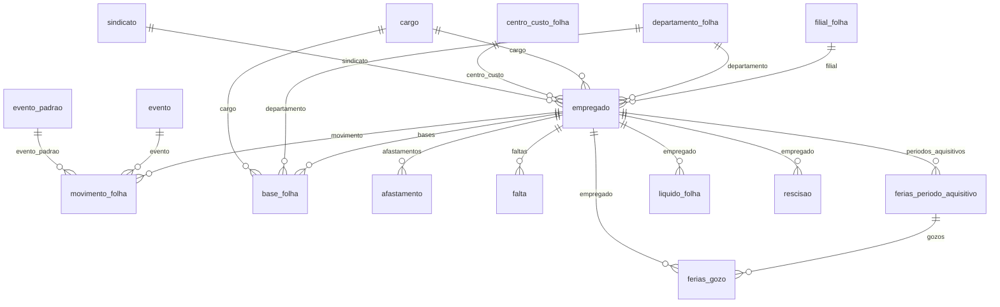

# Modelo — Folha de Pagamento

> Gerado por `src/model/gerar_docs_modelo.py` a partir de `src/model/modulos/folha.yaml`, do catálogo e do perfil de colunas. **Não edite à mão.**

17 entidades. A coluna *Preench.* é o % de linhas com valor útil (nem nulo, nem em branco, nem zero, nem 1900-01-01; para colunas de código o zero conta como valor).

## Diagrama

## Entidades

| Entidade | Tabela | Linhas | Volume | Filtro obrigatório |
|---|---|---|---|---|
| [empregado](#empregado) | `foempregados` | 10.974 | medio | empresa |
| [cargo](#cargo) | `focargos` | 6.043 | medio | empresa |
| [departamento_folha](#departamento_folha) | `fodepto` | 1.403 | medio | empresa |
| [centro_custo_folha](#centro_custo_folha) | `foccustos` | 1.629 | medio | empresa |
| [filial_folha](#filial_folha) | `fofiliais` | 1.672 | medio | empresa |
| [sindicato](#sindicato) | `fosindicatos` | 155 | pequeno | — |
| [evento](#evento) | `foeventos` | 1.306.923 | grande | empresa |
| [evento_padrao](#evento_padrao) | `foeventosdef` | 1.695 | pequeno | — |
| [servico_folha](#servico_folha) | `foservicos` | 1.770 | pequeno | empresa |
| [movimento_folha](#movimento_folha) | `fomovtoserv` | 2.927.129 | grande | empresa; um de: periodo, empregado_codigo |
| [base_folha](#base_folha) | `fobasesserv` | 415.218 | medio | empresa; um de: periodo, empregado_codigo |
| [liquido_folha](#liquido_folha) | `foliquidosfilepr` | 216.930 | medio | empresa; um de: empregado_codigo |
| [rescisao](#rescisao) | `forescisoes` | 7.192 | pequeno | empresa |
| [afastamento](#afastamento) | `FOAFASTAMENTOS` | 38.146 | medio | empresa |
| [falta](#falta) | `FOFALTAS` | 15.865 | pequeno | empresa |
| [ferias_periodo_aquisitivo](#ferias_periodo_aquisitivo) | `FOFERIAS_AQUISITIVOS` | 23.266 | pequeno | empresa |
| [ferias_gozo](#ferias_gozo) | `FOFERIAS_GOZO` | 19.023 | pequeno | empresa |

## empregado

**Empregados (cadastro funcional)** — tabela `foempregados` (10.974 linhas)

Dados funcionais do empregado. Apenas colunas necessárias ao uso de DP; veja o bloco de privacidade no topo do arquivo. A tabela tem 416 colunas (27 marcadas pelo próprio banco como "SEM USO"); só um subconjunto é exposto.

- **Chave:** `codi_emp, i_empregados`
- **Empresa:** `codi_emp`
- **Período:** `—`
- **Ordem padrão:** `nome asc`

**Regras de negócio validadas:**

- O cadastro de empregados NÃO traz situação atual (ativo/demitido). A demissão está em `rescisao`; afastamentos em `afastamento`.
- categoria (1=10.741, 5=217, 7=14, 4=2) e vinculo (1, 11, 50, 0, 13, 52...) são códigos sem tabela de descrição no banco: significado não confirmado.
- Dados dos 'SEM USO' do próprio banco foram ignorados.

| Campo | Coluna | Tipo | Preench. | Domínio | Descrição (banco) |
|---|---|---|---|---|---|
| codigo | `i_empregados` | integer(4) | 100% |  | Codigo |
| matricula | `matricula` | char(20) | 20% |  | Matricula |
| nome 🔒 | `nome` | char(70) | 100% |  | Nome |
| cpf 🔒 | `cpf` | char(11) | 100% |  | CPF |
| pis 🔒 | `pis` | char(11) | 79% |  | PIS |
| identidade 🔒 | `identidade` | char(15) | 87% |  | Identidade |
| data_nascimento 🔒 | `data_nascimento` | date(4) | 100% |  | Data nascimento |
| sexo | `sexo` | char(1) | 100% |  | Sexo |
| estado_civil | `estado_civil` | char(1) | 100% | estado_civil | Estado civil: S=Solteiro/C=Casado/V=Viúvo/D=Divorciado/O=Concubinato/J=Separado judicialmente/U=União estável) |
| grau_instrucao | `grau_instrucao` | smallint(2) | 100% |  | Grau instrucao |
| admissao | `admissao` | date(4) | 100% |  | Admissao |
| categoria | `categoria` | smallint(2) | 100% |  | Categoria |
| vinculo | `vinculo` | smallint(2) | 93% |  | Vinculo empregaticio |
| salario 🔒 | `salario` | numeric(17) | 81% |  | Salario |
| forma_pagamento | `forma_pagto` | char(1) | 100% |  | Forma pagamento |
| horas_mes | `horas_mes` | numeric(5) | 100% |  | Horas mes |
| horas_semana | `horas_semana` | numeric(5) | 100% |  | Horas semana |
| horas_dia | `horas_dia` | numeric(5) | 100% |  | Horas dia |
| vencimento_ferias | `venc_ferias` | date(4) | 77% |  | vencimento das ferias |
| optante_fgts | `opta_fgts` | char(1) | 100% | sim_nao_texto | Optante do FGTS |
| data_opcao_fgts | `opcao_fgts` | date(4) | 75% |  | Data opcao FGTS |
| tipo_contribuinte | `tipo_contrib` | char(1) | 100% |  | Tipo contribuinte (E=Empregador/F=Facultativo/A=Autônomo/R=Produtor Rural/M=Microempreendedor/S=Segurado Especial/I=Autônomo Microempreendedor) |
| filial_codigo | `i_filiais` | integer(4) | 100% |  | Codigo Filial |
| departamento_codigo | `i_depto` | integer(4) | 100% |  | Departamento |
| cargo_codigo | `i_cargos` | integer(4) | 100% |  | Cargo |
| centro_custo_codigo | `i_ccustos` | integer(4) | 100% |  | Centro de Custos |
| servico_codigo | `i_servicos` | integer(4) | 100% |  | Servico |
| sindicato_codigo | `i_sindicatos` | integer(4) | 66% |  | Código da convenção coletiva |
| data_transferencia | `data_transf` | date(4) | 4% |  | Data transferencia |
| origem_registro | `origem_reg` | tinyint(1) | 8% |  | Origem do registro 0 - Sistema, 1 - Imp. Tabelas, 2 - Imp. Layout, 3- Imp. Tabelas Concorrentes, 4-Importação eSocial |

**Vínculos (LEFT JOIN, acrescentam colunas legíveis):**

- `filial` → `fofiliais` por `codi_emp` = `codi_emp` e `i_filiais` = `i_filiais`; colunas: `filial_nome`
- `departamento` → `fodepto` por `codi_emp` = `codi_emp` e `i_depto` = `i_depto`; colunas: `departamento_nome`
- `cargo` → `focargos` por `codi_emp` = `codi_emp` e `i_cargos` = `i_cargos`; colunas: `cargo_nome`, `cargo_cbo`
- `centro_custo` → `foccustos` por `codi_emp` = `codi_emp` e `i_ccustos` = `i_ccustos`; colunas: `centro_custo_nome`
- `sindicato` → `fosindicatos` por `i_sindicatos` = `i_sindicatos`; colunas: `sindicato_nome`

> 🔒 **Privacidade:** Contém dado pessoal (nome, CPF, PIS, identidade, nascimento) e salário. Mascarar por padrão.

**Filhos (1:N):**

- `movimento` → [movimento_folha](#movimento_folha)
- `bases` → [base_folha](#base_folha)
- `afastamentos` → [afastamento](#afastamento)
- `faltas` → [falta](#falta)
- `periodos_aquisitivos` → [ferias_periodo_aquisitivo](#ferias_periodo_aquisitivo)

**Filtros:** `codigo` (eq/in), `matricula` (eq), `nome` (contem/prefixo), `cpf` (eq), `admissao` (entre/gte/lte), `filial_codigo` (eq/in), `departamento_codigo` (eq/in), `cargo_codigo` (eq/in), `centro_custo_codigo` (eq/in), `categoria` (eq/in), `vinculo` (eq/in)

## cargo

**Cargos** — tabela `focargos` (6.043 linhas)

- **Chave:** `codi_emp, i_cargos`
- **Empresa:** `codi_emp`
- **Período:** `—`
- **Ordem padrão:** `nome asc`

| Campo | Coluna | Tipo | Preench. | Domínio | Descrição (banco) |
|---|---|---|---|---|---|
| codigo | `i_cargos` | integer(4) | 100% |  | Codigo |
| nome | `nome` | char(100) | 100% |  | Nome |
| cbo_1994 | `cbo` | integer(4) | 5% |  | CBO 1994 |
| cbo_2002 | `cbo_2002` | integer(4) | 95% |  | CBO 2002 |
| atividade | `atividade` | varchar(1000) | 3% |  | Atividade |
| situacao | `situacao` | smallint(2) | 100% | situacao_cadastro | Situação do cargo. (0=Inativo/1=Ativo) |
| data_inicio | `data_inicio` | date(4) | 100% |  | Data de início do cargo. |
| data_inativacao | `data_inativacao` | date(4) | 7% |  | Data de inativação do cargo. |
| codigo_esocial | `codigo_esocial` | varchar(30) | 100% |  | Código no eSocial. |

**Filtros:** `codigo` (eq/in), `nome` (contem/prefixo), `cbo_2002` (eq/in), `situacao` (eq)

## departamento_folha

**Departamentos (folha)** — tabela `fodepto` (1.403 linhas)

- **Chave:** `codi_emp, i_depto`
- **Empresa:** `codi_emp`
- **Período:** `—`
- **Ordem padrão:** `nome asc`

| Campo | Coluna | Tipo | Preench. | Domínio | Descrição (banco) |
|---|---|---|---|---|---|
| codigo | `i_depto` | integer(4) | 100% |  | Codigo |
| nome | `nome` | char(40) | 100% |  | Nome |
| situacao | `situacao` | smallint(2) | 100% | situacao_cadastro | Situação do departamento. (0=Inativo/1=Ativo) |
| data_inicio | `data_inicio` | date(4) | 100% |  | Data de início do departamento. |
| data_inativacao | `data_inativacao` | date(4) | 0% |  | Data de inativação do departamento. |

**Filtros:** `codigo` (eq/in), `nome` (contem/prefixo), `situacao` (eq)

## centro_custo_folha

**Centros de custo (folha)** — tabela `foccustos` (1.629 linhas)

- **Chave:** `codi_emp, i_ccustos`
- **Empresa:** `codi_emp`
- **Período:** `—`
- **Ordem padrão:** `MASCARA asc`

**Regras de negócio validadas:**

- tipo: 1 = sintético, 2 = analítico (comentário do banco).

| Campo | Coluna | Tipo | Preench. | Domínio | Descrição (banco) |
|---|---|---|---|---|---|
| codigo | `i_ccustos` | integer(4) | 100% |  | Codigo |
| nome | `nome` | varchar(85) | 100% |  | Nome |
| tipo | `tipo` | smallint(2) | 45% |  | Tipo de centro de custos. (1-Sintético/2=Analítico) |
| sintetico_codigo | `i_ccustos_sintetico` | integer(4) | 0% |  | Código do centro de custos sintético. |
| mascara | `mascara` | varchar(50) | 52% |  | Mascara de ordenação da consulta. |

**Filtros:** `codigo` (eq/in), `nome` (contem/prefixo)

## filial_folha

**Filiais (folha)** — tabela `fofiliais` (1.672 linhas)

Estabelecimentos da empresa na folha (CNPJ da filial). Dados de pessoa jurídica.

- **Chave:** `codi_emp, i_filiais`
- **Empresa:** `codi_emp`
- **Período:** `—`
- **Ordem padrão:** `i_filiais asc`

| Campo | Coluna | Tipo | Preench. | Domínio | Descrição (banco) |
|---|---|---|---|---|---|
| codigo | `i_filiais` | integer(4) | 100% |  | Codigo |
| nome | `nome` | char(40) | 100% |  | Nome |
| razao_social | `razao_social` | varchar(255) | 100% |  | Razão social. |
| tipo_inscricao | `tipo_insc` | tinyint(1) | 100% |  | Tipo inscricao |
| inscricao | `cgc` | char(14) | 100% |  | Inscricao |
| inscricao_estadual | `inscricao` | char(22) | 20% |  | Inscr. Estadual |
| cnae | `i_cnae20` | char(15) | 95% |  | CNAE 2.2 |
| cidade | `cidade` | char(25) | 24% |  | Cidade |
| uf | `estado` | char(2) | 24% |  | Estado |
| municipio_codigo | `codigo_municipio` | integer(4) | 97% |  | Codigo do municipio |

**Filtros:** `codigo` (eq/in), `nome` (contem/prefixo)

## sindicato

**Sindicatos / convenções coletivas** — tabela `fosindicatos` (155 linhas)

Cadastro global (não depende de empresa) de convenções coletivas e regras de cálculo.

- **Chave:** `i_sindicatos`
- **Empresa:** `não se aplica (tabela global)`
- **Período:** `—`
- **Ordem padrão:** `nome asc`

| Campo | Coluna | Tipo | Preench. | Domínio | Descrição (banco) |
|---|---|---|---|---|---|
| codigo | `i_sindicatos` | integer(4) | 100% |  | Código da convenção coletiva |
| nome | `nome` | varchar(115) | 100% |  | Nome |
| piso_salarial | `piso_salarial` | numeric(13) | 0% |  | Piso Salarial |
| mes_base | `mes_base` | tinyint(1) | 91% |  | Mes Base |
| mes_contribuicao | `mes_contribuicao` | integer(4) | 100% |  | Mes de contribuicao |
| adicional_noturno_percentual | `adic_noturno` | numeric(13) | 15% |  | Perc. do adicional noturno |
| dias_multa_rescisao | `dias_multa_db` | integer(4) | 0% |  | Dias multa |
| percentual_multa_rescisao | `perc_multa_db` | numeric(5) | 100% |  | Percentual multa |

**Filtros:** `codigo` (eq/in), `nome` (contem/prefixo)

## evento

**Eventos / rubricas** — tabela `foeventos` (1.306.923 linhas)

Rubricas da folha (proventos, descontos e informativos) com as marcações que definem sobre quais bases incidem e se aparecem no recibo. IMPORTANTE: só entram nos totais (proventos/descontos) os eventos com aparece_recibo = 'S'.

- **Chave:** `codi_emp, i_eventos`
- **Empresa:** `codi_emp`
- **Período:** `—`
- **Ordem padrão:** `i_eventos asc`

**Regras de negócio validadas:**

- Totais da folha: fobasesserv.proventos = Σ valor calculado dos eventos P que entram no recibo; fobasesserv.descontos = Σ dos eventos D idem (entra = aparece_recibo 'S' no cadastro próprio ou, na falta, no padrão; evento sem cadastro nenhum entra). Validado em 65.877 linhas de base, 9 empresas (proventos 100,0%, descontos 99,5%). Eventos D que NÃO aparecem no recibo (ex.: auxiliares) NÃO entram em descontos.
- Uma empresa pode não ter nenhuma linha aqui e ainda assim ter movimento de folha: ela usa os eventos padrão (entidade evento_padrao).
- As marcações base_* têm formatos diferentes (S/N em umas, 0/1 em outras): não as use como booleano sem conferir o valor real.

| Campo | Coluna | Tipo | Preench. | Domínio | Descrição (banco) |
|---|---|---|---|---|---|
| codigo | `i_eventos` | integer(4) | 100% |  | Codigo |
| nome | `nome` | char(50) | 100% |  | Nome |
| tipo | `prov_desc` | varchar(2) | 100% | tipo_evento | Tipo |
| unidade | `tipo_inf` | char(1) | 100% |  | Unidade |
| taxa | `taxa` | numeric(7) | 13% |  | Taxa/Valor |
| ordem_calculo | `ordem_calculo` | integer(4) | 81% |  | Ordem calculo |
| classificacao | `classificacao` | integer(4) | 100% |  | Classificacao |
| aparece_recibo | `aparece_recibo` | char(1) | 100% | sim_nao_texto | Aparece no Recibo |
| soma_ficha_financeira | `soma_fic_fin` | char(1) | 100% | sim_nao_texto | Ficha financeira |
| base_inss | `base_inss` | char(1) | 72% |  | INSS |
| base_irrf | `base_irrf` | char(1) | 72% |  | IRRF |
| base_fgts | `base_fgts` | char(1) | 72% |  | FGTS |
| base_sindicato | `base_sindicato` | char(1) | 72% |  | Sindicato |
| base_hora_extra | `base_hextra` | char(1) | 72% |  | Horas extras |
| base_periculosidade | `base_periculosidade` | char(1) | 72% |  | Periculosidade |
| compoe_horas_mes | `horas_mes` | char(1) | 100% |  | Compoe horas mes |
| media_13 | `soma_med_13` | char(1) | 100% |  | Soma media 13 |
| media_ferias | `soma_med_fer` | char(1) | 100% |  | Soma media ferias |
| sai_na_rais | `soma_rais` | char(1) | 100% |  | Sai na RAIS |
| paga_proporcional | `paga_prop` | char(1) | 100% |  | Paga proporcional |
| rendimento_tributavel | `rend_tributaveis` | tinyint(1) | 48% |  | Rendimentos tributaveis |
| rendimento_isento | `rend_isentos` | tinyint(1) | 13% |  | rendimentos isentos e nao tributaveis |

**Filtros:** `codigo` (eq/in/entre), `nome` (contem/prefixo), `tipo` (eq/in), `aparece_recibo` (eq)

## evento_padrao

**Eventos padrão (rubricas-modelo)** — tabela `foeventosdef` (1.695 linhas)

Cadastro global de rubricas-modelo da Domínio. Empresas sem eventos próprios (309 delas têm movimento de folha) usam estes. Tem as mesmas marcações de `evento`, sem filtro de empresa.

- **Chave:** `i_eventos`
- **Empresa:** `não se aplica (tabela global)`
- **Período:** `—`
- **Ordem padrão:** `i_eventos asc`

| Campo | Coluna | Tipo | Preench. | Domínio | Descrição (banco) |
|---|---|---|---|---|---|
| codigo | `i_eventos` | integer(4) | 100% |  | Codigo |
| nome | `nome` | char(50) | 100% |  | Nome |
| tipo | `prov_desc` | varchar(2) | 100% | tipo_evento | Tipo |
| unidade | `tipo_inf` | char(1) | 100% |  | Unidade |
| aparece_recibo | `aparece_recibo` | char(1) | 100% | sim_nao_texto | Aparece no Recibo |
| soma_ficha_financeira | `soma_fic_fin` | char(1) | 100% | sim_nao_texto | Ficha financeira |
| base_inss | `base_inss` | char(1) | 13% |  | INSS |
| base_irrf | `base_irrf` | char(1) | 13% |  | IRRF |
| base_fgts | `base_fgts` | char(1) | 13% |  | FGTS |

**Filtros:** `codigo` (eq/in/entre), `nome` (contem/prefixo), `tipo` (eq/in), `aparece_recibo` (eq)

## servico_folha

**Serviços / tomadores (folha)** — tabela `foservicos` (1.770 linhas)

Código de serviço usado no rateio da folha (a maior parte das colunas do banco está marcada SEM USO).

- **Chave:** `codi_emp, i_servicos`
- **Empresa:** `codi_emp`
- **Período:** `—`
- **Ordem padrão:** `i_servicos asc`

| Campo | Coluna | Tipo | Preench. | Domínio | Descrição (banco) |
|---|---|---|---|---|---|
| codigo | `i_servicos` | integer(4) | 100% |  | Codigo |
| nome | `nome` | char(40) | 100% |  | Nome |
| situacao | `situacao` | smallint(2) | 100% | situacao_cadastro | Situação do serviço. (0=Inativo/1=Ativo) |
| data_inicio | `data_inicio` | date(4) | 100% |  | Data de início do serviço. |
| data_inativacao | `data_inativacao` | date(4) | 2% |  | Data de inativação do serviço. |

**Filtros:** `codigo` (eq/in), `nome` (contem/prefixo)

## movimento_folha

**Movimento da folha (valores por evento)** — tabela `fomovtoserv` (2.927.129 linhas)

Uma linha por evento (rubrica) calculado de cada empregado, competência e tipo de folha — o "recibo" aberto. O identificador do cálculo (calculo) é um GUID e faz parte da chave.

- **Chave:** `codi_emp, i_empregados, data, tipo_proces, i_eventos, rateio, i_servicos, I_CALCULOS`
- **Empresa:** `codi_emp`
- **Período:** `data` · exige um de: `periodo, empregado_codigo`
- **Ordem padrão:** `data desc`, `i_empregados asc`, `i_eventos asc`

**Regras de negócio validadas:**

- REGRA DOS EVENTOS (validada): o evento de um movimento é buscado primeiro no cadastro da própria empresa (foeventos) e, se não existir, nos eventos padrão (foeventosdef). 208.504 movimentos (7,1%) de 310 empresas não têm evento próprio; 309 dessas empresas não têm NENHUM evento próprio e usam só os padrões (92% dos casos resolvem pelos padrões; o resto existe só em outra empresa). As colunas evento_nome e evento_aparece_recibo já aplicam essa ordem.
- Para somar proventos/descontos como a Domínio: some valor_calculado dos eventos tipo P ou D com evento_aparece_recibo = 'S'. Evento sem cadastro nenhum (nem próprio nem padrão) CONTA (default 'S'). Com essa regra: proventos batem em 65.869 de 65.877 linhas de base (100,0%) e descontos em 65.560 (99,5%), em 9 empresas incluindo as que só usam eventos padrão. Sem o default 'S' a regra falha nessas empresas (ex.: 19% na empresa 37).
- competencia é sempre o dia 1º do mês (data = primeiro dia da competência).
- Há competências futuras já calculadas (até 2026-12): filtre por período.
- origem 'F' (172 mil linhas) são cálculos de férias; 'C' são da folha mensal e demais.

| Campo | Coluna | Tipo | Preench. | Domínio | Descrição (banco) |
|---|---|---|---|---|---|
| empregado_codigo | `i_empregados` | integer(4) | 100% |  | Empregado |
| competencia | `data` | date(4) | 100% |  | Competencia |
| tipo_folha | `tipo_proces` | integer(4) | 100% | tipo_folha | Tipo folha |
| evento_codigo | `i_eventos` | integer(4) | 100% |  | Evento |
| tipo_evento | `prov_desc` | varchar(2) | 100% | tipo_evento | Provento/Desconto |
| valor_calculado 🔒 | `valor_cal` | numeric(15) | 100% |  | Valor Calculado |
| valor_informado 🔒 | `valor_inf` | numeric(15) | 80% |  | Valor informado |
| valor_calculado_integral 🔒 | `valor_calculado_integral` | numeric(15) | 93% |  | Valor calculado integral. |
| origem | `origem` | char(1) | 100% | origem_calculo | Origem Calculo (Origem calculo C = mensal / F = férias / I = convocacao intermitente |
| rateio | `rateio` | integer(4) | 49% |  | Rateio |
| servico_codigo | `i_servicos` | integer(4) | 100% |  | Servico |
| simulacao | `simulacao` | smallint(2) | 0% |  | Simulação de cálculo. (0=Não/1=Sim) |
| calculo | `i_calculos` | uniqueidentifier(16) | 100% |  | Código do cálculo |
| evento_nome (coalescida) | `evento.nome ⟶ evento_padrao.nome` | — | — | | Primeiro valor disponível, nesta ordem: evento.nome, evento_padrao.nome |
| evento_aparece_recibo (coalescida) | `evento.aparece_recibo ⟶ evento_padrao.aparece_recibo ⟶ 'S'` | — | — | | Primeiro valor disponível, nesta ordem: evento.aparece_recibo, evento_padrao.aparece_recibo, 'S' |

**Vínculos (LEFT JOIN, acrescentam colunas legíveis):**

- `evento` → `foeventos` por `codi_emp` = `codi_emp` e `i_eventos` = `i_eventos`; colunas: `evento_proprio_nome`, `evento_proprio_aparece_recibo`
- `evento_padrao` → `foeventosdef` por `i_eventos` = `i_eventos`; colunas: `evento_padrao_nome`, `evento_padrao_aparece_recibo`
- `empregado` → `foempregados` por `codi_emp` = `codi_emp` e `i_empregados` = `i_empregados`; colunas: `empregado_nome` 🔒

> 🔒 **Privacidade:** Valores pagos por empregado identificável (financeiro). Mascarar por padrão.

**Filtros:** `empregado_codigo` (eq/in), `competencia` (eq/entre/gte/lte), `tipo_folha` (eq/in), `evento_codigo` (eq/in), `tipo_evento` (eq/in), `simulacao` (eq)

## base_folha

**Bases e totais da folha** — tabela `fobasesserv` (415.218 linhas)

Uma linha por empregado, competência, tipo de folha, serviço e cálculo, com os totais já calculados pela Domínio: proventos, descontos e o líquido (calculado pelo modelo = proventos − descontos). Das ~35 colunas, o banco marca ~25 como "SEM USO" (IRRF, INSS, FGTS ficam em outras tabelas); só as vivas são expostas.

- **Chave:** `codi_emp, i_empregados, competencia, tipo_process, i_servicos, rateio, I_CALCULOS`
- **Empresa:** `codi_emp`
- **Período:** `competencia` · exige um de: `periodo, empregado_codigo`
- **Ordem padrão:** `competencia desc`, `i_empregados asc`

**Regras de negócio validadas:**

- proventos = Σ valor_calculado dos eventos P que aparecem no recibo; descontos = Σ dos eventos D que aparecem no recibo (validado: 99,99% e 99,4% de 56.026 linhas, 5 empresas).
- liquido = proventos − descontos coincide com o líquido registrado pela Domínio em foliquidosfilepr em 99,8% dos pares empregado×cálculo.
- situacao_mes (valores 1, 9, 8, 6, 5, 59, 3, 16...) não tem descrição no banco: significado não confirmado.
- INSS, IRRF e FGTS NÃO estão aqui (colunas marcadas SEM USO); estão em tabelas próprias (fobasesirrf, fofgtsfilial, foguiainss...), ainda não modeladas.

| Campo | Coluna | Tipo | Preench. | Domínio | Descrição (banco) |
|---|---|---|---|---|---|
| empregado_codigo | `i_empregados` | integer(4) | 100% |  | Empregado |
| competencia | `competencia` | date(4) | 100% |  | Competencia |
| tipo_folha | `tipo_process` | integer(4) | 100% | tipo_folha | TIPO DE CALCULO |
| situacao_mes | `situacao_mes` | integer(4) | 100% |  | Situação do mês (0~89) |
| departamento_codigo | `i_depto` | integer(4) | 100% |  | Departamento |
| centro_custo_codigo | `i_ccustos` | integer(4) | 100% |  | Centro de Custos |
| cargo_codigo | `i_cargos` | integer(4) | 100% |  | Cargo |
| numero_filhos | `num_filhos` | integer(4) | 13% |  | No. filhos |
| numero_dependentes | `num_dependentes` | integer(4) | 18% |  | No. Dependentes |
| proventos 🔒 | `proventos` | numeric(13) | 100% |  | Proventos |
| descontos 🔒 | `descontos` | numeric(13) | 82% |  | Descontos |
| salario_mes 🔒 | `salario_mes` | numeric(13) | 95% |  | Salario Mes |
| salario_maternidade 🔒 | `salario_maternidade` | numeric(13) | 0% |  | Salario Maternidade |
| salario_familia 🔒 | `val_sal_fam` | numeric(13) | 1% |  | Valor Sal. Familia |
| numero_cheque | `nume_cheque` | integer(4) | 0% |  | No. Cheque |
| servico_codigo | `i_servicos` | integer(4) | 100% |  | Servico |
| rateio | `rateio` | integer(4) | 44% |  | Rateio |
| calculo | `i_calculos` | uniqueidentifier(16) | 100% |  | Código sequencial de calculos |
| liquido (calculada) | `proventos - descontos` | — | — | | Calculada pelo modelo: proventos - descontos |

**Vínculos (LEFT JOIN, acrescentam colunas legíveis):**

- `empregado` → `foempregados` por `codi_emp` = `codi_emp` e `i_empregados` = `i_empregados`; colunas: `empregado_nome` 🔒
- `departamento` → `fodepto` por `codi_emp` = `codi_emp` e `i_depto` = `i_depto`; colunas: `departamento_nome`
- `cargo` → `focargos` por `codi_emp` = `codi_emp` e `i_cargos` = `i_cargos`; colunas: `cargo_nome`

> 🔒 **Privacidade:** Totais de remuneração por empregado identificável (financeiro). Mascarar por padrão.

**Filtros:** `empregado_codigo` (eq/in), `competencia` (eq/entre/gte/lte), `tipo_folha` (eq/in), `departamento_codigo` (eq/in), `centro_custo_codigo` (eq/in), `cargo_codigo` (eq/in)

## liquido_folha

**Líquido a pagar** — tabela `foliquidosfilepr` (216.930 linhas)

Líquido registrado pela Domínio para pagamento, por empregado e cálculo.

- **Chave:** `codi_emp, i_empregados, SEQUENCIAL, I_LIQUIDOSFIL`
- **Empresa:** `codi_emp`
- **Período:** `—` · exige um de: `empregado_codigo`
- **Ordem padrão:** `i_empregados asc`, `SEQUENCIAL asc`

**Regras de negócio validadas:**

- Não há data nesta tabela; a competência vem do cálculo (calculo = base_folha.calculo).

| Campo | Coluna | Tipo | Preench. | Domínio | Descrição (banco) |
|---|---|---|---|---|---|
| empregado_codigo | `i_empregados` | integer(4) | 100% |  | Codigo do empregado |
| liquido 🔒 | `liquido` | numeric(13) | 99% |  | Liquido |
| sequencial | `sequencial` | smallint(2) | 100% |  | Sequencial. |
| numero_rpa | `numero_rpa` | numeric(10) | 1% |  | Número do RPA. |
| calculo | `i_calculos` | uniqueidentifier(16) | 83% |  | Código do cálculo que está sendo pago. |

**Vínculos (LEFT JOIN, acrescentam colunas legíveis):**

- `empregado` → `foempregados` por `codi_emp` = `codi_emp` e `i_empregados` = `i_empregados`; colunas: `empregado_nome` 🔒

> 🔒 **Privacidade:** Valor líquido por empregado identificável (financeiro). Mascarar por padrão.

**Filtros:** `empregado_codigo` (eq/in)

## rescisao

**Rescisões** — tabela `forescisoes` (7.192 linhas)

- **Chave:** `codi_emp, i_calculos, i_empregados, tipo`
- **Empresa:** `codi_emp`
- **Período:** `demissao`
- **Ordem padrão:** `demissao desc`

**Regras de negócio validadas:**

- A chave é (empresa, cálculo, empregado, tipo): um empregado pode ter mais de uma linha (rescisão normal e complementar). Hoje há 6.904 normais (tipo 1) e 288 complementares (tipo 2); simulações (tipo 4) não aparecem.
- Para contar demissões, filtre tipo = 1; somar normal + complementar duplica o evento de desligamento.
- motivo é um código sem tabela de descrição no banco (mais frequentes: 2, 4, 43, 99, 10, 27, 11, 12): significado não confirmado.

| Campo | Coluna | Tipo | Preench. | Domínio | Descrição (banco) |
|---|---|---|---|---|---|
| empregado_codigo | `i_empregados` | integer(4) | 100% |  | Empregado |
| tipo | `tipo` | integer(4) | 100% | tipo_rescisao | Tipo de cálculo de rescisão. (1=Normal/2=Complementar/3=Parcial/4=Simulação) |
| calculo | `i_calculos` | uniqueidentifier(16) | 100% |  | Código do cálculo |
| demissao | `demissao` | date(4) | 100% |  | Data Demissao |
| motivo | `motivo` | integer(4) | 100% |  | Motivo |
| data_aviso | `data_aviso` | date(4) | 61% |  | Data aviso |
| aviso_indenizado | `aviso_indenizado` | char(1) | 100% | sim_nao_texto | Aviso indenizado |
| avos_13 | `avos_pago_13` | smallint(2) | 72% |  | Avos pago 13 |
| ferias_vencidas | `num_fer_venc` | smallint(2) | 30% |  | No. ferias vencidas |
| meses_ferias_proporcionais | `meses_fer_prop` | smallint(2) | 75% |  | Meses ferias prop. |
| codigo_saque_fgts | `codigo_saque_fgts` | char(2) | 90% |  | Codigo saque FGTS |
| salario 🔒 | `salario` | numeric(13) | 94% |  | Salario |
| proventos 🔒 | `proventos` | numeric(13) | 88% |  | Provento |
| descontos 🔒 | `descontos` | numeric(13) | 88% |  | Desconto |
| saldo_fgts 🔒 | `saldo_fgts` | numeric(15) | 28% |  | Saldo FGTS |
| fgts_rescisao 🔒 | `val_fgts_res` | numeric(13) | 65% |  | Valor FGTS rescisao |
| liquido (calculada) | `proventos - descontos` | — | — | | Calculada pelo modelo: proventos - descontos |

**Vínculos (LEFT JOIN, acrescentam colunas legíveis):**

- `empregado` → `foempregados` por `codi_emp` = `codi_emp` e `i_empregados` = `i_empregados`; colunas: `empregado_nome` 🔒, `empregado_admissao`

> 🔒 **Privacidade:** Verbas rescisórias por empregado identificável (financeiro). Mascarar por padrão.

**Filtros:** `empregado_codigo` (eq/in), `demissao` (entre/gte/lte), `motivo` (eq/in)

## afastamento

**Afastamentos** — tabela `FOAFASTAMENTOS` (38.146 linhas)

Afastamentos do empregado (licenças, auxílio-doença, maternidade...). Colunas de saúde (CID, CAT, acidente) foram deixadas de fora de propósito.

- **Chave:** `CODI_EMP, I_EMPREGADOS, DATA_REAL_DN`
- **Empresa:** `CODI_EMP`
- **Período:** `DATA_REAL`
- **Ordem padrão:** `DATA_REAL desc`

| Campo | Coluna | Tipo | Preench. | Domínio | Descrição (banco) |
|---|---|---|---|---|---|
| empregado_codigo | `i_empregados` | integer(4) | 100% |  | CODIGO |
| data_inicio | `data_real` | date(4) | 100% |  | Data Real |
| data_inicio_folha | `data_folha` | date(4) | 100% |  | Data Folha |
| data_fim | `data_fim` | date(4) | 71% |  | Data fim |
| numero_dias | `numero_dias` | numeric(10) | 100% |  | Número de dias |
| tipo_codigo | `i_afastamentos` | integer(4) | 100% |  | Código do afastamento referente ao tipo de afastamento da FOAFASTAMENTOS_TIPO |
| transferencia | `transferencia` | tinyint(1) | 1% |  | SE O AFASTAMENTO E UMA TRANSFERENCIA OU NAO / 1 - SIM, 0 - NAO |
| origem | `origem` | smallint(2) | 2% |  | Origem: 0=Afastamento/1=Replicação por rescisao por transferencia/2=Replicação por interrupção por outro afastamento |

**Vínculos (LEFT JOIN, acrescentam colunas legíveis):**

- `tipo` → `FOAFASTAMENTOS_TIPOS` por `I_AFASTAMENTOS` = `I_AFASTAMENTOS`; colunas: `tipo_descricao`
- `empregado` → `foempregados` por `CODI_EMP` = `codi_emp` e `I_EMPREGADOS` = `i_empregados`; colunas: `empregado_nome` 🔒

> 🔒 **Privacidade:** O tipo de afastamento pode revelar condição de saúde do empregado (ex.: auxílio-doença). Tratar como dado sensível.

**Filtros:** `empregado_codigo` (eq/in), `data_inicio` (entre/gte/lte), `tipo_codigo` (eq/in)

## falta

**Faltas** — tabela `FOFALTAS` (15.865 linhas)

- **Chave:** `CODI_EMP, I_EMPREGADOS, I_FALTAS`
- **Empresa:** `CODI_EMP`
- **Período:** `DIA`
- **Ordem padrão:** `DIA desc`

| Campo | Coluna | Tipo | Preench. | Domínio | Descrição (banco) |
|---|---|---|---|---|---|
| empregado_codigo | `i_empregados` | integer(4) | 100% |  | CODIGO |
| sequencial | `i_faltas` | integer(4) | 100% |  | SEQUENCIAL DE FALTAS DO EMPREGADO |
| dia | `dia` | date(4) | 100% |  | DIA QUE OCORREU A FALTA |
| tipo | `tipo` | smallint(2) | 100% | tipo_falta | Tipo de falta. (1=Normal/2=DSR/3=Reembolso/4=Parcial/5=Noturna/6=DSR Noturna/7=Suspensão/8=DSR suspensão) |
| origem | `origem` | smallint(2) | 100% | origem_falta | Origem lançamento. (1=Lançamento de rubricas/2=Data para férias/3=Advertência e Suspensão) |
| horas | `valor` | numeric(13) | 23% |  | Quantidade de horas da falta parcial. |

**Vínculos (LEFT JOIN, acrescentam colunas legíveis):**

- `empregado` → `foempregados` por `CODI_EMP` = `codi_emp` e `I_EMPREGADOS` = `i_empregados`; colunas: `empregado_nome` 🔒

**Filtros:** `empregado_codigo` (eq/in), `dia` (entre/gte/lte), `tipo` (eq/in)

## ferias_periodo_aquisitivo

**Férias — períodos aquisitivos** — tabela `FOFERIAS_AQUISITIVOS` (23.266 linhas)

- **Chave:** `CODI_EMP, I_EMPREGADOS, I_FERIAS_AQUISITIVOS`
- **Empresa:** `CODI_EMP`
- **Período:** `DATA_INICIO`
- **Ordem padrão:** `DATA_INICIO desc`

**Regras de negócio validadas:**

- situacao (GOZADO, PERDIDA etc., segundo o comentário) é um código sem tabela de descrição: significado não confirmado.

| Campo | Coluna | Tipo | Preench. | Domínio | Descrição (banco) |
|---|---|---|---|---|---|
| empregado_codigo | `i_empregados` | integer(4) | 100% |  | CODIGO |
| sequencia | `i_ferias_aquisitivos` | integer(4) | 100% |  | SEQUENCIA DE PERIODOS AQUISITIVOS |
| data_inicio | `data_inicio` | date(4) | 100% |  | DATA DO INICIO DO PERIODO AQUISITIVO |
| data_fim | `data_fim` | date(4) | 100% |  | DATA DO FIM DO PERIODO AQUISITIVO |
| situacao | `situacao` | integer(4) | 100% |  | SITUACAO (GOZADO, PERDIDA ETC...) |
| dias_direito | `dias_direito` | numeric(10) | 98% |  | NUMERO DE DIAS DE DIREITO |
| dias_gozados | `dias_gozados` | numeric(10) | 71% |  | NUMERO DE DIAS GOZADOS |
| dias_abono | `dias_abono` | numeric(10) | 4% |  | NUMERO DE DIAS CONVERTIDOS EM ABONO |
| dias_faltas | `dias_faltas` | integer(4) | 6% |  | NUMERO DE DIAS DE FALTAS |
| avos_adquiridos | `avos_adquiridos` | integer(4) | 99% |  | NUMERO DE AVOS ADQUIRIDOS |
| limite_para_gozo | `limite_para_gozo` | date(4) | 100% |  | DIA MAXIMO PARA INICIO O GOZO SEM MULTA |

**Vínculos (LEFT JOIN, acrescentam colunas legíveis):**

- `empregado` → `foempregados` por `CODI_EMP` = `codi_emp` e `I_EMPREGADOS` = `i_empregados`; colunas: `empregado_nome` 🔒

**Filhos (1:N):**

- `gozos` → [ferias_gozo](#ferias_gozo)

**Filtros:** `empregado_codigo` (eq/in), `data_inicio` (entre/gte/lte), `limite_para_gozo` (entre/gte/lte)

## ferias_gozo

**Férias — gozo** — tabela `FOFERIAS_GOZO` (19.023 linhas)

- **Chave:** `CODI_EMP, I_EMPREGADOS, I_FERIAS_GOZO`
- **Empresa:** `CODI_EMP`
- **Período:** `GOZO_INICIO`
- **Ordem padrão:** `GOZO_INICIO desc`

**Regras de negócio validadas:**

- tipo 5 (provisão), 7 e 8 (simulação) NÃO são férias efetivamente gozadas; filtre tipo in (1,2,3,4,6) para férias reais.

| Campo | Coluna | Tipo | Preench. | Domínio | Descrição (banco) |
|---|---|---|---|---|---|
| empregado_codigo | `i_empregados` | integer(4) | 100% |  | CODIGO |
| sequencia | `i_ferias_gozo` | integer(4) | 100% |  | SEQUENCIAL DE PERIODOS DE GOZO |
| periodo_aquisitivo | `i_ferias_aquisitivos` | integer(4) | 100% |  | SEQUENCIA DE PERIODOS AQUISITIVOS |
| gozo_inicio | `gozo_inicio` | date(4) | 100% |  | INICIO DO GOZO |
| gozo_fim | `gozo_fim` | date(4) | 100% |  | FIM DO GOZO |
| paga_abono | `abono_paga` | char(1) | 100% | sim_nao_texto | PAGA ABONO (S/N) |
| abono_inicio | `abono_inicio` | date(4) | 5% |  | INICIO ABONO |
| abono_fim | `abono_fim` | date(4) | 5% |  | FIM ABONO |
| data_pagamento | `data_pagto` | date(4) | 100% |  | DATA DO PAGAMENTO |
| paga_adiantamento_13 | `paga_ad13` | char(1) | 100% | sim_nao_texto | PAGA 13O (S/N) |
| dias_faltas | `dias_faltas` | integer(4) | 7% |  | NUMERO DE DIAS DE FALTAS NO MOMENTO DO CALCULO DE FERIAS |
| tipo | `tipo` | smallint(2) | 100% | tipo_gozo_ferias | Tipo de cálculo das férias. (1=Individual/2=Coletiva/3=Rescisão/4=Manual/5=Provisão/6=Acerto/7=Simulação férias/8=Simulação rescisão) |

**Vínculos (LEFT JOIN, acrescentam colunas legíveis):**

- `empregado` → `foempregados` por `CODI_EMP` = `codi_emp` e `I_EMPREGADOS` = `i_empregados`; colunas: `empregado_nome` 🔒

**Filtros:** `empregado_codigo` (eq/in), `gozo_inicio` (entre/gte/lte), `tipo` (eq/in)

## Domínios (significado dos códigos)

`confirmado`: **sim** = vem do comentário do banco e/ou foi conferido nos dados; **parcial** = parte dos valores; **não** = hipótese, não use como regra.

### status_empresa

Situação da empresa no cadastro (geempre.stat_emp)

Confirmado: sim

| Código | Significado |
|---|---|
| A | Ativa |
| I | Inativa |
| C | Em constituição |
| M | Ativo sem movimento |
| B | Em processo de baixa |
| E | Excluindo |

### motivo_inatividade

Motivo da inatividade (geempre.tipoi_emp). Só aparece em empresas inativas.

Confirmado: sim

| Código | Significado |
|---|---|
| 1 | Outros |
| 2 | Baixada |
| 3 | Transferida |
| 4 | Inadimplente |

### tipo_inscricao

Tipo da inscrição (CNPJ/CPF/CEI/CAEPF)

Confirmado: sim

| Código | Significado |
|---|---|
| 1 | CNPJ |
| 2 | CPF |
| 3 | CEI |
| 6 | CAEPF |

### regime_federal_empresa

Regime federal da folha (geempre.rfed_emp)

Confirmado: parcial

| Código | Significado |
|---|---|
| 1 | Normal |
| 2 | Microempresa |
| 3 | Empresa de pequeno porte |

### tipo_honorario_empresa

Como a empresa usa o módulo Honorários (geempre.honorario_tipo)

Confirmado: sim

| Código | Significado |
|---|---|
| E | Escritório (quem fatura) |
| C | Cliente |

### sim_nao_texto

Confirmado: sim

| Código | Significado |
|---|---|
| S | Sim |
| N | Não |

### sim_nao_numerico

Confirmado: sim

| Código | Significado |
|---|---|
| 1 | Sim |
| 0 | Não |

### situacao_cadastro

Confirmado: sim

| Código | Significado |
|---|---|
| 0 | Inativo |
| 1 | Ativo |

### tipo_folha

Tipo do processamento da folha (fomovtoserv.tipo_proces / fobasesserv.tipo_process)

Confirmado: parcial

> 11, 31-36, 41, 42, 51, 52, 70 e 91 vêm de comentários do banco (FOLANCAMENTOS_EVENTOS, FOGUIAINSS, FOCONTRIBUICAO_SINDICAL...). Os tipos 60 (127 mil eventos), 61 (77 mil) e 92 (3,4 mil) NÃO estão documentados. A hipótese de que 60/61 fossem rescisão foi TESTADA E REFUTADA: só 342 das 21.401 linhas de base do tipo 60 coincidem com mês de rescisão do empregado (1,6%), proporção parecida com a da folha mensal. Significado desconhecido.

| Código | Significado |
|---|---|
| 11 | Mensal |
| 31 | 1ª semana |
| 32 | 2ª semana |
| 33 | 3ª semana |
| 34 | 4ª semana |
| 35 | Última semana |
| 36 | Todas as semanas |
| 41 | Adiantamento |
| 42 | Complementar |
| 51 | Adiantamento de 13º salário |
| 52 | 13º salário |
| 70 | Participação nos lucros |
| 91 | Resilição de professor |

### tipo_evento

Natureza da rubrica (foeventos.prov_desc / fomovtoserv.prov_desc)

Confirmado: parcial

| Código | Significado |
|---|---|
| P | Provento |
| D | Desconto |
| I | Informativo (não soma) |
| ID | Informativo de desconto (inferido) |

### origem_calculo

Confirmado: sim

| Código | Significado |
|---|---|
| C | Folha mensal |
| F | Férias |
| I | Convocação intermitente |

### estado_civil

Confirmado: sim

| Código | Significado |
|---|---|
| S | Solteiro |
| C | Casado |
| V | Viúvo |
| D | Divorciado |
| O | Concubinato |
| J | Separado judicialmente |
| U | União estável |

### tipo_falta

Confirmado: sim

| Código | Significado |
|---|---|
| 1 | Normal |
| 2 | DSR |
| 3 | Reembolso |
| 4 | Parcial |
| 5 | Noturna |
| 6 | DSR noturna |
| 7 | Suspensão |
| 8 | DSR suspensão |

### origem_falta

Confirmado: sim

| Código | Significado |
|---|---|
| 1 | Lançamento de rubricas |
| 2 | Data para férias |
| 3 | Advertência e suspensão |

### tipo_rescisao

Confirmado: sim

| Código | Significado |
|---|---|
| 1 | Normal |
| 2 | Complementar |
| 3 | Parcial |
| 4 | Simulação |

### tipo_gozo_ferias

Confirmado: sim

| Código | Significado |
|---|---|
| 1 | Individual |
| 2 | Coletiva |
| 3 | Rescisão |
| 4 | Manual |
| 5 | Provisão |
| 6 | Acerto |
| 7 | Simulação de férias |
| 8 | Simulação de rescisão |

