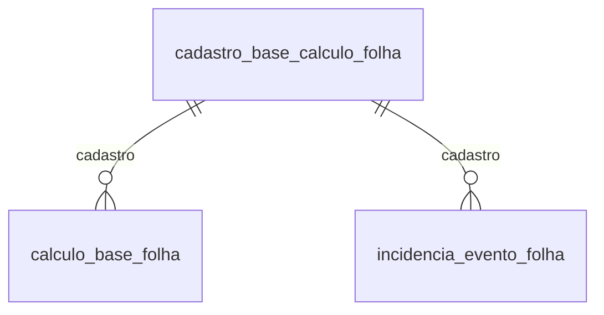

# Modelo — Memória de cálculo da folha (bases e incidências)

> Gerado por `src/model/gerar_docs_modelo.py` a partir de `src/model/modulos/folha_calculo.yaml`, do catálogo e do perfil de colunas. **Não edite à mão.**

3 entidades. A coluna *Preench.* é o % de linhas com valor útil (nem nulo, nem em branco, nem zero, nem 1900-01-01; para colunas de código o zero conta como valor).

## Diagrama

## Entidades

| Entidade | Tabela | Linhas | Volume | Filtro obrigatório |
|---|---|---|---|---|
| [cadastro_base_calculo_folha](#cadastro_base_calculo_folha) | `focadbases` | 270 | pequeno | — |
| [calculo_base_folha](#calculo_base_folha) | `focalculosbases` | 8.459.388 | grande | um de: calculo |
| [incidencia_evento_folha](#incidencia_evento_folha) | `foeventosbases` | 6.082.422 | grande | empresa |

## cadastro_base_calculo_folha

**Cadastro de bases de cálculo da folha** — tabela `focadbases` (270 linhas)

Os 270 tipos de base que o cálculo da folha usa (INSS Mensal, FGTS Mensal, INSS Férias, INSS empresa, terço de férias por rubrica, empréstimos...). 164 têm código negativo (bases internas do sistema) e 106 positivo. As fórmulas não são expostas. Tabela global.

- **Chave:** `i_cadbases`
- **Empresa:** `não se aplica (tabela global)`
- **Período:** `—`
- **Ordem padrão:** `i_cadbases asc`

**Regras de negócio validadas:**

- 270 bases: 164 internas (código negativo) e 106 de código positivo; as mais usadas nos cálculos de 2026 são 9 (INSS Mensal), -86 (INSS Empresa sem desoneração), 15 (FGTS Mensal), -6/-8/-7 (partes do INSS da empresa) e 10/16 (INSS e FGTS de férias).

| Campo | Coluna | Tipo | Preench. | Domínio | Descrição (banco) |
|---|---|---|---|---|---|
| base_codigo | `i_cadbases` | integer(4) |  |  | Codigo do cadastro da base |
| descricao | `descricao` | char(64) |  |  | Descricao |
| tipo_base | `tipo_base` | integer(4) |  | tipo_base_calculo | Tipo da base |
| ordem | `ordem` | tinyint(1) |  |  | Ordem das bases |

**Filtros:** `base_codigo` (eq/in/gte/lte), `descricao` (contem/prefixo)

## calculo_base_folha

**Bases e valores de um cálculo da folha** — tabela `focalculosbases` (8.459.388 linhas)

Para cada cálculo de um empregado (identificado por `calculo`), uma linha por base: valor da base, taxa aplicada e valor resultante, com a descrição de como foi calculado. Mais de 8,4 milhões de linhas; é obrigatório informar o cálculo (o identificador vem de movimento_folha ou base_folha). A tabela não tem coluna de empresa.

- **Chave:** `I_CALCULOSBASES`
- **Empresa:** `não se aplica (tabela global)`
- **Período:** `—` · exige um de: `calculo`
- **Ordem padrão:** `I_CALCULOS asc`, `i_cadbases asc`

**Regras de negócio validadas:**

- Integridade: toda base de cálculo tem o tipo no cadastro (0 sem cadastro em 3,66 milhões de linhas de cálculos recentes; 124 tipos distintos em uso).
- Valor = base × taxa / 100 em 86,6% das bases com taxa (2.954 de 3.412 na empresa 354); as demais são progressivas (INSS, IRRF) ou com dedução, e toda base sem taxa tem valor 0.
- Base do INSS mensal (base 9): em 688 cálculos de 40 empresas na competência 2026-08 (folha mensal), a base gravada é IGUAL à soma dos proventos (tipo P) cujos eventos incidem na base 9 (foeventosbases) em 582 (84,6%); em 36 é MENOR porque está limitada ao teto do INSS (8.475,55, o valor mais frequente quando a base é menor); em 56 é menor por outro motivo e em 14 é maior que a soma (causas não apuradas, 10% do total).

| Campo | Coluna | Tipo | Preench. | Domínio | Descrição (banco) |
|---|---|---|---|---|---|
| calculo_base | `i_calculosbases` | uniqueidentifier(16) |  |  | CÓDIGO DA BASE DE CÁLCULO. |
| calculo | `i_calculos` | uniqueidentifier(16) |  |  | Código do cálculo |
| base_codigo | `i_cadbases` | integer(4) |  |  | Base de Calculo |
| base 🔒 | `base` | numeric(17) |  |  | Valor da base de calculo |
| taxa | `taxa` | numeric(11) |  |  | Taxa |
| valor 🔒 | `valor` | numeric(20) |  |  | Valor |
| como_foi_calculado | `descricao_calculo` | varchar(250) |  |  | Descrição do cálculo efetuado para a base. |

**Vínculos (LEFT JOIN, acrescentam colunas legíveis):**

- `cadastro` → `focadbases` por `i_cadbases` = `i_cadbases`; colunas: `base_descricao`

> 🔒 **Privacidade:** Bases e valores de INSS, FGTS e IRRF por empregado identificável (financeiro).

**Filtros:** `calculo` (eq/in), `base_codigo` (eq/in)

## incidencia_evento_folha

**Bases em que cada evento da folha incide** — tabela `foeventosbases` (6.082.422 linhas)

Liga cada evento (rubrica) às bases de cálculo em que ele incide (INSS, FGTS, IRRF, férias...): é o que decide o que entra em cada base. 1 linha por empresa, evento e base. Inclui indicadores de envio ao eSocial.

- **Chave:** `codi_emp, i_eventos, i_cadbases`
- **Empresa:** `codi_emp`
- **Período:** `—`
- **Ordem padrão:** `i_eventos asc`, `i_cadbases asc`

**Regras de negócio validadas:**

- 6,08 milhões de linhas. Bases com mais eventos: 59 (594.625), 21 (403.823), 15 FGTS Mensal (381.352), 62 (338.979), 9 INSS Mensal (301.557) e 35 (269.016). Integridade (20 maiores empresas, 185.668 linhas): todo evento da incidência existe no cadastro de eventos (0 sem evento).
- É a regra que reconcilia a base do INSS: a soma dos proventos dos eventos com incidência na base 9 é a base gravada em calculo_base_folha (ver regras daquela entidade).

| Campo | Coluna | Tipo | Preench. | Domínio | Descrição (banco) |
|---|---|---|---|---|---|
| evento_codigo | `i_eventos` | integer(4) |  |  | Código do evento |
| base_codigo | `i_cadbases` | integer(4) |  |  | Codigo da base |
| enviar_esocial | `enviar_esocial` | smallint(2) |  | sim_nao_numerico | Enviar para o eSocial. (0=Não/1=Sim) |
| gerar_retificacao_esocial | `gerar_retificacao_esocial` | smallint(2) |  | sim_nao_numerico | Gerar retificação para o eSocial. (0=Não/1=Sim) |

**Vínculos (LEFT JOIN, acrescentam colunas legíveis):**

- `evento` → `foeventos` por `codi_emp` = `codi_emp` e `i_eventos` = `i_eventos`; colunas: `evento_nome`
- `cadastro` → `focadbases` por `i_cadbases` = `i_cadbases`; colunas: `base_descricao`

**Filtros:** `evento_codigo` (eq/in), `base_codigo` (eq/in)

## Domínios (significado dos códigos)

`confirmado`: **sim** = vem do comentário do banco e/ou foi conferido nos dados; **parcial** = parte dos valores; **não** = hipótese, não use como regra.

### status_empresa

Situação da empresa no cadastro (geempre.stat_emp)

Confirmado: sim

| Código | Significado |
|---|---|
| A | Ativa |
| I | Inativa |
| C | Em constituição |
| M | Ativo sem movimento |
| B | Em processo de baixa |
| E | Excluindo |

### motivo_inatividade

Motivo da inatividade (geempre.tipoi_emp). Só aparece em empresas inativas.

Confirmado: sim

| Código | Significado |
|---|---|
| 1 | Outros |
| 2 | Baixada |
| 3 | Transferida |
| 4 | Inadimplente |

### tipo_inscricao

Tipo da inscrição (CNPJ/CPF/CEI/CAEPF)

Confirmado: sim

| Código | Significado |
|---|---|
| 1 | CNPJ |
| 2 | CPF |
| 3 | CEI |
| 6 | CAEPF |

### regime_federal_empresa

Regime federal da folha (geempre.rfed_emp)

Confirmado: parcial

| Código | Significado |
|---|---|
| 1 | Normal |
| 2 | Microempresa |
| 3 | Empresa de pequeno porte |

### tipo_honorario_empresa

Como a empresa usa o módulo Honorários (geempre.honorario_tipo)

Confirmado: sim

| Código | Significado |
|---|---|
| E | Escritório (quem fatura) |
| C | Cliente |

### sim_nao_texto

Confirmado: sim

| Código | Significado |
|---|---|
| S | Sim |
| N | Não |

### sim_nao_numerico

Confirmado: sim

| Código | Significado |
|---|---|
| 1 | Sim |
| 0 | Não |

### tipo_base_calculo

Tipo da base de cálculo (focadbases.tipo_base)

Confirmado: **não**

> O comentário diz só "Tipo da base" e não há legenda. Em uso: 1 em 204 bases, 0 em 59 e 2, 3, 4, 5, 7, 8, 9 em uma base cada. Significado desconhecido; não usar como regra.

| Código | Significado |
|---|---|
| 0 | Sem legenda |
| 1 | Sem legenda |
| 2 | Sem legenda |
| 3 | Sem legenda |
| 4 | Sem legenda |
| 5 | Sem legenda |
| 7 | Sem legenda |
| 8 | Sem legenda |
| 9 | Sem legenda |

