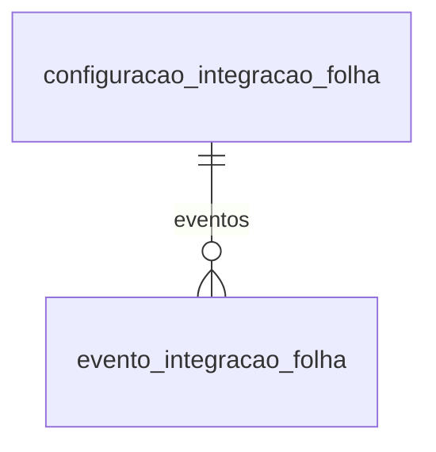

# Modelo — Integração da folha com a contabilidade

> Gerado por `src/model/gerar_docs_modelo.py` a partir de `src/model/modulos/folha_contabil.yaml`, do catálogo e do perfil de colunas. **Não edite à mão.**

3 entidades. A coluna *Preench.* é o % de linhas com valor útil (nem nulo, nem em branco, nem zero, nem 1900-01-01; para colunas de código o zero conta como valor).

## Diagrama

## Entidades

| Entidade | Tabela | Linhas | Volume | Filtro obrigatório |
|---|---|---|---|---|
| [configuracao_integracao_folha](#configuracao_integracao_folha) | `fointegcont` | 112.913 | medio | empresa |
| [evento_integracao_folha](#evento_integracao_folha) | `fointegconteve` | 831.213 | medio | empresa |
| [lancamento_integracao_folha](#lancamento_integracao_folha) | `fointegcontlanc` | 213.590 | medio | empresa |

## configuracao_integracao_folha

**Configuração da integração da folha com a contabilidade** — tabela `fointegcont` (112.913 linhas)

Para cada empresa, separador (centro de custos, departamento...), código e tipo: descrição (ex.: salários, vale transporte, PIS sobre folha), conta de débito e de crédito, histórico padrão e, para guias, contas de juros e multa. 112.913 linhas, 706 empresas; todas de origem "sistema".

- **Chave:** `codi_emp, i_separador, i_codigo, tipo`
- **Empresa:** `codi_emp`
- **Período:** `—`
- **Ordem padrão:** `i_separador asc`, `i_codigo asc`

**Regras de negócio validadas:**

- Cada configuração (empresa, separador, código, tipo) é a chave; as contas e o histórico são os usados quando a folha é contabilizada. Todas as 112.913 linhas têm origem 0 (sistema).
- Descrições típicas do tipo 1: SALÁRIOS, DESCONTOS DE FOLHA, PRO-LABORE, DESCONTOS PRO-LABORE, CONTRIBUIÇÃO SINDICAL, VALE TRANSPORTE.

| Campo | Coluna | Tipo | Preench. | Domínio | Descrição (banco) |
|---|---|---|---|---|---|
| separador | `i_separador` | integer(4) |  |  | Separador |
| codigo | `i_codigo` | integer(4) |  |  | Codigo |
| tipo | `tipo` | integer(4) |  | tipo_integracao_folha | Tipo de configuracao |
| descricao | `descricao` | char(40) |  |  | Descricao |
| conta_credito | `conta_cred` | integer(4) |  |  | Conta Credito |
| conta_debito | `conta_deb` | integer(4) |  |  | Conta Debito |
| historico_codigo | `i_historico` | integer(4) |  |  | Historico |
| historico_complemento | `comp_hist` | varchar(512) |  |  | Descricao Historico |
| conta_debito_juros | `deb_juros` | integer(4) |  |  | Conta debito juros |
| historico_juros_codigo | `hist_juros` | integer(4) |  |  | Historico juros |
| historico_juros_complemento | `hist_juros_comp` | varchar(512) |  |  | Descricao historico juros |
| conta_debito_multa | `deb_multa` | integer(4) |  |  | Conta debito multa |
| historico_multa_codigo | `hist_multa` | integer(4) |  |  | Historico multa |
| historico_multa_complemento | `hist_multa_comp` | varchar(512) |  |  | Descricao historico multa |

**Filhos (1:N):**

- `eventos` → [evento_integracao_folha](#evento_integracao_folha)

**Filtros:** `separador` (eq/in), `codigo` (eq/in), `tipo` (eq/in), `descricao` (contem/prefixo)

## evento_integracao_folha

**Eventos de cada configuração da integração** — tabela `fointegconteve` (831.213 linhas)

Liga cada configuração da integração (separador, código e tipo) aos eventos (rubricas) da folha que a alimentam. 831.213 linhas, 706 empresas.

- **Chave:** `codi_emp, i_separador, i_codigo, i_eventos, tipo`
- **Empresa:** `codi_emp`
- **Período:** `—`
- **Ordem padrão:** `i_separador asc`, `i_codigo asc`, `i_eventos asc`

**Regras de negócio validadas:**

- Toda linha tem a configuração correspondente (0 sem registro na amostra da empresa 927, 1.194 linhas).

| Campo | Coluna | Tipo | Preench. | Domínio | Descrição (banco) |
|---|---|---|---|---|---|
| separador | `i_separador` | integer(4) |  |  | Separador |
| codigo | `i_codigo` | integer(4) |  |  | Codigo |
| evento_codigo | `i_eventos` | integer(4) |  |  | Evento |
| tipo | `tipo` | integer(4) |  | tipo_integracao_folha | Tipo de configuracao |

**Vínculos (LEFT JOIN, acrescentam colunas legíveis):**

- `configuracao` → `fointegcont` por `codi_emp` = `codi_emp` e `i_separador` = `i_separador` e `i_codigo` = `i_codigo` e `tipo` = `tipo`; colunas: `configuracao_descricao`
- `evento` → `foeventos` por `codi_emp` = `codi_emp` e `i_eventos` = `i_eventos`; colunas: `evento_nome`

**Filtros:** `separador` (eq/in), `codigo` (eq/in), `evento_codigo` (eq/in), `tipo` (eq/in)

## lancamento_integracao_folha

**Lançamentos contábeis gerados pela integração da folha** — tabela `fointegcontlanc` (213.590 linhas)

Registra, por empresa da folha, competência e tipo de integração, o número do lançamento contábil gerado (na empresa da contabilidade `codi_emp_cta`), com o separador usado. 213.590 linhas, 457 empresas, de 2013-01 a 2026-09. Os valores ficam em contabil.lancamento.

- **Chave:** `codi_emp, competencia, nume_lanc, tipo`
- **Empresa:** `codi_emp`
- **Período:** `competencia`
- **Ordem padrão:** `competencia desc`, `nume_lanc asc`, `tipo asc`

**Regras de negócio validadas:**

- Integridade: todo lançamento registrado existe em ctlancto (0 sem lançamento nos 38.065 de 2025).
- Tipos em uso: 1 (102.127 linhas), 5 (30.117), 6 (25.574), 4 (21.715), 2 (16.688), 3 (16.268) e 10 (1.213). Quase tudo sem separador (211.854); 1.714 por centro de custos.
- Empresa 1430, 2026-08: valor lançado por tipo 1 = 108.484,19 (9 lançamentos), 2 = 13.978,47, 3 = 9.473,61, 4 = 22.725,96, 5 = 10.687,46, 6 = 5.380,51; a folha do mês soma proventos 144.751,35, descontos 96.374,31 e líquido 48.377,04, sem correspondência exata com um tipo.

| Campo | Coluna | Tipo | Preench. | Domínio | Descrição (banco) |
|---|---|---|---|---|---|
| competencia | `competencia` | date(4) |  |  | Competencia |
| lancamento_numero | `nume_lanc` | integer(4) |  |  | Numero lancamento |
| tipo | `tipo` | integer(4) |  | tipo_integracao_folha | Tipo da integracao |
| empresa_contabilidade | `codi_emp_cta` | integer(4) |  |  | Codigo da empresa da contabilidade |
| tipo_separador | `tipo_separador` | smallint(2) |  | tipo_separador_integracao | Tipo de separador. (0=Sem separador/1=Centro de custos/2=Departamentos/3=Serviços/4=Filiais) |
| separador | `i_separador` | integer(4) |  |  | Código do separador. |

**Vínculos (LEFT JOIN, acrescentam colunas legíveis):**

- `lancamento` → `ctlancto` por `codi_emp_cta` = `codi_emp` e `nume_lanc` = `nume_lan`; colunas: `lancamento_data`, `lancamento_valor`

**Filtros:** `competencia` (eq/entre/gte/lte), `lancamento_numero` (eq/in), `tipo` (eq/in)

## Domínios (significado dos códigos)

`confirmado`: **sim** = vem do comentário do banco e/ou foi conferido nos dados; **parcial** = parte dos valores; **não** = hipótese, não use como regra.

### status_empresa

Situação da empresa no cadastro (geempre.stat_emp)

Confirmado: sim

| Código | Significado |
|---|---|
| A | Ativa |
| I | Inativa |
| C | Em constituição |
| M | Ativo sem movimento |
| B | Em processo de baixa |
| E | Excluindo |

### motivo_inatividade

Motivo da inatividade (geempre.tipoi_emp). Só aparece em empresas inativas.

Confirmado: sim

| Código | Significado |
|---|---|
| 1 | Outros |
| 2 | Baixada |
| 3 | Transferida |
| 4 | Inadimplente |

### tipo_inscricao

Tipo da inscrição (CNPJ/CPF/CEI/CAEPF)

Confirmado: sim

| Código | Significado |
|---|---|
| 1 | CNPJ |
| 2 | CPF |
| 3 | CEI |
| 6 | CAEPF |

### regime_federal_empresa

Regime federal da folha (geempre.rfed_emp)

Confirmado: parcial

| Código | Significado |
|---|---|
| 1 | Normal |
| 2 | Microempresa |
| 3 | Empresa de pequeno porte |

### tipo_honorario_empresa

Como a empresa usa o módulo Honorários (geempre.honorario_tipo)

Confirmado: sim

| Código | Significado |
|---|---|
| E | Escritório (quem fatura) |
| C | Cliente |

### sim_nao_texto

Confirmado: sim

| Código | Significado |
|---|---|
| S | Sim |
| N | Não |

### sim_nao_numerico

Confirmado: sim

| Código | Significado |
|---|---|
| 1 | Sim |
| 0 | Não |

### tipo_separador_integracao

Tipo de separador da integração (fointegcontlanc.tipo_separador)

Confirmado: sim

| Código | Significado |
|---|---|
| 0 | Sem separador |
| 1 | Centro de custos |
| 2 | Departamentos |
| 3 | Serviços |
| 4 | Filiais |

### tipo_integracao_folha

Tipo da configuração/integração da folha com a contabilidade

Confirmado: **não**

> O banco não traz legenda. Em uso: 1, 2, 3, 4, 5, 6, 7, 8 e 10. As descrições das configurações cadastradas dão pistas, mas NÃO fecham uma legenda: o tipo 1 reúne salários, descontos, pró-labore e contribuição sindical; os tipos 1, 3 e 4 repetem as mesmas 53 descrições (ex.: vale transporte) e os tipos 2, 5, 6 e 7 têm PIS, o 8 rescisão e o 10 INSS sobre valores pagos a cooperativa de trabalho. Tentativa de conciliar valores lançados por tipo com os totais da folha (empresa 1430, 2026-08) não identificou uma correspondência exata. Não usar como regra.

| Código | Significado |
|---|---|
| 1 | Sem legenda |
| 2 | Sem legenda |
| 3 | Sem legenda |
| 4 | Sem legenda |
| 5 | Sem legenda |
| 6 | Sem legenda |
| 7 | Sem legenda |
| 8 | Sem legenda |
| 10 | Sem legenda |

