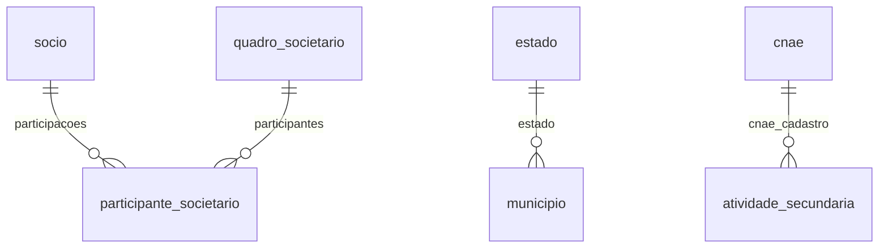

# Modelo — Geral

> Gerado por `src/model/gerar_docs_modelo.py` a partir de `src/model/modulos/geral.yaml`, do catálogo e do perfil de colunas. **Não edite à mão.**

11 entidades. A coluna *Preench.* é o % de linhas com valor útil (nem nulo, nem em branco, nem zero, nem 1900-01-01; para colunas de código o zero conta como valor).

## Diagrama

## Entidades

| Entidade | Tabela | Linhas | Volume | Filtro obrigatório |
|---|---|---|---|---|
| [socio](#socio) | `gesocios` | 2.316 | pequeno | — |
| [quadro_societario](#quadro_societario) | `gequadrosocietario` | 1.571 | pequeno | empresa |
| [participante_societario](#participante_societario) | `gequadrosocietario_socios` | 4.980 | pequeno | empresa |
| [municipio](#municipio) | `gemunicipio` | 5.576 | pequeno | — |
| [estado](#estado) | `geestado` | 28 | pequeno | — |
| [pais](#pais) | `gepais` | 273 | pequeno | — |
| [cnae](#cnae) | `gecnae20` | 1.350 | pequeno | — |
| [natureza_juridica](#natureza_juridica) | `genatjuridica` | 96 | pequeno | — |
| [atividade_secundaria](#atividade_secundaria) | `geatvsecundaria` | 3.952 | pequeno | empresa |
| [feriado](#feriado) | `geferiados` | 106 | pequeno | — |
| [imposto_vigencia](#imposto_vigencia) | `GEIMPOSTO_VIGENCIA` | 316.644 | grande | empresa; um de: imposto_codigo, periodo |

## socio

**Sócios (cadastro mínimo)** — tabela `gesocios` (2.316 linhas)

Cadastro GLOBAL de pessoas sócias (não depende de empresa; 412 de 2.125 aparecem em mais de uma empresa). Somente identificação mínima.

- **Chave:** `i_socio`
- **Empresa:** `não se aplica (tabela global)`
- **Período:** `—`
- **Ordem padrão:** `nome asc`

| Campo | Coluna | Tipo | Preench. | Domínio | Descrição (banco) |
|---|---|---|---|---|---|
| codigo | `i_socio` | integer(4) | 100% |  | Codigo socio |
| nome 🔒 | `nome` | char(60) | 100% |  | Nome |
| sexo | `sexo` | char(1) | 100% |  | Sexo (M - Masculino/F - Feminino) |
| tipo_inscricao | `tipo_insc` | tinyint(1) | 100% | tipo_inscricao | Tipo de inscricao (1 - CNPJ/2 - CPF) |
| inscricao 🔒 | `inscricao` | char(14) | 100% |  | CPF ou CNPJ |
| uf | `uf` | char(2) | 100% |  | UF |

> 🔒 **Privacidade:** Pessoa física identificada (nome e CPF). Mascarar por padrão.

**Filhos (1:N):**

- `participacoes` → [participante_societario](#participante_societario)

**Filtros:** `codigo` (eq/in), `nome` (contem/prefixo), `inscricao` (eq)

## quadro_societario

**Quadros societários (histórico)** — tabela `gequadrosocietario` (1.571 linhas)

Uma linha por empresa e data de alteração: capital social e quotas. O quadro vigente é o de maior `data`. 988 empresas têm 1 quadro; as demais têm histórico (até 6).

- **Chave:** `codi_emp, data`
- **Empresa:** `codi_emp`
- **Período:** `data`
- **Ordem padrão:** `data desc`

**Regras de negócio validadas:**

- Coerência com os participantes: a soma da participação dos sócios (tipo S) é 100% em 1.474 de 1.486 quadros (99,2%; 12 abaixo, 0 acima) e a soma das quotas dos sócios é igual às quotas do quadro em 1.472 (99,1%).

| Campo | Coluna | Tipo | Preench. | Domínio | Descrição (banco) |
|---|---|---|---|---|---|
| data | `data` | date(4) | 100% |  | Data |
| quotas | `qdade_quota` | numeric(13) | 98% |  | Quantidade de quotas |
| capital_social 🔒 | `capital_social` | numeric(20) | 100% |  | Total do Capital Social |
| capital_a_integralizar 🔒 | `total_integralizar` | numeric(13) | 1% |  | Total do Capital a Integralizar |
| quotas_integralizadas | `quota_integralizada` | numeric(13) | 98% |  | Quotas integralizadas |
| quotas_a_integralizar | `quota_a_integralizar` | numeric(13) | 1% |  | Quotas a integralizar |
| capital_integralizado 🔒 | `capital_integralizado` | numeric(17) | 96% |  | Capital integralizado |
| quotas_em_tesouraria_percentual | `quotas_em_tesouraria` | numeric(5) | 1% |  | Quotas em tesouraria(%) |
| liberado_registro | `liberado` | char(1) | 100% | sim_nao_texto | Liberado (finalizado) pelo Modulo Registro (S=Sim/N=Nao) |

**Filhos (1:N):**

- `participantes` → [participante_societario](#participante_societario)

**Filtros:** `data` (eq/entre/gte/lte)

## participante_societario

**Participantes do quadro societário** — tabela `gequadrosocietario_socios` (4.980 linhas)

Sócios, administradores e demais participantes de cada quadro, com quotas e participação percentual.

- **Chave:** `codi_emp, data, i_socio, tipo`
- **Empresa:** `codi_emp`
- **Período:** `data`
- **Ordem padrão:** `data desc`, `i_socio asc`

**Regras de negócio validadas:**

- Para o quadro de uma data some só tipo = 'S' ao conferir 100%. O tipo 'E' (64 linhas) é desconhecido; não o some como sócio.
- Todos os participantes têm cadastro em gesocios (0 sem cadastro em 4.980).

| Campo | Coluna | Tipo | Preench. | Domínio | Descrição (banco) |
|---|---|---|---|---|---|
| data | `data` | date(4) | 100% |  | Data |
| socio_codigo | `i_socio` | integer(4) | 100% |  | Codigo sequencial |
| tipo | `tipo` | char(1) | 100% | tipo_participante | Tipo (S - Socio/A - Administrador/R - Representante Legal) |
| quotas | `qdade_quotas` | numeric(13) | 79% |  | Quantidade de quotas |
| quotas_a_integralizar | `integralizar` | numeric(13) | 1% |  | Capital a integralizar |
| participacao_percentual | `participacao` | numeric(5) | 78% |  | Participacao % |
| condicao | `condicao` | integer(4) | 100% |  | Condicao |
| cargo | `cargo` | char(30) | 0% |  | Cargo |
| data_ingresso | `data_ingresso` | date(4) | 100% |  | Data de  ingresso |
| data_saida | `data_saida` | date(4) | 17% |  | Data de saida |
| exerce_atividade | `exerce_atividade` | tinyint(1) | 100% | sim_nao_numerico_ge | Exerce atividade 1=Sim/0=Nao |

**Vínculos (LEFT JOIN, acrescentam colunas legíveis):**

- `socio` → `gesocios` por `i_socio` = `i_socio`; colunas: `socio_nome` 🔒

> 🔒 **Privacidade:** Liga pessoa física a empresa e percentual de participação. Mascarar nome por padrão.

**Filtros:** `data` (eq/entre/gte/lte), `socio_codigo` (eq/in), `tipo` (eq/in)

## municipio

**Municípios** — tabela `gemunicipio` (5.576 linhas)

Tabela global de municípios. `codigo` é um código INTERNO sequencial da Domínio (1 a 5.576), NÃO o código IBGE (que está em `ibge`). As demais colunas de código (SRF, ANP, NFS-e...) servem a integrações específicas.

- **Chave:** `codigo_municipio`
- **Empresa:** `não se aplica (tabela global)`
- **Período:** `—`
- **Ordem padrão:** `nome_municipio asc`

| Campo | Coluna | Tipo | Preench. | Domínio | Descrição (banco) |
|---|---|---|---|---|---|
| codigo | `codigo_municipio` | integer(4) | 100% |  | Codigo sequencial |
| nome | `nome_municipio` | char(255) | 100% |  | Nome do municipio |
| nome_acentuado | `nome_municipio_acentuado_minusculo` | varchar(255) | 100% |  | Nome do município com acentuação e variação de letras minúsculas/maiúsculas |
| uf_codigo | `codigo_uf` | integer(4) | 100% |  | Codigo do estado |
| ibge | `codigo_ibge` | integer(4) | 100% |  | Codigo do IBGE/RAIS |
| srf | `codigo_srf` | integer(4) | 100% |  | Codigo da Secretaria da Receita Federal |
| srf_2016 | `codigo_srf_2016` | integer(4) | 99% |  | Codigo da Secretaria da Receita Federal 2016 |
| codigo_estadual | `codigo_estado` | integer(4) | 100% |  | Codigo estadual do municipio |

**Vínculos (LEFT JOIN, acrescentam colunas legíveis):**

- `estado` → `geestado` por `codigo_uf` = `codigo_uf`; colunas: `uf`, `uf_nome`

**Filtros:** `codigo` (eq/in), `nome` (contem/prefixo), `ibge` (eq/in), `uf_codigo` (eq/in)

## estado

**Estados (UF)** — tabela `geestado` (28 linhas)

- **Chave:** `codigo_uf`
- **Empresa:** `não se aplica (tabela global)`
- **Período:** `—`
- **Ordem padrão:** `sigla_uf asc`

| Campo | Coluna | Tipo | Preench. | Domínio | Descrição (banco) |
|---|---|---|---|---|---|
| codigo | `codigo_uf` | integer(4) | 100% |  | Codigo do estado |
| nome | `nome_uf` | char(255) | 100% |  | Nome do estado |
| sigla | `sigla_uf` | char(2) | 100% |  | Sigla do estado |
| regiao | `regiao` | integer(4) | 100% |  | Regiao do estado |
| aliquota_icms | `aliquota` | numeric(7) | 96% |  | Aliquota de ICMS |

**Filtros:** `sigla` (eq/in)

## pais

**Países** — tabela `gepais` (273 linhas)

- **Chave:** `codigo_pais`
- **Empresa:** `não se aplica (tabela global)`
- **Período:** `—`
- **Ordem padrão:** `nome_pais asc`

| Campo | Coluna | Tipo | Preench. | Domínio | Descrição (banco) |
|---|---|---|---|---|---|
| codigo | `codigo_pais` | integer(4) | 100% |  | Codigo sequencial |
| nome | `nome_pais` | char(255) | 100% |  | Nome do pais |
| codigo_bacen | `codigo_bc` | integer(4) | 96% |  | Codigo do Banco Central do Brasil |
| codigo_siscomex | `codigo_siscomex` | integer(4) | 97% |  | Codigo SISCOMEX |
| sigla_iso | `sigla_iso` | char(2) | 89% |  | Sigla padrão ISO de 2 letras. |
| codigo_iso | `codigo_iso` | integer(4) | 89% |  | Código numérico padrão ISO. |
| codigo_reinf | `codigo_reinf` | integer(4) | 89% |  | Código do país pela tabela do REINF |

**Filtros:** `nome` (contem/prefixo), `sigla_iso` (eq)

## cnae

**CNAE 2.0** — tabela `gecnae20` (1.350 linhas)

- **Chave:** `i_cnae20`
- **Empresa:** `não se aplica (tabela global)`
- **Período:** `—`
- **Ordem padrão:** `i_cnae20 asc`

| Campo | Coluna | Tipo | Preench. | Domínio | Descrição (banco) |
|---|---|---|---|---|---|
| codigo | `i_cnae20` | char(15) | 100% |  | Codigo CNAE 20 |
| descricao | `descricao` | varchar(300) | 100% |  | Descricao |

**Filtros:** `codigo` (eq/in/prefixo), `descricao` (contem)

## natureza_juridica

**Naturezas jurídicas** — tabela `genatjuridica` (96 linhas)

- **Chave:** `codigo`
- **Empresa:** `não se aplica (tabela global)`
- **Período:** `—`
- **Ordem padrão:** `codigo asc`

| Campo | Coluna | Tipo | Preench. | Domínio | Descrição (banco) |
|---|---|---|---|---|---|
| codigo | `codigo` | integer(4) | 100% |  | Codigo |
| descricao | `descricao` | varchar(250) | 100% |  | Descricao |
| tipo | `tipo` | tinyint(1) | 100% |  | Tipo |

**Filtros:** `codigo` (eq/in), `descricao` (contem)

## atividade_secundaria

**Atividades secundárias (CNAE) da empresa** — tabela `geatvsecundaria` (3.952 linhas)

- **Chave:** `codigo_cnae, codi_emp`
- **Empresa:** `codi_emp`
- **Período:** `—`
- **Ordem padrão:** `ordem asc`

| Campo | Coluna | Tipo | Preench. | Domínio | Descrição (banco) |
|---|---|---|---|---|---|
| cnae | `codigo_cnae` | char(15) | 100% |  | Codigo CNAE |
| ordem | `ordem` | tinyint(1) | 100% |  | Ordem |
| usa_cnae20 | `usa_cnae20` | char(1) | 100% | sim_nao_texto | Usa o CNAE 2.0 (S/N) |

**Vínculos (LEFT JOIN, acrescentam colunas legíveis):**

- `cnae_cadastro` → `gecnae20` por `codigo_cnae` = `i_cnae20`; colunas: `cnae_descricao`

**Filtros:** `cnae` (eq/in/prefixo)

## feriado

**Feriados** — tabela `geferiados` (106 linhas)

Feriados federais, estaduais, municipais e sindicais usados nos cálculos e vencimentos. Fixos têm dia/mês; móveis têm ano.

- **Chave:** `i_feriados`
- **Empresa:** `não se aplica (tabela global)`
- **Período:** `—`
- **Ordem padrão:** `mes asc`, `dia asc`

| Campo | Coluna | Tipo | Preench. | Domínio | Descrição (banco) |
|---|---|---|---|---|---|
| codigo | `i_feriados` | integer(4) | 100% |  | Codigo sequencial |
| descricao | `descricao` | char(40) | 100% |  | Descrição |
| abrangencia | `abrangencia` | tinyint(1) | 100% | abrangencia_feriado | Abrangência: (1=Federal/2=Estadual/3=Municipal/4=Sindical) |
| tipo | `tipo` | tinyint(1) | 100% | tipo_feriado | Tipo do feriado(1-Movel/2-Fixo) |
| dia | `dia` | tinyint(1) | 100% |  | dia |
| mes | `mes` | tinyint(1) | 100% |  | mes |
| ano | `ano` | integer(4) | 46% |  | ano |
| municipio_codigo | `codigo_municipio` | integer(4) | 8% |  | Codigo sequencial do municipio para feriados municipais |
| uf_codigo | `codigo_uf` | integer(4) | 58% |  | Codigo do estado para feriado estadal |
| sindicato_codigo | `i_sindicatos` | integer(4) | 0% |  | Código do sindicato (Abrangência Sindical) |

**Filtros:** `abrangencia` (eq/in), `mes` (eq/in), `uf_codigo` (eq/in), `municipio_codigo` (eq/in)

## imposto_vigencia

**Configuração de impostos por vigência** — tabela `GEIMPOSTO_VIGENCIA` (316.644 linhas)

Como cada empresa apura cada imposto a partir de uma data (vigência): competência (federal/estadual/municipal), periodicidade, forma e dias de vencimento, códigos de recolhimento e contas/históricos contábeis. A configuração em vigor numa data é a de MAIOR `vigencia` menor ou igual a essa data. A tabela tem 367 colunas; só as ~30 de uso geral são expostas.

- **Chave:** `CODI_EMP, CODI_IMP, VIGENCIA_IMP`
- **Empresa:** `CODI_EMP`
- **Período:** `VIGENCIA_IMP` · exige um de: `imposto_codigo, periodo`
- **Ordem padrão:** `CODI_IMP asc`, `VIGENCIA_IMP desc`

**Regras de negócio validadas:**

- ATENÇÃO: periodicidade_imposto (1 mensal, 2 quinzenal, 3 decendial, 4 trimestral, 5 semanal, 6 semestral) usa codificação DIFERENTE da periodicidade da apuração em efsdoimp.pdic_sim (6 = mensal, 4/5 = quinzenas, 7 = trimestral...). Não misture.
- As contas contábeis (conta_*) são códigos do plano de contas; resolva-os pelo plano da empresa (ver regra do plano em contabil.yaml).

| Campo | Coluna | Tipo | Preench. | Domínio | Descrição (banco) |
|---|---|---|---|---|---|
| imposto_codigo | `codi_imp` | integer(4) | 100% |  | Codigo |
| vigencia | `vigencia_imp` | date(4) | 100% |  | Vigencia |
| descricao | `descricao_imp` | char(80) | 100% |  | Descricao |
| competencia | `comp_imp` | char(1) | 100% | competencia_imposto | Competencia (F - federal/E - estadual/M - municipal) |
| periodicidade | `pdic_imp` | integer(4) | 100% | periodicidade_imposto | Periodicidade (1 - Mensal/2 - Quinzenal/3 - Decendial/4 - Trimestral/5 - Semanal/6 - Semestral) |
| forma_vencimento | `fven_imp` | integer(4) | 100% | forma_vencimento | Forma de vencimento (1 - Dias corridos antecipado/2 - Dias corridos adiados/3 - Dias uteis/4 - Dias corridos direto/5 - Ultimo dia util) |
| dias_vencimento | `ndiv_imp` | integer(4) | 82% |  | Dias para o vencimento |
| a_partir_de_meses | `nmes_imp` | integer(4) | 100% |  | A partir de quantos meses vence o imposto(1o mes, 2o mes, 3o mes,...) |
| aliquota | `aliq_imp` | numeric(6) | 74% |  | Aliquota do imposto |
| aliquota_base_calculo | `abas_imp` | numeric(5) | 99% |  | Aliquota da base de calculo |
| tipo_calculo | `tcal_imp` | char(1) | 100% | tipo_calculo_imposto | TIPO (L-LANCADO POR NOTA / P-LANÇADO POR PRODUTO / C-CALCULADO) |
| codigo_recolhimento | `cdrn_imp` | char(6) | 71% |  | Codigo de recolhimento |
| codigo_recolhimento_juros | `cdrj_imp` | char(6) | 2% |  | Codigo de recolhimento para os juros |
| codigo_recolhimento_multa | `cdrm_imp` | char(6) | 2% |  | Codigo de recolhimento para a multa |
| codigo_recolhimento_atualizacao | `cdrc_imp` | char(6) | 2% |  | Codigo de recolhimento para a atualizacao monetaria |
| conta_imposto_a_recolher | `ctrc_imp` | integer(4) | 14% |  | Conta contabil do imposto a recolher |
| historico_imposto_a_recolher | `chip_imp` | integer(4) | 14% |  | Historico padrao do imposto a recolher |
| conta_imposto_a_recuperar | `ctrp_imp` | integer(4) | 7% |  | Conta contabil do imposto a recuperar |
| historico_imposto_a_recuperar | `chir_imp` | integer(4) | 7% |  | Historico padrao do imposto a recuperar |
| conta_imposto_sobre_vendas | `ctvd_imp` | integer(4) | 16% |  | Conta contabil para o imposto sobre vendas |
| conta_imposto_sobre_compras | `ctcp_imp` | integer(4) | 1% |  | Conta contabil para o imposto sobre compras |
| gera_lancamento_contabil_por_nota | `lanc_imp` | char(1) | 95% | sim_nao_texto | Gera lancamentos contabeis por nota (S/N) |

**Vínculos (LEFT JOIN, acrescentam colunas legíveis):**

- `imposto` → `geimposto` por `CODI_EMP` = `codi_emp` e `CODI_IMP` = `codi_imp`; colunas: `imposto_nome`, `imposto_sigla`

**Filtros:** `imposto_codigo` (eq/in), `vigencia` (entre/gte/lte)

## Domínios (significado dos códigos)

`confirmado`: **sim** = vem do comentário do banco e/ou foi conferido nos dados; **parcial** = parte dos valores; **não** = hipótese, não use como regra.

### status_empresa

Situação da empresa no cadastro (geempre.stat_emp)

Confirmado: sim

| Código | Significado |
|---|---|
| A | Ativa |
| I | Inativa |
| C | Em constituição |
| M | Ativo sem movimento |
| B | Em processo de baixa |
| E | Excluindo |

### motivo_inatividade

Motivo da inatividade (geempre.tipoi_emp). Só aparece em empresas inativas.

Confirmado: sim

| Código | Significado |
|---|---|
| 1 | Outros |
| 2 | Baixada |
| 3 | Transferida |
| 4 | Inadimplente |

### tipo_inscricao

Confirmado: sim

| Código | Significado |
|---|---|
| 1 | CNPJ |
| 2 | CPF |

### regime_federal_empresa

Regime federal da folha (geempre.rfed_emp)

Confirmado: parcial

| Código | Significado |
|---|---|
| 1 | Normal |
| 2 | Microempresa |
| 3 | Empresa de pequeno porte |

### tipo_honorario_empresa

Como a empresa usa o módulo Honorários (geempre.honorario_tipo)

Confirmado: sim

| Código | Significado |
|---|---|
| E | Escritório (quem fatura) |
| C | Cliente |

### sim_nao_texto

Confirmado: sim

| Código | Significado |
|---|---|
| S | Sim |
| N | Não |

### sim_nao_numerico

Confirmado: sim

| Código | Significado |
|---|---|
| 1 | Sim |
| 0 | Não |

### sim_nao_numerico_ge

Confirmado: sim

| Código | Significado |
|---|---|
| 1 | Sim |
| 0 | Não |

### tipo_participante

Papel da pessoa no quadro societário (gequadrosocietario_socios.tipo)

Confirmado: parcial

> S (sócio, 4.909), A (administrador, 7) e R (representante legal) vêm do comentário do banco. O valor E (64 linhas) NÃO está documentado e não há 'R' nos dados. Significado de E desconhecido.

| Código | Significado |
|---|---|
| S | Sócio |
| A | Administrador |
| R | Representante legal |
| E | Desconhecido (64 linhas, não documentado) |

### abrangencia_feriado

Confirmado: sim

| Código | Significado |
|---|---|
| 1 | Federal |
| 2 | Estadual |
| 3 | Municipal |
| 4 | Sindical |

### tipo_feriado

Confirmado: sim

| Código | Significado |
|---|---|
| 1 | Móvel |
| 2 | Fixo |

### competencia_imposto

Confirmado: sim

| Código | Significado |
|---|---|
| F | Federal |
| E | Estadual |
| M | Municipal |

### periodicidade_imposto

Periodicidade do imposto na CONFIGURAÇÃO (geimposto_vigencia.pdic_imp). ATENÇÃO - codificação DIFERENTE da periodicidade da apuração (efsdoimp.pdic_sim).

Confirmado: sim

| Código | Significado |
|---|---|
| 1 | Mensal |
| 2 | Quinzenal |
| 3 | Decendial |
| 4 | Trimestral |
| 5 | Semanal |
| 6 | Semestral |

### forma_vencimento

Confirmado: sim

| Código | Significado |
|---|---|
| 1 | Dias corridos antecipado |
| 2 | Dias corridos adiado |
| 3 | Dias úteis |
| 4 | Dias corridos direto |
| 5 | Último dia útil |

### tipo_calculo_imposto

Confirmado: sim

| Código | Significado |
|---|---|
| L | Lançado por nota |
| P | Lançado por produto |
| C | Calculado |

