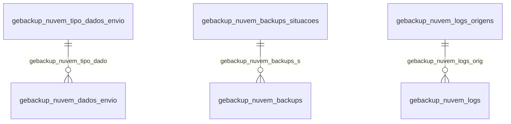

# Modelo — Geral - backup (rascunho em lote)

> Gerado por `src/model/gerar_docs_modelo.py` a partir de `src/model/modulos/geral_backup.yaml`, do catálogo e do perfil de colunas. **Não edite à mão.**

14 entidades. A coluna *Preench.* é o % de linhas com valor útil (nem nulo, nem em branco, nem zero, nem 1900-01-01; para colunas de código o zero conta como valor).

## Diagrama

## Entidades

| Entidade | Tabela | Linhas | Volume | Filtro obrigatório |
|---|---|---|---|---|
| [gebackup_nuvem_dados_envio](#gebackup_nuvem_dados_envio) | `GEBACKUP_NUVEM_DADOS_ENVIO` | 87.159 | medio | — |
| [gebackup_nuvem_backups](#gebackup_nuvem_backups) | `GEBACKUP_NUVEM_BACKUPS` | 11.314 | medio | — |
| [gebackup_nuvem_logs](#gebackup_nuvem_logs) | `GEBACKUP_NUVEM_LOGS` | 5.081 | pequeno | — |
| [gebackup_realizado](#gebackup_realizado) | `GEBACKUP_REALIZADO` | 210 | pequeno | — |
| [gebackup_nuvem_backups_situacoes](#gebackup_nuvem_backups_situacoes) | `GEBACKUP_NUVEM_BACKUPS_SITUACOES` | 18 | pequeno | — |
| [gebackup_nuvem_tipo_dados_envio](#gebackup_nuvem_tipo_dados_envio) | `GEBACKUP_NUVEM_TIPO_DADOS_ENVIO` | 6 | pequeno | — |
| [gebackup_nuvem_logs_origens](#gebackup_nuvem_logs_origens) | `GEBACKUP_NUVEM_LOGS_ORIGENS` | 6 | pequeno | — |
| [gebackup_nuvem_versao](#gebackup_nuvem_versao) | `GEBACKUP_NUVEM_VERSAO` | 1 | pequeno | — |
| [gebackup_nuvem_estacao_vinculada](#gebackup_nuvem_estacao_vinculada) | `GEBACKUP_NUVEM_ESTACAO_VINCULADA` | 1 | pequeno | — |
| [gebackup_nuvem_agenda](#gebackup_nuvem_agenda) | `GEBACKUP_NUVEM_AGENDA` | 1 | pequeno | — |
| [gebackup_nuvem_configuracoes](#gebackup_nuvem_configuracoes) | `GEBACKUP_NUVEM_CONFIGURACOES` | 1 | pequeno | — |
| [gebackup_nuvem_notificacoes_configuracao](#gebackup_nuvem_notificacoes_configuracao) | `GEBACKUP_NUVEM_NOTIFICACOES_CONFIGURACAO` | 1 | pequeno | — |
| [gebackup_nuvem_cliente](#gebackup_nuvem_cliente) | `GEBACKUP_NUVEM_CLIENTE` | 1 | pequeno | — |
| [gebackup_nuvem_parada_processo](#gebackup_nuvem_parada_processo) | `GEBACKUP_NUVEM_PARADA_PROCESSO` | 1 | pequeno | — |

## gebackup_nuvem_dados_envio

**Tabela com os dados à serem enviados para o servidor.** — tabela `GEBACKUP_NUVEM_DADOS_ENVIO` (87.159 linhas)

Tabela com os dados à serem enviados para o servidor.. 87.159 linhas no catálogo; chave: SEQUENCIAL.

- **Chave:** `SEQUENCIAL`
- **Empresa:** `não se aplica (tabela global)`
- **Período:** `—`
- **Ordem padrão:** `SEQUENCIAL asc`

**Regras de negócio validadas:**

- Medido em 2026-10-18: 87.227 linhas.
- Vínculo gebackup_nuvem_tipo_dado (GEBACKUP_NUVEM_TIPO_DADOS_ENVIO): 0 de 87.227 linhas sem registro relacionado.

| Campo | Coluna | Tipo | Preench. | Domínio | Descrição (banco) |
|---|---|---|---|---|---|
| sequencial_auto_incremento | `sequencial` | bigint(8) |  |  | Sequencial auto-incremento. |
| tipo_do_dado_a_ser_enviado | `tipo_dado` | integer(4) |  |  | Tipo do dado a ser enviado. |
| c_1_inclusao_2_exclusao | `acao` | integer(4) |  |  | 1 - Inclusão, 2 - Exclusão |
| valor_da_chave_primaria_do_dado_a_ser_en | `valor_chave_primaria` | bigint(8) |  |  | Valor da chave primária do dado a ser enviado. |
| situacao_do_dado_a_ser_enviado_1_enviado | `situacao` | integer(4) |  |  | Situação do dado a ser enviado: 1 - Enviado, 0 - Não enviado |
| coluna_indicando_que_a_acao_deve_ser_env | `enviar_antes` | integer(4) |  |  | Coluna indicando que a ação deve ser enviada antes das outras. |

**Vínculos (LEFT JOIN, acrescentam colunas legíveis):**

- `gebackup_nuvem_tipo_dado` → `GEBACKUP_NUVEM_TIPO_DADOS_ENVIO` por `tipo_dado` = `codigo`; colunas: `gebackup_nuvem_tipo_dado_nome`

**Filtros:** `sequencial_auto_incremento` (eq/in), `tipo_do_dado_a_ser_enviado` (eq/in), `situacao_do_dado_a_ser_enviado_1_enviado` (eq/in)

## gebackup_nuvem_backups

**Tabela com os processos de backup.** — tabela `GEBACKUP_NUVEM_BACKUPS` (11.314 linhas)

Tabela com os processos de backup.. 11.314 linhas no catálogo; chave: SEQUENCIAL.

- **Chave:** `SEQUENCIAL`
- **Empresa:** `não se aplica (tabela global)`
- **Período:** `—`
- **Ordem padrão:** `SEQUENCIAL asc`

**Regras de negócio validadas:**

- Medido em 2026-10-18: 11.329 linhas.
- Vínculo gebackup_nuvem_backups_s (GEBACKUP_NUVEM_BACKUPS_SITUACOES): 0 de 11.329 linhas sem registro relacionado.

| Campo | Coluna | Tipo | Preench. | Domínio | Descrição (banco) |
|---|---|---|---|---|---|
| chave_primaria | `sequencial` | uniqueidentifier(16) |  |  | Chave primária. |
| tipo_do_backup_1_modificacoes_2_completo | `tipo` | integer(4) |  |  | Tipo do backup: 1 - Modificações, 2 - Completo. |
| situacao_do_backup_relacionada_com_a_tab | `situacao` | integer(4) |  |  | Situação do backup relacionada com a tabela GEBACKUP_NUVEM_BACKUPS_SITUACOES. |
| prazo_da_execucao_do_backup_1_backup_atr | `prazo` | integer(4) |  |  | Prazo da execução do backup: -1 - Backup atrasado, 0 - Backup em dia, 1 - Backup reagendado |
| caminho_do_arquivo_compactado_para_uploa | `caminho_arquivo_resultado` | varchar(512) |  |  | Caminho do arquivo compactado para upload. |
| tamanho_do_arquivo_resultado | `tamanho_arquivo` | bigint(8) |  |  | Tamanho do arquivo resultado. |
| hash_do_checksum_do_arquivo_compactado_p | `hash_arquivo_resultado` | varchar(40) |  |  | Hash do CheckSum do arquivo compactado para upload. |
| quantidade_de_tentativas_de_reenvio_real | `quantidade_tentativa_reenvio` | integer(4) |  |  | Quantidade de tentativas de reenvio realizadas até o envio com sucesso. |
| upload_id_gerado_pelo_s3 | `upload_id` | varchar(512) |  |  | Upload ID gerado pelo S3 |
| hash_do_checksum_gerado_pela_request_de | `hash_arquivo_resultado_s3` | varchar(40) |  |  | Hash do CheckSum gerado pela request de finalização do multipartUpload do S3. |
| c_1_nao_adaptado_ou_concluido_antes_da_a | `adaptar_upload_para_s3` | integer(4) |  |  | 1- Não adaptado ou concluido antes da alteração para o S3; 2- Adaptado; 3- nativo |

**Vínculos (LEFT JOIN, acrescentam colunas legíveis):**

- `gebackup_nuvem_backups_s` → `GEBACKUP_NUVEM_BACKUPS_SITUACOES` por `situacao` = `codigo`; colunas: `gebackup_nuvem_backups_s_nome`

**Filtros:** `chave_primaria` (eq/in), `tipo_do_backup_1_modificacoes_2_completo` (eq/in), `situacao_do_backup_relacionada_com_a_tab` (eq/in), `caminho_do_arquivo_compactado_para_uploa` (contem/prefixo), `hash_do_checksum_do_arquivo_compactado_p` (contem/prefixo), `upload_id_gerado_pelo_s3` (contem/prefixo), `hash_do_checksum_gerado_pela_request_de` (contem/prefixo)

## gebackup_nuvem_logs

**Tabela com os processos de backup.** — tabela `GEBACKUP_NUVEM_LOGS` (5.081 linhas)

Tabela com os processos de backup.. 5.081 linhas no catálogo; chave: SEQUENCIAL.

- **Chave:** `SEQUENCIAL`
- **Empresa:** `não se aplica (tabela global)`
- **Período:** `—`
- **Ordem padrão:** `SEQUENCIAL asc`

**Regras de negócio validadas:**

- Medido em 2026-10-18: 4.946 linhas.
- Vínculo gebackup_nuvem_logs_orig (GEBACKUP_NUVEM_LOGS_ORIGENS): 0 de 4.946 linhas sem registro relacionado.

| Campo | Coluna | Tipo | Preench. | Domínio | Descrição (banco) |
|---|---|---|---|---|---|
| chave_primaria | `sequencial` | bigint(8) |  |  | Chave primária. |
| tipo | `tipo` | integer(4) |  |  |  |
| origem_do_log_referenciado_na_tabela_geb | `origem` | integer(4) |  |  | Origem do log referenciado na tabela GEBACKUP_NUVEM_LOGS_ORIGENS |
| situacao_atual_do_backup_relacionada_com | `situacao_backup` | integer(4) |  |  | Situacao atual do backup relacionada com a tabela GEBACKUP_NUVEM_BACKUPS_SITUACOES quando o LOG foi gerado. |
| tipo_do_log_0_informacao_1_callback_1_er | `sequencial_dado_envio` | bigint(8) |  |  | Tipo do log: 0 - Informação, 1 - Callback, -1 - Erro |

**Vínculos (LEFT JOIN, acrescentam colunas legíveis):**

- `gebackup_nuvem_logs_orig` → `GEBACKUP_NUVEM_LOGS_ORIGENS` por `origem` = `codigo`; colunas: `gebackup_nuvem_logs_orig_nome`

**Filtros:** `chave_primaria` (eq/in), `tipo` (eq/in), `situacao_atual_do_backup_relacionada_com` (eq/in)

## gebackup_realizado

**Log de ciência de backup pré atualização do banco** — tabela `GEBACKUP_REALIZADO` (210 linhas)

Log de ciência de backup pré atualização do banco. 210 linhas no catálogo; chave: I_BACKUP.

- **Chave:** `I_BACKUP`
- **Empresa:** `não se aplica (tabela global)`
- **Período:** `—`
- **Ordem padrão:** `I_BACKUP asc`

**Regras de negócio validadas:**

- Medido em 2026-10-18: 212 linhas.

| Campo | Coluna | Tipo | Preench. | Domínio | Descrição (banco) |
|---|---|---|---|---|---|
| codigo_do_backup_auto_incrementado | `i_backup` | integer(4) |  |  | Código do backup (auto incrementado) |
| usuario_que_iniciou_o_backup | `usuario` | char(30) |  |  | Usuário que iniciou o backup |

**Filtros:** `codigo_do_backup_auto_incrementado` (eq/in), `usuario_que_iniciou_o_backup` (contem/prefixo)

## gebackup_nuvem_backups_situacoes

**Tabela situações do backup.** — tabela `GEBACKUP_NUVEM_BACKUPS_SITUACOES` (18 linhas)

Tabela situações do backup.. 18 linhas no catálogo; chave: CODIGO.

- **Chave:** `CODIGO`
- **Empresa:** `não se aplica (tabela global)`
- **Período:** `—`
- **Ordem padrão:** `CODIGO asc`

**Regras de negócio validadas:**

- Medido em 2026-10-18: 18 linhas.

| Campo | Coluna | Tipo | Preench. | Domínio | Descrição (banco) |
|---|---|---|---|---|---|
| chave_primaria | `codigo` | integer(4) |  |  | Chave primária. |
| descricao_da_situacao_do_backup | `descricao` | varchar(64) |  |  | Descrição da situação do backup. |

**Filtros:** `chave_primaria` (eq/in), `descricao_da_situacao_do_backup` (contem/prefixo)

## gebackup_nuvem_tipo_dados_envio

**Tabela com os tipos de dados de envio ao servidor.** — tabela `GEBACKUP_NUVEM_TIPO_DADOS_ENVIO` (6 linhas)

Tabela com os tipos de dados de envio ao servidor.. 6 linhas no catálogo; chave: CODIGO.

- **Chave:** `CODIGO`
- **Empresa:** `não se aplica (tabela global)`
- **Período:** `—`
- **Ordem padrão:** `CODIGO asc`

**Regras de negócio validadas:**

- Medido em 2026-10-18: 6 linhas.

| Campo | Coluna | Tipo | Preench. | Domínio | Descrição (banco) |
|---|---|---|---|---|---|
| codigo_do_tipo_de_dado_de_envio | `codigo` | integer(4) |  |  | Código do tipo de dado de envio. |
| nome_da_tabela_correspondente_com_o_tipo | `nome_tabela_correspondente` | varchar(64) |  |  | Nome da tabela correspondente com o tipo de dado na aplicação. |

**Filtros:** `codigo_do_tipo_de_dado_de_envio` (eq/in), `nome_da_tabela_correspondente_com_o_tipo` (contem/prefixo)

## gebackup_nuvem_logs_origens

**Origem do log do Backup em Nuvem** — tabela `GEBACKUP_NUVEM_LOGS_ORIGENS` (6 linhas)

Origem do log do Backup em Nuvem. 6 linhas no catálogo; chave: CODIGO.

- **Chave:** `CODIGO`
- **Empresa:** `não se aplica (tabela global)`
- **Período:** `—`
- **Ordem padrão:** `CODIGO asc`

**Regras de negócio validadas:**

- Medido em 2026-10-18: 6 linhas.

| Campo | Coluna | Tipo | Preench. | Domínio | Descrição (banco) |
|---|---|---|---|---|---|
| codigo | `codigo` | integer(4) |  |  |  |
| descricacao | `descricacao` | varchar(32) |  |  |  |

**Filtros:** `codigo` (eq/in), `descricacao` (contem/prefixo)

## gebackup_nuvem_versao

**Tabela de controle de versão do Backup na nuvem** — tabela `GEBACKUP_NUVEM_VERSAO` (1 linhas)

Tabela de controle de versão do Backup na nuvem. 1 linhas no catálogo; chave: CODIGO.

- **Chave:** `CODIGO`
- **Empresa:** `não se aplica (tabela global)`
- **Período:** `—`
- **Ordem padrão:** `CODIGO asc`

**Regras de negócio validadas:**

- Medido em 2026-10-18: 1 linhas.

| Campo | Coluna | Tipo | Preench. | Domínio | Descrição (banco) |
|---|---|---|---|---|---|
| chave_primaria_para_linha_unica | `codigo` | integer(4) |  |  | Chave primária para linha única. |
| versao_atual_da_aplicacao_do_backup | `versao_atual_aplicacao` | varchar(8) |  |  | Versão atual da aplicação do Backup. |
| versao_atual_do_servico_do_backup | `versao_atual_servico` | varchar(8) |  |  | Versão atual do serviço do Backup. |
| versao_desejada_do_backup_pelo_contabil | `versao_desejada` | varchar(8) |  |  | Versão desejada do Backup pelo Contábil. |
| nova_versao_baixada_disponivel_para_inst | `nova_versao_baixada` | integer(4) |  |  | Nova versão baixada disponível para instalação. |
| executando_atualizacao | `executando_atualizacao` | integer(4) |  |  |  |

**Filtros:** `chave_primaria_para_linha_unica` (eq/in), `versao_atual_da_aplicacao_do_backup` (eq/in), `versao_atual_do_servico_do_backup` (eq/in), `versao_desejada_do_backup_pelo_contabil` (eq/in)

## gebackup_nuvem_estacao_vinculada

**Tabela de controle da estação vinculada e da situacao do Backup na nuvem.** — tabela `GEBACKUP_NUVEM_ESTACAO_VINCULADA` (1 linhas)

Tabela de controle da estação vinculada e da situacao do Backup na nuvem.. 1 linhas no catálogo; chave: CODIGO.

- **Chave:** `CODIGO`
- **Empresa:** `não se aplica (tabela global)`
- **Período:** `—`
- **Ordem padrão:** `CODIGO asc`

**Regras de negócio validadas:**

- Medido em 2026-10-18: 1 linhas.

| Campo | Coluna | Tipo | Preench. | Domínio | Descrição (banco) |
|---|---|---|---|---|---|
| chave_primaria_para_linha_unica | `codigo` | integer(4) |  |  | Chave primária para linha única. |
| nome_da_estacao_vinculada_ao_backup_na_n | `nome_estacao` | varchar(64) |  |  | Nome da estação vinculada ao Backup na Nuvem. |
| modo_de_inicializacao_do_processo_1_auto | `modo_inicializacao` | integer(4) |  |  | Modo de inicialização do processo: 1 - Automática, 0 - Manual. |
| situacao_do_processo_1_iniciado_0_parado | `situacao_processo` | integer(4) |  |  | Situacao do processo: 1 - Iniciado, 0 - Parado. |

**Filtros:** `chave_primaria_para_linha_unica` (eq/in), `nome_da_estacao_vinculada_ao_backup_na_n` (contem/prefixo), `situacao_do_processo_1_iniciado_0_parado` (eq/in)

## gebackup_nuvem_agenda

**Tabela de configurações do agendamento dos backups do Backup na Nuvem.** — tabela `GEBACKUP_NUVEM_AGENDA` (1 linhas)

Tabela de configurações do agendamento dos backups do Backup na Nuvem.. 1 linhas no catálogo; chave: CODIGO.

- **Chave:** `CODIGO`
- **Empresa:** `não se aplica (tabela global)`
- **Período:** `—`
- **Ordem padrão:** `CODIGO asc`

**Regras de negócio validadas:**

- Medido em 2026-10-18: 1 linhas.

| Campo | Coluna | Tipo | Preench. | Domínio | Descrição (banco) |
|---|---|---|---|---|---|
| chave_primaria_para_linha_unica | `codigo` | integer(4) |  |  | Chave primária para linha única. |
| dia_da_semana_em_que_o_backup_completo_e | `completo_dia_semana` | integer(4) |  |  | Dia da semana em que o backup completo é realizado: 0 - Domingo, 1 - Segunda, 2 - Terça, 3 - Quarta, 4 - Quinta, 5 - Sexta, 6 - Sábado |
| hora_em_que_o_backup_completo_e_realizad | `completo_hora` | time(8) |  |  | Hora em que o backup completo é realizado. |
| horario_inicial_dos_backups_de_modificac | `modificacoes_hora_inicio` | time(8) |  |  | Horário inicial dos backups de modificações. |
| horario_final_dos_backups_de_modificacoe | `modificacoes_hora_fim` | time(8) |  |  | Horário final dos backups de modificações. |
| intervalo_entre_a_realizacao_dos_backups | `modificacoes_intervalo` | integer(4) |  |  | Intervalo entre a realização dos backups de modificações em horas. |
| faz_backup_de_modificacoes_no_domingo | `modificacoes_domingo` | integer(4) |  |  | Faz backup de modificações no Domingo. |
| faz_backup_de_modificacoes_na_segunda | `modificacoes_segunda` | integer(4) |  |  | Faz backup de modificações na Segunda. |
| faz_backup_de_modificacoes_na_terca | `modificacoes_terca` | integer(4) |  |  | Faz backup de modificações na Terça. |
| faz_backup_de_modificacoes_na_quarta | `modificacoes_quarta` | integer(4) |  |  | Faz backup de modificações na Quarta. |
| faz_backup_de_modificacoes_na_quinta | `modificacoes_quinta` | integer(4) |  |  | Faz backup de modificações na Quinta. |
| faz_backup_de_modificacoes_na_sexta | `modificacoes_sexta` | integer(4) |  |  | Faz backup de modificações na Sexta. |
| faz_backup_de_modificacoes_no_sabado | `modificacoes_sabado` | integer(4) |  |  | Faz backup de modificações no Sábado. |

**Filtros:** `chave_primaria_para_linha_unica` (eq/in)

## gebackup_nuvem_configuracoes

**Tabela de configurações adicionais do Backup na Nuvem.** — tabela `GEBACKUP_NUVEM_CONFIGURACOES` (1 linhas)

Tabela de configurações adicionais do Backup na Nuvem.. 1 linhas no catálogo; chave: CODIGO.

- **Chave:** `CODIGO`
- **Empresa:** `não se aplica (tabela global)`
- **Período:** `—`
- **Ordem padrão:** `CODIGO asc`

**Regras de negócio validadas:**

- Medido em 2026-10-18: 1 linhas.
- Colunas expostas nulas em 100% das linhas (1): nome_de_usuario_utilizado_para_salvar_a.

| Campo | Coluna | Tipo | Preench. | Domínio | Descrição (banco) |
|---|---|---|---|---|---|
| chave_primaria_para_linha_unica | `codigo` | integer(4) |  |  | Chave primária para linha única. |
| limitar_memoria_utilizada_na_validacao_d | `limitar_memoria_validacao` | integer(4) |  |  | Limitar memória utilizada na validação do backup: 1 - Limitar, 0 - Não limitar. |
| quantidade_de_memoria_utilizada_na_valid | `memoria_maxima_validacao` | integer(4) |  |  | Quantidade de memória utilizada na validação do backup em MB. |
| limitar_velocidade_envio | `limitar_velocidade_envio` | integer(4) |  |  | Limitar velocidade do envio do backup: 1 - Limitar, 2 - Não limitar. |
| velocidade_maxima_do_envio_do_backup_em | `velocidade_maxima_envio` | integer(4) |  |  | Velocidade máxima do envio do backup em Kbps. |
| definir_a_pasta_temporaria_para_salvar_o | `definir_caminho_temporario` | integer(4) |  |  | Definir a pasta temporária para salvar o backup: 1 - Definir, 0 - Utilizar temp do Windows. |
| caminho_temporario_do_backup | `caminho_temporario` | varchar(256) |  |  | Caminho temporário do backup. |
| salvar_uma_copia_local_do_backup_1_salva | `salvar_copia_local` | integer(4) |  |  | Salvar uma copia local do backup: 1 - Salvar, 0 - Não salvar. |
| tipo_do_caminho_da_copia_local_do_backup | `tipo_caminho_copia_local` | integer(4) |  |  | Tipo do caminho da cópia local do backup: 1 - Pasta local, 2 - Pasta de rede. |
| caminho_da_copia_local_do_backup | `caminho_copia_local` | varchar(256) |  |  | Caminho da cópia local do backup. |
| nome_de_usuario_utilizado_para_salvar_a | `nome_usuario_caminho_rede` | varchar(256) |  |  | Nome de usuário utilizado para salvar a cópia local em pasta de rede. |

**Filtros:** `chave_primaria_para_linha_unica` (eq/in), `caminho_temporario_do_backup` (contem/prefixo), `tipo_do_caminho_da_copia_local_do_backup` (eq/in), `caminho_da_copia_local_do_backup` (contem/prefixo), `nome_de_usuario_utilizado_para_salvar_a` (contem/prefixo)

## gebackup_nuvem_notificacoes_configuracao

**Tabela de configurações das notificações geradas pelo Backup na Nuvem.** — tabela `GEBACKUP_NUVEM_NOTIFICACOES_CONFIGURACAO` (1 linhas)

Tabela de configurações das notificações geradas pelo Backup na Nuvem.. 1 linhas no catálogo; chave: CODIGO.

- **Chave:** `CODIGO`
- **Empresa:** `não se aplica (tabela global)`
- **Período:** `—`
- **Ordem padrão:** `CODIGO asc`

**Regras de negócio validadas:**

- Medido em 2026-10-18: 1 linhas.

| Campo | Coluna | Tipo | Preench. | Domínio | Descrição (banco) |
|---|---|---|---|---|---|
| chave_primaria_para_linha_unica | `codigo` | integer(4) |  |  | Chave primária para linha única. |
| gerar_notificacoes_ao_concluir_o_process | `backup_sucesso` | integer(4) |  |  | Gerar notificações ao concluir o processo completo (backup e envio) com sucesso: 1 - Gerar, 2 - Não gerar. |
| gerar_notificacoes_ao_ocorrer_erro_na_ex | `backup_erro` | integer(4) |  |  | Gerar notificações ao ocorrer erro na execução do backup: 1 - Gerar, 2 - Não gerar. |
| gerar_notificacoes_ao_ocorrer_erro_no_en | `envio_erro` | integer(4) |  |  | Gerar notificações ao ocorrer erro no envio do backup: 1 - Gerar, 2 - Não gerar. |
| emails_de_destino_separados_por_virgula 🔒 | `emails_destino` | varchar(256) |  |  | Emails de destino separados por vírgula para envio das notificações. |
| emails_com_copia_separados_por_virgula_p 🔒 | `emails_copia` | varchar(256) |  |  | Emails com cópia separados por vírgula para envio das notificações. |

**Filtros:** `chave_primaria_para_linha_unica` (eq/in), `emails_de_destino_separados_por_virgula` (contem/prefixo), `emails_com_copia_separados_por_virgula_p` (contem/prefixo)

## gebackup_nuvem_cliente

**Tabela com os dados do cliente.** — tabela `GEBACKUP_NUVEM_CLIENTE` (1 linhas)

Tabela com os dados do cliente.. 1 linhas no catálogo; chave: CODIGO.

- **Chave:** `CODIGO`
- **Empresa:** `não se aplica (tabela global)`
- **Período:** `DATA_ATIVACAO`
- **Ordem padrão:** `DATA_ATIVACAO desc`, `CODIGO asc`

**Regras de negócio validadas:**

- Medido em 2026-10-18: 1 linhas, DATA_ATIVACAO de 2017-06-21 a 2017-06-21.

| Campo | Coluna | Tipo | Preench. | Domínio | Descrição (banco) |
|---|---|---|---|---|---|
| codigo_do_cliente_no_sgd | `codigo` | integer(4) |  |  | Código do cliente no SGD. |
| situacao_do_contrato_1_ativo_0_sem_contr | `situacao_contrato` | integer(4) |  |  | Situação do contrato: 1 - Ativo, 0 - Sem contrato, -1 - Cancelado. |
| data_de_ativacao_do_contrato | `data_ativacao` | date(4) |  |  | Data de ativação do contrato. |
| data_de_cancelamento_do_contrato | `data_cancelamento` | date(4) |  |  | Data de cancelamento do contrato. |

**Filtros:** `codigo_do_cliente_no_sgd` (eq/in), `data_de_ativacao_do_contrato` (entre/gte/lte), `data_de_cancelamento_do_contrato` (entre/gte/lte), `situacao_do_contrato_1_ativo_0_sem_contr` (eq/in)

## gebackup_nuvem_parada_processo

**Controle de pedido de parada do processo do Backup em Nuvem** — tabela `GEBACKUP_NUVEM_PARADA_PROCESSO` (1 linhas)

Controle de pedido de parada do processo do Backup em Nuvem. 1 linhas no catálogo; chave: CODIGO.

- **Chave:** `CODIGO`
- **Empresa:** `não se aplica (tabela global)`
- **Período:** `—`
- **Ordem padrão:** `CODIGO asc`

**Regras de negócio validadas:**

- Medido em 2026-10-18: 1 linhas.

| Campo | Coluna | Tipo | Preench. | Domínio | Descrição (banco) |
|---|---|---|---|---|---|
| chave_primaria_para_linha_unica | `codigo` | integer(4) |  |  | Chave primária para linha única. |
| indicacao_para_parar_o_processo_para_atu | `acao_processo` | integer(4) |  |  | Indicação para parar o processo para atualizar o banco. 0 - Sem ação, 1 - Parar processo, 2 - Processo parado, 3 - Iniciar Processo |

**Filtros:** `chave_primaria_para_linha_unica` (eq/in)

## Domínios (significado dos códigos)

`confirmado`: **sim** = vem do comentário do banco e/ou foi conferido nos dados; **parcial** = parte dos valores; **não** = hipótese, não use como regra.

### status_empresa

Situação da empresa no cadastro (geempre.stat_emp)

Confirmado: sim

| Código | Significado |
|---|---|
| A | Ativa |
| I | Inativa |
| C | Em constituição |
| M | Ativo sem movimento |
| B | Em processo de baixa |
| E | Excluindo |

### motivo_inatividade

Motivo da inatividade (geempre.tipoi_emp). Só aparece em empresas inativas.

Confirmado: sim

| Código | Significado |
|---|---|
| 1 | Outros |
| 2 | Baixada |
| 3 | Transferida |
| 4 | Inadimplente |

### tipo_inscricao

Tipo da inscrição (CNPJ/CPF/CEI/CAEPF)

Confirmado: sim

| Código | Significado |
|---|---|
| 1 | CNPJ |
| 2 | CPF |
| 3 | CEI |
| 6 | CAEPF |

### regime_federal_empresa

Regime federal da folha (geempre.rfed_emp)

Confirmado: parcial

| Código | Significado |
|---|---|
| 1 | Normal |
| 2 | Microempresa |
| 3 | Empresa de pequeno porte |

### tipo_honorario_empresa

Como a empresa usa o módulo Honorários (geempre.honorario_tipo)

Confirmado: sim

| Código | Significado |
|---|---|
| E | Escritório (quem fatura) |
| C | Cliente |

### sim_nao_texto

Confirmado: sim

| Código | Significado |
|---|---|
| S | Sim |
| N | Não |

### sim_nao_numerico

Confirmado: sim

| Código | Significado |
|---|---|
| 1 | Sim |
| 0 | Não |

