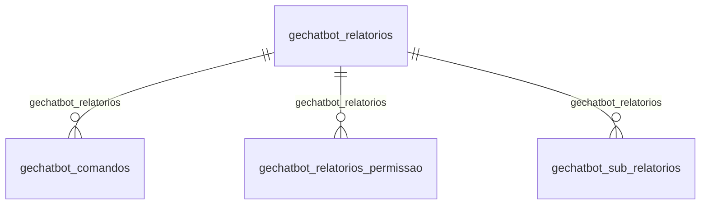

# Modelo — Geral - chatbot (rascunho em lote)

> Gerado por `src/model/gerar_docs_modelo.py` a partir de `src/model/modulos/geral_chatbot.yaml`, do catálogo e do perfil de colunas. **Não edite à mão.**

5 entidades. A coluna *Preench.* é o % de linhas com valor útil (nem nulo, nem em branco, nem zero, nem 1900-01-01; para colunas de código o zero conta como valor).

## Diagrama

## Entidades

| Entidade | Tabela | Linhas | Volume | Filtro obrigatório |
|---|---|---|---|---|
| [gechatbot_comandos](#gechatbot_comandos) | `GECHATBOT_COMANDOS` | 191 | pequeno | — |
| [gechatbot_relatorios](#gechatbot_relatorios) | `GECHATBOT_RELATORIOS` | 32 | pequeno | — |
| [gechatbot_relatorios_permissao](#gechatbot_relatorios_permissao) | `GECHATBOT_RELATORIOS_PERMISSAO` | 32 | pequeno | — |
| [gechatbot_sub_relatorios](#gechatbot_sub_relatorios) | `GECHATBOT_SUB_RELATORIOS` | 3 | pequeno | — |
| [gechatbot_limpeza_dados](#gechatbot_limpeza_dados) | `GECHATBOT_LIMPEZA_DADOS` | 1 | pequeno | — |

## gechatbot_comandos

**Tabela com os comandos em ordem de execução para cada relatório.** — tabela `GECHATBOT_COMANDOS` (191 linhas)

Tabela com os comandos em ordem de execução para cada relatório.. 191 linhas no catálogo; chave: CODIGO, CODIGO_RELATORIO.

- **Chave:** `CODIGO, CODIGO_RELATORIO`
- **Empresa:** `não se aplica (tabela global)`
- **Período:** `—`
- **Ordem padrão:** `CODIGO asc`, `CODIGO_RELATORIO asc`

**Regras de negócio validadas:**

- Medido em 2026-10-18: 191 linhas.
- Vínculo gechatbot_relatorios (GECHATBOT_RELATORIOS): 0 de 191 linhas sem registro relacionado.

| Campo | Coluna | Tipo | Preench. | Domínio | Descrição (banco) |
|---|---|---|---|---|---|
| codigo_do_comando | `codigo` | integer(4) |  |  | Código do comando. |
| codigo_do_relatorio | `codigo_relatorio` | integer(4) |  |  | Código do relatório. |
| tipo_do_componente_1_command_button_2_ra | `tipo_componente` | integer(4) |  |  | Tipo do componente? 1 - Command button; 2 - Radio button; 3 - Edit mask; 4 - Dropdown list box; 5 - Datawindow; 6 - Single line edit; 7 - Check box; 8 - Menu |
| class_name_do_componente | `componente` | varchar(128) |  |  | Class name do componente. |
| descricao_do_componente | `texto_componente` | varchar(128) |  |  | Descrição do componente. |
| nome_do_parametro | `parametro` | varchar(128) |  |  | Nome do parâmetro. |
| nome_da_janela_a_ser_aberta | `janela` | varchar(128) |  |  | Nome da janela a ser aberta. |
| nome_do_dataobject_utilizado_quando_o_co | `nome_dataobject` | varchar(128) |  |  | Nome do dataobject (utilizado quando o componente for do tipo datawindow). |
| nome_da_coluna_sobre_a_qual_sera_realiza | `nome_coluna` | varchar(128) |  |  | Nome da coluna sobre a qual será realizada a ação (utilizado quando o componente for do tipo datawindow). |
| tipo_da_acao_1_preencher_2_selecionar | `tipo_acao` | integer(4) |  |  | Tipo da ação: 1 - Preencher; 2 - Selecionar |
| caso_o_parametro_de_busca_no_json_nao_fo | `parametro_valor_padrao` | varchar(128) |  |  | Caso o parametro de busca no JSON não for informado ou o mesmo for informado porem nao for encontrado, será utilizado o valor informado nesta coluna. |

**Vínculos (LEFT JOIN, acrescentam colunas legíveis):**

- `gechatbot_relatorios` → `GECHATBOT_RELATORIOS` por `codigo_relatorio` = `codigo`; colunas: `gechatbot_relatorios_nome`

**Filtros:** `codigo_do_comando` (eq/in), `codigo_do_relatorio` (eq/in), `tipo_do_componente_1_command_button_2_ra` (eq/in), `class_name_do_componente` (contem/prefixo), `descricao_do_componente` (contem/prefixo), `nome_do_parametro` (contem/prefixo), `nome_da_janela_a_ser_aberta` (contem/prefixo), `nome_do_dataobject_utilizado_quando_o_co` (contem/prefixo), `nome_da_coluna_sobre_a_qual_sera_realiza` (contem/prefixo), `tipo_da_acao_1_preencher_2_selecionar` (eq/in), `caso_o_parametro_de_busca_no_json_nao_fo` (contem/prefixo)

## gechatbot_relatorios

**Tabela com os relatórios configurados para o chatbot.** — tabela `GECHATBOT_RELATORIOS` (32 linhas)

Tabela com os relatórios configurados para o chatbot.. 32 linhas no catálogo; chave: CODIGO.

- **Chave:** `CODIGO`
- **Empresa:** `não se aplica (tabela global)`
- **Período:** `—`
- **Ordem padrão:** `CODIGO asc`

**Regras de negócio validadas:**

- Medido em 2026-10-18: 32 linhas.

| Campo | Coluna | Tipo | Preench. | Domínio | Descrição (banco) |
|---|---|---|---|---|---|
| codigo_do_relatorio | `codigo` | integer(4) |  |  | Código do relatório. |
| descricao_do_relatorio | `relatorio` | varchar(256) |  |  | Descrição do relatório. |
| codigo_do_modulo_do_relatorio | `codigo_modulo` | integer(4) |  |  | Código do módulo do relatório. |
| tempo_limite_para_a_execucao_do_relatori | `tempo_limite_execucao` | integer(4) |  |  | Tempo limite para a execução do relatório |
| versao_minima_do_contabil_para_a_execuca | `versao_contabil` | char(8) |  |  | Versão mínima do contábil para a execução do relatório |
| definir_que_o_relatorio_possui_sub_relat | `possui_sub_relatorio` | integer(4) |  |  | Definir que o relatorio possui sub-relatorios que são executados a partir deste relatorio. |
| campos_responsavel_por_controlar_o_nome | `parametro_link_documento` | varchar(2048) |  |  | Campos responsavel por controlar o nome do parametro onde o link do documento sera disponibilizado na mensagem de resposta. |
| layout_da_mensagem_para_ser_enviada_ao_c | `layout_mensagem_resposta` | varchar(2048) |  |  | Layout da mensagem para ser enviada ao cliente quando o relatorio for gerado. |
| campo_que_define_o_formato_do_nome_do_do | `layout_nome_documento` | varchar(2048) |  |  | Campo que define o formato do nome do documento publicado pelo Onvio Messenger |

**Filtros:** `codigo_do_relatorio` (eq/in), `descricao_do_relatorio` (contem/prefixo), `codigo_do_modulo_do_relatorio` (eq/in), `versao_minima_do_contabil_para_a_execuca` (eq/in), `campos_responsavel_por_controlar_o_nome` (contem/prefixo), `layout_da_mensagem_para_ser_enviada_ao_c` (contem/prefixo), `campo_que_define_o_formato_do_nome_do_do` (contem/prefixo)

## gechatbot_relatorios_permissao

**Configuração de permissão de relatórios para o Assistente Virtual** — tabela `GECHATBOT_RELATORIOS_PERMISSAO` (32 linhas)

Configuração de permissão de relatórios para o Assistente Virtual. 32 linhas no catálogo; chave: CODIGO_RELATORIO.

- **Chave:** `CODIGO_RELATORIO`
- **Empresa:** `não se aplica (tabela global)`
- **Período:** `—`
- **Ordem padrão:** `CODIGO_RELATORIO asc`

**Regras de negócio validadas:**

- Medido em 2026-10-18: 32 linhas.
- Vínculo gechatbot_relatorios (GECHATBOT_RELATORIOS): 0 de 32 linhas sem registro relacionado.

| Campo | Coluna | Tipo | Preench. | Domínio | Descrição (banco) |
|---|---|---|---|---|---|
| codigo_do_relatorio_que_a_permissao_esta | `codigo_relatorio` | integer(4) |  |  | Código do relatório que a permissão esta relacionada. |
| descricao_do_nome_do_relatorio | `descricao` | varchar(256) |  |  | Descrição do nome do relatório. |
| nome_do_modulo_ao_qual_o_relatorio_perte | `modulo` | varchar(128) |  |  | Nome do módulo ao qual o relatório pertence. |
| descricao_do_menu_ao_qual_o_relatorio_pe | `menu` | varchar(128) |  |  | Descrição do menu ao qual o relatório pertence. |
| informa_se_pode_emitir_o_relatorio_pelo | `permite_emitir` | bit(1) |  |  | Informa se pode emitir o relatório pelo Agente de Execução do Assistente Virtual. 0 - NAO, 1 - SIM |

**Vínculos (LEFT JOIN, acrescentam colunas legíveis):**

- `gechatbot_relatorios` → `GECHATBOT_RELATORIOS` por `codigo_relatorio` = `codigo`; colunas: `gechatbot_relatorios_nome`

**Filtros:** `codigo_do_relatorio_que_a_permissao_esta` (eq/in), `descricao_do_nome_do_relatorio` (contem/prefixo), `nome_do_modulo_ao_qual_o_relatorio_perte` (contem/prefixo), `descricao_do_menu_ao_qual_o_relatorio_pe` (contem/prefixo)

## gechatbot_sub_relatorios

**Relação de sub-relatórios para o Assistente Virtual** — tabela `GECHATBOT_SUB_RELATORIOS` (3 linhas)

Relação de sub-relatórios para o Assistente Virtual. 3 linhas no catálogo; chave: CODIGO, CODIGO_RELATORIO.

- **Chave:** `CODIGO, CODIGO_RELATORIO`
- **Empresa:** `não se aplica (tabela global)`
- **Período:** `—`
- **Ordem padrão:** `CODIGO asc`, `CODIGO_RELATORIO asc`

**Regras de negócio validadas:**

- Medido em 2026-10-18: 3 linhas.
- Vínculo gechatbot_relatorios (GECHATBOT_RELATORIOS): 0 de 3 linhas sem registro relacionado.

| Campo | Coluna | Tipo | Preench. | Domínio | Descrição (banco) |
|---|---|---|---|---|---|
| codigo_sequencial | `codigo` | integer(4) |  |  | Codigo sequencial. |
| relatorio_principal | `codigo_relatorio` | integer(4) |  |  | Relatorio principal. |
| codigo_dos_sub_relatorios | `codigo_sub_relatorio` | integer(4) |  |  | Codigo dos sub-relatorios. |

**Vínculos (LEFT JOIN, acrescentam colunas legíveis):**

- `gechatbot_relatorios` → `GECHATBOT_RELATORIOS` por `codigo_relatorio` = `codigo`; colunas: `gechatbot_relatorios_nome`

**Filtros:** `codigo_sequencial` (eq/in), `relatorio_principal` (eq/in), `codigo_dos_sub_relatorios` (eq/in)

## gechatbot_limpeza_dados

**Controla quando deve limpar os dados referente ao chatbot quando houver cancelamento, downgrade ou cessão de direitos envolvendo FRP no Onvio Messenger** — tabela `GECHATBOT_LIMPEZA_DADOS` (1 linhas)

Controla quando deve limpar os dados referente ao chatbot quando houver cancelamento, downgrade ou cessão de direitos envolvendo FRP no Onvio Messenger. 1 linhas no catálogo; chave: CHAVE.

- **Chave:** `CHAVE`
- **Empresa:** `não se aplica (tabela global)`
- **Período:** `DATA_SOLICITACAO_LIMPEZA`
- **Ordem padrão:** `DATA_SOLICITACAO_LIMPEZA desc`, `CHAVE asc`

**Regras de negócio validadas:**

- Medido em 2026-10-18: 1 linhas, DATA_SOLICITACAO_LIMPEZA de 2021-10-26 a 2021-10-26.
- Colunas expostas nulas em 100% das linhas (1): data_da_ultima_limpeza_de_dados_executad.

| Campo | Coluna | Tipo | Preench. | Domínio | Descrição (banco) |
|---|---|---|---|---|---|
| chave | `chave` | integer(4) |  |  |  |
| c_0_nao_executar_limpeza_1_executar_limp | `status_limpeza_dados` | tinyint(1) |  |  | 0 - Não executar limpeza, 1 - Executar limpeza, 2 - Limpeza concluída |
| data_em_que_foi_recebida_a_informacao_qu | `data_solicitacao_limpeza` | date(4) |  |  | Data em que foi recebida a informação que o contrato não tem mais acesso ao chatbot |
| data_da_ultima_limpeza_de_dados_executad | `data_ultima_limpeza` | date(4) |  |  | Data da última limpeza de dados executada. |

**Filtros:** `chave` (eq/in), `data_em_que_foi_recebida_a_informacao_qu` (entre/gte/lte), `data_da_ultima_limpeza_de_dados_executad` (entre/gte/lte)

## Domínios (significado dos códigos)

`confirmado`: **sim** = vem do comentário do banco e/ou foi conferido nos dados; **parcial** = parte dos valores; **não** = hipótese, não use como regra.

### status_empresa

Situação da empresa no cadastro (geempre.stat_emp)

Confirmado: sim

| Código | Significado |
|---|---|
| A | Ativa |
| I | Inativa |
| C | Em constituição |
| M | Ativo sem movimento |
| B | Em processo de baixa |
| E | Excluindo |

### motivo_inatividade

Motivo da inatividade (geempre.tipoi_emp). Só aparece em empresas inativas.

Confirmado: sim

| Código | Significado |
|---|---|
| 1 | Outros |
| 2 | Baixada |
| 3 | Transferida |
| 4 | Inadimplente |

### tipo_inscricao

Tipo da inscrição (CNPJ/CPF/CEI/CAEPF)

Confirmado: sim

| Código | Significado |
|---|---|
| 1 | CNPJ |
| 2 | CPF |
| 3 | CEI |
| 6 | CAEPF |

### regime_federal_empresa

Regime federal da folha (geempre.rfed_emp)

Confirmado: parcial

| Código | Significado |
|---|---|
| 1 | Normal |
| 2 | Microempresa |
| 3 | Empresa de pequeno porte |

### tipo_honorario_empresa

Como a empresa usa o módulo Honorários (geempre.honorario_tipo)

Confirmado: sim

| Código | Significado |
|---|---|
| E | Escritório (quem fatura) |
| C | Cliente |

### sim_nao_texto

Confirmado: sim

| Código | Significado |
|---|---|
| S | Sim |
| N | Não |

### sim_nao_numerico

Confirmado: sim

| Código | Significado |
|---|---|
| 1 | Sim |
| 0 | Não |

