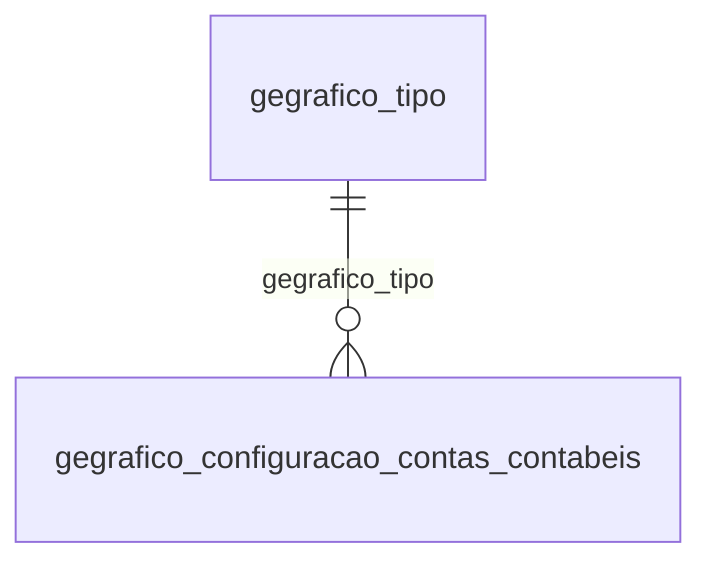

# Modelo — Geral - grafico (rascunho em lote)

> Gerado por `src/model/gerar_docs_modelo.py` a partir de `src/model/modulos/geral_grafico.yaml`, do catálogo e do perfil de colunas. **Não edite à mão.**

11 entidades. A coluna *Preench.* é o % de linhas com valor útil (nem nulo, nem em branco, nem zero, nem 1900-01-01; para colunas de código o zero conta como valor).

## Diagrama

## Entidades

| Entidade | Tabela | Linhas | Volume | Filtro obrigatório |
|---|---|---|---|---|
| [gegrafico_contas_contabeis](#gegrafico_contas_contabeis) | `GEGRAFICO_CONTAS_CONTABEIS` | 217 | pequeno | — |
| [gegrafico_plano_contas_empresa](#gegrafico_plano_contas_empresa) | `GEGRAFICO_PLANO_CONTAS_EMPRESA` | 83 | pequeno | — |
| [gegrafico_permissao_tipo_grafico](#gegrafico_permissao_tipo_grafico) | `GEGRAFICO_PERMISSAO_TIPO_GRAFICO` | 75 | pequeno | — |
| [gegrafico_configuracao_contas_contabeis](#gegrafico_configuracao_contas_contabeis) | `GEGRAFICO_CONFIGURACAO_CONTAS_CONTABEIS` | 30 | pequeno | — |
| [gegrafico_graficos_selecionados_emissao_empresas](#gegrafico_graficos_selecionados_emissao_empresas) | `GEGRAFICO_GRAFICOS_SELECIONADOS_EMISSAO_EMPRESAS` | 25 | pequeno | empresa |
| [gegrafico_emitir](#gegrafico_emitir) | `GEGRAFICO_EMITIR` | 22 | pequeno | — |
| [gegrafico_tipo](#gegrafico_tipo) | `GEGRAFICO_TIPO` | 6 | pequeno | — |
| [gegrafico_legenda](#gegrafico_legenda) | `GEGRAFICO_LEGENDA` | 6 | pequeno | — |
| [gegrafico_graficos_selecionados_emissao](#gegrafico_graficos_selecionados_emissao) | `GEGRAFICO_GRAFICOS_SELECIONADOS_EMISSAO` | 3 | pequeno | — |
| [gegrafico_vinculo](#gegrafico_vinculo) | `GEGRAFICO_VINCULO` | 1 | pequeno | — |
| [gegrafico_graficos_selecionados_emissao_usuarios](#gegrafico_graficos_selecionados_emissao_usuarios) | `GEGRAFICO_GRAFICOS_SELECIONADOS_EMISSAO_USUARIOS` | 1 | pequeno | — |

## gegrafico_contas_contabeis

**Tabela referente as contas contabeis que devem ser emitidas no grafico.** — tabela `GEGRAFICO_CONTAS_CONTABEIS` (217 linhas)

Tabela referente as contas contabeis que devem ser emitidas no grafico.. 217 linhas no catálogo; chave: CODIGO_GRAFICO, CODIGO_EMPRESA, CODIGO_CONTA_CONTABIL.

- **Chave:** `CODIGO_GRAFICO, CODIGO_EMPRESA, CODIGO_CONTA_CONTABIL`
- **Empresa:** `não se aplica (tabela global)`
- **Período:** `—`
- **Ordem padrão:** `CODIGO_GRAFICO asc`, `CODIGO_EMPRESA asc`

**Regras de negócio validadas:**

- Medido em 2026-10-18: 217 linhas.

| Campo | Coluna | Tipo | Preench. | Domínio | Descrição (banco) |
|---|---|---|---|---|---|
| codigo_do_grafico | `codigo_grafico` | integer(4) |  |  | Código do gráfico. |
| empresa_selecionado | `codigo_empresa` | integer(4) |  |  | Empresa selecionado. |
| codigo_da_conta_contabil | `codigo_conta_contabil` | integer(4) |  |  | Código da conta contábil |
| classificacao_da_conta_contabil | `classificacao` | varchar(32) |  |  | Classificação da conta contábil |
| descricao_da_conta_contabil | `descricao` | varchar(256) |  |  | Descrição da conta contábil |
| posicao_do_item | `posicao_item` | integer(4) |  |  | Posição do item |

**Filtros:** `codigo_do_grafico` (eq/in), `empresa_selecionado` (eq/in), `codigo_da_conta_contabil` (eq/in), `classificacao_da_conta_contabil` (contem/prefixo), `descricao_da_conta_contabil` (contem/prefixo)

## gegrafico_plano_contas_empresa

**Tabela referente ao plano de conta selecionado para cada gráfico.** — tabela `GEGRAFICO_PLANO_CONTAS_EMPRESA` (83 linhas)

Tabela referente ao plano de conta selecionado para cada gráfico.. 83 linhas no catálogo; chave: CODIGO_GRAFICO, CODIGO_EMPRESA.

- **Chave:** `CODIGO_GRAFICO, CODIGO_EMPRESA`
- **Empresa:** `não se aplica (tabela global)`
- **Período:** `—`
- **Ordem padrão:** `CODIGO_GRAFICO asc`, `CODIGO_EMPRESA asc`

**Regras de negócio validadas:**

- Medido em 2026-10-18: 83 linhas.

| Campo | Coluna | Tipo | Preench. | Domínio | Descrição (banco) |
|---|---|---|---|---|---|
| codigo_do_grafico | `codigo_grafico` | integer(4) |  |  | Código do gráfico. |
| empresa_selecionado | `codigo_empresa` | integer(4) |  |  | Empresa selecionado. |
| c_1_saldo_do_periodo_2_saldo_do_exercici | `tipo_saldo_conta_contabil` | integer(4) |  |  | 1- Saldo do período; 2-Saldo do exercício; 3-Total de débitos; 4-Total de créditos |

**Filtros:** `codigo_do_grafico` (eq/in), `empresa_selecionado` (eq/in), `c_1_saldo_do_periodo_2_saldo_do_exercici` (eq/in)

## gegrafico_permissao_tipo_grafico

**Tipo de gráficos permitidos na configuração dos dashboards** — tabela `GEGRAFICO_PERMISSAO_TIPO_GRAFICO` (75 linhas)

Tipo de gráficos permitidos na configuração dos dashboards. 75 linhas no catálogo; chave: CODIGO_GRAFICO, CODIGO_MODULO, CODIGO_TIPO_GRAFICO.

- **Chave:** `CODIGO_GRAFICO, CODIGO_MODULO, CODIGO_TIPO_GRAFICO`
- **Empresa:** `não se aplica (tabela global)`
- **Período:** `—`
- **Ordem padrão:** `CODIGO_GRAFICO asc`, `CODIGO_MODULO asc`

**Regras de negócio validadas:**

- Medido em 2026-10-18: 75 linhas.

| Campo | Coluna | Tipo | Preench. | Domínio | Descrição (banco) |
|---|---|---|---|---|---|
| codigo_do_grafico_referencia_a_tabela_ge | `codigo_grafico` | integer(4) |  |  | Código do gráfico, referencia a tabela GEGRAFICO_CONFIGURACAO_CONTAS_CONTABEIS |
| codigo_do_modulo_referencia_aos_codigos | `codigo_modulo` | integer(4) |  |  | Código do módulo, referencia aos códigos dos módulos do sistema Dominio Contábil |
| tipo_do_grafico_referencia_a_tabela_gegr | `codigo_tipo_grafico` | integer(4) |  |  | Tipo do gráfico, referencia a tabela GEGRAFICO_TIPO |

**Filtros:** `codigo_do_grafico_referencia_a_tabela_ge` (eq/in), `codigo_do_modulo_referencia_aos_codigos` (eq/in), `tipo_do_grafico_referencia_a_tabela_gegr` (eq/in)

## gegrafico_configuracao_contas_contabeis

**Dados dos gráficos criado pelo usuário e gráficos padrões.** — tabela `GEGRAFICO_CONFIGURACAO_CONTAS_CONTABEIS` (30 linhas)

Dados dos gráficos criado pelo usuário e gráficos padrões.. 30 linhas no catálogo; chave: CODIGO, CODIGO_MODULO.

- **Chave:** `CODIGO, CODIGO_MODULO`
- **Empresa:** `não se aplica (tabela global)`
- **Período:** `—`
- **Ordem padrão:** `CODIGO asc`, `CODIGO_MODULO asc`

**Regras de negócio validadas:**

- Medido em 2026-10-18: 30 linhas.
- Vínculo gegrafico_tipo (GEGRAFICO_TIPO): 0 de 30 linhas sem registro relacionado.

| Campo | Coluna | Tipo | Preench. | Domínio | Descrição (banco) |
|---|---|---|---|---|---|
| codigo | `codigo` | integer(4) |  |  |  |
| codigo_do_modulo_que_o_grafico_pertence | `codigo_modulo` | integer(4) |  |  | Código do módulo que o gráfico pertence |
| codigo_do_usuario_para_graico_padrao_inf | `codigo_usuario` | integer(4) |  |  | Código do usuário, para gráico padrão informar 0. |
| nome_do_grafico | `nome` | varchar(128) |  |  | Nome do gráfico. |
| titulo_do_grafico | `titulo` | varchar(128) |  |  | Titulo do gráfico. |
| tipo_do_grafico_consultar_tabela_gegrafi | `tipo_grafico` | integer(4) |  |  | Tipo do gráfico, consultar tabela GEGRAFICO_TIPO. |
| intervalo_de_emissao_dos_dados_1_mensal | `intervalo_emissao` | integer(4) |  |  | Intervalo de emissão dos dados. 1-Mensal; 2-Trimestral |
| informa_a_quantidade_de_contas_contabeis | `itens_agrupamento` | integer(4) |  |  | Informa a quantidade de contas contábeis que serão agrupadas. |
| grafico_padrao_inserido_na_atualizacao_d | `grafico_padrao` | integer(4) |  |  | Gráfico padrão, inserido na atualização de banco. 0-Não; 1-Sim |

**Vínculos (LEFT JOIN, acrescentam colunas legíveis):**

- `gegrafico_tipo` → `GEGRAFICO_TIPO` por `tipo_grafico` = `codigo`; colunas: `gegrafico_tipo_nome`

**Filtros:** `codigo` (eq/in), `codigo_do_modulo_que_o_grafico_pertence` (eq/in), `codigo_do_usuario_para_graico_padrao_inf` (eq/in), `nome_do_grafico` (contem/prefixo), `titulo_do_grafico` (contem/prefixo), `tipo_do_grafico_consultar_tabela_gegrafi` (eq/in)

## gegrafico_graficos_selecionados_emissao_empresas

**Empresas vinculadas aos dashboards** — tabela `GEGRAFICO_GRAFICOS_SELECIONADOS_EMISSAO_EMPRESAS` (25 linhas)

Empresas vinculadas aos dashboards. 25 linhas no catálogo; chave: CODIGO.

- **Chave:** `CODIGO`
- **Empresa:** `CODI_EMP`
- **Período:** `—`
- **Ordem padrão:** `CODIGO asc`

**Regras de negócio validadas:**

- Medido em 2026-10-18: 25 linhas, 9 empresa(s).

| Campo | Coluna | Tipo | Preench. | Domínio | Descrição (banco) |
|---|---|---|---|---|---|
| codigo | `codigo` | integer(4) |  |  |  |
| codigo_selecao | `codigo_selecao` | integer(4) |  |  |  |
| codi_emp | `codi_emp` | integer(4) |  |  |  |
| codigo_vinculo | `codigo_vinculo` | integer(4) |  |  |  |

**Filtros:** `codigo` (eq/in), `codigo_selecao` (eq/in), `codigo_vinculo` (eq/in)

## gegrafico_emitir

**Configurações do gráfico dos dashboards** — tabela `GEGRAFICO_EMITIR` (22 linhas)

Configurações do gráfico dos dashboards. 22 linhas no catálogo; chave: CODIGO.

- **Chave:** `CODIGO`
- **Empresa:** `não se aplica (tabela global)`
- **Período:** `—`
- **Ordem padrão:** `CODIGO asc`

**Regras de negócio validadas:**

- Medido em 2026-10-18: 22 linhas.

| Campo | Coluna | Tipo | Preench. | Domínio | Descrição (banco) |
|---|---|---|---|---|---|
| codigo | `codigo` | integer(4) |  |  |  |
| codigo_selecao | `codigo_selecao` | integer(4) |  |  |  |
| codigo_grafico | `codigo_grafico` | integer(4) |  |  |  |
| codigo_modulo | `codigo_modulo` | integer(4) |  |  |  |
| tipo_grafico | `tipo_grafico` | integer(4) |  |  |  |

**Filtros:** `codigo` (eq/in), `codigo_selecao` (eq/in), `codigo_grafico` (eq/in), `codigo_modulo` (eq/in), `tipo_grafico` (eq/in)

## gegrafico_tipo

**Tipo dos gráfico** — tabela `GEGRAFICO_TIPO` (6 linhas)

Tipo dos gráfico. 6 linhas no catálogo; chave: CODIGO.

- **Chave:** `CODIGO`
- **Empresa:** `não se aplica (tabela global)`
- **Período:** `—`
- **Ordem padrão:** `CODIGO asc`

**Regras de negócio validadas:**

- Medido em 2026-10-18: 6 linhas.

| Campo | Coluna | Tipo | Preench. | Domínio | Descrição (banco) |
|---|---|---|---|---|---|
| chave_primaria | `codigo` | integer(4) |  |  | Chave primária |
| nome_de_cada_tipo_de_grafico_ex_1_linha | `nome` | varchar(64) |  |  | Nome de cada tipo de gráfico. Ex.: 1-Linha; 2-Barra horizontal |

**Filtros:** `chave_primaria` (eq/in), `nome_de_cada_tipo_de_grafico_ex_1_linha` (contem/prefixo)

## gegrafico_legenda

**Tabela referente as legendas do gráfico.** — tabela `GEGRAFICO_LEGENDA` (6 linhas)

Tabela referente as legendas do gráfico.. 6 linhas no catálogo; chave: CODIGO.

- **Chave:** `CODIGO`
- **Empresa:** `não se aplica (tabela global)`
- **Período:** `—`
- **Ordem padrão:** `CODIGO asc`

**Regras de negócio validadas:**

- Medido em 2026-10-18: 6 linhas.

| Campo | Coluna | Tipo | Preench. | Domínio | Descrição (banco) |
|---|---|---|---|---|---|
| chave_primaria | `codigo` | integer(4) |  |  | Chave primária. |
| codigo_do_grafico_que_a_legenda_pertence | `codigo_grafico` | integer(4) |  |  | Código do gráfico que a legenda pertence. |
| coluna_referente_a_legenda_1_do_grafico | `legenda_1` | varchar(128) |  |  | Coluna referente a legenda 1 do gráfico. Cada gráfico pode possui até 5 legendas. |
| legenda_2_c | `legenda_2` | varchar(128) |  |  |  |
| legenda_3_c | `legenda_3` | varchar(128) |  |  |  |
| legenda_4_c | `legenda_4` | varchar(128) |  |  |  |
| legenda_5_c | `legenda_5` | varchar(128) |  |  |  |

**Filtros:** `chave_primaria` (eq/in), `codigo_do_grafico_que_a_legenda_pertence` (eq/in), `coluna_referente_a_legenda_1_do_grafico` (contem/prefixo), `legenda_2_c` (contem/prefixo), `legenda_3_c` (contem/prefixo), `legenda_4_c` (contem/prefixo), `legenda_5_c` (contem/prefixo)

## gegrafico_graficos_selecionados_emissao

**Gráficos de dashboards - Cadastro** — tabela `GEGRAFICO_GRAFICOS_SELECIONADOS_EMISSAO` (3 linhas)

Gráficos de dashboards - Cadastro. 3 linhas no catálogo; chave: CODIGO.

- **Chave:** `CODIGO`
- **Empresa:** `não se aplica (tabela global)`
- **Período:** `—`
- **Ordem padrão:** `CODIGO asc`

**Regras de negócio validadas:**

- Medido em 2026-10-18: 3 linhas.

| Campo | Coluna | Tipo | Preench. | Domínio | Descrição (banco) |
|---|---|---|---|---|---|
| codigo | `codigo` | integer(4) |  |  |  |
| nome | `nome` | varchar(128) |  |  |  |

**Filtros:** `codigo` (eq/in), `nome` (contem/prefixo)

## gegrafico_vinculo

**Código, chave primaria** — tabela `GEGRAFICO_VINCULO` (1 linhas)

Código, chave primaria. 1 linhas no catálogo; chave: CODIGO.

- **Chave:** `CODIGO`
- **Empresa:** `não se aplica (tabela global)`
- **Período:** `—`
- **Ordem padrão:** `CODIGO asc`

**Regras de negócio validadas:**

- Medido em 2026-10-18: 1 linhas.

| Campo | Coluna | Tipo | Preench. | Domínio | Descrição (banco) |
|---|---|---|---|---|---|
| codigo | `codigo` | integer(4) |  |  |  |
| descricao | `descricao` | varchar(200) |  |  |  |
| exibe_acesso_sistema | `exibe_acesso_sistema` | integer(4) |  |  |  |

**Filtros:** `codigo` (eq/in), `descricao` (contem/prefixo)

## gegrafico_graficos_selecionados_emissao_usuarios

**Usuários selecionados para emitir os dashboards** — tabela `GEGRAFICO_GRAFICOS_SELECIONADOS_EMISSAO_USUARIOS` (1 linhas)

Usuários selecionados para emitir os dashboards. 1 linhas no catálogo; chave: CODIGO.

- **Chave:** `CODIGO`
- **Empresa:** `não se aplica (tabela global)`
- **Período:** `—`
- **Ordem padrão:** `CODIGO asc`

**Regras de negócio validadas:**

- Medido em 2026-10-18: 1 linhas.

| Campo | Coluna | Tipo | Preench. | Domínio | Descrição (banco) |
|---|---|---|---|---|---|
| codigo | `codigo` | integer(4) |  |  |  |
| codigo_vinculo | `codigo_vinculo` | integer(4) |  |  |  |
| codigo_usuario | `codigo_usuario` | integer(4) |  |  |  |

**Filtros:** `codigo` (eq/in), `codigo_vinculo` (eq/in), `codigo_usuario` (eq/in)

## Domínios (significado dos códigos)

`confirmado`: **sim** = vem do comentário do banco e/ou foi conferido nos dados; **parcial** = parte dos valores; **não** = hipótese, não use como regra.

### status_empresa

Situação da empresa no cadastro (geempre.stat_emp)

Confirmado: sim

| Código | Significado |
|---|---|
| A | Ativa |
| I | Inativa |
| C | Em constituição |
| M | Ativo sem movimento |
| B | Em processo de baixa |
| E | Excluindo |

### motivo_inatividade

Motivo da inatividade (geempre.tipoi_emp). Só aparece em empresas inativas.

Confirmado: sim

| Código | Significado |
|---|---|
| 1 | Outros |
| 2 | Baixada |
| 3 | Transferida |
| 4 | Inadimplente |

### tipo_inscricao

Tipo da inscrição (CNPJ/CPF/CEI/CAEPF)

Confirmado: sim

| Código | Significado |
|---|---|
| 1 | CNPJ |
| 2 | CPF |
| 3 | CEI |
| 6 | CAEPF |

### regime_federal_empresa

Regime federal da folha (geempre.rfed_emp)

Confirmado: parcial

| Código | Significado |
|---|---|
| 1 | Normal |
| 2 | Microempresa |
| 3 | Empresa de pequeno porte |

### tipo_honorario_empresa

Como a empresa usa o módulo Honorários (geempre.honorario_tipo)

Confirmado: sim

| Código | Significado |
|---|---|
| E | Escritório (quem fatura) |
| C | Cliente |

### sim_nao_texto

Confirmado: sim

| Código | Significado |
|---|---|
| S | Sim |
| N | Não |

### sim_nao_numerico

Confirmado: sim

| Código | Significado |
|---|---|
| 1 | Sim |
| 0 | Não |

