# Modelo — Geral - importador (rascunho em lote)

> Gerado por `src/model/gerar_docs_modelo.py` a partir de `src/model/modulos/geral_importador.yaml`, do catálogo e do perfil de colunas. **Não edite à mão.**

24 entidades. A coluna *Preench.* é o % de linhas com valor útil (nem nulo, nem em branco, nem zero, nem 1900-01-01; para colunas de código o zero conta como valor).

## Diagrama

```mermaid
erDiagram
    geimportador_definicao_dados_tabelas ||--o{ geimportador_definicao_dados_tabelas_colunas : "geimportador_definicao_d"
    geimportador_leiautes_registros_campos ||--o{ geimportador_definicao_dados_tabelas_colunas : "geimportador_leiautes_re"
    geimportador_tabelas_estrangeiras ||--o{ geimportador_definicao_dados_tabelas_colunas : "geimportador_tabelas_est"
    geimportador_argumentos ||--o{ geimportador_definicao_dados_tabelas_colunas : "geimportador_argumentos"
    geimportador_regras ||--o{ geimportador_definicao_dados_tabelas_colunas : "geimportador_regras"
    geimportador_manipulacao_caracteres ||--o{ geimportador_definicao_dados_tabelas_colunas : "geimportador_manipulacao"
    geimportador_leiautes_registros ||--o{ geimportador_leiautes_registros_campos : "geimportador_leiautes_re"
    geimportador_leiautes_registros_campos ||--o{ geimportador_regras_clausulas_condicoes : "geimportador_leiautes_re"
    geimportador_argumentos ||--o{ geimportador_regras_clausulas : "geimportador_argumentos"
    geimportador_regras ||--o{ geimportador_regras_clausulas : "geimportador_regras"
    geimportador_leiautes_registros_campos ||--o{ geimportador_regras_clausulas : "geimportador_leiautes_re"
    geimportador_definicao_dados ||--o{ geimportador_definicao_dados_tabelas : "geimportador_definicao_d"
    geimportador_leiautes ||--o{ geimportador_leiautes_registros : "geimportador_leiautes"
    geimportador_definicao_dados_tabelas_colunas ||--o{ geimportador_campos_calculados : "geimportador_definicao_d"
    geimportador_leiautes_registros_campos ||--o{ geimportador_campos_calculados : "geimportador_leiautes_re"
    geimportador_leiautes_registros ||--o{ geimportador_definicao_dados : "geimportador_leiautes_re"
    geimportador_conjunto_dados ||--o{ geimportador_conjunto_dados_definicoes_dados : "geimportador_conjunto_da"
    geimportador_definicao_dados ||--o{ geimportador_conjunto_dados_definicoes_dados : "geimportador_definicao_d"
    geimportador_definicao_dados ||--o{ geimportador_definicao_dados_identificacao : "geimportador_definicao_d"
    geimportador_leiautes_registros_campos ||--o{ geimportador_definicao_dados_identificacao : "geimportador_leiautes_re"
    geimportador_leiautes_registros ||--o{ geimportador_regras : "geimportador_leiautes_re"
    geimportador_tabelas_estrangeiras_identificacoes ||--o{ geimportador_tabelas_estrangeiras_colunas : "geimportador_tabelas_est"
    geimportador_leiautes_registros_campos ||--o{ geimportador_tabelas_estrangeiras_colunas : "geimportador_leiautes_re"
    geimportador_argumentos ||--o{ geimportador_tabelas_estrangeiras_colunas : "geimportador_argumentos"
    geimportador_leiautes_registros_campos ||--o{ geimportador_manipulacao_caracteres_colunas : "geimportador_leiautes_re"
    geimportador_manipulacao_caracteres ||--o{ geimportador_manipulacao_caracteres_colunas : "geimportador_manipulacao"
    geimportador_tabelas_estrangeiras ||--o{ geimportador_tabelas_estrangeiras_identificacoes : "geimportador_tabelas_est"
    geimportador_leiautes_registros ||--o{ geimportador_manipulacao_caracteres : "geimportador_leiautes_re"
    geimportador_leiautes_registros ||--o{ geimportador_tabelas_estrangeiras : "geimportador_leiautes_re"
    geimportador_equivalencias ||--o{ geimportador_equivalencias_valores : "geimportador_equivalenci"
    geimportador_leiautes ||--o{ geimportador_conjunto_dados : "geimportador_leiautes"
    geimportador_leiautes ||--o{ geimportador_equivalencias : "geimportador_leiautes"
```

## Entidades

| Entidade | Tabela | Linhas | Volume | Filtro obrigatório |
|---|---|---|---|---|
| [geimportador_definicao_dados_tabelas_colunas](#geimportador_definicao_dados_tabelas_colunas) | `GEIMPORTADOR_DEFINICAO_DADOS_TABELAS_COLUNAS` | 24.631 | medio | — |
| [geimportador_leiautes_registros_campos](#geimportador_leiautes_registros_campos) | `GEIMPORTADOR_LEIAUTES_REGISTROS_CAMPOS` | 23.006 | medio | — |
| [geimportador_regras_clausulas_condicoes](#geimportador_regras_clausulas_condicoes) | `GEIMPORTADOR_REGRAS_CLAUSULAS_CONDICOES` | 15.396 | medio | — |
| [geimportador_regras_clausulas](#geimportador_regras_clausulas) | `GEIMPORTADOR_REGRAS_CLAUSULAS` | 6.538 | pequeno | — |
| [geimportador_definicao_dados_tabelas](#geimportador_definicao_dados_tabelas) | `GEIMPORTADOR_DEFINICAO_DADOS_TABELAS` | 4.844 | pequeno | — |
| [geimportador_leiautes_registros](#geimportador_leiautes_registros) | `GEIMPORTADOR_LEIAUTES_REGISTROS` | 4.004 | pequeno | — |
| [geimportador_campos_calculados](#geimportador_campos_calculados) | `GEIMPORTADOR_CAMPOS_CALCULADOS` | 3.149 | pequeno | — |
| [geimportador_definicao_dados](#geimportador_definicao_dados) | `GEIMPORTADOR_DEFINICAO_DADOS` | 2.608 | pequeno | — |
| [geimportador_conjunto_dados_definicoes_dados](#geimportador_conjunto_dados_definicoes_dados) | `GEIMPORTADOR_CONJUNTO_DADOS_DEFINICOES_DADOS` | 2.596 | pequeno | — |
| [geimportador_definicao_dados_identificacao](#geimportador_definicao_dados_identificacao) | `GEIMPORTADOR_DEFINICAO_DADOS_IDENTIFICACAO` | 2.402 | pequeno | — |
| [geimportador_regras](#geimportador_regras) | `GEIMPORTADOR_REGRAS` | 1.384 | pequeno | — |
| [geimportador_tabelas_estrangeiras_colunas](#geimportador_tabelas_estrangeiras_colunas) | `GEIMPORTADOR_TABELAS_ESTRANGEIRAS_COLUNAS` | 1.022 | pequeno | — |
| [geimportador_argumentos](#geimportador_argumentos) | `GEIMPORTADOR_ARGUMENTOS` | 829 | pequeno | — |
| [geimportador_colunas_valor_inicial](#geimportador_colunas_valor_inicial) | `GEIMPORTADOR_COLUNAS_VALOR_INICIAL` | 823 | pequeno | — |
| [geimportador_manipulacao_caracteres_colunas](#geimportador_manipulacao_caracteres_colunas) | `GEIMPORTADOR_MANIPULACAO_CARACTERES_COLUNAS` | 809 | pequeno | — |
| [geimportador_tabelas_estrangeiras_identificacoes](#geimportador_tabelas_estrangeiras_identificacoes) | `GEIMPORTADOR_TABELAS_ESTRANGEIRAS_IDENTIFICACOES` | 757 | pequeno | — |
| [geimportador_manipulacao_caracteres](#geimportador_manipulacao_caracteres) | `GEIMPORTADOR_MANIPULACAO_CARACTERES` | 716 | pequeno | — |
| [geimportador_tabelas_estrangeiras](#geimportador_tabelas_estrangeiras) | `GEIMPORTADOR_TABELAS_ESTRANGEIRAS` | 626 | pequeno | — |
| [geimportador_tabelas_disponiveis](#geimportador_tabelas_disponiveis) | `GEIMPORTADOR_TABELAS_DISPONIVEIS` | 533 | pequeno | — |
| [geimportador_colunas_resumo](#geimportador_colunas_resumo) | `GEIMPORTADOR_COLUNAS_RESUMO` | 483 | pequeno | — |
| [geimportador_equivalencias_valores](#geimportador_equivalencias_valores) | `GEIMPORTADOR_EQUIVALENCIAS_VALORES` | 335 | pequeno | — |
| [geimportador_leiautes](#geimportador_leiautes) | `GEIMPORTADOR_LEIAUTES` | 209 | pequeno | — |
| [geimportador_conjunto_dados](#geimportador_conjunto_dados) | `GEIMPORTADOR_CONJUNTO_DADOS` | 163 | pequeno | — |
| [geimportador_equivalencias](#geimportador_equivalencias) | `GEIMPORTADOR_EQUIVALENCIAS` | 44 | pequeno | — |

## geimportador_definicao_dados_tabelas_colunas

**Colunas das tabelas da definição de dados** — tabela `GEIMPORTADOR_DEFINICAO_DADOS_TABELAS_COLUNAS` (24.631 linhas)

Colunas das tabelas da definição de dados. 24.631 linhas no catálogo; chave: CODI_DEFINICAO, CODI_TABELA, CODI_COLUNA.

- **Chave:** `CODI_DEFINICAO, CODI_TABELA, CODI_COLUNA`
- **Empresa:** `não se aplica (tabela global)`
- **Período:** `—`
- **Ordem padrão:** `CODI_DEFINICAO asc`, `CODI_TABELA asc`

**Regras de negócio validadas:**

- Medido em 2026-10-18: 24.631 linhas.
- valor_da_variavel_automatica_d_data_atua: todos os valores reais estão no comentário do banco (nulo=23.751, S=657, U=171, D=46, E=6).
- Vínculo geimportador_definicao_d (GEIMPORTADOR_DEFINICAO_DADOS_TABELAS): 0 de 24.631 linhas sem registro relacionado.
- Vínculo geimportador_leiautes_re (GEIMPORTADOR_LEIAUTES_REGISTROS_CAMPOS): 2.782 de 24.631 linhas sem registro relacionado.
- Vínculo geimportador_tabelas_est (GEIMPORTADOR_TABELAS_ESTRANGEIRAS): 11.073 de 24.631 linhas sem registro relacionado.
- Vínculo geimportador_argumentos (GEIMPORTADOR_ARGUMENTOS): 0 de 24.631 linhas sem registro relacionado.
- Vínculo geimportador_regras (GEIMPORTADOR_REGRAS): 10.249 de 24.631 linhas sem registro relacionado.
- Vínculo geimportador_manipulacao (GEIMPORTADOR_MANIPULACAO_CARACTERES): 11.240 de 24.631 linhas sem registro relacionado.

| Campo | Coluna | Tipo | Preench. | Domínio | Descrição (banco) |
|---|---|---|---|---|---|
| codigo_da_definicao | `codi_definicao` | integer(4) |  |  | Código da definição |
| codigo_da_tabela | `codi_tabela` | integer(4) |  |  | Código da tabela |
| codigo_da_coluna | `codi_coluna` | integer(4) |  |  | Código da coluna |
| nome_da_coluna_no_banco_de_dados | `nome_coluna` | varchar(128) |  |  | Nome da coluna no banco de dados |
| definicao_de_dados_que_sera_complementad | `referente_codi_definicao` | integer(4) |  |  | Definição de dados que será complementada |
| tabela_temporaria_da_definicao_de_dados | `referente_codi_tabela` | integer(4) |  |  | Tabela temporária da definição de dados que será complementada |
| coluna_da_tabela_temporaria_que_sera_com | `referente_codi_coluna` | integer(4) |  |  | Coluna da tabela temporária que será complementada |
| origem_da_coluna_f_fixo_i_importado_v_va | `origem_coluna` | char(1) |  |  | Origem da coluna (F = Fixo/I = Importado/V = Variável automática/T = Tabela estrangeira/A = Argumento/R = Regra/C = Calculado/D = Definição de dados/P = Própria definição de dados/M = Manipulação de caracteres/N = Complementar(Nulo)/L = Código de lote automático) |
| valor_fixo_origem_coluna_f | `valor_fixo` | varchar(128) |  |  | Valor fixo (ORIGEM_COLUNA = F) |
| codigo_do_leiaute_origem_coluna_i | `codi_leiaute` | integer(4) |  |  | Código do leiaute (ORIGEM_COLUNA = I) |
| codigo_do_registro_origem_coluna_i | `codi_registro` | integer(4) |  |  | Código do registro (ORIGEM_COLUNA = I) |
| codigo_do_campo_origem_coluna_i | `codi_campo` | integer(4) |  |  | Código do campo (ORIGEM_COLUNA = I) |
| valor_da_variavel_automatica_d_data_atua | `valor_automatico` | char(1) |  | geimportador_definicao_dados_tabelas_colunas_valor_da_va | Valor da variável automática (D = Data atual/E = Empresa atual/U = Usuario atual/S = Sequencial) (ORIGEM_COLUNA = V) |
| coluna_de_quebra_da_variavel_automatica | `coluna_quebra` | varchar(128) |  |  | Coluna de quebra da variável automática sequencial (VALOR_AUTOMATICO = S) |
| codigo_da_tabela_estrangeira_origem_colu | `codi_tabela_estrangeira` | integer(4) |  |  | Código da tabela estrangeira (ORIGEM_COLUNA = T) |
| codigo_do_argumento_origem_coluna_a | `codi_arg` | integer(4) |  |  | Código do argumento (ORIGEM_COLUNA = A) |
| codigo_da_regra_origem_coluna_r | `codi_regra` | integer(4) |  |  | Código da regra (ORIGEM_COLUNA = R) |
| codigo_da_manipulacao_de_caracteres_orig | `codi_manipulacao` | integer(4) |  |  | Código da manipulação de caracteres (ORIGEM_COLUNA = M) |
| definicao_de_dados_da_qual_dependente_or | `dependente_codi_definicao` | integer(4) |  |  | Definição de dados da qual dependente (ORIGEM_COLUNA = D, P) |
| tabela_da_definicao_de_dados_da_qual_dep | `dependente_codi_tabela` | integer(4) |  |  | Tabela da definição de dados da qual dependente (ORIGEM_COLUNA = D, P) |
| coluna_da_tabela_da_qual_dependentee_ori | `dependente_codi_coluna` | integer(4) |  |  | Coluna da tabela da qual dependentee (ORIGEM_COLUNA = D, P) |

**Vínculos (LEFT JOIN, acrescentam colunas legíveis):**

- `geimportador_definicao_d` → `GEIMPORTADOR_DEFINICAO_DADOS_TABELAS` por `codi_definicao` = `codi_definicao` e `codi_tabela` = `codi_tabela`; colunas: `geimportador_definicao_d_nome`
- `geimportador_leiautes_re` → `GEIMPORTADOR_LEIAUTES_REGISTROS_CAMPOS` por `codi_leiaute` = `codi_leiaute` e `codi_registro` = `codi_registro` e `codi_campo` = `codi_campo`; colunas: `geimportador_leiautes_re_nome`
- `geimportador_tabelas_est` → `GEIMPORTADOR_TABELAS_ESTRANGEIRAS` por `codi_leiaute` = `codi_leiaute` e `codi_registro` = `codi_registro` e `codi_tabela_estrangeira` = `codi_tabela_estrangeira`; colunas: `geimportador_tabelas_est_nome`
- `geimportador_argumentos` → `GEIMPORTADOR_ARGUMENTOS` por `codi_arg` = `codi_arg`; colunas: `geimportador_argumentos_nome`
- `geimportador_regras` → `GEIMPORTADOR_REGRAS` por `codi_leiaute` = `codi_leiaute` e `codi_registro` = `codi_registro` e `codi_regra` = `codi_regra`; colunas: `geimportador_regras_nome`
- `geimportador_manipulacao` → `GEIMPORTADOR_MANIPULACAO_CARACTERES` por `codi_leiaute` = `codi_leiaute` e `codi_registro` = `codi_registro` e `codi_manipulacao` = `codi_manipulacao`; colunas: `geimportador_manipulacao_nome`

**Filtros:** `codigo_da_definicao` (eq/in), `codigo_da_tabela` (eq/in), `codigo_da_coluna` (eq/in), `nome_da_coluna_no_banco_de_dados` (contem/prefixo), `definicao_de_dados_que_sera_complementad` (eq/in), `tabela_temporaria_da_definicao_de_dados` (eq/in), `coluna_da_tabela_temporaria_que_sera_com` (eq/in), `origem_da_coluna_f_fixo_i_importado_v_va` (eq/in), `valor_fixo_origem_coluna_f` (contem/prefixo), `codigo_do_leiaute_origem_coluna_i` (eq/in), `codigo_do_registro_origem_coluna_i` (eq/in), `codigo_do_campo_origem_coluna_i` (eq/in), `valor_da_variavel_automatica_d_data_atua` (eq/in), `coluna_de_quebra_da_variavel_automatica` (contem/prefixo)

## geimportador_leiautes_registros_campos

**Campos dos registros dos leiautes** — tabela `GEIMPORTADOR_LEIAUTES_REGISTROS_CAMPOS` (23.006 linhas)

Campos dos registros dos leiautes. 23.006 linhas no catálogo; chave: CODI_LEIAUTE, CODI_REGISTRO, CODI_CAMPO.

- **Chave:** `CODI_LEIAUTE, CODI_REGISTRO, CODI_CAMPO`
- **Empresa:** `não se aplica (tabela global)`
- **Período:** `—`
- **Ordem padrão:** `CODI_LEIAUTE asc`, `CODI_REGISTRO asc`

**Regras de negócio validadas:**

- Medido em 2026-10-18: 23.006 linhas.
- tipo_de_dado_do_campo_c_caractere_r_deci: todos os valores reais estão no comentário do banco (C=14.661, R=4.618, N=2.964, D=532, G=230, H=1).
- campo_identificador_s_n_tipo_de_elemento: valores reais fora do comentário do banco (N=7.423, S=500); tratar o domínio como hipótese.
- Vínculo geimportador_leiautes_re (GEIMPORTADOR_LEIAUTES_REGISTROS): 0 de 23.006 linhas sem registro relacionado.

| Campo | Coluna | Tipo | Preench. | Domínio | Descrição (banco) |
|---|---|---|---|---|---|
| codigo_do_leiaute | `codi_leiaute` | integer(4) |  |  | Código do leiaute |
| codigo_do_registro | `codi_registro` | integer(4) |  |  | Código do registro |
| codigo_do_campo | `codi_campo` | integer(4) |  |  | Código do campo |
| nome_do_campo | `nome_campo` | varchar(64) |  |  | Nome do campo |
| tipo_de_dado_do_campo_c_caractere_r_deci | `tipo_campo` | char(1) |  | geimportador_leiautes_registros_campos_tipo_de_dado_do_ | Tipo de dado do campo (C = Caractere/R = Decimal/N = Numérico/D = Data/H = Hora/G = Númerico Grande) |
| formato_de_dado_do_campo | `formato_campo` | varchar(32) |  |  | Formato de dado do campo |
| posicao_inicial_do_campo | `pos_inicial` | integer(4) |  |  | Posição (inicial) do campo |
| posicao_final_do_campo | `pos_final` | integer(4) |  |  | Posição final do campo |
| casas_decimais_do_campo | `dec_info` | integer(4) |  |  | Casas decimais do campo |
| campo_identificador_s_n_tipo_de_elemento | `ident_campo` | char(1) |  | geimportador_leiautes_registros_campos_campo_identifica | Campo identificador (S/N) / Tipo de elemento (I = Identificador/P = Propriedade/C = Campo/V = Valor) |
| valor_identificador | `valor_campo` | varchar(32) |  |  | Valor identificador |
| codigo_da_tabela_de_equivalencia | `codi_equivalencia` | integer(4) |  |  | Código da tabela de equivalência |
| ordem_do_campo | `ordem` | integer(4) |  |  | Ordem do campo |
| comentario_do_campo | `comentario` | varchar(2048) |  |  | Comentário do campo |
| campo_requerido_s_n_arquivo_xml | `requerido` | char(1) |  |  | Campo requerido (S/N) (Arquivo XML) |

**Vínculos (LEFT JOIN, acrescentam colunas legíveis):**

- `geimportador_leiautes_re` → `GEIMPORTADOR_LEIAUTES_REGISTROS` por `codi_leiaute` = `codi_leiaute` e `codi_registro` = `codi_registro`; colunas: `geimportador_leiautes_re_nome`

**Filtros:** `codigo_do_leiaute` (eq/in), `codigo_do_registro` (eq/in), `codigo_do_campo` (eq/in), `nome_do_campo` (contem/prefixo), `tipo_de_dado_do_campo_c_caractere_r_deci` (eq/in), `formato_de_dado_do_campo` (contem/prefixo), `campo_identificador_s_n_tipo_de_elemento` (eq/in), `valor_identificador` (contem/prefixo), `codigo_da_tabela_de_equivalencia` (eq/in), `comentario_do_campo` (contem/prefixo), `campo_requerido_s_n_arquivo_xml` (eq/in)

## geimportador_regras_clausulas_condicoes

**Condições das cláusulas das regras** — tabela `GEIMPORTADOR_REGRAS_CLAUSULAS_CONDICOES` (15.396 linhas)

Condições das cláusulas das regras. 15.396 linhas no catálogo; chave: CODI_LEIAUTE, CODI_REGISTRO, CODI_REGRA, CODI_CLAUSULA, CODI_CONDICAO.

- **Chave:** `CODI_LEIAUTE, CODI_REGISTRO, CODI_REGRA, CODI_CLAUSULA, CODI_CONDICAO`
- **Empresa:** `não se aplica (tabela global)`
- **Período:** `—`
- **Ordem padrão:** `CODI_LEIAUTE asc`, `CODI_REGISTRO asc`

**Regras de negócio validadas:**

- Medido em 2026-10-18: 15.396 linhas.
- Colunas expostas nulas em 100% das linhas (1): valor2_da_condicao_entre_bw.
- origem_da_coluna_i_importado_p_definicao: todos os valores reais estão no comentário do banco (P=11.885, I=3.511).
- Vínculo geimportador_leiautes_re (GEIMPORTADOR_LEIAUTES_REGISTROS_CAMPOS): 11.885 de 15.396 linhas sem registro relacionado.

| Campo | Coluna | Tipo | Preench. | Domínio | Descrição (banco) |
|---|---|---|---|---|---|
| codigo_do_leiaute | `codi_leiaute` | integer(4) |  |  | Código do leiaute |
| codigo_do_registro_do_leiaute | `codi_registro` | integer(4) |  |  | Código do registro do leiaute |
| codigo_da_regra | `codi_regra` | integer(4) |  |  | Código da regra |
| codigo_da_clausula | `codi_clausula` | integer(4) |  |  | Código da cláusula |
| codigo_da_condicao | `codi_condicao` | integer(4) |  |  | Código da condição |
| codigo_do_campo_do_registro | `codi_campo` | integer(4) |  |  | Código do campo do registro |
| condicao_do_campo_bw_vv_vi_li_ld | `condicao` | varchar(2) |  |  | Condição do campo (=/</>/<=/>=/<>/BW/VV/VI/LI/LD) |
| valor_da_condicao | `valor1` | varchar(32) |  |  | Valor da condição |
| valor2_da_condicao_entre_bw | `valor2` | varchar(32) |  |  | Valor2 da condição entre(BW) |
| operador_logico_e_o_ou | `operador` | char(1) |  |  | Operador lógico (E/O = Ou) |
| origem_da_coluna_i_importado_p_definicao | `origem_coluna` | char(1) |  | geimportador_regras_clausulas_condicoes_origem_da_colun | Origem da coluna (I = Importado/P = Definição de dados atual) |
| definicao_de_dados_da_qual_dependente_or | `dependente_codi_definicao` | integer(4) |  |  | Definição de dados da qual dependente (ORIGEM_COLUNA = P) |
| tabela_da_definicao_de_dados_da_qual_dep | `dependente_codi_tabela` | integer(4) |  |  | Tabela da definição de dados da qual dependente (ORIGEM_COLUNA = P) |
| coluna_da_tabela_da_qual_dependentee_ori | `dependente_codi_coluna` | integer(4) |  |  | Coluna da tabela da qual dependentee (ORIGEM_COLUNA = P) |

**Vínculos (LEFT JOIN, acrescentam colunas legíveis):**

- `geimportador_leiautes_re` → `GEIMPORTADOR_LEIAUTES_REGISTROS_CAMPOS` por `codi_leiaute` = `codi_leiaute` e `codi_registro` = `codi_registro` e `codi_campo` = `codi_campo`; colunas: `geimportador_leiautes_re_nome`

**Filtros:** `codigo_do_leiaute` (eq/in), `codigo_do_registro_do_leiaute` (eq/in), `codigo_da_regra` (eq/in), `codigo_da_clausula` (eq/in), `codigo_da_condicao` (eq/in), `codigo_do_campo_do_registro` (eq/in), `condicao_do_campo_bw_vv_vi_li_ld` (eq/in), `valor_da_condicao` (contem/prefixo), `valor2_da_condicao_entre_bw` (contem/prefixo), `operador_logico_e_o_ou` (eq/in), `origem_da_coluna_i_importado_p_definicao` (eq/in), `definicao_de_dados_da_qual_dependente_or` (eq/in), `tabela_da_definicao_de_dados_da_qual_dep` (eq/in), `coluna_da_tabela_da_qual_dependentee_ori` (eq/in)

## geimportador_regras_clausulas

**Cláusulas das regras** — tabela `GEIMPORTADOR_REGRAS_CLAUSULAS` (6.538 linhas)

Cláusulas das regras. 6.538 linhas no catálogo; chave: CODI_LEIAUTE, CODI_REGISTRO, CODI_REGRA, CODI_CLAUSULA.

- **Chave:** `CODI_LEIAUTE, CODI_REGISTRO, CODI_REGRA, CODI_CLAUSULA`
- **Empresa:** `não se aplica (tabela global)`
- **Período:** `—`
- **Ordem padrão:** `CODI_LEIAUTE asc`, `CODI_REGISTRO asc`

**Regras de negócio validadas:**

- Medido em 2026-10-18: 6.538 linhas.
- tipo_de_retorno_f_fixo_i_importado_v_var: todos os valores reais estão no comentário do banco (A=4.529, F=989, P=630, I=367, V=23).
- valor_da_variavel_automatica_d_data_atua: todos os valores reais estão no comentário do banco (nulo=6.515, U=11, E=11, D=1).
- Vínculo geimportador_argumentos (GEIMPORTADOR_ARGUMENTOS): 0 de 6.538 linhas sem registro relacionado.
- Vínculo geimportador_regras (GEIMPORTADOR_REGRAS): 0 de 6.538 linhas sem registro relacionado.
- Vínculo geimportador_leiautes_re (GEIMPORTADOR_LEIAUTES_REGISTROS_CAMPOS): 6.170 de 6.538 linhas sem registro relacionado.

| Campo | Coluna | Tipo | Preench. | Domínio | Descrição (banco) |
|---|---|---|---|---|---|
| codigo_do_leiaute | `codi_leiaute` | integer(4) |  |  | Código do leiaute |
| codigo_do_registro | `codi_registro` | integer(4) |  |  | Código do registro |
| codigo_da_regra | `codi_regra` | integer(4) |  |  | Código da regra |
| codigo_da_clausula | `codi_clausula` | integer(4) |  |  | Código da cláusula |
| identificacao_da_clausula | `identificacao` | varchar(64) |  |  | Identificação da cláusula |
| tipo_de_retorno_f_fixo_i_importado_v_var | `tipo_retorno` | char(1) |  | geimportador_regras_clausulas_tipo_de_retorno_f_fixo_i_impo | Tipo de retorno (F = Fixo/I = Importado/V = variável automática/A = Argumento/P = Própria definição de dados) |
| valor_fixo_tipo_retorno_f | `valor_fixo` | varchar(128) |  |  | Valor fixo (TIPO_RETORNO = F) |
| codigo_do_campo_do_registro_tipo_retorno | `codi_campo` | integer(4) |  |  | Código do campo do registro (TIPO_RETORNO = I) |
| valor_da_variavel_automatica_d_data_atua | `valor_automatico` | char(1) |  | geimportador_regras_clausulas_valor_da_variavel_automatica_ | Valor da variável automática (D = Data atual/E = Empresa atual/U = Usuario atual) (TIPO_RETORNO = V) |
| codigo_do_argumento_tipo_retorno_a | `codi_arg` | integer(4) |  |  | Código do argumento (TIPO_RETORNO = A) |
| definicao_de_dados_da_qual_dependente_ti | `dependente_codi_definicao` | integer(4) |  |  | Definição de dados da qual dependente (TIPO_RETORNO = P) |
| tabela_da_definicao_de_dados_da_qual_dep | `dependente_codi_tabela` | integer(4) |  |  | Tabela da definição de dados da qual dependente (TIPO_RETORNO = P) |
| coluna_da_tabela_da_qual_dependentee_tip | `dependente_codi_coluna` | integer(4) |  |  | Coluna da tabela da qual dependentee (TIPO_RETORNO = P) |

**Vínculos (LEFT JOIN, acrescentam colunas legíveis):**

- `geimportador_argumentos` → `GEIMPORTADOR_ARGUMENTOS` por `codi_arg` = `codi_arg`; colunas: `geimportador_argumentos_nome`
- `geimportador_regras` → `GEIMPORTADOR_REGRAS` por `codi_leiaute` = `codi_leiaute` e `codi_registro` = `codi_registro` e `codi_regra` = `codi_regra`; colunas: `geimportador_regras_nome`
- `geimportador_leiautes_re` → `GEIMPORTADOR_LEIAUTES_REGISTROS_CAMPOS` por `codi_leiaute` = `codi_leiaute` e `codi_registro` = `codi_registro` e `codi_campo` = `codi_campo`; colunas: `geimportador_leiautes_re_nome`

**Filtros:** `codigo_do_leiaute` (eq/in), `codigo_do_registro` (eq/in), `codigo_da_regra` (eq/in), `codigo_da_clausula` (eq/in), `identificacao_da_clausula` (contem/prefixo), `tipo_de_retorno_f_fixo_i_importado_v_var` (eq/in), `valor_fixo_tipo_retorno_f` (contem/prefixo), `codigo_do_campo_do_registro_tipo_retorno` (eq/in), `valor_da_variavel_automatica_d_data_atua` (eq/in), `codigo_do_argumento_tipo_retorno_a` (eq/in), `definicao_de_dados_da_qual_dependente_ti` (eq/in), `tabela_da_definicao_de_dados_da_qual_dep` (eq/in), `coluna_da_tabela_da_qual_dependentee_tip` (eq/in)

## geimportador_definicao_dados_tabelas

**Tabelas da definição de dados** — tabela `GEIMPORTADOR_DEFINICAO_DADOS_TABELAS` (4.844 linhas)

Tabelas da definição de dados. 4.844 linhas no catálogo; chave: CODI_DEFINICAO, CODI_TABELA.

- **Chave:** `CODI_DEFINICAO, CODI_TABELA`
- **Empresa:** `não se aplica (tabela global)`
- **Período:** `—`
- **Ordem padrão:** `CODI_DEFINICAO asc`, `CODI_TABELA asc`

**Regras de negócio validadas:**

- Medido em 2026-10-18: 4.844 linhas.
- tipo_da_tabela_d_dados_c_complementar_t: todos os valores reais estão no comentário do banco (D=2.185, T=1.744, C=915).
- Vínculo geimportador_definicao_d (GEIMPORTADOR_DEFINICAO_DADOS): 0 de 4.844 linhas sem registro relacionado.

| Campo | Coluna | Tipo | Preench. | Domínio | Descrição (banco) |
|---|---|---|---|---|---|
| codigo_da_definicao | `codi_definicao` | integer(4) |  |  | Código da definição |
| codigo_da_tabela | `codi_tabela` | integer(4) |  |  | Código da tabela |
| identificacao_da_tabela | `identificacao` | varchar(64) |  |  | Identificação da tabela |
| tipo_da_tabela_d_dados_c_complementar_t | `tipo_tabela` | char(1) |  | geimportador_definicao_dados_tabelas_tipo_da_tabela_d_dad | Tipo da tabela (D = Dados/C = Complementar/T = Temporária) |
| nome_da_tabela | `tabela` | varchar(64) |  |  | Nome da tabela |
| definicao_de_dados_da_qual_dependente_ti | `dependente_codi_definicao` | integer(4) |  |  | Definição de dados da qual dependente (TIPO_TABELA = C) |
| tabela_da_definicao_de_dados_da_qual_dep | `dependente_codi_tabela` | integer(4) |  |  | Tabela da definição de dados da qual dependente (TIPO_TABELA = C) |
| ordem_da_tabela | `ordem` | integer(4) |  |  | Ordem da tabela |

**Vínculos (LEFT JOIN, acrescentam colunas legíveis):**

- `geimportador_definicao_d` → `GEIMPORTADOR_DEFINICAO_DADOS` por `codi_definicao` = `codi_definicao`; colunas: `geimportador_definicao_d_nome`

**Filtros:** `codigo_da_definicao` (eq/in), `codigo_da_tabela` (eq/in), `identificacao_da_tabela` (contem/prefixo), `tipo_da_tabela_d_dados_c_complementar_t` (eq/in), `nome_da_tabela` (contem/prefixo), `definicao_de_dados_da_qual_dependente_ti` (eq/in), `tabela_da_definicao_de_dados_da_qual_dep` (eq/in)

## geimportador_leiautes_registros

**Registros dos leiautes** — tabela `GEIMPORTADOR_LEIAUTES_REGISTROS` (4.004 linhas)

Registros dos leiautes. 4.004 linhas no catálogo; chave: CODI_LEIAUTE, CODI_REGISTRO.

- **Chave:** `CODI_LEIAUTE, CODI_REGISTRO`
- **Empresa:** `não se aplica (tabela global)`
- **Período:** `—`
- **Ordem padrão:** `CODI_LEIAUTE asc`, `CODI_REGISTRO asc`

**Regras de negócio validadas:**

- Medido em 2026-10-18: 4.004 linhas.
- Vínculo geimportador_leiautes (GEIMPORTADOR_LEIAUTES): 0 de 4.004 linhas sem registro relacionado.

| Campo | Coluna | Tipo | Preench. | Domínio | Descrição (banco) |
|---|---|---|---|---|---|
| codigo_do_leiaute | `codi_leiaute` | integer(4) |  |  | Código do leiaute |
| codigo_do_registro | `codi_registro` | integer(4) |  |  | Código do registro |
| nome_do_registro | `nome_registro` | varchar(64) |  |  | Nome do registro |
| registro_referente | `codi_registro_referente` | integer(4) |  |  | Registro referente |
| nivel_do_registro | `nivel_registro` | integer(4) |  |  | Nivel do registro |
| ordem_do_registro | `ordem_registro` | integer(4) |  |  | Ordem do registro |

**Vínculos (LEFT JOIN, acrescentam colunas legíveis):**

- `geimportador_leiautes` → `GEIMPORTADOR_LEIAUTES` por `codi_leiaute` = `codi_leiaute`; colunas: `geimportador_leiautes_nome`

**Filtros:** `codigo_do_leiaute` (eq/in), `codigo_do_registro` (eq/in), `nome_do_registro` (contem/prefixo), `registro_referente` (eq/in)

## geimportador_campos_calculados

**Campos calculados** — tabela `GEIMPORTADOR_CAMPOS_CALCULADOS` (3.149 linhas)

Campos calculados. 3.149 linhas no catálogo; chave: CODI_DEFINICAO, CODI_TABELA, CODI_COLUNA, CODI_CALCULADO.

- **Chave:** `CODI_DEFINICAO, CODI_TABELA, CODI_COLUNA, CODI_CALCULADO`
- **Empresa:** `não se aplica (tabela global)`
- **Período:** `—`
- **Ordem padrão:** `CODI_DEFINICAO asc`, `CODI_TABELA asc`

**Regras de negócio validadas:**

- Medido em 2026-10-18: 3.149 linhas.
- origem_da_coluna_f_fixo_i_importado_p_pr: todos os valores reais estão no comentário do banco (I=1.256, F=1.029, P=864).
- Vínculo geimportador_definicao_d (GEIMPORTADOR_DEFINICAO_DADOS_TABELAS_COLUNAS): 0 de 3.149 linhas sem registro relacionado.
- Vínculo geimportador_leiautes_re (GEIMPORTADOR_LEIAUTES_REGISTROS_CAMPOS): 1.893 de 3.149 linhas sem registro relacionado.

| Campo | Coluna | Tipo | Preench. | Domínio | Descrição (banco) |
|---|---|---|---|---|---|
| codigo_da_definicao | `codi_definicao` | integer(4) |  |  | Código da definição |
| codigo_da_tabela | `codi_tabela` | integer(4) |  |  | Código da tabela |
| codigo_da_coluna | `codi_coluna` | integer(4) |  |  | Código da coluna |
| codigo_do_campo_calculado | `codi_calculado` | integer(4) |  |  | Código do campo calculado |
| origem_da_coluna_f_fixo_i_importado_p_pr | `origem_coluna` | char(1) |  | geimportador_campos_calculados_origem_da_coluna_f_fixo_i_import | Origem da coluna (F = Fixo/I = Importado/P = Própria definição de dados) |
| valor_fixo | `valor` | numeric(13) |  |  | Valor fixo |
| codigo_do_leiaute_origem_coluna_i | `codi_leiaute` | integer(4) |  |  | Código do leiaute (ORIGEM_COLUNA = I) |
| codigo_do_registro_origem_coluna_i | `codi_registro` | integer(4) |  |  | Código do registro (ORIGEM_COLUNA = I) |
| codigo_do_campo_do_registro_origem_colun | `codi_campo` | integer(4) |  |  | Código do campo do registro (ORIGEM_COLUNA = I) |
| definicao_de_dados_da_qual_depende_orige | `dependente_codi_definicao` | integer(4) |  |  | Definição de dados da qual depende (ORIGEM_COLUNA = P) |
| tabela_da_definicao_de_dados_da_qual_dep | `dependente_codi_tabela` | integer(4) |  |  | Tabela da definição de dados da qual depende (ORIGEM_COLUNA = P) |
| coluna_da_tabela_da_qual_depende_origem | `dependente_codi_coluna` | integer(4) |  |  | Coluna da tabela da qual depende (ORIGEM_COLUNA = P) |
| operacao_aritmetica | `operacao` | char(1) |  |  | Operação aritmética |
| operacao_do_grupo | `operacao_grupo` | char(1) |  |  | Operação do grupo |
| grupo | `grupo` | integer(4) |  |  | Grupo |
| ordem_do_campo | `ordem` | integer(4) |  |  | Ordem do campo |

**Vínculos (LEFT JOIN, acrescentam colunas legíveis):**

- `geimportador_definicao_d` → `GEIMPORTADOR_DEFINICAO_DADOS_TABELAS_COLUNAS` por `codi_definicao` = `codi_definicao` e `codi_tabela` = `codi_tabela` e `codi_coluna` = `codi_coluna`; colunas: `geimportador_definicao_d_nome`
- `geimportador_leiautes_re` → `GEIMPORTADOR_LEIAUTES_REGISTROS_CAMPOS` por `codi_leiaute` = `codi_leiaute` e `codi_registro` = `codi_registro` e `codi_campo` = `codi_campo`; colunas: `geimportador_leiautes_re_nome`

**Filtros:** `codigo_da_definicao` (eq/in), `codigo_da_tabela` (eq/in), `codigo_da_coluna` (eq/in), `codigo_do_campo_calculado` (eq/in), `origem_da_coluna_f_fixo_i_importado_p_pr` (eq/in), `codigo_do_leiaute_origem_coluna_i` (eq/in), `codigo_do_registro_origem_coluna_i` (eq/in), `codigo_do_campo_do_registro_origem_colun` (eq/in), `definicao_de_dados_da_qual_depende_orige` (eq/in), `tabela_da_definicao_de_dados_da_qual_dep` (eq/in), `coluna_da_tabela_da_qual_depende_origem` (eq/in), `operacao_aritmetica` (eq/in), `operacao_do_grupo` (eq/in)

## geimportador_definicao_dados

**Definição de dados** — tabela `GEIMPORTADOR_DEFINICAO_DADOS` (2.608 linhas)

Definição de dados. 2.608 linhas no catálogo; chave: CODI_DEFINICAO.

- **Chave:** `CODI_DEFINICAO`
- **Empresa:** `não se aplica (tabela global)`
- **Período:** `—`
- **Ordem padrão:** `CODI_DEFINICAO asc`

**Regras de negócio validadas:**

- Medido em 2026-10-18: 2.608 linhas.
- Vínculo geimportador_leiautes_re (GEIMPORTADOR_LEIAUTES_REGISTROS): 0 de 2.608 linhas sem registro relacionado.

| Campo | Coluna | Tipo | Preench. | Domínio | Descrição (banco) |
|---|---|---|---|---|---|
| codigo_da_definicao | `codi_definicao` | integer(4) |  |  | Código da definição |
| nome_da_definicao | `nome` | varchar(64) |  |  | Nome da definição |
| descricao_da_definicao | `descricao` | varchar(256) |  |  | Descrição da definição |
| codigo_do_leiaute_referente | `codi_leiaute` | integer(4) |  |  | Código do leiaute referente |
| codigo_do_registro_do_leiaute_referente | `codi_registro` | integer(4) |  |  | Código do registro do leiaute referente |
| dependente_de_outra_definicao_s_n | `dependente` | char(1) |  |  | Dependente de outra definição (S/N) |
| definicao_de_dados_da_qual_depende | `dependente_codi_definicao` | integer(4) |  |  | Definição de dados da qual depende |
| padrao_da_dominio_sistemas | `padrao` | varchar(20) |  |  | Padrão da Domínio Sistemas |
| diferenciar_maiusculo_de_minusculo | `diferenciar_maiusculo_minusculo` | char(1) |  |  | Diferenciar maiúsculo de minúsculo |

**Vínculos (LEFT JOIN, acrescentam colunas legíveis):**

- `geimportador_leiautes_re` → `GEIMPORTADOR_LEIAUTES_REGISTROS` por `codi_leiaute` = `codi_leiaute` e `codi_registro` = `codi_registro`; colunas: `geimportador_leiautes_re_nome`

**Filtros:** `codigo_da_definicao` (eq/in), `nome_da_definicao` (contem/prefixo), `descricao_da_definicao` (contem/prefixo), `codigo_do_leiaute_referente` (eq/in), `codigo_do_registro_do_leiaute_referente` (eq/in), `dependente_de_outra_definicao_s_n` (eq/in), `definicao_de_dados_da_qual_depende` (eq/in), `padrao_da_dominio_sistemas` (eq/in), `diferenciar_maiusculo_de_minusculo` (eq/in)

## geimportador_conjunto_dados_definicoes_dados

**Definições de dados dos conjunto de dados** — tabela `GEIMPORTADOR_CONJUNTO_DADOS_DEFINICOES_DADOS` (2.596 linhas)

Definições de dados dos conjunto de dados. 2.596 linhas no catálogo; chave: CODI_CONJUNTO, CODI_DEFINICAO.

- **Chave:** `CODI_CONJUNTO, CODI_DEFINICAO`
- **Empresa:** `não se aplica (tabela global)`
- **Período:** `—`
- **Ordem padrão:** `CODI_CONJUNTO asc`, `CODI_DEFINICAO asc`

**Regras de negócio validadas:**

- Medido em 2026-10-18: 2.596 linhas.
- Vínculo geimportador_conjunto_da (GEIMPORTADOR_CONJUNTO_DADOS): 0 de 2.596 linhas sem registro relacionado.
- Vínculo geimportador_definicao_d (GEIMPORTADOR_DEFINICAO_DADOS): 0 de 2.596 linhas sem registro relacionado.

| Campo | Coluna | Tipo | Preench. | Domínio | Descrição (banco) |
|---|---|---|---|---|---|
| codigo_do_conjunto | `codi_conjunto` | integer(4) |  |  | Código do conjunto |
| codigo_da_definicao | `codi_definicao` | integer(4) |  |  | Código da definição |
| ordem_da_definicao_de_dados | `ordem` | integer(4) |  |  | Ordem da definição de dados |

**Vínculos (LEFT JOIN, acrescentam colunas legíveis):**

- `geimportador_conjunto_da` → `GEIMPORTADOR_CONJUNTO_DADOS` por `codi_conjunto` = `codi_conjunto`; colunas: `geimportador_conjunto_da_nome`
- `geimportador_definicao_d` → `GEIMPORTADOR_DEFINICAO_DADOS` por `codi_definicao` = `codi_definicao`; colunas: `geimportador_definicao_d_nome`

**Filtros:** `codigo_do_conjunto` (eq/in), `codigo_da_definicao` (eq/in)

## geimportador_definicao_dados_identificacao

**Identificação da definição de dados** — tabela `GEIMPORTADOR_DEFINICAO_DADOS_IDENTIFICACAO` (2.402 linhas)

Identificação da definição de dados. 2.402 linhas no catálogo; chave: CODI_DEFINICAO, CODI_IDENTIFICACAO.

- **Chave:** `CODI_DEFINICAO, CODI_IDENTIFICACAO`
- **Empresa:** `não se aplica (tabela global)`
- **Período:** `—`
- **Ordem padrão:** `CODI_DEFINICAO asc`, `CODI_IDENTIFICACAO asc`

**Regras de negócio validadas:**

- Medido em 2026-10-18: 2.402 linhas.
- Vínculo geimportador_definicao_d (GEIMPORTADOR_DEFINICAO_DADOS): 0 de 2.402 linhas sem registro relacionado.
- Vínculo geimportador_leiautes_re (GEIMPORTADOR_LEIAUTES_REGISTROS_CAMPOS): 0 de 2.402 linhas sem registro relacionado.

| Campo | Coluna | Tipo | Preench. | Domínio | Descrição (banco) |
|---|---|---|---|---|---|
| codigo_da_definicao | `codi_definicao` | integer(4) |  |  | Código da definição |
| codigo_da_identificacao | `codi_identificacao` | integer(4) |  |  | Código da identificação |
| codigo_do_leiaute_referente | `codi_leiaute` | integer(4) |  |  | Código do leiaute referente |
| codigo_do_registro_do_leiaute_referente | `codi_registro` | integer(4) |  |  | Código do registro do leiaute referente |
| codigo_do_campo_do_registro | `codi_campo` | integer(4) |  |  | Código do campo do registro |
| condicao_do_campo_bw_vv_vi_li_ld | `condicao` | varchar(2) |  |  | Condição do campo (=/</>/<=/>=/<>/BW/VV/VI/LI/LD) |
| valor_da_condicao | `valor1` | varchar(32) |  |  | Valor da condição |
| valor2_da_condicao_entre_bw | `valor2` | varchar(32) |  |  | Valor2 da condição entre(BW) |
| operador_logico_e_o_ou | `operador` | char(1) |  |  | Operador lógico (E/O = Ou) |

**Vínculos (LEFT JOIN, acrescentam colunas legíveis):**

- `geimportador_definicao_d` → `GEIMPORTADOR_DEFINICAO_DADOS` por `codi_definicao` = `codi_definicao`; colunas: `geimportador_definicao_d_nome`
- `geimportador_leiautes_re` → `GEIMPORTADOR_LEIAUTES_REGISTROS_CAMPOS` por `codi_leiaute` = `codi_leiaute` e `codi_registro` = `codi_registro` e `codi_campo` = `codi_campo`; colunas: `geimportador_leiautes_re_nome`

**Filtros:** `codigo_da_definicao` (eq/in), `codigo_da_identificacao` (eq/in), `codigo_do_leiaute_referente` (eq/in), `codigo_do_registro_do_leiaute_referente` (eq/in), `codigo_do_campo_do_registro` (eq/in), `condicao_do_campo_bw_vv_vi_li_ld` (eq/in), `valor_da_condicao` (contem/prefixo), `valor2_da_condicao_entre_bw` (contem/prefixo), `operador_logico_e_o_ou` (eq/in)

## geimportador_regras

**Regras** — tabela `GEIMPORTADOR_REGRAS` (1.384 linhas)

Regras. 1.384 linhas no catálogo; chave: CODI_LEIAUTE, CODI_REGISTRO, CODI_REGRA.

- **Chave:** `CODI_LEIAUTE, CODI_REGISTRO, CODI_REGRA`
- **Empresa:** `não se aplica (tabela global)`
- **Período:** `—`
- **Ordem padrão:** `CODI_LEIAUTE asc`, `CODI_REGISTRO asc`

**Regras de negócio validadas:**

- Medido em 2026-10-18: 1.384 linhas.
- Vínculo geimportador_leiautes_re (GEIMPORTADOR_LEIAUTES_REGISTROS): 0 de 1.384 linhas sem registro relacionado.

| Campo | Coluna | Tipo | Preench. | Domínio | Descrição (banco) |
|---|---|---|---|---|---|
| codigo_do_leiaute | `codi_leiaute` | integer(4) |  |  | Código do leiaute |
| codigo_do_registro | `codi_registro` | integer(4) |  |  | Código do registro |
| codigo_da_regra | `codi_regra` | integer(4) |  |  | Código da regra |
| nome_da_regra | `nome_regra` | varchar(64) |  |  | Nome da regra |
| retorno_padrao_da_regra | `retorno_padrao` | varchar(64) |  |  | Retorno padrão da regra |
| exibir_advertencias_referentes_a_retorno | `exibir_advertencia_retorno` | char(1) |  |  | Exibir advertências referentes a retorno (S/N) |
| definicao_de_dados_da_qual_as_clausulas | `dependente_codi_definicao` | integer(4) |  |  | Definição de dados da qual as cláusulas dependem |
| padrao_da_dominio_sistemas | `padrao` | varchar(20) |  |  | Padrão da Domínio Sistemas |

**Vínculos (LEFT JOIN, acrescentam colunas legíveis):**

- `geimportador_leiautes_re` → `GEIMPORTADOR_LEIAUTES_REGISTROS` por `codi_leiaute` = `codi_leiaute` e `codi_registro` = `codi_registro`; colunas: `geimportador_leiautes_re_nome`

**Filtros:** `codigo_do_leiaute` (eq/in), `codigo_do_registro` (eq/in), `codigo_da_regra` (eq/in), `nome_da_regra` (contem/prefixo), `retorno_padrao_da_regra` (contem/prefixo), `exibir_advertencias_referentes_a_retorno` (eq/in), `definicao_de_dados_da_qual_as_clausulas` (eq/in), `padrao_da_dominio_sistemas` (eq/in)

## geimportador_tabelas_estrangeiras_colunas

**Colunas das tabelas estrangeiras** — tabela `GEIMPORTADOR_TABELAS_ESTRANGEIRAS_COLUNAS` (1.022 linhas)

Colunas das tabelas estrangeiras. 1.022 linhas no catálogo; chave: CODI_LEIAUTE, CODI_REGISTRO, CODI_TABELA_ESTRANGEIRA, CODI_IDENTIFICACAO, CODI_COLUNA_TABELA_ESTRANGEIRA.

- **Chave:** `CODI_LEIAUTE, CODI_REGISTRO, CODI_TABELA_ESTRANGEIRA, CODI_IDENTIFICACAO, CODI_COLUNA_TABELA_ESTRANGEIRA`
- **Empresa:** `não se aplica (tabela global)`
- **Período:** `—`
- **Ordem padrão:** `CODI_LEIAUTE asc`, `CODI_REGISTRO asc`

**Regras de negócio validadas:**

- Medido em 2026-10-18: 1.022 linhas.
- Colunas expostas nulas em 100% das linhas (1): valor_da_variavel_automatica_d_data_atua.
- origem_da_coluna_f_fixo_i_importado_v_va: todos os valores reais estão no comentário do banco (I=511, P=482, F=23, A=6).
- valor_da_variavel_automatica_d_data_atua: coluna sem nenhum valor preenchido; o domínio do comentário do banco não pôde ser verificado.
- Vínculo geimportador_tabelas_est (GEIMPORTADOR_TABELAS_ESTRANGEIRAS_IDENTIFICACOES): 0 de 1.022 linhas sem registro relacionado.
- Vínculo geimportador_leiautes_re (GEIMPORTADOR_LEIAUTES_REGISTROS_CAMPOS): 511 de 1.022 linhas sem registro relacionado.
- Vínculo geimportador_argumentos (GEIMPORTADOR_ARGUMENTOS): 0 de 1.022 linhas sem registro relacionado.

| Campo | Coluna | Tipo | Preench. | Domínio | Descrição (banco) |
|---|---|---|---|---|---|
| codigo_do_leiaute | `codi_leiaute` | integer(4) |  |  | Código do leiaute |
| codigo_do_registro_do_leiaute | `codi_registro` | integer(4) |  |  | Código do registro do leiaute |
| codigo_da_tabela_estrangeira | `codi_tabela_estrangeira` | integer(4) |  |  | Código da tabela estrangeira |
| codigo_da_identificacao | `codi_identificacao` | integer(4) |  |  | Código da identificação |
| codigo_da_coluna_da_tabela_estrangeira | `codi_coluna_tabela_estrangeira` | integer(4) |  |  | Código da coluna da tabela estrangeira |
| nome_da_coluna_no_banco_de_dados_tabelas | `nome_coluna` | varchar(128) |  |  | Nome da coluna no banco de dados (Tabelas do sistema) |
| definicao_de_dados_que_contem_a_tabela_t | `codi_definicao` | integer(4) |  |  | Definição de dados que contém a tabela temporária (Tabelas temporárias) |
| tabela_temporaria_pesquisada_tabelas_tem | `codi_tabela` | integer(4) |  |  | Tabela temporária pesquisada (Tabelas temporárias) |
| coluna_da_tabela_temporaria_comparada_ta | `codi_coluna` | integer(4) |  |  | Coluna da tabela temporária comparada (Tabelas temporárias) |
| condicao_do_campo | `condicao` | varchar(2) |  |  | Condição do campo (=/</>/<=/>=/<>) |
| origem_da_coluna_f_fixo_i_importado_v_va | `origem_coluna` | char(1) |  | geimportador_tabelas_estrangeiras_colunas_origem_da_coluna_ | Origem da coluna (F = Fixo/I = Importado/V = Variável automática/A = Argumento/P = Própria definição de dados) |
| valor_fixo_origem_coluna_f | `valor_fixo` | varchar(128) |  |  | Valor fixo (ORIGEM_COLUNA = F) |
| codigo_do_campo_do_registro_origem_colun | `codi_campo` | integer(4) |  |  | Código do campo do registro (ORIGEM_COLUNA = I) |
| valor_da_variavel_automatica_d_data_atua | `valor_automatico` | char(1) |  | geimportador_tabelas_estrangeiras_colunas_valor_da_variavel | Valor da variável automática (D = Data atual/E = Empresa atual/U = Usuario atual) (ORIGEM_COLUNA = V) |
| codigo_do_argumento_origem_coluna_a | `codi_arg` | integer(4) |  |  | Código do argumento (ORIGEM_COLUNA = A) |
| definicao_de_dados_da_qual_depende_orige | `dependente_codi_definicao` | integer(4) |  |  | Definição de dados da qual depende (ORIGEM_COLUNA = P) |
| tabela_da_definicao_de_dados_da_qual_dep | `dependente_codi_tabela` | integer(4) |  |  | Tabela da definição de dados da qual depende (ORIGEM_COLUNA = P) |
| coluna_da_tabela_da_qual_depende_origem | `dependente_codi_coluna` | integer(4) |  |  | Coluna da tabela da qual depende (ORIGEM_COLUNA = P) |
| operador_logico_e_o_ou | `operador` | char(1) |  |  | Operador lógico (E/O = Ou) |

**Vínculos (LEFT JOIN, acrescentam colunas legíveis):**

- `geimportador_tabelas_est` → `GEIMPORTADOR_TABELAS_ESTRANGEIRAS_IDENTIFICACOES` por `codi_leiaute` = `codi_leiaute` e `codi_registro` = `codi_registro` e `codi_tabela_estrangeira` = `codi_tabela_estrangeira` e `codi_identificacao` = `codi_identificacao`; colunas: `geimportador_tabelas_est_nome`
- `geimportador_leiautes_re` → `GEIMPORTADOR_LEIAUTES_REGISTROS_CAMPOS` por `codi_leiaute` = `codi_leiaute` e `codi_registro` = `codi_registro` e `codi_campo` = `codi_campo`; colunas: `geimportador_leiautes_re_nome`
- `geimportador_argumentos` → `GEIMPORTADOR_ARGUMENTOS` por `codi_arg` = `codi_arg`; colunas: `geimportador_argumentos_nome`

**Filtros:** `codigo_do_leiaute` (eq/in), `codigo_do_registro_do_leiaute` (eq/in), `codigo_da_tabela_estrangeira` (eq/in), `codigo_da_identificacao` (eq/in), `codigo_da_coluna_da_tabela_estrangeira` (eq/in), `nome_da_coluna_no_banco_de_dados_tabelas` (contem/prefixo), `definicao_de_dados_que_contem_a_tabela_t` (eq/in), `tabela_temporaria_pesquisada_tabelas_tem` (eq/in), `coluna_da_tabela_temporaria_comparada_ta` (eq/in), `condicao_do_campo` (eq/in), `origem_da_coluna_f_fixo_i_importado_v_va` (eq/in), `valor_fixo_origem_coluna_f` (contem/prefixo), `codigo_do_campo_do_registro_origem_colun` (eq/in), `valor_da_variavel_automatica_d_data_atua` (eq/in)

## geimportador_argumentos

**Argumentos** — tabela `GEIMPORTADOR_ARGUMENTOS` (829 linhas)

Argumentos. 829 linhas no catálogo; chave: CODI_ARG.

- **Chave:** `CODI_ARG`
- **Empresa:** `não se aplica (tabela global)`
- **Período:** `—`
- **Ordem padrão:** `CODI_ARG asc`

**Regras de negócio validadas:**

- Medido em 2026-10-18: 829 linhas.
- tipo_de_dado_do_argumento_c_caractere_r: todos os valores reais estão no comentário do banco (N=736, C=69, D=16, R=8).
- origem_do_valor_padrao_n_nenhum_f_fixo_v: todos os valores reais estão no comentário do banco (N=696, F=127, V=6).
- valor_padrao_automatica_d_data_atual_e_e: todos os valores reais estão no comentário do banco (nulo=823, D=6).

| Campo | Coluna | Tipo | Preench. | Domínio | Descrição (banco) |
|---|---|---|---|---|---|
| codigo_do_argumento | `codi_arg` | integer(4) |  |  | Código do argumento |
| nome_do_argumento | `nome_arg` | varchar(64) |  |  | Nome do argumento |
| tipo_de_dado_do_argumento_c_caractere_r | `tipo_arg` | char(1) |  | geimportador_argumentos_tipo_de_dado_do_argumento_c_caractere_r | Tipo de dado do argumento (C = Caractere/R = Decimal/N = Numérico/D = Data/H = Hora) |
| origem_do_valor_padrao_n_nenhum_f_fixo_v | `origem_arg` | char(1) |  | geimportador_argumentos_origem_do_valor_padrao_n_nenhum_f_fixo_ | Origem do valor padrão (N = Nenhum/F = Fixo/V = Variável automática) |
| valor_padrao_fixo_origem_arg_f | `valor_fixo` | varchar(128) |  |  | Valor padrão fixo (ORIGEM_ARG = F) |
| valor_padrao_automatica_d_data_atual_e_e | `valor_automatico` | char(1) |  | geimportador_argumentos_valor_padrao_automatica_d_data_atual_e_ | Valor padrão automática (D = Data atual/E = Empresa atual/U = Usuario atual) (ORIGEM_ARG = V) |
| padrao_da_dominio_sistemas | `padrao` | varchar(20) |  |  | Padrão da Domínio Sistemas |

**Filtros:** `codigo_do_argumento` (eq/in), `nome_do_argumento` (contem/prefixo), `tipo_de_dado_do_argumento_c_caractere_r` (eq/in), `origem_do_valor_padrao_n_nenhum_f_fixo_v` (eq/in), `valor_padrao_fixo_origem_arg_f` (contem/prefixo), `valor_padrao_automatica_d_data_atual_e_e` (eq/in), `padrao_da_dominio_sistemas` (eq/in)

## geimportador_colunas_valor_inicial

**Valor inicial das colunas** — tabela `GEIMPORTADOR_COLUNAS_VALOR_INICIAL` (823 linhas)

Valor inicial das colunas. 823 linhas no catálogo; chave: TABELA, COLUNA.

- **Chave:** `TABELA, COLUNA`
- **Empresa:** `não se aplica (tabela global)`
- **Período:** `—`
- **Ordem padrão:** `TABELA asc`, `COLUNA asc`

**Regras de negócio validadas:**

- Medido em 2026-10-18: 823 linhas.

| Campo | Coluna | Tipo | Preench. | Domínio | Descrição (banco) |
|---|---|---|---|---|---|
| nome_da_tabela | `tabela` | varchar(64) |  |  | Nome da tabela |
| nome_da_coluna | `coluna` | varchar(128) |  |  | Nome da coluna |
| valor_inicial_da_coluna | `valor_inicial` | varchar(32) |  |  | Valor inicial da coluna |
| ocultar_coluna_na_definicao | `ocultar` | char(1) |  |  | Ocultar coluna na definição |

**Filtros:** `nome_da_tabela` (eq/in), `nome_da_coluna` (eq/in), `valor_inicial_da_coluna` (contem/prefixo), `ocultar_coluna_na_definicao` (eq/in)

## geimportador_manipulacao_caracteres_colunas

**Colunas da manipulação de caracteres** — tabela `GEIMPORTADOR_MANIPULACAO_CARACTERES_COLUNAS` (809 linhas)

Colunas da manipulação de caracteres. 809 linhas no catálogo; chave: CODI_LEIAUTE, CODI_REGISTRO, CODI_MANIPULACAO, CODI_COLUNA.

- **Chave:** `CODI_LEIAUTE, CODI_REGISTRO, CODI_MANIPULACAO, CODI_COLUNA`
- **Empresa:** `não se aplica (tabela global)`
- **Período:** `—`
- **Ordem padrão:** `CODI_LEIAUTE asc`, `CODI_REGISTRO asc`

**Regras de negócio validadas:**

- Medido em 2026-10-18: 809 linhas.
- Colunas expostas nulas em 100% das linhas (2): operacao3, quantidade_de_caracteres_da_operacao3.
- operacao_de_manipulacao_sn_so_numeros_sl: todos os valores reais estão no comentário do banco (SN=408, ES=252, nulo=120, SL=14, DI=12, MA=3).
- operacao2: todos os valores reais estão no comentário do banco (nulo=767, DI=32, ES=8, SN=1, MA=1).
- operacao3: coluna sem nenhum valor preenchido; o domínio do comentário do banco não pôde ser verificado.
- Vínculo geimportador_leiautes_re (GEIMPORTADOR_LEIAUTES_REGISTROS_CAMPOS): 20 de 809 linhas sem registro relacionado.
- Vínculo geimportador_manipulacao (GEIMPORTADOR_MANIPULACAO_CARACTERES): 0 de 809 linhas sem registro relacionado.

| Campo | Coluna | Tipo | Preench. | Domínio | Descrição (banco) |
|---|---|---|---|---|---|
| codigo_do_leiaute | `codi_leiaute` | integer(4) |  |  | Código do leiaute |
| codigo_do_registro_do_leiaute | `codi_registro` | integer(4) |  |  | Código do registro do leiaute |
| codigo_da_manipulacao_de_caracteres | `codi_manipulacao` | integer(4) |  |  | Código da manipulação de caracteres |
| codigo_da_coluna_da_manipulacao | `codi_coluna` | integer(4) |  |  | Código da coluna da manipulação |
| codigo_do_campo_do_registro | `codi_campo` | integer(4) |  |  | Código do campo do registro |
| valor_informado | `valor` | varchar(32) |  |  | Valor informado |
| operacao_de_manipulacao_sn_so_numeros_sl | `operacao1` | char(2) |  | geimportador_manipulacao_caracteres_colunas_operacao_de_m | Operação de manipulação (SN = Só numeros/SL = Só letras/MA = Maiúsculo/MI = Minúsculo/ES = À esquerda/DI = À direita) |
| quantidade_de_caracteres_da_operacao1 | `quantidade1` | integer(4) |  |  | Quantidade de caracteres da operação1 |
| operacao2 | `operacao2` | char(2) |  | geimportador_manipulacao_caracteres_colunas_operacao_de_m | Operação de manipulação (SN = Só numeros/SL = Só letras/MA = Maiúsculo/MI = Minúsculo/ES = À esquerda/DI = À direita) |
| quantidade_de_caracteres_da_operacao2 | `quantidade2` | integer(4) |  |  | Quantidade de caracteres da operação2 |
| operacao3 | `operacao3` | char(2) |  | geimportador_manipulacao_caracteres_colunas_operacao_de_m | Operação de manipulação (SN = Só numeros/SL = Só letras/MA = Maiúsculo/MI = Minúsculo/ES = À esquerda/DI = À direita) |
| quantidade_de_caracteres_da_operacao3 | `quantidade3` | integer(4) |  |  | Quantidade de caracteres da operação3 |
| ordem_da_coluna | `ordem` | integer(4) |  |  | Ordem da coluna |

**Vínculos (LEFT JOIN, acrescentam colunas legíveis):**

- `geimportador_leiautes_re` → `GEIMPORTADOR_LEIAUTES_REGISTROS_CAMPOS` por `codi_leiaute` = `codi_leiaute` e `codi_registro` = `codi_registro` e `codi_campo` = `codi_campo`; colunas: `geimportador_leiautes_re_nome`
- `geimportador_manipulacao` → `GEIMPORTADOR_MANIPULACAO_CARACTERES` por `codi_leiaute` = `codi_leiaute` e `codi_registro` = `codi_registro` e `codi_manipulacao` = `codi_manipulacao`; colunas: `geimportador_manipulacao_nome`

**Filtros:** `codigo_do_leiaute` (eq/in), `codigo_do_registro_do_leiaute` (eq/in), `codigo_da_manipulacao_de_caracteres` (eq/in), `codigo_da_coluna_da_manipulacao` (eq/in), `codigo_do_campo_do_registro` (eq/in), `valor_informado` (contem/prefixo), `operacao_de_manipulacao_sn_so_numeros_sl` (eq/in), `operacao2` (eq/in), `operacao3` (eq/in)

## geimportador_tabelas_estrangeiras_identificacoes

**Tabelas estrangeiras** — tabela `GEIMPORTADOR_TABELAS_ESTRANGEIRAS_IDENTIFICACOES` (757 linhas)

Tabelas estrangeiras. 757 linhas no catálogo; chave: CODI_LEIAUTE, CODI_REGISTRO, CODI_TABELA_ESTRANGEIRA, CODI_IDENTIFICACAO.

- **Chave:** `CODI_LEIAUTE, CODI_REGISTRO, CODI_TABELA_ESTRANGEIRA, CODI_IDENTIFICACAO`
- **Empresa:** `não se aplica (tabela global)`
- **Período:** `—`
- **Ordem padrão:** `CODI_LEIAUTE asc`, `CODI_REGISTRO asc`

**Regras de negócio validadas:**

- Medido em 2026-10-18: 757 linhas.
- Vínculo geimportador_tabelas_est (GEIMPORTADOR_TABELAS_ESTRANGEIRAS): 0 de 757 linhas sem registro relacionado.

| Campo | Coluna | Tipo | Preench. | Domínio | Descrição (banco) |
|---|---|---|---|---|---|
| codigo_do_leiaute | `codi_leiaute` | integer(4) |  |  | Código do leiaute |
| codigo_do_registro_do_leiaute | `codi_registro` | integer(4) |  |  | Código do registro do leiaute |
| codigo_da_tabela_estrangeira | `codi_tabela_estrangeira` | integer(4) |  |  | Código da tabela estrangeira |
| codigo_da_identificacao | `codi_identificacao` | integer(4) |  |  | Código da identificação |
| descricao_da_identificacao | `descricao` | varchar(64) |  |  | Descrição da identificação |

**Vínculos (LEFT JOIN, acrescentam colunas legíveis):**

- `geimportador_tabelas_est` → `GEIMPORTADOR_TABELAS_ESTRANGEIRAS` por `codi_leiaute` = `codi_leiaute` e `codi_registro` = `codi_registro` e `codi_tabela_estrangeira` = `codi_tabela_estrangeira`; colunas: `geimportador_tabelas_est_nome`

**Filtros:** `codigo_do_leiaute` (eq/in), `codigo_do_registro_do_leiaute` (eq/in), `codigo_da_tabela_estrangeira` (eq/in), `codigo_da_identificacao` (eq/in), `descricao_da_identificacao` (contem/prefixo)

## geimportador_manipulacao_caracteres

**Manipulação de caracteres** — tabela `GEIMPORTADOR_MANIPULACAO_CARACTERES` (716 linhas)

Manipulação de caracteres. 716 linhas no catálogo; chave: CODI_LEIAUTE, CODI_REGISTRO, CODI_MANIPULACAO.

- **Chave:** `CODI_LEIAUTE, CODI_REGISTRO, CODI_MANIPULACAO`
- **Empresa:** `não se aplica (tabela global)`
- **Período:** `—`
- **Ordem padrão:** `CODI_LEIAUTE asc`, `CODI_REGISTRO asc`

**Regras de negócio validadas:**

- Medido em 2026-10-18: 716 linhas.
- Vínculo geimportador_leiautes_re (GEIMPORTADOR_LEIAUTES_REGISTROS): 0 de 716 linhas sem registro relacionado.

| Campo | Coluna | Tipo | Preench. | Domínio | Descrição (banco) |
|---|---|---|---|---|---|
| codigo_do_leiaute | `codi_leiaute` | integer(4) |  |  | Código do leiaute |
| codigo_do_registro | `codi_registro` | integer(4) |  |  | Código do registro |
| codigo_da_manipulacao_de_caracteres | `codi_manipulacao` | integer(4) |  |  | Código da manipulação de caracteres |
| descricao_da_manipulacao_de_caracteres | `descricao` | varchar(64) |  |  | Descrição da manipulação de caracteres |
| padrao_da_dominio_sistemas | `padrao` | varchar(20) |  |  | Padrão da Domínio Sistemas |

**Vínculos (LEFT JOIN, acrescentam colunas legíveis):**

- `geimportador_leiautes_re` → `GEIMPORTADOR_LEIAUTES_REGISTROS` por `codi_leiaute` = `codi_leiaute` e `codi_registro` = `codi_registro`; colunas: `geimportador_leiautes_re_nome`

**Filtros:** `codigo_do_leiaute` (eq/in), `codigo_do_registro` (eq/in), `codigo_da_manipulacao_de_caracteres` (eq/in), `descricao_da_manipulacao_de_caracteres` (contem/prefixo), `padrao_da_dominio_sistemas` (eq/in)

## geimportador_tabelas_estrangeiras

**Tabelas estrangeiras** — tabela `GEIMPORTADOR_TABELAS_ESTRANGEIRAS` (626 linhas)

Tabelas estrangeiras. 626 linhas no catálogo; chave: CODI_LEIAUTE, CODI_REGISTRO, CODI_TABELA_ESTRANGEIRA.

- **Chave:** `CODI_LEIAUTE, CODI_REGISTRO, CODI_TABELA_ESTRANGEIRA`
- **Empresa:** `não se aplica (tabela global)`
- **Período:** `—`
- **Ordem padrão:** `CODI_LEIAUTE asc`, `CODI_REGISTRO asc`

**Regras de negócio validadas:**

- Medido em 2026-10-18: 626 linhas.
- local_da_pesquisa_s_tabelas_do_sistema_t: todos os valores reais estão no comentário do banco (S=586, T=40).
- Vínculo geimportador_leiautes_re (GEIMPORTADOR_LEIAUTES_REGISTROS): 0 de 626 linhas sem registro relacionado.

| Campo | Coluna | Tipo | Preench. | Domínio | Descrição (banco) |
|---|---|---|---|---|---|
| codigo_do_leiaute | `codi_leiaute` | integer(4) |  |  | Código do leiaute |
| codigo_do_registro_do_leiaute | `codi_registro` | integer(4) |  |  | Código do registro do leiaute |
| codigo_da_tabela_estrangeira | `codi_tabela_estrangeira` | integer(4) |  |  | Código da tabela estrangeira |
| nome_da_tabela_estrangeira | `nome_tabela_estrangeira` | varchar(64) |  |  | Nome da tabela estrangeira |
| local_da_pesquisa_s_tabelas_do_sistema_t | `local_pesquisa` | char(1) |  | geimportador_tabelas_estrangeiras_local_da_pesquisa_s_tabelas_d | Local da pesquisa (S = tabelas do Sistema/T = tabelas Temporárias) |
| tabela_do_sistema_pesquisada_local_pesqu | `tabela` | varchar(64) |  |  | Tabela do sistema pesquisada (LOCAL_PESQUISA = S) |
| coluna_retornada_da_tabela_pesquisada_lo | `coluna_retorno` | varchar(128) |  |  | Coluna retornada da tabela pesquisada (LOCAL_PESQUISA = S) |
| definicao_de_dados_que_contem_a_tabela_t | `codi_definicao` | integer(4) |  |  | Definição de dados que contém a tabela temporária (LOCAL_PESQUISA = T) |
| tabela_temporaria_pesquisada_local_pesqu | `codi_tabela` | integer(4) |  |  | Tabela temporária pesquisada (LOCAL_PESQUISA = T) |
| coluna_da_tabela_temporaria_retornada_lo | `codi_coluna` | integer(4) |  |  | Coluna da tabela temporária retornada (LOCAL_PESQUISA = T) |
| retorno_padrao | `retorno_padrao` | varchar(64) |  |  | Retorno padrão |
| exibir_advertencias_referentes_a_retorno | `exibir_advertencia_retorno` | char(1) |  |  | Exibir advertências referentes a retorno (S/N) |
| tabela_estrangeira_que_identifica_a_empr | `identificador_empresa` | char(1) |  |  | Tabela estrangeira que identifica a empresa no arquivo |
| definicao_de_dados_da_qual_as_colunas_de | `dependente_codi_definicao` | integer(4) |  |  | Definição de dados da qual as colunas dependem |
| padrao_da_dominio_sistemas | `padrao` | varchar(20) |  |  | Padrão da Domínio Sistemas |

**Vínculos (LEFT JOIN, acrescentam colunas legíveis):**

- `geimportador_leiautes_re` → `GEIMPORTADOR_LEIAUTES_REGISTROS` por `codi_leiaute` = `codi_leiaute` e `codi_registro` = `codi_registro`; colunas: `geimportador_leiautes_re_nome`

**Filtros:** `codigo_do_leiaute` (eq/in), `codigo_do_registro_do_leiaute` (eq/in), `codigo_da_tabela_estrangeira` (eq/in), `nome_da_tabela_estrangeira` (contem/prefixo), `local_da_pesquisa_s_tabelas_do_sistema_t` (eq/in), `tabela_do_sistema_pesquisada_local_pesqu` (contem/prefixo), `coluna_retornada_da_tabela_pesquisada_lo` (contem/prefixo), `definicao_de_dados_que_contem_a_tabela_t` (eq/in), `tabela_temporaria_pesquisada_local_pesqu` (eq/in), `coluna_da_tabela_temporaria_retornada_lo` (eq/in), `retorno_padrao` (contem/prefixo), `exibir_advertencias_referentes_a_retorno` (eq/in), `tabela_estrangeira_que_identifica_a_empr` (eq/in), `definicao_de_dados_da_qual_as_colunas_de` (eq/in)

## geimportador_tabelas_disponiveis

**Tabelas disponíveis para definição no importador** — tabela `GEIMPORTADOR_TABELAS_DISPONIVEIS` (533 linhas)

Tabelas disponíveis para definição no importador. 533 linhas no catálogo; chave: TABELA.

- **Chave:** `TABELA`
- **Empresa:** `não se aplica (tabela global)`
- **Período:** `—`
- **Ordem padrão:** `TABELA asc`

**Regras de negócio validadas:**

- Medido em 2026-10-18: 533 linhas.
- onde_a_tabela_poder_ser_usada_d_definica: todos os valores reais estão no comentário do banco (Q=308, nulo=196, T=21, D=8).
- opcao_considerada_para_sobrescrever_regi: todos os valores reais estão no comentário do banco (nulo=485, M=31, C=17).

| Campo | Coluna | Tipo | Preench. | Domínio | Descrição (banco) |
|---|---|---|---|---|---|
| nome_da_tabela | `tabela` | char(128) |  |  | Nome da tabela |
| descricao_da_tabela | `descricao` | varchar(256) |  |  | Descrição da tabela |
| onde_a_tabela_poder_ser_usada_d_definica | `tipo` | char(1) |  | geimportador_tabelas_disponiveis_onde_a_tabel | Onde a tabela poder ser usada (D = Definição de dados/T = Tabela estrangeira/Q = Qualquer) |
| tabela_pai_da_tabela | `tabela_pai` | char(128) |  |  | Tabela pai da tabela |
| ordem_de_processamento_das_tabelas | `ordem` | integer(4) |  |  | Ordem de processamento das tabelas |
| sobrescrever_registros_p_padrao_n_nota_c | `sobrescrever` | varchar(5) |  |  | Sobrescrever registros (P = Padrão/N = Nota/C = Cadastro/M = Produtos/I = Imobiliário/COMB = Combustíveis/CFE = CFe/ORP = Ordem de produção/L = Lançamentos(somente para OnBalance)/PGTO = Pagamentos(somente para OnBalance)/HON = Lançamentos Honorarios/EXTRA = Saída e Entrada Extra/DIMOB = Declaracao de Informacoes sobre Atividades Imobiliarias)/CPK - Correção de Apontamento Estoque Escriturado - K280/UE - Últimas Entradas Ressarcimento/Complemento ICMS ST - IN 48/2018/ODCTB - Outros Dados Contas Contábeis/MOVOU - Outros movimentos/FUNCL - Fundos e clubes de investimentos/ORC = Lancamentos Orcados |
| ordem_para_o_resumo_da_importacao | `ordem_resumo` | varchar(128) |  |  | Ordem para o resumo da importação |
| ordem_de_gravacao_dos_dados_no_banco | `ordem_gravacao` | integer(4) |  |  | Ordem de gravação dos dados no banco |
| opcao_considerada_para_sobrescrever_regi | `opcao_sobrescrever` | char(1) |  | geimportador_tabelas_disponiveis_opcao_consid | Opção considerada para sobrescrever registros (C = Cadastros/M = Movimentos) |

**Filtros:** `nome_da_tabela` (eq/in), `descricao_da_tabela` (contem/prefixo), `onde_a_tabela_poder_ser_usada_d_definica` (eq/in), `tabela_pai_da_tabela` (contem/prefixo), `sobrescrever_registros_p_padrao_n_nota_c` (eq/in), `ordem_para_o_resumo_da_importacao` (contem/prefixo), `opcao_considerada_para_sobrescrever_regi` (eq/in)

## geimportador_colunas_resumo

**Colunas exibidas no resumo do importador** — tabela `GEIMPORTADOR_COLUNAS_RESUMO` (483 linhas)

Colunas exibidas no resumo do importador. 483 linhas no catálogo; chave: TABELA, ORDEM.

- **Chave:** `TABELA, ORDEM`
- **Empresa:** `não se aplica (tabela global)`
- **Período:** `—`
- **Ordem padrão:** `TABELA asc`, `ORDEM asc`

**Regras de negócio validadas:**

- Medido em 2026-10-18: 483 linhas.
- alinhamento_do_valor_exibido_e_esquerda: todos os valores reais estão no comentário do banco (E=267, D=210, C=6).
- utiliza_tratamento_para_exibir_valor_s_s: todos os valores reais estão no comentário do banco (N=338, S=145).

| Campo | Coluna | Tipo | Preench. | Domínio | Descrição (banco) |
|---|---|---|---|---|---|
| nome_da_tabela | `tabela` | varchar(64) |  |  | Nome da tabela |
| ordem_da_coluna | `ordem` | integer(4) |  |  | Ordem da coluna |
| nome_da_coluna_no_banco | `nome_coluna` | varchar(128) |  |  | Nome da coluna no banco |
| descricao_no_cabecalho | `descricao_cabecalho` | varchar(64) |  |  | Descrição no cabeçalho |
| larguna_no_cabecalho_em_caracteres | `largura` | integer(4) |  |  | Larguna no cabeçalho em caracteres |
| formato_do_valor_exibido | `formato` | varchar(32) |  |  | Formato do valor exibido |
| alinhamento_do_valor_exibido_e_esquerda | `alinhamento` | char(1) |  | geimportador_colunas_resumo_alinhamento | Alinhamento do valor exibido (E = Esquerda/D = Direita/C = Centro) |
| utiliza_tratamento_para_exibir_valor_s_s | `utiliza_tratamento` | char(1) |  | geimportador_colunas_resumo_utiliza_tra | Utiliza tratamento para exibir valor (S = Sim/N = Não) |

**Filtros:** `nome_da_tabela` (eq/in), `ordem_da_coluna` (eq/in), `nome_da_coluna_no_banco` (contem/prefixo), `descricao_no_cabecalho` (contem/prefixo), `formato_do_valor_exibido` (contem/prefixo), `alinhamento_do_valor_exibido_e_esquerda` (eq/in), `utiliza_tratamento_para_exibir_valor_s_s` (eq/in)

## geimportador_equivalencias_valores

**Valores das tabelas equivalentes** — tabela `GEIMPORTADOR_EQUIVALENCIAS_VALORES` (335 linhas)

Valores das tabelas equivalentes. 335 linhas no catálogo; chave: CODI_LEIAUTE, CODI_EQUIVALENCIA, CODI_VALOR.

- **Chave:** `CODI_LEIAUTE, CODI_EQUIVALENCIA, CODI_VALOR`
- **Empresa:** `não se aplica (tabela global)`
- **Período:** `—`
- **Ordem padrão:** `CODI_LEIAUTE asc`, `CODI_EQUIVALENCIA asc`

**Regras de negócio validadas:**

- Medido em 2026-10-18: 335 linhas.
- Vínculo geimportador_equivalenci (GEIMPORTADOR_EQUIVALENCIAS): 0 de 335 linhas sem registro relacionado.

| Campo | Coluna | Tipo | Preench. | Domínio | Descrição (banco) |
|---|---|---|---|---|---|
| codigo_do_leiaute | `codi_leiaute` | integer(4) |  |  | Código do leiaute |
| codigo_da_tabela_equivalente | `codi_equivalencia` | integer(4) |  |  | Código da tabela equivalente |
| codigo_do_valor_da_tabela_equivalente | `codi_valor` | integer(4) |  |  | Código do valor da tabela equivalente |
| valor_de_entrada | `valor_entrada` | varchar(64) |  |  | Valor de entrada |
| valor_de_saida | `valor_saida` | varchar(64) |  |  | Valor de saída |
| descricao_do_valor | `descricao` | varchar(32) |  |  | Descrição do valor |

**Vínculos (LEFT JOIN, acrescentam colunas legíveis):**

- `geimportador_equivalenci` → `GEIMPORTADOR_EQUIVALENCIAS` por `codi_leiaute` = `codi_leiaute` e `codi_equivalencia` = `codi_equivalencia`; colunas: `geimportador_equivalenci_nome`

**Filtros:** `codigo_do_leiaute` (eq/in), `codigo_da_tabela_equivalente` (eq/in), `codigo_do_valor_da_tabela_equivalente` (eq/in), `valor_de_entrada` (contem/prefixo), `valor_de_saida` (contem/prefixo), `descricao_do_valor` (contem/prefixo)

## geimportador_leiautes

**Leiautes do importador** — tabela `GEIMPORTADOR_LEIAUTES` (209 linhas)

Leiautes do importador. 209 linhas no catálogo; chave: CODI_LEIAUTE.

- **Chave:** `CODI_LEIAUTE`
- **Empresa:** `não se aplica (tabela global)`
- **Período:** `—`
- **Ordem padrão:** `CODI_LEIAUTE asc`

**Regras de negócio validadas:**

- Medido em 2026-10-18: 209 linhas.
- estrutura_do_arquivo_h_hierarquico_a_agr: todos os valores reais estão no comentário do banco (A=114, H=95).
- tipo_do_arquivo_t_txt_x_xml: todos os valores reais estão no comentário do banco (T=124, X=85).

| Campo | Coluna | Tipo | Preench. | Domínio | Descrição (banco) |
|---|---|---|---|---|---|
| codigo_do_leiaute | `codi_leiaute` | integer(4) |  |  | Código do leiaute |
| nome_do_leiaute | `nome_leiaute` | varchar(64) |  |  | Nome do leiaute |
| descricao_do_leiaute | `desc_leiaute` | varchar(256) |  |  | Descrição do leiaute |
| utiliza_separador_de_campos_s_n | `utiliza_separador_campos` | char(1) |  |  | Utiliza separador de campos (S/N) |
| separador_campos | `separador_campos` | char(5) |  |  | Separador campos |
| ignorar_o_primeiro_caractere_da_linha_qu | `ignorar_primeiro_separador_campos` | char(1) |  |  | Ignorar o primeiro caractere da linha quando iniciar com o separador (S/N)) |
| estrutura_do_arquivo_h_hierarquico_a_agr | `estrutura_arquivo` | char(1) |  | geimportador_leiautes_estrutura_do_arquivo_h_hier | Estrutura do arquivo (H = Hierárquico/A = Agrupado) |
| utiliza_separador_decimal_s_n | `utiliza_separador_decimal` | char(1) |  |  | Utiliza separador decimal (S/N) |
| separador_decimal | `separador_decimal` | char(1) |  |  | Separador decimal |
| utiliza_delimitador_de_caracteres_s_n | `utiliza_delimitador_caracteres` | char(1) |  |  | Utiliza delimitador de caracteres (S/N) |
| delimitador_de_caracteres | `delimitador_caracteres` | char(1) |  |  | Delimitador de caracteres |
| utiliza_agrupamento_de_notas_s_n | `utiliza_agrupamento_notas` | char(1) |  |  | Utiliza agrupamento de notas (S/N) |
| padrao_da_dominio_sistemas | `padrao` | varchar(20) |  |  | Padrão da Domínio Sistemas |
| tipo_do_arquivo_t_txt_x_xml | `tipo_arquivo` | char(1) |  | geimportador_leiautes_tipo_do_arquivo_t_txt_x_xml | Tipo do arquivo (T = Txt/X = XML) |
| observacao | `observacao` | varchar(32000) |  |  | Observação |

**Filtros:** `codigo_do_leiaute` (eq/in), `nome_do_leiaute` (contem/prefixo), `descricao_do_leiaute` (contem/prefixo), `utiliza_separador_de_campos_s_n` (eq/in), `separador_campos` (eq/in), `ignorar_o_primeiro_caractere_da_linha_qu` (eq/in), `estrutura_do_arquivo_h_hierarquico_a_agr` (eq/in), `utiliza_separador_decimal_s_n` (eq/in), `separador_decimal` (eq/in), `utiliza_delimitador_de_caracteres_s_n` (eq/in), `delimitador_de_caracteres` (eq/in), `utiliza_agrupamento_de_notas_s_n` (eq/in), `padrao_da_dominio_sistemas` (eq/in), `tipo_do_arquivo_t_txt_x_xml` (eq/in)

## geimportador_conjunto_dados

**Conjunto de dados** — tabela `GEIMPORTADOR_CONJUNTO_DADOS` (163 linhas)

Conjunto de dados. 163 linhas no catálogo; chave: CODI_CONJUNTO.

- **Chave:** `CODI_CONJUNTO`
- **Empresa:** `não se aplica (tabela global)`
- **Período:** `—`
- **Ordem padrão:** `CODI_CONJUNTO asc`

**Regras de negócio validadas:**

- Medido em 2026-10-18: 163 linhas.
- identificar_a_empresa_no_arquivo_s_sim_n: todos os valores reais estão no comentário do banco (N=136, S=27).
- Vínculo geimportador_leiautes (GEIMPORTADOR_LEIAUTES): 0 de 163 linhas sem registro relacionado.

| Campo | Coluna | Tipo | Preench. | Domínio | Descrição (banco) |
|---|---|---|---|---|---|
| codigo_do_conjunto | `codi_conjunto` | integer(4) |  |  | Código do conjunto |
| nome_do_conjunto | `nome_conjunto` | varchar(64) |  |  | Nome do conjunto |
| codigo_do_leiaute_do_conjunto | `codi_leiaute` | integer(4) |  |  | Código do leiaute do conjunto |
| identificar_a_empresa_no_arquivo_s_sim_n | `identificar_empresa` | char(1) |  | geimportador_conjunto_dados_identificar_a_empresa_no_arquivo | Identificar a empresa no arquivo (S=Sim/N=Não) |
| registro_usado_para_identificar_a_empres | `codi_registro` | integer(4) |  |  | Registro usado para identificar a empresa |
| tabela_estrangeira_que_identifica_a_empr | `codi_tabela_estrangeira` | integer(4) |  |  | Tabela estrangeira que identifica a empresa |
| padrao_da_dominio_sistemas | `padrao` | varchar(20) |  |  | Padrão da Domínio Sistemas |

**Vínculos (LEFT JOIN, acrescentam colunas legíveis):**

- `geimportador_leiautes` → `GEIMPORTADOR_LEIAUTES` por `codi_leiaute` = `codi_leiaute`; colunas: `geimportador_leiautes_nome`

**Filtros:** `codigo_do_conjunto` (eq/in), `nome_do_conjunto` (contem/prefixo), `codigo_do_leiaute_do_conjunto` (eq/in), `identificar_a_empresa_no_arquivo_s_sim_n` (eq/in), `registro_usado_para_identificar_a_empres` (eq/in), `tabela_estrangeira_que_identifica_a_empr` (eq/in), `padrao_da_dominio_sistemas` (eq/in)

## geimportador_equivalencias

**Tabelas equivalentes** — tabela `GEIMPORTADOR_EQUIVALENCIAS` (44 linhas)

Tabelas equivalentes. 44 linhas no catálogo; chave: CODI_LEIAUTE, CODI_EQUIVALENCIA.

- **Chave:** `CODI_LEIAUTE, CODI_EQUIVALENCIA`
- **Empresa:** `não se aplica (tabela global)`
- **Período:** `—`
- **Ordem padrão:** `CODI_LEIAUTE asc`, `CODI_EQUIVALENCIA asc`

**Regras de negócio validadas:**

- Medido em 2026-10-18: 44 linhas.
- Vínculo geimportador_leiautes (GEIMPORTADOR_LEIAUTES): 0 de 44 linhas sem registro relacionado.

| Campo | Coluna | Tipo | Preench. | Domínio | Descrição (banco) |
|---|---|---|---|---|---|
| codigo_do_leiaute | `codi_leiaute` | integer(4) |  |  | Código do leiaute |
| codigo_da_tabela_equivalente | `codi_equivalencia` | integer(4) |  |  | Código da tabela equivalente |
| nome_da_tabela_equivalente | `nome_equivalencia` | varchar(64) |  |  | Nome da tabela equivalente |
| retorno_padrao | `retorno_padrao` | varchar(64) |  |  | Retorno padrão |
| diferenciar_maiusculas_de_minusculas | `diferenciar_maiusc_minusc` | char(1) |  |  | Diferenciar maiúsculas de minúsculas |
| padrao_da_dominio_sistemas | `padrao` | varchar(20) |  |  | Padrão da Domínio Sistemas |

**Vínculos (LEFT JOIN, acrescentam colunas legíveis):**

- `geimportador_leiautes` → `GEIMPORTADOR_LEIAUTES` por `codi_leiaute` = `codi_leiaute`; colunas: `geimportador_leiautes_nome`

**Filtros:** `codigo_do_leiaute` (eq/in), `codigo_da_tabela_equivalente` (eq/in), `nome_da_tabela_equivalente` (contem/prefixo), `retorno_padrao` (contem/prefixo), `diferenciar_maiusculas_de_minusculas` (eq/in), `padrao_da_dominio_sistemas` (eq/in)

## Domínios (significado dos códigos)

`confirmado`: **sim** = vem do comentário do banco e/ou foi conferido nos dados; **parcial** = parte dos valores; **não** = hipótese, não use como regra.

### status_empresa

Situação da empresa no cadastro (geempre.stat_emp)

Confirmado: sim

| Código | Significado |
|---|---|
| A | Ativa |
| I | Inativa |
| C | Em constituição |
| M | Ativo sem movimento |
| B | Em processo de baixa |
| E | Excluindo |

### motivo_inatividade

Motivo da inatividade (geempre.tipoi_emp). Só aparece em empresas inativas.

Confirmado: sim

| Código | Significado |
|---|---|
| 1 | Outros |
| 2 | Baixada |
| 3 | Transferida |
| 4 | Inadimplente |

### tipo_inscricao

Tipo da inscrição (CNPJ/CPF/CEI/CAEPF)

Confirmado: sim

| Código | Significado |
|---|---|
| 1 | CNPJ |
| 2 | CPF |
| 3 | CEI |
| 6 | CAEPF |

### regime_federal_empresa

Regime federal da folha (geempre.rfed_emp)

Confirmado: parcial

| Código | Significado |
|---|---|
| 1 | Normal |
| 2 | Microempresa |
| 3 | Empresa de pequeno porte |

### tipo_honorario_empresa

Como a empresa usa o módulo Honorários (geempre.honorario_tipo)

Confirmado: sim

| Código | Significado |
|---|---|
| E | Escritório (quem fatura) |
| C | Cliente |

### sim_nao_texto

Confirmado: sim

| Código | Significado |
|---|---|
| S | Sim |
| N | Não |

### sim_nao_numerico

Confirmado: sim

| Código | Significado |
|---|---|
| 1 | Sim |
| 0 | Não |

### geimportador_definicao_dados_tabelas_colunas_valor_da_va

Confirmado: sim

> Todos os valores observados em GEIMPORTADOR_DEFINICAO_DADOS_TABELAS_COLUNAS.VALOR_AUTOMATICO estão no comentário do banco (2026-10-18). Distribuição: nulo=23.751, S=657, U=171, D=46, E=6.

| Código | Significado |
|---|---|
| D | Data atual |
| E | Empresa atual |
| U | Usuario atual |
| S | Sequencial |

### geimportador_leiautes_registros_campos_tipo_de_dado_do_

Confirmado: sim

> Todos os valores observados em GEIMPORTADOR_LEIAUTES_REGISTROS_CAMPOS.TIPO_CAMPO estão no comentário do banco (2026-10-18). Distribuição: C=14.661, R=4.618, N=2.964, D=532, G=230, H=1.

| Código | Significado |
|---|---|
| C | Caractere |
| R | Decimal |
| N | Numérico |
| D | Data |
| H | Hora |
| G | Númerico Grande |

### geimportador_leiautes_registros_campos_campo_identifica

Confirmado: parcial

> Valores em GEIMPORTADOR_LEIAUTES_REGISTROS_CAMPOS.IDENT_CAMPO fora do comentário do banco: N=7.423, S=500. Distribuição: C=11.556, N=7.423, I=3.408, S=500, P=117, V=2 (2026-10-18).

| Código | Significado |
|---|---|
| I | Identificador |
| P | Propriedade |
| C | Campo |
| V | Valor |

### geimportador_regras_clausulas_condicoes_origem_da_colun

Confirmado: sim

> Todos os valores observados em GEIMPORTADOR_REGRAS_CLAUSULAS_CONDICOES.ORIGEM_COLUNA estão no comentário do banco (2026-10-18). Distribuição: P=11.885, I=3.511.

| Código | Significado |
|---|---|
| I | Importado |
| P | Definição de dados atual |

### geimportador_regras_clausulas_tipo_de_retorno_f_fixo_i_impo

Confirmado: sim

> Todos os valores observados em GEIMPORTADOR_REGRAS_CLAUSULAS.TIPO_RETORNO estão no comentário do banco (2026-10-18). Distribuição: A=4.529, F=989, P=630, I=367, V=23.

| Código | Significado |
|---|---|
| F | Fixo |
| I | Importado |
| V | variável automática |
| A | Argumento |
| P | Própria definição de dados |

### geimportador_regras_clausulas_valor_da_variavel_automatica_

Confirmado: sim

> Todos os valores observados em GEIMPORTADOR_REGRAS_CLAUSULAS.VALOR_AUTOMATICO estão no comentário do banco (2026-10-18). Distribuição: nulo=6.515, U=11, E=11, D=1.

| Código | Significado |
|---|---|
| D | Data atual |
| E | Empresa atual |
| U | Usuario atual |

### geimportador_definicao_dados_tabelas_tipo_da_tabela_d_dad

Confirmado: sim

> Todos os valores observados em GEIMPORTADOR_DEFINICAO_DADOS_TABELAS.TIPO_TABELA estão no comentário do banco (2026-10-18). Distribuição: D=2.185, T=1.744, C=915.

| Código | Significado |
|---|---|
| D | Dados |
| C | Complementar |
| T | Temporária |

### geimportador_campos_calculados_origem_da_coluna_f_fixo_i_import

Confirmado: sim

> Todos os valores observados em GEIMPORTADOR_CAMPOS_CALCULADOS.ORIGEM_COLUNA estão no comentário do banco (2026-10-18). Distribuição: I=1.256, F=1.029, P=864.

| Código | Significado |
|---|---|
| F | Fixo |
| I | Importado |
| P | Própria definição de dados |

### geimportador_tabelas_estrangeiras_colunas_origem_da_coluna_

Confirmado: sim

> Todos os valores observados em GEIMPORTADOR_TABELAS_ESTRANGEIRAS_COLUNAS.ORIGEM_COLUNA estão no comentário do banco (2026-10-18). Distribuição: I=511, P=482, F=23, A=6.

| Código | Significado |
|---|---|
| F | Fixo |
| I | Importado |
| V | Variável automática |
| A | Argumento |
| P | Própria definição de dados |

### geimportador_tabelas_estrangeiras_colunas_valor_da_variavel

Confirmado: parcial

> Coluna GEIMPORTADOR_TABELAS_ESTRANGEIRAS_COLUNAS.VALOR_AUTOMATICO só tem valores nulos na data da medição (2026-10-18): sem evidência para confirmar o comentário do banco.

| Código | Significado |
|---|---|
| D | Data atual |
| E | Empresa atual |
| U | Usuario atual |

### geimportador_argumentos_tipo_de_dado_do_argumento_c_caractere_r

Confirmado: sim

> Todos os valores observados em GEIMPORTADOR_ARGUMENTOS.TIPO_ARG estão no comentário do banco (2026-10-18). Distribuição: N=736, C=69, D=16, R=8.

| Código | Significado |
|---|---|
| C | Caractere |
| R | Decimal |
| N | Numérico |
| D | Data |
| H | Hora |

### geimportador_argumentos_origem_do_valor_padrao_n_nenhum_f_fixo_

Confirmado: sim

> Todos os valores observados em GEIMPORTADOR_ARGUMENTOS.ORIGEM_ARG estão no comentário do banco (2026-10-18). Distribuição: N=696, F=127, V=6.

| Código | Significado |
|---|---|
| N | Nenhum |
| F | Fixo |
| V | Variável automática |

### geimportador_argumentos_valor_padrao_automatica_d_data_atual_e_

Confirmado: sim

> Todos os valores observados em GEIMPORTADOR_ARGUMENTOS.VALOR_AUTOMATICO estão no comentário do banco (2026-10-18). Distribuição: nulo=823, D=6.

| Código | Significado |
|---|---|
| D | Data atual |
| E | Empresa atual |
| U | Usuario atual |

### geimportador_manipulacao_caracteres_colunas_operacao_de_m

Confirmado: parcial

> Coluna GEIMPORTADOR_MANIPULACAO_CARACTERES_COLUNAS.OPERACAO3 só tem valores nulos na data da medição (2026-10-18): sem evidência para confirmar o comentário do banco.

| Código | Significado |
|---|---|
| SN | Só numeros |
| SL | Só letras |
| MA | Maiúsculo |
| MI | Minúsculo |
| ES | À esquerda |
| DI | À direita |

### geimportador_tabelas_estrangeiras_local_da_pesquisa_s_tabelas_d

Confirmado: sim

> Todos os valores observados em GEIMPORTADOR_TABELAS_ESTRANGEIRAS.LOCAL_PESQUISA estão no comentário do banco (2026-10-18). Distribuição: S=586, T=40.

| Código | Significado |
|---|---|
| S | tabelas do Sistema |
| T | tabelas Temporárias |

### geimportador_tabelas_disponiveis_onde_a_tabel

Confirmado: sim

> Todos os valores observados em GEIMPORTADOR_TABELAS_DISPONIVEIS.TIPO estão no comentário do banco (2026-10-18). Distribuição: Q=308, nulo=196, T=21, D=8.

| Código | Significado |
|---|---|
| D | Definição de dados |
| T | Tabela estrangeira |
| Q | Qualquer |

### geimportador_tabelas_disponiveis_opcao_consid

Confirmado: sim

> Todos os valores observados em GEIMPORTADOR_TABELAS_DISPONIVEIS.OPCAO_SOBRESCREVER estão no comentário do banco (2026-10-18). Distribuição: nulo=485, M=31, C=17.

| Código | Significado |
|---|---|
| C | Cadastros |
| M | Movimentos |

### geimportador_colunas_resumo_alinhamento

Confirmado: sim

> Todos os valores observados em GEIMPORTADOR_COLUNAS_RESUMO.ALINHAMENTO estão no comentário do banco (2026-10-18). Distribuição: E=267, D=210, C=6.

| Código | Significado |
|---|---|
| E | Esquerda |
| D | Direita |
| C | Centro |

### geimportador_colunas_resumo_utiliza_tra

Confirmado: sim

> Todos os valores observados em GEIMPORTADOR_COLUNAS_RESUMO.UTILIZA_TRATAMENTO estão no comentário do banco (2026-10-18). Distribuição: N=338, S=145.

| Código | Significado |
|---|---|
| S | Sim |
| N | Não |

### geimportador_leiautes_estrutura_do_arquivo_h_hier

Confirmado: sim

> Todos os valores observados em GEIMPORTADOR_LEIAUTES.ESTRUTURA_ARQUIVO estão no comentário do banco (2026-10-18). Distribuição: A=114, H=95.

| Código | Significado |
|---|---|
| H | Hierárquico |
| A | Agrupado |

### geimportador_leiautes_tipo_do_arquivo_t_txt_x_xml

Confirmado: sim

> Todos os valores observados em GEIMPORTADOR_LEIAUTES.TIPO_ARQUIVO estão no comentário do banco (2026-10-18). Distribuição: T=124, X=85.

| Código | Significado |
|---|---|
| T | Txt |
| X | XML |

### geimportador_conjunto_dados_identificar_a_empresa_no_arquivo

Confirmado: sim

> Todos os valores observados em GEIMPORTADOR_CONJUNTO_DADOS.IDENTIFICAR_EMPRESA estão no comentário do banco (2026-10-18). Distribuição: N=136, S=27.

| Código | Significado |
|---|---|
| S | Sim |
| N | Não |

