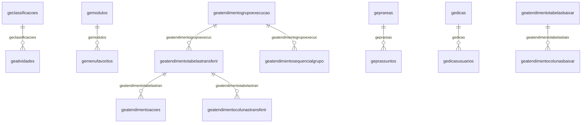

# Modelo — Geral - nucleo (rascunho em lote)

> Gerado por `src/model/gerar_docs_modelo.py` a partir de `src/model/modulos/geral_nucleo.yaml`, do catálogo e do perfil de colunas. **Não edite à mão.**

38 entidades. A coluna *Preench.* é o % de linhas com valor útil (nem nulo, nem em branco, nem zero, nem 1900-01-01; para colunas de código o zero conta como valor).

## Diagrama

## Entidades

| Entidade | Tabela | Linhas | Volume | Filtro obrigatório |
|---|---|---|---|---|
| [geatendimentoacoes](#geatendimentoacoes) | `GEATENDIMENTOACOES` | 4.390.127 | grande | empresa; um de: codigo |
| [geatendimentolog](#geatendimentolog) | `GEATENDIMENTOLOG` | 72.972 | medio | — |
| [geinformacao](#geinformacao) | `GEINFORMACAO` | 58.949 | medio | empresa |
| [geatividades](#geatividades) | `geatividades` | 19.995 | medio | empresa |
| [gecmdexecutado](#gecmdexecutado) | `gecmdexecutado` | 4.654 | pequeno | — |
| [geanalytics](#geanalytics) | `GEANALYTICS` | 2.101 | pequeno | — |
| [gecnae](#gecnae) | `gecnae` | 2.061 | pequeno | — |
| [geatendimentocolunastransferir](#geatendimentocolunastransferir) | `GEATENDIMENTOCOLUNASTRANSFERIR` | 1.140 | pequeno | — |
| [gecae](#gecae) | `gecae` | 790 | pequeno | — |
| [geraexecutar](#geraexecutar) | `GERAEXECUTAR` | 501 | pequeno | — |
| [gerarotinas](#gerarotinas) | `GERAROTINAS` | 501 | pequeno | — |
| [gemenufavoritos](#gemenufavoritos) | `GEMENUFAVORITOS` | 431 | pequeno | — |
| [geprassuntos](#geprassuntos) | `GEPRASSUNTOS` | 358 | pequeno | — |
| [geatendimentotabelastransferir](#geatendimentotabelastransferir) | `GEATENDIMENTOTABELASTRANSFERIR` | 175 | pequeno | — |
| [geselemp](#geselemp) | `geselemp` | 91 | pequeno | — |
| [gedicas](#gedicas) | `gedicas` | 88 | pequeno | — |
| [gerepresentante](#gerepresentante) | `GEREPRESENTANTE` | 68 | pequeno | — |
| [geatendimentogrupoexecucao](#geatendimentogrupoexecucao) | `GEATENDIMENTOGRUPOEXECUCAO` | 62 | pequeno | — |
| [geclassificacoes](#geclassificacoes) | `geclassificacoes` | 51 | pequeno | — |
| [geestacoes](#geestacoes) | `GEESTACOES` | 50 | pequeno | — |
| [geconexoesativas](#geconexoesativas) | `geconexoesativas` | 43 | pequeno | — |
| [gedicasusuarios](#gedicasusuarios) | `gedicasusuarios` | 31 | pequeno | — |
| [geselecao](#geselecao) | `GESELECAO` | 25 | pequeno | empresa |
| [gemodulos](#gemodulos) | `GEMODULOS` | 13 | pequeno | — |
| [geatendimentosequencialgrupo](#geatendimentosequencialgrupo) | `GEATENDIMENTOSEQUENCIALGRUPO` | 9 | pequeno | — |
| [geprareas](#geprareas) | `GEPRAREAS` | 6 | pequeno | — |
| [geprop](#geprop) | `geprop` | 1 | pequeno | — |
| [gedicasconf](#gedicasconf) | `gedicasconf` | 1 | pequeno | — |
| [geconversao](#geconversao) | `GECONVERSAO` | 1 | pequeno | — |
| [geatendimentotabelasbaixar](#geatendimentotabelasbaixar) | `GEATENDIMENTOTABELASBAIXAR` | 1 | pequeno | — |
| [geatendimentocolunasbaixar](#geatendimentocolunasbaixar) | `GEATENDIMENTOCOLUNASBAIXAR` | 1 | pequeno | — |
| [geintegra](#geintegra) | `GEINTEGRA` | 1 | pequeno | — |
| [geatendimentologingestta](#geatendimentologingestta) | `GEATENDIMENTOLOGINGESTTA` | 1 | pequeno | — |
| [geiaconfig](#geiaconfig) | `GEIACONFIG` | 1 | pequeno | — |
| [geresponsavel](#geresponsavel) | `geresponsavel` | 1.986 | pequeno | empresa |
| [geindice](#geindice) | `GEINDICE` | 17 | pequeno | — |
| [gescp](#gescp) | `GESCP` | 17 | pequeno | empresa |
| [gecontador](#gecontador) | `GeContador` | 11 | pequeno | — |

## geatendimentoacoes

**Ações a serem enviadas para o Domínio Atendimento** — tabela `GEATENDIMENTOACOES` (4.390.127 linhas)

Ações a serem enviadas para o Domínio Atendimento. 4.390.127 linhas no catálogo; chave: CODIGO.

- **Chave:** `CODIGO`
- **Empresa:** `CODI_EMP`
- **Período:** `—` · exige um de: `codigo`
- **Ordem padrão:** `CODIGO asc`

**Regras de negócio validadas:**

- Medido em 2026-10-18: 4.393.258 linhas, 1.437 empresa(s).
- empresa_usa_o_da_quando_a_acao_foi_proce: todos os valores reais estão no comentário do banco (0=3.472.993, 1=920.265).
- Vínculo geatendimentotabelastran (GEATENDIMENTOTABELASTRANSFERIR): 0 de 66 linhas sem registro relacionado (empresa 857).

| Campo | Coluna | Tipo | Preench. | Domínio | Descrição (banco) |
|---|---|---|---|---|---|
| codigo | `codigo` | integer(4) |  |  |  |
| codigo_tabela | `codigo_tabela` | integer(4) |  |  |  |
| acao | `acao` | integer(4) |  |  |  |
| status | `status` | integer(4) |  |  |  |
| sequencial_grupo_envio | `sequencial_grupo_envio` | integer(4) |  |  |  |
| sequencial_grupo_recebimento | `sequencial_grupo_recebimento` | integer(4) |  |  |  |
| codi_emp | `codi_emp` | integer(4) |  |  |  |
| ordem | `ordem` | integer(4) |  |  |  |
| c_1_carga_inicial_2_aplicacao | `origem_acao` | integer(4) |  |  | 1-Carga Inicial, 2-Aplicacao |
| se_o_registro_e_um_reenvio_de_informacao | `origem_reenvio_erro` | integer(4) |  |  | Se o registro é um reenvio de informação proveniente de uma ação que deu erro |
| numero_da_acao_que_deu_erro_que_criou_es | `origem_reenvio_acao_erro` | integer(4) |  |  | Número da ação que deu erro que criou esta ação de reenvio |
| coluna_que_indica_o_codigo_referente_a_f | `i_filial` | integer(4) |  |  | Coluna que indica o código referente a filial |
| coluna_que_indica_a_quantidade_de_vezes | `numero_tentativas` | integer(4) |  |  | Coluna que indica a quantidade de vezes que foi tentado enviar esta ação |
| empresa_usa_o_da_quando_a_acao_foi_proce | `empresa_usa_da` | tinyint(1) |  | geatendimentoacoes_empresa_usa_ | Empresa usa o DA quando a ação foi processada. (0=Não usa/1=Usa). |
| c_1_registro_de_inclusao_da_empresa_0_al | `inclusao_empresa` | integer(4) |  |  | 1-Registro de inclusao da empresa, 0-Alteração ou exclusão/desativação de empresa |

**Vínculos (LEFT JOIN, acrescentam colunas legíveis):**

- `geatendimentotabelastran` → `GEATENDIMENTOTABELASTRANSFERIR` por `codigo_tabela` = `codigo`; colunas: `geatendimentotabelastran_nome`

**Filtros:** `codigo` (eq/in), `codigo_tabela` (eq/in), `coluna_que_indica_o_codigo_referente_a_f` (eq/in)

## geatendimentolog

**Log do envio de dados do Agente de Comunicação** — tabela `GEATENDIMENTOLOG` (72.972 linhas)

Log do envio de dados do Agente de Comunicação. 72.972 linhas no catálogo; chave: CODIGO.

- **Chave:** `CODIGO`
- **Empresa:** `não se aplica (tabela global)`
- **Período:** `—`
- **Ordem padrão:** `CODIGO asc`

**Regras de negócio validadas:**

- Medido em 2026-10-18: 65.331 linhas.

| Campo | Coluna | Tipo | Preench. | Domínio | Descrição (banco) |
|---|---|---|---|---|---|
| codigo | `codigo` | integer(4) |  |  |  |
| codigo_grupo | `codigo_grupo` | integer(4) |  |  |  |
| codigo_tabela | `codigo_tabela` | integer(4) |  |  |  |
| codigo_acao | `codigo_acao` | integer(4) |  |  |  |
| mensagem_log | `mensagem_log` | varchar(5000) |  |  |  |
| tipo_log | `tipo_log` | integer(4) |  |  |  |
| pid_do_processo_que_inseriu_o_log | `pid` | integer(4) |  |  | PID do processo que inseriu o log |
| id_da_thread_que_inseriu_o_log | `thread_id` | integer(4) |  |  | ID da Thread que inseriu o log |
| codigo_da_solucao_no_suporte | `codigo_solucao` | integer(4) |  |  | Código da solução no suporte |

**Filtros:** `codigo` (eq/in), `codigo_grupo` (eq/in), `codigo_tabela` (eq/in), `codigo_acao` (eq/in), `mensagem_log` (contem/prefixo), `tipo_log` (eq/in), `codigo_da_solucao_no_suporte` (eq/in)

## geinformacao

**Informações a respeito do banco de dados para serem enviadas a Domínio** — tabela `GEINFORMACAO` (58.949 linhas)

Informações a respeito do banco de dados para serem enviadas a Domínio. 58.949 linhas no catálogo; chave: CODI_EMP, COMPETENCIA.

- **Chave:** `CODI_EMP, COMPETENCIA`
- **Empresa:** `CODI_EMP`
- **Período:** `COMPETENCIA`
- **Ordem padrão:** `COMPETENCIA desc`

**Regras de negócio validadas:**

- Medido em 2026-10-18: 58.997 linhas, 1.296 empresa(s), COMPETENCIA de 2007-04-01 a 2026-09-01.
- Vínculo geempre (geempre): 0 de 31 linhas sem registro relacionado (empresa 1006).

| Campo | Coluna | Tipo | Preench. | Domínio | Descrição (banco) |
|---|---|---|---|---|---|
| empresa | `codi_emp` | integer(4) |  |  | Empresa |
| competencia | `competencia` | date(4) |  |  | Competência |
| numero_de_nf_e_lancada_na_entrada_no_per | `total_nfe_entradas` | integer(4) |  |  | Número de NF-e lançada na entrada no período |
| numero_de_nf_e_lancada_na_saida_no_perio | `total_nfe_saida` | integer(4) |  |  | Número de NF-e lançada na saída no período |

**Vínculos (LEFT JOIN, acrescentam colunas legíveis):**

- `geempre` → `geempre` por `codi_emp` = `codi_emp`; colunas: `geempre_nome`

**Filtros:** `competencia` (eq/in)

## geatividades

**Registro de Atividades - Cadastro** — tabela `geatividades` (19.995 linhas)

Registro de Atividades - Cadastro. 19.995 linhas no catálogo; chave: codi_atv.

- **Chave:** `codi_atv`
- **Empresa:** `codi_emp`
- **Período:** `data_atv`
- **Ordem padrão:** `data_atv desc`, `codi_atv asc`

**Regras de negócio validadas:**

- Medido em 2026-10-18: 20.034 linhas, 889 empresa(s), data_atv de 0260-02-05 a 2202-06-24.
- Vínculo geempre (geempre): 0 de 6 linhas sem registro relacionado (empresa 1503).
- Vínculo geclassificacoes (geclassificacoes): 0 de 6 linhas sem registro relacionado (empresa 1503).

| Campo | Coluna | Tipo | Preench. | Domínio | Descrição (banco) |
|---|---|---|---|---|---|
| codigo_sequencial_das_atividades | `codi_atv` | integer(4) |  |  | Codigo sequencial das atividades |
| empresa | `codi_emp` | integer(4) |  |  | Empresa |
| codigo_da_classificacao | `codi_cla` | integer(4) |  |  | Codigo da classificacao |
| usuario | `codi_usu` | char(30) |  |  | Usuario |
| data_da_atividade | `data_atv` | date(4) |  |  | Data da atividade |
| hora_inicial_da_atividade | `hori_atv` | time(8) |  |  | Hora inicial da atividade |
| finalizar_a_atividade_s_n | `fina_atv` | char(1) |  |  | Finalizar a atividade(S/N) |
| hora_final_da_atividade | `horf_atv` | time(8) |  |  | Hora final da atividade |
| descricao_da_atividade | `desc_atv` | varchar(500) |  |  | Descricao da atividade |

**Vínculos (LEFT JOIN, acrescentam colunas legíveis):**

- `geempre` → `geempre` por `codi_emp` = `codi_emp`; colunas: `geempre_nome`
- `geclassificacoes` → `geclassificacoes` por `codi_cla` = `codi_cla`; colunas: `geclassificacoes_nome`

**Filtros:** `codigo_sequencial_das_atividades` (eq/in), `data_da_atividade` (entre/gte/lte), `codigo_da_classificacao` (eq/in), `usuario` (contem/prefixo), `finalizar_a_atividade_s_n` (eq/in), `descricao_da_atividade` (contem/prefixo)

## gecmdexecutado

**Indica se um comando SQL ja foi executado** — tabela `gecmdexecutado` (4.654 linhas)

Indica se um comando SQL ja foi executado. 4.654 linhas no catálogo; chave: i_sequencial.

- **Chave:** `i_sequencial`
- **Empresa:** `não se aplica (tabela global)`
- **Período:** `—`
- **Ordem padrão:** `i_sequencial asc`

**Regras de negócio validadas:**

- Medido em 2026-10-18: 4.661 linhas.

| Campo | Coluna | Tipo | Preench. | Domínio | Descrição (banco) |
|---|---|---|---|---|---|
| sequencial | `i_sequencial` | integer(4) |  |  | Sequencial |
| identifica_o_comando | `comando` | varchar(100) |  |  | Identifica o comando |

**Filtros:** `sequencial` (eq/in), `identifica_o_comando` (contem/prefixo)

## geanalytics

**Armazena dados referente a informações da importação.** — tabela `GEANALYTICS` (2.101 linhas)

Armazena dados referente a informações da importação.. 2.101 linhas no catálogo; chave: I_SEQUENCIAL.

- **Chave:** `I_SEQUENCIAL`
- **Empresa:** `não se aplica (tabela global)`
- **Período:** `—`
- **Ordem padrão:** `I_SEQUENCIAL asc`

**Regras de negócio validadas:**

- Medido em 2026-10-18: 2.117 linhas.

| Campo | Coluna | Tipo | Preench. | Domínio | Descrição (banco) |
|---|---|---|---|---|---|
| codigo_sequencial_do_registro | `i_sequencial` | integer(4) |  |  | Código sequencial do registro |

**Filtros:** `codigo_sequencial_do_registro` (eq/in)

## gecnae

**Codigo nacional da atividade economica** — tabela `gecnae` (2.061 linhas)

Codigo nacional da atividade economica. 2.061 linhas no catálogo; chave: codigo_cnae.

- **Chave:** `codigo_cnae`
- **Empresa:** `não se aplica (tabela global)`
- **Período:** `—`
- **Ordem padrão:** `codigo_cnae asc`

**Regras de negócio validadas:**

- Medido em 2026-10-18: 2.061 linhas.

| Campo | Coluna | Tipo | Preench. | Domínio | Descrição (banco) |
|---|---|---|---|---|---|
| codigo_cnae | `codigo_cnae` | char(15) |  |  | Codigo CNAE |
| descricao | `descricao` | varchar(300) |  |  | Descricao |
| ordem | `ordem` | integer(4) |  |  | Ordem |

**Filtros:** `codigo_cnae` (eq/in), `descricao` (contem/prefixo)

## geatendimentocolunastransferir

**Colunas utilizadas pelo Agente de Comunicação para realizar envios de dados** — tabela `GEATENDIMENTOCOLUNASTRANSFERIR` (1.140 linhas)

Colunas utilizadas pelo Agente de Comunicação para realizar envios de dados. 1.140 linhas no catálogo; chave: CODIGO.

- **Chave:** `CODIGO`
- **Empresa:** `não se aplica (tabela global)`
- **Período:** `—`
- **Ordem padrão:** `CODIGO asc`

**Regras de negócio validadas:**

- Medido em 2026-10-18: 1.140 linhas.
- Vínculo geatendimentotabelastran (GEATENDIMENTOTABELASTRANSFERIR): 0 de 1.140 linhas sem registro relacionado.
- Vínculo geatendimentocolunas_tip (GEATENDIMENTOCOLUNAS_TIPOS): 0 de 1.140 linhas sem registro relacionado.

| Campo | Coluna | Tipo | Preench. | Domínio | Descrição (banco) |
|---|---|---|---|---|---|
| codigo | `codigo` | integer(4) |  |  |  |
| codigo_tabela | `codigo_tabela` | integer(4) |  |  |  |
| nome_da_coluna_no_db | `coluna` | varchar(1024) |  |  | Nome da coluna no DB |
| nome_xml | `nome_xml` | varchar(1024) |  |  |  |
| atributo_xml | `atributo_xml` | integer(4) |  |  |  |
| sub_query | `sub_query` | integer(4) |  |  |  |
| conteudo_sub_query | `conteudo_sub_query` | varchar(2048) |  |  |  |
| coluna_controle_atendimento | `coluna_controle_atendimento` | integer(4) |  |  |  |
| chave_tabela_auxiliar | `chave_tabela_auxiliar` | integer(4) |  |  |  |
| coluna_base_64_c | `coluna_base_64` | integer(4) |  |  |  |
| tipo_coluna | `tipo_coluna` | integer(4) |  |  |  |
| c_0_coluna_normal_1_coluna_chave | `coluna_chave` | bit(1) |  |  | 0 - Coluna normal, 1 - Coluna chave |
| c_0_coluna_nao_transmitida_1_coluna_tran | `transmitir_coluna` | bit(1) |  |  | 0 - Coluna não transmitida, 1 - Coluna transmitida |
| nome_do_parametro_do_endpoint_para_o_val | `nome_parametro_coluna_controle_atendimento` | varchar(256) |  |  | Nome do parâmetro do EndPoint para o valor máximo da coluna de controle |
| valor_padrao_da_coluna_quando_o_valor_na | `valor_padrao` | varchar(1024) |  |  | Valor padrão da coluna quando o valor não existir |
| c_0_coluna_normal_1_coluna_utilizado_par | `coluna_filtro` | bit(1) |  |  | 0 - Coluna normal, 1 - Coluna utilizado para filtro de consulta |
| c_0_coluna_opcional_para_o_envio_do_regi | `coluna_obrigatoria` | bit(1) |  |  | 0 - Coluna opcional para o envio do registro, 1 - Coluna obrigatória para o envio do registro |
| codigo_da_tabela_pai_da_coluna_obrigator | `codigo_tabela_pai` | integer(4) |  |  | Código da tabela pai da coluna obrigatória. |
| subquery_para_busca_do_guid_contabil_do | `sub_query_guid_contabil` | varchar(2048) |  |  | Subquery para busca do GUID_CONTABIL do registro pai. |
| apelido_da_coluna | `alias` | varchar(1024) |  |  | Apelido da coluna |

**Vínculos (LEFT JOIN, acrescentam colunas legíveis):**

- `geatendimentotabelastran` → `GEATENDIMENTOTABELASTRANSFERIR` por `codigo_tabela` = `codigo`; colunas: `geatendimentotabelastran_nome`
- `geatendimentocolunas_tip` → `GEATENDIMENTOCOLUNAS_TIPOS` por `tipo_coluna` = `codigo`; colunas: `geatendimentocolunas_tip_nome`

**Filtros:** `codigo` (eq/in), `codigo_tabela` (eq/in), `nome_da_coluna_no_db` (contem/prefixo), `nome_xml` (contem/prefixo), `conteudo_sub_query` (contem/prefixo), `tipo_coluna` (eq/in), `nome_do_parametro_do_endpoint_para_o_val` (contem/prefixo), `valor_padrao_da_coluna_quando_o_valor_na` (contem/prefixo), `codigo_da_tabela_pai_da_coluna_obrigator` (eq/in), `subquery_para_busca_do_guid_contabil_do` (contem/prefixo), `apelido_da_coluna` (contem/prefixo)

## gecae

**Codigo de atividade economica** — tabela `gecae` (790 linhas)

Codigo de atividade economica. 790 linhas no catálogo; chave: codigo.

- **Chave:** `codigo`
- **Empresa:** `não se aplica (tabela global)`
- **Período:** `—`
- **Ordem padrão:** `codigo asc`

**Regras de negócio validadas:**

- Medido em 2026-10-18: 790 linhas.

| Campo | Coluna | Tipo | Preench. | Domínio | Descrição (banco) |
|---|---|---|---|---|---|
| codigo | `codigo` | double(8) |  |  | Codigo |
| descricao | `descricao` | varchar(100) |  |  | Descricao |

**Filtros:** `codigo` (eq/in), `descricao` (contem/prefixo)

## geraexecutar

**EXECUÇÃO DE ROTINAS AUTOMÁTICAS** — tabela `GERAEXECUTAR` (501 linhas)

EXECUÇÃO DE ROTINAS AUTOMÁTICAS. 501 linhas no catálogo; chave: I_EXECUTARRA, I_SISTEMA.

- **Chave:** `I_EXECUTARRA, I_SISTEMA`
- **Empresa:** `não se aplica (tabela global)`
- **Período:** `AGENDAMENTO_DATA`
- **Ordem padrão:** `AGENDAMENTO_DATA desc`, `I_EXECUTARRA asc`, `I_SISTEMA asc`

**Regras de negócio validadas:**

- Medido em 2026-10-18: 501 linhas, AGENDAMENTO_DATA de 2022-01-01 a 2026-09-30.
- Colunas expostas nulas em 100% das linhas (5): ano_hora_agendada, mes_agendado, quantidade_de_dias_anteriores_ao_gozo_pr, quantidade_de_dias_apos_a_data_de_rescis, observacao_de_falha_transitoria_durante.
- periodicidade_do_agendamento_0_na_1_mens: valores reais fora do comentário do banco (11=2); tratar o domínio como hipótese.
- gerar_os_relatorios_individualizados_por: todos os valores reais estão no comentário do banco (1=435, 0=66).
- indica_em_qual_estado_se_encontra_a_exec: todos os valores reais estão no comentário do banco (0=497, 1=3, 2=1).
- Vínculo gesecusuarios (GESECUSUARIOS): 0 de 501 linhas sem registro relacionado.

| Campo | Coluna | Tipo | Preench. | Domínio | Descrição (banco) |
|---|---|---|---|---|---|
| codigo_da_execucao | `i_executarra` | integer(4) |  |  | CÓDIGO DA EXECUÇÃO |
| codigo_do_sistema | `i_sistema` | smallint(2) |  |  | CÓDIGO DO SISTEMA |
| codigo_do_usuario | `i_secusuarios` | integer(4) |  |  | CÓDIGO DO USUÁRIO |
| descricao_da_execucao | `descricao` | char(60) |  |  | DESCRIÇÃO DA EXECUÇÃO |
| periodicidade_do_agendamento_0_na_1_mens | `periodicidade` | smallint(2) |  | geraexecutar_periodicidade_do_a | PERIODICIDADE DO AGENDAMENTO (0-NA/1-MENSAL/2-DATA/3-ANUAL/4-QUINZE/5-DECENDE/6-SEMANA/7-DIARIO/8-CALCULO FÉRIAS PROGRAMADAS/9-TRIMESTRAL) |
| dia_agendado | `agendamento_dia` | smallint(2) |  |  | DIA AGENDADO |
| hora_agendada | `agendamento_hora` | time(8) |  |  | HORA AGENDADA |
| data_agendada | `agendamento_data` | date(4) |  |  | DATA AGENDADA |
| competencia_inicial | `agendamento_apartir_de` | date(4) |  |  | COMPETÊNCIA INICIAL |
| competencia_agendada | `agendamento_comp` | smallint(2) |  |  | COMPETÊNCIA AGENDADA |
| envia_email_em_caso_de_sucesso | `email_sucesso` | smallint(2) |  |  | ENVIA EMAIL EM CASO DE SUCESSO |
| envia_email_em_caso_de_erro | `email_erro` | smallint(2) |  |  | ENVIA EMAIL EM CASO DE ERRO |
| endereco_do_email 🔒 | `email_end_para` | varchar(128) |  |  | ENDEREÇO DO EMAIL |
| endereco_para_copia_do_email 🔒 | `email_end_cc` | varchar(128) |  |  | ENDEREÇO PARA CÓPIA DO EMAIL |
| data_da_ultima_execucao | `ultima_execucao` | date(4) |  |  | DATA DA ÚLTIMA EXECUÇÃO |
| exibida_notificacao_de_nao_execucao | `notificado` | smallint(2) |  |  | EXIBIDA NOTIFICAÇÃO DE NÃO EXECUÇÃO |
| gerar_os_relatorios_individualizados_por | `gerar_relatorios_individualizados_empresa` | smallint(2) |  | geraexecutar_gerar_os_relatorio | Gerar os relatórios individualizados por empresa. (0=Não/1=Sim) |
| ano_hora_agendada | `agendamento_ano_hora` | time(8) |  |  | Ano - Hora Agendada |
| ano_competencia_inicial | `agendamento_ano_apartir_de` | integer(4) |  |  | Ano - Competência Inicial |
| ano_dia_agendado | `agendamento_ano_dia` | integer(4) |  |  | Ano - Dia Agendado |
| ano_mes_agendado | `agendamento_ano_mes` | integer(4) |  |  | Ano - Mês Agendado |
| mes_agendado | `agendamento_mes` | integer(4) |  |  | Mês - Agendado |
| quantidade_de_dias_anteriores_ao_gozo_pr | `quantidade_dias_anteriores_ferias_programada` | integer(4) |  |  | Quantidade de dias anteriores ao gozo programado |
| empresa_filtrar_apenas_ativas | `empresa_filtrar_ativas` | smallint(2) |  |  | Empresa - Filtrar apenas ativas |
| inibir_as_mensagens_de_erros_e_avisos_du | `inibir_mensagens_erros_ou_avisos_durante_execucao` | smallint(2) |  |  | Inibir as mensagens de erros e avisos durante a execução das rotinas automáticas |
| pasta_de_destino_para_salvar_relatorio_d | `pasta_destino_salva_relatorio_erros_ou_avisos` | varchar(255) |  |  | Pasta de destino para salvar relatório de erros e avisos |
| quantidade_de_dias_apos_a_data_de_rescis | `quantidade_dias_apos_data_rescisao` | integer(4) |  |  | Quantidade de dias após a data de Rescisão |
| excutar_estas_rotinas_somente_pelo_usuar | `executar_rotina_somente_usuario_responsavel` | smallint(2) |  |  | Excutar estas rotinas somente pelo usuário responsável |
| tipo_de_rotina_0_rotina_cliente_1_rotina | `tipo_rotina` | integer(4) |  |  | Tipo de Rotina, 0 - rotina cliente, 1 - rotina interna |
| indica_se_a_rotina_deve_ser_executada_em | `executar_em_segundo_plano` | bit(1) |  |  | Indica se a rotina deve ser executada em segundo plano. |
| indica_em_qual_estado_se_encontra_a_exec | `estado_execucao` | smallint(2) |  | geraexecutar_indica_em_qual_est | Indica em qual estado se encontra a execução da Rotina (-1=Erro/0=Aguardando/1=EmProcessamento/2=Processada) |
| status_do_download_do_arquivo_gerado_pel | `status_download` | smallint(2) |  |  | Status do download do arquivo gerado pela rotina (0=N/A, 1=Pronto para download, 2=Realizando download, 3=Download realizado, 4=Concluido sem download, 5=Erro ao realizar download) |
| observacao_de_falha_transitoria_durante | `observacao_reprocessamento` | varchar(255) |  |  | Observacao de falha transitoria durante a execucao da rotina, indicando que sera realizado reprocessamento automatico. |
| contador_de_tentativas_de_execucao_da_ro | `tentativas_execucao` | smallint(2) |  |  | Contador de tentativas de execucao da rotina. Maximo de 3 tentativas para erros transitorios. |
| indica_se_a_rotina_processada_com_sucess | `visualizado` | bit(1) |  |  | Indica se a rotina processada com sucesso foi visualizada pelo usuario no Painel de Acompanhamento. |
| caminho_de_destino_para_salvamento_autom | `pasta_destino_salvar_relatorio` | varchar(255) |  |  | Caminho de destino para salvamento automatico de relatorios em PDF durante execucao de rotinas automaticas. |

**Vínculos (LEFT JOIN, acrescentam colunas legíveis):**

- `gesecusuarios` → `GESECUSUARIOS` por `i_secusuarios` = `i_secusuarios`; colunas: `gesecusuarios_nome`

**Filtros:** `codigo_da_execucao` (eq/in), `codigo_do_sistema` (eq/in), `data_agendada` (entre/gte/lte), `competencia_inicial` (entre/gte/lte), `data_da_ultima_execucao` (entre/gte/lte), `codigo_do_usuario` (eq/in), `descricao_da_execucao` (contem/prefixo), `endereco_do_email` (contem/prefixo), `endereco_para_copia_do_email` (contem/prefixo), `pasta_de_destino_para_salvar_relatorio_d` (contem/prefixo), `tipo_de_rotina_0_rotina_cliente_1_rotina` (eq/in), `observacao_de_falha_transitoria_durante` (contem/prefixo), `caminho_de_destino_para_salvamento_autom` (contem/prefixo)

## gerarotinas

**CADASTRO DE ROTINAS AUTOMÁTICAS** — tabela `GERAROTINAS` (501 linhas)

CADASTRO DE ROTINAS AUTOMÁTICAS. 501 linhas no catálogo; chave: I_ROTINAS, I_SISTEMA.

- **Chave:** `I_ROTINAS, I_SISTEMA`
- **Empresa:** `não se aplica (tabela global)`
- **Período:** `—`
- **Ordem padrão:** `I_ROTINAS asc`, `I_SISTEMA asc`

**Regras de negócio validadas:**

- Medido em 2026-10-18: 501 linhas.

| Campo | Coluna | Tipo | Preench. | Domínio | Descrição (banco) |
|---|---|---|---|---|---|
| codigo_da_rotina | `i_rotinas` | integer(4) |  |  | CÓDIGO DA ROTINA |
| codigo_do_sistema | `i_sistema` | smallint(2) |  |  | CÓDIGO DO SISTEMA |
| descricao_da_rotina | `descricao` | char(60) |  |  | DESCRIÇÃO DA ROTINA |
| pasta_destino_para_salvar_os_relatorios | `pasta_destino_salva_relatorios` | varchar(255) |  |  | Pasta destino para salvar os relatórios em PDF. |
| pasta_destino_salva_relatorios_acompanha | `pasta_destino_salva_relatorios_acompanhamento` | varchar(255) |  |  | Pasta destino para salvar os relatórios de acompanhamentos em PDF. |
| pasta_destino_salva_relatorios_guia | `pasta_destino_salva_relatorios_guia` | varchar(255) |  |  | Pasta destino para salvar os relatórios de Guia em PDF. |
| pasta_destino_salva_relatorios_utilitari | `pasta_destino_salva_relatorios_utilitario` | varchar(255) |  |  | Pasta destino para salvar os relatórios de Utilitários em PDF. |
| pasta_destino_para_salvar_os_relata3rios | `pasta_destino_salva_relatorios_mei` | varchar(255) |  |  | Pasta destino para salvar os relatórios da Guia MEI em PDF. |
| pasta_destino_salva_relatorios_informati | `pasta_destino_salva_relatorios_informativo` | varchar(255) |  |  | Pasta destino para salvar os relatórios de Informativos em PDF. |
| pasta_destino_salva_relatorios_demonstra | `pasta_destino_salva_relatorios_demonstrativo` | varchar(255) |  |  | Pasta destino para salvar os relatórios de Demonstrativo em PDF. |
| tipo_de_rotina_0_rotina_cliente_1_rotina | `tipo_rotina` | integer(4) |  |  | Tipo de Rotina, 0 - rotina cliente, 1 - rotina interna |
| pasta_destino_salva_relatorios_excel | `pasta_destino_salva_relatorios_excel` | varchar(255) |  |  | Pasta destino para salvar os relatórios em Excel. |

**Filtros:** `codigo_da_rotina` (eq/in), `codigo_do_sistema` (eq/in), `descricao_da_rotina` (contem/prefixo), `pasta_destino_para_salvar_os_relatorios` (contem/prefixo), `pasta_destino_salva_relatorios_acompanha` (contem/prefixo), `pasta_destino_salva_relatorios_guia` (contem/prefixo), `pasta_destino_salva_relatorios_utilitari` (contem/prefixo), `pasta_destino_para_salvar_os_relata3rios` (contem/prefixo), `pasta_destino_salva_relatorios_informati` (contem/prefixo), `pasta_destino_salva_relatorios_demonstra` (contem/prefixo), `tipo_de_rotina_0_rotina_cliente_1_rotina` (eq/in), `pasta_destino_salva_relatorios_excel` (contem/prefixo)

## gemenufavoritos

**Itens do menu favoritos** — tabela `GEMENUFAVORITOS` (431 linhas)

Itens do menu favoritos. 431 linhas no catálogo; chave: I_MODULO, I_CONFUSUARIO, I_MENUFAVORITO, TIPO_USUARIO.

- **Chave:** `I_MODULO, I_CONFUSUARIO, I_MENUFAVORITO, TIPO_USUARIO`
- **Empresa:** `não se aplica (tabela global)`
- **Período:** `—`
- **Ordem padrão:** `I_MODULO asc`, `I_CONFUSUARIO asc`

**Regras de negócio validadas:**

- Medido em 2026-10-18: 431 linhas.
- Vínculo gemodulos (GEMODULOS): 0 de 431 linhas sem registro relacionado.
- Vínculo usconfusuario (usConfUsuario): 0 de 431 linhas sem registro relacionado.

| Campo | Coluna | Tipo | Preench. | Domínio | Descrição (banco) |
|---|---|---|---|---|---|
| i_modulo | `i_modulo` | integer(4) |  |  |  |
| i_confusuario | `i_confusuario` | integer(4) |  |  |  |
| i_menufavorito | `i_menufavorito` | integer(4) |  |  |  |
| tipo_usuario | `tipo_usuario` | smallint(2) |  |  |  |
| i_menufavorito_pai | `i_menufavorito_pai` | integer(4) |  |  |  |
| nome | `nome` | varchar(120) |  |  |  |
| tipo | `tipo` | smallint(2) |  |  |  |
| i_modulo_menu | `i_modulo_menu` | integer(4) |  |  |  |
| vinculo | `vinculo` | varchar(1000) |  |  |  |
| caminho_menu | `caminho_menu` | varchar(512) |  |  |  |
| ordem | `ordem` | integer(4) |  |  |  |

**Vínculos (LEFT JOIN, acrescentam colunas legíveis):**

- `gemodulos` → `GEMODULOS` por `i_modulo` = `i_modulo`; colunas: `gemodulos_nome`
- `usconfusuario` → `usConfUsuario` por `tipo_usuario` = `tipo` e `i_confusuario` = `i_confusuario`; colunas: `usconfusuario_nome`

**Filtros:** `i_modulo` (eq/in), `i_confusuario` (eq/in), `i_menufavorito` (eq/in), `tipo_usuario` (eq/in), `i_menufavorito_pai` (eq/in), `nome` (contem/prefixo), `tipo` (eq/in), `i_modulo_menu` (eq/in), `vinculo` (contem/prefixo), `caminho_menu` (contem/prefixo)

## geprassuntos

**Assuntos do Perguntas e Respostas do Checkpoint** — tabela `GEPRASSUNTOS` (358 linhas)

Assuntos do Perguntas e Respostas do Checkpoint. 358 linhas no catálogo; chave: ID.

- **Chave:** `ID`
- **Empresa:** `não se aplica (tabela global)`
- **Período:** `—`
- **Ordem padrão:** `ID asc`

**Regras de negócio validadas:**

- Medido em 2026-10-18: 358 linhas.
- Vínculo geprareas (GEPRAREAS): 0 de 358 linhas sem registro relacionado.

| Campo | Coluna | Tipo | Preench. | Domínio | Descrição (banco) |
|---|---|---|---|---|---|
| id | `id` | uniqueidentifier(16) |  |  |  |
| id_fisco | `id_fisco` | integer(4) |  |  |  |
| descricao | `descricao` | varchar(4000) |  |  |  |
| excluido | `excluido` | integer(4) |  |  |  |
| id_area | `id_area` | uniqueidentifier(16) |  |  |  |

**Vínculos (LEFT JOIN, acrescentam colunas legíveis):**

- `geprareas` → `GEPRAREAS` por `id_area` = `id`; colunas: `geprareas_nome`

**Filtros:** `id` (eq/in), `descricao` (contem/prefixo), `id_area` (eq/in)

## geatendimentotabelastransferir

**Tabelas utilizadas pelo Agente de Comunicação para realizar o envio de dados** — tabela `GEATENDIMENTOTABELASTRANSFERIR` (175 linhas)

Tabelas utilizadas pelo Agente de Comunicação para realizar o envio de dados. 175 linhas no catálogo; chave: CODIGO.

- **Chave:** `CODIGO`
- **Empresa:** `não se aplica (tabela global)`
- **Período:** `—`
- **Ordem padrão:** `CODIGO asc`

**Regras de negócio validadas:**

- Medido em 2026-10-18: 175 linhas.
- usa_trigger_de_sincronizacao_com_o_onvio: todos os valores reais estão no comentário do banco (0=174, 1=1).
- permite_inserir_uma_unica_acao_do_onvio: todos os valores reais estão no comentário do banco (0=164, 1=11).
- Vínculo geatendimentogrupoexecuc (GEATENDIMENTOGRUPOEXECUCAO): 0 de 175 linhas sem registro relacionado.

| Campo | Coluna | Tipo | Preench. | Domínio | Descrição (banco) |
|---|---|---|---|---|---|
| codigo | `codigo` | integer(4) |  |  |  |
| grupo | `grupo` | integer(4) |  |  |  |
| tabela | `tabela` | varchar(1024) |  |  |  |
| criador | `criador` | varchar(32) |  |  |  |
| tag_pai_xml_recebimento | `tag_pai_xml_recebimento` | varchar(1024) |  |  |  |
| nome_xml | `nome_xml` | varchar(1024) |  |  |  |
| ordem | `ordem` | integer(4) |  |  |  |
| possui_tabela_auxiliar | `possui_tabela_auxiliar` | integer(4) |  |  |  |
| codigo_tabela_baixar | `codigo_tabela_baixar` | integer(4) |  |  |  |
| tag_id_xml | `tag_id_xml` | integer(4) |  |  |  |
| descricao_tabela | `descricao_tabela` | varchar(1024) |  |  |  |
| versao_xml | `versao_xml` | integer(4) |  |  |  |
| endpoint_utilizado_para_a_transferencia | `tabela_bloco_informacoes` | integer(4) |  |  | Endpoint utilizado para a transferência da tabela. |
| endpoint | `endpoint` | varchar(512) |  |  | Endpoint utilizado para a transferência da tabela. |
| c_0_login_gerente_1_login_por_usuario_es | `login_por_usuario` | bit(1) |  |  | 0 - Login GERENTE, 1 - Login por usuário específico |
| c_0_busca_por_clausula_1_busca_por_guid | `busca_registro_por_guid` | bit(1) |  |  | 0 - Busca por clausula, 1 - Busca por GUID Contabil |
| c_0_nao_usa_metodo_post_1_usa_metodo_pos | `usa_metodo_post` | bit(1) |  |  | 0 - Não usa método POST, 1 - Usa método POST |
| c_0_mantem_registros_que_nao_foram_receb | `excluir_registros_nao_recebidos` | bit(1) |  |  | 0 - Mantém registros que não foram recebidos pelo Atendimento no Onvio, 1 - Exclui os registros que foram recebidos pelo Atendimento no Onvio |
| c_1_simpledtowithidanddeletepath_2_simpl | `tipo_retorno` | tinyint(1) |  |  | 1 - SimpleDtoWithIdAndDeletePath, 2 - SimpleDtoWithId, 3 - None, 4 - SimpleDtoWithIdAndHATEOS |
| coluna_utilizada_apenas_pelas_tabelas_do | `sincronia_onvio_concluida` | bit(1) |  |  | Coluna utilizada apenas pelas tabelas do grupo 28. |
| ultima_chave_sincronizada | `ultima_chave_sincronizada` | bigint(8) |  |  | Coluna utilizada apenas pelas tabelas do grupo 28. |
| c_0_envio_sincrono_1_envio_assincrono | `envio_assincrono` | integer(4) |  |  | 0 - Envio Sincrono/ 1-Envio Assincrono |
| tabela_base_do_bloco_de_informacao | `nome_tabela_bloco_informacoes` | varchar(50) |  |  | Tabela base do bloco de informação |
| arquivo_sera_enviado_para_o_static_files | `upload_static_files` | bit(1) |  |  | Arquivo será enviado para o static files. |
| tabela_que_devera_ser_verificada_primeir | `codigo_tabela_dependente` | integer(4) |  |  | Tabela que deverá ser verificada primeiro. Coluna será utilizada pela Central de Conflitos |
| endpoint_de_consulta_dos_registros_no_on | `endpoint_consulta` | varchar(512) |  |  | ENDPOINT de consulta dos registros no Onvio. Coluna será utilizada pela Central de Conflitos |
| usa_trigger_de_sincronizacao_com_o_onvio | `usar_trigger_sincronizacao_onvio` | smallint(2) |  | geatendimentotabelastransferir_usa_trigger | Usa trigger de sincronização com o Onvio. (0=Não/1=Sim) |
| permite_inserir_uma_unica_acao_do_onvio | `permite_inserir_unica_acao_onvio` | smallint(2) |  | geatendimentotabelastransferir_permite_ins | Permite inserir uma única ação do Onvio. (0=Não/1=Sim) |
| endpoint_inativacao_do_registro | `endpoint_inativacao` | varchar(512) |  |  | Endpoint inativação do registro. |
| indica_se_o_endpoint_sera_afetado_pelo_c | `rate_limit` | bit(1) |  |  | Indica se o endpoint será afetado pelo circuitbreaker (0=Não/1=Sim) |

**Vínculos (LEFT JOIN, acrescentam colunas legíveis):**

- `geatendimentogrupoexecuc` → `GEATENDIMENTOGRUPOEXECUCAO` por `grupo` = `codigo`; colunas: `geatendimentogrupoexecuc_nome`

**Filtros:** `codigo` (eq/in), `tabela` (contem/prefixo), `criador` (contem/prefixo), `tag_pai_xml_recebimento` (contem/prefixo), `nome_xml` (contem/prefixo), `codigo_tabela_baixar` (eq/in), `descricao_tabela` (contem/prefixo), `endpoint` (contem/prefixo), `c_1_simpledtowithidanddeletepath_2_simpl` (eq/in), `tabela_base_do_bloco_de_informacao` (contem/prefixo), `tabela_que_devera_ser_verificada_primeir` (eq/in), `endpoint_de_consulta_dos_registros_no_on` (contem/prefixo), `endpoint_inativacao_do_registro` (contem/prefixo)

## geselemp

**Seleção de empresas** — tabela `geselemp` (91 linhas)

Seleção de empresas. 91 linhas no catálogo; chave: i_selemp.

- **Chave:** `i_selemp`
- **Empresa:** `não se aplica (tabela global)`
- **Período:** `—`
- **Ordem padrão:** `i_selemp asc`

**Regras de negócio validadas:**

- Medido em 2026-10-18: 91 linhas.

| Campo | Coluna | Tipo | Preench. | Domínio | Descrição (banco) |
|---|---|---|---|---|---|
| nome_da_selecao | `i_selemp` | char(40) |  |  | Nome da selecao |

**Filtros:** `nome_da_selecao` (eq/in)

## gedicas

**Dicas** — tabela `gedicas` (88 linhas)

Dicas. 88 linhas no catálogo; chave: i_sistemas, i_dicas.

- **Chave:** `i_sistemas, i_dicas`
- **Empresa:** `não se aplica (tabela global)`
- **Período:** `—`
- **Ordem padrão:** `i_sistemas asc`, `i_dicas asc`

**Regras de negócio validadas:**

- Medido em 2026-10-18: 88 linhas.

| Campo | Coluna | Tipo | Preench. | Domínio | Descrição (banco) |
|---|---|---|---|---|---|
| codigo_do_sistema | `i_sistemas` | integer(4) |  |  | Codigo do sistema |
| numero_da_dica | `i_dicas` | integer(4) |  |  | Numero da dica |
| descricao_da_dica | `descricao` | varchar(5120) |  |  | Descrição da dica |
| estado_a_que_a_dica_pertence_xx_todos_os | `uf` | char(2) |  |  | Estado a que a dica pertence XX=Todos os estados |
| modulo_da_dica_0_todos_os_modulos | `modulo` | integer(4) |  |  | Modulo da dica. 0=Todos os modulos. |

**Filtros:** `codigo_do_sistema` (eq/in), `numero_da_dica` (eq/in), `descricao_da_dica` (contem/prefixo), `estado_a_que_a_dica_pertence_xx_todos_os` (eq/in)

## gerepresentante

**Tabela de Representantes** — tabela `GEREPRESENTANTE` (68 linhas)

Tabela de Representantes. 68 linhas no catálogo; chave: Codigo.

- **Chave:** `Codigo`
- **Empresa:** `não se aplica (tabela global)`
- **Período:** `—`
- **Ordem padrão:** `Codigo asc`

**Regras de negócio validadas:**

- Medido em 2026-10-18: 68 linhas.

| Campo | Coluna | Tipo | Preench. | Domínio | Descrição (banco) |
|---|---|---|---|---|---|
| codigo_do_cadastro_de_representante | `codigo` | integer(4) |  |  | Código do cadastro de representante |
| nome_da_empresa_do_cadastro_de_represent | `nome` | char(250) |  |  | Nome da empresa do cadastro de representante |
| tipo_de_representante_1_umf_2_upg_3_fili | `tipo` | integer(4) |  |  | Tipo de representante 1-UMF, 2-UPG, 3-Filial, 4-Vendedor, 5-Revenda |

**Filtros:** `codigo_do_cadastro_de_representante` (eq/in), `nome_da_empresa_do_cadastro_de_represent` (contem/prefixo), `tipo_de_representante_1_umf_2_upg_3_fili` (eq/in)

## geatendimentogrupoexecucao

**Grupos de execução do Agente de Comunicação** — tabela `GEATENDIMENTOGRUPOEXECUCAO` (62 linhas)

Grupos de execução do Agente de Comunicação. 62 linhas no catálogo; chave: CODIGO.

- **Chave:** `CODIGO`
- **Empresa:** `não se aplica (tabela global)`
- **Período:** `—`
- **Ordem padrão:** `CODIGO asc`

**Regras de negócio validadas:**

- Medido em 2026-10-18: 62 linhas.
- tipo_da_thread_1_envio_2_recebimento: todos os valores reais estão no comentário do banco (2=33, 1=29).
- tipo_destino: valores reais fora do comentário do banco (21=2, 24=1, 23=1); tratar o domínio como hipótese.

| Campo | Coluna | Tipo | Preench. | Domínio | Descrição (banco) |
|---|---|---|---|---|---|
| codigo | `codigo` | integer(4) |  |  |  |
| descricao_grupo | `descricao_grupo` | varchar(100) |  |  |  |
| tipo_da_thread_1_envio_2_recebimento | `tipo` | integer(4) |  | geatendimentogrupoexecucao_tipo_da_thr | Tipo da thread (1=Envio/2=Recebimento) |
| minutos | `minutos` | integer(4) |  |  |  |
| status | `status` | integer(4) |  |  |  |
| tipo_destino | `tipo_destino` | integer(4) |  | geatendimentogrupoexecucao_tipos_de_de | Tipos de destino (TIPOS DE DESTINO (1=DA/2=INTEGRA/3=SERVIÇOS TREINAMENTO/4=ONBALANCE/5=ATENDIMENTO ONVIO/6=ESOCIAL/7=ASIS/8=ONVIO VIA OPERATIONS/9=CONTA AZUL/10=ONVIO MESSENGER/11=ONVIO WEBSOCKET/12=ICEBERG WEBSOCKET/13=BANKING/14=EFD-REINF/15=SGDNOTIFICACAO/16=QUANTUM/17=DOMINIO CONTA DIGITAL/18=BAIXAPARCELANF/19=FOLHA/20=ENVIO DE EVENTOS REFORMA)/21=INGESTÃO ESOCIAL/22=APURAÇÃO ASSISTIDA/23=DeRE/24=DOM�NIO IA) |
| ordem_guia_agente | `ordem_guia_agente` | integer(4) |  |  |  |
| ultimo_protocolo | `ultimo_protocolo` | integer(4) |  |  |  |
| mostra_tabpage | `mostra_tabpage` | integer(4) |  |  |  |
| coluna_que_indica_se_o_grupo_gera_acoes | `gera_monitoria` | integer(4) |  |  | Coluna que indica se o grupo gera ações para monitoria quando der erro |
| c_1_ativo_0_inativo | `ativo` | bit(1) |  |  | 1 - Ativo, 0 - Inativo |
| c_1_permite_insercao_de_acoes_para_as_ta | `permite_inserir_acoes` | bit(1) |  |  | 1 - Permite inserção de ações para as tabelas filhas, 0 - Não permite inserção de ações para as tabelas filhas |
| informa_se_utiliza_websocket_para_comuni | `utiliza_websocket` | bit(1) |  |  | Informa se utiliza WebSocket para comunicação. |
| informa_se_libera_utilizacao_do_download | `utiliza_download_api_zip` | bit(1) |  |  | Informa se libera utilizacao do download de notas em zip apenas grupo API. |

**Filtros:** `codigo` (eq/in), `descricao_grupo` (contem/prefixo), `tipo_da_thread_1_envio_2_recebimento` (eq/in), `tipo_destino` (eq/in)

## geclassificacoes

**Registro de Atividades - Cadastro - Classificacoes** — tabela `geclassificacoes` (51 linhas)

Registro de Atividades - Cadastro - Classificacoes. 51 linhas no catálogo; chave: codi_cla.

- **Chave:** `codi_cla`
- **Empresa:** `não se aplica (tabela global)`
- **Período:** `—`
- **Ordem padrão:** `codi_cla asc`

**Regras de negócio validadas:**

- Medido em 2026-10-18: 51 linhas.

| Campo | Coluna | Tipo | Preench. | Domínio | Descrição (banco) |
|---|---|---|---|---|---|
| codigo | `codi_cla` | integer(4) |  |  | Codigo |
| descricao | `desc_cla` | char(40) |  |  | Descricao |

**Filtros:** `codigo` (eq/in), `descricao` (contem/prefixo)

## geestacoes

**INFORMAÇÕES SOBRE AS ESTAÇÕES** — tabela `GEESTACOES` (50 linhas)

INFORMAÇÕES SOBRE AS ESTAÇÕES. 50 linhas no catálogo; chave: ENDERECO_MAC.

- **Chave:** `ENDERECO_MAC`
- **Empresa:** `não se aplica (tabela global)`
- **Período:** `—`
- **Ordem padrão:** `ENDERECO_MAC asc`

**Regras de negócio validadas:**

- Medido em 2026-10-18: 50 linhas.

| Campo | Coluna | Tipo | Preench. | Domínio | Descrição (banco) |
|---|---|---|---|---|---|
| endereco_mac_da_placa_de_rede 🔒 | `endereco_mac` | char(12) |  |  | ENDEREÇO MAC DA PLACA DE REDE |
| sistema_operacional | `so` | tinyint(1) |  |  | SISTEMA OPERACIONAL |
| versao_maior_do_sistema_operacional | `versao_maior_so` | integer(4) |  |  | VERSÃO MAIOR DO SISTEMA OPERACIONAL |
| versao_menor_do_sistema_operacional | `versao_menor_so` | integer(4) |  |  | VERSÃO MENOR DO SISTEMA OPERACIONAL |
| resolucao_de_video_horizontal | `resolucao_video_x` | integer(4) |  |  | RESOLUÇÃO DE VÍDEO HORIZONTAL |
| resolucao_de_video_vertical | `resolucao_video_y` | integer(4) |  |  | RESOLUÇÃO DE VÍDEO VERTICAL |
| maior_versao_dotnet | `maior_versao_dotnet` | varchar(255) |  |  | MAIOR VERSÃO DOTNET |
| versao_do_banco | `versao_banco` | varchar(255) |  |  | VERSÃO DO BANCO |
| c_1_banco_sybase_2_banco_db2 | `tipo_banco` | smallint(2) |  |  | 1 = BANCO SYBASE / 2 = BANCO DB2 |
| lista_de_versoes_net_instaladas_na_estac | `lista_versoes_dotnet` | varchar(900) |  |  | Lista de versões .net instaladas na estacao |

**Filtros:** `endereco_mac_da_placa_de_rede` (eq/in), `maior_versao_dotnet` (contem/prefixo), `versao_do_banco` (contem/prefixo), `c_1_banco_sybase_2_banco_db2` (eq/in), `lista_de_versoes_net_instaladas_na_estac` (contem/prefixo)

## geconexoesativas

**Conexoes concorrentes e ativas** — tabela `geconexoesativas` (43 linhas)

Conexoes concorrentes e ativas. 43 linhas no catálogo; chave: i_conexoesativas.

- **Chave:** `i_conexoesativas`
- **Empresa:** `não se aplica (tabela global)`
- **Período:** `—`
- **Ordem padrão:** `i_conexoesativas asc`

**Regras de negócio validadas:**

- Medido em 2026-10-18: 2 linhas.

| Campo | Coluna | Tipo | Preench. | Domínio | Descrição (banco) |
|---|---|---|---|---|---|
| i_conexoesativas | `i_conexoesativas` | integer(4) |  |  |  |
| identificador_da_conexao | `i_conexao_id` | integer(4) |  |  | Identificador da conexao |
| codigo_do_produto_dominio | `i_produto` | integer(4) |  |  | Codigo do produto dominio |
| endereco_mac_da_placa_de_rede 🔒 | `mac_address` | varchar(512) |  |  | Endereco MAC da placa de rede |
| id_da_sessao_do_usuario_wts | `session_id` | integer(4) |  |  | Id da sessao do usuario(WTS) |
| nome_do_usuario_do_banco_conectado | `usuario` | char(64) |  |  | Nome do usuario do banco conectado |
| numero_do_ip_da_estacao_conectada_ao_ban | `ip` | varchar(48) |  |  | Numero do IP da estação conectada ao banco |
| codigo_do_sistema | `sistema` | tinyint(1) |  |  | Codigo do sistema |
| codigo_da_empresa | `empresa` | integer(4) |  |  | Codigo da empresa |
| nome_da_maquina | `estacao` | char(40) |  |  | Nome da maquina. |
| usuario_da_rede | `usuario_rede` | char(40) |  |  | Usuario da rede. |
| segundos_ocioso_acumulado | `ocioso_acum_seg` | integer(4) |  |  | Segundos ocioso acumulado. |

**Filtros:** `i_conexoesativas` (eq/in), `identificador_da_conexao` (eq/in), `codigo_do_produto_dominio` (eq/in), `endereco_mac_da_placa_de_rede` (contem/prefixo), `nome_do_usuario_do_banco_conectado` (contem/prefixo), `numero_do_ip_da_estacao_conectada_ao_ban` (contem/prefixo), `nome_da_maquina` (contem/prefixo), `usuario_da_rede` (contem/prefixo)

## gedicasusuarios

**Dicas - Controle de dicas por usuarios** — tabela `gedicasusuarios` (31 linhas)

Dicas - Controle de dicas por usuarios. 31 linhas no catálogo; chave: i_usuario, i_dicas, i_sistemas.

- **Chave:** `i_usuario, i_dicas, i_sistemas`
- **Empresa:** `não se aplica (tabela global)`
- **Período:** `—`
- **Ordem padrão:** `i_usuario asc`, `i_dicas asc`

**Regras de negócio validadas:**

- Medido em 2026-10-18: 31 linhas.
- Vínculo gedicas (gedicas): 0 de 31 linhas sem registro relacionado.

| Campo | Coluna | Tipo | Preench. | Domínio | Descrição (banco) |
|---|---|---|---|---|---|
| i_usuario | `i_usuario` | char(15) |  |  | i_usuario |
| numero_da_dica | `i_dicas` | integer(4) |  |  | Numero da dica |
| codigo_do_sistema | `i_sistemas` | integer(4) |  |  | Codigo do sistema |
| numero_de_vezes_que_a_dica_foi_exibida | `no_exibicoes` | integer(4) |  |  | Numero de vezes que a dica foi exibida |

**Vínculos (LEFT JOIN, acrescentam colunas legíveis):**

- `gedicas` → `gedicas` por `i_sistemas` = `i_sistemas` e `i_dicas` = `i_dicas`; colunas: `gedicas_nome`

**Filtros:** `i_usuario` (eq/in), `numero_da_dica` (eq/in), `codigo_do_sistema` (eq/in)

## geselecao

**Armazena os dados da seleção** — tabela `GESELECAO` (25 linhas)

Armazena os dados da seleção. 25 linhas no catálogo; chave: I_SELECAO, I_TIPO_SELECAO.

- **Chave:** `I_SELECAO, I_TIPO_SELECAO`
- **Empresa:** `CODI_EMP`
- **Período:** `—`
- **Ordem padrão:** `I_SELECAO asc`, `I_TIPO_SELECAO asc`

**Regras de negócio validadas:**

- Medido em 2026-10-18: 25 linhas, 12 empresa(s).
- Vínculo getipo_selecao (GETIPO_SELECAO): 0 de 1 linhas sem registro relacionado (empresa 648).
- Vínculo geempre (geempre): 0 de 1 linhas sem registro relacionado (empresa 648).

| Campo | Coluna | Tipo | Preench. | Domínio | Descrição (banco) |
|---|---|---|---|---|---|
| sequencial_da_selecao | `i_selecao` | integer(4) |  |  | Sequencial da selecao |
| sequencial_do_tipo_de_selecao | `i_tipo_selecao` | integer(4) |  |  | Sequencial do tipo de selecao |
| codigo_da_empresa | `codi_emp` | integer(4) |  |  | Codigo da empresa |
| descricao | `descricao` | varchar(64) |  |  | Descricao |

**Vínculos (LEFT JOIN, acrescentam colunas legíveis):**

- `getipo_selecao` → `GETIPO_SELECAO` por `i_tipo_selecao` = `i_tipo_selecao`; colunas: `getipo_selecao_nome`
- `geempre` → `geempre` por `codi_emp` = `codi_emp`; colunas: `geempre_nome`

**Filtros:** `sequencial_da_selecao` (eq/in), `sequencial_do_tipo_de_selecao` (eq/in), `descricao` (contem/prefixo)

## gemodulos

**Lista dos módulos do sistema** — tabela `GEMODULOS` (13 linhas)

Lista dos módulos do sistema. 13 linhas no catálogo; chave: I_MODULO.

- **Chave:** `I_MODULO`
- **Empresa:** `não se aplica (tabela global)`
- **Período:** `—`
- **Ordem padrão:** `I_MODULO asc`

**Regras de negócio validadas:**

- Medido em 2026-10-18: 13 linhas.

| Campo | Coluna | Tipo | Preench. | Domínio | Descrição (banco) |
|---|---|---|---|---|---|
| i_modulo | `i_modulo` | integer(4) |  |  |  |
| nome | `nome` | varchar(60) |  |  |  |
| codigo | `codigo` | integer(4) |  |  |  |
| ordem | `ordem` | integer(4) |  |  |  |
| importa_dados_de_outras_empresas | `importa_dados` | char(1) |  |  | Importa dados de outras empresas |

**Filtros:** `i_modulo` (eq/in), `nome` (contem/prefixo), `codigo` (eq/in), `importa_dados_de_outras_empresas` (eq/in)

## geatendimentosequencialgrupo

**Sequencial do envio de dados por grupo do Agente de Comunicação** — tabela `GEATENDIMENTOSEQUENCIALGRUPO` (9 linhas)

Sequencial do envio de dados por grupo do Agente de Comunicação. 9 linhas no catálogo; chave: CODIGO.

- **Chave:** `CODIGO`
- **Empresa:** `não se aplica (tabela global)`
- **Período:** `—`
- **Ordem padrão:** `CODIGO asc`

**Regras de negócio validadas:**

- Medido em 2026-10-18: 9 linhas.
- Vínculo geatendimentogrupoexecuc (GEATENDIMENTOGRUPOEXECUCAO): 0 de 9 linhas sem registro relacionado.

| Campo | Coluna | Tipo | Preench. | Domínio | Descrição (banco) |
|---|---|---|---|---|---|
| codigo | `codigo` | integer(4) |  |  |  |
| grupo | `grupo` | integer(4) |  |  |  |
| ultimo_sequencial | `ultimo_sequencial` | integer(4) |  |  |  |

**Vínculos (LEFT JOIN, acrescentam colunas legíveis):**

- `geatendimentogrupoexecuc` → `GEATENDIMENTOGRUPOEXECUCAO` por `grupo` = `codigo`; colunas: `geatendimentogrupoexecuc_nome`

**Filtros:** `codigo` (eq/in)

## geprareas

**Áreas do Perguntas e Respostas do Checkpoint** — tabela `GEPRAREAS` (6 linhas)

Áreas do Perguntas e Respostas do Checkpoint. 6 linhas no catálogo; chave: ID.

- **Chave:** `ID`
- **Empresa:** `não se aplica (tabela global)`
- **Período:** `—`
- **Ordem padrão:** `ID asc`

**Regras de negócio validadas:**

- Medido em 2026-10-18: 6 linhas.

| Campo | Coluna | Tipo | Preench. | Domínio | Descrição (banco) |
|---|---|---|---|---|---|
| id | `id` | uniqueidentifier(16) |  |  |  |
| id_fisco | `id_fisco` | integer(4) |  |  |  |
| descricao | `descricao` | varchar(2000) |  |  |  |
| excluido | `excluido` | integer(4) |  |  |  |

**Filtros:** `id` (eq/in), `descricao` (contem/prefixo)

## geprop

**Proprietario** — tabela `geprop` (1 linhas)

Proprietario. 1 linhas no catálogo; chave: nome_pro.

- **Chave:** `nome_pro`
- **Empresa:** `não se aplica (tabela global)`
- **Período:** `—`
- **Ordem padrão:** `nome_pro asc`

**Regras de negócio validadas:**

- Medido em 2026-10-18: 1 linhas.
- Colunas expostas nulas em 100% das linhas (3): cpfc_pro, cmun_pro, dddf_pro.

| Campo | Coluna | Tipo | Preench. | Domínio | Descrição (banco) |
|---|---|---|---|---|---|
| nome_pro | `nome_pro` | char(128) |  |  | nome_pro |
| cgce_pro | `cgce_pro` | char(14) |  |  | cgce_pro |
| tins_pro | `tins_pro` | tinyint(1) |  |  | tins_pro |
| nonc_pro | `nonc_pro` | char(40) |  |  | nonc_pro |
| rcrc_pro | `rcrc_pro` | char(12) |  |  | rcrc_pro |
| cpfc_pro 🔒 | `cpfc_pro` | char(12) |  |  | cpfc_pro |
| ende_pro | `ende_pro` | char(40) |  |  | ende_pro |
| nume_pro | `nume_pro` | integer(4) |  |  | nume_pro |
| bair_pro | `bair_pro` | char(20) |  |  | bair_pro |
| cida_pro | `cida_pro` | char(25) |  |  | cida_pro |
| cmun_pro | `cmun_pro` | integer(4) |  |  | cmun_pro |
| cepe_pro | `cepe_pro` | char(8) |  |  | cepe_pro |
| ufed_pro | `ufed_pro` | char(2) |  |  | ufed_pro |
| fone_pro | `fone_pro` | char(14) |  |  | fone_pro |
| faxe_pro | `faxe_pro` | char(14) |  |  | faxe_pro |
| resp_pro | `resp_pro` | char(128) |  |  | resp_pro |
| vban_pro | `vban_pro` | integer(4) |  |  | vban_pro |
| dddf_pro | `dddf_pro` | integer(4) |  |  |  |
| db_folha | `db_folha` | integer(4) |  |  |  |
| db_ponto | `db_ponto` | integer(4) |  |  |  |
| versao_atual_do_sistema_contabil | `vsis_contabil` | char(10) |  |  | Versao atual do sistema Contabil |
| versao_atual_do_sistema_da_folha_de_paga | `vsis_folha` | char(10) |  |  | Versao atual do sistema da Folha de Pagamento |
| versao_atual_do_sistema_ponto_eletronico | `vsis_ponto` | char(10) |  |  | Versao atual do sistema Ponto Eletronico |
| numero_da_versao_de_atualizacao_da_versa | `asis_contabil` | integer(4) |  |  | Numero da versao de atualizacao da versao do contabil |
| asis_folha | `asis_folha` | integer(4) |  |  | Numero da versao de atualizacao da versao do folha |
| asis_ponto | `asis_ponto` | integer(4) |  |  | Numero da versao de atualizacao da versao do ponto |
| versao_do_banco_para_o_dominio_cliente | `db_cliente` | integer(4) |  |  | Versao do banco para o dominio cliente |

**Filtros:** `nome_pro` (eq/in), `cgce_pro` (eq/in), `nonc_pro` (contem/prefixo), `rcrc_pro` (eq/in), `cpfc_pro` (eq/in), `ende_pro` (contem/prefixo), `bair_pro` (eq/in), `cida_pro` (contem/prefixo), `cepe_pro` (eq/in), `ufed_pro` (eq/in), `fone_pro` (eq/in), `faxe_pro` (eq/in), `resp_pro` (contem/prefixo), `versao_atual_do_sistema_contabil` (eq/in)

## gedicasconf

**Dicas - Configuracao das dicas** — tabela `gedicasconf` (1 linhas)

Dicas - Configuracao das dicas. 1 linhas no catálogo; chave: i_usuario.

- **Chave:** `i_usuario`
- **Empresa:** `não se aplica (tabela global)`
- **Período:** `—`
- **Ordem padrão:** `i_usuario asc`

**Regras de negócio validadas:**

- Medido em 2026-10-18: 1 linhas.

| Campo | Coluna | Tipo | Preench. | Domínio | Descrição (banco) |
|---|---|---|---|---|---|
| usuario | `i_usuario` | char(15) |  |  | Usuario |
| exibir_dicas | `exibir` | integer(4) |  |  | Exibir dicas |
| repetir_dicas | `repetir` | integer(4) |  |  | Repetir dicas |

**Filtros:** `usuario` (eq/in)

## geconversao

**Situação da conversão do módulo Patrimônio** — tabela `GECONVERSAO` (1 linhas)

Situação da conversão do módulo Patrimônio. 1 linhas no catálogo; chave: CONVERTIDO.

- **Chave:** `CONVERTIDO`
- **Empresa:** `não se aplica (tabela global)`
- **Período:** `—`
- **Ordem padrão:** `CONVERTIDO asc`

**Regras de negócio validadas:**

- Medido em 2026-10-18: 1 linhas.

| Campo | Coluna | Tipo | Preench. | Domínio | Descrição (banco) |
|---|---|---|---|---|---|
| convertido | `convertido` | integer(4) |  |  |  |

**Filtros:** `convertido` (eq/in)

## geatendimentotabelasbaixar

**Tabelas utilizadas pelo Agente de Comunicação para baixar dados** — tabela `GEATENDIMENTOTABELASBAIXAR` (1 linhas)

Tabelas utilizadas pelo Agente de Comunicação para baixar dados. 1 linhas no catálogo; chave: CODIGO.

- **Chave:** `CODIGO`
- **Empresa:** `não se aplica (tabela global)`
- **Período:** `—`
- **Ordem padrão:** `CODIGO asc`

**Regras de negócio validadas:**

- Medido em 2026-10-18: 1 linhas.

| Campo | Coluna | Tipo | Preench. | Domínio | Descrição (banco) |
|---|---|---|---|---|---|
| codigo | `codigo` | integer(4) |  |  |  |
| criador | `criador` | varchar(1024) |  |  |  |
| tabela | `tabela` | varchar(1024) |  |  |  |
| nome_xml | `nome_xml` | varchar(300) |  |  |  |
| tag_pai_xml_recebimento | `tag_pai_xml_recebimento` | varchar(1024) |  |  |  |
| atributo_adicional_xml | `atributo_adicional_xml` | varchar(300) |  |  |  |

**Filtros:** `codigo` (eq/in), `criador` (contem/prefixo), `tabela` (contem/prefixo), `nome_xml` (contem/prefixo), `tag_pai_xml_recebimento` (contem/prefixo), `atributo_adicional_xml` (contem/prefixo)

## geatendimentocolunasbaixar

**Colunas utilizadas pelo Agente de Comunicação para baixar dados** — tabela `GEATENDIMENTOCOLUNASBAIXAR` (1 linhas)

Colunas utilizadas pelo Agente de Comunicação para baixar dados. 1 linhas no catálogo; chave: CODIGO.

- **Chave:** `CODIGO`
- **Empresa:** `não se aplica (tabela global)`
- **Período:** `—`
- **Ordem padrão:** `CODIGO asc`

**Regras de negócio validadas:**

- Medido em 2026-10-18: 1 linhas.
- Vínculo geatendimentotabelasbaix (GEATENDIMENTOTABELASBAIXAR): 0 de 1 linhas sem registro relacionado.

| Campo | Coluna | Tipo | Preench. | Domínio | Descrição (banco) |
|---|---|---|---|---|---|
| codigo | `codigo` | integer(4) |  |  |  |
| codigo_tabela_baixar | `codigo_tabela_baixar` | integer(4) |  |  |  |
| coluna | `coluna` | varchar(1024) |  |  |  |
| nome_atributo_xml | `nome_atributo_xml` | varchar(1024) |  |  |  |
| coluna_base_64_c | `coluna_base_64` | integer(4) |  |  |  |

**Vínculos (LEFT JOIN, acrescentam colunas legíveis):**

- `geatendimentotabelasbaix` → `GEATENDIMENTOTABELASBAIXAR` por `codigo_tabela_baixar` = `codigo`; colunas: `geatendimentotabelasbaix_nome`

**Filtros:** `codigo` (eq/in), `codigo_tabela_baixar` (eq/in), `coluna` (contem/prefixo), `nome_atributo_xml` (contem/prefixo)

## geintegra

**Thomson Reuters INTEGRA** — tabela `GEINTEGRA` (1 linhas)

Thomson Reuters INTEGRA. 1 linhas no catálogo; chave: I_INTEGRA.

- **Chave:** `I_INTEGRA`
- **Empresa:** `não se aplica (tabela global)`
- **Período:** `—`
- **Ordem padrão:** `I_INTEGRA asc`

**Regras de negócio validadas:**

- Medido em 2026-10-18: 1 linhas.

| Campo | Coluna | Tipo | Preench. | Domínio | Descrição (banco) |
|---|---|---|---|---|---|
| sequencial | `i_integra` | integer(4) |  |  | Sequencial |
| gerar_cadastro_das_empresas_para_o_thoms | `gerar_cadstro_empresa_tr` | char(1) |  |  | Gerar cadastro das empresas para o Thomson Reuters Integra |
| usuario | `usuario` | varchar(100) |  |  | Usuário |
| ja_enviou_o_xml_de_configuracoes_de_empr | `ja_enviou_xml_config_tables` | integer(4) |  |  | Já enviou o xml de configurações de empresas do integra |

**Filtros:** `sequencial` (eq/in), `gerar_cadastro_das_empresas_para_o_thoms` (eq/in), `usuario` (contem/prefixo)

## geatendimentologingestta

**Login para o Gestta Processos** — tabela `GEATENDIMENTOLOGINGESTTA` (1 linhas)

Login para o Gestta Processos. 1 linhas no catálogo; chave: CODIGO.

- **Chave:** `CODIGO`
- **Empresa:** `não se aplica (tabela global)`
- **Período:** `—`
- **Ordem padrão:** `CODIGO asc`

**Regras de negócio validadas:**

- Medido em 2026-10-18: 1 linhas.

| Campo | Coluna | Tipo | Preench. | Domínio | Descrição (banco) |
|---|---|---|---|---|---|
| codigo | `codigo` | integer(4) |  |  |  |

**Filtros:** `codigo` (eq/in)

## geiaconfig

**GEIACONFIG** — tabela `GEIACONFIG` (1 linhas)

GEIACONFIG. 1 linhas no catálogo; chave: CODIGO_AGENT.

- **Chave:** `CODIGO_AGENT`
- **Empresa:** `não se aplica (tabela global)`
- **Período:** `—`
- **Ordem padrão:** `CODIGO_AGENT asc`

**Regras de negócio validadas:**

- Medido em 2026-10-18: 1 linhas.

| Campo | Coluna | Tipo | Preench. | Domínio | Descrição (banco) |
|---|---|---|---|---|---|
| codigo_agent | `codigo_agent` | integer(4) |  |  |  |
| client_id | `client_id` | char(120) |  |  |  |
| workflow_id | `workflow_id` | char(120) |  |  |  |

**Filtros:** `codigo_agent` (eq/in), `client_id` (contem/prefixo), `workflow_id` (contem/prefixo)

## geresponsavel

**Responsavel - Cadastro** — tabela `geresponsavel` (1.986 linhas)

Responsavel - Cadastro. 1.986 linhas no catálogo; chave: codi_emp, i_responsavel.

- **Chave:** `codi_emp, i_responsavel`
- **Empresa:** `codi_emp`
- **Período:** `DATA_NASCIMENTO`
- **Ordem padrão:** `DATA_NASCIMENTO desc`, `i_responsavel asc`

**Regras de negócio validadas:**

- Medido em 2026-10-18: 1.986 linhas, 1.455 empresa(s), DATA_NASCIMENTO de 1935-12-07 a 2001-02-06.
- Colunas expostas nulas em 100% das linhas (2): cidade, cod_municipio.
- enviar_para_o_esocial_0_nao_1_sim: todos os valores reais estão no comentário do banco (1=1.986).
- gerar_retificacao_esocial: todos os valores reais estão no comentário do banco (0=1.986).
- marcacao_do_evento_para_gerar_o_evento_d: todos os valores reais estão no comentário do banco (0=1.986).
- Vínculo gemunicipio (gemunicipio): 0 de 1 linhas sem registro relacionado (empresa 692).
- Vínculo geempre (geempre): 0 de 1 linhas sem registro relacionado (empresa 692).

| Campo | Coluna | Tipo | Preench. | Domínio | Descrição (banco) |
|---|---|---|---|---|---|
| codigo_empresa | `codi_emp` | integer(4) |  |  | Codigo empresa |
| codigo | `i_responsavel` | integer(4) |  |  | Código |
| empresa | `empresa` | char(40) |  |  | Empresa |
| nome | `nome` | char(40) |  |  | Nome |
| endereco 🔒 | `endereco` | char(40) |  |  | Endereco |
| bairro 🔒 | `bairro` | char(30) |  |  | Bairro |
| cidade | `cidade` | char(30) |  |  | Cidade |
| estado | `estado` | char(2) |  |  | UF |
| cep 🔒 | `cep` | char(8) |  |  | CEP |
| fone 🔒 | `fone` | char(14) |  |  | Fone |
| tipo_inscricao | `tipo_insc` | tinyint(1) |  |  | Tipo inscricao |
| cnpj 🔒 | `cgc` | char(14) |  |  | CNPJ |
| email 🔒 | `email` | varchar(255) |  |  | Email |
| ddd | `dddfone` | char(3) |  |  | DDD |
| ramal | `ramal` | char(5) |  |  | Ramal |
| numero | `numero` | integer(4) |  |  | Numero |
| cod_municipio | `i_municipio` | integer(4) |  |  | Cod. Municipio |
| origem_do_registro_0_sistema_1_imp_tabel | `origem_reg` | tinyint(1) |  |  | Origem do registro 0 - Sistema, 1 - Imp. Tabelas, 2 - Imp. Layout, 3- Imp. Tabelas Concorrentes |
| nit | `nit` | char(11) |  |  | NIT |
| cargo | `cargo` | char(40) |  |  | Cargo |
| codigo_do_municipio | `codigo_municipio` | integer(4) |  |  | Codigo do municipio |
| data_de_nascimento | `data_nascimento` | date(4) |  |  | DATA DE NASCIMENTO |
| cpf 🔒 | `cpf` | char(11) |  |  | CPF |
| identidade | `documento_identidade` | char(15) |  |  | Identidade |
| orgao_expedicao_identidade | `orgao_emissor_identidade` | char(8) |  |  | Orgão expedição identidade |
| uf_expedicao_identidade | `uf_emissao_identidade` | char(2) |  |  | UF expedição identidade |
| data_emissao_identidade | `data_emissao_identidade` | date(4) |  |  | Data emissão identidade |
| fax | `fax` | char(9) |  |  | Fax |
| complemento_do_endereco 🔒 | `complemento` | char(30) |  |  | Complemento do endereço |
| telefone_celular 🔒 | `telefone_celular` | varchar(12) |  |  | Telefone celular. |
| nome_do_pai | `nome_pai` | varchar(60) |  |  | Nome do pai. |
| nome_da_mae | `nome_mae` | varchar(60) |  |  | Nome da mãe. |
| enviar_para_o_esocial_0_nao_1_sim | `enviar_esocial` | smallint(2) |  | geresponsavel_enviar_para_o_esocial_0_nao_1 | Enviar para o eSocial. (0=Não/1=Sim) |
| gerar_retificacao_esocial | `gerar_retificacao_esocial` | smallint(2) |  | geresponsavel_gerar_retificacao_para_o_esoc | Gerar retificação para o eSocial. (0=Não/1=Sim) |
| marcacao_do_evento_para_gerar_o_evento_d | `processar_exclusao_esocial` | smallint(2) |  | geresponsavel_marcacao_do_evento_para_gerar | Marcação do evento para gerar o evento de exclusão no eSocial. (0=Não/1=Sim) |

**Vínculos (LEFT JOIN, acrescentam colunas legíveis):**

- `gemunicipio` → `gemunicipio` por `codigo_municipio` = `codigo_municipio`; colunas: `gemunicipio_nome`
- `geempre` → `geempre` por `codi_emp` = `codi_emp`; colunas: `geempre_nome`

**Filtros:** `codigo` (eq/in), `data_de_nascimento` (entre/gte/lte), `data_emissao_identidade` (entre/gte/lte), `empresa` (contem/prefixo), `nome` (contem/prefixo), `endereco` (contem/prefixo), `bairro` (contem/prefixo), `cidade` (contem/prefixo), `estado` (eq/in), `cep` (eq/in), `fone` (eq/in), `tipo_inscricao` (eq/in), `cnpj` (eq/in), `email` (contem/prefixo)

## geindice

**Índices** — tabela `GEINDICE` (17 linhas)

Índices. 17 linhas no catálogo; chave: I_INDICE.

- **Chave:** `I_INDICE`
- **Empresa:** `não se aplica (tabela global)`
- **Período:** `—`
- **Ordem padrão:** `I_INDICE asc`

**Regras de negócio validadas:**

- Medido em 2026-10-18: 17 linhas.
- tipo_do_indice_o_outros_m_moeda_estrange: todos os valores reais estão no comentário do banco (O=16, M=1).

| Campo | Coluna | Tipo | Preench. | Domínio | Descrição (banco) |
|---|---|---|---|---|---|
| codigo | `i_indice` | integer(4) |  |  | Código |
| descricao | `descricao` | varchar(40) |  |  | Descrição |
| sigla | `sigla` | varchar(8) |  |  | Sigla |
| tipo_do_indice_o_outros_m_moeda_estrange | `tipo` | char(1) |  | geindice_tipo_do_indice_o_outros_m_moeda_estrange | Tipo do índice (O=Outros/ M=Moeda estrangeira) |
| origem_do_registro_0_sistema_1_imp_tabel | `origem_reg` | tinyint(1) |  |  | Origem do registro 0 - Sistema, 1 - Imp. Tabelas, 2 - Imp. Layout, 3- Imp. Tabelas Concorrentes |

**Filtros:** `codigo` (eq/in), `descricao` (contem/prefixo), `sigla` (eq/in), `tipo_do_indice_o_outros_m_moeda_estrange` (eq/in)

## gescp

**Sociedade em Conta de Participação - SCP** — tabela `GESCP` (17 linhas)

Sociedade em Conta de Participação - SCP. 17 linhas no catálogo; chave: CODI_EMP, I_SCP.

- **Chave:** `CODI_EMP, I_SCP`
- **Empresa:** `CODI_EMP`
- **Período:** `DATA_INATIVO`
- **Ordem padrão:** `DATA_INATIVO desc`, `I_SCP asc`

**Regras de negócio validadas:**

- Medido em 2026-10-18: 17 linhas, 6 empresa(s), DATA_INATIVO de 2022-09-01 a 2025-01-01.
- situacao_1_ativa_2_inativa: todos os valores reais estão no comentário do banco (1=14, 2=3).
- forma_de_escrituracao_contabil_a_partir: todos os valores reais estão no comentário do banco (G=17).
- Vínculo geempre (geempre): 0 de 1 linhas sem registro relacionado (empresa 749).

| Campo | Coluna | Tipo | Preench. | Domínio | Descrição (banco) |
|---|---|---|---|---|---|
| empresa | `codi_emp` | integer(4) |  |  | Empresa |
| sequencial_do_scp | `i_scp` | integer(4) |  |  | Sequencial do SCP |
| descricao | `descricao` | char(128) |  |  | Descrição |
| zeramento_conta_destino | `conta_destino` | integer(4) |  |  | Zeramento - Conta destino |
| zeramento_transfere_automaticamente_os_l | `transfere_resultado_pl` | char(1) |  |  | Zeramento - Transfere automaticamente os lançamentos de zeramento (S/N) |
| zeramento_conta_lucro_do_periodo | `conta_lucro` | integer(4) |  |  | Zeramento - Conta Lucro do período |
| zeramento_conta_prejuizo_do_periodo | `conta_prejuizo` | integer(4) |  |  | Zeramento - Conta Prejuízo do período |
| situacao_1_ativa_2_inativa | `situacao` | integer(4) |  | gescp_situacao_1_ | Situação (1-Ativa / 2-Inativa) |
| data_da_situacao_inativa | `data_inativo` | date(4) |  |  | Data da Situação Inativa |
| cnpj 🔒 | `cnpj_scp` | varchar(14) |  |  | CNPJ |
| gerar_sped_contabil | `gerar_sped_contabil` | char(1) |  |  | Gerar SPED Contábil |
| gerar_sped_ecf | `gerar_sped_ecf` | char(1) |  |  | Gerar SPED ECF |
| possui_quadro_societario_proprio | `possui_quadro_societario_proprio` | char(1) |  |  | Possui quadro societário próprio |
| forma_de_escrituracao_contabil_a_partir | `forma_escrituracao_contabil` | char(1) |  | gescp_forma_de_es | Forma de escrituração contábil - A partir de 2015 (G - Diário Completo/R - Diário com escrituração resumida/B - Balancetes diários e balanços/A - Diário auxiliar) |
| nome_livro_diario_completo | `nome_livro_diario_completo` | varchar(80) |  |  | Nome Livro Diário Completo |
| nome_livro_com_escrituracao_resumida | `nome_livro_escrituracao_resumida` | varchar(80) |  |  | Nome Livro com escrituração resumida |
| nome_balancetes_diarios_e_balancos | `nome_livro_balancete_diario_balanco` | varchar(80) |  |  | Nome Balancetes Diários e Balanços |
| nome_livro_diario_auxiliar | `nome_livro_diario_auxiliar` | varchar(80) |  |  | Nome Livro Diário Auxiliar |
| data_abertura | `data_abertura` | date(4) |  |  | Data Abertura |

**Vínculos (LEFT JOIN, acrescentam colunas legíveis):**

- `geempre` → `geempre` por `codi_emp` = `codi_emp`; colunas: `geempre_nome`

**Filtros:** `sequencial_do_scp` (eq/in), `data_da_situacao_inativa` (entre/gte/lte), `data_abertura` (entre/gte/lte), `descricao` (contem/prefixo), `zeramento_transfere_automaticamente_os_l` (eq/in), `situacao_1_ativa_2_inativa` (eq/in), `cnpj` (eq/in), `gerar_sped_contabil` (eq/in), `gerar_sped_ecf` (eq/in), `possui_quadro_societario_proprio` (eq/in), `forma_de_escrituracao_contabil_a_partir` (eq/in), `nome_livro_diario_completo` (contem/prefixo), `nome_livro_com_escrituracao_resumida` (contem/prefixo), `nome_balancetes_diarios_e_balancos` (contem/prefixo)

## gecontador

**Empresa - Cadastro - Contadores** — tabela `GeContador` (11 linhas)

Empresa - Cadastro - Contadores. 11 linhas no catálogo; chave: codi_con.

- **Chave:** `codi_con`
- **Empresa:** `não se aplica (tabela global)`
- **Período:** `data_exp_ident`
- **Ordem padrão:** `data_exp_ident desc`, `codi_con asc`

**Regras de negócio validadas:**

- Medido em 2026-10-18: 11 linhas, data_exp_ident de 1986-10-03 a 2005-06-29.
- Colunas expostas nulas em 100% das linhas (4): cf_df_somente_para_o_distrito_federal, codigo_do_municipio_do_ibge, matricula, sefaz_tipo_do_crc.
- categoria_t_tecnico_c_contador: todos os valores reais estão no comentário do banco (C=9, T=2).
- enviar_para_o_esocial_0_nao_1_sim: todos os valores reais estão no comentário do banco (0=8, 1=3).
- gerar_retificacao_esocial: todos os valores reais estão no comentário do banco (0=11).
- marcacao_do_evento_para_gerar_o_evento_d: todos os valores reais estão no comentário do banco (0=11).
- Vínculo gemunicipio (gemunicipio): 0 de 11 linhas sem registro relacionado.

| Campo | Coluna | Tipo | Preench. | Domínio | Descrição (banco) |
|---|---|---|---|---|---|
| codigo | `codi_con` | integer(4) |  |  | Codigo |
| nome | `nome_con` | varchar(255) |  |  | Nome |
| crc | `rcrc_con` | char(15) |  |  | CRC |
| cpf 🔒 | `cpfc_con` | char(14) |  |  | CPF |
| endereco 🔒 | `ende_con` | char(40) |  |  | Endereco |
| numero_do_endereco | `nume_con` | integer(4) |  |  | Numero do Endereco |
| bairro 🔒 | `bair_con` | char(20) |  |  | Bairro |
| cidade | `cida_con` | char(25) |  |  | Cidade |
| codigo_do_municipio | `cmun_con` | integer(4) |  |  | Codigo do municipio |
| cep 🔒 | `cepe_con` | char(8) |  |  | CEP |
| estado | `ufed_con` | char(2) |  |  | Estado |
| telefone 🔒 | `fone_con` | char(10) |  |  | Telefone |
| ddd_do_fone | `dddf_con` | integer(4) |  |  | DDD do fone |
| fax | `faxe_con` | char(14) |  |  | FAX |
| e_mail 🔒 | `email_con` | varchar(255) |  |  | e-mail |
| cf_df_somente_para_o_distrito_federal | `cfdf_con` | char(13) |  |  | CF/DF Somente para o Distrito Federal |
| tipo_de_inscricao_1_cnpj_2_cpf | `tins_con` | tinyint(1) |  |  | Tipo de inscricao (1=CNPJ, 2=CPF) |
| categoria_t_tecnico_c_contador | `categoria_con` | char(1) |  | gecontador_categoria_t_tecnico_c_ | Categoria (T - Tecnico/C - Contador) |
| origem_do_registro_0_sistema_1_imp_tabel | `origem_reg` | tinyint(1) |  |  | Origem do registro 0 - Sistema, 1 - Imp. Tabelas, 2 - Imp. Layout, 3- Imp. Tabelas Concorrentes |
| codigo_do_municipio_do_ibge | `cmunrais_con` | integer(4) |  |  | Codigo do municipio do IBGE |
| codigo_municipio | `codigo_municipio` | integer(4) |  |  | Codigo do municipio |
| cnpj 🔒 | `cnpj` | char(14) |  |  | CNPJ |
| carteira_de_identidade | `identidade` | char(15) |  |  | Carteira de identidade |
| data_expedicao | `data_exp_ident` | date(4) |  |  | Data expedicao |
| orgao_expedidor | `org_exp_ident` | char(8) |  |  | Orgao expedidor |
| uf_expedidor | `uf_exp_ident` | char(2) |  |  | UF expedidor |
| matricula | `matricula` | char(6) |  |  | Matrícula |
| possui_o_certificado_digital_para_assina | `certificado_digital` | char(1) |  |  | Possui o Certificado digital para assinatura dos atos da Junta Comercial(S/N) |
| complemento_endereco 🔒 | `complemento` | varchar(60) |  |  | Complemento endereco |
| uf_crc | `uf_crc` | char(2) |  |  | UF CRC |
| sefaz_acesso_ao_portal | `acesso_portal_sefaz` | char(1) |  |  | SEFAZ - Acesso ao portal |
| sefaz_tipo_de_pessoa | `tipo_pessoa_portal_sefaz` | char(1) |  |  | SEFAZ - Tipo de pessoa |
| sefaz_tipo_do_crc | `tipo_crc_sefaz` | integer(4) |  |  | SEFAZ - Tipo do CRC |
| data_de_validade_do_crc | `data_validade_crc` | date(4) |  |  | Data de validade do CRC |
| sequencial_do_crc | `sequencial_crc` | varchar(20) |  |  | Sequencial do CRC |
| razao_social 🔒 | `razao_social` | varchar(255) |  |  | Razão Social |
| numero_de_inscricao_do_crc_do_escritorio 🔒 | `crc_escritorio` | varchar(15) |  |  | Número de inscrição do CRC do Escritório |
| certificado_digital_a3_sefaz | `certificado_digital_a3` | char(1) |  |  | Certificado Digital A3 (SEFAZ) |
| esta_coluna_nao_e_mais_utilizada | `responsavel_legal_empresa_junto_base_rfb` | char(1) |  |  | (ESTA COLUNA NÃO É MAIS UTILIZADA) |
| enviar_para_o_esocial_0_nao_1_sim | `enviar_esocial` | smallint(2) |  | gecontador_enviar_para_o_esocial_ | Enviar para o eSocial. (0=Não/1=Sim) |
| gerar_retificacao_esocial | `gerar_retificacao_esocial` | smallint(2) |  | gecontador_gerar_retificacao_para | Gerar retificação para o eSocial. (0=Não/1=Sim) |
| marcacao_do_evento_para_gerar_o_evento_d | `processar_exclusao_esocial` | smallint(2) |  | gecontador_marcacao_do_evento_par | Marcação do evento para gerar o evento de exclusão no eSocial. (0=Não/1=Sim) |
| tipo_do_endereco | `tipo_endereco` | tinyint(1) |  |  | Tipo do endereço |
| possui_assinatura_digital | `assinatura_digital_contador` | char(1) |  |  | Possui assinatura digital |
| chave_de_consumo_da_api_contador | `das_api_contador_consumer_key` | char(50) |  |  | Chave de consumo da API Contador |
| informar_um_certificado_especafico_para | `informar_certificado_especifico_sefaz` | char(1) |  |  | Informar um certificado específico para a importação de notas através do Web Service SEFAZ |
| nao_permitir_habilitar_guia_acesso_sefaz | `nao_permite_habilitar_acesso_sefaz` | char(1) |  |  | Não permitir habilitar guia Acesso SEFAZ |

**Vínculos (LEFT JOIN, acrescentam colunas legíveis):**

- `gemunicipio` → `gemunicipio` por `codigo_municipio` = `codigo_municipio`; colunas: `gemunicipio_nome`

**Filtros:** `codigo` (eq/in), `data_expedicao` (entre/gte/lte), `data_de_validade_do_crc` (entre/gte/lte), `nome` (contem/prefixo), `crc` (eq/in), `cpf` (eq/in), `endereco` (contem/prefixo), `bairro` (eq/in), `cidade` (contem/prefixo), `cep` (eq/in), `estado` (eq/in), `telefone` (eq/in), `fax` (eq/in), `e_mail` (contem/prefixo)

## Domínios (significado dos códigos)

`confirmado`: **sim** = vem do comentário do banco e/ou foi conferido nos dados; **parcial** = parte dos valores; **não** = hipótese, não use como regra.

### status_empresa

Situação da empresa no cadastro (geempre.stat_emp)

Confirmado: sim

| Código | Significado |
|---|---|
| A | Ativa |
| I | Inativa |
| C | Em constituição |
| M | Ativo sem movimento |
| B | Em processo de baixa |
| E | Excluindo |

### motivo_inatividade

Motivo da inatividade (geempre.tipoi_emp). Só aparece em empresas inativas.

Confirmado: sim

| Código | Significado |
|---|---|
| 1 | Outros |
| 2 | Baixada |
| 3 | Transferida |
| 4 | Inadimplente |

### tipo_inscricao

Tipo da inscrição (CNPJ/CPF/CEI/CAEPF)

Confirmado: sim

| Código | Significado |
|---|---|
| 1 | CNPJ |
| 2 | CPF |
| 3 | CEI |
| 6 | CAEPF |

### regime_federal_empresa

Regime federal da folha (geempre.rfed_emp)

Confirmado: parcial

| Código | Significado |
|---|---|
| 1 | Normal |
| 2 | Microempresa |
| 3 | Empresa de pequeno porte |

### tipo_honorario_empresa

Como a empresa usa o módulo Honorários (geempre.honorario_tipo)

Confirmado: sim

| Código | Significado |
|---|---|
| E | Escritório (quem fatura) |
| C | Cliente |

### sim_nao_texto

Confirmado: sim

| Código | Significado |
|---|---|
| S | Sim |
| N | Não |

### sim_nao_numerico

Confirmado: sim

| Código | Significado |
|---|---|
| 1 | Sim |
| 0 | Não |

### geatendimentoacoes_empresa_usa_

Confirmado: sim

> Todos os valores observados em GEATENDIMENTOACOES.EMPRESA_USA_DA estão no comentário do banco (2026-10-18). Distribuição: 0=3.472.993, 1=920.265.

| Código | Significado |
|---|---|
| 0 | Não usa |
| 1 | Usa |

### geraexecutar_periodicidade_do_a

Confirmado: parcial

> Valores em GERAEXECUTAR.PERIODICIDADE fora do comentário do banco: 11=2. Distribuição: 0=429, 2=61, 1=7, 11=2, 3=2 (2026-10-18).

| Código | Significado |
|---|---|
| 0 | NA |
| 1 | MENSAL |
| 2 | DATA |
| 3 | ANUAL |
| 4 | QUINZE |
| 5 | DECENDE |
| 6 | SEMANA |
| 7 | DIARIO |
| 8 | CALCULO FÉRIAS PROGRAMADAS |
| 9 | TRIMESTRAL |

### geraexecutar_gerar_os_relatorio

Confirmado: sim

> Todos os valores observados em GERAEXECUTAR.GERAR_RELATORIOS_INDIVIDUALIZADOS_EMPRESA estão no comentário do banco (2026-10-18). Distribuição: 1=435, 0=66.

| Código | Significado |
|---|---|
| 0 | Não |
| 1 | Sim |

### geraexecutar_indica_em_qual_est

Confirmado: sim

> Todos os valores observados em GERAEXECUTAR.ESTADO_EXECUCAO estão no comentário do banco (2026-10-18). Distribuição: 0=497, 1=3, 2=1.

| Código | Significado |
|---|---|
| 0 | Aguardando |
| 1 | EmProcessamento |
| 2 | Processada |

### geatendimentotabelastransferir_usa_trigger

Confirmado: sim

> Todos os valores observados em GEATENDIMENTOTABELASTRANSFERIR.USAR_TRIGGER_SINCRONIZACAO_ONVIO estão no comentário do banco (2026-10-18). Distribuição: 0=174, 1=1.

| Código | Significado |
|---|---|
| 0 | Não |
| 1 | Sim |

### geatendimentotabelastransferir_permite_ins

Confirmado: sim

> Todos os valores observados em GEATENDIMENTOTABELASTRANSFERIR.PERMITE_INSERIR_UNICA_ACAO_ONVIO estão no comentário do banco (2026-10-18). Distribuição: 0=164, 1=11.

| Código | Significado |
|---|---|
| 0 | Não |
| 1 | Sim |

### geatendimentogrupoexecucao_tipo_da_thr

Confirmado: sim

> Todos os valores observados em GEATENDIMENTOGRUPOEXECUCAO.TIPO estão no comentário do banco (2026-10-18). Distribuição: 2=33, 1=29.

| Código | Significado |
|---|---|
| 1 | Envio |
| 2 | Recebimento |

### geatendimentogrupoexecucao_tipos_de_de

Confirmado: parcial

> Valores em GEATENDIMENTOGRUPOEXECUCAO.TIPO_DESTINO fora do comentário do banco: 21=2, 24=1, 23=1. Distribuição: 1=12, 5=12, 11=5, 12=5, 7=3, 19=2, 13=2, 9=2 (2026-10-18).

| Código | Significado |
|---|---|
| 1 | DA |
| 2 | INTEGRA |
| 3 | SERVIÇOS TREINAMENTO |
| 4 | ONBALANCE |
| 5 | ATENDIMENTO ONVIO |
| 6 | ESOCIAL |
| 7 | ASIS |
| 8 | ONVIO VIA OPERATIONS |
| 9 | CONTA AZUL |
| 10 | ONVIO MESSENGER |
| 11 | ONVIO WEBSOCKET |
| 12 | ICEBERG WEBSOCKET |
| 13 | BANKING |
| 14 | EFD-REINF |
| 15 | SGDNOTIFICACAO |
| 16 | QUANTUM |
| 17 | DOMINIO CONTA DIGITAL |
| 18 | BAIXAPARCELANF |
| 19 | FOLHA |
| 20 | ENVIO DE EVENTOS REFORMA |

### geresponsavel_enviar_para_o_esocial_0_nao_1

Confirmado: sim

> Todos os valores observados em geresponsavel.ENVIAR_ESOCIAL estão no comentário do banco (2026-10-18). Distribuição: 1=1.986.

| Código | Significado |
|---|---|
| 0 | Não |
| 1 | Sim |

### geresponsavel_gerar_retificacao_para_o_esoc

Confirmado: sim

> Todos os valores observados em geresponsavel.GERAR_RETIFICACAO_ESOCIAL estão no comentário do banco (2026-10-18). Distribuição: 0=1.986.

| Código | Significado |
|---|---|
| 0 | Não |
| 1 | Sim |

### geresponsavel_marcacao_do_evento_para_gerar

Confirmado: sim

> Todos os valores observados em geresponsavel.PROCESSAR_EXCLUSAO_ESOCIAL estão no comentário do banco (2026-10-18). Distribuição: 0=1.986.

| Código | Significado |
|---|---|
| 0 | Não |
| 1 | Sim |

### geindice_tipo_do_indice_o_outros_m_moeda_estrange

Confirmado: sim

> Todos os valores observados em GEINDICE.TIPO estão no comentário do banco (2026-10-18). Distribuição: O=16, M=1.

| Código | Significado |
|---|---|
| O | Outros |
| M | Moeda estrangeira |

### gescp_situacao_1_

Confirmado: sim

> Todos os valores observados em GESCP.SITUACAO estão no comentário do banco (2026-10-18). Distribuição: 1=14, 2=3.

| Código | Significado |
|---|---|
| 1 | Ativa |
| 2 | Inativa |

### gescp_forma_de_es

Confirmado: sim

> Todos os valores observados em GESCP.FORMA_ESCRITURACAO_CONTABIL estão no comentário do banco (2026-10-18). Distribuição: G=17.

| Código | Significado |
|---|---|
| G | Diário Completo |
| R | Diário com escrituração resumida |
| B | Balancetes diários e balanços |
| A | Diário auxiliar |

### gecontador_categoria_t_tecnico_c_

Confirmado: sim

> Todos os valores observados em GeContador.categoria_con estão no comentário do banco (2026-10-18). Distribuição: C=9, T=2.

| Código | Significado |
|---|---|
| T | Tecnico |
| C | Contador |

### gecontador_enviar_para_o_esocial_

Confirmado: sim

> Todos os valores observados em GeContador.ENVIAR_ESOCIAL estão no comentário do banco (2026-10-18). Distribuição: 0=8, 1=3.

| Código | Significado |
|---|---|
| 0 | Não |
| 1 | Sim |

### gecontador_gerar_retificacao_para

Confirmado: sim

> Todos os valores observados em GeContador.GERAR_RETIFICACAO_ESOCIAL estão no comentário do banco (2026-10-18). Distribuição: 0=11.

| Código | Significado |
|---|---|
| 0 | Não |
| 1 | Sim |

### gecontador_marcacao_do_evento_par

Confirmado: sim

> Todos os valores observados em GeContador.PROCESSAR_EXCLUSAO_ESOCIAL estão no comentário do banco (2026-10-18). Distribuição: 0=11.

| Código | Significado |
|---|---|
| 0 | Não |
| 1 | Sim |

