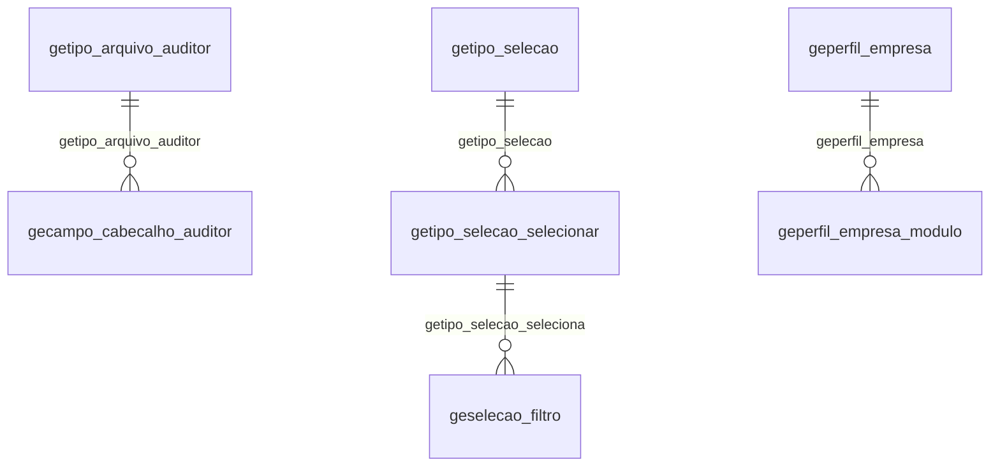

# Modelo — Geral - outros (rascunho em lote)

> Gerado por `src/model/gerar_docs_modelo.py` a partir de `src/model/modulos/geral_outros.yaml`, do catálogo e do perfil de colunas. **Não edite à mão.**

68 entidades. A coluna *Preench.* é o % de linhas com valor útil (nem nulo, nem em branco, nem zero, nem 1900-01-01; para colunas de código o zero conta como valor).

## Diagrama

## Entidades

| Entidade | Tabela | Linhas | Volume | Filtro obrigatório |
|---|---|---|---|---|
| [genotificacoes_usuario_atendimento](#genotificacoes_usuario_atendimento) | `GENOTIFICACOES_USUARIO_ATENDIMENTO` | 393.561 | medio | um de: sequencial, visualizado |
| [gerarotinas_processos](#gerarotinas_processos) | `GERAROTINAS_PROCESSOS` | 53.754 | medio | — |
| [gegestta_atividade](#gegestta_atividade) | `GEGESTTA_ATIVIDADE` | 47.858 | medio | — |
| [geindice_diario](#geindice_diario) | `GEINDICE_DIARIO` | 24.907 | medio | — |
| [geindice_medio](#geindice_medio) | `GEINDICE_MEDIO` | 1.185 | pequeno | — |
| [gecsperguntas_solucoes](#gecsperguntas_solucoes) | `GECSPERGUNTAS_SOLUCOES` | 7.968 | pequeno | — |
| [gecampo_cabecalho_auditor](#gecampo_cabecalho_auditor) | `GECAMPO_CABECALHO_AUDITOR` | 5.606 | pequeno | — |
| [gediagnostico_processamento](#gediagnostico_processamento) | `GEDIAGNOSTICO_PROCESSAMENTO` | 3.954 | pequeno | empresa |
| [gediagnostico_performance_ct](#gediagnostico_performance_ct) | `GEDIAGNOSTICO_PERFORMANCE_CT` | 2.464 | pequeno | empresa |
| [geatvsecundaria_vigencia](#geatvsecundaria_vigencia) | `geatvsecundaria_vigencia` | 3.952 | pequeno | empresa |
| [getabelas_exclusao_empresa](#getabelas_exclusao_empresa) | `GETABELAS_EXCLUSAO_EMPRESA` | 3.632 | pequeno | — |
| [usconfusuario_configurado](#usconfusuario_configurado) | `usconfusuario_configurado` | 2.144 | pequeno | — |
| [usconfusuario_preferencias](#usconfusuario_preferencias) | `USCONFUSUARIO_PREFERENCIAS` | 69 | pequeno | — |
| [usconfusuario_expediente](#usconfusuario_expediente) | `USCONFUSUARIO_EXPEDIENTE` | 5 | pequeno | — |
| [geempresas_moduloweb](#geempresas_moduloweb) | `GEEMPRESAS_MODULOWEB` | 1.969 | pequeno | empresa |
| [gecontador_envios_esocial](#gecontador_envios_esocial) | `GECONTADOR_ENVIOS_ESOCIAL` | 1.829 | pequeno | — |
| [geprperguntas_respostas](#geprperguntas_respostas) | `GEPRPERGUNTAS_RESPOSTAS` | 1.529 | pequeno | — |
| [gecheckpoint_incentivos_fiscais_cnae](#gecheckpoint_incentivos_fiscais_cnae) | `GECHECKPOINT_INCENTIVOS_FISCAIS_CNAE` | 1.510 | pequeno | — |
| [gecheckpoint_comparativo_regime_tributacao](#gecheckpoint_comparativo_regime_tributacao) | `GECHECKPOINT_COMPARATIVO_REGIME_TRIBUTACAO` | 168 | pequeno | empresa |
| [gecheckpoint_comparativo_regime_tributacao_saldo](#gecheckpoint_comparativo_regime_tributacao_saldo) | `GECHECKPOINT_COMPARATIVO_REGIME_TRIBUTACAO_SALDO` | 40 | pequeno | empresa |
| [gecnae_previdencia_social](#gecnae_previdencia_social) | `GECNAE_PREVIDENCIA_SOCIAL` | 1.301 | pequeno | — |
| [gecnae_classificacao_tributaria](#gecnae_classificacao_tributaria) | `GECNAE_CLASSIFICACAO_TRIBUTARIA` | 185 | pequeno | — |
| [geestacoes_moduloweb](#geestacoes_moduloweb) | `GEESTACOES_MODULOWEB` | 357 | pequeno | — |
| [gepastas_moduloweb](#gepastas_moduloweb) | `GEPASTAS_MODULOWEB` | 261 | pequeno | — |
| [geinformacoes_sgd_modulo_bloqueado](#geinformacoes_sgd_modulo_bloqueado) | `GEINFORMACOES_SGD_MODULO_BLOQUEADO` | 170 | pequeno | — |
| [geinformacoes_modulos](#geinformacoes_modulos) | `GEINFORMACOES_MODULOS` | 12 | pequeno | — |
| [geselecao_empresas_contabil](#geselecao_empresas_contabil) | `GESELECAO_EMPRESAS_CONTABIL` | 149 | pequeno | — |
| [geselecao_filtro](#geselecao_filtro) | `GESELECAO_FILTRO` | 62 | pequeno | — |
| [getabela_relacionamento_cnae_atividade_inss](#getabela_relacionamento_cnae_atividade_inss) | `GETABELA_RELACIONAMENTO_CNAE_ATIVIDADE_INSS` | 131 | pequeno | — |
| [getabela_grupo_tributo](#getabela_grupo_tributo) | `GETABELA_GRUPO_TRIBUTO` | 13 | pequeno | — |
| [getipo_selecao_selecionar](#getipo_selecao_selecionar) | `GETIPO_SELECAO_SELECIONAR` | 127 | pequeno | — |
| [getipo_selecao](#getipo_selecao) | `GETIPO_SELECAO` | 50 | pequeno | — |
| [getipo_arquivo_auditor](#getipo_arquivo_auditor) | `GETIPO_ARQUIVO_AUDITOR` | 29 | pequeno | — |
| [geperfil_empresa_modulo](#geperfil_empresa_modulo) | `GEPERFIL_EMPRESA_MODULO` | 119 | pequeno | empresa |
| [geperfil_empresa](#geperfil_empresa) | `GEPERFIL_EMPRESA` | 17 | pequeno | — |
| [geibge_tipo_obras_servicos](#geibge_tipo_obras_servicos) | `GEIBGE_TIPO_OBRAS_SERVICOS` | 86 | pequeno | — |
| [gedctf_web_pagamento_lancto](#gedctf_web_pagamento_lancto) | `GEDCTF_WEB_PAGAMENTO_LANCTO` | 84 | pequeno | empresa |
| [gedctf_web_pagamento](#gedctf_web_pagamento) | `GEDCTF_WEB_PAGAMENTO` | 82 | pequeno | empresa |
| [gefarol_ss_usuario_atendimento](#gefarol_ss_usuario_atendimento) | `GEFAROL_SS_USUARIO_ATENDIMENTO` | 78 | pequeno | — |
| [gefarol_ss_usuario_atendimento_onvio](#gefarol_ss_usuario_atendimento_onvio) | `GEFAROL_SS_USUARIO_ATENDIMENTO_ONVIO` | 14 | pequeno | — |
| [gepermissoes_usuario_atendimento](#gepermissoes_usuario_atendimento) | `GEPERMISSOES_USUARIO_ATENDIMENTO` | 78 | pequeno | — |
| [geatendimentolog_frp](#geatendimentolog_frp) | `GEATENDIMENTOLOG_FRP` | 72 | pequeno | — |
| [geferiados_febraban](#geferiados_febraban) | `GEFERIADOS_FEBRABAN` | 39 | pequeno | — |
| [gequadrosocietario_socios_representante_legal](#gequadrosocietario_socios_representante_legal) | `GEQUADROSOCIETARIO_SOCIOS_REPRESENTANTE_LEGAL` | 34 | pequeno | empresa |
| [gexcount_log_comunicacao](#gexcount_log_comunicacao) | `GEXCOUNT_LOG_COMUNICACAO` | 19 | pequeno | empresa |
| [gegerencia_versoes](#gegerencia_versoes) | `gegerencia_versoes` | 7 | pequeno | — |
| [geconfiguracao_envio_email_parametros_usuarios](#geconfiguracao_envio_email_parametros_usuarios) | `GECONFIGURACAO_ENVIO_EMAIL_PARAMETROS_USUARIOS` | 6 | pequeno | — |
| [geconfiguracao_envio_email](#geconfiguracao_envio_email) | `GECONFIGURACAO_ENVIO_EMAIL` | 1 | pequeno | — |
| [geatendimentocolunas_tipos](#geatendimentocolunas_tipos) | `GEATENDIMENTOCOLUNAS_TIPOS` | 3 | pequeno | — |
| [gefarois_atendimento](#gefarois_atendimento) | `GEFAROIS_ATENDIMENTO` | 1 | pequeno | — |
| [geversao_agente](#geversao_agente) | `GEVERSAO_AGENTE` | 1 | pequeno | — |
| [geprversao_tabelas](#geprversao_tabelas) | `GEPRVERSAO_TABELAS` | 1 | pequeno | — |
| [geprultima_verificacao](#geprultima_verificacao) | `GEPRULTIMA_VERIFICACAO` | 1 | pequeno | — |
| [gecsversao_tabelas](#gecsversao_tabelas) | `GECSVERSAO_TABELAS` | 1 | pequeno | — |
| [gecsultima_verificacao](#gecsultima_verificacao) | `GECSULTIMA_VERIFICACAO` | 1 | pequeno | — |
| [gedados_auditor](#gedados_auditor) | `GEDADOS_AUDITOR` | 1 | pequeno | — |
| [gedados_reforma_tributaria](#gedados_reforma_tributaria) | `GEDADOS_REFORMA_TRIBUTARIA` | 1 | pequeno | — |
| [geverificacao_exclusao_notas_contabil](#geverificacao_exclusao_notas_contabil) | `GEVERIFICACAO_EXCLUSAO_NOTAS_CONTABIL` | 1 | pequeno | — |
| [gecomunicador_web_parada_processo](#gecomunicador_web_parada_processo) | `GECOMUNICADOR_WEB_PARADA_PROCESSO` | 1 | pequeno | — |
| [gecomunicador_web_processo](#gecomunicador_web_processo) | `GECOMUNICADOR_WEB_PROCESSO` | 1 | pequeno | — |
| [geonvio_dados_sessao_company](#geonvio_dados_sessao_company) | `GEONVIO_DADOS_SESSAO_COMPANY` | 1 | pequeno | — |
| [geacoes_suporte_configuracoes](#geacoes_suporte_configuracoes) | `GEACOES_SUPORTE_CONFIGURACOES` | 1 | pequeno | — |
| [gebuscanfe_controle_acesso](#gebuscanfe_controle_acesso) | `GEBUSCANFE_CONTROLE_ACESSO` | 1 | pequeno | — |
| [gesieg_dados_sessao_company](#gesieg_dados_sessao_company) | `GESIEG_DADOS_SESSAO_COMPANY` | 1 | pequeno | — |
| [geprocessando_digial_bank](#geprocessando_digial_bank) | `GEPROCESSANDO_DIGIAL_BANK` | 1 | pequeno | — |
| [gever_executado](#gever_executado) | `GEVER_EXECUTADO` | 1 | pequeno | — |
| [geatendimento_publicar_documentos](#geatendimento_publicar_documentos) | `GEATENDIMENTO_PUBLICAR_DOCUMENTOS` | 42.851 | medio | — |
| [geatendimento_contas_iceberg](#geatendimento_contas_iceberg) | `GEATENDIMENTO_CONTAS_ICEBERG` | 5 | pequeno | empresa |

## genotificacoes_usuario_atendimento

**Notificações por usuário do Domínio Atendimento** — tabela `GENOTIFICACOES_USUARIO_ATENDIMENTO` (393.561 linhas)

Notificações por usuário do Domínio Atendimento. 393.561 linhas no catálogo; chave: SEQUENCIAL.

- **Chave:** `SEQUENCIAL`
- **Empresa:** `não se aplica (tabela global)`
- **Período:** `—` · exige um de: `sequencial, visualizado`
- **Ordem padrão:** `SEQUENCIAL asc`

**Regras de negócio validadas:**

- Medido em 2026-10-18: 393.561 linhas.

| Campo | Coluna | Tipo | Preench. | Domínio | Descrição (banco) |
|---|---|---|---|---|---|
| sequencial | `sequencial` | integer(4) |  |  |  |
| tipo_notificacao | `tipo_notificacao` | integer(4) |  |  |  |
| codigo | `codigo` | integer(4) |  |  |  |
| usuario | `usuario` | integer(4) |  |  |  |
| empresa | `empresa` | integer(4) |  |  |  |
| responsavel | `responsavel` | integer(4) |  |  |  |
| departamento | `departamento` | varchar(64) |  |  |  |
| situacao | `situacao` | integer(4) |  |  |  |
| assunto | `assunto` | varchar(250) |  |  |  |
| tipo | `tipo` | integer(4) |  |  |  |
| nome_empregado | `nome_empregado` | varchar(70) |  |  |  |
| cpf_empregado 🔒 | `cpf_empregado` | varchar(11) |  |  |  |
| visualizado | `visualizado` | integer(4) |  |  |  |
| flag_que_indica_se_o_registro_vem_do_da | `origem_atendimento` | integer(4) |  |  | Flag que indica se o registro vem do DA(1) ou não (0) |

**Filtros:** `sequencial` (eq/in), `tipo_notificacao` (eq/in), `codigo` (eq/in), `departamento` (contem/prefixo), `situacao` (eq/in), `assunto` (contem/prefixo), `tipo` (eq/in), `nome_empregado` (contem/prefixo), `cpf_empregado` (eq/in), `visualizado` (eq/in)

## gerarotinas_processos

**PROCESSOS DAS ROTINAS AUTOMÁTICAS** — tabela `GERAROTINAS_PROCESSOS` (53.754 linhas)

PROCESSOS DAS ROTINAS AUTOMÁTICAS. 53.754 linhas no catálogo; chave: I_ROTINAS, I_SISTEMA, I_PROCESSOS.

- **Chave:** `I_ROTINAS, I_SISTEMA, I_PROCESSOS`
- **Empresa:** `não se aplica (tabela global)`
- **Período:** `—`
- **Ordem padrão:** `I_ROTINAS asc`, `I_SISTEMA asc`

**Regras de negócio validadas:**

- Medido em 2026-10-18: 53.754 linhas.
- Vínculo gerarotinas (GERAROTINAS): 0 de 53.754 linhas sem registro relacionado.

| Campo | Coluna | Tipo | Preench. | Domínio | Descrição (banco) |
|---|---|---|---|---|---|
| codigo_da_rotina | `i_rotinas` | integer(4) |  |  | CÓDIGO DA ROTINA |
| codigo_do_sistema | `i_sistema` | smallint(2) |  |  | CÓDIGO DO SISTEMA |
| i_processos | `i_processos` | smallint(2) |  |  | CÓDIGO DO PROCESSO: (1-140) |
| selecionado | `selecionado` | smallint(2) |  |  | SELECIONADO |
| opcoes_da_tela | `opcoes_tela` | varchar(32000) |  |  | OPÇÕES DA TELA |

**Vínculos (LEFT JOIN, acrescentam colunas legíveis):**

- `gerarotinas` → `GERAROTINAS` por `i_rotinas` = `i_rotinas` e `i_sistema` = `i_sistema`; colunas: `gerarotinas_nome`

**Filtros:** `codigo_da_rotina` (eq/in), `codigo_do_sistema` (eq/in), `i_processos` (eq/in), `opcoes_da_tela` (contem/prefixo)

## gegestta_atividade

**Conclusão de atividades no módulo Processos** — tabela `GEGESTTA_ATIVIDADE` (47.858 linhas)

Conclusão de atividades no módulo Processos. 47.858 linhas no catálogo; chave: CODIGO.

- **Chave:** `CODIGO`
- **Empresa:** `não se aplica (tabela global)`
- **Período:** `—`
- **Ordem padrão:** `CODIGO asc`

**Regras de negócio validadas:**

- Medido em 2026-10-18: 47.858 linhas.

| Campo | Coluna | Tipo | Preench. | Domínio | Descrição (banco) |
|---|---|---|---|---|---|
| codigo | `codigo` | integer(4) |  |  |  |
| atividade | `atividade` | integer(4) |  |  |  |
| c_1_erro_0_nao_processado_1_processado | `processado` | integer(4) |  |  | -1 ERRO , 0 NÃO PROCESSADO, 1 PROCESSADO |
| c_1_contabil_2_agente | `tipo_processamento` | integer(4) |  |  | 1 - CONTABIL, 2 - AGENTE |

**Filtros:** `codigo` (eq/in), `c_1_contabil_2_agente` (eq/in)

## geindice_diario

**Índice diário** — tabela `GEINDICE_DIARIO` (24.907 linhas)

Índice diário. 24.907 linhas no catálogo; chave: I_INDICE, DATA_INDICE.

- **Chave:** `I_INDICE, DATA_INDICE`
- **Empresa:** `não se aplica (tabela global)`
- **Período:** `DATA_INDICE`
- **Ordem padrão:** `DATA_INDICE desc`, `I_INDICE asc`

**Regras de negócio validadas:**

- Medido em 2026-10-18: 24.907 linhas, DATA_INDICE de 1964-10-01 a 2026-01-01.
- Vínculo geindice (GEINDICE): 0 de 24.907 linhas sem registro relacionado.

| Campo | Coluna | Tipo | Preench. | Domínio | Descrição (banco) |
|---|---|---|---|---|---|
| codigo_do_indice | `i_indice` | integer(4) |  |  | Código do índice |
| data | `data_indice` | date(4) |  |  | Data |
| valor | `valor` | numeric(14) |  |  | Valor |

**Vínculos (LEFT JOIN, acrescentam colunas legíveis):**

- `geindice` → `GEINDICE` por `i_indice` = `i_indice`; colunas: `geindice_nome`

**Filtros:** `codigo_do_indice` (eq/in), `data` (eq/in)

## geindice_medio

**Índice médio** — tabela `GEINDICE_MEDIO` (1.185 linhas)

Índice médio. 1.185 linhas no catálogo; chave: I_INDICE, DATA_INDICE.

- **Chave:** `I_INDICE, DATA_INDICE`
- **Empresa:** `não se aplica (tabela global)`
- **Período:** `DATA_INDICE`
- **Ordem padrão:** `DATA_INDICE desc`, `I_INDICE asc`

**Regras de negócio validadas:**

- Medido em 2026-10-18: 1.185 linhas, DATA_INDICE de 1964-10-01 a 2018-12-01.
- Vínculo geindice (GEINDICE): 0 de 1.185 linhas sem registro relacionado.

| Campo | Coluna | Tipo | Preench. | Domínio | Descrição (banco) |
|---|---|---|---|---|---|
| codigo_do_indice | `i_indice` | integer(4) |  |  | Código do índice |
| data | `data_indice` | date(4) |  |  | Data |
| valor | `valor` | numeric(14) |  |  | Valor |

**Vínculos (LEFT JOIN, acrescentam colunas legíveis):**

- `geindice` → `GEINDICE` por `i_indice` = `i_indice`; colunas: `geindice_nome`

**Filtros:** `codigo_do_indice` (eq/in), `data` (eq/in)

## gecsperguntas_solucoes

**Perguntas e soluções da Central de Soluções** — tabela `GECSPERGUNTAS_SOLUCOES` (7.968 linhas)

Perguntas e soluções da Central de Soluções. 7.968 linhas no catálogo; chave: ID.

- **Chave:** `ID`
- **Empresa:** `não se aplica (tabela global)`
- **Período:** `—`
- **Ordem padrão:** `ID asc`

**Regras de negócio validadas:**

- Medido em 2026-10-18: 7.968 linhas.

| Campo | Coluna | Tipo | Preench. | Domínio | Descrição (banco) |
|---|---|---|---|---|---|
| id | `id` | uniqueidentifier(16) |  |  |  |
| codigo | `codigo` | integer(4) |  |  |  |
| sistema | `sistema` | integer(4) |  |  |  |
| modulo | `modulo` | integer(4) |  |  |  |
| classificacao | `classificacao` | integer(4) |  |  |  |
| pergunta | `pergunta` | varchar(4000) |  |  |  |
| titulo | `titulo` | varchar(4000) |  |  |  |
| tipo | `tipo` | integer(4) |  |  |  |
| tags | `tags` | varchar(4000) |  |  |  |
| quantidade_acessos | `quantidade_acessos` | integer(4) |  |  |  |
| quantidade_total_acessos | `quantidade_total_acessos` | integer(4) |  |  |  |
| ids_telas_contabil | `ids_telas_contabil` | varchar(4000) |  |  |  |
| ativo | `ativo` | integer(4) |  |  |  |

**Filtros:** `id` (eq/in), `codigo` (eq/in), `pergunta` (contem/prefixo), `titulo` (contem/prefixo), `tipo` (eq/in), `tags` (contem/prefixo), `ids_telas_contabil` (contem/prefixo)

## gecampo_cabecalho_auditor

**Cabeçalho Auditor Digital** — tabela `GECAMPO_CABECALHO_AUDITOR` (5.606 linhas)

Cabeçalho Auditor Digital. 5.606 linhas no catálogo; chave: CODIGO_CAMPO.

- **Chave:** `CODIGO_CAMPO`
- **Empresa:** `não se aplica (tabela global)`
- **Período:** `—`
- **Ordem padrão:** `CODIGO_CAMPO asc`

**Regras de negócio validadas:**

- Medido em 2026-10-18: 5.606 linhas.
- Vínculo getipo_arquivo_auditor (GETIPO_ARQUIVO_AUDITOR): 0 de 5.606 linhas sem registro relacionado.

| Campo | Coluna | Tipo | Preench. | Domínio | Descrição (banco) |
|---|---|---|---|---|---|
| codigo_do_campo | `codigo_campo` | integer(4) |  |  | Código do campo |
| codigo_do_arquivo | `codigo_arquivo` | integer(4) |  |  | Código do arquivo |
| campo | `campo` | varchar(256) |  |  | Campo |
| descricao_do_campo | `campo_desc` | varchar(256) |  |  | Descrição do campo |

**Vínculos (LEFT JOIN, acrescentam colunas legíveis):**

- `getipo_arquivo_auditor` → `GETIPO_ARQUIVO_AUDITOR` por `codigo_arquivo` = `codigo_arquivo`; colunas: `getipo_arquivo_auditor_nome`

**Filtros:** `codigo_do_campo` (eq/in), `codigo_do_arquivo` (eq/in), `campo` (contem/prefixo), `descricao_do_campo` (contem/prefixo)

## gediagnostico_processamento

**Tempos de processamento de funcionalidades** — tabela `GEDIAGNOSTICO_PROCESSAMENTO` (3.954 linhas)

Tempos de processamento de funcionalidades. 3.954 linhas no catálogo; chave: CODI_EMP, COMPETENCIA, FUNCIONALIDADE.

- **Chave:** `CODI_EMP, COMPETENCIA, FUNCIONALIDADE`
- **Empresa:** `CODI_EMP`
- **Período:** `COMPETENCIA`
- **Ordem padrão:** `COMPETENCIA desc`, `FUNCIONALIDADE asc`

**Regras de negócio validadas:**

- Medido em 2026-10-18: 3.916 linhas, 700 empresa(s), COMPETENCIA de 2012-10-01 a 2026-09-01.
- dominio_web_1_sim_0_nao: todos os valores reais estão no comentário do banco (0=3.916).
- Vínculo geempre (geempre): 0 de 4 linhas sem registro relacionado (empresa 1727).

| Campo | Coluna | Tipo | Preench. | Domínio | Descrição (banco) |
|---|---|---|---|---|---|
| codigo_da_empresa | `codi_emp` | integer(4) |  |  | Código da empresa |
| competencia_data | `competencia` | date(4) |  |  | Competência (data) |
| funcionalidade_apuracao_folhapagamento | `funcionalidade` | varchar(50) |  |  | Funcionalidade: Apuracao, FolhaPagamento |
| usuario_do_sistema | `usuario` | varchar(128) |  |  | Usuário do sistema |
| versao_do_sistema | `versao` | varchar(50) |  |  | Versão do sistema |
| dominio_web_1_sim_0_nao | `dominio_web` | smallint(2) |  | gediagnostico_processamento_dominio_web | Dominio Web(1 - Sim/0 - Nao) |

**Vínculos (LEFT JOIN, acrescentam colunas legíveis):**

- `geempre` → `geempre` por `codi_emp` = `codi_emp`; colunas: `geempre_nome`

**Filtros:** `competencia_data` (eq/in), `funcionalidade_apuracao_folhapagamento` (eq/in), `usuario_do_sistema` (contem/prefixo), `versao_do_sistema` (contem/prefixo)

## gediagnostico_performance_ct

**Diagnóstico de Performance (retenção 90 dias)** — tabela `GEDIAGNOSTICO_PERFORMANCE_CT` (2.464 linhas)

Diagnóstico de Performance (retenção 90 dias). 2.464 linhas no catálogo; chave: I_LOG.

- **Chave:** `I_LOG`
- **Empresa:** `CODI_EMP`
- **Período:** `PERIODO_DATA_INICIAL`
- **Ordem padrão:** `PERIODO_DATA_INICIAL desc`, `I_LOG asc`

**Regras de negócio validadas:**

- Medido em 2026-10-18: 2.464 linhas, 427 empresa(s), PERIODO_DATA_INICIAL de 2022-01-01 a 2025-12-01.

| Campo | Coluna | Tipo | Preench. | Domínio | Descrição (banco) |
|---|---|---|---|---|---|
| identificador_unico_do_registro | `i_log` | bigint(8) |  |  | Identificador único do registro |
| codigo_da_empresa | `codi_emp` | integer(4) |  |  | Código da empresa |
| codigo_da_scp_sera_considerado_0_para_so | `scp` | varchar(20) |  |  | Código da SCP. Será considerado "0" para sócio ostensivo. |
| funcionalidade_sped_contabil_sped_ecf | `funcionalidade` | varchar(50) |  |  | Funcionalidade: SPED Contábil, SPED ECF |
| usuario_que_executou_o_processo | `usuario` | varchar(255) |  |  | Usuário que executou o processo |
| versao_do_sistema_no_momento_da_execucao | `versao_sistema` | varchar(80) |  |  | Versão do sistema no momento da execução |
| codigos_de_filiais_envolvidas_separadas | `codigos_filiais` | varchar(4000) |  |  | Códigos de filiais envolvidas (separadas por vírgula) |
| data_inicial_do_periodo_do_relatorio_pro | `periodo_data_inicial` | date(4) |  |  | Data inicial do período do relatório/processo |
| data_final_do_periodo_do_relatorio_proce | `periodo_data_final` | date(4) |  |  | Data final do período do relatório/processo |
| total_de_lancamentos | `total_lancamentos` | integer(4) |  |  | Total de lançamentos |
| total_de_contas | `total_contas_contabeis` | integer(4) |  |  | Total de contas |
| total_de_centros_de_custo | `total_centros_custo` | integer(4) |  |  | Total de centros de custo |
| tempo_de_geracao_cpu_ms_sem_espera_ocios | `tempo_geracao_ms` | bigint(8) |  |  | Tempo de geração (CPU, ms) sem espera ociosa |
| c_1_dominio_web_0_nao | `dominio_web` | smallint(2) |  |  | 1=Domínio Web, 0=Não |

**Filtros:** `identificador_unico_do_registro` (eq/in), `data_inicial_do_periodo_do_relatorio_pro` (entre/gte/lte), `data_final_do_periodo_do_relatorio_proce` (entre/gte/lte), `codigo_da_scp_sera_considerado_0_para_so` (eq/in), `funcionalidade_sped_contabil_sped_ecf` (contem/prefixo), `usuario_que_executou_o_processo` (contem/prefixo), `versao_do_sistema_no_momento_da_execucao` (contem/prefixo), `codigos_de_filiais_envolvidas_separadas` (contem/prefixo)

## geatvsecundaria_vigencia

**Empresa - Cadastro - Atividades secundarias Vigencia** — tabela `geatvsecundaria_vigencia` (3.952 linhas)

Empresa - Cadastro - Atividades secundarias Vigencia. 3.952 linhas no catálogo; chave: codigo_cnae, codi_emp, data.

- **Chave:** `codigo_cnae, codi_emp, data`
- **Empresa:** `codi_emp`
- **Período:** `data`
- **Ordem padrão:** `data desc`, `codigo_cnae asc`

**Regras de negócio validadas:**

- Medido em 2026-10-18: 3.952 linhas, 950 empresa(s), data de 1990-01-01 a 1990-01-01.

| Campo | Coluna | Tipo | Preench. | Domínio | Descrição (banco) |
|---|---|---|---|---|---|
| codigo_cnae | `codigo_cnae` | char(15) |  |  | Codigo CNAE |
| codigo_da_empresa | `codi_emp` | integer(4) |  |  | Codigo da empresa |
| data_da_vigencia | `data` | date(4) |  |  | Data da vigencia |
| usa_o_cnae_2_0_s_n | `usa_cnae20` | char(1) |  |  | Usa o CNAE 2.0 (S/N) |
| ordem | `ordem` | tinyint(1) |  |  | Ordem |

**Filtros:** `codigo_cnae` (eq/in), `data_da_vigencia` (eq/in), `usa_o_cnae_2_0_s_n` (eq/in)

## getabelas_exclusao_empresa

**Tabelas ordenadas para realizar a exclusão da empresa** — tabela `GETABELAS_EXCLUSAO_EMPRESA` (3.632 linhas)

Tabelas ordenadas para realizar a exclusão da empresa. 3.632 linhas no catálogo; chave: ORDEM, TABELA.

- **Chave:** `ORDEM, TABELA`
- **Empresa:** `não se aplica (tabela global)`
- **Período:** `—`
- **Ordem padrão:** `ORDEM asc`

**Regras de negócio validadas:**

- Medido em 2026-10-18: 3.632 linhas.

| Campo | Coluna | Tipo | Preench. | Domínio | Descrição (banco) |
|---|---|---|---|---|---|
| a_ordem_que_a_tabela_deve_ser_excluida | `ordem` | integer(4) |  |  | A ordem que a tabela deve ser excluída |
| nome_da_tabela | `tabela` | varchar(300) |  |  | Nome da tabela |

**Filtros:** `a_ordem_que_a_tabela_deve_ser_excluida` (eq/in), `nome_da_tabela` (contem/prefixo)

## usconfusuario_configurado

**Cadastro de usuário - indica se o usuario esta configurado** — tabela `usconfusuario_configurado` (2.144 linhas)

Cadastro de usuário - indica se o usuario esta configurado. 2.144 linhas no catálogo; chave: i_confusuario, tipo, modulo.

- **Chave:** `i_confusuario, tipo, modulo`
- **Empresa:** `não se aplica (tabela global)`
- **Período:** `—`
- **Ordem padrão:** `i_confusuario asc`, `tipo asc`

**Regras de negócio validadas:**

- Medido em 2026-10-18: 2.144 linhas.
- Vínculo usconfusuario (usConfUsuario): 0 de 2.144 linhas sem registro relacionado.

| Campo | Coluna | Tipo | Preench. | Domínio | Descrição (banco) |
|---|---|---|---|---|---|
| codigo | `i_confusuario` | integer(4) |  |  | Codigo |
| tipo | `tipo` | smallint(2) |  |  | Tipo (1=Usuario, 2=Grupo de modulos/menu, 3=Grupo de empresas) |
| codigo_do_modulo | `modulo` | integer(4) |  |  | Codigo do modulo |

**Vínculos (LEFT JOIN, acrescentam colunas legíveis):**

- `usconfusuario` → `usConfUsuario` por `tipo` = `tipo` e `i_confusuario` = `i_confusuario`; colunas: `usconfusuario_nome`

**Filtros:** `codigo` (eq/in), `tipo` (eq/in), `codigo_do_modulo` (eq/in)

## usconfusuario_preferencias

**Tabela para armazenar as preferências do usuário** — tabela `USCONFUSUARIO_PREFERENCIAS` (69 linhas)

Tabela para armazenar as preferências do usuário. 69 linhas no catálogo; chave: CODI_TIPO_USUARIO, CODI_USUARIO.

- **Chave:** `CODI_TIPO_USUARIO, CODI_USUARIO`
- **Empresa:** `não se aplica (tabela global)`
- **Período:** `—`
- **Ordem padrão:** `CODI_TIPO_USUARIO asc`, `CODI_USUARIO asc`

**Regras de negócio validadas:**

- Medido em 2026-10-18: 70 linhas.
- Vínculo usconfusuario (usConfUsuario): 0 de 70 linhas sem registro relacionado.

| Campo | Coluna | Tipo | Preench. | Domínio | Descrição (banco) |
|---|---|---|---|---|---|
| codigo_do_tipo_de_usuario | `codi_tipo_usuario` | smallint(2) |  |  | Código do tipo de usuário |
| codigo_do_usuario | `codi_usuario` | integer(4) |  |  | Código do usuário |
| c_1_abre_o_pdf_depois_que_salva_um_relat | `relatorio_abrir_pdf_apos_salvar` | bit(1) |  |  | 1 = Abre o pdf depois que salva um relatório em PDF, 0 = Não abre |
| c_1_abre_o_planilha_depois_que_salva_um | `relatorio_abrir_planilha_apos_salvar` | bit(1) |  |  | 1 = Abre o planilha depois que salva um relatório em XLS/XLSX, 0 = Não abre |
| c_0_proprio_1_por_procuracao | `relatorio_certificado_proprio_procuracao` | bit(1) |  |  | 0 = Próprio, 1 = Por Procuração |

**Vínculos (LEFT JOIN, acrescentam colunas legíveis):**

- `usconfusuario` → `usConfUsuario` por `codi_tipo_usuario` = `tipo` e `codi_usuario` = `i_confusuario`; colunas: `usconfusuario_nome`

**Filtros:** `codigo_do_tipo_de_usuario` (eq/in), `codigo_do_usuario` (eq/in)

## usconfusuario_expediente

**Expediente do usuário** — tabela `USCONFUSUARIO_EXPEDIENTE` (5 linhas)

Expediente do usuário. 5 linhas no catálogo; chave: CODI_TIPO_USUARIO, CODI_USUARIO, CODI_EXIGENCIA.

- **Chave:** `CODI_TIPO_USUARIO, CODI_USUARIO, CODI_EXIGENCIA`
- **Empresa:** `não se aplica (tabela global)`
- **Período:** `—`
- **Ordem padrão:** `CODI_TIPO_USUARIO asc`, `CODI_USUARIO asc`

**Regras de negócio validadas:**

- Medido em 2026-10-18: 5 linhas.
- Vínculo usconfusuario (usConfUsuario): 0 de 5 linhas sem registro relacionado.

| Campo | Coluna | Tipo | Preench. | Domínio | Descrição (banco) |
|---|---|---|---|---|---|
| codi_tipo_usuario | `codi_tipo_usuario` | smallint(2) |  |  |  |
| codi_usuario | `codi_usuario` | integer(4) |  |  |  |
| codi_exigencia | `codi_exigencia` | integer(4) |  |  |  |
| c_1_domingo_2_segunda_feira_3_terca_feir | `dia_semana` | integer(4) |  |  | 1 - Domingo, 2 - Segunda-feira, 3 - Terça-feira, 4 - Quarta-feira, 5 - Quinta-feira, 6 - Sexta-feira, 7 - Sábado. |
| hora_inicial | `hora_inicial` | time(8) |  |  |  |
| hora_final | `hora_final` | time(8) |  |  |  |

**Vínculos (LEFT JOIN, acrescentam colunas legíveis):**

- `usconfusuario` → `usConfUsuario` por `codi_tipo_usuario` = `tipo` e `codi_usuario` = `i_confusuario`; colunas: `usconfusuario_nome`

**Filtros:** `codi_tipo_usuario` (eq/in), `codi_usuario` (eq/in), `codi_exigencia` (eq/in)

## geempresas_moduloweb

**Relação de empresas que utilizam o Domínio Atendimento** — tabela `GEEMPRESAS_MODULOWEB` (1.969 linhas)

Relação de empresas que utilizam o Domínio Atendimento. 1.969 linhas no catálogo; chave: CODI_EMP.

- **Chave:** `CODI_EMP`
- **Empresa:** `CODI_EMP`
- **Período:** `—`
- **Ordem padrão:** 

**Regras de negócio validadas:**

- Medido em 2026-10-18: 1.969 linhas, 1.969 empresa(s).
- Vínculo geempre (geempre): 0 de 1 linhas sem registro relacionado (empresa 123).

| Campo | Coluna | Tipo | Preench. | Domínio | Descrição (banco) |
|---|---|---|---|---|---|
| codi_emp | `codi_emp` | integer(4) |  |  |  |
| usa_dominio_web | `usa_dominio_web` | smallint(2) |  |  |  |
| sincronizar_dados | `sincronizar_dados` | smallint(2) |  |  |  |

**Vínculos (LEFT JOIN, acrescentam colunas legíveis):**

- `geempre` → `geempre` por `codi_emp` = `codi_emp`; colunas: `geempre_nome`

## gecontador_envios_esocial

**Liga contadores aos eventos e-Social gerados - Tabela de relacionamento entre contador e eventos e-Social através de CODI_EMP_DADOS_EVENTOS e I_DADOS_EVENTOS** — tabela `GECONTADOR_ENVIOS_ESOCIAL` (1.829 linhas)

Liga contadores aos eventos e-Social gerados - Tabela de relacionamento entre contador e eventos e-Social através de CODI_EMP_DADOS_EVENTOS e I_DADOS_EVENTOS. 1.829 linhas no catálogo; chave: codi_con, CODI_EMP_DADOS_EVENTOS, I_DADOS_EVENTOS.

- **Chave:** `codi_con, CODI_EMP_DADOS_EVENTOS, I_DADOS_EVENTOS`
- **Empresa:** `não se aplica (tabela global)`
- **Período:** `—`
- **Ordem padrão:** `codi_con asc`, `CODI_EMP_DADOS_EVENTOS asc`

**Regras de negócio validadas:**

- Medido em 2026-10-18: 1.831 linhas.
- Vínculo foesocial_dados_eventos (FOESOCIAL_DADOS_EVENTOS): 0 de 1.831 linhas sem registro relacionado.
- Vínculo gecontador (GeContador): 0 de 1.831 linhas sem registro relacionado.

| Campo | Coluna | Tipo | Preench. | Domínio | Descrição (banco) |
|---|---|---|---|---|---|
| codi_con | `codi_con` | integer(4) |  |  |  |
| codi_emp_dados_eventos | `codi_emp_dados_eventos` | integer(4) |  |  |  |
| i_dados_eventos | `i_dados_eventos` | integer(4) |  |  |  |

**Vínculos (LEFT JOIN, acrescentam colunas legíveis):**

- `foesocial_dados_eventos` → `FOESOCIAL_DADOS_EVENTOS` por `codi_emp_dados_eventos` = `codi_emp` e `i_dados_eventos` = `i_dados_eventos`; colunas: `foesocial_dados_eventos_nome`
- `gecontador` → `GeContador` por `codi_con` = `codi_con`; colunas: `gecontador_nome`

**Filtros:** `codi_con` (eq/in), `codi_emp_dados_eventos` (eq/in), `i_dados_eventos` (eq/in)

## geprperguntas_respostas

**Perguntas e Respostas do Checkpoint** — tabela `GEPRPERGUNTAS_RESPOSTAS` (1.529 linhas)

Perguntas e Respostas do Checkpoint. 1.529 linhas no catálogo; chave: ID.

- **Chave:** `ID`
- **Empresa:** `não se aplica (tabela global)`
- **Período:** `DATA_VIGENCIA_ATE`
- **Ordem padrão:** `DATA_VIGENCIA_ATE desc`, `ID asc`

**Regras de negócio validadas:**

- Medido em 2026-10-18: 1.529 linhas, DATA_VIGENCIA_ATE de 2018-10-10 a 2018-10-10.

| Campo | Coluna | Tipo | Preench. | Domínio | Descrição (banco) |
|---|---|---|---|---|---|
| id | `id` | uniqueidentifier(16) |  |  |  |
| id_fisco | `id_fisco` | integer(4) |  |  |  |
| replica | `replica` | integer(4) |  |  |  |
| tipo_atendimento | `tipo_atendimento` | varchar(32) |  |  |  |
| status | `status` | integer(4) |  |  |  |
| data_vigencia_ate | `data_vigencia_ate` | date(4) |  |  |  |
| excluido | `excluido` | integer(4) |  |  |  |

**Filtros:** `id` (eq/in), `data_vigencia_ate` (entre/gte/lte), `tipo_atendimento` (contem/prefixo)

## gecheckpoint_incentivos_fiscais_cnae

**Codigo de atividade economica** — tabela `GECHECKPOINT_INCENTIVOS_FISCAIS_CNAE` (1.510 linhas)

Codigo de atividade economica. 1.510 linhas no catálogo; chave: CNAE22, CAMPO_SITE.

- **Chave:** `CNAE22, CAMPO_SITE`
- **Empresa:** `não se aplica (tabela global)`
- **Período:** `—`
- **Ordem padrão:** `CNAE22 asc`, `CAMPO_SITE asc`

**Regras de negócio validadas:**

- Medido em 2026-10-18: 1.510 linhas.

| Campo | Coluna | Tipo | Preench. | Domínio | Descrição (banco) |
|---|---|---|---|---|---|
| cnae22 | `cnae22` | varchar(15) |  |  |  |
| campo_site | `campo_site` | varchar(15) |  |  |  |

**Filtros:** `cnae22` (eq/in), `campo_site` (eq/in)

## gecheckpoint_comparativo_regime_tributacao

**Checkpoint - Comparativo de Regime de Tributação** — tabela `GECHECKPOINT_COMPARATIVO_REGIME_TRIBUTACAO` (168 linhas)

Checkpoint - Comparativo de Regime de Tributação. 168 linhas no catálogo; chave: CODI_EMP, ANO_CALENDARIO, MES.

- **Chave:** `CODI_EMP, ANO_CALENDARIO, MES`
- **Empresa:** `CODI_EMP`
- **Período:** `—`
- **Ordem padrão:** `ANO_CALENDARIO asc`, `MES asc`

**Regras de negócio validadas:**

- Medido em 2026-10-18: 168 linhas, 13 empresa(s).
- Vínculo geempre (geempre): 0 de 12 linhas sem registro relacionado (empresa 635).

| Campo | Coluna | Tipo | Preench. | Domínio | Descrição (banco) |
|---|---|---|---|---|---|
| empresa | `codi_emp` | integer(4) |  |  | Empresa |
| ano_calendario | `ano_calendario` | integer(4) |  |  | Ano calendário |
| mes | `mes` | integer(4) |  |  | Mês |
| folha_salarios_em_12_meses | `folha_salario_12_meses` | numeric(13) |  |  | Folha salários em 12 meses |
| saldo_ipi | `saldo_ipi` | numeric(13) |  |  | Saldo IPI |
| saldo_icms | `saldo_icms` | numeric(13) |  |  | Saldo ICMS |
| folha_salarios | `folha_salario` | numeric(13) |  |  | Folha Salários |
| folha_contribuintes | `folha_contribuinte` | numeric(13) |  |  | Folha Contribuintes |
| outras_despesas | `outras_despesas` | numeric(13) |  |  | Outras despesas |
| base_de_calculo_credito_de_pis | `base_calculo_credito_pis` | numeric(13) |  |  | Base de cálculo crédito de PIS |
| base_de_calculo_credito_de_cofins | `base_calculo_credito_cofins` | numeric(13) |  |  | Base de cálculo crédito de COFINS |
| adicoes_do_lalur_exceto_csll | `adicao_lalur` | numeric(13) |  |  | Adições do LALUR (exceto CSLL) |
| exclusoes_do_lalur | `exclusao_lalur` | numeric(13) |  |  | Exclusões do LALUR |
| coluna_receita_bruta_comercio_exportacao | `rb_comercio_exportacao` | numeric(13) |  |  | Coluna receita bruta comercio exportacao |
| rb_comercio_exportacao_ind | `rb_comercio_exportacao_ind` | numeric(13) |  |  | Coluna receita bruta comercio exportacao indireta |
| coluna_receita_bruta_comercio_nao_tribut | `rb_comercio_n_trib_piscofins` | numeric(13) |  |  | Coluna receita bruta comercio não tributada por piscofins |
| coluna_receita_bruta_comercio_demais_ati | `rb_comercio_demais_ativ` | numeric(13) |  |  | Coluna receita bruta comercio demais atividades |
| coluna_receita_bruta_servico_exportacao | `rb_servico_exportacao` | numeric(13) |  |  | Coluna receita bruta servico exportacao |
| coluna_receita_bruta_servico_nao_tributa | `rb_servico_n_trib_piscofins` | numeric(13) |  |  | Coluna receita bruta servico nao tributada por pis/cofins |
| coluna_receita_bruta_servico_demais_ativ | `rb_servico_demais_ativ` | numeric(13) |  |  | Coluna receita bruta servico demais atividades |
| coluna_receita_bruta_industria_exportaca | `rb_industria_exportacao` | numeric(13) |  |  | Coluna receita bruta industria exportacao |
| rb_industria_exportacao_ind | `rb_industria_exportacao_ind` | numeric(13) |  |  | Coluna receita bruta industria exportacao indireta |
| coluna_receita_bruta_industria_nao_tribu | `rb_industria_n_trib_piscofins` | numeric(13) |  |  | Coluna receita bruta industria nao tributada por pis/cofins |
| coluna_receita_bruta_industria_pis_cofin | `rb_industria_piscofins_mono` | numeric(13) |  |  | Coluna receita bruta industria pis/cofins monofasico |
| rb_industria_piscofins_st | `rb_industria_piscofins_st` | numeric(13) |  |  | Coluna receita bruta industria pis/cofins st |
| coluna_receita_bruta_industria_demais_at | `rb_industria_demais_ativ` | numeric(13) |  |  | Coluna receita bruta industria demais atividades |
| coluna_receita_bruta_mercado_interno_em | `rb_mercado_interno_12_meses` | numeric(13) |  |  | Coluna receita bruta mercado interno em 12 meses |
| coluna_receita_bruta_mercado_externo_em | `rb_mercado_externo_12_meses` | numeric(13) |  |  | Coluna receita bruta mercado externo em 12 meses |
| coluna_receita_financeiras_de_jcp | `rf_jcp` | numeric(13) |  |  | Coluna receita financeiras de jcp |
| coluna_receita_financeira_exceto_jcp | `rf_exceto_jcp` | numeric(13) |  |  | Coluna receita financeira exceto jcp |
| coluna_pis_monofasico_e_st | `pis_mono_e_st` | numeric(13) |  |  | Coluna pis monofasico e st |
| coluna_cofins_monofasico_e_st | `cofins_mono_e_st` | numeric(13) |  |  | Coluna cofins monofasico e st |

**Vínculos (LEFT JOIN, acrescentam colunas legíveis):**

- `geempre` → `geempre` por `codi_emp` = `codi_emp`; colunas: `geempre_nome`

**Filtros:** `ano_calendario` (eq/in), `mes` (eq/in)

## gecheckpoint_comparativo_regime_tributacao_saldo

**Checkpoint - Comparativo de Regime de Tributação - Informações saldos** — tabela `GECHECKPOINT_COMPARATIVO_REGIME_TRIBUTACAO_SALDO` (40 linhas)

Checkpoint - Comparativo de Regime de Tributação - Informações saldos. 40 linhas no catálogo; chave: CODI_EMP, CAMPO.

- **Chave:** `CODI_EMP, CAMPO`
- **Empresa:** `CODI_EMP`
- **Período:** `—`
- **Ordem padrão:** `CAMPO asc`

**Regras de negócio validadas:**

- Medido em 2026-10-18: 40 linhas, 13 empresa(s).
- Vínculo geempre (geempre): 0 de 3 linhas sem registro relacionado (empresa 586).

| Campo | Coluna | Tipo | Preench. | Domínio | Descrição (banco) |
|---|---|---|---|---|---|
| empresa | `codi_emp` | integer(4) |  |  | Empresa |
| coluna | `campo` | varchar(100) |  |  | Coluna |
| determinar_a_forma_de_importar_o_saldo_d | `determinar_forma_importacao_saldo` | char(1) |  |  | Determinar a forma de importar o saldo das contas contábeis (S/N) |
| forma_de_importar_o_saldo_das_contas_con | `tipo_saldo_importacao` | smallint(2) |  |  | Forma de importar o saldo das contas contábeis |
| importar_valores_c_das_contas_contabeis | `origem_importar_valores` | char(1) |  |  | Importar valores C - Das contas contábeis / R - Das rubricas do módulo folha. |

**Vínculos (LEFT JOIN, acrescentam colunas legíveis):**

- `geempre` → `geempre` por `codi_emp` = `codi_emp`; colunas: `geempre_nome`

**Filtros:** `coluna` (eq/in), `determinar_a_forma_de_importar_o_saldo_d` (eq/in), `forma_de_importar_o_saldo_das_contas_con` (eq/in), `importar_valores_c_das_contas_contabeis` (eq/in)

## gecnae_previdencia_social

**Tabela de CNAE da previdência social** — tabela `GECNAE_PREVIDENCIA_SOCIAL` (1.301 linhas)

Tabela de CNAE da previdência social. 1.301 linhas no catálogo; chave: I_CNAE.

- **Chave:** `I_CNAE`
- **Empresa:** `não se aplica (tabela global)`
- **Período:** `—`
- **Ordem padrão:** `I_CNAE asc`

**Regras de negócio validadas:**

- Medido em 2026-10-18: 1.301 linhas.

| Campo | Coluna | Tipo | Preench. | Domínio | Descrição (banco) |
|---|---|---|---|---|---|
| codigo_cnae | `i_cnae` | varchar(15) |  |  | Código CNAE. |
| descricao | `descricao` | varchar(300) |  |  | Descrição. |

**Filtros:** `codigo_cnae` (eq/in), `descricao` (contem/prefixo)

## gecnae_classificacao_tributaria

**Classificação de códigos CNAE quanto à elegibilidade ao Simples Nacional: impeditivos, híbridos ou fator R** — tabela `GECNAE_CLASSIFICACAO_TRIBUTARIA` (185 linhas)

Classificação de códigos CNAE quanto à elegibilidade ao Simples Nacional: impeditivos, híbridos ou fator R. 185 linhas no catálogo; chave: I_CNAE20.

- **Chave:** `I_CNAE20`
- **Empresa:** `não se aplica (tabela global)`
- **Período:** `—`
- **Ordem padrão:** `I_CNAE20 asc`

**Regras de negócio validadas:**

- Medido em 2026-10-18: 185 linhas.
- Vínculo gecnae20 (gecnae20): 0 de 185 linhas sem registro relacionado.

| Campo | Coluna | Tipo | Preench. | Domínio | Descrição (banco) |
|---|---|---|---|---|---|
| i_cnae20 | `i_cnae20` | char(15) |  |  | Código CNAE 20 |
| descricao | `descricao` | varchar(300) |  |  | Descricao |
| c_0_sem_impeditivo_1_impeditivo_simples | `tipo_impeditivo` | integer(4) |  |  | 0 = sem impeditivo / 1 = Impeditivo Simples Nacional / 2 = Impeditivo atividade hibrida / 3 = Impeditivo sujeito ao Fator R |

**Vínculos (LEFT JOIN, acrescentam colunas legíveis):**

- `gecnae20` → `gecnae20` por `i_cnae20` = `i_cnae20`; colunas: `gecnae20_nome`

**Filtros:** `i_cnae20` (eq/in), `descricao` (contem/prefixo), `c_0_sem_impeditivo_1_impeditivo_simples` (eq/in)

## geestacoes_moduloweb

**Usuário e máquina que configurou o Domínio Atendimento para o usuário** — tabela `GEESTACOES_MODULOWEB` (357 linhas)

Usuário e máquina que configurou o Domínio Atendimento para o usuário. 357 linhas no catálogo; chave: I_CONFUSUARIO, TIPO, MACADRESS.

- **Chave:** `I_CONFUSUARIO, TIPO, MACADRESS`
- **Empresa:** `não se aplica (tabela global)`
- **Período:** `—`
- **Ordem padrão:** `I_CONFUSUARIO asc`, `TIPO asc`

**Regras de negócio validadas:**

- Medido em 2026-10-18: 357 linhas.
- Vínculo usconfusuario (usConfUsuario): 0 de 357 linhas sem registro relacionado.

| Campo | Coluna | Tipo | Preench. | Domínio | Descrição (banco) |
|---|---|---|---|---|---|
| i_confusuario | `i_confusuario` | integer(4) |  |  |  |
| tipo | `tipo` | smallint(2) |  |  |  |
| macadress | `macadress` | varchar(40) |  |  |  |

**Vínculos (LEFT JOIN, acrescentam colunas legíveis):**

- `usconfusuario` → `usConfUsuario` por `tipo` = `tipo` e `i_confusuario` = `i_confusuario`; colunas: `usconfusuario_nome`

**Filtros:** `i_confusuario` (eq/in), `tipo` (eq/in), `macadress` (eq/in)

## gepastas_moduloweb

**Pastas de publicação do Onvio** — tabela `GEPASTAS_MODULOWEB` (261 linhas)

Pastas de publicação do Onvio. 261 linhas no catálogo; chave: MODULO, DEPARTAMENTO, JANELA, PASTA.

- **Chave:** `MODULO, DEPARTAMENTO, JANELA, PASTA`
- **Empresa:** `não se aplica (tabela global)`
- **Período:** `—`
- **Ordem padrão:** `MODULO asc`, `DEPARTAMENTO asc`

**Regras de negócio validadas:**

- Medido em 2026-10-18: 263 linhas.

| Campo | Coluna | Tipo | Preench. | Domínio | Descrição (banco) |
|---|---|---|---|---|---|
| modulo | `modulo` | integer(4) |  |  |  |
| departamento | `departamento` | integer(4) |  |  |  |
| janela | `janela` | varchar(255) |  |  |  |
| pasta | `pasta` | long varchar(32767) |  |  |  |
| padrao | `padrao` | smallint(2) |  |  |  |
| c_0_pasta_do_da_legado_1_pasta_do_onvio | `pasta_onvio` | bit(1) |  |  | 0 - Pasta do DA Legado, 1 - Pasta do Onvio |

**Filtros:** `modulo` (eq/in), `departamento` (eq/in), `janela` (eq/in), `pasta` (eq/in)

## geinformacoes_sgd_modulo_bloqueado

**Informações das tentativas de acessos aos modulos bloqueados para serem enviadas para o SGD** — tabela `GEINFORMACOES_SGD_MODULO_BLOQUEADO` (170 linhas)

Informações das tentativas de acessos aos modulos bloqueados para serem enviadas para o SGD. 170 linhas no catálogo; chave: I_ACESSO.

- **Chave:** `I_ACESSO`
- **Empresa:** `não se aplica (tabela global)`
- **Período:** `—`
- **Ordem padrão:** `I_ACESSO asc`

**Regras de negócio validadas:**

- Medido em 2026-10-18: 170 linhas.
- Vínculo usconfusuario (usConfUsuario): 0 de 170 linhas sem registro relacionado.

| Campo | Coluna | Tipo | Preench. | Domínio | Descrição (banco) |
|---|---|---|---|---|---|
| sequencial | `i_acesso` | integer(4) |  |  | Sequencial |
| codigo_do_modulo | `codigo_modulo` | integer(4) |  |  | Código do módulo |
| codigo_do_usuario_relacionado_com_a_tabe | `i_usuario` | integer(4) |  |  | Código do usuário relacionado com a tabela USCONFUSUARIO |
| tipo_do_usuario_relacionado_com_a_tabela | `tipo_usuario` | smallint(2) |  |  | Tipo do usuário relacionado com a tabela USCONFUSUARIO |

**Vínculos (LEFT JOIN, acrescentam colunas legíveis):**

- `usconfusuario` → `usConfUsuario` por `i_usuario` = `i_confusuario` e `tipo_usuario` = `tipo`; colunas: `usconfusuario_nome`

**Filtros:** `sequencial` (eq/in), `codigo_do_modulo` (eq/in), `codigo_do_usuario_relacionado_com_a_tabe` (eq/in), `tipo_do_usuario_relacionado_com_a_tabela` (eq/in)

## geinformacoes_modulos

**INFORMAÇÕES SOBRE OS MÓDULOS** — tabela `GEINFORMACOES_MODULOS` (12 linhas)

INFORMAÇÕES SOBRE OS MÓDULOS. 12 linhas no catálogo; chave: I_MODULO.

- **Chave:** `I_MODULO`
- **Empresa:** `não se aplica (tabela global)`
- **Período:** `—`
- **Ordem padrão:** `I_MODULO asc`

**Regras de negócio validadas:**

- Medido em 2026-10-18: 12 linhas.

| Campo | Coluna | Tipo | Preench. | Domínio | Descrição (banco) |
|---|---|---|---|---|---|
| i_modulo | `i_modulo` | integer(4) |  |  |  |
| numero_acessos | `numero_acessos` | integer(4) |  |  |  |

**Filtros:** `i_modulo` (eq/in)

## geselecao_empresas_contabil

**Filtros de seleção de empresas** — tabela `GESELECAO_EMPRESAS_CONTABIL` (149 linhas)

Filtros de seleção de empresas. 149 linhas no catálogo; chave: I_SELECAO, I_MODULO.

- **Chave:** `I_SELECAO, I_MODULO`
- **Empresa:** `não se aplica (tabela global)`
- **Período:** `—`
- **Ordem padrão:** `I_SELECAO asc`, `I_MODULO asc`

**Regras de negócio validadas:**

- Medido em 2026-10-18: 149 linhas.

| Campo | Coluna | Tipo | Preench. | Domínio | Descrição (banco) |
|---|---|---|---|---|---|
| identificador_do_filtro | `i_selecao` | integer(4) |  |  | Identificador do filtro |
| identificador_do_modulo_0_nao_filtra_por | `i_modulo` | integer(4) |  |  | Identificador do módulo - 0 = Não filtra por módulo |
| nome_do_filtro | `nome` | varchar(64) |  |  | Nome do filtro |
| nome_do_computador_proprietario_do_filtr | `nome_computador` | varchar(64) |  |  | Nome do computador proprietário do filtro |

**Filtros:** `identificador_do_filtro` (eq/in), `identificador_do_modulo_0_nao_filtra_por` (eq/in), `nome_do_filtro` (contem/prefixo), `nome_do_computador_proprietario_do_filtr` (contem/prefixo)

## geselecao_filtro

**Armazena os dados da seleção - Filtro** — tabela `GESELECAO_FILTRO` (62 linhas)

Armazena os dados da seleção - Filtro. 62 linhas no catálogo; chave: I_SELECAO, I_TIPO_SELECAO, I_TIPO_SELECAO_SELECIONAR.

- **Chave:** `I_SELECAO, I_TIPO_SELECAO, I_TIPO_SELECAO_SELECIONAR`
- **Empresa:** `não se aplica (tabela global)`
- **Período:** `—`
- **Ordem padrão:** `I_SELECAO asc`, `I_TIPO_SELECAO asc`

**Regras de negócio validadas:**

- Medido em 2026-10-18: 62 linhas.
- Vínculo geselecao (GESELECAO): 0 de 62 linhas sem registro relacionado.
- Vínculo getipo_selecao_seleciona (GETIPO_SELECAO_SELECIONAR): 0 de 62 linhas sem registro relacionado.

| Campo | Coluna | Tipo | Preench. | Domínio | Descrição (banco) |
|---|---|---|---|---|---|
| sequencial_da_selecao | `i_selecao` | integer(4) |  |  | Sequencial da selecao |
| sequencial_do_tipo_de_selecao | `i_tipo_selecao` | integer(4) |  |  | Sequencial do tipo de selecao |
| sequencial_da_opcao_selecionar | `i_tipo_selecao_selecionar` | integer(4) |  |  | Sequencial da opcao selecionar |
| filtro | `filtro` | varchar(2048) |  |  | Filtro |

**Vínculos (LEFT JOIN, acrescentam colunas legíveis):**

- `geselecao` → `GESELECAO` por `i_selecao` = `i_selecao` e `i_tipo_selecao` = `i_tipo_selecao`; colunas: `geselecao_nome`
- `getipo_selecao_seleciona` → `GETIPO_SELECAO_SELECIONAR` por `i_tipo_selecao` = `i_tipo_selecao` e `i_tipo_selecao_selecionar` = `i_tipo_selecao_selecionar`; colunas: `getipo_selecao_seleciona_nome`

**Filtros:** `sequencial_da_selecao` (eq/in), `sequencial_do_tipo_de_selecao` (eq/in), `sequencial_da_opcao_selecionar` (eq/in), `filtro` (contem/prefixo)

## getabela_relacionamento_cnae_atividade_inss

**CNAE e Atividade INSS - Relacionamento** — tabela `GETABELA_RELACIONAMENTO_CNAE_ATIVIDADE_INSS` (131 linhas)

CNAE e Atividade INSS - Relacionamento. 131 linhas no catálogo; chave: I_CNAE, I_ATIVIDADE.

- **Chave:** `I_CNAE, I_ATIVIDADE`
- **Empresa:** `não se aplica (tabela global)`
- **Período:** `—`
- **Ordem padrão:** `I_CNAE asc`, `I_ATIVIDADE asc`

**Regras de negócio validadas:**

- Medido em 2026-10-18: 131 linhas.

| Campo | Coluna | Tipo | Preench. | Domínio | Descrição (banco) |
|---|---|---|---|---|---|
| codigo_cnae | `i_cnae` | char(15) |  |  | Código CNAE |
| codigo_de_atividade_inss | `i_atividade` | char(8) |  |  | Código de Atividade INSS |

**Filtros:** `codigo_cnae` (eq/in), `codigo_de_atividade_inss` (eq/in)

## getabela_grupo_tributo

**Grupo de Tributo** — tabela `GETABELA_GRUPO_TRIBUTO` (13 linhas)

Grupo de Tributo. 13 linhas no catálogo; chave: CODI_GRUPO_TRIBUTO.

- **Chave:** `CODI_GRUPO_TRIBUTO`
- **Empresa:** `não se aplica (tabela global)`
- **Período:** `—`
- **Ordem padrão:** `CODI_GRUPO_TRIBUTO asc`

**Regras de negócio validadas:**

- Medido em 2026-10-18: 13 linhas.

| Campo | Coluna | Tipo | Preench. | Domínio | Descrição (banco) |
|---|---|---|---|---|---|
| codigo_do_grupo_de_tributo | `codi_grupo_tributo` | integer(4) |  |  | Código do Grupo de Tributo |
| descricao_do_grupo_de_tributo | `descricao` | varchar(60) |  |  | Descrição do Grupo de Tributo |

**Filtros:** `codigo_do_grupo_de_tributo` (eq/in), `descricao_do_grupo_de_tributo` (contem/prefixo)

## getipo_selecao_selecionar

**Tipos de seleção - selecionar** — tabela `GETIPO_SELECAO_SELECIONAR` (127 linhas)

Tipos de seleção - selecionar. 127 linhas no catálogo; chave: I_TIPO_SELECAO, I_TIPO_SELECAO_SELECIONAR.

- **Chave:** `I_TIPO_SELECAO, I_TIPO_SELECAO_SELECIONAR`
- **Empresa:** `não se aplica (tabela global)`
- **Período:** `—`
- **Ordem padrão:** `I_TIPO_SELECAO asc`, `I_TIPO_SELECAO_SELECIONAR asc`

**Regras de negócio validadas:**

- Medido em 2026-10-18: 127 linhas.
- Vínculo getipo_selecao (GETIPO_SELECAO): 0 de 127 linhas sem registro relacionado.

| Campo | Coluna | Tipo | Preench. | Domínio | Descrição (banco) |
|---|---|---|---|---|---|
| sequencial_do_tipo_de_selecao | `i_tipo_selecao` | integer(4) |  |  | Sequencial do tipo de selecao |
| sequencial_da_opcao_selecionar | `i_tipo_selecao_selecionar` | integer(4) |  |  | Sequencial da opcao selecionar |
| nome_da_opcao_selecionar | `nome` | varchar(80) |  |  | Nome da opcao selecionar |

**Vínculos (LEFT JOIN, acrescentam colunas legíveis):**

- `getipo_selecao` → `GETIPO_SELECAO` por `i_tipo_selecao` = `i_tipo_selecao`; colunas: `getipo_selecao_nome`

**Filtros:** `sequencial_do_tipo_de_selecao` (eq/in), `sequencial_da_opcao_selecionar` (eq/in), `nome_da_opcao_selecionar` (contem/prefixo)

## getipo_selecao

**Tipos de seleção** — tabela `GETIPO_SELECAO` (50 linhas)

Tipos de seleção. 50 linhas no catálogo; chave: I_TIPO_SELECAO.

- **Chave:** `I_TIPO_SELECAO`
- **Empresa:** `não se aplica (tabela global)`
- **Período:** `—`
- **Ordem padrão:** `I_TIPO_SELECAO asc`

**Regras de negócio validadas:**

- Medido em 2026-10-18: 50 linhas.

| Campo | Coluna | Tipo | Preench. | Domínio | Descrição (banco) |
|---|---|---|---|---|---|
| sequencial_do_tipo_de_selecao | `i_tipo_selecao` | integer(4) |  |  | Sequencial do tipo de selecao |
| nome_do_tipo_de_selecao | `nome` | varchar(80) |  |  | Nome do tipo de selecao |
| sistema | `sistema` | char(2) |  |  | Sistema |

**Filtros:** `sequencial_do_tipo_de_selecao` (eq/in), `nome_do_tipo_de_selecao` (contem/prefixo), `sistema` (eq/in)

## getipo_arquivo_auditor

**Dados dos Tipos de Arquivos.** — tabela `GETIPO_ARQUIVO_AUDITOR` (29 linhas)

Dados dos Tipos de Arquivos.. 29 linhas no catálogo; chave: CODIGO_ARQUIVO.

- **Chave:** `CODIGO_ARQUIVO`
- **Empresa:** `não se aplica (tabela global)`
- **Período:** `—`
- **Ordem padrão:** `CODIGO_ARQUIVO asc`

**Regras de negócio validadas:**

- Medido em 2026-10-18: 29 linhas.

| Campo | Coluna | Tipo | Preench. | Domínio | Descrição (banco) |
|---|---|---|---|---|---|
| chave_primaria | `codigo_arquivo` | integer(4) |  |  | Chave primária. |
| nome_do_arquivo | `arquivo` | varchar(128) |  |  | Nome do arquivo. |

**Filtros:** `chave_primaria` (eq/in), `nome_do_arquivo` (contem/prefixo)

## geperfil_empresa_modulo

**Perfis de Empresas - Módulos** — tabela `GEPERFIL_EMPRESA_MODULO` (119 linhas)

Perfis de Empresas - Módulos. 119 linhas no catálogo; chave: I_PERFIL_EMPRESA, I_MODULO.

- **Chave:** `I_PERFIL_EMPRESA, I_MODULO`
- **Empresa:** `CODI_EMP`
- **Período:** `—`
- **Ordem padrão:** `I_PERFIL_EMPRESA asc`, `I_MODULO asc`

**Regras de negócio validadas:**

- Medido em 2026-10-18: 119 linhas, 8 empresa(s).
- Vínculo geempre (geempre): 0 de 4 linhas sem registro relacionado (empresa 9992).
- Vínculo gemodulos (GEMODULOS): 0 de 4 linhas sem registro relacionado (empresa 9992).
- Vínculo geperfil_empresa (GEPERFIL_EMPRESA): 0 de 4 linhas sem registro relacionado (empresa 9992).

| Campo | Coluna | Tipo | Preench. | Domínio | Descrição (banco) |
|---|---|---|---|---|---|
| sequencial_do_perfil | `i_perfil_empresa` | integer(4) |  |  | Sequencial do perfil |
| sequencial_do_modulo | `i_modulo` | integer(4) |  |  | Sequencial do módulo |
| configurar_s_n | `configurar` | char(1) |  |  | Configurar (S/N) |
| empresa | `codi_emp` | integer(4) |  |  | Empresa |
| ef_parametros | `ef_parametro` | char(1) |  |  | EF - Parâmetros |
| ef_historicos_padroes | `ef_historico_padrao` | char(1) |  |  | EF - Históricos padrões |
| ef_plano_de_contas | `ef_plano_conta` | char(1) |  |  | EF - Plano de contas |
| ef_impostos_e_ajustes | `ef_imposto_ajuste` | char(1) |  |  | EF - Impostos e ajustes |
| ef_acumuladores | `ef_acumulador` | char(1) |  |  | EF - Acumuladores |
| ef_fornecedores | `ef_fornecedor` | char(1) |  |  | EF - Fornecedores |
| ef_clientes | `ef_cliente` | char(1) |  |  | EF - Clientes |
| ef_remetentes_destinatarios | `ef_remetente_destinatario` | char(1) |  |  | EF - Remetentes/Destinatários |
| ef_grupos_de_produtos | `ef_grupo_produto` | char(1) |  |  | EF - Grupos de produtos |
| ef_produtos | `ef_produto` | char(1) |  |  | EF - Produtos |
| ef_observacoes | `ef_observacao` | char(1) |  |  | EF - Observações |
| ef_configuracao_de_reducoes_z | `ef_configuracao_reducao_z` | char(1) |  |  | EF - Configuração de Reduções Z |
| ef_configuracao_de_importacao_de_nf_e_do | `ef_configuracao_importacao_nfe_portal` | char(1) |  |  | EF - Configuração de Importação de NF-e do Portal |
| ef_configuracao_de_importacao_de_nf_e_ar | `ef_configuracao_importacao_nfe_arquivo_xml` | char(1) |  |  | EF - Configuração de Importação de NF-e Arquivo XML |
| ef_configuracao_de_importacao_de_nfc_e_a | `ef_configuracao_importacao_nfce_arquivo_xml` | char(1) |  |  | EF - Configuração de Importação de NFC-e Arquivo XML |
| ef_configuracao_de_importacao_de_ct_e_do | `ef_configuracao_importacao_cte_portal` | char(1) |  |  | EF - Configuração de Importação de CT-e do Portal |
| ef_configuracao_de_importacao_de_ct_e_ar | `ef_configuracao_importacao_cte_arquivo_xml` | char(1) |  |  | EF - Configuração de Importação de CT-e Arquivo XML |
| ef_configuracao_de_importacao_do_sped_fi | `ef_configuracao_importacao_sped_fiscal` | char(1) |  |  | EF - Configuração de Importação do SPED Fiscal |
| ef_configuracao_de_importacao_do_ato_cot | `ef_configuracao_importacao_ato_cotepe` | char(1) |  |  | EF - Configuração de Importação do Ato Cotepe 17/04 - CAT 52 |
| fo_parametros | `fo_parametro` | char(1) |  |  | FO - Parâmetros |
| fo_cargos | `fo_cargo` | char(1) |  |  | FO - Cargos |
| fo_departamentos | `fo_departamento` | char(1) |  |  | FO - Departamentos |
| fo_centros_de_custos | `fo_centro_custo` | char(1) |  |  | FO - Centros de custos |
| fo_horarios | `fo_horario` | char(1) |  |  | FO - Horários |
| fo_jornadas | `fo_jornada` | char(1) |  |  | FO - Jornadas |
| ct_parametros | `ct_parametro` | char(1) |  |  | CT - Parâmetros |
| ct_historicos | `ct_historico` | char(1) |  |  | CT - Históricos |
| ct_contas_contabeis | `ct_conta_contabil` | char(1) |  |  | CT - Contas Contábeis |
| ct_natureza_das_contas | `ct_natureza_conta` | char(1) |  |  | CT - Natureza das contas |
| ct_zeramento | `ct_zeramento` | char(1) |  |  | CT - Zeramento |
| ct_livro_caixa | `ct_livro_caixa` | char(1) |  |  | CT - Livro Caixa |
| ct_estrutura_do_dre | `ct_estrutura_dre` | char(1) |  |  | CT - Estrutura do DRE |
| ct_estrutura_do_dra | `ct_estrutura_dra` | char(1) |  |  | CT - Estrutura do DRA |
| ct_estrutura_do_dva | `ct_estrutura_dva` | char(1) |  |  | CT - Estrutura do DVA |
| ct_estrutura_do_dlpa | `ct_estrutura_dlpa` | char(1) |  |  | CT - Estrutura do DLPA |
| ct_estrutura_do_doar | `ct_estrutura_doar` | char(1) |  |  | CT - Estrutura do DOAR |
| ct_estrutura_do_dmpl | `ct_estrutura_dmpl` | char(1) |  |  | CT - Estrutura do DMPL |
| ct_estrutura_do_dfc | `ct_estrutura_dfc` | char(1) |  |  | CT - Estrutura do DFC |
| ct_estrutura_do_dsp | `ct_estrutura_dsp` | char(1) |  |  | CT - Estrutura do DSP |
| ct_estrutura_do_ebitda_lajida | `ct_estrutura_ebitda_lajida` | char(1) |  |  | CT - Estrutura do EBITDA/LAJIDA |
| ct_plano_referencial_sped | `ct_plano_referencial_sped` | char(1) |  |  | CT - Plano Referencial SPED |
| ct_plano_referencial_sped_ecf | `ct_plano_referencial_sped_ecf` | char(1) |  |  | CT - Plano Referencial SPED ECF |
| ct_plano_referencial_aneel | `ct_plano_referencial_aneel` | char(1) |  |  | CT - Plano Referencial ANEEL |
| ct_plano_referencial_cofi | `ct_plano_referencial_cofi` | char(1) |  |  | CT - Plano Referencial COFI |
| ct_outros_idiomas | `ct_plano_outro_idioma` | char(1) |  |  | CT - Outros Idiomas |
| ct_contas_gerenciais | `ct_conta_gerencial` | char(1) |  |  | CT - Contas Gerenciais |
| ct_rateio_gerencial | `ct_rateio_gerencial` | char(1) |  |  | CT - Rateio Gerencial |
| ct_departamento | `ct_departamento` | char(1) |  |  | CT - Departamento |
| ct_centros_de_custos | `ct_centro_custo` | char(1) |  |  | CT - Centros de Custos |
| ct_rateio_centro_de_custo | `ct_rateio_centro_custo` | char(1) |  |  | CT - Rateio Centro de Custo |
| pm_grupos_contabeis | `pm_grupo_contabil` | char(1) |  |  | PM - Grupos contábeis |
| pm_contas_patrimoniais | `pm_conta_patrimonial` | char(1) |  |  | PM - Contas patrimoniais |
| pm_departamentos | `pm_departamento` | char(1) |  |  | PM - Departamentos |
| pm_centros_de_custos | `pm_centro_custo` | char(1) |  |  | PM - Centros de custos |
| hr_clientes | `hr_cliente` | char(1) |  |  | HR - Clientes |
| hr_fornecedores | `hr_fornecedor` | char(1) |  |  | HR - Fornecedores |

**Vínculos (LEFT JOIN, acrescentam colunas legíveis):**

- `geempre` → `geempre` por `codi_emp` = `codi_emp`; colunas: `geempre_nome`
- `gemodulos` → `GEMODULOS` por `i_modulo` = `i_modulo`; colunas: `gemodulos_nome`
- `geperfil_empresa` → `GEPERFIL_EMPRESA` por `i_perfil_empresa` = `i_perfil_empresa`; colunas: `geperfil_empresa_nome`

**Filtros:** `sequencial_do_perfil` (eq/in), `sequencial_do_modulo` (eq/in), `configurar_s_n` (eq/in), `ef_parametros` (eq/in), `ef_historicos_padroes` (eq/in), `ef_plano_de_contas` (eq/in), `ef_impostos_e_ajustes` (eq/in), `ef_acumuladores` (eq/in), `ef_fornecedores` (eq/in), `ef_clientes` (eq/in), `ef_remetentes_destinatarios` (eq/in), `ef_grupos_de_produtos` (eq/in), `ef_produtos` (eq/in), `ef_observacoes` (eq/in)

## geperfil_empresa

**Perfis de Empresas** — tabela `GEPERFIL_EMPRESA` (17 linhas)

Perfis de Empresas. 17 linhas no catálogo; chave: I_PERFIL_EMPRESA.

- **Chave:** `I_PERFIL_EMPRESA`
- **Empresa:** `não se aplica (tabela global)`
- **Período:** `—`
- **Ordem padrão:** `I_PERFIL_EMPRESA asc`

**Regras de negócio validadas:**

- Medido em 2026-10-18: 17 linhas.

| Campo | Coluna | Tipo | Preench. | Domínio | Descrição (banco) |
|---|---|---|---|---|---|
| sequencial | `i_perfil_empresa` | integer(4) |  |  | Sequencial |
| nome | `nome` | varchar(80) |  |  | Nome |

**Filtros:** `sequencial` (eq/in), `nome` (contem/prefixo)

## geibge_tipo_obras_servicos

**Cadastro dos tipos de obras e serviços segundo classificação do IBGE** — tabela `GEIBGE_TIPO_OBRAS_SERVICOS` (86 linhas)

Cadastro dos tipos de obras e serviços segundo classificação do IBGE. 86 linhas no catálogo; chave: CODI_IBS.

- **Chave:** `CODI_IBS`
- **Empresa:** `não se aplica (tabela global)`
- **Período:** `—`
- **Ordem padrão:** `CODI_IBS asc`

**Regras de negócio validadas:**

- Medido em 2026-10-18: 86 linhas.
- tipo_i_ibge_n_novo: todos os valores reais estão no comentário do banco (I=86).

| Campo | Coluna | Tipo | Preench. | Domínio | Descrição (banco) |
|---|---|---|---|---|---|
| codigo | `codi_ibs` | integer(4) |  |  | Código |
| codigo_do_ibge | `codi_ibge` | char(9) |  |  | Código do IBGE |
| tipo_i_ibge_n_novo | `tipo_ibs` | char(1) |  | geibge_tipo_obras_servicos_tipo_i_ibge | Tipo (I=IBGE/N=NOVO) |
| descricao | `descricao_ibs` | varchar(200) |  |  | Descrição |

**Filtros:** `codigo` (eq/in), `codigo_do_ibge` (eq/in), `tipo_i_ibge_n_novo` (eq/in), `descricao` (contem/prefixo)

## gedctf_web_pagamento_lancto

**DCTF Web - Pagamentos X Lançamentos contábeis** — tabela `GEDCTF_WEB_PAGAMENTO_LANCTO` (84 linhas)

DCTF Web - Pagamentos X Lançamentos contábeis. 84 linhas no catálogo; chave: CODI_EMP, NUME_LAN, FILI_LAN, COMPETENCIA, TIPO_GUIA, I_PAGAMENTO, SEQUENCIAL.

- **Chave:** `CODI_EMP, NUME_LAN, FILI_LAN, COMPETENCIA, TIPO_GUIA, I_PAGAMENTO, SEQUENCIAL`
- **Empresa:** `CODI_EMP`
- **Período:** `COMPETENCIA`
- **Ordem padrão:** `COMPETENCIA desc`, `NUME_LAN asc`, `FILI_LAN asc`

**Regras de negócio validadas:**

- Medido em 2026-10-18: 84 linhas, 2 empresa(s), COMPETENCIA de 2021-10-01 a 2025-03-01.
- tipo_de_guia_1_mensal_2_13o_salario_3_tr: todos os valores reais estão no comentário do banco (3=60, 1=19, 2=5).
- tipo_do_lancamento_0_usuario_1_principal: todos os valores reais estão no comentário do banco (0=66, 1=18).
- origem_do_registro_0_sistema_1_imp_tabel: todos os valores reais estão no comentário do banco (0=84).
- lancamento_discriminado_por_imposto_0_na: todos os valores reais estão no comentário do banco (0=84).
- Vínculo geempre (geempre): 0 de 68 linhas sem registro relacionado (empresa 1).

| Campo | Coluna | Tipo | Preench. | Domínio | Descrição (banco) |
|---|---|---|---|---|---|
| empresa_do_lancamento | `codi_emp` | integer(4) |  |  | Empresa do lançamento |
| numero_lancamento | `nume_lan` | integer(4) |  |  | Número lançamento |
| empresa_do_pagamento | `fili_lan` | integer(4) |  |  | Empresa do pagamento |
| competencia | `competencia` | date(4) |  |  | Competência |
| tipo_de_guia_1_mensal_2_13o_salario_3_tr | `tipo_guia` | smallint(2) |  | gedctf_web_pagamento_lancto_tipo_de_gui | Tipo de guia. (1=Mensal/2=13º salário/3=Tributos federais) |
| sequencial_do_pagamento | `i_pagamento` | integer(4) |  |  | Sequencial do pagamento |
| sequencial | `sequencial` | integer(4) |  |  | Sequencial |
| imposto | `codi_imp` | integer(4) |  |  | Imposto |
| grupo_do_lancamento | `grupo` | integer(4) |  |  | Grupo do lançamento |
| tipo_do_lancamento_0_usuario_1_principal | `tipo` | integer(4) |  | gedctf_web_pagamento_lancto_tipo_do_lan | Tipo do lançamento (0 - Usuário/1 - Principal/2 - Juros/3 - Multa/4-Valor pago a maior/5 - Correção) |
| codigo_do_lancamento_contrapartida_para | `contra_partida` | integer(4) |  |  | Código do lançamento contrapartida para pagamentos em grupo |
| origem_do_registro_0_sistema_1_imp_tabel | `origem_registro` | smallint(2) |  | gedctf_web_pagamento_lancto_origem_do_r | Origem do registro (0=Sistema/1=Imp. tabelas/2=Imp. layout/3=Imp. tabelas concorrentes/5=Digital Bank) |
| lancamento_discriminado_por_imposto_0_na | `lancamento_discriminado_por_imposto` | smallint(2) |  | gedctf_web_pagamento_lancto_lancamento_ | Lançamento discriminado por imposto. (0=Não/1=Sim) |
| ordem_do_lancamento_no_momento_da_gravac | `ordem_gravacao` | integer(4) |  |  | Ordem do lançamento no momento da gravação |

**Vínculos (LEFT JOIN, acrescentam colunas legíveis):**

- `geempre` → `geempre` por `codi_emp` = `codi_emp`; colunas: `geempre_nome`

**Filtros:** `numero_lancamento` (eq/in), `empresa_do_pagamento` (eq/in), `competencia` (eq/in), `tipo_de_guia_1_mensal_2_13o_salario_3_tr` (eq/in), `sequencial_do_pagamento` (eq/in), `sequencial` (eq/in), `imposto` (eq/in), `tipo_do_lancamento_0_usuario_1_principal` (eq/in)

## gedctf_web_pagamento

**DCTF Web - Pagamentos** — tabela `GEDCTF_WEB_PAGAMENTO` (82 linhas)

DCTF Web - Pagamentos. 82 linhas no catálogo; chave: CODI_EMP, COMPETENCIA, TIPO_GUIA, I_PAGAMENTO, SEQUENCIAL.

- **Chave:** `CODI_EMP, COMPETENCIA, TIPO_GUIA, I_PAGAMENTO, SEQUENCIAL`
- **Empresa:** `CODI_EMP`
- **Período:** `DATA_PAGAMENTO`
- **Ordem padrão:** `DATA_PAGAMENTO desc`, `COMPETENCIA asc`, `TIPO_GUIA asc`

**Regras de negócio validadas:**

- Medido em 2026-10-18: 82 linhas, 3 empresa(s), DATA_PAGAMENTO de 2021-11-19 a 2025-04-18.
- Colunas expostas nulas em 100% das linhas (2): sequencial_baixa_parcial_conta_azul, identificador_integracao_conta_azul.
- tipo_de_guia_1_mensal_2_13o_salario_3_tr: todos os valores reais estão no comentário do banco (3=58, 1=19, 2=5).
- origem_do_registro_0_sistema_1_importaca: todos os valores reais estão no comentário do banco (0=82).
- Vínculo geempre (geempre): 0 de 16 linhas sem registro relacionado (empresa 930).

| Campo | Coluna | Tipo | Preench. | Domínio | Descrição (banco) |
|---|---|---|---|---|---|
| empresa | `codi_emp` | integer(4) |  |  | Empresa |
| competencia | `competencia` | date(4) |  |  | Competência |
| tipo_de_guia_1_mensal_2_13o_salario_3_tr | `tipo_guia` | smallint(2) |  | gedctf_web_pagamento_tipo_de_guia_1_mensal_2_13o_sa | Tipo de guia. (1=Mensal/2=13º salário/3=Tributos federais) |
| sequencial_do_pagamento | `i_pagamento` | integer(4) |  |  | Sequencial do pagamento |
| sequencial | `sequencial` | integer(4) |  |  | Sequencial |
| imposto | `codi_imp` | integer(4) |  |  | Imposto |
| data_do_pagamento | `data_pagamento` | date(4) |  |  | Data do pagamento |
| valor_pago | `valor_pago` | numeric(13) |  |  | Valor pago |
| valor_da_multa | `valor_multa` | numeric(13) |  |  | Valor da multa |
| valor_dos_juros | `valor_juros` | numeric(13) |  |  | Valor dos juros |
| valor_pago_a_maior | `valor_pago_a_maior` | numeric(13) |  |  | Valor pago a maior |
| origem_do_registro_0_sistema_1_importaca | `origem_registro` | smallint(2) |  | gedctf_web_pagamento_origem_do_registro_0_sistema_1 | Origem do registro. (0=Sistema/1=Importação de tabelas/2=Importação de layout/3=Importação tabelas concorrentes/4=Importação de baixas Conta Azul/5=Digital Bank) |
| conta_corrente_escritorio_honorarios | `i_movimento_escritorio` | integer(4) |  |  | Conta corrente escritório Honorários |
| sequencial_baixa_parcial_conta_azul | `i_pagamento_conta_azul` | integer(4) |  |  | Sequencial Baixa parcial Conta Azul |
| identificador_integracao_conta_azul | `guid_contabil` | varchar(36) |  |  | Identificador integração Conta Azul |

**Vínculos (LEFT JOIN, acrescentam colunas legíveis):**

- `geempre` → `geempre` por `codi_emp` = `codi_emp`; colunas: `geempre_nome`

**Filtros:** `competencia` (eq/in), `tipo_de_guia_1_mensal_2_13o_salario_3_tr` (eq/in), `sequencial_do_pagamento` (eq/in), `sequencial` (eq/in), `data_do_pagamento` (entre/gte/lte), `imposto` (eq/in), `conta_corrente_escritorio_honorarios` (eq/in), `sequencial_baixa_parcial_conta_azul` (eq/in), `identificador_integracao_conta_azul` (contem/prefixo)

## gefarol_ss_usuario_atendimento

**Situação dos atendimentos por usuário** — tabela `GEFAROL_SS_USUARIO_ATENDIMENTO` (78 linhas)

Situação dos atendimentos por usuário. 78 linhas no catálogo; chave: CODIGO_USUARIO.

- **Chave:** `CODIGO_USUARIO`
- **Empresa:** `não se aplica (tabela global)`
- **Período:** `—`
- **Ordem padrão:** `CODIGO_USUARIO asc`

**Regras de negócio validadas:**

- Medido em 2026-10-18: 78 linhas.

| Campo | Coluna | Tipo | Preench. | Domínio | Descrição (banco) |
|---|---|---|---|---|---|
| codigo_usuario | `codigo_usuario` | integer(4) |  |  |  |
| possui_ss_pendente | `possui_ss_pendente` | integer(4) |  |  |  |

**Filtros:** `codigo_usuario` (eq/in)

## gefarol_ss_usuario_atendimento_onvio

**Usuários do Onvio que possuem solicitações pendentes** — tabela `GEFAROL_SS_USUARIO_ATENDIMENTO_ONVIO` (14 linhas)

Usuários do Onvio que possuem solicitações pendentes. 14 linhas no catálogo; chave: CONTACT_ID.

- **Chave:** `CONTACT_ID`
- **Empresa:** `não se aplica (tabela global)`
- **Período:** `—`
- **Ordem padrão:** `CONTACT_ID asc`

**Regras de negócio validadas:**

- Medido em 2026-10-18: 13 linhas.

| Campo | Coluna | Tipo | Preench. | Domínio | Descrição (banco) |
|---|---|---|---|---|---|
| codigo_guid_do_usuario_no_onvio | `contact_id` | uniqueidentifier(16) |  |  | Código GUID do usuário no Onvio |

**Filtros:** `codigo_guid_do_usuario_no_onvio` (eq/in)

## gepermissoes_usuario_atendimento

**Permissões do usuário no Domínio Atendimento** — tabela `GEPERMISSOES_USUARIO_ATENDIMENTO` (78 linhas)

Permissões do usuário no Domínio Atendimento. 78 linhas no catálogo; chave: CODIGO_USUARIO, USUARIO.

- **Chave:** `CODIGO_USUARIO, USUARIO`
- **Empresa:** `não se aplica (tabela global)`
- **Período:** `—`
- **Ordem padrão:** `CODIGO_USUARIO asc`, `USUARIO asc`

**Regras de negócio validadas:**

- Medido em 2026-10-18: 78 linhas.

| Campo | Coluna | Tipo | Preench. | Domínio | Descrição (banco) |
|---|---|---|---|---|---|
| codigo_usuario | `codigo_usuario` | integer(4) |  |  |  |
| usuario | `usuario` | varchar(40) |  |  |  |
| gerenciar_estrutura_pasta | `gerenciar_estrutura_pasta` | integer(4) |  |  |  |
| permite_publicar_relatorio | `permite_publicar_relatorio` | integer(4) |  |  |  |
| notificar_nfe | `notificar_nfe` | integer(4) |  |  |  |
| situacao_do_usuario_no_atendimento_1_ati | `ativo` | tinyint(1) |  |  | Situação do usuário no Atendimento. 1 - Ativo, 0 - Inativo |

**Filtros:** `codigo_usuario` (eq/in), `usuario` (eq/in)

## geatendimentolog_frp

**Log das requisições de FRP do Portal do Empregado** — tabela `GEATENDIMENTOLOG_FRP` (72 linhas)

Log das requisições de FRP do Portal do Empregado. 72 linhas no catálogo; chave: CODIGO.

- **Chave:** `CODIGO`
- **Empresa:** `não se aplica (tabela global)`
- **Período:** `—`
- **Ordem padrão:** `CODIGO asc`

**Regras de negócio validadas:**

- Medido em 2026-10-18: 68 linhas.

| Campo | Coluna | Tipo | Preench. | Domínio | Descrição (banco) |
|---|---|---|---|---|---|
| codigo | `codigo` | integer(4) |  |  |  |
| endpoint | `endpoint` | char(255) |  |  |  |
| request_usuario_logado | `request_usuario_logado` | char(180) |  |  |  |
| request_usuario_autenticacao | `request_usuario_autenticacao` | char(180) |  |  |  |
| thread_id | `thread_id` | integer(4) |  |  |  |
| process_id | `process_id` | integer(4) |  |  |  |
| request_tool | `request_tool` | char(80) |  |  |  |
| request_firmid | `request_firmid` | integer(4) |  |  |  |
| response_contabilfirmid | `response_contabilfirmid` | integer(4) |  |  |  |

**Filtros:** `codigo` (eq/in), `endpoint` (contem/prefixo), `request_usuario_logado` (contem/prefixo), `request_usuario_autenticacao` (contem/prefixo), `request_tool` (contem/prefixo)

## geferiados_febraban

**Feriados da FEBRABAN (Tabela Interna)** — tabela `GEFERIADOS_FEBRABAN` (39 linhas)

Feriados da FEBRABAN (Tabela Interna). 39 linhas no catálogo; chave: I_FERIADOS_FEBRABAN.

- **Chave:** `I_FERIADOS_FEBRABAN`
- **Empresa:** `não se aplica (tabela global)`
- **Período:** `DATA_FERIADO`
- **Ordem padrão:** `DATA_FERIADO desc`, `I_FERIADOS_FEBRABAN asc`

**Regras de negócio validadas:**

- Medido em 2026-10-18: 39 linhas, DATA_FERIADO de 2024-01-01 a 2026-12-25.

| Campo | Coluna | Tipo | Preench. | Domínio | Descrição (banco) |
|---|---|---|---|---|---|
| codigo_sequencial_auto_incremental | `i_feriados_febraban` | integer(4) |  |  | Código sequencial auto incremental |
| ano_de_vigencia_do_feriado | `ano_vigencia` | integer(4) |  |  | Ano de vigência do feriado |
| data_do_feriado | `data_feriado` | date(4) |  |  | Data do feriado |
| descricao_do_feriado | `descricao` | varchar(100) |  |  | Descrição do feriado |

**Filtros:** `codigo_sequencial_auto_incremental` (eq/in), `data_do_feriado` (entre/gte/lte), `descricao_do_feriado` (contem/prefixo)

## gequadrosocietario_socios_representante_legal

**Empresa - Cadastro - Quadro Societario - Socios - Representante Legal** — tabela `GEQUADROSOCIETARIO_SOCIOS_REPRESENTANTE_LEGAL` (34 linhas)

Empresa - Cadastro - Quadro Societario - Socios - Representante Legal. 34 linhas no catálogo; chave: CODI_EMP, DATA, I_SOCIO, TIPO, I_REPRESENTANTE.

- **Chave:** `CODI_EMP, DATA, I_SOCIO, TIPO, I_REPRESENTANTE`
- **Empresa:** `CODI_EMP`
- **Período:** `DATA`
- **Ordem padrão:** `DATA desc`, `I_SOCIO asc`, `TIPO asc`

**Regras de negócio validadas:**

- Medido em 2026-10-18: 34 linhas, 19 empresa(s), DATA de 2010-08-10 a 2022-10-26.
- tipo_s_socio_a_administrador_r_represent: todos os valores reais estão no comentário do banco (S=34).
- qualificacao_1_procurador_2_curador_3_ma: todos os valores reais estão no comentário do banco (6=32, 1=2).
- Vínculo gequadrosocietario_socio (gequadrosocietario_socios): 0 de 2 linhas sem registro relacionado (empresa 1011).

| Campo | Coluna | Tipo | Preench. | Domínio | Descrição (banco) |
|---|---|---|---|---|---|
| empresa | `codi_emp` | integer(4) |  |  | Empresa |
| data | `data` | date(4) |  |  | Data |
| socio | `i_socio` | integer(4) |  |  | Sócio |
| tipo_s_socio_a_administrador_r_represent | `tipo` | char(1) |  | gequadrosocietario_socios_representante_legal_tipo_s_soci | Tipo (S - Sócio/A - Administrador/R - Representante Legal/ E - Empresário) |
| sequencial | `i_representante` | integer(4) |  |  | Sequencial |
| cpf 🔒 | `cpf` | varchar(11) |  |  | CPF |
| nome | `nome` | varchar(40) |  |  | Nome |
| qualificacao_1_procurador_2_curador_3_ma | `qualificacao` | integer(4) |  | gequadrosocietario_socios_representante_legal_qualificaca | Qualificação (1-Procurador/2-Curador/3-Mãe/4-Pai/5-Tutor/6-Outro) |

**Vínculos (LEFT JOIN, acrescentam colunas legíveis):**

- `gequadrosocietario_socio` → `gequadrosocietario_socios` por `codi_emp` = `codi_emp` e `data` = `data` e `i_socio` = `i_socio` e `tipo` = `tipo`; colunas: `gequadrosocietario_socio_nome`

**Filtros:** `data` (eq/in), `socio` (eq/in), `tipo_s_socio_a_administrador_r_represent` (eq/in), `sequencial` (eq/in), `cpf` (eq/in), `nome` (contem/prefixo)

## gexcount_log_comunicacao

**XCOUNT - Log de Comunicação** — tabela `GEXCOUNT_LOG_COMUNICACAO` (19 linhas)

XCOUNT - Log de Comunicação. 19 linhas no catálogo; chave: CODI_EMP, I_SEQUENCIAL.

- **Chave:** `CODI_EMP, I_SEQUENCIAL`
- **Empresa:** `CODI_EMP`
- **Período:** `—`
- **Ordem padrão:** `I_SEQUENCIAL asc`

**Regras de negócio validadas:**

- Medido em 2026-10-18: 19 linhas, 5 empresa(s).
- Vínculo geempre (geempre): 0 de 2 linhas sem registro relacionado (empresa 709).

| Campo | Coluna | Tipo | Preench. | Domínio | Descrição (banco) |
|---|---|---|---|---|---|
| codigo_da_empresa | `codi_emp` | integer(4) |  |  | Código da empresa |
| codigo_sequencial_de_erros | `i_sequencial` | integer(4) |  |  | Código sequencial de erros |
| usuario | `usuario` | varchar(128) |  |  | Usuário |
| versao_do_sistema | `versao_sistema` | varchar(40) |  |  | Versão do sistema |
| arquivo_de_atualizacao | `atualizacao` | integer(4) |  |  | Arquivo de atualização |
| versao_do_banco_de_dados | `versao_banco` | integer(4) |  |  | Versão do banco de dados |
| codigo_do_processo_no_contabil | `processo_contabil` | integer(4) |  |  | Código do processo no contábil |
| id_do_processo_na_xcount | `xcount_id_processo` | varchar(20) |  |  | ID do processo na XCOUNT |
| indica_se_o_token_obtido_foi_validado_e | `xcount_processo_validado` | char(1) |  |  | Indica se o token obtido foi validado e utilizado |
| motivo_do_token_nao_ser_reportado_i_inva | `xcount_motivo_nao_reportado` | char(1) |  |  | Motivo do token não ser reportado(I-Invalidado, T-Tempo, E-Erro de comunicação) |

**Vínculos (LEFT JOIN, acrescentam colunas legíveis):**

- `geempre` → `geempre` por `codi_emp` = `codi_emp`; colunas: `geempre_nome`

**Filtros:** `codigo_sequencial_de_erros` (eq/in), `usuario` (contem/prefixo), `versao_do_sistema` (contem/prefixo), `id_do_processo_na_xcount` (eq/in), `indica_se_o_token_obtido_foi_validado_e` (eq/in), `motivo_do_token_nao_ser_reportado_i_inva` (eq/in)

## gegerencia_versoes

**Gerencia Versoes de Sistema** — tabela `gegerencia_versoes` (7 linhas)

Gerencia Versoes de Sistema. 7 linhas no catálogo; chave: i_sequencial.

- **Chave:** `i_sequencial`
- **Empresa:** `não se aplica (tabela global)`
- **Período:** `—`
- **Ordem padrão:** `i_sequencial asc`

**Regras de negócio validadas:**

- Medido em 2026-10-18: 7 linhas.

| Campo | Coluna | Tipo | Preench. | Domínio | Descrição (banco) |
|---|---|---|---|---|---|
| sequencial | `i_sequencial` | integer(4) |  |  | Sequencial |
| versao_do_banco_para_o_contabil | `contabil_banco` | integer(4) |  |  | Versao do banco para o contabil |
| versao_do_banco_para_a_folha | `folha_banco` | integer(4) |  |  | Versao do banco para a folha |
| versao_do_banco_para_o_ponto | `ponto_banco` | integer(4) |  |  | Versao do banco para o ponto |
| versao_do_sistema_para_o_contabil | `contabil_sistema` | char(30) |  |  | Versao do sistema para o contabil |
| versao_do_sistema_para_a_folha | `folha_sistema` | char(30) |  |  | Versao do sistema para a folha |
| versao_do_sistema_para_o_ponto | `ponto_sistema` | char(30) |  |  | Versao do sistema para o ponto |

**Filtros:** `sequencial` (eq/in), `versao_do_sistema_para_o_contabil` (contem/prefixo), `versao_do_sistema_para_a_folha` (contem/prefixo), `versao_do_sistema_para_o_ponto` (contem/prefixo)

## geconfiguracao_envio_email_parametros_usuarios

**Tabela de relação dos usuários com a configuração de parâmetros** — tabela `GECONFIGURACAO_ENVIO_EMAIL_PARAMETROS_USUARIOS` (6 linhas)

Tabela de relação dos usuários com a configuração de parâmetros. 6 linhas no catálogo; chave: I_CONFUSUARIO, TIPO_USUARIO.

- **Chave:** `I_CONFUSUARIO, TIPO_USUARIO`
- **Empresa:** `não se aplica (tabela global)`
- **Período:** `—`
- **Ordem padrão:** `I_CONFUSUARIO asc`, `TIPO_USUARIO asc`

**Regras de negócio validadas:**

- Medido em 2026-10-18: 6 linhas.
- Vínculo usconfusuario (usConfUsuario): 0 de 6 linhas sem registro relacionado.

| Campo | Coluna | Tipo | Preench. | Domínio | Descrição (banco) |
|---|---|---|---|---|---|
| codigo_do_usuario | `i_confusuario` | integer(4) |  |  | Código do usuário |
| tipo_usuario | `tipo_usuario` | smallint(2) |  |  |  |
| codigo_da_configuracao_de_parametros_do | `codigo_configuracao_parametros` | integer(4) |  |  | Código da configuração de parâmetros do usuário |

**Vínculos (LEFT JOIN, acrescentam colunas legíveis):**

- `usconfusuario` → `usConfUsuario` por `i_confusuario` = `i_confusuario` e `tipo_usuario` = `tipo`; colunas: `usconfusuario_nome`

**Filtros:** `codigo_do_usuario` (eq/in), `tipo_usuario` (eq/in), `codigo_da_configuracao_de_parametros_do` (eq/in)

## geconfiguracao_envio_email

**Tabela para definição do tipo da configuração do envio de email** — tabela `GECONFIGURACAO_ENVIO_EMAIL` (1 linhas)

Tabela para definição do tipo da configuração do envio de email. 1 linhas no catálogo; chave: CODIGO.

- **Chave:** `CODIGO`
- **Empresa:** `não se aplica (tabela global)`
- **Período:** `—`
- **Ordem padrão:** `CODIGO asc`

**Regras de negócio validadas:**

- Medido em 2026-10-18: 1 linhas.

| Campo | Coluna | Tipo | Preench. | Domínio | Descrição (banco) |
|---|---|---|---|---|---|
| codigo_para_controle_de_linha_unica | `codigo` | integer(4) |  |  | Código para controle de linha única |
| tipo_configuracao | `tipo_configuracao` | integer(4) |  |  | 1 - Configuração definida pelo Outlook, 2 - Configuração definida pelo Contábil |
| c_0_configuracao_geral_1_configuracao_po | `configuracao_por_usuario` | integer(4) |  |  | 0 - Configuração Geral, 1 - Configuração por usuário |

**Filtros:** `codigo_para_controle_de_linha_unica` (eq/in), `tipo_configuracao` (eq/in)

## geatendimentocolunas_tipos

**Tipo de colunas para envio de dados** — tabela `GEATENDIMENTOCOLUNAS_TIPOS` (3 linhas)

Tipo de colunas para envio de dados. 3 linhas no catálogo; chave: CODIGO.

- **Chave:** `CODIGO`
- **Empresa:** `não se aplica (tabela global)`
- **Período:** `—`
- **Ordem padrão:** `CODIGO asc`

**Regras de negócio validadas:**

- Medido em 2026-10-18: 3 linhas.

| Campo | Coluna | Tipo | Preench. | Domínio | Descrição (banco) |
|---|---|---|---|---|---|
| codigo | `codigo` | integer(4) |  |  |  |
| descricao | `descricao` | varchar(32) |  |  |  |

**Filtros:** `codigo` (eq/in), `descricao` (contem/prefixo)

## gefarois_atendimento

**Situação dos faróis de notificações** — tabela `GEFAROIS_ATENDIMENTO` (1 linhas)

Situação dos faróis de notificações. 1 linhas no catálogo; chave: CODIGO_CLIENTE.

- **Chave:** `CODIGO_CLIENTE`
- **Empresa:** `não se aplica (tabela global)`
- **Período:** `—`
- **Ordem padrão:** `CODIGO_CLIENTE asc`

**Regras de negócio validadas:**

- Medido em 2026-10-18: 1 linhas.

| Campo | Coluna | Tipo | Preench. | Domínio | Descrição (banco) |
|---|---|---|---|---|---|
| coluna_depreciada_nao_representa_o_codig | `codigo_cliente` | integer(4) |  |  | Coluna depreciada. Não representa o código do cliente. |
| possui_ss_sem_responsavel_pendente | `possui_ss_sem_responsavel_pendente` | integer(4) |  |  |  |
| possui_solicitacao_cadastro_empregado_pe | `possui_solicitacao_cadastro_empregado_pendente` | integer(4) |  |  |  |
| possui_solicitacao_lancamento_pendente | `possui_solicitacao_lancamento_pendente` | integer(4) |  |  |  |
| possui_solicitacao_dominio_beneficios | `possui_solicitacao_dominio_beneficios` | integer(4) |  |  |  |

**Filtros:** `coluna_depreciada_nao_representa_o_codig` (eq/in)

## geversao_agente

**Versão do Agente de Comunicação** — tabela `GEVERSAO_AGENTE` (1 linhas)

Versão do Agente de Comunicação. 1 linhas no catálogo; chave: CODIGO.

- **Chave:** `CODIGO`
- **Empresa:** `não se aplica (tabela global)`
- **Período:** `—`
- **Ordem padrão:** `CODIGO asc`

**Regras de negócio validadas:**

- Medido em 2026-10-18: 1 linhas.

| Campo | Coluna | Tipo | Preench. | Domínio | Descrição (banco) |
|---|---|---|---|---|---|
| codigo | `codigo` | integer(4) |  |  |  |
| versao_desejada | `versao_desejada` | varchar(20) |  |  |  |
| versao_atual | `versao_atual` | varchar(20) |  |  |  |
| versao_atual_servico | `versao_atual_servico` | varchar(20) |  |  |  |
| coluna_que_indica_se_foi_baixada_uma_nov | `existe_versao_nova_baixada` | integer(4) |  |  | Coluna que indica se foi baixada uma nova versão do site |
| versao_desejada_do_agente_e_social_certi | `versao_desejada_esocial` | integer(4) |  |  | Versão desejada do Agente E-Social Certificados A3 |

**Filtros:** `codigo` (eq/in), `versao_desejada` (eq/in), `versao_atual` (eq/in), `versao_atual_servico` (eq/in)

## geprversao_tabelas

**Versão das tabelas do perguntas e respostas do Checkpoint** — tabela `GEPRVERSAO_TABELAS` (1 linhas)

Versão das tabelas do perguntas e respostas do Checkpoint. 1 linhas no catálogo; chave: ID.

- **Chave:** `ID`
- **Empresa:** `não se aplica (tabela global)`
- **Período:** `—`
- **Ordem padrão:** `ID asc`

**Regras de negócio validadas:**

- Medido em 2026-10-18: 1 linhas.

| Campo | Coluna | Tipo | Preench. | Domínio | Descrição (banco) |
|---|---|---|---|---|---|
| id | `id` | uniqueidentifier(16) |  |  |  |

**Filtros:** `id` (eq/in)

## geprultima_verificacao

**Verificação das perguntas e respostas do Checkpoint** — tabela `GEPRULTIMA_VERIFICACAO` (1 linhas)

Verificação das perguntas e respostas do Checkpoint. 1 linhas no catálogo; chave: ULTIMA_VERIFICACAO.

- **Chave:** `ULTIMA_VERIFICACAO`
- **Empresa:** `não se aplica (tabela global)`
- **Período:** `—`
- **Ordem padrão:** `ULTIMA_VERIFICACAO asc`

**Regras de negócio validadas:**

- Medido em 2026-10-18: 1 linhas.

| Campo | Coluna | Tipo | Preench. | Domínio | Descrição (banco) |
|---|---|---|---|---|---|
| ultima_verificacao | `ultima_verificacao` | timestamp(8) |  |  |  |

**Filtros:** `ultima_verificacao` (eq/in)

## gecsversao_tabelas

**Versão das tabelas da Central de Soluções** — tabela `GECSVERSAO_TABELAS` (1 linhas)

Versão das tabelas da Central de Soluções. 1 linhas no catálogo; chave: ID.

- **Chave:** `ID`
- **Empresa:** `não se aplica (tabela global)`
- **Período:** `—`
- **Ordem padrão:** `ID asc`

**Regras de negócio validadas:**

- Medido em 2026-10-18: 1 linhas.

| Campo | Coluna | Tipo | Preench. | Domínio | Descrição (banco) |
|---|---|---|---|---|---|
| id | `id` | uniqueidentifier(16) |  |  |  |

**Filtros:** `id` (eq/in)

## gecsultima_verificacao

**Última verificação da Central de Soluções** — tabela `GECSULTIMA_VERIFICACAO` (1 linhas)

Última verificação da Central de Soluções. 1 linhas no catálogo; chave: ULTIMA_VERIFICACAO.

- **Chave:** `ULTIMA_VERIFICACAO`
- **Empresa:** `não se aplica (tabela global)`
- **Período:** `—`
- **Ordem padrão:** `ULTIMA_VERIFICACAO asc`

**Regras de negócio validadas:**

- Medido em 2026-10-18: 1 linhas.

| Campo | Coluna | Tipo | Preench. | Domínio | Descrição (banco) |
|---|---|---|---|---|---|
| ultima_verificacao | `ultima_verificacao` | timestamp(8) |  |  |  |

**Filtros:** `ultima_verificacao` (eq/in)

## gedados_auditor

**Dados do Auditor Digital** — tabela `GEDADOS_AUDITOR` (1 linhas)

Dados do Auditor Digital. 1 linhas no catálogo; chave: CODIGO.

- **Chave:** `CODIGO`
- **Empresa:** `não se aplica (tabela global)`
- **Período:** `—`
- **Ordem padrão:** `CODIGO asc`

**Regras de negócio validadas:**

- Medido em 2026-10-18: 1 linhas.

| Campo | Coluna | Tipo | Preench. | Domínio | Descrição (banco) |
|---|---|---|---|---|---|
| chave_primaria | `codigo` | tinyint(1) |  |  | Chave primária |
| codigo_identificador_do_contrato_da_asis | `codigo_controle_asis` | varchar(256) |  |  | Código identificador do contrato da ASIS. |
| codigo_identificador_da_aplicacao_parece | `codigo_controle_aplicacao` | varchar(256) |  |  | Código identificador da aplicação pareceira ASIS. |
| situacao_do_contrato_1_inativo_0_sem_con | `situacao_contrato` | integer(4) |  |  | Situação do contrato: -1 - Inativo, 0 - Sem Contrato, 1 - Ativo, 2 - Em Processamento |
| situacao_da_verificacao_1_executando_0_p | `situacao_verificacao` | integer(4) |  |  | Situação da verificação: 1 - Executando, 0 - Parada |
| indica_se_a_liberacao_e_de_vendedor_0_na | `liberacao_vendedor` | integer(4) |  |  | Indica se a liberação é de vendedor. 0 - Não; 1 - Sim. |
| codigo_do_produto_auditor_fiscal_utiliza | `produto` | integer(4) |  |  | Código do produto Auditor Fiscal utilizado pelo cliente |

**Filtros:** `chave_primaria` (eq/in), `codigo_identificador_do_contrato_da_asis` (contem/prefixo), `codigo_identificador_da_aplicacao_parece` (contem/prefixo), `situacao_do_contrato_1_inativo_0_sem_con` (eq/in), `situacao_da_verificacao_1_executando_0_p` (eq/in)

## gedados_reforma_tributaria

**Dados da Reforma Tributária - Acesso ao módulo** — tabela `GEDADOS_REFORMA_TRIBUTARIA` (1 linhas)

Dados da Reforma Tributária - Acesso ao módulo. 1 linhas no catálogo; chave: CODIGO.

- **Chave:** `CODIGO`
- **Empresa:** `não se aplica (tabela global)`
- **Período:** `DATA_INCLUSAO`
- **Ordem padrão:** `DATA_INCLUSAO desc`, `CODIGO asc`

**Regras de negócio validadas:**

- Medido em 2026-10-18: 1 linhas, DATA_INCLUSAO de 1900-01-01 a 1900-01-01.

| Campo | Coluna | Tipo | Preench. | Domínio | Descrição (banco) |
|---|---|---|---|---|---|
| chave_primaria | `codigo` | tinyint(1) |  |  | Chave primária |
| situacao_do_contrato_0_sem_contrato_1_at | `situacao_contrato` | integer(4) |  |  | Situação do contrato: 0 - Sem Contrato, 1 - Ativo |
| data_de_inclusao | `data_inclusao` | date(4) |  |  | Data de inclusão |
| data_de_verificacao | `data_verificacao` | date(4) |  |  | Data de verificação |

**Filtros:** `chave_primaria` (eq/in), `data_de_inclusao` (entre/gte/lte), `data_de_verificacao` (entre/gte/lte), `situacao_do_contrato_0_sem_contrato_1_at` (eq/in)

## geverificacao_exclusao_notas_contabil

**Tabela com configurações do OnBalance.** — tabela `GEVERIFICACAO_EXCLUSAO_NOTAS_CONTABIL` (1 linhas)

Tabela com configurações do OnBalance.. 1 linhas no catálogo; chave: CODIGO.

- **Chave:** `CODIGO`
- **Empresa:** `não se aplica (tabela global)`
- **Período:** `—`
- **Ordem padrão:** `CODIGO asc`

**Regras de negócio validadas:**

- Medido em 2026-10-18: 1 linhas.

| Campo | Coluna | Tipo | Preench. | Domínio | Descrição (banco) |
|---|---|---|---|---|---|
| codigo_sequencial_das_configuracoes | `codigo` | integer(4) |  |  | Código sequencial das configurações. |

**Filtros:** `codigo_sequencial_das_configuracoes` (eq/in)

## gecomunicador_web_parada_processo

**Controle de pedido de parada do processo do Busca NF-e** — tabela `GECOMUNICADOR_WEB_PARADA_PROCESSO` (1 linhas)

Controle de pedido de parada do processo do Busca NF-e. 1 linhas no catálogo; chave: CODIGO.

- **Chave:** `CODIGO`
- **Empresa:** `não se aplica (tabela global)`
- **Período:** `—`
- **Ordem padrão:** `CODIGO asc`

**Regras de negócio validadas:**

- Medido em 2026-10-18: 1 linhas.

| Campo | Coluna | Tipo | Preench. | Domínio | Descrição (banco) |
|---|---|---|---|---|---|
| codigo | `codigo` | integer(4) |  |  |  |
| acao_processo | `acao_processo` | integer(4) |  |  |  |
| minutos_para_a_migracao_do_sybase17 | `minutos_migracao` | integer(4) |  |  | Minutos para a migração do Sybase17 |

**Filtros:** `codigo` (eq/in)

## gecomunicador_web_processo

**Situação do processo do Busca NF-e** — tabela `GECOMUNICADOR_WEB_PROCESSO` (1 linhas)

Situação do processo do Busca NF-e. 1 linhas no catálogo; chave: CODIGO.

- **Chave:** `CODIGO`
- **Empresa:** `não se aplica (tabela global)`
- **Período:** `—`
- **Ordem padrão:** `CODIGO asc`

**Regras de negócio validadas:**

- Medido em 2026-10-18: 1 linhas.
- Colunas expostas nulas em 100% das linhas (1): nome_estacao.

| Campo | Coluna | Tipo | Preench. | Domínio | Descrição (banco) |
|---|---|---|---|---|---|
| codigo | `codigo` | integer(4) |  |  |  |
| nome_estacao | `nome_estacao` | varchar(64) |  |  |  |
| situacao_processo | `situacao_processo` | integer(4) |  |  |  |

**Filtros:** `codigo` (eq/in), `nome_estacao` (contem/prefixo), `situacao_processo` (eq/in)

## geonvio_dados_sessao_company

**Dados de sessão do company referentes à Company** — tabela `GEONVIO_DADOS_SESSAO_COMPANY` (1 linhas)

Dados de sessão do company referentes à Company. 1 linhas no catálogo; chave: CHAVE.

- **Chave:** `CHAVE`
- **Empresa:** `não se aplica (tabela global)`
- **Período:** `—`
- **Ordem padrão:** `CHAVE asc`

**Regras de negócio validadas:**

- Medido em 2026-10-18: 1 linhas.

| Campo | Coluna | Tipo | Preench. | Domínio | Descrição (banco) |
|---|---|---|---|---|---|
| chave | `chave` | integer(4) |  |  |  |
| possui_a_frp_applications_brcustos | `possui_modulo_custos` | bit(1) |  |  | Possui a FRP Applications\BRCustos |
| possui_a_frp_applications_bremployeeport | `possui_modulo_portal_empregado` | bit(1) |  |  | Possui a FRP Applications\BREmployeePortal |
| possui_a_frp_applications_brprocess | `possui_modulo_gestta_processos` | bit(1) |  |  | Possui a FRP Applications\BRProcess |
| possui_a_frp_applications_brchat | `possui_modulo_chat` | bit(1) |  |  | Possui a FRP Applications\BRChat |
| possui_a_frp_applications_briceberg | `possui_modulo_iceberg` | bit(1) |  |  | Possui a FRP Applications\BRIceberg |
| possui_a_frp_applications_bremprestimoco | `possui_modulo_consignado` | bit(1) |  |  | Possui a FRP Applications\BREmprestimoConsignado |
| possui_acesso_importacao_api | `possui_acesso_importacao_api` | bit(1) |  |  | Possui acesso Importacao API |
| possui_iac_br_enablepublishingpubliclink | `possui_link_publico` | bit(1) |  |  | Possui IAC BR_EnablePublishingPublicLink ou FRP OnvioBR.EnablePublishingPublicLink |
| possui_a_frp_de_carga_inicial_brclient | `possui_carga_inicial_br_client` | bit(1) |  |  | Possui a FRP de carga inicial BRClient |
| possui_a_frp_de_cadastro_brclient | `possui_cadastro_emp_br_client` | bit(1) |  |  | Possui a FRP de cadastro BRClient |
| possui_a_frp_applications_bratendimento | `possui_modulo_portal_do_cliente` | bit(1) |  |  | Possui a FRP Applications\BRAtendimento. 0 - Nao , 1 - Sim , NULL - Opcao para forcar a atualizacao da coluna |
| ja_integrou_alguma_vez_com_dominio_inova | `conectado_dominio_inova` | bit(1) |  |  | Ja integrou alguma vez com Dominio Inova. 0 - Nao , 1 - Sim |
| possui_mudanca_portal_empregado | `possui_mudanca_portal_empregado` | bit(1) |  |  | Possui IAC BR_EnablePublishingPublicLink ou FRP OnvioBR.EnablePublishingPublicLink |
| possui_iac_br_newemployeeportal_ou_frp_o | `possui_app_para_voce` | bit(1) |  |  | Possui IAC BR_NewEmployeePortal ou FRP OnvioBR.NewEmployeePortal |
| possui_frp_certificado | `possui_envio_certificado` | bit(1) |  |  | Possui FRP certificado |
| possui_produto_certificado | `possui_produto_certificado` | bit(1) |  |  | Possui Produto Certificado |

**Filtros:** `chave` (eq/in)

## geacoes_suporte_configuracoes

**Tabela de configurações de ações exclusivas do suporte** — tabela `GEACOES_SUPORTE_CONFIGURACOES` (1 linhas)

Tabela de configurações de ações exclusivas do suporte. 1 linhas no catálogo; chave: CODIGO.

- **Chave:** `CODIGO`
- **Empresa:** `não se aplica (tabela global)`
- **Período:** `—`
- **Ordem padrão:** `CODIGO asc`

**Regras de negócio validadas:**

- Medido em 2026-10-18: 1 linhas.

| Campo | Coluna | Tipo | Preench. | Domínio | Descrição (banco) |
|---|---|---|---|---|---|
| codigo_unico | `codigo` | integer(4) |  |  | Código unico |
| quantidade_maxima_de_arquivos_de_request | `quantidade_maxima_arquivos` | integer(4) |  |  | Quantidade máxima de arquivos de request log |
| tamanho_maximo_do_arquivo_de_request_log | `tamanho_maximo_arquivo` | integer(4) |  |  | Tamanho máximo do arquivo de request log |
| tempo_em_horas_que_o_processo_ficara_ati | `tempo_ativo` | integer(4) |  |  | Tempo em horas que o processo ficará ativo |
| caminho_em_que_os_arquivos_serao_gravado | `caminho` | varchar(512) |  |  | Caminho em que os arquivos serão gravados |
| status_iniciado | `status_iniciado` | integer(4) |  |  | Status request log inciado (Sim - 1; Não - 0 |

**Filtros:** `codigo_unico` (eq/in), `caminho_em_que_os_arquivos_serao_gravado` (contem/prefixo)

## gebuscanfe_controle_acesso

**Controla acesso ao Busca NFE** — tabela `GEBUSCANFE_CONTROLE_ACESSO` (1 linhas)

Controla acesso ao Busca NFE. 1 linhas no catálogo; chave: DATA_ACESSO.

- **Chave:** `DATA_ACESSO`
- **Empresa:** `não se aplica (tabela global)`
- **Período:** `DATA_ACESSO`
- **Ordem padrão:** `DATA_ACESSO desc`

**Regras de negócio validadas:**

- Medido em 2026-10-18: 1 linhas, DATA_ACESSO de 2024-02-16 a 2024-02-16.

| Campo | Coluna | Tipo | Preench. | Domínio | Descrição (banco) |
|---|---|---|---|---|---|
| data_da_ultima_tentativa_ou_conclusao_de | `data_acesso` | date(4) |  |  | Data da ultima tentativa ou conclusão de acesso ao busca nfe |
| conseguiu_acessar | `conseguiu_acessar` | integer(4) |  |  |  |
| possui_buscanfe | `possui_buscanfe` | integer(4) |  |  |  |

**Filtros:** `data_da_ultima_tentativa_ou_conclusao_de` (eq/in)

## gesieg_dados_sessao_company

**Dados da sessão referentes à SIEG** — tabela `GESIEG_DADOS_SESSAO_COMPANY` (1 linhas)

Dados da sessão referentes à SIEG. 1 linhas no catálogo; chave: CHAVE.

- **Chave:** `CHAVE`
- **Empresa:** `não se aplica (tabela global)`
- **Período:** `—`
- **Ordem padrão:** `CHAVE asc`

**Regras de negócio validadas:**

- Medido em 2026-10-18: 1 linhas.

| Campo | Coluna | Tipo | Preench. | Domínio | Descrição (banco) |
|---|---|---|---|---|---|
| chave | `chave` | integer(4) |  |  |  |
| company_esta_ativa_na_sieg | `api_ativada` | bit(1) |  |  | Company está ativa na SIEG |
| login_esta_valido | `credenciais_validas` | bit(1) |  |  | Login está valido |

**Filtros:** `chave` (eq/in)

## geprocessando_digial_bank

**GEPROCESSANDO_DIGIAL_BANK** — tabela `GEPROCESSANDO_DIGIAL_BANK` (1 linhas)

GEPROCESSANDO_DIGIAL_BANK. 1 linhas no catálogo; chave: USUARIO.

- **Chave:** `USUARIO`
- **Empresa:** `não se aplica (tabela global)`
- **Período:** `—`
- **Ordem padrão:** `USUARIO asc`

**Regras de negócio validadas:**

- Medido em 2026-10-18: 1 linhas.

| Campo | Coluna | Tipo | Preench. | Domínio | Descrição (banco) |
|---|---|---|---|---|---|
| usuario | `usuario` | char(30) |  |  |  |
| connection_id | `connection_id` | integer(4) |  |  |  |

**Filtros:** `usuario` (eq/in)

## gever_executado

**Arquivos .ver executados na versão** — tabela `GEVER_EXECUTADO` (1 linhas)

Arquivos .ver executados na versão. 1 linhas no catálogo; chave: CODIGO.

- **Chave:** `CODIGO`
- **Empresa:** `não se aplica (tabela global)`
- **Período:** `—`
- **Ordem padrão:** `CODIGO asc`

**Regras de negócio validadas:**

- Medido em 2026-10-18: 1 linhas.

| Campo | Coluna | Tipo | Preench. | Domínio | Descrição (banco) |
|---|---|---|---|---|---|
| codigo | `codigo` | integer(4) |  |  |  |
| versao_dominio | `versao_dominio` | varchar(10) |  |  |  |
| ponto_ver | `ponto_ver` | varchar(6) |  |  |  |
| comandos_count | `comandos_count` | integer(4) |  |  |  |
| ultimo_executado | `ultimo_executado` | integer(4) |  |  |  |

**Filtros:** `codigo` (eq/in), `versao_dominio` (eq/in), `ponto_ver` (eq/in)

## geatendimento_publicar_documentos

**Relação de documentos publicados** — tabela `GEATENDIMENTO_PUBLICAR_DOCUMENTOS` (42.851 linhas)

Relação de documentos publicados. 42.851 linhas no catálogo; chave: I_DOCUMENTO.

- **Chave:** `I_DOCUMENTO`
- **Empresa:** `não se aplica (tabela global)`
- **Período:** `COMPETENCIA`
- **Ordem padrão:** `COMPETENCIA desc`, `I_DOCUMENTO asc`

**Regras de negócio validadas:**

- Medido em 2026-10-18: 42.996 linhas, COMPETENCIA de 2021-08-01 a 2026-09-01.
- Colunas expostas nulas em 100% das linhas (2): departamento, usuario.
- Vínculo foempregados (foempregados): 0 de 42.996 linhas sem registro relacionado.

| Campo | Coluna | Tipo | Preench. | Domínio | Descrição (banco) |
|---|---|---|---|---|---|
| i_documento | `i_documento` | integer(4) |  |  |  |
| empresa | `empresa` | integer(4) |  |  |  |
| departamento | `departamento` | integer(4) |  |  |  |
| pasta | `pasta` | varchar(255) |  |  |  |
| nome | `nome` | varchar(255) |  |  |  |
| arquivo | `arquivo` | varchar(255) |  |  |  |
| usuario | `usuario` | integer(4) |  |  |  |
| substituir | `substituir` | integer(4) |  |  |  |
| observacao | `observacao` | varchar(1024) |  |  |  |
| competencia_do_relatorio_publicado | `competencia` | date(4) |  |  | Competencia do relatório publicado |
| vencimento_do_relatorio_publicado | `vencimento` | date(4) |  |  | Vencimento do relatório publicado |
| cnpj_da_empresa_que_publicou_o_documento 🔒 | `cpf_cnpj_cei_empresa` | varchar(50) |  |  | CNPJ da Empresa que publicou o documento |
| nome_do_arquivo_a_ser_publicado_no_onvio | `nome_arquivo_onvio` | varchar(255) |  |  | Nome do arquivo à ser publicado no Onvio |
| nome_completo_da_guia_publicada | `nome_completo` | varchar(255) |  |  | Nome Completo da guia publicada |
| valor_da_guia_publicada | `valor` | numeric(13) |  |  | Valor da guia publicada |
| c_0_nao_a_imposto_1_a_imposto | `imposto` | bit(1) |  |  | 0 - não é imposto , 1 - é imposto |
| tipo_de_publicaaao_1_documents_2_portal | `destino_publicacao` | integer(4) |  |  | Tipo de publicação: 1-Documents / 2-Portal Empregado / 3-Gestta Processos / 4-Gestta Express |
| json_de_contrato_para_upload | `json_contrato` | varchar(1024) |  |  | Json de contrato para upload |
| i_empregados | `i_empregados` | integer(4) |  |  |  |
| c_0_publicacao_gerada_pelo_usuario_1_pub | `onvio_chat` | bit(1) |  |  | 0 - Publicação gerada pelo usuário, 1 - Publicação gerada pelo Chatbot. |
| campo_informa_qual_a_versao_do_arquivo_e | `versao_documento` | integer(4) |  |  | Campo informa qual a versão do arquivo, este campo serva para arquivos que ja foram visualizador pelo cliente mas precisam de uma nova versão ex NomeRelatorio (2) |
| link_da_publicacao | `link_publicacao` | varchar(2048) |  |  | Link da Publicação |
| json_para_publicar_no_app_para_voce | `json_app_para_voce` | varchar(1024) |  |  | Json para publicar no App Para Você. |

**Vínculos (LEFT JOIN, acrescentam colunas legíveis):**

- `foempregados` → `foempregados` por `i_empregados` = `i_empregados` e `empresa` = `codi_emp`; colunas: `foempregados_nome`

**Filtros:** `i_documento` (eq/in), `competencia_do_relatorio_publicado` (entre/gte/lte), `vencimento_do_relatorio_publicado` (entre/gte/lte), `pasta` (contem/prefixo), `nome` (contem/prefixo), `arquivo` (contem/prefixo), `observacao` (contem/prefixo), `cnpj_da_empresa_que_publicou_o_documento` (contem/prefixo), `nome_do_arquivo_a_ser_publicado_no_onvio` (contem/prefixo), `nome_completo_da_guia_publicada` (contem/prefixo), `json_de_contrato_para_upload` (contem/prefixo), `i_empregados` (eq/in), `link_da_publicacao` (contem/prefixo), `json_para_publicar_no_app_para_voce` (contem/prefixo)

## geatendimento_contas_iceberg

**Contas financeiras Iceberg** — tabela `GEATENDIMENTO_CONTAS_ICEBERG` (5 linhas)

Contas financeiras Iceberg. 5 linhas no catálogo; chave: CODI_EMP, I_BANCO.

- **Chave:** `CODI_EMP, I_BANCO`
- **Empresa:** `CODI_EMP`
- **Período:** `DATA_CRIACAO`
- **Ordem padrão:** `DATA_CRIACAO desc`, `I_BANCO asc`

**Regras de negócio validadas:**

- Medido em 2026-10-18: 5 linhas, 4 empresa(s).
- Colunas expostas nulas em 100% das linhas (7): digito_verificador_da_conta_corrente, agencia_bancaria, digito_verificador_da_agencia_bancaria, data_de_criacao_da_conta, link_de_consentimento_gerado_via_open_fi, parceiro_de_conexao_open_banking, identificador_do_consentimento_open_bank.
- Vínculo geempre (geempre): 0 de 1 linhas sem registro relacionado (empresa 864).
- Vínculo geatendimento_bancos_ice (GEATENDIMENTO_BANCOS_ICEBERG): 0 de 1 linhas sem registro relacionado (empresa 864).

| Campo | Coluna | Tipo | Preench. | Domínio | Descrição (banco) |
|---|---|---|---|---|---|
| escritorio | `codi_emp` | integer(4) |  |  | Escritorio |
| codigo_de_identificacao_do_banco | `i_banco` | integer(4) |  |  | Codigo de identificacão do banco |
| conta_corrente | `conta_corrente` | varchar(20) |  |  | Conta corrente |
| digito_verificador_da_conta_corrente | `dv_conta_corrente` | char(2) |  |  | Digito verificador da conta corrente |
| agencia_bancaria | `codi_age` | varchar(10) |  |  | Agencia bancaria |
| digito_verificador_da_agencia_bancaria | `agencia_dv` | char(2) |  |  | Digito verificador da Agencia bancaria |
| data_de_criacao_da_conta | `data_criacao` | date(4) |  |  | Data de criacao da conta |
| c_0_bloqueada_1_ativa_2_aguardando_confi | `status` | integer(4) |  |  | 0=Bloqueada / 1=Ativa / 2=Aguardando Confirm. Adicional / 3=Credencial Invalida / 4=Conexao Encerrada / 5=Refazer Consentimento |
| nome_da_instituicao_banco | `nome_banco` | varchar(100) |  |  | Nome da instituição/banco |
| nome_da_instituicao_banco_formatado | `descricao_banco` | varchar(100) |  |  | Nome da instituição/banco formatado |
| link_de_consentimento_gerado_via_open_fi | `link` | varchar(256) |  |  | Link de consentimento gerado via Open Finance |
| id_gerado_via_open_finance | `account_id` | varchar(256) |  |  | Id gerado via Open Finance |
| origem_do_banco_0_nao_1_sim | `open_finance` | integer(4) |  |  | Origem do banco 0 - não/ 1 - sim |
| codigo_da_instituicao_financeira | `codigo_banco` | integer(4) |  |  | Código da Instituição Financeira |
| conta_corrente_formatada_para_uso_visual | `conta_corrente_formatada` | varchar(20) |  |  | Conta corrente formatada para uso visual |
| parceiro_de_conexao_open_banking | `partner` | varchar(100) |  |  | Parceiro de conexão Open Banking |
| identificador_do_consentimento_open_bank | `consent_id` | varchar(50) |  |  | Identificador do consentimento Open Banking |
| c_0_aguardando_processamento_da_conta_ap | `conta_processada` | integer(4) |  |  | 0-Aguardando processamento da conta após receber consentimento / 1-Conta cadastrada |

**Vínculos (LEFT JOIN, acrescentam colunas legíveis):**

- `geempre` → `geempre` por `codi_emp` = `codi_emp`; colunas: `geempre_nome`
- `geatendimento_bancos_ice` → `GEATENDIMENTO_BANCOS_ICEBERG` por `codigo_banco` = `codigo_banco`; colunas: `geatendimento_bancos_ice_nome`

**Filtros:** `codigo_de_identificacao_do_banco` (eq/in), `data_de_criacao_da_conta` (entre/gte/lte), `conta_corrente` (eq/in), `digito_verificador_da_conta_corrente` (eq/in), `agencia_bancaria` (eq/in), `digito_verificador_da_agencia_bancaria` (eq/in), `nome_da_instituicao_banco` (contem/prefixo), `nome_da_instituicao_banco_formatado` (contem/prefixo), `link_de_consentimento_gerado_via_open_fi` (contem/prefixo), `id_gerado_via_open_finance` (contem/prefixo), `codigo_da_instituicao_financeira` (eq/in), `conta_corrente_formatada_para_uso_visual` (eq/in), `parceiro_de_conexao_open_banking` (contem/prefixo), `identificador_do_consentimento_open_bank` (contem/prefixo)

## Domínios (significado dos códigos)

`confirmado`: **sim** = vem do comentário do banco e/ou foi conferido nos dados; **parcial** = parte dos valores; **não** = hipótese, não use como regra.

### status_empresa

Situação da empresa no cadastro (geempre.stat_emp)

Confirmado: sim

| Código | Significado |
|---|---|
| A | Ativa |
| I | Inativa |
| C | Em constituição |
| M | Ativo sem movimento |
| B | Em processo de baixa |
| E | Excluindo |

### motivo_inatividade

Motivo da inatividade (geempre.tipoi_emp). Só aparece em empresas inativas.

Confirmado: sim

| Código | Significado |
|---|---|
| 1 | Outros |
| 2 | Baixada |
| 3 | Transferida |
| 4 | Inadimplente |

### tipo_inscricao

Tipo da inscrição (CNPJ/CPF/CEI/CAEPF)

Confirmado: sim

| Código | Significado |
|---|---|
| 1 | CNPJ |
| 2 | CPF |
| 3 | CEI |
| 6 | CAEPF |

### regime_federal_empresa

Regime federal da folha (geempre.rfed_emp)

Confirmado: parcial

| Código | Significado |
|---|---|
| 1 | Normal |
| 2 | Microempresa |
| 3 | Empresa de pequeno porte |

### tipo_honorario_empresa

Como a empresa usa o módulo Honorários (geempre.honorario_tipo)

Confirmado: sim

| Código | Significado |
|---|---|
| E | Escritório (quem fatura) |
| C | Cliente |

### sim_nao_texto

Confirmado: sim

| Código | Significado |
|---|---|
| S | Sim |
| N | Não |

### sim_nao_numerico

Confirmado: sim

| Código | Significado |
|---|---|
| 1 | Sim |
| 0 | Não |

### gediagnostico_processamento_dominio_web

Confirmado: sim

> Todos os valores observados em GEDIAGNOSTICO_PROCESSAMENTO.DOMINIO_WEB estão no comentário do banco (2026-10-18). Distribuição: 0=3.916.

| Código | Significado |
|---|---|
| 1 | Sim |
| 0 | Nao |

### geibge_tipo_obras_servicos_tipo_i_ibge

Confirmado: sim

> Todos os valores observados em GEIBGE_TIPO_OBRAS_SERVICOS.TIPO_IBS estão no comentário do banco (2026-10-18). Distribuição: I=86.

| Código | Significado |
|---|---|
| I | IBGE |
| N | NOVO |

### gedctf_web_pagamento_lancto_tipo_de_gui

Confirmado: sim

> Todos os valores observados em GEDCTF_WEB_PAGAMENTO_LANCTO.TIPO_GUIA estão no comentário do banco (2026-10-18). Distribuição: 3=60, 1=19, 2=5.

| Código | Significado |
|---|---|
| 1 | Mensal |
| 2 | 13º salário |
| 3 | Tributos federais |

### gedctf_web_pagamento_lancto_tipo_do_lan

Confirmado: sim

> Todos os valores observados em GEDCTF_WEB_PAGAMENTO_LANCTO.TIPO estão no comentário do banco (2026-10-18). Distribuição: 0=66, 1=18.

| Código | Significado |
|---|---|
| 0 | Usuário |
| 1 | Principal |
| 2 | Juros |
| 3 | Multa |
| 4 | Valor pago a maior |
| 5 | Correção |

### gedctf_web_pagamento_lancto_origem_do_r

Confirmado: sim

> Todos os valores observados em GEDCTF_WEB_PAGAMENTO_LANCTO.ORIGEM_REGISTRO estão no comentário do banco (2026-10-18). Distribuição: 0=84.

| Código | Significado |
|---|---|
| 0 | Sistema |
| 1 | Imp. tabelas |
| 2 | Imp. layout |
| 3 | Imp. tabelas concorrentes |
| 5 | Digital Bank |

### gedctf_web_pagamento_lancto_lancamento_

Confirmado: sim

> Todos os valores observados em GEDCTF_WEB_PAGAMENTO_LANCTO.LANCAMENTO_DISCRIMINADO_POR_IMPOSTO estão no comentário do banco (2026-10-18). Distribuição: 0=84.

| Código | Significado |
|---|---|
| 0 | Não |
| 1 | Sim |

### gedctf_web_pagamento_tipo_de_guia_1_mensal_2_13o_sa

Confirmado: sim

> Todos os valores observados em GEDCTF_WEB_PAGAMENTO.TIPO_GUIA estão no comentário do banco (2026-10-18). Distribuição: 3=58, 1=19, 2=5.

| Código | Significado |
|---|---|
| 1 | Mensal |
| 2 | 13º salário |
| 3 | Tributos federais |

### gedctf_web_pagamento_origem_do_registro_0_sistema_1

Confirmado: sim

> Todos os valores observados em GEDCTF_WEB_PAGAMENTO.ORIGEM_REGISTRO estão no comentário do banco (2026-10-18). Distribuição: 0=82.

| Código | Significado |
|---|---|
| 0 | Sistema |
| 1 | Importação de tabelas |
| 2 | Importação de layout |
| 3 | Importação tabelas concorrentes |
| 4 | Importação de baixas Conta Azul |
| 5 | Digital Bank |

### gequadrosocietario_socios_representante_legal_tipo_s_soci

Confirmado: sim

> Todos os valores observados em GEQUADROSOCIETARIO_SOCIOS_REPRESENTANTE_LEGAL.TIPO estão no comentário do banco (2026-10-18). Distribuição: S=34.

| Código | Significado |
|---|---|
| S | Sócio |
| A | Administrador |
| R | Representante Legal |
| E | Empresário |

### gequadrosocietario_socios_representante_legal_qualificaca

Confirmado: sim

> Todos os valores observados em GEQUADROSOCIETARIO_SOCIOS_REPRESENTANTE_LEGAL.QUALIFICACAO estão no comentário do banco (2026-10-18). Distribuição: 6=32, 1=2.

| Código | Significado |
|---|---|
| 1 | Procurador |
| 2 | Curador |
| 3 | Mãe |
| 4 | Pai |
| 5 | Tutor |
| 6 | Outro |

