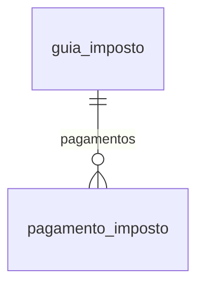

# Modelo — Guias de impostos (apuração por recolhimento e pagamentos)

> Gerado por `src/model/gerar_docs_modelo.py` a partir de `src/model/modulos/guias.yaml`, do catálogo e do perfil de colunas. **Não edite à mão.**

4 entidades. A coluna *Preench.* é o % de linhas com valor útil (nem nulo, nem em branco, nem zero, nem 1900-01-01; para colunas de código o zero conta como valor).

## Diagrama

## Entidades

| Entidade | Tabela | Linhas | Volume | Filtro obrigatório |
|---|---|---|---|---|
| [guia_imposto](#guia_imposto) | `efsdoimp_por_recolhimento` | 407.907 | grande | empresa |
| [pagamento_imposto](#pagamento_imposto) | `efpagimp` | 35.248 | medio | empresa |
| [regra_recolhimento](#regra_recolhimento) | `geimposto_vigencia_recolhimento` | 315.670 | medio | empresa; um de: imposto_codigo |
| [codigo_receita_imposto](#codigo_receita_imposto) | `geimposto_vigencia_codrec` | 38.319 | medio | empresa; um de: imposto_codigo |

## guia_imposto

**Guias de impostos (apuração por código de recolhimento)** — tabela `efsdoimp_por_recolhimento` (407.907 linhas)

Desdobra a apuração de cada imposto (empresa, imposto, competência e periodicidade) em um registro por código de recolhimento: saldo a recolher, vencimento, valor já pago, créditos, débitos, estornos e deduções. É a base das guias (DARF, DAS, DAE, GPS...). 408.276 linhas, 1.312 empresas, de 2007-04 a 2026-09; só 28.910 têm saldo a recolher (as demais têm saldo credor ou zero). Usa 39 das 137 colunas.

- **Chave:** `CODI_EMP, CODI_IMP, DATA_SIM, PDIC_SIM, I_RECOLHIMENTO`
- **Empresa:** `CODI_EMP`
- **Período:** `DATA_SIM`
- **Ordem padrão:** `DATA_SIM desc`, `CODI_IMP asc`, `I_RECOLHIMENTO asc`

**Regras de negócio validadas:**

- Saldo a recolher: em 17.951 linhas de 2024 em diante com saldo a recolher, 17.926 (99,9%) têm saldo_a_recolher = saldo_devedor; só 2 têm saldo devedor zero. 28.910 de 408.276 linhas têm saldo a recolher.
- O REGISTRO DE PAGAMENTOS PAROU: linhas com saldo a recolher e valor pago: 2018 733 de 877 · 2019 1.125 de 1.260 · 2020 1.313 de 1.460 · 2021 1.784 de 2.122 · 2022 1.874 de 2.442 · 2023 1.525 de 2.738 · 2024 17 de 6.347 · 2025 6 de 6.742 · 2026 0 de 4.862. Não conclua que uma guia de 2024 em diante está em aberto só porque não tem valor pago.
- Pagamento: nas 60 empresas com mais pagamentos em 2023-2024, valor_pago desta tabela é igual à soma de pagamento_imposto (vpag) por imposto, competência e periodicidade em 2.044 de 2.082 guias com saldo (98,2%); em 37 a soma dos pagamentos é MAIOR que o valor_pago e em nenhuma é menor (1 guia não entrou na comparação).
- Vencimento: a classe de vencimento é 0 em 407.652 linhas e 10049 em 624. Todas as linhas têm data de vencimento (0 nulas).
- Chave: (empresa, imposto, competência, periodicidade, sequencial do recolhimento) é a PK. Um imposto pode ter vários códigos de recolhimento na mesma competência.

| Campo | Coluna | Tipo | Preench. | Domínio | Descrição (banco) |
|---|---|---|---|---|---|
| imposto_codigo | `codi_imp` | integer(4) |  |  | Imposto |
| competencia | `data_sim` | date(4) |  |  | Competência |
| periodicidade | `pdic_sim` | integer(4) |  | periodicidade_guia | Periodicidade (1=1D, 2=2D, 3=3D, 4=1Q, 5=2Q, 6=M, 7=T, 11=1S, 12=2S, 13=3S, 14=4S, 15=5S, 51=COMPLEMENTAR, 52=13SAL) |
| recolhimento_sequencial | `i_recolhimento` | integer(4) |  |  | Sequencial do código de recolhimento |
| codigo_recolhimento | `codigo_recolhimento` | char(6) |  |  | Código de recolhimento |
| parcela | `parcela` | integer(4) |  |  | Parcela |
| vencimento | `data_vencimento` | date(4) |  |  | Data do vencimento |
| classe_vencimento | `classe_vencimento` | integer(4) |  |  | Classe do vencimento |
| saldo_a_recolher | `saldo_recolher` | numeric(13) |  |  | Saldo a recolher |
| valor_pago | `valor_pago` | numeric(13) |  |  | Valor pago |
| saldo_devedor | `saldo_devedor` | numeric(13) |  |  | Saldo devedor |
| saldo_credor | `saldo_credor` | numeric(13) |  |  | Saldo credor |
| saldo_credor_anterior | `saldo_credor_anterior` | numeric(13) |  |  | Saldo credor anterior |
| valor_contabil_saida | `valor_contabil_saida` | numeric(13) |  |  | Valor contábil saída |
| base_calculo_saida | `base_calculo_saida` | numeric(13) |  |  | Base de cálculo saída |
| imposto_saida | `valor_imposto_saida` | numeric(13) |  |  | Valor do imposto saída |
| valor_contabil_entrada | `valor_contabil_entrada` | numeric(13) |  |  | Valor contábil entrada |
| base_calculo_entrada | `base_calculo_entrada` | numeric(13) |  |  | Base de cálculo entrada |
| imposto_entrada | `valor_imposto_entrada` | numeric(13) |  |  | Valor do imposto entrada |
| outros_creditos | `outros_creditos` | numeric(13) |  |  | Outros créditos |
| outros_debitos | `outros_debitos` | numeric(13) |  |  | Outros débitos |
| estorno_creditos | `estorno_creditos` | numeric(13) |  |  | Estorno de créditos |
| estorno_debitos | `estorno_debitos` | numeric(13) |  |  | Estorno de débitos |
| outras_deducoes | `outras_deducoes` | numeric(13) |  |  | Outras deduções |
| outros_acrescimos | `outros_acrescimos` | numeric(13) |  |  | Outros acréscimos |
| isentas_saida | `valor_isentas_saida` | numeric(13) |  |  | Valor isentas saída |
| outras_saida | `valor_outras_saida` | numeric(13) |  |  | Valor outras saída |
| isentas_entrada | `valor_isentas_entrada` | numeric(13) |  |  | Valor isentas entrada |
| outras_entrada | `valor_outras_entrada` | numeric(13) |  |  | Valor outras entrada |
| credito_presumido | `valor_credito_presumido` | numeric(13) |  |  | Valor crédito presumido |
| estorno_credito_presumido | `valor_estorno_credito_presumido` | numeric(13) |  |  | Valor estorno crédito presumido |
| regime_especial | `valor_regime_especial` | numeric(13) |  |  | Valor regime especial |
| estorno_regime_especial | `valor_estorno_regime_especial` | numeric(13) |  |  | Valor estorno regime especial |
| compensacao_pagamento_indevido | `compensacao_pagamento_indevido_maior` | numeric(13) |  |  | Compensação de pagamento indevido ou a maior |
| outras_compensacoes | `outras_compensacoes` | numeric(13) |  |  | Outras compensações |
| creditos_devolucao_entradas | `creditos_devolucao_entradas` | numeric(13) |  |  | Crédito pelas devoluções de entradas |
| creditos_devolucao_saidas | `creditos_devolucao_saidas` | numeric(13) |  |  | Crédito pelas devoluções de saídas |
| valor_diferido | `valor_diferido` | numeric(13) |  |  | Valor Diferido |
| valor_diferido_anterior | `valor_diferido_anterior` | numeric(13) |  |  | Valor Diferido anterior |
| saldo_em_aberto (calculada) | `SALDO_RECOLHER - VALOR_PAGO` | — | — | | Calculada pelo modelo: SALDO_RECOLHER - VALOR_PAGO |

**Vínculos (LEFT JOIN, acrescentam colunas legíveis):**

- `imposto` → `geimposto` por `CODI_EMP` = `codi_emp` e `CODI_IMP` = `codi_imp`; colunas: `imposto_nome`, `imposto_sigla`

**Filhos (1:N):**

- `pagamentos` → [pagamento_imposto](#pagamento_imposto)

**Filtros:** `competencia` (eq/entre/gte/lte), `imposto_codigo` (eq/in), `periodicidade` (eq/in), `codigo_recolhimento` (eq/in), `vencimento` (eq/entre/gte/lte), `saldo_a_recolher` (gte/lte/entre)

## pagamento_imposto

**Pagamentos de impostos** — tabela `efpagimp` (35.248 linhas)

Baixas de pagamento de cada imposto: data, valor, juros, multa, banco, DARE e a ligação com Honorários e parcelamentos. 35.248 linhas, 521 empresas, de 2013-01 a 2025-04 (o registro termina em 2025-04). O órgão arrecadador, o número do DARE e a descrição complementar estão vazios em todas as linhas.

- **Chave:** `codi_emp, codi_imp, data_pim, pdic_pim, parc_pim, nbaixa_pim, I_PARCELAMENTO, I_PARCELAMENTO_PARCELA_PARCELAMENTO, IMPOSTO_PARCELADO, I_PARCELAMENTO_PARCELA_PARCELA`
- **Empresa:** `codi_emp`
- **Período:** `data_pim`
- **Ordem padrão:** `data_pim desc`, `codi_imp asc`, `parc_pim asc`

**Regras de negócio validadas:**

- Todos os 35.248 pagamentos têm valor (vpag > 0); origem 0 (sistema) em 35.244 e 5 em 4. Nenhum tem DARE, órgão arrecadador ou imposto parcelado = S.
- O registro vai de 2013-01 a 2025-04: não há pagamentos mais recentes; para saber se uma guia recente foi paga consulte o banco/Honorários, não esta tabela.
- Impostos com mais pagamentos: 25 (contribuição retida na fonte) 6.571 · 16 (IRRF) 5.531 · 5 (COFINS) 4.879 · 4 (PIS) 4.776 · 6 (CSLL) 3.445.

| Campo | Coluna | Tipo | Preench. | Domínio | Descrição (banco) |
|---|---|---|---|---|---|
| imposto_codigo | `codi_imp` | integer(4) |  |  | Imposto |
| competencia | `data_pim` | date(4) |  |  | Competencia |
| periodicidade | `pdic_pim` | integer(4) |  | periodicidade_guia | Periodicidade |
| parcela | `parc_pim` | integer(4) |  |  | Parcela |
| baixa | `nbaixa_pim` | integer(4) |  |  | Numero da baixa |
| data_pagamento | `dpag_pim` | date(4) |  |  | Data do pagamento |
| valor | `vpag_pim` | numeric(13) |  |  | Valor |
| juros | `vjur_pim` | numeric(13) |  |  | Valor dos juros |
| multa | `vmul_pim` | numeric(13) |  |  | Valor da multa |
| valor_pago_a_maior | `valor_pago_a_maior` | numeric(13) |  |  | Valor Pago a Maior |
| banco | `banco_pim` | integer(4) |  |  | Codigo do Banco |
| codigo_receita_irrf | `crec_pim` | char(6) |  |  | Codigo da receita para o IRRF |
| recolhimento_sequencial | `i_recolhimento` | integer(4) |  |  | Sequencial do código de recolhimento |
| pagamento_operacoes | `pagto_operacoes_pim` | integer(4) |  |  | Pagamento referente a operacoes(1=interna/2=interestadual) |
| nota_saida_codigo | `codi_sai_pim` | integer(4) |  |  | Código da nota fiscal de saída |
| escritorio_honorarios | `codigo_escritorio` | integer(4) |  |  | Codigo do escritorio Honorarios |
| historico_honorarios | `historico_hr` | varchar(512) |  |  | Historico Honorarios |
| periodo | `periodo` | date(4) |  |  | Período |
| imposto_parcelado | `imposto_parcelado` | char(1) |  | sim_nao_texto | Imposto parcelado |
| origem_registro | `origem_reg` | tinyint(1) |  | origem_pagamento_imposto | Origem do registro 0 - Sistema, 1 - Imp. Tabelas, 2 - Imp. Layout, 3- Imp. Tabelas Concorrentes, 4 - Imp. API, 5 - Digital Bank |
| total_pago_com_encargos (calculada) | `vpag_pim + vjur_pim + vmul_pim` | — | — | | Calculada pelo modelo: vpag_pim + vjur_pim + vmul_pim |

**Vínculos (LEFT JOIN, acrescentam colunas legíveis):**

- `imposto` → `geimposto` por `codi_emp` = `codi_emp` e `codi_imp` = `codi_imp`; colunas: `imposto_nome`, `imposto_sigla`

**Filtros:** `competencia` (eq/entre/gte/lte), `imposto_codigo` (eq/in), `data_pagamento` (eq/entre/gte/lte), `banco` (eq/in)

## regra_recolhimento

**Regras de recolhimento por imposto e vigência** — tabela `geimposto_vigencia_recolhimento` (315.670 linhas)

Para cada imposto de uma empresa e vigência: código de recolhimento (receita), periodicidade, dias de vencimento (até 5), classes de vencimento, alíquota, forma de recolhimento e se gera crédito de ICMS. É a regra que gera as guias de guia_imposto. 315.670 linhas, 1.503 empresas; 177.414 (56%) têm periodicidade "por nota". Usa 29 das 45 colunas.

- **Chave:** `CODI_EMP, CODI_IMP, VIGENCIA_IMP, I_RECOLHIMENTO`
- **Empresa:** `CODI_EMP`
- **Período:** `—` · exige um de: `imposto_codigo`
- **Ordem padrão:** `CODI_IMP asc`, `VIGENCIA_IMP desc`, `I_RECOLHIMENTO asc`

**Regras de negócio validadas:**

- Código de recolhimento: a guia (guia_imposto) herda o código da regra (mesma empresa, imposto e sequência, vigência mais recente até a competência): 7.426 de 7.427 guias de 2023 das 80 empresas com mais guias.
- Vencimento (guias de 2022-2023 com saldo, 3.316): 2.072 (62,5%) vencem exatamente num dos dias configurados; 939 (28,3%) vencem ANTECIPADOS para o dia útil anterior quando o dia configurado cai no sábado ou domingo (ex.: dia 20 vira sexta 18 ou 19); 305 (9,2%) não foram explicados (provavelmente feriados, não modelados). Aparece nos impostos de maior volume (25 e 16); a regra de antecipação não está gravada no banco, é inferida.
- Periodicidades em uso: 7 (por nota) 177.417 · 1 (mensal) 133.662 · 2 (quinzenal) 3.177 · 3 (decendial) 1.397 · 5 (semanal) 12 · 10 (sem legenda) 5. Tipo de guia sempre 1. Combinações com a forma de vencimento mais comuns: 7 (por nota) com forma 6 · 177.414; 1 (mensal) com forma 4 · 92.010; 1 com forma 1 · 40.705; 2 (quinzenal) com forma 5 · 3.177; 3 (decendial) com forma 3 · 1.397. O comentário da forma de vencimento não traz legenda.
- Tipo da regra: normal (1) em 314.011 e TTD (2) em 1.659; forma de recolhimento sempre 1 (junto com o ICMS normal). A vigência mais antiga é 1964-06-01 (valor padrão).

| Campo | Coluna | Tipo | Preench. | Domínio | Descrição (banco) |
|---|---|---|---|---|---|
| imposto_codigo | `codi_imp` | integer(4) |  |  | Codigo |
| vigencia | `vigencia_imp` | date(4) |  |  | Vigencia |
| recolhimento_sequencial | `i_recolhimento` | integer(4) |  |  | Sequencial |
| codigo_recolhimento | `codigo_recolhimento` | char(6) |  |  | Código do recolhimento |
| descricao | `descricao` | varchar(255) |  |  | Descrição |
| tipo_guia | `guia` | integer(4) |  | tipo_guia_estadual | 1-GARE-ICMS(SP) OU DARE(SC) / 2-GNRE |
| periodicidade | `periodicidade` | integer(4) |  | periodicidade_recolhimento | Periodicidade (1-Mensal/2-Quinzenal/3-Decendial/4-Trimestral/5-Semanal/6-Semestral/7-Por Nota/8-Trimestral/Mensal/9-Por Vencimento/10-Diária) |
| periodo_subsequente | `periodo_subsequente` | integer(4) |  |  | Período subsequente |
| forma_vencimento | `forma_vencimento` | integer(4) |  |  | Forma de vencimento |
| dia_vencimento_1 | `dia_vencimento_1` | integer(4) |  |  | Dia do vencimento 1 |
| dia_vencimento_2 | `dia_vencimento_2` | integer(4) |  |  | Dia do vencimento 2 |
| dia_vencimento_3 | `dia_vencimento_3` | integer(4) |  |  | Dia do vencimento 3 |
| dia_vencimento_4 | `dia_vencimento_4` | integer(4) |  |  | Dia do vencimento 4 |
| dia_vencimento_5 | `dia_vencimento_5` | integer(4) |  |  | Dia do vencimento 5 |
| classe_vencimento_1 | `classe_vencimento_1` | integer(4) |  |  | Classe do vencimento 1 |
| classe_vencimento_2 | `classe_vencimento_2` | integer(4) |  |  | Classe do vencimento 2 |
| aliquota | `aliquota` | numeric(5) |  |  | Alíquota |
| tipo | `tipo` | integer(4) |  | tipo_regra_recolhimento | Tipo(1-Normal / 2-TTD) |
| forma_recolhimento | `forma_recolhimento` | integer(4) |  | forma_recolhimento_icms | Forma de Recolhimento(1-Junto com o ICMS Normal/2-Guia de Recolhimentos Especiais) |
| gera_credito_icms | `gera_credito_icms` | char(1) |  | sim_nao_texto | Gera crédito ICMS (S-Sim/N-Não) |
| utilizar_credito_na_apuracao_icms | `utilizar_credito_apuracao_icms` | integer(4) |  |  | Utilizar o crédito na apuração do ICMS (0/1/2) |
| apropriacao_credito | `apropriacao_credito` | integer(4) |  |  | Apropriação do Crédito (1 - Data do Recolhimento / 2 - Data de Entrada) |
| tipo_antecipacao | `tipo_antecipacao` | integer(4) |  |  | Tipo de Antecipação (1-Aquisição de arroz - Art. 4º, Anexo XVI do RICMS/2-Outras antecipações) |
| uf_favorecida | `uf_favorecida` | char(2) |  |  | UF Favorecida |
| calcula_adicional_fcp | `calcula_adicional_fcp` | char(1) |  | sim_nao_texto | Calcula Adicional FCP |
| irrf_cooperativa | `irrf_cooperativa` | char(1) |  | sim_nao_texto | IRRF de cooperativas |
| codigo_sped_fiscal | `i_recolhimento_sped_fiscal` | integer(4) |  |  | Código SPED Fiscal |
| fundamentacao_legal | `fundamentacao_legal` | char(194) |  |  | Fundamentação Legal |
| numero_ttd_1 | `numero_ttd_1` | char(20) |  |  | Número do acordo TTD para o primeiro vencimento do imposto |

**Vínculos (LEFT JOIN, acrescentam colunas legíveis):**

- `imposto` → `geimposto` por `CODI_EMP` = `codi_emp` e `CODI_IMP` = `codi_imp`; colunas: `imposto_nome`, `imposto_sigla`

**Filtros:** `imposto_codigo` (eq/in), `vigencia` (eq/entre/gte/lte), `codigo_recolhimento` (eq/in), `periodicidade` (eq/in)

## codigo_receita_imposto

**Códigos de receita permitidos por imposto e vigência** — tabela `geimposto_vigencia_codrec` (38.319 linhas)

Códigos de receita selecionáveis para os impostos que restringem o código, por empresa e vigência, com descrição. 38.319 linhas, 1.504 empresas, mas só 19 códigos distintos.

- **Chave:** `CODI_EMP, CODI_IMP, VIGENCIA_IMP, CODI_REC`
- **Empresa:** `CODI_EMP`
- **Período:** `—` · exige um de: `imposto_codigo`
- **Ordem padrão:** `CODI_IMP asc`, `VIGENCIA_IMP desc`, `CODI_REC asc`

**Regras de negócio validadas:**

- Só 19 códigos de receita distintos em 38.319 linhas. A lista é usada por poucas regras: nas 40 empresas com mais regras, só 241 de 17.343 regras de recolhimento têm o código na lista (1,4%); para a maioria dos impostos o código é digitado direto na regra.

| Campo | Coluna | Tipo | Preench. | Domínio | Descrição (banco) |
|---|---|---|---|---|---|
| imposto_codigo | `codi_imp` | integer(4) |  |  | Imposto |
| vigencia | `vigencia_imp` | date(4) |  |  | Vigencia |
| codigo_receita | `codi_rec` | char(6) |  |  | Codigo do recolhimento |
| descricao | `descricao` | char(128) |  |  | Descricao |

**Filtros:** `imposto_codigo` (eq/in), `vigencia` (eq/entre/gte/lte), `codigo_receita` (eq/in/prefixo), `descricao` (contem)

## Domínios (significado dos códigos)

`confirmado`: **sim** = vem do comentário do banco e/ou foi conferido nos dados; **parcial** = parte dos valores; **não** = hipótese, não use como regra.

### status_empresa

Situação da empresa no cadastro (geempre.stat_emp)

Confirmado: sim

| Código | Significado |
|---|---|
| A | Ativa |
| I | Inativa |
| C | Em constituição |
| M | Ativo sem movimento |
| B | Em processo de baixa |
| E | Excluindo |

### motivo_inatividade

Motivo da inatividade (geempre.tipoi_emp). Só aparece em empresas inativas.

Confirmado: sim

| Código | Significado |
|---|---|
| 1 | Outros |
| 2 | Baixada |
| 3 | Transferida |
| 4 | Inadimplente |

### tipo_inscricao

Tipo da inscrição (CNPJ/CPF/CEI/CAEPF)

Confirmado: sim

| Código | Significado |
|---|---|
| 1 | CNPJ |
| 2 | CPF |
| 3 | CEI |
| 6 | CAEPF |

### regime_federal_empresa

Regime federal da folha (geempre.rfed_emp)

Confirmado: parcial

| Código | Significado |
|---|---|
| 1 | Normal |
| 2 | Microempresa |
| 3 | Empresa de pequeno porte |

### tipo_honorario_empresa

Como a empresa usa o módulo Honorários (geempre.honorario_tipo)

Confirmado: sim

| Código | Significado |
|---|---|
| E | Escritório (quem fatura) |
| C | Cliente |

### sim_nao_texto

Confirmado: sim

| Código | Significado |
|---|---|
| S | Sim |
| N | Não |

### sim_nao_numerico

Confirmado: sim

| Código | Significado |
|---|---|
| 1 | Sim |
| 0 | Não |

### periodicidade_guia

Periodicidade da apuração (pdic_sim / pdic_pim)

Confirmado: sim

| Código | Significado |
|---|---|
| 1 | 1º decêndio |
| 2 | 2º decêndio |
| 3 | 3º decêndio |
| 4 | 1ª quinzena |
| 5 | 2ª quinzena |
| 6 | Mensal |
| 7 | Trimestral |
| 11 | 1ª semana |
| 12 | 2ª semana |
| 13 | 3ª semana |
| 14 | 4ª semana |
| 15 | 5ª semana |
| 51 | Complementar |
| 52 | 13º salário |

### origem_pagamento_imposto

Origem do registro (efpagimp.origem_reg)

Confirmado: parcial

> O comentário lista 0 a 5 (0 Sistema; 1 a 3 importações; 4 importação por API; 5 truncado no catálogo). Nos dados: 0 em 35.244 linhas e 5 em 4.

| Código | Significado |
|---|---|
| 0 | Sistema |
| 1 | Importação de tabelas |
| 2 | Importação de layout |
| 3 | Importação de tabelas concorrentes |
| 4 | Importação por API |
| 5 | Não documentado |

### tipo_guia_estadual

Confirmado: parcial

> O comentário lista 1 (GARE-ICMS SP ou DARE SC) e 2 (GNRE). Nos dados só existe 1 (315.670 de 315.670).

| Código | Significado |
|---|---|
| 1 | GARE-ICMS (SP) ou DARE (SC) |
| 2 | GNRE |

### periodicidade_recolhimento

Periodicidade da regra de recolhimento (geimposto_vigencia_recolhimento.periodicidade)

Confirmado: parcial

> O comentário está truncado ("... 7-Por Nota/8-Trimestral/Mensal..."). Em uso: 7 (177.417 regras), 1 (133.662), 2 (3.177), 3 (1.397), 5 (12) e 10 (5, sem legenda); 4, 6 e 8 não aparecem.

| Código | Significado |
|---|---|
| 1 | Mensal |
| 2 | Quinzenal |
| 3 | Decendial |
| 4 | Trimestral |
| 5 | Semanal |
| 6 | Semestral |
| 7 | Por nota |
| 10 | Sem legenda |

### tipo_regra_recolhimento

Confirmado: sim

| Código | Significado |
|---|---|
| 1 | Normal |
| 2 | TTD (regime especial) |

### forma_recolhimento_icms

Confirmado: parcial

> O comentário lista 1 (junto com o ICMS normal) e 2 (guia de recolhimentos especiais); todas as 315.670 regras têm 1.

| Código | Significado |
|---|---|
| 1 | Junto com o ICMS normal |
| 2 | Guia de recolhimentos especiais |

