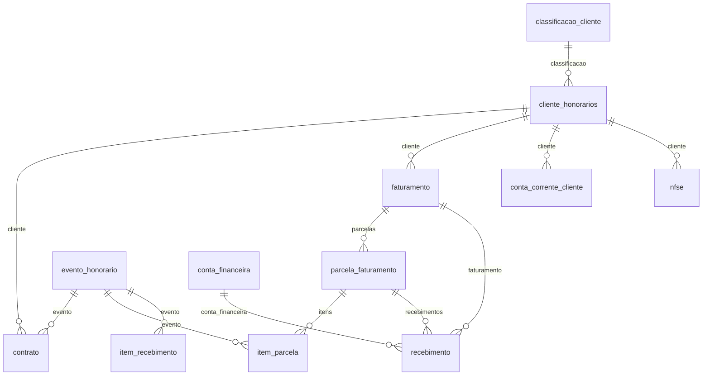

# Modelo — Honorários

> Gerado por `src/model/gerar_docs_modelo.py` a partir de `src/model/modulos/honorarios.yaml`, do catálogo e do perfil de colunas. **Não edite à mão.**

13 entidades. A coluna *Preench.* é o % de linhas com valor útil (nem nulo, nem em branco, nem zero, nem 1900-01-01; para colunas de código o zero conta como valor).

## Diagrama

## Entidades

| Entidade | Tabela | Linhas | Volume | Filtro obrigatório |
|---|---|---|---|---|
| [cliente_honorarios](#cliente_honorarios) | `hrcliente` | 2.918 | medio | empresa |
| [classificacao_cliente](#classificacao_cliente) | `hrclassificacao` | 3 | pequeno | — |
| [evento_honorario](#evento_honorario) | `hrevento` | 89 | pequeno | empresa |
| [contrato](#contrato) | `hrcontrato` | 1.064 | pequeno | empresa |
| [conta_financeira](#conta_financeira) | `hrconta_financeira` | 24 | pequeno | empresa |
| [faturamento](#faturamento) | `hrfaturamento` | 43.194 | medio | empresa |
| [parcela_faturamento](#parcela_faturamento) | `hrfaturamento_parcela` | 43.224 | medio | empresa |
| [item_parcela](#item_parcela) | `hrfaturamento_parcela_item` | 43.766 | medio | empresa; um de: faturamento_codigo |
| [recebimento](#recebimento) | `hrrecebimento` | 43.042 | medio | empresa |
| [item_recebimento](#item_recebimento) | `hrrecebimento_item` | 43.603 | medio | empresa; um de: faturamento_codigo |
| [conta_corrente_cliente](#conta_corrente_cliente) | `hrconta_corrente_cliente` | 88.987 | medio | empresa |
| [conta_corrente_escritorio](#conta_corrente_escritorio) | `hrconta_corrente_escritorio` | 65.980 | medio | empresa |
| [nfse](#nfse) | `hrnota_nfse` | 36.496 | medio | empresa |

## cliente_honorarios

**Clientes de honorários** — tabela `hrcliente` (2.918 linhas)

Clientes que o escritório fatura. `empresa` = ESCRITÓRIO. Fixos (tipo F) ligam à empresa cadastrada por `empresa_cliente_codigo` (= geempre.codi_emp). Contatos e observações livres não são expostos.

- **Chave:** `codi_emp, i_cliente`
- **Empresa:** `codi_emp`
- **Período:** `—`
- **Ordem padrão:** `NOME asc`

**Regras de negócio validadas:**

- Cliente fixo (F): empresa_cliente_codigo existe em geempre em 100% dos casos (1.644 de 1.644). Cliente eventual (E): sem empresa cadastrada.
- Dois escritórios no banco (códigos 1 e 930): sempre filtre `empresa` pelo escritório desejado.

| Campo | Coluna | Tipo | Preench. | Domínio | Descrição (banco) |
|---|---|---|---|---|---|
| codigo | `i_cliente` | integer(4) | 100% |  | Codigo |
| apelido | `apelido` | varchar(20) | 100% |  | Apelido |
| nome 🔒 | `nome` | varchar(40) | 100% |  | Nome |
| tipo | `tipo` | char(1) | 100% | tipo_cliente_honorarios | Tipo F Fixo E Eventual |
| empresa_cliente_codigo | `i_cliente_fixo` | integer(4) | 56% |  | Codigo do cliente fixo |
| data_cadastro | `data_cadastro` | date(4) | 100% |  | Data de cadastro |
| tipo_inscricao | `tipo_inscricao` | tinyint(1) | 100% | tipo_inscricao | Tipo da inscrição(1 - CNPJ/2 - CPF/3 - CEI/6 - CAEPF) |
| inscricao 🔒 | `inscricao` | varchar(14) | 100% |  | Inscricao |
| municipio_codigo | `codigo_municipio` | integer(4) | 43% |  | Municipio |
| uf | `uf` | char(2) | 44% |  | UF |
| regime_federal | `regime_federal` | tinyint(1) | 100% | regime_federal | Regime federal 1 Normal 2 Microempresa 3 Empresa de Pequeno Porte |
| classificacao_codigo | `i_classificacao` | integer(4) | 87% |  | Codigo da classificacao |
| conta_contabil | `conta_contabil` | integer(4) | 100% |  | Conta contabil |
| gera_contabilizacao | `gera_contabilizacao` | char(1) | 100% | sim_nao_texto | Gera lancamentos contabeis na contabilidade S N |

**Vínculos (LEFT JOIN, acrescentam colunas legíveis):**

- `classificacao` → `hrclassificacao` por `I_CLASSIFICACAO` = `I_CLASSIFICACAO`; colunas: `classificacao_nome`
- `empresa_cadastrada` → `geempre` por `I_CLIENTE_FIXO` = `codi_emp`; colunas: `empresa_cliente_nome`

> 🔒 **Privacidade:** 1.141 clientes são pessoas físicas (CPF). Nome e inscrição mascarados por padrão.

**Filtros:** `codigo` (eq/in), `nome` (contem/prefixo), `tipo` (eq), `inscricao` (eq), `empresa_cliente_codigo` (eq/in), `uf` (eq/in)

## classificacao_cliente

**Classificações de cliente** — tabela `hrclassificacao` (3 linhas)

Tabela global (3 linhas).

- **Chave:** `I_CLASSIFICACAO`
- **Empresa:** `não se aplica (tabela global)`
- **Período:** `—`
- **Ordem padrão:** `I_CLASSIFICACAO asc`

| Campo | Coluna | Tipo | Preench. | Domínio | Descrição (banco) |
|---|---|---|---|---|---|
| codigo | `i_classificacao` | integer(4) | 100% |  | Codigo |
| descricao | `descricao` | varchar(40) | 100% |  | Descricao |

**Filtros:** `codigo` (eq/in)

## evento_honorario

**Eventos de honorário (tipos de cobrança)** — tabela `hrevento` (89 linhas)

Catálogo de serviços/cobranças do escritório (89 linhas) com as marcações de impostos retidos.

- **Chave:** `codi_emp, I_EVENTO`
- **Empresa:** `codi_emp`
- **Período:** `—`
- **Ordem padrão:** `I_EVENTO asc`

| Campo | Coluna | Tipo | Preench. | Domínio | Descrição (banco) |
|---|---|---|---|---|---|
| codigo | `i_evento` | integer(4) | 100% |  | Codigo |
| descricao | `descricao` | varchar(60) | 100% |  | Descricao |
| data_cadastro | `data_cadastro` | date(4) | 0% |  | Data de cadastro |
| unidade | `unidade` | char(1) | 100% | unidade_evento | Unidade V Valor Q Quantidade P Percentual sobre contrato F Formula |
| referencia | `referencia` | numeric(13) | 4% |  | Referencia |
| categoria_codigo | `i_categoria_receber` | integer(4) | 100% |  | Categoria |
| imposto_codigo | `codi_imp` | integer(4) | 7% |  | Codigo do imposto |
| soma_irrf | `soma_irrf` | char(1) | 100% | sim_nao_texto | Soma na base do IRRF S N |
| aliquota_irrf | `aliquota_irrf` | numeric(5) | 18% |  | Aliquota de IRRF |
| soma_iss | `soma_iss` | char(1) | 100% | sim_nao_texto | Soma na base do ISS S N |
| aliquota_iss | `aliquota_iss` | numeric(5) | 0% |  | Aliquota de ISS |
| dia_vencimento | `dia_vencimento` | tinyint(1) | 3% |  | Dia de vencimento |
| mes_vencimento | `mes_vencimento` | char(1) | 3% | mes_vencimento | Mes de vencimento N No mesmo mes A Apos o mes S No segundo mes |
| fatura_contrato | `fatura_contrato` | char(1) | 100% | sim_nao_texto | Fatura com contrato S N |

**Filtros:** `codigo` (eq/in), `descricao` (contem/prefixo)

## contrato

**Contratos de honorários** — tabela `hrcontrato` (1.064 linhas)

- **Chave:** `codi_emp, I_CONTRATO`
- **Empresa:** `codi_emp`
- **Período:** `—`
- **Ordem padrão:** `I_CONTRATO desc`

**Regras de negócio validadas:**

- 583 contratos não têm término definido e 481 têm; destes, nenhum está vigente (todos encerrados).

| Campo | Coluna | Tipo | Preench. | Domínio | Descrição (banco) |
|---|---|---|---|---|---|
| codigo | `i_contrato` | integer(4) | 100% |  | Codigo |
| descricao | `descricao` | varchar(60) | 100% |  | Descricao |
| cliente_codigo | `i_cliente` | integer(4) | 100% |  | Cliente |
| tipo_contrato_codigo | `i_tipo_contrato` | integer(4) | 100% |  | Tipo de contrato |
| evento_codigo | `i_evento` | integer(4) | 100% |  | Evento honorarios |
| data_emissao | `data_emissao` | date(4) | 100% |  | Data de emissao |
| data_inicio | `data_inicio` | date(4) | 100% |  | Inicio do contrato |
| data_inicio_faturamento | `data_inicio_faturamento` | date(4) | 100% |  | Inicio do faturamento |
| dia_vencimento | `dia_vencimento` | tinyint(1) | 33% |  | Dia de vencimento |
| mes_vencimento | `mes_vencimento` | char(1) | 100% | mes_vencimento | Mes do vencimento N No mesmo mes A Apos o mes S No segundo mes |
| define_termino | `definir_termino` | char(1) | 100% | sim_nao_texto | Definir data termino S N |
| data_termino | `data_termino` | date(4) | 45% |  | Data de termino |
| valor_contrato 🔒 | `valor_contrato` | numeric(13) | 100% |  | Valor do contrato |
| valor_original 🔒 | `valor_original` | numeric(13) | 100% |  | Valor original |

**Vínculos (LEFT JOIN, acrescentam colunas legíveis):**

- `cliente` → `hrcliente` por `codi_emp` = `codi_emp` e `I_CLIENTE` = `i_cliente`; colunas: `cliente_nome` 🔒
- `evento` → `hrevento` por `codi_emp` = `codi_emp` e `I_EVENTO` = `i_evento`; colunas: `evento_descricao`

> 🔒 **Privacidade:** Valor contratado por cliente (financeiro).

**Filtros:** `codigo` (eq/in), `cliente_codigo` (eq/in), `evento_codigo` (eq/in), `data_inicio` (entre/gte/lte), `data_termino` (entre/gte/lte)

## conta_financeira

**Contas financeiras do escritório** — tabela `hrconta_financeira` (24 linhas)

Bancos e caixas do escritório (24 linhas). Número da conta, agência e convênio não são expostos.

- **Chave:** `codi_emp, I_CONTA_FINANCEIRA`
- **Empresa:** `codi_emp`
- **Período:** `—`
- **Ordem padrão:** `I_CONTA_FINANCEIRA asc`

| Campo | Coluna | Tipo | Preench. | Domínio | Descrição (banco) |
|---|---|---|---|---|---|
| codigo | `i_conta_financeira` | integer(4) | 100% |  | Codigo |
| descricao | `descricao` | char(60) | 100% |  | Descricao |
| tipo | `tipo` | char(1) | 100% | tipo_conta_financeira | TIPO (B=BANCARIA/C=CAIXA/H=CHEQUE) |
| banco_codigo | `i_banco` | integer(4) | 67% |  | Codigo banco |
| conta_contabil | `conta_contabil` | integer(4) | 96% |  | Conta contabil |
| envia_cobranca_registrada | `envia_cobranca_registrada` | char(1) | 100% | sim_nao_texto | Envia cobranca registrada S N |

**Filtros:** `codigo` (eq/in), `tipo` (eq)

## faturamento

**Faturamentos** — tabela `hrfaturamento` (43.194 linhas)

Cabeçalho de cada faturamento de honorários (um por cliente e competência).

- **Chave:** `codi_emp, I_FATURAMENTO`
- **Empresa:** `codi_emp`
- **Período:** `DATA_FATURAMENTO`
- **Ordem padrão:** `DATA_FATURAMENTO desc`, `I_FATURAMENTO desc`

**Regras de negócio validadas:**

- Faturamentos de 2015-09 a 2025-12; não há nada em 2026.

| Campo | Coluna | Tipo | Preench. | Domínio | Descrição (banco) |
|---|---|---|---|---|---|
| codigo | `i_faturamento` | integer(4) | 100% |  | Codigo |
| cliente_codigo | `i_cliente` | integer(4) | 100% |  | Cliente |
| competencia | `competencia` | date(4) | 100% |  | Compentecia |
| data_faturamento | `data_faturamento` | date(4) | 100% |  | Data do faturamento |
| tipo | `tipo_faturamento` | char(1) | 100% | tipo_faturamento | Tipo de faturamento T Todos C Contratos e eventos com contrato E Eventos sem contrato |
| somente_vencimento | `somente_vencimento` | char(1) | 100% | sim_nao_texto | Faturar somente o vencimento S N |
| gerar_parcelado | `gerar_parcelado` | char(1) | 100% | sim_nao_texto | Gerar faturamento parcelado S N |
| quantidade_parcelas | `quantidade_parcela` | integer(4) | 0% |  | Quantidade de parcelas |
| intervalo_dias | `intervalo_dias` | integer(4) | 0% |  | Intervalo de dias entre os vencimentos |
| nota_fiscal_codigo | `i_nota_fiscal` | integer(4) | 0% |  | Nota fiscal |
| nfse_codigo | `i_nota_nfse` | integer(4) | 84% |  | Nota fiscal de servico eletronica |
| usuario | `usuario` | varchar(128) | 100% |  | Usuario que efetuou o faturamento |
| data_hora | `data_hora` | timestamp(8) | 100% |  | Data e hora do faturamento |

**Vínculos (LEFT JOIN, acrescentam colunas legíveis):**

- `cliente` → `hrcliente` por `codi_emp` = `codi_emp` e `I_CLIENTE` = `i_cliente`; colunas: `cliente_nome` 🔒

**Filhos (1:N):**

- `parcelas` → [parcela_faturamento](#parcela_faturamento)

**Filtros:** `codigo` (eq/in), `cliente_codigo` (eq/in), `competencia` (eq/entre/gte/lte), `data_faturamento` (entre/gte/lte), `tipo` (eq/in)

## parcela_faturamento

**Parcelas de faturamento** — tabela `hrfaturamento_parcela` (43.224 linhas)

Vencimentos de cada faturamento, com o estado de emissão de boleto e de documento de cobrança. O valor da parcela é a soma dos itens (item_parcela); o recebido é a soma de recebimento.valor. Para o saldo pronto use a consulta `contas_a_receber`.

- **Chave:** `codi_emp, I_FATURAMENTO, I_PARCELA`
- **Empresa:** `codi_emp`
- **Período:** `VENCIMENTO`
- **Ordem padrão:** `VENCIMENTO desc`, `I_FATURAMENTO desc`, `I_PARCELA asc`

| Campo | Coluna | Tipo | Preench. | Domínio | Descrição (banco) |
|---|---|---|---|---|---|
| faturamento_codigo | `i_faturamento` | integer(4) | 100% |  | Faturamento |
| parcela | `i_parcela` | integer(4) | 100% |  | Parcela |
| vencimento | `vencimento` | date(4) | 100% |  | Data de vencimento |
| vencimento_original | `vencimento_original` | date(4) | 100% |  | Data de vencimento original |
| imprimiu_boleto | `imprimiu_boleto` | char(1) | 100% | sim_nao_texto | Imprimiu boleto S N |
| emissao_boleto | `emissao_boleto` | date(4) | 76% |  | Data de emisao do boleto |
| nosso_numero_boleto | `nosso_numero_boleto` | varchar(128) | 76% |  | Nosso numero do boleto |
| conta_financeira_boleto | `i_conta_financeira_boleto` | integer(4) | 76% |  | Conta financeira usada na emissao do boleto |
| tipo_boleto | `tipo_boleto` | tinyint(1) | 76% | tipo_boleto | Tipo do boleto 1 Completo 2 Detalhado 3 Pre Impresso 4 Carnê |
| imprimiu_cobranca | `imprimiu_cobranca` | char(1) | 100% | sim_nao_texto | Imprimiu documento de cobranca S N |
| numero_cobranca | `numero_cobranca` | integer(4) | 12% |  | Numero do documento de cobranca |
| emissao_cobranca | `emissao_cobranca` | date(4) | 12% |  | Data de emissao do documento de cobranca |

**Vínculos (LEFT JOIN, acrescentam colunas legíveis):**

- `faturamento` → `hrfaturamento` por `codi_emp` = `codi_emp` e `I_FATURAMENTO` = `i_faturamento`; colunas: `cliente_codigo`, `faturamento_competencia`, `faturamento_data`

**Filhos (1:N):**

- `itens` → [item_parcela](#item_parcela)
- `recebimentos` → [recebimento](#recebimento)

**Filtros:** `faturamento_codigo` (eq/in), `vencimento` (entre/gte/lte), `imprimiu_boleto` (eq)

## item_parcela

**Itens das parcelas** — tabela `hrfaturamento_parcela_item` (43.766 linhas)

Cada evento (honorário) cobrado em uma parcela, com valores, descontos e retenções (IRRF, ISS, INSS, CRF).

- **Chave:** `codi_emp, I_FATURAMENTO, I_PARCELA, I_EVENTO, PAGO_ESCRITORIO`
- **Empresa:** `codi_emp`
- **Período:** `—` · exige um de: `faturamento_codigo`
- **Ordem padrão:** `I_FATURAMENTO desc`, `I_PARCELA asc`, `I_EVENTO asc`

**Regras de negócio validadas:**

- Valor do movimento da conta corrente do cliente = valor do item em 99,6% dos itens (43.594 de 43.766; 172 itens sem movimento).
- valor é o valor cobrado do item; a soma dos itens de uma parcela é o valor faturado dela.

| Campo | Coluna | Tipo | Preench. | Domínio | Descrição (banco) |
|---|---|---|---|---|---|
| faturamento_codigo | `i_faturamento` | integer(4) | 100% |  | Faturamento |
| parcela | `i_parcela` | integer(4) | 100% |  | Parcela |
| evento_codigo | `i_evento` | integer(4) | 100% |  | Evento |
| pago_pelo_escritorio | `pago_escritorio` | char(1) | 100% | sim_nao_texto | Pago pelo escritorio S N |
| valor 🔒 | `valor` | numeric(13) | 99% |  | Valor |
| valor_original 🔒 | `valor_original` | numeric(13) | 100% |  | Valor original |
| valor_desconto 🔒 | `valor_desconto` | numeric(13) | 2% |  | Valor de desconto |
| valor_irrf 🔒 | `valor_irrf` | numeric(13) | 7% |  | Valor IRRF aproveitado |
| aliquota_irrf | `aliquota_irrf` | numeric(5) | 19% |  | Aliquota de IRRF |
| valor_iss 🔒 | `valor_iss` | numeric(13) | 0% |  | Valor de ISS |
| aliquota_iss | `aliquota_iss` | numeric(5) | 0% |  | Aliquota de ISS |
| valor_iss_retido 🔒 | `valor_iss_retido` | numeric(13) | 0% |  | Valor de ISS Retido |
| valor_inss_retido 🔒 | `valor_inss_retido` | numeric(13) | 0% |  | Valor de INSS Retido |
| valor_crf 🔒 | `valor_crf` | numeric(13) | 12% |  | Valor de CRF aproveitado |
| movimento_cliente_codigo | `i_movimento_cliente` | integer(4) | 100% |  | Conta corrente cliente |

**Vínculos (LEFT JOIN, acrescentam colunas legíveis):**

- `evento` → `hrevento` por `codi_emp` = `codi_emp` e `I_EVENTO` = `i_evento`; colunas: `evento_descricao`
- `parcela` → `hrfaturamento_parcela` por `codi_emp` = `codi_emp` e `I_FATURAMENTO` = `i_faturamento` e `I_PARCELA` = `i_parcela`; colunas: `parcela_vencimento`

> 🔒 **Privacidade:** Valores cobrados por cliente (financeiro).

**Filtros:** `faturamento_codigo` (eq/in), `evento_codigo` (eq/in)

## recebimento

**Recebimentos** — tabela `hrrecebimento` (43.042 linhas)

Baixas de parcelas. `valor_recebido` é o BRUTO (inclui juros e multa); `valor` é o LÍQUIDO que abate o principal da parcela. Identidade validada em 100%: valor = valor_recebido − juros − multa + desconto.

- **Chave:** `codi_emp, I_FATURAMENTO, I_PARCELA, I_RECEBIMENTO`
- **Empresa:** `codi_emp`
- **Período:** `DATA_RECEBIMENTO`
- **Ordem padrão:** `DATA_RECEBIMENTO desc`, `I_FATURAMENTO desc`

**Regras de negócio validadas:**

- Identidade: valor_liquido = valor_recebido − valor_juros − valor_multa + valor_desconto, em 43.042 de 43.042 recebimentos (100%) e 43.581 de 43.603 itens (99,95%).
- O valor_recebido do recebimento é igual à soma dos itens em 99,95% (43.019 de 43.042); o valor_liquido em 99,998%.
- O movimento do escritório ligado tem valor igual a valor_recebido em 98,3% (42.295 de 43.042; 746 recebimentos sem movimento) — o movimento registra o BRUTO, não o líquido.
- Para saber o que ainda está em aberto use a consulta `contas_a_receber`: saldo da parcela = Σ valor dos itens − Σ valor_liquido dos recebimentos. Validado: 42.824 parcelas quitadas, 399 em aberto e 1 inconsistente (99,998%). Somar também desconto/quitado/refaturado/reparcelado produz 588 'baixadas a mais' artificiais.

| Campo | Coluna | Tipo | Preench. | Domínio | Descrição (banco) |
|---|---|---|---|---|---|
| faturamento_codigo | `i_faturamento` | integer(4) | 100% |  | Faturamento |
| parcela | `i_parcela` | integer(4) | 100% |  | Parcela |
| recebimento | `i_recebimento` | integer(4) | 100% |  | Codigo |
| data_recebimento | `data_recebimento` | date(4) | 100% |  | Data do recebimento |
| origem | `origem` | char(1) | 100% | origem_recebimento | Origem D Individual G Em grupo R Reneg recebimento P Reneg reparcelada Q Reneg quitada N Reneg novo fat A Adiantamento F Faturamento I Consulta Fat Integral E Consulta Fat Evento C Consulta Cliente S Cancelar NF B Imp Boletos M Recebimento Automatico Boleto X Recebimento Automatico qrcode |
| conta_financeira_codigo | `i_conta_financeira` | integer(4) | 99% |  | Conta financeira |
| movimento_escritorio_codigo | `i_movimento_escritorio` | integer(4) | 98% |  | Conta corrente escritorio |
| valor_liquido 🔒 | `valor` | numeric(13) | 100% |  | Valor liquido do recebimento |
| valor_recebido 🔒 | `valor_recebido` | numeric(13) | 100% |  | Valor bruto do recebimento |
| valor_juros 🔒 | `valor_juros` | numeric(13) | 5% |  | Valor de juros |
| valor_multa 🔒 | `valor_multa` | numeric(13) | 0% |  | Valor de multa |
| valor_desconto 🔒 | `valor_desconto` | numeric(13) | 0% |  | Valor de desconto |
| valor_irrf 🔒 | `valor_irrf` | numeric(13) | 0% |  | Valor IRRF |
| valor_crf 🔒 | `valor_crf` | numeric(13) | 0% |  | Valor CRF |
| valor_refaturado 🔒 | `valor_refaturado` | numeric(13) | 0% |  | Valor refaturado |
| valor_reparcelado 🔒 | `valor_reparcelado` | numeric(13) | 0% |  | Valor reparcelado |
| valor_quitado 🔒 | `valor_quitado` | numeric(13) | 1% |  | Valor quitado sem recebimento |
| historico | `historico` | varchar(512) | 96% |  | Historico |

**Vínculos (LEFT JOIN, acrescentam colunas legíveis):**

- `conta_financeira` → `hrconta_financeira` por `codi_emp` = `codi_emp` e `I_CONTA_FINANCEIRA` = `i_conta_financeira`; colunas: `conta_financeira_descricao`
- `faturamento` → `hrfaturamento` por `codi_emp` = `codi_emp` e `I_FATURAMENTO` = `i_faturamento`; colunas: `cliente_codigo`, `faturamento_competencia`

> 🔒 **Privacidade:** Valores recebidos por cliente (financeiro).

**Filtros:** `faturamento_codigo` (eq/in), `data_recebimento` (entre/gte/lte), `origem` (eq/in), `conta_financeira_codigo` (eq/in)

## item_recebimento

**Itens dos recebimentos** — tabela `hrrecebimento_item` (43.603 linhas)

Rateio de cada recebimento pelos eventos (itens) da parcela.

- **Chave:** `codi_emp, I_FATURAMENTO, I_PARCELA, I_RECEBIMENTO, I_EVENTO, PAGO_ESCRITORIO`
- **Empresa:** `codi_emp`
- **Período:** `—` · exige um de: `faturamento_codigo`
- **Ordem padrão:** `I_FATURAMENTO desc`, `I_PARCELA asc`, `I_RECEBIMENTO asc`, `I_EVENTO asc`

| Campo | Coluna | Tipo | Preench. | Domínio | Descrição (banco) |
|---|---|---|---|---|---|
| faturamento_codigo | `i_faturamento` | integer(4) | 100% |  | Faturamento |
| parcela | `i_parcela` | integer(4) | 100% |  | Parcela |
| recebimento | `i_recebimento` | integer(4) | 100% |  | Recebimento |
| evento_codigo | `i_evento` | integer(4) | 100% |  | Evento |
| pago_pelo_escritorio | `pago_escritorio` | char(1) | 100% | sim_nao_texto | Pago pelo escritorio S N |
| valor_liquido 🔒 | `valor` | numeric(13) | 100% |  | Valor liquido do recebimento do item |
| valor_recebido 🔒 | `valor_recebido` | numeric(13) | 100% |  | Valor bruto do recebimento do item |
| valor_juros 🔒 | `valor_juros` | numeric(13) | 5% |  | Valor de juros |
| valor_multa 🔒 | `valor_multa` | numeric(13) | 0% |  | Valor de multa |
| valor_desconto 🔒 | `valor_desconto` | numeric(13) | 0% |  | Valor de desconto |

**Vínculos (LEFT JOIN, acrescentam colunas legíveis):**

- `evento` → `hrevento` por `codi_emp` = `codi_emp` e `I_EVENTO` = `i_evento`; colunas: `evento_descricao`

> 🔒 **Privacidade:** Valores recebidos por cliente (financeiro).

**Filtros:** `faturamento_codigo` (eq/in), `evento_codigo` (eq/in)

## conta_corrente_cliente

**Conta corrente do cliente** — tabela `hrconta_corrente_cliente` (88.987 linhas)

Razão do cliente: faturamento entra (E, origem F), pagamento/adiantamento sai (S). Cada movimento principal (P) pode ter desdobramentos (juros e multa, desconto, retenções) pelo sequencial.

- **Chave:** `codi_emp, I_MOVIMENTO_CLIENTE, I_MOVIMENTO_CLIENTE_SEQ`
- **Empresa:** `codi_emp`
- **Período:** `DATA_MOVIMENTO`
- **Ordem padrão:** `DATA_MOVIMENTO desc`, `I_MOVIMENTO_CLIENTE desc`, `I_MOVIMENTO_CLIENTE_SEQ asc`

| Campo | Coluna | Tipo | Preench. | Domínio | Descrição (banco) |
|---|---|---|---|---|---|
| movimento | `i_movimento_cliente` | integer(4) | 100% |  | Codigo |
| sequencial | `i_movimento_cliente_seq` | integer(4) | 100% |  | Sequencial |
| detalhe | `detalhe` | char(1) | 100% | detalhe_movimento_cliente | DETALHE DO MOVIMENTO (P=PRINCIPAL/ J=JUROS E MULTA/ D=DESCONTO/ R=RETENCOES/ U=JUROS/ M=MULTA) |
| cliente_codigo | `i_cliente` | integer(4) | 100% |  | Cliente |
| data | `data_movimento` | date(4) | 100% |  | Data |
| tipo | `tipo` | char(1) | 100% | tipo_movimento | Tipo E Entrada S Saida |
| origem | `origem` | char(1) | 100% | origem_movimento_cliente | ORIGEM (F=FATURAMENTO/ P=PAGAMENTO/ A=ADIANTAMENTO/ C=CANCELAMENTO DE NOTA FISCAL/ E=PAGO PELO ESCRITORIO/ R=RENEGOCIAÇÃO) |
| valor 🔒 | `valor` | numeric(13) | 100% |  | Valor |
| historico | `historico` | varchar(512) | 100% |  | Historico |

**Vínculos (LEFT JOIN, acrescentam colunas legíveis):**

- `cliente` → `hrcliente` por `codi_emp` = `codi_emp` e `I_CLIENTE` = `i_cliente`; colunas: `cliente_nome` 🔒

> 🔒 **Privacidade:** Movimentação financeira por cliente. Mascarar por padrão.

**Filtros:** `cliente_codigo` (eq/in), `data` (entre/gte/lte), `tipo` (eq), `origem` (eq/in), `detalhe` (eq/in)

## conta_corrente_escritorio

**Conta corrente do escritório** — tabela `hrconta_corrente_escritorio` (65.980 linhas)

Razão financeiro do próprio escritório (recebimentos, pagamentos a fornecedores, impostos, funcionários, transferências).

- **Chave:** `codi_emp, I_MOVIMENTO_ESCRITORIO`
- **Empresa:** `codi_emp`
- **Período:** `DATA_MOVIMENTO`
- **Ordem padrão:** `DATA_MOVIMENTO desc`, `I_MOVIMENTO_ESCRITORIO desc`

**Regras de negócio validadas:**

- Movimento de recebimento (origem R) registra o valor BRUTO recebido (igual a hrrecebimento.valor_recebido em 98,3%).

| Campo | Coluna | Tipo | Preench. | Domínio | Descrição (banco) |
|---|---|---|---|---|---|
| movimento | `i_movimento_escritorio` | integer(4) | 100% |  | Codigo |
| data | `data_movimento` | date(4) | 100% |  | Data |
| tipo | `tipo` | char(1) | 100% | tipo_movimento | Tipo E Entrada S Saida T Transferencia |
| origem | `origem` | char(1) | 100% | origem_movimento_escritorio | Origem - M-Manual/F-Pagamento fornecedor/I-Pagamento imposto/P-Pagamento funcionario/C-Pagamento de item para cliente/R-Recebimento/A-Adiantamento/H-Cheque/X-Extrato Bancário |
| valor 🔒 | `valor` | numeric(13) | 100% |  | Valor |
| conta_origem_codigo | `i_conta_financeira_origem` | integer(4) | 33% |  | Conta financeira origem |
| conta_destino_codigo | `i_conta_financeira_destino` | integer(4) | 70% |  | Conta financeira destino |
| categoria_receber_codigo | `i_categoria_receber` | integer(4) | 64% |  | Categoria a receber |
| categoria_pagar_codigo | `i_categoria_pagar` | integer(4) | 30% |  | Categoria a pagar |
| historico | `historico` | varchar(512) | 100% |  | Historico |

**Filtros:** `data` (entre/gte/lte), `tipo` (eq/in), `origem` (eq/in)

## nfse

**Notas fiscais de serviço eletrônicas emitidas pelo escritório** — tabela `hrnota_nfse` (36.496 linhas)

NFS-e do escritório aos clientes. Observação livre e CNAE não são expostos.

- **Chave:** `codi_emp, I_NOTA_NFSE`
- **Empresa:** `codi_emp`
- **Período:** `EMISSAO_NFSE`
- **Ordem padrão:** `EMISSAO_NFSE desc`, `I_NOTA_NFSE desc`

**Regras de negócio validadas:**

- Emissões de 2018-03-20 a 2025-04-16: 36.426 válidas e 70 canceladas. Não há NFS-e emitida por este módulo depois de 2025-04.

| Campo | Coluna | Tipo | Preench. | Domínio | Descrição (banco) |
|---|---|---|---|---|---|
| codigo | `i_nota_nfse` | integer(4) | 100% |  | Codigo |
| cliente_codigo | `i_cliente` | integer(4) | 100% |  | Cliente |
| numero_rps | `numero_rps` | numeric(17) | 100% |  | Numero da RPS |
| lote_codigo | `i_lote` | integer(4) | 100% |  | Numero do lote |
| numero_nfse | `numero_nfse` | numeric(17) | 100% |  | Numero da nota fiscal |
| codigo_verificacao | `codigo_verificacao` | varchar(50) | 100% |  | Codigo de verificacao |
| emissao | `emissao_nfse` | date(4) | 100% |  | Data de emissao da nota fiscal |
| hora_emissao | `emissao_hora_nfse` | time(8) | 100% |  | Hora de emissao da nota fiscal |
| cancelada | `cancelada_nota_nfse` | char(1) | 100% | sim_nao_texto | Nota fiscal cancelada (S/N) |
| data_cancelamento | `cancelada_nota_nfse_data` | date(4) | 0% |  | Data do cancelamento da nota fiscal |
| aliquota | `aliquota` | numeric(7) | 0% |  | Aliquota |
| serie | `serie` | char(5) | 100% |  | Serie |
| municipio_prestacao_codigo | `municipio_prestacao_servico` | integer(4) | 0% |  | Município de prestação do serviço |
| usuario | `usuario` | varchar(128) | 100% |  | Usuario que emitiu |

**Vínculos (LEFT JOIN, acrescentam colunas legíveis):**

- `cliente` → `hrcliente` por `codi_emp` = `codi_emp` e `I_CLIENTE` = `i_cliente`; colunas: `cliente_nome` 🔒

**Filtros:** `numero_nfse` (eq/in/entre), `cliente_codigo` (eq/in), `emissao` (entre/gte/lte), `cancelada` (eq)

## Domínios (significado dos códigos)

`confirmado`: **sim** = vem do comentário do banco e/ou foi conferido nos dados; **parcial** = parte dos valores; **não** = hipótese, não use como regra.

### status_empresa

Situação da empresa no cadastro (geempre.stat_emp)

Confirmado: sim

| Código | Significado |
|---|---|
| A | Ativa |
| I | Inativa |
| C | Em constituição |
| M | Ativo sem movimento |
| B | Em processo de baixa |
| E | Excluindo |

### motivo_inatividade

Motivo da inatividade (geempre.tipoi_emp). Só aparece em empresas inativas.

Confirmado: sim

| Código | Significado |
|---|---|
| 1 | Outros |
| 2 | Baixada |
| 3 | Transferida |
| 4 | Inadimplente |

### tipo_inscricao

Confirmado: sim

| Código | Significado |
|---|---|
| 1 | CNPJ |
| 2 | CPF |
| 3 | CEI |
| 6 | CAEPF |

### regime_federal_empresa

Regime federal da folha (geempre.rfed_emp)

Confirmado: parcial

| Código | Significado |
|---|---|
| 1 | Normal |
| 2 | Microempresa |
| 3 | Empresa de pequeno porte |

### tipo_honorario_empresa

Como a empresa usa o módulo Honorários (geempre.honorario_tipo)

Confirmado: sim

| Código | Significado |
|---|---|
| E | Escritório (quem fatura) |
| C | Cliente |

### sim_nao_texto

Confirmado: sim

| Código | Significado |
|---|---|
| S | Sim |
| N | Não |

### sim_nao_numerico

Confirmado: sim

| Código | Significado |
|---|---|
| 1 | Sim |
| 0 | Não |

### tipo_cliente_honorarios

Confirmado: sim

| Código | Significado |
|---|---|
| F | Fixo (empresa cadastrada) |
| E | Eventual |

### regime_federal

Confirmado: sim

| Código | Significado |
|---|---|
| 1 | Normal |
| 2 | Microempresa |
| 3 | Empresa de pequeno porte |

### tipo_faturamento

Confirmado: sim

| Código | Significado |
|---|---|
| T | Todos |
| C | Contratos e eventos com contrato |
| E | Eventos sem contrato |

### unidade_evento

Confirmado: sim

| Código | Significado |
|---|---|
| V | Valor |
| Q | Quantidade |
| P | Percentual sobre contrato |
| F | Fórmula |

### mes_vencimento

Confirmado: sim

| Código | Significado |
|---|---|
| N | No mesmo mês |
| A | Após o mês |
| S | No segundo mês |

### origem_recebimento

Como o recebimento foi lançado (hrrecebimento.origem)

Confirmado: sim

| Código | Significado |
|---|---|
| D | Individual |
| G | Em grupo |
| R | Renegociação - recebimento |
| P | Renegociação - reparcelada |
| Q | Renegociação - quitada |
| N | Renegociação - novo faturamento |
| A | Adiantamento |
| F | Faturamento |
| I | Consulta de faturamento integral |
| E | Consulta de faturamento por evento |
| C | Consulta de cliente |
| S | Cancelamento de nota fiscal |
| B | Importação de boletos |
| M | Recebimento automático de boleto |
| X | Recebimento automático por QR Code |

### tipo_boleto

Confirmado: sim

| Código | Significado |
|---|---|
| 1 | Completo |
| 2 | Detalhado |
| 3 | Pré-impresso |
| 4 | Carnê |

### detalhe_movimento_cliente

Confirmado: sim

| Código | Significado |
|---|---|
| P | Principal |
| J | Juros e multa |
| D | Desconto |
| R | Retenções |
| U | Juros |
| M | Multa |

### tipo_movimento

Confirmado: sim

| Código | Significado |
|---|---|
| E | Entrada |
| S | Saída |
| T | Transferência |

### origem_movimento_cliente

Confirmado: sim

| Código | Significado |
|---|---|
| F | Faturamento |
| P | Pagamento |
| A | Adiantamento |
| C | Cancelamento de nota fiscal |
| E | Pago pelo escritório |
| R | Renegociação |

### origem_movimento_escritorio

Confirmado: sim

| Código | Significado |
|---|---|
| M | Manual |
| F | Pagamento a fornecedor |
| I | Pagamento de imposto |
| P | Pagamento de funcionário |
| C | Pagamento de item para cliente |
| R | Recebimento |
| A | Adiantamento |
| H | Cheque |
| X | Extrato bancário |

### tipo_conta_financeira

Confirmado: sim

| Código | Significado |
|---|---|
| B | Bancária |
| C | Caixa |
| H | Cheque |

