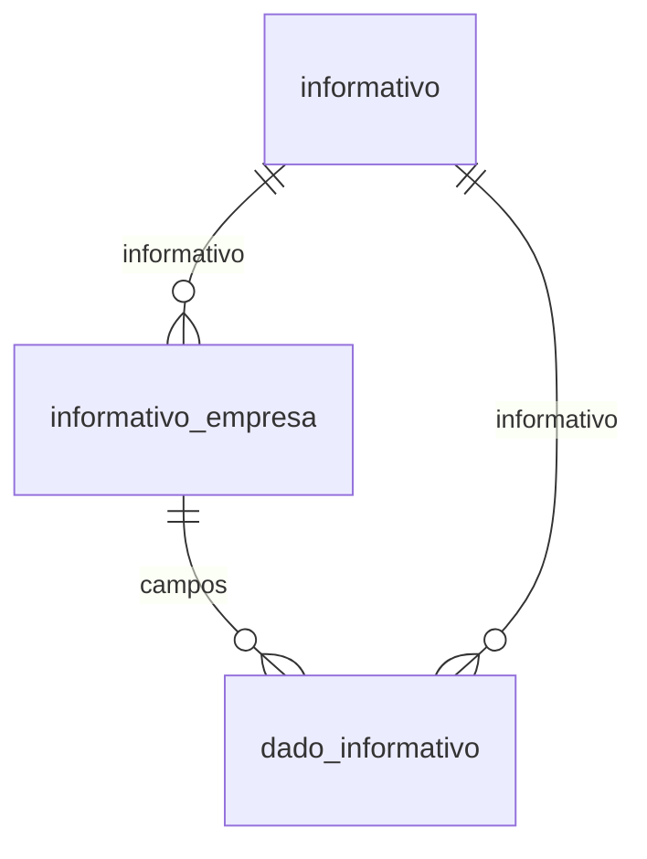

# Modelo — Informativos e obrigações acessórias (outros dados)

> Gerado por `src/model/gerar_docs_modelo.py` a partir de `src/model/modulos/informativos.yaml`, do catálogo e do perfil de colunas. **Não edite à mão.**

3 entidades. A coluna *Preench.* é o % de linhas com valor útil (nem nulo, nem em branco, nem zero, nem 1900-01-01; para colunas de código o zero conta como valor).

## Diagrama

## Entidades

| Entidade | Tabela | Linhas | Volume | Filtro obrigatório |
|---|---|---|---|---|
| [informativo](#informativo) | `efinformativos` | 82 | pequeno | — |
| [informativo_empresa](#informativo_empresa) | `efoutrosdados` | 83.235 | medio | empresa |
| [dado_informativo](#dado_informativo) | `efoutrosdados_dados` | 3.842.053 | grande | empresa; um de: informativo_codigo, periodo |

## informativo

**Catálogo de informativos (obrigações acessórias)** — tabela `efinformativos` (82 linhas)

Os 82 informativos que a Domínio trata, de DIPJ/DASN/DEFIS (um por ano) a guias estaduais (GIA, DIEF, GIM...), DCTF, DIRF, DMED, SPED, EFD-Reinf, MIT, DIRBI e DeRE. Tabela global.

- **Chave:** `i_informativos`
- **Empresa:** `não se aplica (tabela global)`
- **Período:** `—`
- **Ordem padrão:** `i_informativos asc`

**Regras de negócio validadas:**

- 82 informativos. Códigos de uso mais frequente: 35 (SPED PIS e COFINS), 36 (DCTF), 62 e 65 (EFD-Reinf e Reinf eventos), 32 (DIRF após 2009), 77 (MIT), 78 e 80 (DEFIS 2025 e 2026).

| Campo | Coluna | Tipo | Preench. | Domínio | Descrição (banco) |
|---|---|---|---|---|---|
| codigo | `i_informativos` | integer(4) |  |  | Codigo |
| descricao | `descricao` | varchar(80) |  |  | Descricao |

**Filtros:** `codigo` (eq/in), `descricao` (contem/prefixo)

## informativo_empresa

**Informativos preparados por empresa e competência** — tabela `efoutrosdados` (83.235 linhas)

Marca que existe "outros dados" para um informativo numa competência de uma empresa: ou seja, a obrigação foi preparada ali. Para informativos anuais (DEFIS, DIRF, DMED) a competência é 1º de janeiro do ano de referência. 83.391 linhas, 1.911 empresas. Os campos informados ficam em dado_informativo.

- **Chave:** `codi_emp, competencia, i_informativos`
- **Empresa:** `codi_emp`
- **Período:** `competencia`
- **Ordem padrão:** `competencia desc`, `i_informativos asc`

**Regras de negócio validadas:**

- Por informativo (cabeçalhos): 35 SPED PIS/COFINS 29.100 (868 empresas) · 36 DCTF 17.730 (709) · 62 EFD-Reinf 16.004 (883) · 65 Reinf eventos 7.219 (667) · 77 MIT 5.266 (679, de 2020-09 a 2026-09) · 32 DIRF 5.180 (1.740) · 78 DEFIS 2025 582 (196) · 80 DEFIS 2026 432 (235).
- Dado suspeito: 9 cabeçalhos têm ano impossível na competência (digitação): informativo 35 com anos 20 a 2240 (7 empresas) e informativo 62 com anos 3202 e 5025 (2 empresas). Filtre a competência entre 2000 e a data atual.
- Integridade: todo campo (dado_informativo) tem o cabeçalho correspondente (0 sem cabeçalho em 3.842.053) e só 1 cabeçalho não tem campos.

| Campo | Coluna | Tipo | Preench. | Domínio | Descrição (banco) |
|---|---|---|---|---|---|
| competencia | `competencia` | date(4) |  |  | Competencia |
| informativo_codigo | `i_informativos` | integer(4) |  |  | Informativo |

**Vínculos (LEFT JOIN, acrescentam colunas legíveis):**

- `informativo` → `efinformativos` por `i_informativos` = `i_informativos`; colunas: `informativo_descricao`

**Filhos (1:N):**

- `campos` → [dado_informativo](#dado_informativo)

**Filtros:** `competencia` (eq/entre/gte/lte), `informativo_codigo` (eq/in)

## dado_informativo

**Campos informados em cada informativo (campo/valor)** — tabela `efoutrosdados_dados` (3.842.053 linhas)

Os parâmetros e respostas que o escritório informa para gerar cada obrigação, como pares campo/valor por empresa, competência e informativo (retificadora, número do recibo, regime, qualificação, opções...). 3,84 milhões de linhas; o informativo 35 (SPED PIS/COFINS) tem 2,9 milhões. O valor é sempre texto: o `tipo` diz como interpretá-lo (ver domínio). Alguns campos têm dado pessoal (CPF e nome do inventariante da DIRF, CNPJ do responsável).

- **Chave:** `codi_emp, competencia, i_informativos, campo`
- **Empresa:** `codi_emp`
- **Período:** `competencia` · exige um de: `informativo_codigo, periodo`
- **Ordem padrão:** `competencia desc`, `i_informativos asc`, `campo asc`

**Regras de negócio validadas:**

- Volume por informativo: 35 SPED PIS/COFINS 2.909.913 linhas (100 campos distintos) · 36 DCTF 383.650 (22) · 62 EFD-Reinf 201.167 (13) · 32 DIRF 138.911 (27) · 65 Reinf eventos 122.234 (18) · 77 MIT 47.061 (24).
- Tipo: 1 em 2.965.178 campos (481.742 com valor vazio), 3 em 658.888, 4 em 169.850 e 2 em 49.921 (47.429 vazios); tipos 3 e 4 nunca têm valor vazio.
- Campos de controle comuns: `retificadora`, `numero_recibo`, `situacao_especial`, `regime`, `evento`, `qualificacao`. Na DCTF (36) campos como retificadora, numero_recibo, regime, evento e qualificacao aparecem em todos os 17.730 cabeçalhos; no MIT (77) aparecem data_evento e situacao_especial em 5.266 e evento, qualificacao_pj, tributacao_lucro e variacoes_monetarias em 4.959.

| Campo | Coluna | Tipo | Preench. | Domínio | Descrição (banco) |
|---|---|---|---|---|---|
| competencia | `competencia` | date(4) |  |  | Competencia |
| informativo_codigo | `i_informativos` | integer(4) |  |  | Informativo |
| campo | `campo` | varchar(100) |  |  | Campo |
| tipo | `tipo` | integer(4) |  | tipo_campo_informativo | Tipo |
| valor 🔒 | `valor` | varchar(4096) |  |  |  |

**Vínculos (LEFT JOIN, acrescentam colunas legíveis):**

- `informativo` → `efinformativos` por `i_informativos` = `i_informativos`; colunas: `informativo_descricao`

> 🔒 **Privacidade:** Alguns valores contêm CPF, nome ou CNPJ (inventariante da DIRF, responsáveis).

**Filtros:** `competencia` (eq/entre/gte/lte), `informativo_codigo` (eq/in), `campo` (eq/in/prefixo), `tipo` (eq/in)

## Domínios (significado dos códigos)

`confirmado`: **sim** = vem do comentário do banco e/ou foi conferido nos dados; **parcial** = parte dos valores; **não** = hipótese, não use como regra.

### status_empresa

Situação da empresa no cadastro (geempre.stat_emp)

Confirmado: sim

| Código | Significado |
|---|---|
| A | Ativa |
| I | Inativa |
| C | Em constituição |
| M | Ativo sem movimento |
| B | Em processo de baixa |
| E | Excluindo |

### motivo_inatividade

Motivo da inatividade (geempre.tipoi_emp). Só aparece em empresas inativas.

Confirmado: sim

| Código | Significado |
|---|---|
| 1 | Outros |
| 2 | Baixada |
| 3 | Transferida |
| 4 | Inadimplente |

### tipo_inscricao

Tipo da inscrição (CNPJ/CPF/CEI/CAEPF)

Confirmado: sim

| Código | Significado |
|---|---|
| 1 | CNPJ |
| 2 | CPF |
| 3 | CEI |
| 6 | CAEPF |

### regime_federal_empresa

Regime federal da folha (geempre.rfed_emp)

Confirmado: parcial

| Código | Significado |
|---|---|
| 1 | Normal |
| 2 | Microempresa |
| 3 | Empresa de pequeno porte |

### tipo_honorario_empresa

Como a empresa usa o módulo Honorários (geempre.honorario_tipo)

Confirmado: sim

| Código | Significado |
|---|---|
| E | Escritório (quem fatura) |
| C | Cliente |

### sim_nao_texto

Confirmado: sim

| Código | Significado |
|---|---|
| S | Sim |
| N | Não |

### sim_nao_numerico

Confirmado: sim

| Código | Significado |
|---|---|
| 1 | Sim |
| 0 | Não |

### tipo_campo_informativo

Tipo do campo em efoutrosdados_dados (coluna `tipo`)

Confirmado: parcial

> O banco não documenta o tipo (a coluna não tem comentário). Padrão observado nos nomes de campo: 1 = indicador S/N ou texto curto (retificadora, numero_recibo, situacao_especial, certificado_digital; 2,97 mi de campos, 481.742 vazios), 2 = data (data_evento, data_obito; 49.921, 47.429 vazios), 3 = opção/código escolhido (evento, regime, qualificacao, forma_tributacao_lucro; 658.888, nenhum vazio), 4 = valor ou texto longo (limite_rendimento, natureza_declarante, total_ctb; 169.850, nenhum vazio). O campo numero_recibo aparece em tipo 1 (DCTF) e em tipo 4 (DIRF).

| Código | Significado |
|---|---|
| 1 | Indicador ou texto curto (por observação) |
| 2 | Data (por observação) |
| 3 | Opção ou código (por observação) |
| 4 | Valor ou texto longo (por observação) |

