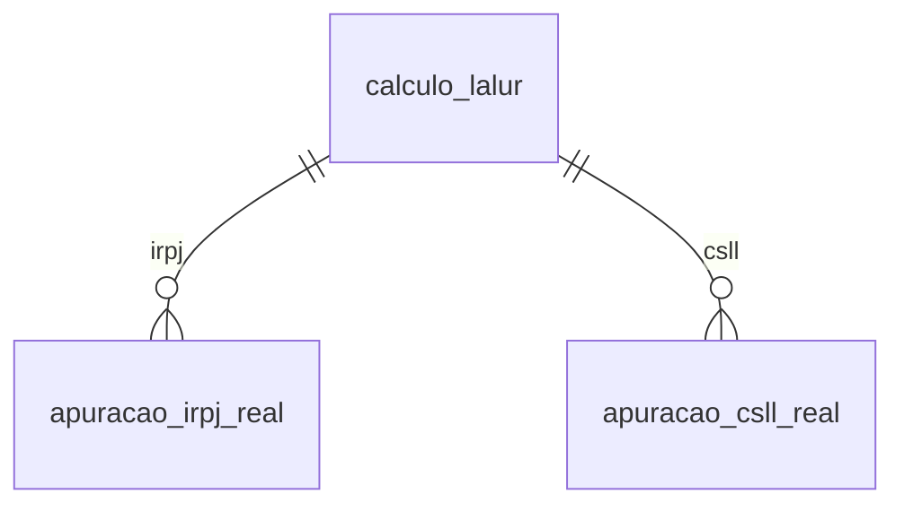

# Modelo — Lalur (IRPJ e CSLL do lucro real)

> Gerado por `src/model/gerar_docs_modelo.py` a partir de `src/model/modulos/lalur.yaml`, do catálogo e do perfil de colunas. **Não edite à mão.**

4 entidades. A coluna *Preench.* é o % de linhas com valor útil (nem nulo, nem em branco, nem zero, nem 1900-01-01; para colunas de código o zero conta como valor).

## Diagrama

## Entidades

| Entidade | Tabela | Linhas | Volume | Filtro obrigatório |
|---|---|---|---|---|
| [calculo_lalur](#calculo_lalur) | `lrcalculo` | 2.884 | pequeno | empresa |
| [apuracao_irpj_real](#apuracao_irpj_real) | `lrcalculo_irpj_real` | 3.108 | medio | empresa; um de: calculo |
| [apuracao_csll_real](#apuracao_csll_real) | `lrcalculo_csll_real` | 3.108 | medio | empresa; um de: calculo |
| [lucro_antes_irpj_csll](#lucro_antes_irpj_csll) | `lrlucro_antes_csll_irpj` | 2.813 | medio | empresa |

## calculo_lalur

**Cálculos do Lalur (cabeçalho)** — tabela `lrcalculo` (2.884 linhas)

Cada vez que o Lalur é calculado para uma empresa e competência fica um registro com o usuário e a hora. 2.884 cálculos, 76 empresas, de 2015-01 a 2026-09, feitos por 22 usuários. As apurações de IRPJ e CSLL ficam em apuracao_irpj_real e apuracao_csll_real, ligadas por (empresa, cálculo).

- **Chave:** `CODI_EMP, I_CALCULO`
- **Empresa:** `CODI_EMP`
- **Período:** `COMPETENCIA`
- **Ordem padrão:** `COMPETENCIA desc`, `I_CALCULO desc`

**Regras de negócio validadas:**

- Cada cálculo de IRPJ real tem o cabeçalho (0 sem cabeçalho em 3.108) e cada um tem também o cálculo de CSLL (3.108 de 3.108). As competências cobrem todos os meses (~240 por mês); dezembro tem 464 por incluir as 224 linhas de ajuste anual.

| Campo | Coluna | Tipo | Preench. | Domínio | Descrição (banco) |
|---|---|---|---|---|---|
| calculo | `i_calculo` | integer(4) |  |  | Código |
| competencia | `competencia` | date(4) |  |  | Competência |
| usuario | `usuario` | varchar(128) |  |  | Usuário que efetuou o cálculo |
| calculado_em | `data_hora` | timestamp(8) |  |  | Data e hora do cálculo |
| scp_codigo | `i_scp` | integer(4) |  |  | SCP |

**Vínculos (LEFT JOIN, acrescentam colunas legíveis):**

- `empresa` → `geempre` por `CODI_EMP` = `codi_emp`; colunas: `empresa_nome`

**Filhos (1:N):**

- `irpj` → [apuracao_irpj_real](#apuracao_irpj_real)
- `csll` → [apuracao_csll_real](#apuracao_csll_real)

**Filtros:** `calculo` (eq/in), `competencia` (eq/entre/gte/lte)

## apuracao_irpj_real

**Apuração do IRPJ pelo lucro real** — tabela `lrcalculo_irpj_real` (3.108 linhas)

Cadeia completa do IRPJ de um cálculo do Lalur: lucro líquido antes do IRPJ, adições, exclusões, lucro real antes e depois da compensação de prejuízos, IRPJ devido (15%), adicional (10%), deduções, incentivos, diferimento e valor a recolher; há os mesmos blocos para a atividade geral e a rural. 3.108 linhas, 76 empresas. Usa 38 das 62 colunas.

- **Chave:** `CODI_EMP, I_CALCULO, AJUSTE_ANUAL`
- **Empresa:** `CODI_EMP`
- **Período:** `—` · exige um de: `calculo`
- **Ordem padrão:** `I_CALCULO desc`, `AJUSTE_ANUAL asc`

**Regras de negócio validadas:**

- Lucro real antes da compensação = lucro líquido antes do IRPJ + adições − exclusões em 3.108 de 3.108 linhas; lucro real = antes da compensação − compensação em 3.108 de 3.108 (tolerância 0,02).
- IRPJ devido = 15% do lucro real em 278 de 278 linhas com lucro real positivo; nas 2.830 linhas com lucro real zero ou negativo o IRPJ devido é 0 em todas.
- Adicional = 10% × (lucro real − 20.000 × m), com m inteiro entre 1 e 12 em 167 de 167 linhas com adicional (m = nº de meses do período; mais comuns 3 e 12). Não use um limite fixo.
- Deduções (total) = soma das 10 parcelas em 3.108 de 3.108.
- Valor a recolher = max(0, IRPJ devido + adicional − deduções − incentivos fiscais − redução do lucro da exploração − redução por reinvestimento + diferido do período anterior − diferido do período) em 278 de 278 linhas com imposto devido; em 96 delas as deduções cobrem o imposto e o valor a recolher é 0. Nas 2.830 linhas sem imposto devido, o valor a recolher é 0.
- Cálculos de dezembro são o dobro dos demais meses porque incluem o ajuste anual (224 linhas com ajuste_anual = 1 e 2.884 com 0).

| Campo | Coluna | Tipo | Preench. | Domínio | Descrição (banco) |
|---|---|---|---|---|---|
| calculo | `i_calculo` | integer(4) |  |  | Código do cálculo |
| ajuste_anual | `ajuste_anual` | integer(4) |  | ajuste_anual | Ajuste Anual |
| lucro_liquido_antes_irpj | `valor_lucro_liquido_antes_irpj` | numeric(13) |  |  | Lucro líquido antes do IRPJ |
| adicoes | `valor_adicao` | numeric(13) |  |  | Adições |
| exclusoes | `valor_exclusao` | numeric(13) |  |  | Exclusões |
| lucro_real_antes_compensacao | `valor_lucro_real_antes_compensacao` | numeric(13) |  |  | Lucro Real antes da compensação |
| compensacao_prejuizo | `valor_compensacao` | numeric(13) |  |  | Compensação |
| lucro_real | `valor_lucro_real` | numeric(13) |  |  | Lucro Real da atividade |
| prejuizo_periodo | `valor_prejuizo_periodo` | numeric(13) |  |  | Prejuízo do período |
| lucro_liquido_antes_irpj_geral | `valor_lucro_liquido_antes_irpj_geral` | numeric(13) |  |  | Lucro líquido antes do IRPJ - Geral |
| adicoes_geral | `valor_adicao_geral` | numeric(13) |  |  | Adições - Geral |
| exclusoes_geral | `valor_exclusao_geral` | numeric(13) |  |  | Exclusões - Geral |
| lucro_real_geral | `valor_lucro_real_geral` | numeric(13) |  |  | Lucro Real da atividade - Geral |
| lucro_liquido_antes_irpj_rural | `valor_lucro_liquido_antes_irpj_rural` | numeric(13) |  |  | Lucro líquido antes do IRPJ - Rural |
| adicoes_rural | `valor_adicao_rural` | numeric(13) |  |  | Adições - Rural |
| exclusoes_rural | `valor_exclusao_rural` | numeric(13) |  |  | Exclusões - Rural |
| lucro_real_rural | `valor_lucro_real_rural` | numeric(13) |  |  | Lucro Real da atividade - Rural |
| irpj_devido | `valor_irpj_devido` | numeric(13) |  |  | IRPJ devido |
| adicional | `valor_adicional` | numeric(13) |  |  | Adicional de IRPJ |
| deducoes | `valor_deducao` | numeric(13) |  |  | Deduções |
| deducao_pago_em_meses_anteriores | `valor_deducao_pago_em_mes_anterior` | numeric(13) |  |  | Dedução - IR pago em meses anteriores |
| deducao_irrf | `valor_deducao_irrf` | numeric(13) |  |  | Dedução - IRRF |
| deducao_irrf_orgao_publico_federal | `valor_deducao_orgao_publico_federal` | numeric(13) |  |  | Dedução - IRRF por Órgãos Públicos Federais |
| deducao_irrf_administracao_publica | `valor_deducao_administracao_publica` | numeric(13) |  |  | Dedução - IRRF Administração Pública |
| deducao_outras | `valor_deducao_outra_deducao` | numeric(13) |  |  | Dedução - Outras Deduções |
| deducao_pago_exterior | `valor_deducao_pago_exterior` | numeric(13) |  |  | Dedução - Pago no exterior sobre lucros, rendimentos e ganhos de capital |
| deducao_ganhos_renda_variavel | `valor_deducao_pago_incidente_sobre_ganhos` | numeric(13) |  |  | Dedução - Pago incidente sobre ganhos no mercado de renda variável |
| deducao_parcelamento_formalizado | `valor_deducao_parcelamento_formalizado` | numeric(13) |  |  | Dedução - Parcelamento formalizado de IR sobre a base de cálculo estimada |
| deducao_compensacao_federal_periodo_anterior | `valor_deducao_compensacao_imposto_federal_periodo_anterior` | numeric(13) |  |  | Compensação de impostos federais de períodos anteriores |
| deducao_saldo_periodo_anterior | `valor_deducao_saldo_periodo_anterior` | numeric(13) |  |  | Saldo de deduções do período anterior |
| incentivo_fiscal | `valor_incentivo_fiscal` | numeric(13) |  |  | Incentivos Fiscais |
| reducao_lucro_exploracao | `valor_reducao_lucro_exploracao` | numeric(13) |  |  | Redução Lucro da Exploração |
| reducao_por_reinvestimento | `valor_reducao_por_reinvestimento` | numeric(13) |  |  | Redução por Reinvestimento |
| diferido_periodo_anterior | `valor_diferido_periodo_anterior` | numeric(13) |  |  | IRPJ diferido do período anterior |
| diferido_periodo | `valor_diferido_periodo` | numeric(13) |  |  | IRPJ diferido do período |
| a_recolher | `valor_a_recolher` | numeric(13) |  |  | IRPJ a recolher |
| compensar_periodo_seguinte | `valor_compensar_periodo_seguinte` | numeric(13) |  |  | Valor a compensar para o período seguinte |
| deduzir_periodo_seguinte | `valor_deduzir_periodo_seguinte` | numeric(13) |  |  | Valor a deduzir para o período seguinte |
| lucro_real_recalculado (calculada) | `VALOR_LUCRO_LIQUIDO_ANTES_IRPJ + VALOR_ADICAO - VALOR_EXCLUSAO - VALOR_COMPENSACAO` | — | — | | Calculada pelo modelo: VALOR_LUCRO_LIQUIDO_ANTES_IRPJ + VALOR_ADICAO - VALOR_EXCLUSAO - VALOR_COMPENSACAO |

**Vínculos (LEFT JOIN, acrescentam colunas legíveis):**

- `calculo_ref` → `lrcalculo` por `CODI_EMP` = `CODI_EMP` e `I_CALCULO` = `I_CALCULO`; colunas: `competencia`, `calculado_em`

> 🔒 **Privacidade:** Resultado tributário da empresa (financeiro).

**Filtros:** `calculo` (eq/in), `ajuste_anual` (eq), `lucro_real` (gte/lte/entre), `a_recolher` (gte/lte/entre)

## apuracao_csll_real

**Apuração da CSLL pelo lucro real** — tabela `lrcalculo_csll_real` (3.108 linhas)

Cadeia da CSLL de um cálculo do Lalur: lucro antes, adições, exclusões, base de cálculo antes e depois da compensação da base negativa, CSLL devida (9%), deduções e valor a recolher; geral e rural. 3.108 linhas, 76 empresas. Usa 26 das 60 colunas.

- **Chave:** `CODI_EMP, I_CALCULO, AJUSTE_ANUAL`
- **Empresa:** `CODI_EMP`
- **Período:** `—` · exige um de: `calculo`
- **Ordem padrão:** `I_CALCULO desc`, `AJUSTE_ANUAL asc`

**Regras de negócio validadas:**

- Base antes da compensação = lucro antes + adições − exclusões e base = antes − compensação, ambas em 3.108 de 3.108 linhas (tolerância 0,02).
- CSLL devida = 9% da base positiva em 277 das 278 linhas com base positiva (a outra é 9,03%, arredondamento); nas 2.830 linhas com base zero ou negativa a CSLL devida é 0 em todas.
- Deduções (total) = soma das 6 parcelas em 3.103 de 3.108 linhas; as 5 restantes não fecham nem somando o Perse/PGSC (causa não apurada).
- Valor a recolher = max(0, CSLL devida − deduções − isenção Prouni − bônus de adimplência + diferido do período anterior − diferido do período) em 278 de 278 linhas com CSLL devida.

| Campo | Coluna | Tipo | Preench. | Domínio | Descrição (banco) |
|---|---|---|---|---|---|
| calculo | `i_calculo` | integer(4) |  |  | Código do cálculo |
| ajuste_anual | `ajuste_anual` | integer(4) |  | ajuste_anual | Ajuste Anual |
| lucro_liquido_antes_csll_irpj | `valor_lucro_liquido_antes_csll_irpj` | numeric(13) |  |  | Lucro líquido antes da CSLL e do IRPJ |
| adicoes | `valor_adicao` | numeric(13) |  |  | Adições |
| exclusoes | `valor_exclusao` | numeric(13) |  |  | Exclusões |
| base_calculo_antes_compensacao | `valor_base_calculo_antes_compensacao` | numeric(13) |  |  | Base de cálculo antes da compensação |
| compensacao_base_negativa | `valor_compensacao` | numeric(13) |  |  | Compensação |
| base_calculo | `valor_base_calculo` | numeric(13) |  |  | Base de cálculo |
| base_calculo_geral | `valor_base_calculo_geral` | numeric(13) |  |  | Base de cálculo - Geral |
| base_calculo_rural | `valor_base_calculo_rural` | numeric(13) |  |  | Base de cálculo - Rural |
| csll_devida | `valor_csll_devida` | numeric(13) |  |  | CSLL devida |
| deducoes | `valor_deducao` | numeric(13) |  |  | Deduções |
| deducao_orgao_publico_federal | `valor_deducao_orgao_publico_federal` | numeric(13) |  |  | Dedução - CSLL retida por Órgãos Públicos Federais |
| deducao_pago_em_meses_anteriores | `valor_deducao_pago_em_mes_anterior` | numeric(13) |  |  | Dedução - pago em meses anteriores |
| deducao_outras_pessoas_juridicas | `valor_deducao_outra_pessoa_juridica` | numeric(13) |  |  | Dedução - CSLL retida por outras pessoas jurídicas |
| deducao_estado_municipio | `valor_deducao_estado_municipio` | numeric(13) |  |  | Dedução - CSLL retida por Esados, Municípios |
| deducao_administracao_publica | `valor_deducao_administracao_publica` | numeric(13) |  |  | Dedução - CSLL retida pela Administração Pública |
| deducao_outras | `valor_deducao_outra_deducao` | numeric(13) |  |  | Dedução - Outras Deduções |
| isencao_prouni | `valor_isencao_prouni` | numeric(13) |  |  | Isenção Prouni |
| isencao_perse_pgsc | `valor_isencao_perse_pgsc` | decimal(13) |  |  | Isenção Lei Perse e PGSC - Lei 14.148/21 |
| bonus_adimplencia | `valor_bonus_adimplencia` | numeric(13) |  |  | Bônus por adimplência |
| diferido_periodo_anterior | `valor_diferido_periodo_anterior` | numeric(13) |  |  | CSLL diferido do período anterior |
| diferido_periodo | `valor_diferido_periodo` | numeric(13) |  |  | CSLL diferido do período |
| a_recolher | `valor_a_recolher` | numeric(13) |  |  | CSLL a recolher |
| compensar_periodo_seguinte | `valor_compensar_periodo_seguinte` | numeric(13) |  |  | Valor a compensar para o período seguinte |
| deduzir_periodo_seguinte | `valor_deduzir_periodo_seguinte` | numeric(13) |  |  | Valor a deduzir para o período seguinte |
| base_recalculada (calculada) | `VALOR_LUCRO_LIQUIDO_ANTES_CSLL_IRPJ + VALOR_ADICAO - VALOR_EXCLUSAO - VALOR_COMPENSACAO` | — | — | | Calculada pelo modelo: VALOR_LUCRO_LIQUIDO_ANTES_CSLL_IRPJ + VALOR_ADICAO - VALOR_EXCLUSAO - VALOR_COMPENSACAO |

**Vínculos (LEFT JOIN, acrescentam colunas legíveis):**

- `calculo_ref` → `lrcalculo` por `CODI_EMP` = `CODI_EMP` e `I_CALCULO` = `I_CALCULO`; colunas: `competencia`, `calculado_em`

> 🔒 **Privacidade:** Resultado tributário da empresa (financeiro).

**Filtros:** `calculo` (eq/in), `ajuste_anual` (eq), `a_recolher` (gte/lte/entre)

## lucro_antes_irpj_csll

**Lucro antes da CSLL e do IRPJ (apurado na contabilidade)** — tabela `lrlucro_antes_csll_irpj` (2.813 linhas)

Lucro ou prejuízo contábil, operacional e não operacional, geral e rural, que alimenta o cálculo do Lalur numa competência. 2.813 linhas, 78 empresas, de 2013-01 a 2026-10.

- **Chave:** `CODI_EMP, I_LUCRO_ANTES`
- **Empresa:** `CODI_EMP`
- **Período:** `COMPETENCIA`
- **Ordem padrão:** `COMPETENCIA desc`, `I_LUCRO_ANTES desc`

**Regras de negócio validadas:**

- Nunca há lucro e prejuízo operacionais ao mesmo tempo na mesma linha (0 de 2.813); nenhuma linha é de SCP.

| Campo | Coluna | Tipo | Preench. | Domínio | Descrição (banco) |
|---|---|---|---|---|---|
| lucro_antes | `i_lucro_antes` | integer(4) |  |  | Código |
| competencia | `competencia` | date(4) |  |  | Competência |
| lucro_operacional | `valor_lucro_operacional` | numeric(13) |  |  | Lucro operacional |
| prejuizo_operacional | `valor_prejuizo_operacional` | numeric(13) |  |  | Prejuízo operacional |
| lucro_nao_operacional | `valor_lucro_nao_operacional` | numeric(13) |  |  | Lucro não operacional |
| prejuizo_nao_operacional | `valor_prejuizo_nao_operacional` | numeric(13) |  |  | Prejuízo não operacional |
| lucro_operacional_geral | `valor_lucro_operacional_geral` | numeric(13) |  |  | Lucro operacional - Geral |
| prejuizo_operacional_geral | `valor_prejuizo_operacional_geral` | numeric(13) |  |  | Prejuízo operacional - Geral |
| lucro_nao_operacional_geral | `valor_lucro_nao_operacional_geral` | numeric(13) |  |  | Lucro não operacional - Geral |
| prejuizo_nao_operacional_geral | `valor_prejuizo_nao_operacional_geral` | numeric(13) |  |  | Prejuízo não operacional - Geral |
| lucro_operacional_rural | `valor_lucro_operacional_rural` | numeric(13) |  |  | Lucro operacional - Rural |
| prejuizo_operacional_rural | `valor_prejuizo_operacional_rural` | numeric(13) |  |  | Prejuízo operacional - Rural |
| scp_codigo | `i_scp` | integer(4) |  |  | SCP |
| historico_geral | `historico_geral` | varchar(100) |  |  | Descrição do histórico do lucro antes da CSLL e IRPJ - Geral |
| historico_rural | `historico_rural` | varchar(100) |  |  | Descrição do histórico do lucro antes da CSLL e IRPJ - Rural |

> 🔒 **Privacidade:** Resultado contábil da empresa (financeiro).

**Filtros:** `competencia` (eq/entre/gte/lte)

## Domínios (significado dos códigos)

`confirmado`: **sim** = vem do comentário do banco e/ou foi conferido nos dados; **parcial** = parte dos valores; **não** = hipótese, não use como regra.

### status_empresa

Situação da empresa no cadastro (geempre.stat_emp)

Confirmado: sim

| Código | Significado |
|---|---|
| A | Ativa |
| I | Inativa |
| C | Em constituição |
| M | Ativo sem movimento |
| B | Em processo de baixa |
| E | Excluindo |

### motivo_inatividade

Motivo da inatividade (geempre.tipoi_emp). Só aparece em empresas inativas.

Confirmado: sim

| Código | Significado |
|---|---|
| 1 | Outros |
| 2 | Baixada |
| 3 | Transferida |
| 4 | Inadimplente |

### tipo_inscricao

Tipo da inscrição (CNPJ/CPF/CEI/CAEPF)

Confirmado: sim

| Código | Significado |
|---|---|
| 1 | CNPJ |
| 2 | CPF |
| 3 | CEI |
| 6 | CAEPF |

### regime_federal_empresa

Regime federal da folha (geempre.rfed_emp)

Confirmado: parcial

| Código | Significado |
|---|---|
| 1 | Normal |
| 2 | Microempresa |
| 3 | Empresa de pequeno porte |

### tipo_honorario_empresa

Como a empresa usa o módulo Honorários (geempre.honorario_tipo)

Confirmado: sim

| Código | Significado |
|---|---|
| E | Escritório (quem fatura) |
| C | Cliente |

### sim_nao_texto

Confirmado: sim

| Código | Significado |
|---|---|
| S | Sim |
| N | Não |

### sim_nao_numerico

Confirmado: sim

| Código | Significado |
|---|---|
| 1 | Sim |
| 0 | Não |

### ajuste_anual

Indica se a linha é o ajuste anual do cálculo (lrcalculo_irpj_real.ajuste_anual e lrcalculo_csll_real.ajuste_anual)

Confirmado: parcial

> O comentário só diz 'Ajuste Anual'. Em IRPJ: 224 linhas com 1 e 2.884 com 0 (de 3.108). É parte da chave: o mesmo cálculo tem uma linha normal (0) e uma de ajuste anual (1).

| Código | Significado |
|---|---|
| 0 | Cálculo do período |
| 1 | Ajuste anual |

