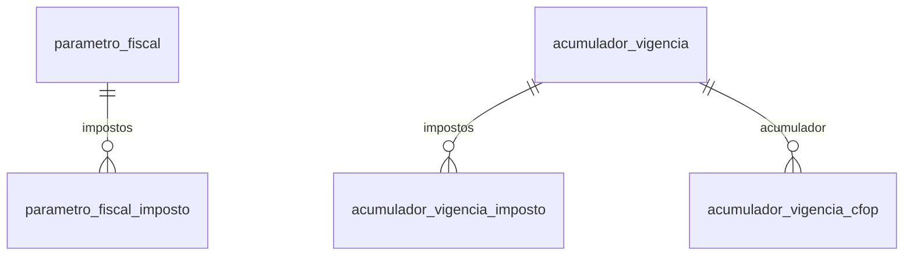

# Modelo — Perfil fiscal da empresa (parâmetros e acumuladores)

> Gerado por `src/model/gerar_docs_modelo.py` a partir de `src/model/modulos/parametro_fiscal.yaml`, do catálogo e do perfil de colunas. **Não edite à mão.**

8 entidades. A coluna *Preench.* é o % de linhas com valor útil (nem nulo, nem em branco, nem zero, nem 1900-01-01; para colunas de código o zero conta como valor).

## Diagrama

## Entidades

| Entidade | Tabela | Linhas | Volume | Filtro obrigatório |
|---|---|---|---|---|
| [parametro_fiscal](#parametro_fiscal) | `efparametro_vigencia` | 6.450 | pequeno | empresa |
| [parametro_fiscal_imposto](#parametro_fiscal_imposto) | `efparametro_vigencia_impostos` | 89.621 | medio | empresa |
| [acumulador_vigencia](#acumulador_vigencia) | `efacumulador_vigencia` | 460.804 | medio | empresa |
| [acumulador_vigencia_imposto](#acumulador_vigencia_imposto) | `efacumulador_vigencia_impostos` | 896.703 | grande | empresa; um de: acumulador_codigo |
| [parametro_fiscal_geral](#parametro_fiscal_geral) | `efparametro` | 1.434 | pequeno | empresa |
| [acumulador_vigencia_cfop](#acumulador_vigencia_cfop) | `efacumulador_vigencia_cfop` | 767.782 | grande | empresa; um de: acumulador_codigo |
| [acumulador_vigencia_aliquota](#acumulador_vigencia_aliquota) | `efacumulador_vigencia_impostos_aliquotas` | 379.002 | medio | empresa; um de: acumulador_codigo |
| [acumulador_vigencia_conta](#acumulador_vigencia_conta) | `efacumulador_vigencia_impostos_contas` | 453.490 | medio | empresa; um de: acumulador_codigo |

## parametro_fiscal

**Parâmetros da escrita fiscal por vigência** — tabela `efparametro_vigencia` (6.450 linhas)

Configuração fiscal de cada empresa a partir de uma data (vigência): regimes federal, estadual e municipal, geração de lançamentos contábeis, integração das notas, fatos geradores das retenções e opções do Simples. Cada alteração de regime cria uma nova vigência; a vigente em uma data é a mais recente com `vigencia` até essa data. 6.449 linhas, 1.434 empresas (308 com uma só vigência, até 24). Usa ~45 das 650+ colunas.

- **Chave:** `codi_emp, vigencia_par`
- **Empresa:** `codi_emp`
- **Período:** `vigencia_par`
- **Ordem padrão:** `vigencia_par desc`

**Regras de negócio validadas:**

- Vigência em vigor numa data = a de maior `vigencia` menor ou igual a essa data, por empresa (a mesma regra vale para acumuladores; validada na receita do Simples: 38 de 40 competências fecham ao centavo). 308 empresas têm 1 vigência, 198 têm 2 e há empresas com até 24.
- Regime federal (rfed_par), vigência mais recente por empresa: 5 = lucro presumido (733 empresas), 4 = Simples Nacional (466), 1 = provável lucro real (170), 2 = variante do Simples (29), 9 (32) incerto, 6 e 8 (2 cada) não determinados. A legenda NÃO consta no banco; ver a nota do domínio regime_federal_fiscal. Cruze com a apuração (efsdoimp_simples_nacional, IRPJ) antes de afirmar o regime de uma empresa.
- Regime estadual 13 não está no comentário do banco (que lista 1 a 4) e é o único além do 1: 1.736 das 1.764 vigências de regime federal 4 e 103 das 114 de regime federal 2 têm 13; todas as demais têm 1.
- Regime de recolhimento: todas as 6.449 vigências têm R (real), inclusive as de lucro presumido: o campo não identifica o regime de tributação. 6.429 vigências geram lançamentos contábeis (lctb = S) e 20 não.
- Há vigência datada de 1964-06-01 (a mais antiga); datas anteriores a 2000 provavelmente são digitação do ano.

| Campo | Coluna | Tipo | Preench. | Domínio | Descrição (banco) |
|---|---|---|---|---|---|
| vigencia | `vigencia_par` | date(4) |  |  | Vigencia |
| descricao | `descricao_par` | char(80) |  |  | Descricao |
| regime_federal | `rfed_par` | integer(4) |  | regime_federal_fiscal | Regime federal (1 / 2 / 3 / 4 / 5 / 6 / 7 / 8 / 9) |
| regime_estadual | `rest_par` | integer(4) |  | regime_estadual_fiscal | Regime estadual (1 - Normal/2 - ME/3 - Estimativa/4 - EPP) |
| regime_municipal | `rmun_par` | integer(4) |  | regime_municipal_fiscal | Regime Municipal (1 - Normal/2 - Simples) |
| regime_recolhimento | `regime_recolhimento_par` | char(1) |  | regime_recolhimento_fiscal | Regime de recolhimento (R - Real/P - Presumido) |
| gera_lancamentos_contabeis | `lctb_par` | char(1) |  | sim_nao_texto | Gera lancamentos contabeis (S/N) |
| lancamentos_em_outra_empresa | `ctbmat_par` | char(1) |  | sim_nao_texto | Lancamentos Contabeis (N - Mesma empresa/S - Outra empresa) |
| empresa_da_contabilidade | `codmat_par` | integer(4) |  |  | Codigo da Empresa na Contabilidade |
| processa_filiais | `fili_par` | integer(4) |  | processa_filiais | Processa as filiais (1 - Nao/2 - Sim) |
| agrupa_lancamentos_filiais | `agrupafil_par` | char(1) |  | sim_nao_texto | Agrupar Lancamentos das filiais (S/N) |
| apuracao_consolidada | `consolidada_par` | integer(4) |  | apuracao_consolidada | Apuracao consolidada (1 - Nao/2 - Estabelecimento consolidador/3 - Estabelecimento consolidado) |
| centralizacao_recolhimento | `central_par` | integer(4) |  |  | Centralizacao do recolhimento |
| gera_honorarios | `geho_par` | char(1) |  | sim_nao_texto | Gera Honorarios (S/N) |
| substituicao_tributaria | `subst_par` | char(1) |  | sim_nao_texto | Substituicao Tributaria (S/N) |
| integracao_entradas | `integraent_par` | char(1) |  | integracao_contabil | Integracao das Entradas (A - Analitica com data da nota/U - Analitica com data do ultimo dia do mes/S - Sintetica por mes/D - Sintetico por dia |
| integracao_saidas | `integrasai_par` | char(1) |  | integracao_contabil | Integracao das Saidas (A - Analitica com data da nota/U - Analitica com data do ultimo dia do mes/S - Sintetica por mes/D - Sintetico por dia |
| integracao_servicos | `integraser_par` | char(1) |  | integracao_contabil | Integracao dos Servicos (A - Analitica com data da nota/U - Analitica com data do ultimo dia do mes/S - Sintetica por mes/D - Sintetico por dia |
| cada_fornecedor_gera_conta | `criactafor_par` | char(1) |  | sim_nao_texto | Cada fornecedor gera uma conta (S/N) |
| cada_cliente_gera_conta | `criactacli_par` | char(1) |  | sim_nao_texto | Cada cliente gera uma conta (S/N) |
| fato_gerador_crf | `crffatger_par` | char(1) |  | fato_gerador_retencao | Fato gerador da CRF(E - emissao/P - pagamento). |
| fato_gerador_irrf | `irrffatger_par` | char(1) |  | fato_gerador_retencao | Fato gerador do IRRF(E - emissao/P - pagamento). |
| fato_gerador_crf_pf | `crfopfatger_par` | char(1) |  | fato_gerador_retencao | Fato gerador da CRFOP(E - emissao/P - pagamento) |
| fato_gerador_irrf_pf | `irrfpfatger_par` | char(1) |  | fato_gerador_retencao | Fato gerador do IRRFP(E - emissao/P - pagamento) |
| prestadora_servico_base_16 | `prestserv_par` | char(1) |  | sim_nao_texto | Empresa exclusivamente prestadora de servico com aliquota base de LP de 16% |
| deduz_st_base_irpj_csll | `deduzst_par` | char(1) |  | sim_nao_texto | Deduzir o valor de Substituicao Tributaria da Base do IRPJ e CSLL (S/N) |
| transfere_creditos_acumulados | `transferecreditos_par` | char(1) |  | sim_nao_texto | Efetua transferencia de creditos acumulados |
| calcula_adicional_icms | `adicional_icms_par` | char(1) |  | sim_nao_texto | Calcula adicional de ICMS (S/N) |
| simples_saldo_negativo_proximo_mes | `saldosimples_par` | char(1) |  | sim_nao_texto | Transfere saldo negativo do faturamento para o proximo mes (S/N) |
| simples_federal_com_iss | `simplesiss_par` | char(1) |  | sim_nao_texto | Calcular Simples Federal com ISS (S/N) |
| simples_50_prestadoras | `simples50_par` | char(1) |  | sim_nao_texto | Calcular Simples com 50% de aumento para prestadoras de servico (S/N) |
| simples_aliquota_diferenciada | `simples_aliq_diferenciada_par` | char(1) |  | sim_nao_texto | Calcular Simples com aliquota diferenciada(S/N) |
| regime_especial_st | `regime_especial_st_par` | char(1) |  | sim_nao_texto | Regime especial para recolhimento de substiuicao tributaria(S/N) |
| margem_valor_agregado | `mva_par` | numeric(5) |  |  | Margem do valor agregado |

**Vínculos (LEFT JOIN, acrescentam colunas legíveis):**

- `empresa` → `geempre` por `codi_emp` = `codi_emp`; colunas: `empresa_nome`, `empresa_cnpj_cpf` 🔒

**Filhos (1:N):**

- `impostos` → [parametro_fiscal_imposto](#parametro_fiscal_imposto)

**Filtros:** `vigencia` (eq/entre/gte/lte), `regime_federal` (eq/in), `regime_estadual` (eq/in)

## parametro_fiscal_imposto

**Impostos ativos em cada vigência dos parâmetros fiscais** — tabela `efparametro_vigencia_impostos` (89.621 linhas)

Quais impostos a empresa apura em cada vigência (89.618 linhas, 1.434 empresas, 54 impostos diferentes).

- **Chave:** `codi_emp, vigencia_par, codi_imp`
- **Empresa:** `codi_emp`
- **Período:** `vigencia_par`
- **Ordem padrão:** `vigencia_par desc`, `codi_imp asc`

**Regras de negócio validadas:**

- Toda linha tem a vigência correspondente em parametro_fiscal (0 órfãs em 89.618).

| Campo | Coluna | Tipo | Preench. | Domínio | Descrição (banco) |
|---|---|---|---|---|---|
| vigencia | `vigencia_par` | date(4) |  |  | Vigencia |
| imposto_codigo | `codi_imp` | integer(4) |  |  | Imposto |

**Vínculos (LEFT JOIN, acrescentam colunas legíveis):**

- `imposto` → `geimposto` por `codi_emp` = `codi_emp` e `codi_imp` = `codi_imp`; colunas: `imposto_nome`, `imposto_sigla`

**Filtros:** `vigencia` (eq/entre/gte/lte), `imposto_codigo` (eq/in)

## acumulador_vigencia

**Acumuladores fiscais por vigência (configuração)** — tabela `efacumulador_vigencia` (460.804 linhas)

Cada acumulador classifica as notas (entrada, saída, serviço) e define como entram na receita, no faturamento, nos impostos e na contabilidade. A configuração vale por vigência: o acumulador em vigor numa nota é o de maior `vigencia` até a data da nota (as notas não guardam a vigência). 460.803 linhas, 1.419 empresas, 434 mil acumuladores (96% com uma só vigência).

- **Chave:** `codi_emp, codi_acu, vigencia_acu`
- **Empresa:** `codi_emp`
- **Período:** `—`
- **Ordem padrão:** `codi_acu asc`, `vigencia_acu desc`

**Regras de negócio validadas:**

- Receita bruta do Simples: as notas de saída, serviços e CF-e contam na receita quando o acumulador em vigor na data tem `incide_receita_bruta` = S; as devoluções lançadas em entradas abatem quando `incide_devolucao` = S. Conferido em 38 de 40 empresa/competências sorteadas (ver simples.apuracao_simples_nacional).
- Indicadores (460.803 vigências): receita = faturamento = S em 138.517 (inclui 23.216 que também incidem em devolução), ambos N em 322.111 (31.402 só devolução); receita S e faturamento N em 133 e o inverso em 42. Receita e faturamento quase sempre andam juntos.
- 96% dos acumuladores (416.083 de 434.521) têm uma só vigência; 14.633 têm duas; o máximo é 15.
- Tipo de nota: 458.456 vigências são O (outras), 1.236 V (à vista) e 1.111 P (a prazo): o tipo só é usado em poucos acumuladores.

| Campo | Coluna | Tipo | Preench. | Domínio | Descrição (banco) |
|---|---|---|---|---|---|
| acumulador_codigo | `codi_acu` | integer(4) |  |  | Codigo |
| vigencia | `vigencia_acu` | date(4) |  |  | Vigencia |
| descricao | `descricao_acu` | char(80) |  |  | Descricao |
| incide_receita_bruta | `irec_acu` | char(1) |  | sim_nao_texto | Incide sobre Receita Bruta (S/N) |
| incide_faturamento | `ifat_acu` | char(1) |  | sim_nao_texto | Incide sobre Faturamento (S/N) |
| incide_devolucao | `idev_acu` | char(1) |  | sim_nao_texto | Incide sobre Devolucao (S/N) |
| incide_acrescimo_financeiro | `iax1_acu` | char(1) |  | sim_nao_texto | Incide sobre Acrescimo financeiro (S/N) |
| enquadramento_epp | `ienq_acu` | char(1) |  | sim_nao_texto | Enquadramento EPP (S/N) |
| faz_estoque_dipi | `esto_acu` | char(1) |  | sim_nao_texto | Faz estoque/DIPI (S/N) |
| gera_bens_patrimonio | `gpat_acu` | char(1) |  | sim_nao_texto | Gera bens automaticamento no patrimonio (S/N) |
| gera_parcelas | `parc_acu` | char(1) |  | sim_nao_texto | Gera parcelas nas notas (S/N) |
| tipo_nota | `tiponota_acu` | char(1) |  | tipo_nota_acumulador | Tipo de nota (V - a vista/P - a prazo/O - outras) |
| nota_transferencia_credito | `transferencia_acu` | char(1) |  | sim_nao_texto | Nota de transferencia de credito (S/N) |
| confere_natureza | `cnat_acu` | char(1) |  | sim_nao_texto | Confere natureza no lancamento (S/N) |
| nota_cancelada | `cancel_acu` | char(1) |  | sim_nao_texto | Nota cancelada (S/N) |
| servico_terceirizado | `servterc_acu` | char(1) |  | sim_nao_texto | Nota de Servico terceirizado (S/N) |
| incide_simples_municipal | `smun_acu` | char(1) |  | sim_nao_texto | Incide sobre Simples Municipal (S/N) |
| simples_nao_somar_servico_50 | `naosomarsimples_acu` | char(1) |  | sim_nao_texto | Nao somar com servico para aumento de 50% na aliquota do SIMPLES (S/N) |
| simples_aliquota_diferenciada | `simples_aliq_diferenciada_acu` | char(1) |  | sim_nao_texto | Calcular Simples com aliquota diferenciada(S/N) |
| simples_credito_presumido | `simplesn_credito_presumido_acu` | char(1) |  | sim_nao_texto | Calcula credito presumido simples nacional (S/N) |
| simples_entradas_mercadoria | `simplesn_entradas_acu` | char(1) |  | sim_nao_texto | Entradas de mercadoria para calculo do Simples Nacional - Decreto 662/2007 (S/N) |
| produtos_sujeitos_st | `produtos_sujeitos_st_acu` | char(1) |  | sim_nao_texto | Produtos sujeitos ao regime de substituicao tributaria(S/N) |
| credito_presumido | `credito_presumido_acu` | char(1) |  | sim_nao_texto | Gera credito presumido na apuracao (S/N) |
| importacao_credito_icms | `importacao_acu` | char(1) |  | sim_nao_texto | Notas de importacao com aproveitamento de credito de ICMS (S/N) |
| gera_entrada_outra_empresa | `geraentrada_acu` | char(1) |  | sim_nao_texto | Gerar Nota de Entrada em outra empresa (S=Sim/N=Nao) |
| conta_debito | `cdeb_acu` | integer(4) |  |  | Conta Debito |
| conta_credito | `ccre_acu` | integer(4) |  |  | Conta Credito |
| historico_padrao | `chis_acu` | integer(4) |  |  | Historico Padrao |
| conta_contrapartida_pagamento | `ctcp_acu` | integer(4) |  |  | Conta de contra partida para pagto das notas parceladas |
| conta_juros | `ctjr_acu` | integer(4) |  |  | Conta dos Juros dos pagamentos |
| conta_multa | `ctmt_acu` | integer(4) |  |  | Conta da multa dos pagamentos |
| conta_desconto | `ctdt_acu` | integer(4) |  |  | Conta do desconto das parcelas |
| conta_devolucao | `ctdv_acu` | integer(4) |  |  | Conta de devolucao das parcelas |
| conta_icms_compras | `ctaicmscp_acu` | integer(4) |  |  | Conta ICMS sobre compras |
| cop | `cop_acu` | char(3) |  |  | Codigo de Operacao e Prestacao |

**Filhos (1:N):**

- `impostos` → [acumulador_vigencia_imposto](#acumulador_vigencia_imposto)

**Filtros:** `acumulador_codigo` (eq/in), `vigencia` (eq/entre/gte/lte), `descricao` (contem/prefixo), `incide_receita_bruta` (eq), `incide_devolucao` (eq)

## acumulador_vigencia_imposto

**Impostos de cada acumulador por vigência** — tabela `efacumulador_vigencia_impostos` (896.703 linhas)

Como cada acumulador trata cada imposto: alíquota da base de cálculo, onde lançar a diferença da base, redução, e o enquadramento no Simples Nacional (anexo, seção e tabela) usado na segregação da receita. 896.705 linhas, 40 impostos diferentes.

- **Chave:** `CODI_EMP, CODI_ACU, VIGENCIA_ACU, CODI_IMP`
- **Empresa:** `CODI_EMP`
- **Período:** `—` · exige um de: `acumulador_codigo`
- **Ordem padrão:** `CODI_ACU asc`, `VIGENCIA_ACU desc`, `CODI_IMP asc`

**Regras de negócio validadas:**

- Toda linha tem o acumulador e a vigência correspondentes em acumulador_vigencia (0 sem acumulador em 896.705).
- O enquadramento no Simples (anexo preenchido) está quase só no imposto 44 (Simples Nacional): 33.057 linhas; seguem IPI 528, PIS 204, Simples MEI 19 e outros com poucas linhas.

| Campo | Coluna | Tipo | Preench. | Domínio | Descrição (banco) |
|---|---|---|---|---|---|
| acumulador_codigo | `codi_acu` | integer(4) |  |  | Acumulador |
| vigencia | `vigencia_acu` | date(4) |  |  | Vigencia |
| imposto_codigo | `codi_imp` | integer(4) |  |  | Imposto |
| aliquota_base_calculo | `albc_iac` | numeric(7) |  |  | Aliquota da Base de Calculo |
| diferenca_base_lancar_em | `diferenca_iac` | integer(4) |  | diferenca_base_valor_contabil | Diferenca da base de calculo com valor contabil lancar em (1-Isentas/2-Outras/3-Nao lancar/4-IPI/5-SUBTRI/6-Nao tributadas/7-parcela reduzida) |
| percentual_reducao | `reducao_iac` | numeric(6) |  |  | Percentual de reducao do imposto |
| reduz_imposto | `reduz_imposto_iac` | char(1) |  | sim_nao_texto | Reduz valor do imposto(S/N) |
| codigo_recolhimento_padrao | `codrec_padrao_iac` | char(6) |  |  | Codigo de recolhimento padrao do imposto |
| sequencial_recolhimento | `i_recolhimento` | integer(4) |  |  | Sequencial do código de recolhimento |
| simples_anexo | `simplesn_anexo_iac` | integer(4) |  |  | Simples Nacional - Anexo |
| simples_secao | `simplesn_secao_iac` | integer(4) |  |  | Simples Nacional - Secao |
| simples_tabela | `simplesn_tabela_iac` | integer(4) |  |  | Simples Nacional - Tabela |
| simples_situacao_irpj | `simplesn_irpj_iac` | char(1) |  |  | SIMPLES NACIONAL - SITUACAO IRPJ(0/1/2/3/4/5/6/I/R/A/B/"") |
| simples_situacao_csll | `simplesn_csll_iac` | char(1) |  |  | SIMPLES NACIONAL - SITUACAO CSLL(0/1/2/3/4/5/6/I/R/A/B/"") |
| simples_situacao_cofins | `simplesn_cofins_iac` | char(1) |  |  | SIMPLES NACIONAL - SITUACAO COFINS(0/1/2/3/4/5/6/I/R/A/B/"") |
| simples_situacao_pis | `simplesn_pis_iac` | char(1) |  |  | SIMPLES NACIONAL - SITUACAO PIS(0/1/2/3/4/5/6/I/R/A/B/"") |
| simples_situacao_inss | `simplesn_inss_iac` | char(1) |  |  | SIMPLES NACIONAL - SITUACAO INSS(0/1/2/3/4/5/6/I/R/A/B/"") |
| simples_situacao_ipi | `simplesn_ipi_iac` | char(1) |  |  | SIMPLES NACIONAL - SITUACAO IPI(0/1/2/3/4/5/6/I/R/A/B/"") |
| simples_situacao_icms | `simplesn_icms_iac` | char(1) |  |  | SIMPLES NACIONAL - SITUACAO ICMS(0/1/2/3/4/5/6/I/R/A/B/"") |
| simples_situacao_iss | `simplesn_iss_iac` | char(1) |  |  | SIMPLES NACIONAL - SITUACAO ISS(0/1/2/3/4/5/6/I/R/A/B/"") |
| simples_reducao_base_icms | `simplesn_arbc_icms_iac` | numeric(5) |  |  | Aliquota de reducao da base de calculo do ICMS |
| simples_reducao_base_iss | `simplesn_arbc_iss_iac` | numeric(5) |  |  | Aliquota de reducao da base de calculo do ISS |
| simples_utilizar_reducao_icms | `simplesn_utilizar_arbc_icms_iac` | char(1) |  | sim_nao_texto | Aplicar a redução da base de cálculo para o ICMS |
| simples_servicos_702_705 | `simplesn_servicos_702_705` | char(1) |  | sim_nao_texto | Serviços relacionados nos subitens 7.02 e 7.05 da lista anexa à LC 116/2003 |
| modalidade_operacao | `modalidade_operacao_iac` | integer(4) |  |  | Modalidade da importacao(1 - Com direito a credito/2 - Compensacao/3 - Regime especial/4 - Sem direito a credito) |
| debito_especial_sped | `debito_especial_sped_iac` | char(1) |  | sim_nao_texto | Gerar débito especial para o SPED (S/N) |
| dacon_tipo_receita | `dacon_tipo_receita_iac` | integer(4) |  |  | Tipo de receita |

**Vínculos (LEFT JOIN, acrescentam colunas legíveis):**

- `acumulador` → `efacumulador_vigencia` por `CODI_EMP` = `codi_emp` e `CODI_ACU` = `codi_acu` e `VIGENCIA_ACU` = `vigencia_acu`; colunas: `acumulador_descricao`
- `imposto` → `geimposto` por `CODI_EMP` = `codi_emp` e `CODI_IMP` = `codi_imp`; colunas: `imposto_nome`, `imposto_sigla`

**Filtros:** `acumulador_codigo` (eq/in), `vigencia` (eq/entre/gte/lte), `imposto_codigo` (eq/in)

## parametro_fiscal_geral

**Parâmetros gerais da escrita fiscal (sem vigência)** — tabela `efparametro` (1.434 linhas)

Opções da escrita fiscal que não variam por vigência: período atual de trabalho, data de fechamento (não se lança depois dela), SPED, controle de estoque, forma de lançar clientes e fornecedores e integração contábil. Uma linha por empresa (1.434). Usa 38 das 135 colunas; as demais são opções de tela e de regras estaduais.

- **Chave:** `CODI_EMP`
- **Empresa:** `CODI_EMP`
- **Período:** `—`
- **Ordem padrão:** `CODI_EMP asc`

**Regras de negócio validadas:**

- Uma linha por empresa (1.434 empresas; todas têm vigência em parametro_fiscal, 0 sem). Período atual de 2010-01 a 2026-09.
- Fechamento fiscal (`fechamento_fiscal`, 'não é permitido lançamento após esta data'): preenchido nas 1.434 empresas, de 1966-06-30 a 2026-04-30; é anterior ao período atual em 1.433 e posterior em 1 — o fechamento costuma estar ATRASADO em relação ao período de trabalho. Datas como 1966 são provavelmente 'sem fechamento'.
- SPED Fiscal: gera (S) em 921 empresas e não em 513; o controle genérico `gera_sped` é N em todas as 1.434. Controla estoque (1) em 1.429 empresas e não (2) em 5; gera lançamentos contábeis em 1.431 e não em 3.
- Perfil do SPED é A em todas; lançamento de produtos Normal (N) em 1.430 e NCM (C) em 4. O início do cálculo do Simples no sistema está preenchido em 358 empresas (de 2015-01 a 2026-09).

| Campo | Coluna | Tipo | Preench. | Domínio | Descrição (banco) |
|---|---|---|---|---|---|
| periodo_atual | `peri_par` | date(4) |  |  | Periodo atual |
| periodo_inicial | `pini_par` | date(4) |  |  | Periodo inicial |
| fechamento_fiscal | `pfec_par` | date(4) |  |  | Data do fechamento, nao e permitido lancto apos esta data |
| inicio_efetivo_atividades | `inicioefetivo_par` | date(4) |  |  | Inicio efetivo das atividades da empresa |
| simples_inicio_no_sistema | `simplesn_inicio_sistema_par` | date(4) |  |  | Inicio do calculo do simples nacional no sistema (receita bruta acumulada) |
| controla_estoque | `esto_par` | integer(4) |  | sim1_nao2 | Faz controle de estoque (1 - Sim/2 - Nao) |
| gera_movimento_produtos_sintegra | `dipi_par` | integer(4) |  | sim1_nao2 | Gerar movimento de produtos no SINTEGRA (1 - Sim/2 - Nao) |
| gera_sped | `sped_par` | char(1) |  | sim_nao_texto | Gera informacoes SPED (S=Sim/N=Nao) |
| gera_sped_fiscal | `sped_fiscal_par` | char(1) |  | sim_nao_texto | Gera SPED Fiscal (S/N) |
| perfil_sped | `sped_perfil_par` | char(1) |  | perfil_sped | SPED - Perfil de apresentacao (A/B) |
| gera_lancamentos_contabeis | `gera_lancamentos_par` | char(1) |  | sim_nao_texto | Gera lancamentos contabeis(S/N) |
| gera_perdcomp | `perdcomp_par` | char(1) |  | sim_nao_texto | Gera PER/DCOMP (S/N) |
| gera_informacoes_sintegra | `digecf_par` | char(1) |  | sim_nao_texto | Gerar informacoes para o Sintegra (S/N) |
| verifica_inscricao_estadual | `chkins_par` | char(1) |  | sim_nao_texto | Verifica Inscricao Estadual (S/N) |
| lancamento_fornecedor_por | `lfor_par` | integer(4) |  | lancamento_por | Lancamento de fornecedor por (1 - Codigo/2 - Nome/3 - CNPJ) |
| lancamento_cliente_por | `lcli_par` | integer(4) |  | lancamento_por | Lancamento de cliente por (1 - Codigo/2 - Nome/3 - CNPJ) |
| opcao_lancamento_produtos | `produto_par` | char(1) |  | opcao_produto | Opcao para lancamento de produtos (N - Normal / B - NBM / C - NCM / I - Identificador) |
| sequencia_automatica_saidas_servicos | `seqaut_par` | char(1) |  | sim_nao_texto | Sequencia automatica das notas de saidas e servicos (S/N) |
| controla_contas_a_pagar_receber | `caixa_par` | char(1) |  | sim_nao_texto | Controla contas a pagar e receber (S/N) |
| usa_tabelas_municipais | `usatm_par` | char(1) |  | sim_nao_texto | Usa tabelas municipais (S/N) |
| controla_aidf | `controla_aidf_par` | char(1) |  | sim_nao_texto | Efetuar controle no lancamento das notas de saidas conforme AIDF (S/N) |
| informativo_nota_fiscal_paulista | `informativo_nfp_par` | char(1) |  | sim_nao_texto | Gera informativo nota fiscal paulista(S/N) |
| importa_nfe_do_site_da_receita | `importar_nfe_par` | char(1) |  | sim_nao_texto | Importa a NFe do site da receita(S/N) |
| informa_chave_nfe_terceiros | `informar_nfe_terceiros_par` | char(1) |  | sim_nao_texto | Informar a chave NFe para notas de entradas com emissão de terceiros(S/N) |
| distribuidora_de_combustivel | `combustivel_par` | char(1) |  | sim_nao_texto | Empresa distribuidora, refinaria ou revendedora de combustível(S/N) |
| limite_lancamento_reducao_z | `limite_reducao_z_par` | date(4) |  |  | Data limite para o lançamento de redução Z na tela de saídas |
| utiliza_dominio_cliente | `domcli_par` | char(1) |  | sim_nao_texto | Utiliza Dominio Cliente (S=Sim/N=Nao) |
| scanc_ctb | `scancctb_par` | char(1) |  | sim_nao_texto | Gera informacoes para o Scanc-CTB (S=Sim/N=Nao) |
| entrega_a_domicilio | `entrega_domicilio_par` | char(1) |  | sim_nao_texto | Entrega a domicilio(S/N) |

**Vínculos (LEFT JOIN, acrescentam colunas legíveis):**

- `empresa` → `geempre` por `CODI_EMP` = `codi_emp`; colunas: `empresa_nome`

**Filtros:** `periodo_atual` (eq/entre/gte/lte), `fechamento_fiscal` (eq/entre/gte/lte), `gera_sped_fiscal` (eq)

## acumulador_vigencia_cfop

**CFOPs permitidos em cada acumulador por vigência** — tabela `efacumulador_vigencia_cfop` (767.782 linhas)

Lista de CFOPs (naturezas de operação) que o acumulador aceita numa vigência. Cada acumulador costuma ter 2 CFOPs (o estadual e o interestadual, ex.: 5xxx e 6xxx) ou 1. 767.782 linhas, 1.414 empresas, 512 CFOPs distintos.

- **Chave:** `CODI_EMP, CODI_ACU, VIGENCIA_ACU, CODI_NAT`
- **Empresa:** `CODI_EMP`
- **Período:** `—` · exige um de: `acumulador_codigo`
- **Ordem padrão:** `CODI_ACU asc`, `VIGENCIA_ACU desc`, `CODI_NAT asc`

**Regras de negócio validadas:**

- Número de CFOPs por acumulador/vigência: 2 em 349.322, 1 em 63.684, 3 em 1.653, 4 em 103; máximo 8. Todas as linhas têm o acumulador e a vigência correspondentes (0 órfãs em 767.782).
- Conciliação com as notas: em 13.088 notas de saída de 2025 de 3 empresas médias, o CFOP da nota está na lista do acumulador vigente na data em 13.071 (99,9%); as outras 17 são de acumuladores sem lista de CFOPs.

| Campo | Coluna | Tipo | Preench. | Domínio | Descrição (banco) |
|---|---|---|---|---|---|
| acumulador_codigo | `codi_acu` | integer(4) |  |  | Acumulador |
| vigencia | `vigencia_acu` | date(4) |  |  | Vigencia |
| cfop | `codi_nat` | integer(4) |  |  | Natureza |
| complemento_cfop_cat_17_99 | `complemento_cfop_cat_17_99` | integer(4) |  |  | Complemento padrão da CFOP - Portaria Cat nº 17/99 (S/N) |

**Vínculos (LEFT JOIN, acrescentam colunas legíveis):**

- `acumulador` → `efacumulador_vigencia` por `CODI_EMP` = `codi_emp` e `CODI_ACU` = `codi_acu` e `VIGENCIA_ACU` = `vigencia_acu`; colunas: `acumulador_descricao`

**Filtros:** `acumulador_codigo` (eq/in), `vigencia` (eq/entre/gte/lte), `cfop` (eq/in/prefixo)

## acumulador_vigencia_aliquota

**Alíquotas pré-definidas dos impostos de cada acumulador** — tabela `efacumulador_vigencia_impostos_aliquotas` (379.002 linhas)

Alíquotas e percentual de base de cálculo pré-definidos para cada imposto de um acumulador numa vigência (mais de uma por imposto, pelo sequencial), com o tipo de alíquota de ICMS (informada ou por tabela), adicional, carga tributária e coeficiente. 379.002 linhas.

- **Chave:** `CODI_EMP, CODI_ACU, VIGENCIA_ACU, CODI_IMP, SEQU_IMP`
- **Empresa:** `CODI_EMP`
- **Período:** `—` · exige um de: `acumulador_codigo`
- **Ordem padrão:** `CODI_ACU asc`, `VIGENCIA_ACU desc`, `CODI_IMP asc`, `SEQU_IMP asc`

**Regras de negócio validadas:**

- Tipo de alíquota do ICMS: informada (A) em 378.968 linhas, por tabela (T) em 5 e vazio em 28. Todas as linhas têm o acumulador e a vigência correspondentes (0 órfãs em 379.002).

| Campo | Coluna | Tipo | Preench. | Domínio | Descrição (banco) |
|---|---|---|---|---|---|
| acumulador_codigo | `codi_acu` | integer(4) |  |  | Acumulador |
| vigencia | `vigencia_acu` | date(4) |  |  | Vigencia |
| imposto_codigo | `codi_imp` | integer(4) |  |  | Imposto |
| sequencial | `sequ_imp` | integer(4) |  |  | Sequencial |
| aliquota | `aliquota_imp` | numeric(5) |  |  | Aliquotas pre-definidas |
| percentual_base_calculo | `percentualbc_imp` | numeric(7) |  |  | Percentual da base de calculo |
| tipo_aliquota_icms | `tipo_aliquota_icms` | char(1) |  | tipo_aliquota_icms | Tipo Alíquota do ICMS (A- Informar Alíquota / T= Informar Tabela) |
| tabela_icms | `i_tabela_icms` | integer(4) |  |  | Sequencial tabela de ICMS |
| adicional_aliquota | `adicional_aliquota_imp` | numeric(5) |  |  |  |
| carga_tributaria | `percentual_carga_tributaria` | numeric(5) |  |  | Carga tributária % |
| coeficiente | `valor_coeficiente` | numeric(5) |  |  | Coeficiente |

**Filtros:** `acumulador_codigo` (eq/in), `vigencia` (eq/entre/gte/lte), `imposto_codigo` (eq/in)

## acumulador_vigencia_conta

**Contas contábeis dos impostos de cada acumulador** — tabela `efacumulador_vigencia_impostos_contas` (453.490 linhas)

Contas e históricos padrão que a contabilização usa para cada imposto de um acumulador: imposto a recolher, a recuperar, sobre vendas, sobre compras, devoluções e estornos, e se gera lançamento contábil. 453.490 linhas, 1.417 empresas.

- **Chave:** `CODI_EMP, CODI_ACU, VIGENCIA_ACU, CODI_IMP`
- **Empresa:** `CODI_EMP`
- **Período:** `—` · exige um de: `acumulador_codigo`
- **Ordem padrão:** `CODI_ACU asc`, `VIGENCIA_ACU desc`, `CODI_IMP asc`

**Regras de negócio validadas:**

- Gera lançamento contábil (S) em 453.474 linhas e não (N) em 17. Todas as linhas têm o acumulador e a vigência correspondentes (0 órfãs em 453.490).

| Campo | Coluna | Tipo | Preench. | Domínio | Descrição (banco) |
|---|---|---|---|---|---|
| acumulador_codigo | `codi_acu` | integer(4) |  |  | Acumulador |
| vigencia | `vigencia_acu` | date(4) |  |  | Vigencia |
| imposto_codigo | `codi_imp` | integer(4) |  |  | Imposto |
| conta_imposto_a_recolher | `ctrc_iac` | integer(4) |  |  | Conta contabil do imposto a recolher |
| historico_imposto_a_recolher | `chip_iac` | integer(4) |  |  | Historico padrao do imposto a recolher |
| conta_imposto_a_recuperar | `ctrp_iac` | integer(4) |  |  | Conta contabil do imposto a recuperar |
| historico_imposto_a_recuperar | `chir_iac` | integer(4) |  |  | Historico padrao do imposto a recuperar |
| conta_imposto_sobre_vendas | `ctvd_iac` | integer(4) |  |  | Conta contabil para o imposto sobre vendas |
| conta_imposto_sobre_compras | `ctcp_iac` | integer(4) |  |  | Conta contabil para o imposto sobre compras |
| conta_devolucao_vendas | `ctdv_iac` | integer(4) |  |  | Conta de devolucao de vendas |
| conta_devolucao_compras | `ctdevcompra_iac` | integer(4) |  |  | Conta devolucao de compras |
| historico_devolucao_compras | `chdevcompra_iac` | integer(4) |  |  | Historico devolucao de compras |
| gera_lancamento_contabil | `gera_lan_ctb_iac` | char(1) |  | sim_nao_texto | Gera lancamentos contabeis(S/N) |
| historico_estorno_debito | `chestorno_debito_iac` | integer(4) |  |  | Estorno de débito - Histórico |
| historico_credito_venda_fora_estabelecimento | `choutros_creditos_venda_fora_estabelecimento_iac` | integer(4) |  |  | Histórico crédito venda fora do estabelecimento |

**Vínculos (LEFT JOIN, acrescentam colunas legíveis):**

- `imposto` → `geimposto` por `CODI_EMP` = `codi_emp` e `CODI_IMP` = `codi_imp`; colunas: `imposto_nome`, `imposto_sigla`

**Filtros:** `acumulador_codigo` (eq/in), `vigencia` (eq/entre/gte/lte), `imposto_codigo` (eq/in), `gera_lancamento_contabil` (eq)

## Domínios (significado dos códigos)

`confirmado`: **sim** = vem do comentário do banco e/ou foi conferido nos dados; **parcial** = parte dos valores; **não** = hipótese, não use como regra.

### status_empresa

Situação da empresa no cadastro (geempre.stat_emp)

Confirmado: sim

| Código | Significado |
|---|---|
| A | Ativa |
| I | Inativa |
| C | Em constituição |
| M | Ativo sem movimento |
| B | Em processo de baixa |
| E | Excluindo |

### motivo_inatividade

Motivo da inatividade (geempre.tipoi_emp). Só aparece em empresas inativas.

Confirmado: sim

| Código | Significado |
|---|---|
| 1 | Outros |
| 2 | Baixada |
| 3 | Transferida |
| 4 | Inadimplente |

### tipo_inscricao

Tipo da inscrição (CNPJ/CPF/CEI/CAEPF)

Confirmado: sim

| Código | Significado |
|---|---|
| 1 | CNPJ |
| 2 | CPF |
| 3 | CEI |
| 6 | CAEPF |

### regime_federal_empresa

Regime federal da folha (geempre.rfed_emp)

Confirmado: parcial

| Código | Significado |
|---|---|
| 1 | Normal |
| 2 | Microempresa |
| 3 | Empresa de pequeno porte |

### tipo_honorario_empresa

Como a empresa usa o módulo Honorários (geempre.honorario_tipo)

Confirmado: sim

| Código | Significado |
|---|---|
| E | Escritório (quem fatura) |
| C | Cliente |

### sim_nao_texto

Confirmado: sim

| Código | Significado |
|---|---|
| S | Sim |
| N | Não |

### sim_nao_numerico

Confirmado: sim

| Código | Significado |
|---|---|
| 1 | Sim |
| 0 | Não |

### regime_federal_fiscal

Regime federal da empresa na escrita fiscal (efparametro_vigencia.rfed_par)

Confirmado: parcial

> O comentário do banco só diz "1 / 2 / ... / 9", sem legenda. Deduzido do que cada empresa realmente apura (vigência mais recente de cada empresa; apurações a partir de 2025-01). 5: 733 empresas, 447 apuram IRPJ e 459 PIS e só 8 apuram Simples, logo LUCRO PRESUMIDO (conclusão por evidência). 4: 466 empresas, 166 apuram Simples Nacional e só 3 apuram IRPJ, logo SIMPLES NACIONAL (por evidência). 1: 170 empresas, 87 apuram PIS, 16 IRPJ e 1 Simples: provável lucro real, mas o IRPJ do lucro real pode vir do Lalur (não conferido). 2: 29 empresas, 10 apuram Simples Nacional e só 1 apura IRPJ; 103 de suas 114 vigências têm regime estadual 13 (Simples): é uma variante do SIMPLES (a empresa 679, que apura Simples todo mês, usa 2). 6 (2 empresas), 8 (2) e 9 (32 empresas, 15 apuram IRPJ): não determinados.

| Código | Significado |
|---|---|
| 1 | Lucro real (provável) |
| 2 | Simples - variante do Simples Nacional (por evidência) |
| 4 | Simples Nacional |
| 5 | Lucro presumido |
| 6 | Não determinado |
| 8 | Não determinado |
| 9 | Não determinado |

### regime_estadual_fiscal

Regime estadual da empresa (rest_par)

Confirmado: parcial

> O comentário lista 1 (Normal), 2 (ME), 3 (Estimativa) e 4 (EPP), mas os dados só têm 1 e 13. O 13 não consta no comentário: aparece em 1.736 das 1.764 vigências de regime federal 4 e em 103 das 114 de regime federal 2, ou seja, é o regime do Simples Nacional (conclusão por evidência).

| Código | Significado |
|---|---|
| 1 | Normal |
| 13 | Simples Nacional (por evidência) |

### regime_municipal_fiscal

Confirmado: sim

| Código | Significado |
|---|---|
| 1 | Normal |
| 2 | Simples |

### regime_recolhimento_fiscal

Confirmado: parcial

> O comentário lista R (real) e P (presumido), mas todas as 6.449 vigências têm R; o regime de recolhimento NÃO distingue lucro presumido de real (use rfed_par).

| Código | Significado |
|---|---|
| R | Real |
| P | Presumido |

### integracao_contabil

Como as notas viram lançamentos contábeis (integraent_par / integrasai_par / integraser_par)

Confirmado: parcial

> O comentário do banco está truncado em "D - Sintetico por d..."; D é provavelmente "por dia". Distribuição não medida.

| Código | Significado |
|---|---|
| A | Analítica com a data da nota |
| U | Analítica com a data do último dia do mês |
| S | Sintética por mês |
| D | Sintética por dia (provável) |

### tipo_nota_acumulador

Confirmado: sim

| Código | Significado |
|---|---|
| V | À vista |
| P | A prazo |
| O | Outras |

### diferenca_base_valor_contabil

Onde lançar a diferença entre a base de cálculo e o valor contábil (efacumulador_vigencia_impostos.diferenca_iac)

Confirmado: sim

| Código | Significado |
|---|---|
| 1 | Isentas |
| 2 | Outras |
| 3 | Não lançar |
| 4 | IPI |
| 5 | Substituição tributária |
| 6 | Não tributadas |
| 7 | Parcela reduzida |

### apuracao_consolidada

Confirmado: sim

| Código | Significado |
|---|---|
| 1 | Não |
| 2 | Estabelecimento consolidador |
| 3 | Estabelecimento consolidado |

### processa_filiais

Confirmado: sim

| Código | Significado |
|---|---|
| 1 | Não |
| 2 | Sim |

### fato_gerador_retencao

Confirmado: sim

| Código | Significado |
|---|---|
| E | Emissão |
| P | Pagamento |

### sim1_nao2

Confirmado: sim

| Código | Significado |
|---|---|
| 1 | Sim |
| 2 | Não |

### lancamento_por

Confirmado: sim

| Código | Significado |
|---|---|
| 1 | Código |
| 2 | Nome |
| 3 | CNPJ |

### perfil_sped

Confirmado: sim

> Todas as empresas têm A.

| Código | Significado |
|---|---|
| A | Perfil A |
| B | Perfil B |

### opcao_produto

Confirmado: sim

| Código | Significado |
|---|---|
| N | Normal |
| B | NBM |
| C | NCM |
| I | Identificador |

### tipo_aliquota_icms

Confirmado: sim

| Código | Significado |
|---|---|
| A | Informar a alíquota |
| T | Informar a tabela |

