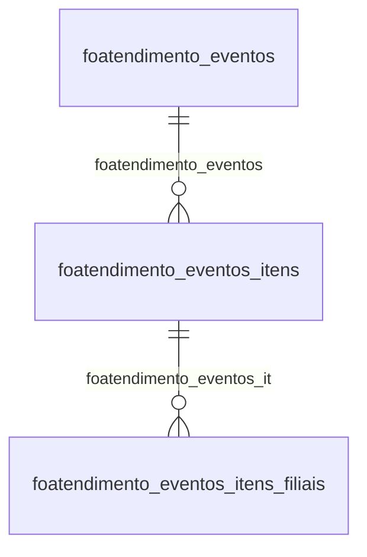

# Modelo — Pessoal - atendimento (rascunho em lote)

> Gerado por `src/model/gerar_docs_modelo.py` a partir de `src/model/modulos/pessoal_atendimento.yaml`, do catálogo e do perfil de colunas. **Não edite à mão.**

10 entidades. A coluna *Preench.* é o % de linhas com valor útil (nem nulo, nem em branco, nem zero, nem 1900-01-01; para colunas de código o zero conta como valor).

## Diagrama

## Entidades

| Entidade | Tabela | Linhas | Volume | Filtro obrigatório |
|---|---|---|---|---|
| [foatendimento_eventos_itens](#foatendimento_eventos_itens) | `FOATENDIMENTO_EVENTOS_ITENS` | 1.825 | pequeno | empresa |
| [foatendimento_eventos_itens_filiais](#foatendimento_eventos_itens_filiais) | `FOATENDIMENTO_EVENTOS_ITENS_FILIAIS` | 1.825 | pequeno | empresa |
| [foatendimento_servicos_empresa_onvio](#foatendimento_servicos_empresa_onvio) | `FOATENDIMENTO_SERVICOS_EMPRESA_ONVIO` | 1.494 | pequeno | empresa |
| [foatendimento_sindicato_empresa_onvio](#foatendimento_sindicato_empresa_onvio) | `FOATENDIMENTO_SINDICATO_EMPRESA_ONVIO` | 398 | pequeno | — |
| [foatendimento_eventos](#foatendimento_eventos) | `FOATENDIMENTO_EVENTOS` | 238 | pequeno | empresa |
| [foatendimento_acoes](#foatendimento_acoes) | `FOATENDIMENTO_ACOES` | 54 | pequeno | empresa |
| [foatendimento_solicitacoes_abertas_rubrica](#foatendimento_solicitacoes_abertas_rubrica) | `FOATENDIMENTO_SOLICITACOES_ABERTAS_RUBRICA` | 31 | pequeno | empresa |
| [foatendimento_eventos_itens_backup](#foatendimento_eventos_itens_backup) | `FOATENDIMENTO_EVENTOS_ITENS_BACKUP` | 16 | pequeno | empresa |
| [foatendimento_eventos_itens_filiais_backup](#foatendimento_eventos_itens_filiais_backup) | `FOATENDIMENTO_EVENTOS_ITENS_FILIAIS_BACKUP` | 16 | pequeno | empresa |
| [foatendimento_eventos_backup](#foatendimento_eventos_backup) | `FOATENDIMENTO_EVENTOS_BACKUP` | 6 | pequeno | empresa |

## foatendimento_eventos_itens

**ITENS DOS EVENTOS DOMINIO ATENDIMENTO** — tabela `FOATENDIMENTO_EVENTOS_ITENS` (1.825 linhas)

ITENS DOS EVENTOS DOMINIO ATENDIMENTO. 1.825 linhas no catálogo; chave: CODI_EMP, I_ATENDIMENTO_EVENTO, I_EVENTOS.

- **Chave:** `CODI_EMP, I_ATENDIMENTO_EVENTO, I_EVENTOS`
- **Empresa:** `CODI_EMP`
- **Período:** `—`
- **Ordem padrão:** `I_ATENDIMENTO_EVENTO asc`, `I_EVENTOS asc`

**Regras de negócio validadas:**

- Medido em 2026-10-18: 1.825 linhas, 186 empresa(s).
- tipo_provento_i_informativa_p_provento_d: todos os valores reais estão no comentário do banco (P=1.003, D=789, I=33).
- unidade_h_horas_v_valor_d_dias_p_percent: todos os valores reais estão no comentário do banco (H=927, V=595, D=273, P=30).
- Vínculo foatendimento_eventos (FOATENDIMENTO_EVENTOS): 0 de 6 linhas sem registro relacionado (empresa 46).
- Vínculo foeventos (foeventos): 0 de 6 linhas sem registro relacionado (empresa 46).

| Campo | Coluna | Tipo | Preench. | Domínio | Descrição (banco) |
|---|---|---|---|---|---|
| codigo_da_empresa | `codi_emp` | integer(4) |  |  | Código da empresa |
| codigo_do_atendimento_referente_a_foaten | `i_atendimento_evento` | integer(4) |  |  | Código do atendimento referente a FOATENDIMENTO_EVENTOS |
| codigo_do_evento_referente_a_foeventos | `i_eventos` | integer(4) |  |  | Código do evento referente a FOEVENTOS |
| codigo_da_empresa_referente_a_foeventos | `codi_emp_eve` | integer(4) |  |  | Código da empresa referente a FOEVENTOS |
| nome | `nome` | varchar(50) |  |  | Nome |
| tipo_provento_i_informativa_p_provento_d | `prov_desc` | char(2) |  | foatendimento_eventos_itens_tipo_provent | Tipo provento (I=Informativa/P=Provento/D=Desconto/ID=Informativa dedutora) |
| unidade_h_horas_v_valor_d_dias_p_percent | `tipo_inf` | char(1) |  | foatendimento_eventos_itens_unidade_h_ho | Unidade (H=Horas/V=Valor/D=Dias/P=Percentual/A=Automático/G=Horas-Aulas) |
| ordem | `ordem` | integer(4) |  |  | Ordem |
| endpoint_utilizado_para_a_exclusao_do_re | `endpoint_exclusao` | varchar(1024) |  |  | Endpoint utilizado para a exclusão do registro. |

**Vínculos (LEFT JOIN, acrescentam colunas legíveis):**

- `foatendimento_eventos` → `FOATENDIMENTO_EVENTOS` por `codi_emp` = `codi_emp` e `i_atendimento_evento` = `i_atendimento_evento`; colunas: `foatendimento_eventos_nome`
- `foeventos` → `foeventos` por `codi_emp_eve` = `codi_emp` e `i_eventos` = `i_eventos`; colunas: `foeventos_nome`

**Filtros:** `codigo_do_atendimento_referente_a_foaten` (eq/in), `codigo_do_evento_referente_a_foeventos` (eq/in), `codigo_da_empresa_referente_a_foeventos` (eq/in), `nome` (contem/prefixo), `tipo_provento_i_informativa_p_provento_d` (eq/in), `unidade_h_horas_v_valor_d_dias_p_percent` (eq/in), `endpoint_utilizado_para_a_exclusao_do_re` (contem/prefixo)

## foatendimento_eventos_itens_filiais

**ITENS DOS EVENTOS DOMINIO ATENDIMENTO** — tabela `FOATENDIMENTO_EVENTOS_ITENS_FILIAIS` (1.825 linhas)

ITENS DOS EVENTOS DOMINIO ATENDIMENTO. 1.825 linhas no catálogo; chave: CODI_EMP, I_ATENDIMENTO_EVENTO, I_EVENTOS, I_FILIAIS.

- **Chave:** `CODI_EMP, I_ATENDIMENTO_EVENTO, I_EVENTOS, I_FILIAIS`
- **Empresa:** `CODI_EMP`
- **Período:** `—`
- **Ordem padrão:** `I_ATENDIMENTO_EVENTO asc`, `I_EVENTOS asc`

**Regras de negócio validadas:**

- Medido em 2026-10-18: 1.825 linhas, 186 empresa(s).
- Vínculo foatendimento_eventos_it (FOATENDIMENTO_EVENTOS_ITENS): 0 de 6 linhas sem registro relacionado (empresa 46).

| Campo | Coluna | Tipo | Preench. | Domínio | Descrição (banco) |
|---|---|---|---|---|---|
| codigo_da_empresa | `codi_emp` | integer(4) |  |  | Código da empresa |
| codigo_do_atendimento_referente_a_foaten | `i_atendimento_evento` | integer(4) |  |  | Código do atendimento referente a FOATENDIMENTO_EVENTOS_ITENS |
| codigo_do_evento_referente_a_foatendimen | `i_eventos` | integer(4) |  |  | Código do evento referente a FOATENDIMENTO_EVENTOS_ITENS |
| codigo_filial | `i_filiais` | integer(4) |  |  | Código filial |
| endpoint_utilizado_para_a_exclusao_do_re | `endpoint_exclusao` | varchar(1024) |  |  | Endpoint utilizado para a exclusão do registro. |

**Vínculos (LEFT JOIN, acrescentam colunas legíveis):**

- `foatendimento_eventos_it` → `FOATENDIMENTO_EVENTOS_ITENS` por `codi_emp` = `codi_emp` e `i_atendimento_evento` = `i_atendimento_evento` e `i_eventos` = `i_eventos`; colunas: `foatendimento_eventos_it_nome`

**Filtros:** `codigo_do_atendimento_referente_a_foaten` (eq/in), `codigo_do_evento_referente_a_foatendimen` (eq/in), `codigo_filial` (eq/in), `endpoint_utilizado_para_a_exclusao_do_re` (contem/prefixo)

## foatendimento_servicos_empresa_onvio

**Tabela para controle das GUIDs de envio pro ONVIO, mantendo comportamento do DA antigo que era feito select envolvendo multiplas tabelas.** — tabela `FOATENDIMENTO_SERVICOS_EMPRESA_ONVIO` (1.494 linhas)

Tabela para controle das GUIDs de envio pro ONVIO, mantendo comportamento do DA antigo que era feito select envolvendo multiplas tabelas.. 1.494 linhas no catálogo; chave: SEQUENCIAL.

- **Chave:** `SEQUENCIAL`
- **Empresa:** `CODI_EMP`
- **Período:** `—`
- **Ordem padrão:** `SEQUENCIAL asc`

**Regras de negócio validadas:**

- Medido em 2026-10-18: 1.499 linhas, 1.392 empresa(s).

| Campo | Coluna | Tipo | Preench. | Domínio | Descrição (banco) |
|---|---|---|---|---|---|
| sequencial | `sequencial` | integer(4) |  |  | Sequencial |
| codigo_da_empresa | `codi_emp` | integer(4) |  |  | Código da empresa |
| codigo_do_servico | `i_servicos` | integer(4) |  |  | Código do serviço |
| nome | `nome` | varchar(40) |  |  | Nome |
| codigo_da_empresa_no_onvio | `codi_emp_atendimento` | integer(4) |  |  | Código da empresa no ONVIO |
| endpoint_utilizado_para_a_exclusao_do_re | `endpoint_exclusao` | varchar(1024) |  |  | Endpoint utilizado para a exclusão do registro. |

**Filtros:** `sequencial` (eq/in), `codigo_do_servico` (eq/in), `nome` (contem/prefixo), `codigo_da_empresa_no_onvio` (eq/in), `endpoint_utilizado_para_a_exclusao_do_re` (contem/prefixo)

## foatendimento_sindicato_empresa_onvio

**Tabela referente a view BETHADBA.SINDICATO_EMPRESA_ATENDIMENTO do DA antigo.** — tabela `FOATENDIMENTO_SINDICATO_EMPRESA_ONVIO` (398 linhas)

Tabela referente a view BETHADBA.SINDICATO_EMPRESA_ATENDIMENTO do DA antigo.. 398 linhas no catálogo; chave: SEQUENCIAL.

- **Chave:** `SEQUENCIAL`
- **Empresa:** `não se aplica (tabela global)`
- **Período:** `—`
- **Ordem padrão:** `SEQUENCIAL asc`

**Regras de negócio validadas:**

- Medido em 2026-10-18: 399 linhas.

| Campo | Coluna | Tipo | Preench. | Domínio | Descrição (banco) |
|---|---|---|---|---|---|
| sequencial | `sequencial` | integer(4) |  |  | Sequencial |
| codigo_da_empresa | `codigo_empresa` | integer(4) |  |  | Código da empresa |
| codigo_da_filial | `codigo_filial` | integer(4) |  |  | Código da filial |
| codigo_da_empresa_no_onvio | `codigo_empresa_atendimento` | integer(4) |  |  | Código da empresa no ONVIO |
| codigo_do_sindicato | `codigo_sindicato` | integer(4) |  |  | Código do sindicato |
| endpoint_utilizado_para_a_exclusao_do_re | `endpoint_exclusao` | varchar(1024) |  |  | Endpoint utilizado para a exclusão do registro. |

**Filtros:** `sequencial` (eq/in), `codigo_da_empresa` (eq/in), `codigo_da_filial` (eq/in), `codigo_da_empresa_no_onvio` (eq/in), `codigo_do_sindicato` (eq/in), `endpoint_utilizado_para_a_exclusao_do_re` (contem/prefixo)

## foatendimento_eventos

**EVENTOS DOMINIO ATENDIMENTO** — tabela `FOATENDIMENTO_EVENTOS` (238 linhas)

EVENTOS DOMINIO ATENDIMENTO. 238 linhas no catálogo; chave: CODI_EMP, I_ATENDIMENTO_EVENTO.

- **Chave:** `CODI_EMP, I_ATENDIMENTO_EVENTO`
- **Empresa:** `CODI_EMP`
- **Período:** `COMPETENCIA`
- **Ordem padrão:** `COMPETENCIA desc`, `I_ATENDIMENTO_EVENTO asc`

**Regras de negócio validadas:**

- Medido em 2026-10-18: 238 linhas, 186 empresa(s), COMPETENCIA de 2010-01-01 a 2026-08-01.
- tipo_da_folha_11_mensal_41_adiantamento: todos os valores reais estão no comentário do banco (11=236, 41=2).
- lancamento_de_hora_d_horas_decimais_m_ho: todos os valores reais estão no comentário do banco (M=232, D=6).
- Vínculo geempre (geempre): 0 de 1 linhas sem registro relacionado (empresa 652).

| Campo | Coluna | Tipo | Preench. | Domínio | Descrição (banco) |
|---|---|---|---|---|---|
| codigo_da_empresa | `codi_emp` | integer(4) |  |  | Código da empresa |
| codigo_do_atendimento | `i_atendimento_evento` | integer(4) |  |  | Código do atendimento |
| nome | `nome` | varchar(50) |  |  | Nome |
| tipo_da_folha_11_mensal_41_adiantamento | `tipo_proceso` | integer(4) |  | foatendimento_eventos_tipo_da_folha_11_mensa | Tipo da folha (11=Mensal/41=Adiantamento/70=Participação de lucros/...) |
| competencia | `competencia` | date(4) |  |  | Competência |
| lancamento_de_hora_d_horas_decimais_m_ho | `tipo_lacamento_horas` | char(1) |  | foatendimento_eventos_lancamento_de_hora_d_h | Lançamento de hora (D = Horas decimais/M = Horas minutos) |
| endpoint_utilizado_para_a_exclusao_do_re | `endpoint_exclusao` | varchar(1024) |  |  | Endpoint utilizado para a exclusão do registro. |

**Vínculos (LEFT JOIN, acrescentam colunas legíveis):**

- `geempre` → `geempre` por `codi_emp` = `codi_emp`; colunas: `geempre_nome`

**Filtros:** `codigo_do_atendimento` (eq/in), `competencia` (entre/gte/lte), `nome` (contem/prefixo), `tipo_da_folha_11_mensal_41_adiantamento` (eq/in), `lancamento_de_hora_d_horas_decimais_m_ho` (eq/in), `endpoint_utilizado_para_a_exclusao_do_re` (contem/prefixo)

## foatendimento_acoes

**Acoes Dominio Atendimento** — tabela `FOATENDIMENTO_ACOES` (54 linhas)

Acoes Dominio Atendimento. 54 linhas no catálogo; chave: I_ACOES, CODI_EMP, I_EMPREGADOS, CODI_EMP_ATENDIMENTO, ACAO.

- **Chave:** `I_ACOES, CODI_EMP, I_EMPREGADOS, CODI_EMP_ATENDIMENTO, ACAO`
- **Empresa:** `CODI_EMP`
- **Período:** `—`
- **Ordem padrão:** `I_ACOES asc`, `I_EMPREGADOS asc`

**Regras de negócio validadas:**

- Medido em 2026-10-18: 54 linhas, 4 empresa(s).
- tipo_da_acao_1_inserir_2_excluir_3_desab: todos os valores reais estão no comentário do banco (2=28, 1=26).
- acao_concluida_0_nao_1_sim: todos os valores reais estão no comentário do banco (0=54).

| Campo | Coluna | Tipo | Preench. | Domínio | Descrição (banco) |
|---|---|---|---|---|---|
| codigo_sequencial_da_acao | `i_acoes` | integer(4) |  |  | Código sequencial da ação |
| codigo_da_empresa | `codi_emp` | integer(4) |  |  | Código da empresa |
| codigo_do_empregado | `i_empregados` | integer(4) |  |  | Código do empregado |
| codigo_da_empresa_do_atendimento | `codi_emp_atendimento` | integer(4) |  |  | Código da empresa do atendimento |
| tipo_da_acao_1_inserir_2_excluir_3_desab | `acao` | smallint(2) |  | foatendimento_acoes_tipo_da_acao_1_inserir_2 | Tipo da ação (1=Inserir/2=Excluir/3=Desabilitar/4=Carga Inicial) |
| acao_concluida_0_nao_1_sim | `concluido` | smallint(2) |  | foatendimento_acoes_acao_concluida_0_nao_1_s | Ação concluída (0=Não/1=Sim) |

**Filtros:** `codigo_sequencial_da_acao` (eq/in), `codigo_do_empregado` (eq/in), `codigo_da_empresa_do_atendimento` (eq/in), `tipo_da_acao_1_inserir_2_excluir_3_desab` (eq/in)

## foatendimento_solicitacoes_abertas_rubrica

**Tabela que indica rubricas com lançamentos no portal do cliente** — tabela `FOATENDIMENTO_SOLICITACOES_ABERTAS_RUBRICA` (31 linhas)

Tabela que indica rubricas com lançamentos no portal do cliente. 31 linhas no catálogo; chave: CODI_EMP, RUBRICA.

- **Chave:** `CODI_EMP, RUBRICA`
- **Empresa:** `CODI_EMP`
- **Período:** `—`
- **Ordem padrão:** `RUBRICA asc`

**Regras de negócio validadas:**

- Medido em 2026-10-18: 31 linhas, 28 empresa(s).
- possui_lancamento_0_nao_1_sim: todos os valores reais estão no comentário do banco (1=22, 0=9).

| Campo | Coluna | Tipo | Preench. | Domínio | Descrição (banco) |
|---|---|---|---|---|---|
| codigo_da_empresa | `codi_emp` | integer(4) |  |  | Código da empresa |
| rubrica | `rubrica` | integer(4) |  |  | Rubrica |
| possui_lancamento_0_nao_1_sim | `possui_lancamento` | integer(4) |  | foatendimento_solicitacoes_abertas_rubrica_possui_lanc | Possui Lançamento (0=Não/1=Sim) |
| flag_que_indica_se_o_registro_vem_do_da | `origem_atendimento` | integer(4) |  |  | Flag que indica se o registro vem do DA(1) ou não (0) |

**Filtros:** `rubrica` (eq/in)

## foatendimento_eventos_itens_backup

**Tabela apenas para backup de dados** — tabela `FOATENDIMENTO_EVENTOS_ITENS_BACKUP` (16 linhas)

Tabela apenas para backup de dados. 16 linhas no catálogo; chave: CODI_EMP, I_ATENDIMENTO_EVENTO, I_EVENTOS.

- **Chave:** `CODI_EMP, I_ATENDIMENTO_EVENTO, I_EVENTOS`
- **Empresa:** `CODI_EMP`
- **Período:** `—`
- **Ordem padrão:** `I_ATENDIMENTO_EVENTO asc`, `I_EVENTOS asc`

**Regras de negócio validadas:**

- Medido em 2026-10-18: 16 linhas, 3 empresa(s).
- Colunas expostas nulas em 100% das linhas (1): endpoint_exclusao.

| Campo | Coluna | Tipo | Preench. | Domínio | Descrição (banco) |
|---|---|---|---|---|---|
| codi_emp | `codi_emp` | integer(4) |  |  |  |
| i_atendimento_evento | `i_atendimento_evento` | integer(4) |  |  |  |
| i_eventos | `i_eventos` | integer(4) |  |  |  |
| codi_emp_eve | `codi_emp_eve` | integer(4) |  |  |  |
| nome | `nome` | varchar(50) |  |  |  |
| prov_desc | `prov_desc` | char(1) |  |  |  |
| tipo_inf | `tipo_inf` | char(1) |  |  |  |
| ordem | `ordem` | integer(4) |  |  |  |
| endpoint_exclusao | `endpoint_exclusao` | varchar(1024) |  |  |  |

**Filtros:** `i_atendimento_evento` (eq/in), `i_eventos` (eq/in), `codi_emp_eve` (eq/in), `nome` (contem/prefixo), `prov_desc` (eq/in), `tipo_inf` (eq/in), `endpoint_exclusao` (contem/prefixo)

## foatendimento_eventos_itens_filiais_backup

**Tabela apenas para backup de dados** — tabela `FOATENDIMENTO_EVENTOS_ITENS_FILIAIS_BACKUP` (16 linhas)

Tabela apenas para backup de dados. 16 linhas no catálogo; chave: CODI_EMP, I_ATENDIMENTO_EVENTO, I_EVENTOS, I_FILIAIS.

- **Chave:** `CODI_EMP, I_ATENDIMENTO_EVENTO, I_EVENTOS, I_FILIAIS`
- **Empresa:** `CODI_EMP`
- **Período:** `—`
- **Ordem padrão:** `I_ATENDIMENTO_EVENTO asc`, `I_EVENTOS asc`

**Regras de negócio validadas:**

- Medido em 2026-10-18: 16 linhas, 3 empresa(s).
- Colunas expostas nulas em 100% das linhas (1): endpoint_exclusao.

| Campo | Coluna | Tipo | Preench. | Domínio | Descrição (banco) |
|---|---|---|---|---|---|
| codi_emp | `codi_emp` | integer(4) |  |  |  |
| i_atendimento_evento | `i_atendimento_evento` | integer(4) |  |  |  |
| i_eventos | `i_eventos` | integer(4) |  |  |  |
| i_filiais | `i_filiais` | integer(4) |  |  |  |
| endpoint_exclusao | `endpoint_exclusao` | varchar(1024) |  |  |  |

**Filtros:** `i_atendimento_evento` (eq/in), `i_eventos` (eq/in), `i_filiais` (eq/in), `endpoint_exclusao` (contem/prefixo)

## foatendimento_eventos_backup

**Tabela apenas para backup de dados** — tabela `FOATENDIMENTO_EVENTOS_BACKUP` (6 linhas)

Tabela apenas para backup de dados. 6 linhas no catálogo; chave: CODI_EMP, I_ATENDIMENTO_EVENTO.

- **Chave:** `CODI_EMP, I_ATENDIMENTO_EVENTO`
- **Empresa:** `CODI_EMP`
- **Período:** `COMPETENCIA`
- **Ordem padrão:** `COMPETENCIA desc`, `I_ATENDIMENTO_EVENTO asc`

**Regras de negócio validadas:**

- Medido em 2026-10-18: 6 linhas, 3 empresa(s), COMPETENCIA de 2016-06-01 a 2019-05-01.
- Colunas expostas nulas em 100% das linhas (1): endpoint_utilizado_para_a_exclusao_do_re.
- tipo_da_folha_11_mensal_41_adiantamento: todos os valores reais estão no comentário do banco (11=6).
- lancamento_de_hora_d_horas_decimais_m_ho: todos os valores reais estão no comentário do banco (M=5, D=1).

| Campo | Coluna | Tipo | Preench. | Domínio | Descrição (banco) |
|---|---|---|---|---|---|
| codigo_da_empresa | `codi_emp` | integer(4) |  |  | Código da empresa |
| codigo_do_atendimento | `i_atendimento_evento` | integer(4) |  |  | Código do atendimento |
| nome | `nome` | varchar(50) |  |  | Nome |
| tipo_da_folha_11_mensal_41_adiantamento | `tipo_proceso` | integer(4) |  | foatendimento_eventos_backup_tipo_da_folha_1 | Tipo da folha (11=Mensal/41=Adiantamento/70=Participação de lucros/...) |
| competencia | `competencia` | date(4) |  |  | Competência |
| lancamento_de_hora_d_horas_decimais_m_ho | `tipo_lacamento_horas` | char(1) |  | foatendimento_eventos_backup_lancamento_de_h | Lançamento de hora (D = Horas decimais/M = Horas minutos) |
| endpoint_utilizado_para_a_exclusao_do_re | `endpoint_exclusao` | varchar(1024) |  |  | Endpoint utilizado para a exclusão do registro. |

**Filtros:** `codigo_do_atendimento` (eq/in), `competencia` (entre/gte/lte), `nome` (contem/prefixo), `tipo_da_folha_11_mensal_41_adiantamento` (eq/in), `lancamento_de_hora_d_horas_decimais_m_ho` (eq/in), `endpoint_utilizado_para_a_exclusao_do_re` (contem/prefixo)

## Domínios (significado dos códigos)

`confirmado`: **sim** = vem do comentário do banco e/ou foi conferido nos dados; **parcial** = parte dos valores; **não** = hipótese, não use como regra.

### status_empresa

Situação da empresa no cadastro (geempre.stat_emp)

Confirmado: sim

| Código | Significado |
|---|---|
| A | Ativa |
| I | Inativa |
| C | Em constituição |
| M | Ativo sem movimento |
| B | Em processo de baixa |
| E | Excluindo |

### motivo_inatividade

Motivo da inatividade (geempre.tipoi_emp). Só aparece em empresas inativas.

Confirmado: sim

| Código | Significado |
|---|---|
| 1 | Outros |
| 2 | Baixada |
| 3 | Transferida |
| 4 | Inadimplente |

### tipo_inscricao

Tipo da inscrição (CNPJ/CPF/CEI/CAEPF)

Confirmado: sim

| Código | Significado |
|---|---|
| 1 | CNPJ |
| 2 | CPF |
| 3 | CEI |
| 6 | CAEPF |

### regime_federal_empresa

Regime federal da folha (geempre.rfed_emp)

Confirmado: parcial

| Código | Significado |
|---|---|
| 1 | Normal |
| 2 | Microempresa |
| 3 | Empresa de pequeno porte |

### tipo_honorario_empresa

Como a empresa usa o módulo Honorários (geempre.honorario_tipo)

Confirmado: sim

| Código | Significado |
|---|---|
| E | Escritório (quem fatura) |
| C | Cliente |

### sim_nao_texto

Confirmado: sim

| Código | Significado |
|---|---|
| S | Sim |
| N | Não |

### sim_nao_numerico

Confirmado: sim

| Código | Significado |
|---|---|
| 1 | Sim |
| 0 | Não |

### foatendimento_eventos_itens_tipo_provent

Confirmado: sim

> Todos os valores observados em FOATENDIMENTO_EVENTOS_ITENS.PROV_DESC estão no comentário do banco (2026-10-18). Distribuição: P=1.003, D=789, I=33.

| Código | Significado |
|---|---|
| I | Informativa |
| P | Provento |
| D | Desconto |
| ID | Informativa dedutora |

### foatendimento_eventos_itens_unidade_h_ho

Confirmado: sim

> Todos os valores observados em FOATENDIMENTO_EVENTOS_ITENS.TIPO_INF estão no comentário do banco (2026-10-18). Distribuição: H=927, V=595, D=273, P=30.

| Código | Significado |
|---|---|
| H | Horas |
| V | Valor |
| D | Dias |
| P | Percentual |
| A | Automático |
| G | Horas-Aulas |

### foatendimento_eventos_tipo_da_folha_11_mensa

Confirmado: sim

> Todos os valores observados em FOATENDIMENTO_EVENTOS.TIPO_PROCESO estão no comentário do banco (2026-10-18). Distribuição: 11=236, 41=2.

| Código | Significado |
|---|---|
| 11 | Mensal |
| 41 | Adiantamento |
| 70 | Participação de lucros |

### foatendimento_eventos_lancamento_de_hora_d_h

Confirmado: sim

> Todos os valores observados em FOATENDIMENTO_EVENTOS.TIPO_LACAMENTO_HORAS estão no comentário do banco (2026-10-18). Distribuição: M=232, D=6.

| Código | Significado |
|---|---|
| D | Horas decimais |
| M | Horas minutos |

### foatendimento_acoes_tipo_da_acao_1_inserir_2

Confirmado: sim

> Todos os valores observados em FOATENDIMENTO_ACOES.ACAO estão no comentário do banco (2026-10-18). Distribuição: 2=28, 1=26.

| Código | Significado |
|---|---|
| 1 | Inserir |
| 2 | Excluir |
| 3 | Desabilitar |
| 4 | Carga Inicial |

### foatendimento_acoes_acao_concluida_0_nao_1_s

Confirmado: sim

> Todos os valores observados em FOATENDIMENTO_ACOES.CONCLUIDO estão no comentário do banco (2026-10-18). Distribuição: 0=54.

| Código | Significado |
|---|---|
| 0 | Não |
| 1 | Sim |

### foatendimento_solicitacoes_abertas_rubrica_possui_lanc

Confirmado: sim

> Todos os valores observados em FOATENDIMENTO_SOLICITACOES_ABERTAS_RUBRICA.POSSUI_LANCAMENTO estão no comentário do banco (2026-10-18). Distribuição: 1=22, 0=9.

| Código | Significado |
|---|---|
| 0 | Não |
| 1 | Sim |

### foatendimento_eventos_backup_tipo_da_folha_1

Confirmado: sim

> Todos os valores observados em FOATENDIMENTO_EVENTOS_BACKUP.TIPO_PROCESO estão no comentário do banco (2026-10-18). Distribuição: 11=6.

| Código | Significado |
|---|---|
| 11 | Mensal |
| 41 | Adiantamento |
| 70 | Participação de lucros |

### foatendimento_eventos_backup_lancamento_de_h

Confirmado: sim

> Todos os valores observados em FOATENDIMENTO_EVENTOS_BACKUP.TIPO_LACAMENTO_HORAS estão no comentário do banco (2026-10-18). Distribuição: M=5, D=1.

| Código | Significado |
|---|---|
| D | Horas decimais |
| M | Horas minutos |

