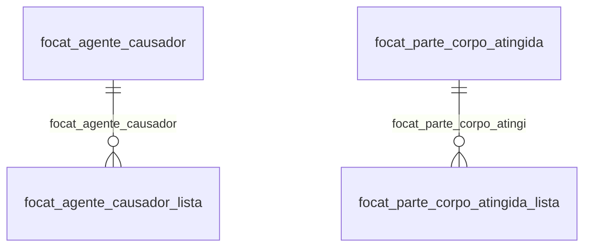

# Modelo — Pessoal - cat (rascunho em lote)

> Gerado por `src/model/gerar_docs_modelo.py` a partir de `src/model/modulos/pessoal_cat.yaml`, do catálogo e do perfil de colunas. **Não edite à mão.**

8 entidades. A coluna *Preench.* é o % de linhas com valor útil (nem nulo, nem em branco, nem zero, nem 1900-01-01; para colunas de código o zero conta como valor).

## Diagrama

## Entidades

| Entidade | Tabela | Linhas | Volume | Filtro obrigatório |
|---|---|---|---|---|
| [focat_agente_causador](#focat_agente_causador) | `FOCAT_AGENTE_CAUSADOR` | 308 | pequeno | — |
| [focat_situacao_geradora](#focat_situacao_geradora) | `FOCAT_SITUACAO_GERADORA` | 60 | pequeno | — |
| [focat_parte_corpo_atingida](#focat_parte_corpo_atingida) | `FOCAT_PARTE_CORPO_ATINGIDA` | 45 | pequeno | — |
| [focat_natureza_lesao](#focat_natureza_lesao) | `FOCAT_NATUREZA_LESAO` | 29 | pequeno | — |
| [focat_tipo_acidente](#focat_tipo_acidente) | `FOCAT_TIPO_ACIDENTE` | 22 | pequeno | — |
| [focat_agente_causador_lista](#focat_agente_causador_lista) | `FOCAT_AGENTE_CAUSADOR_LISTA` | 7 | pequeno | empresa |
| [focat_parte_corpo_atingida_lista](#focat_parte_corpo_atingida_lista) | `FOCAT_PARTE_CORPO_ATINGIDA_LISTA` | 7 | pequeno | empresa |
| [focat_envios_esocial](#focat_envios_esocial) | `FOCAT_ENVIOS_ESOCIAL` | 1 | pequeno | empresa |

## focat_agente_causador

**Agente causador da CAT.** — tabela `FOCAT_AGENTE_CAUSADOR` (308 linhas)

Agente causador da CAT.. 308 linhas no catálogo; chave: CODIGO.

- **Chave:** `CODIGO`
- **Empresa:** `não se aplica (tabela global)`
- **Período:** `—`
- **Ordem padrão:** `CODIGO asc`

**Regras de negócio validadas:**

- Medido em 2026-10-18: 308 linhas.

| Campo | Coluna | Tipo | Preench. | Domínio | Descrição (banco) |
|---|---|---|---|---|---|
| codigo_do_agente_causador | `codigo` | varchar(10) |  |  | Código do agente causador. |
| descricao_do_agente_causador | `descricao` | varchar(300) |  |  | Descrição do agente causador. |
| observacao_do_agente_causador | `observacao` | varchar(500) |  |  | Observação do agente causador. |
| aplicacao | `aplicacao` | varchar(1024) |  |  | Aplicação. |
| descricao_2024 | `descricao_2024` | varchar(300) |  |  | Descrição do agente causador. |

**Filtros:** `codigo_do_agente_causador` (eq/in), `descricao_do_agente_causador` (contem/prefixo), `observacao_do_agente_causador` (contem/prefixo), `aplicacao` (contem/prefixo), `descricao_2024` (contem/prefixo)

## focat_situacao_geradora

**Situações geradoras da CAT.** — tabela `FOCAT_SITUACAO_GERADORA` (60 linhas)

Situações geradoras da CAT.. 60 linhas no catálogo; chave: CODIGO.

- **Chave:** `CODIGO`
- **Empresa:** `não se aplica (tabela global)`
- **Período:** `—`
- **Ordem padrão:** `CODIGO asc`

**Regras de negócio validadas:**

- Medido em 2026-10-18: 60 linhas.

| Campo | Coluna | Tipo | Preench. | Domínio | Descrição (banco) |
|---|---|---|---|---|---|
| codigo_da_situacao_geradora | `codigo` | varchar(10) |  |  | Código da situação geradora. |
| descricao_da_situacao_geradora | `descricao` | varchar(90) |  |  | Descrição da situação geradora. |
| aplicacao | `aplicacao` | varchar(1024) |  |  | Aplicação |

**Filtros:** `codigo_da_situacao_geradora` (eq/in), `descricao_da_situacao_geradora` (contem/prefixo), `aplicacao` (contem/prefixo)

## focat_parte_corpo_atingida

**Partes do corpo atingida da CAT.** — tabela `FOCAT_PARTE_CORPO_ATINGIDA` (45 linhas)

Partes do corpo atingida da CAT.. 45 linhas no catálogo; chave: CODIGO.

- **Chave:** `CODIGO`
- **Empresa:** `não se aplica (tabela global)`
- **Período:** `—`
- **Ordem padrão:** `CODIGO asc`

**Regras de negócio validadas:**

- Medido em 2026-10-18: 45 linhas.

| Campo | Coluna | Tipo | Preench. | Domínio | Descrição (banco) |
|---|---|---|---|---|---|
| codigo_da_parte_do_corpo_atingida | `codigo` | varchar(10) |  |  | Código da parte do corpo atingida. |
| descricao_da_parte_do_corpo_atingida | `descricao` | varchar(40) |  |  | Descrição da parte do corpo atingida. |
| observacao_da_parte_do_corpo_atingida | `observacao` | varchar(500) |  |  | Observação da parte do corpo atingida. |

**Filtros:** `codigo_da_parte_do_corpo_atingida` (eq/in), `descricao_da_parte_do_corpo_atingida` (contem/prefixo), `observacao_da_parte_do_corpo_atingida` (contem/prefixo)

## focat_natureza_lesao

**Tabela de catálogo das naturezas de lesões do CAT** — tabela `FOCAT_NATUREZA_LESAO` (29 linhas)

Tabela de catálogo das naturezas de lesões do CAT. 29 linhas no catálogo; chave: CODIGO.

- **Chave:** `CODIGO`
- **Empresa:** `não se aplica (tabela global)`
- **Período:** `—`
- **Ordem padrão:** `CODIGO asc`

**Regras de negócio validadas:**

- Medido em 2026-10-18: 29 linhas.

| Campo | Coluna | Tipo | Preench. | Domínio | Descrição (banco) |
|---|---|---|---|---|---|
| codigo_da_natureza_da_lesao | `codigo` | varchar(10) |  |  | Código da Natureza da Lesão |
| descricao | `descricao` | varchar(150) |  |  | Descrição |

**Filtros:** `codigo_da_natureza_da_lesao` (eq/in), `descricao` (contem/prefixo)

## focat_tipo_acidente

**Tipos de acidente da CAT** — tabela `FOCAT_TIPO_ACIDENTE` (22 linhas)

Tipos de acidente da CAT. 22 linhas no catálogo; chave: CODIGO.

- **Chave:** `CODIGO`
- **Empresa:** `não se aplica (tabela global)`
- **Período:** `—`
- **Ordem padrão:** `CODIGO asc`

**Regras de negócio validadas:**

- Medido em 2026-10-18: 22 linhas.

| Campo | Coluna | Tipo | Preench. | Domínio | Descrição (banco) |
|---|---|---|---|---|---|
| codigo_do_tipo_de_acidente | `codigo` | varchar(10) |  |  | Código do tipo de acidente. |
| descricao_do_tipo_de_acidente | `descricao` | varchar(500) |  |  | Descrição do tipo de acidente. |

**Filtros:** `codigo_do_tipo_de_acidente` (eq/in), `descricao_do_tipo_de_acidente` (contem/prefixo)

## focat_agente_causador_lista

**Lista de agentes causador da CAT.** — tabela `FOCAT_AGENTE_CAUSADOR_LISTA` (7 linhas)

Lista de agentes causador da CAT.. 7 linhas no catálogo; chave: CODI_EMP, I_EMPREGADOS, I_CAT, SEQUENCIAL.

- **Chave:** `CODI_EMP, I_EMPREGADOS, I_CAT, SEQUENCIAL`
- **Empresa:** `CODI_EMP`
- **Período:** `—`
- **Ordem padrão:** `I_EMPREGADOS asc`, `I_CAT asc`

**Regras de negócio validadas:**

- Medido em 2026-10-18: 7 linhas, 6 empresa(s).
- enviar_para_o_esocial_0_nao_1_sim: todos os valores reais estão no comentário do banco (1=7).
- gerar_retificacao_esocial: todos os valores reais estão no comentário do banco (0=7).
- marcacao_do_evento_para_gerar_o_evento_d: todos os valores reais estão no comentário do banco (0=7).
- Vínculo focat (FOCAT): 0 de 1 linhas sem registro relacionado (empresa 652).
- Vínculo focat_agente_causador (FOCAT_AGENTE_CAUSADOR): 0 de 1 linhas sem registro relacionado (empresa 652).

| Campo | Coluna | Tipo | Preench. | Domínio | Descrição (banco) |
|---|---|---|---|---|---|
| codigo_da_empresa | `codi_emp` | integer(4) |  |  | Código da empresa. |
| codigo_do_empregado | `i_empregados` | integer(4) |  |  | Código do empregado. |
| codigo_da_cat | `i_cat` | integer(4) |  |  | Código da CAT. |
| sequencial_da_lista | `sequencial` | integer(4) |  |  | Sequencial da lista. |
| codigo_do_agente_causador | `codigo_agente_causador` | varchar(10) |  |  | Código do agente causador. |
| enviar_para_o_esocial_0_nao_1_sim | `enviar_esocial` | smallint(2) |  | focat_agente_causador_lista_enviar_para_o_eso | Enviar para o eSocial. (0=Não/1=Sim) |
| gerar_retificacao_esocial | `gerar_retificacao_esocial` | smallint(2) |  | focat_agente_causador_lista_gerar_retificacao | Gerar retificação para o eSocial. (0=Não/1=Sim) |
| marcacao_do_evento_para_gerar_o_evento_d | `processar_exclusao_esocial` | smallint(2) |  | focat_agente_causador_lista_marcacao_do_event | Marcação do evento para gerar o evento de exclusão no eSocial. (0=Não/1=Sim) |

**Vínculos (LEFT JOIN, acrescentam colunas legíveis):**

- `focat` → `FOCAT` por `codi_emp` = `codi_emp` e `i_empregados` = `i_empregados` e `i_cat` = `i_cat`; colunas: `focat_nome`
- `focat_agente_causador` → `FOCAT_AGENTE_CAUSADOR` por `codigo_agente_causador` = `codigo`; colunas: `focat_agente_causador_nome`

**Filtros:** `codigo_do_empregado` (eq/in), `codigo_da_cat` (eq/in), `sequencial_da_lista` (eq/in), `codigo_do_agente_causador` (eq/in)

## focat_parte_corpo_atingida_lista

**Lista de partes do corpo atingida da CAT.** — tabela `FOCAT_PARTE_CORPO_ATINGIDA_LISTA` (7 linhas)

Lista de partes do corpo atingida da CAT.. 7 linhas no catálogo; chave: CODI_EMP, I_EMPREGADOS, I_CAT, SEQUENCIAL.

- **Chave:** `CODI_EMP, I_EMPREGADOS, I_CAT, SEQUENCIAL`
- **Empresa:** `CODI_EMP`
- **Período:** `—`
- **Ordem padrão:** `I_EMPREGADOS asc`, `I_CAT asc`

**Regras de negócio validadas:**

- Medido em 2026-10-18: 7 linhas, 6 empresa(s).
- lateralidade_0_nao_aplicavel_1_esquerda: todos os valores reais estão no comentário do banco (0=6, 1=1).
- enviar_para_o_esocial_0_nao_1_sim: todos os valores reais estão no comentário do banco (1=7).
- gerar_retificacao_esocial: todos os valores reais estão no comentário do banco (0=7).
- marcacao_do_evento_para_gerar_o_evento_d: todos os valores reais estão no comentário do banco (0=7).
- Vínculo focat (FOCAT): 0 de 1 linhas sem registro relacionado (empresa 652).
- Vínculo focat_parte_corpo_atingi (FOCAT_PARTE_CORPO_ATINGIDA): 0 de 1 linhas sem registro relacionado (empresa 652).

| Campo | Coluna | Tipo | Preench. | Domínio | Descrição (banco) |
|---|---|---|---|---|---|
| codigo_da_empresa | `codi_emp` | integer(4) |  |  | Código da empresa. |
| codigo_do_empregado | `i_empregados` | integer(4) |  |  | Código do empregado. |
| codigo_da_cat | `i_cat` | integer(4) |  |  | Código da CAT. |
| sequencial_da_lista | `sequencial` | integer(4) |  |  | Sequencial da lista. |
| codigo_da_parte_do_corpo_atingida | `codigo_parte_corpo_atingida` | varchar(10) |  |  | Código da parte do corpo atingida. |
| lateralidade_0_nao_aplicavel_1_esquerda | `lateralidade` | smallint(2) |  | focat_parte_corpo_atingida_lista_lateralidad | Lateralidade. (0=Não aplicável/1=Esquerda/2=Direita/3=Ambas) |
| enviar_para_o_esocial_0_nao_1_sim | `enviar_esocial` | smallint(2) |  | focat_parte_corpo_atingida_lista_enviar_para | Enviar para o eSocial. (0=Não/1=Sim) |
| gerar_retificacao_esocial | `gerar_retificacao_esocial` | smallint(2) |  | focat_parte_corpo_atingida_lista_gerar_retif | Gerar retificação para o eSocial. (0=Não/1=Sim) |
| marcacao_do_evento_para_gerar_o_evento_d | `processar_exclusao_esocial` | smallint(2) |  | focat_parte_corpo_atingida_lista_marcacao_do | Marcação do evento para gerar o evento de exclusão no eSocial. (0=Não/1=Sim) |

**Vínculos (LEFT JOIN, acrescentam colunas legíveis):**

- `focat` → `FOCAT` por `codi_emp` = `codi_emp` e `i_empregados` = `i_empregados` e `i_cat` = `i_cat`; colunas: `focat_nome`
- `focat_parte_corpo_atingi` → `FOCAT_PARTE_CORPO_ATINGIDA` por `codigo_parte_corpo_atingida` = `codigo`; colunas: `focat_parte_corpo_atingi_nome`

**Filtros:** `codigo_do_empregado` (eq/in), `codigo_da_cat` (eq/in), `sequencial_da_lista` (eq/in), `codigo_da_parte_do_corpo_atingida` (eq/in)

## focat_envios_esocial

**Envios dos CAT para o esocial** — tabela `FOCAT_ENVIOS_ESOCIAL` (1 linhas)

Envios dos CAT para o esocial. 1 linhas no catálogo; chave: CODI_EMP, I_EMPREGADOS, I_CAT, CODI_EMP_DADOS_EVENTOS, I_DADOS_EVENTOS.

- **Chave:** `CODI_EMP, I_EMPREGADOS, I_CAT, CODI_EMP_DADOS_EVENTOS, I_DADOS_EVENTOS`
- **Empresa:** `CODI_EMP`
- **Período:** `—`
- **Ordem padrão:** `I_EMPREGADOS asc`, `I_CAT asc`

**Regras de negócio validadas:**

- Medido em 2026-10-18: 1 linhas, 1 empresa(s).
- Vínculo focat (FOCAT): 0 de 1 linhas sem registro relacionado (empresa 789).
- Vínculo foesocial_dados_eventos (FOESOCIAL_DADOS_EVENTOS): 0 de 1 linhas sem registro relacionado (empresa 789).

| Campo | Coluna | Tipo | Preench. | Domínio | Descrição (banco) |
|---|---|---|---|---|---|
| codigo_da_empresa | `codi_emp` | integer(4) |  |  | Código da empresa |
| codigo_do_empregado | `i_empregados` | integer(4) |  |  | Código do empregado |
| codigo_do_cat_referente_a_focat | `i_cat` | integer(4) |  |  | Código do CAT referente a FOCAT |
| codigo_da_empresa_referente_a_foesocial | `codi_emp_dados_eventos` | integer(4) |  |  | Código da empresa referente a FOESOCIAL_DADOS_EVENTOS |
| codigo_do_evento_referente_a_foesocial_d | `i_dados_eventos` | integer(4) |  |  | Código do evento referente a FOESOCIAL_DADOS_EVENTOS |

**Vínculos (LEFT JOIN, acrescentam colunas legíveis):**

- `focat` → `FOCAT` por `codi_emp` = `codi_emp` e `i_empregados` = `i_empregados` e `i_cat` = `i_cat`; colunas: `focat_nome`
- `foesocial_dados_eventos` → `FOESOCIAL_DADOS_EVENTOS` por `codi_emp_dados_eventos` = `codi_emp` e `i_dados_eventos` = `i_dados_eventos`; colunas: `foesocial_dados_eventos_nome`

**Filtros:** `codigo_do_empregado` (eq/in), `codigo_do_cat_referente_a_focat` (eq/in), `codigo_da_empresa_referente_a_foesocial` (eq/in), `codigo_do_evento_referente_a_foesocial_d` (eq/in)

## Domínios (significado dos códigos)

`confirmado`: **sim** = vem do comentário do banco e/ou foi conferido nos dados; **parcial** = parte dos valores; **não** = hipótese, não use como regra.

### status_empresa

Situação da empresa no cadastro (geempre.stat_emp)

Confirmado: sim

| Código | Significado |
|---|---|
| A | Ativa |
| I | Inativa |
| C | Em constituição |
| M | Ativo sem movimento |
| B | Em processo de baixa |
| E | Excluindo |

### motivo_inatividade

Motivo da inatividade (geempre.tipoi_emp). Só aparece em empresas inativas.

Confirmado: sim

| Código | Significado |
|---|---|
| 1 | Outros |
| 2 | Baixada |
| 3 | Transferida |
| 4 | Inadimplente |

### tipo_inscricao

Tipo da inscrição (CNPJ/CPF/CEI/CAEPF)

Confirmado: sim

| Código | Significado |
|---|---|
| 1 | CNPJ |
| 2 | CPF |
| 3 | CEI |
| 6 | CAEPF |

### regime_federal_empresa

Regime federal da folha (geempre.rfed_emp)

Confirmado: parcial

| Código | Significado |
|---|---|
| 1 | Normal |
| 2 | Microempresa |
| 3 | Empresa de pequeno porte |

### tipo_honorario_empresa

Como a empresa usa o módulo Honorários (geempre.honorario_tipo)

Confirmado: sim

| Código | Significado |
|---|---|
| E | Escritório (quem fatura) |
| C | Cliente |

### sim_nao_texto

Confirmado: sim

| Código | Significado |
|---|---|
| S | Sim |
| N | Não |

### sim_nao_numerico

Confirmado: sim

| Código | Significado |
|---|---|
| 1 | Sim |
| 0 | Não |

### focat_agente_causador_lista_enviar_para_o_eso

Confirmado: sim

> Todos os valores observados em FOCAT_AGENTE_CAUSADOR_LISTA.ENVIAR_ESOCIAL estão no comentário do banco (2026-10-18). Distribuição: 1=7.

| Código | Significado |
|---|---|
| 0 | Não |
| 1 | Sim |

### focat_agente_causador_lista_gerar_retificacao

Confirmado: sim

> Todos os valores observados em FOCAT_AGENTE_CAUSADOR_LISTA.GERAR_RETIFICACAO_ESOCIAL estão no comentário do banco (2026-10-18). Distribuição: 0=7.

| Código | Significado |
|---|---|
| 0 | Não |
| 1 | Sim |

### focat_agente_causador_lista_marcacao_do_event

Confirmado: sim

> Todos os valores observados em FOCAT_AGENTE_CAUSADOR_LISTA.PROCESSAR_EXCLUSAO_ESOCIAL estão no comentário do banco (2026-10-18). Distribuição: 0=7.

| Código | Significado |
|---|---|
| 0 | Não |
| 1 | Sim |

### focat_parte_corpo_atingida_lista_lateralidad

Confirmado: sim

> Todos os valores observados em FOCAT_PARTE_CORPO_ATINGIDA_LISTA.LATERALIDADE estão no comentário do banco (2026-10-18). Distribuição: 0=6, 1=1.

| Código | Significado |
|---|---|
| 0 | Não aplicável |
| 1 | Esquerda |
| 2 | Direita |
| 3 | Ambas |

### focat_parte_corpo_atingida_lista_enviar_para

Confirmado: sim

> Todos os valores observados em FOCAT_PARTE_CORPO_ATINGIDA_LISTA.ENVIAR_ESOCIAL estão no comentário do banco (2026-10-18). Distribuição: 1=7.

| Código | Significado |
|---|---|
| 0 | Não |
| 1 | Sim |

### focat_parte_corpo_atingida_lista_gerar_retif

Confirmado: sim

> Todos os valores observados em FOCAT_PARTE_CORPO_ATINGIDA_LISTA.GERAR_RETIFICACAO_ESOCIAL estão no comentário do banco (2026-10-18). Distribuição: 0=7.

| Código | Significado |
|---|---|
| 0 | Não |
| 1 | Sim |

### focat_parte_corpo_atingida_lista_marcacao_do

Confirmado: sim

> Todos os valores observados em FOCAT_PARTE_CORPO_ATINGIDA_LISTA.PROCESSAR_EXCLUSAO_ESOCIAL estão no comentário do banco (2026-10-18). Distribuição: 0=7.

| Código | Significado |
|---|---|
| 0 | Não |
| 1 | Sim |

