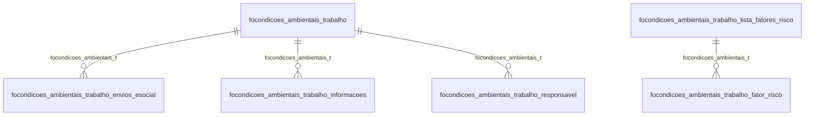

# Modelo — Pessoal - condicoes (rascunho em lote)

> Gerado por `src/model/gerar_docs_modelo.py` a partir de `src/model/modulos/pessoal_condicoes.yaml`, do catálogo e do perfil de colunas. **Não edite à mão.**

8 entidades. A coluna *Preench.* é o % de linhas com valor útil (nem nulo, nem em branco, nem zero, nem 1900-01-01; para colunas de código o zero conta como valor).

## Diagrama

## Entidades

| Entidade | Tabela | Linhas | Volume | Filtro obrigatório |
|---|---|---|---|---|
| [focondicoes_ambientais_trabalho_lista_fatores_risco](#focondicoes_ambientais_trabalho_lista_fatores_risco) | `FOCONDICOES_AMBIENTAIS_TRABALHO_LISTA_FATORES_RISCO` | 966 | pequeno | — |
| [focondicoes_ambientais_trabalho_lista_atividades](#focondicoes_ambientais_trabalho_lista_atividades) | `FOCONDICOES_AMBIENTAIS_TRABALHO_LISTA_ATIVIDADES` | 206 | pequeno | — |
| [focondicoes_ambientais_trabalho](#focondicoes_ambientais_trabalho) | `FOCONDICOES_AMBIENTAIS_TRABALHO` | 62 | pequeno | empresa |
| [focondicoes_ambientais_trabalho_envios_esocial](#focondicoes_ambientais_trabalho_envios_esocial) | `FOCONDICOES_AMBIENTAIS_TRABALHO_ENVIOS_ESOCIAL` | 62 | pequeno | empresa |
| [focondicoes_ambientais_trabalho_informacoes](#focondicoes_ambientais_trabalho_informacoes) | `FOCONDICOES_AMBIENTAIS_TRABALHO_INFORMACOES` | 62 | pequeno | empresa |
| [focondicoes_ambientais_trabalho_fator_risco](#focondicoes_ambientais_trabalho_fator_risco) | `FOCONDICOES_AMBIENTAIS_TRABALHO_FATOR_RISCO` | 62 | pequeno | empresa |
| [focondicoes_ambientais_trabalho_responsavel](#focondicoes_ambientais_trabalho_responsavel) | `FOCONDICOES_AMBIENTAIS_TRABALHO_RESPONSAVEL` | 62 | pequeno | empresa |
| [focondicoes_ambientais_trabalho_unidade_medida_fator_risco](#focondicoes_ambientais_trabalho_unidade_medida_fator_risco) | `FOCONDICOES_AMBIENTAIS_TRABALHO_UNIDADE_MEDIDA_FATOR_RISCO` | 30 | pequeno | — |

## focondicoes_ambientais_trabalho_lista_fatores_risco

**Tabela de catálogo dos fatores de risco das condições ambientais de trabalho** — tabela `FOCONDICOES_AMBIENTAIS_TRABALHO_LISTA_FATORES_RISCO` (966 linhas)

Tabela de catálogo dos fatores de risco das condições ambientais de trabalho. 966 linhas no catálogo; chave: I_FATOR_RISCO.

- **Chave:** `I_FATOR_RISCO`
- **Empresa:** `não se aplica (tabela global)`
- **Período:** `—`
- **Ordem padrão:** `I_FATOR_RISCO asc`

**Regras de negócio validadas:**

- Medido em 2026-10-18: 966 linhas.

| Campo | Coluna | Tipo | Preench. | Domínio | Descrição (banco) |
|---|---|---|---|---|---|
| codigo_sequencial_do_fator_de_risco | `i_fator_risco` | integer(4) |  |  | Código sequencial do fator de risco |
| descricao | `descricao` | varchar(400) |  |  | Descrição |
| codigo_do_fator_de_risco | `codigo` | varchar(9) |  |  | Código do fator de risco |

**Filtros:** `codigo_sequencial_do_fator_de_risco` (eq/in), `descricao` (contem/prefixo), `codigo_do_fator_de_risco` (eq/in)

## focondicoes_ambientais_trabalho_lista_atividades

**Lista de atividades perigosas e insalubres.** — tabela `FOCONDICOES_AMBIENTAIS_TRABALHO_LISTA_ATIVIDADES` (206 linhas)

Lista de atividades perigosas e insalubres.. 206 linhas no catálogo; chave: I_ATIVIDADES.

- **Chave:** `I_ATIVIDADES`
- **Empresa:** `não se aplica (tabela global)`
- **Período:** `—`
- **Ordem padrão:** `I_ATIVIDADES asc`

**Regras de negócio validadas:**

- Medido em 2026-10-18: 206 linhas.

| Campo | Coluna | Tipo | Preench. | Domínio | Descrição (banco) |
|---|---|---|---|---|---|
| codigo_da_atividade | `i_atividades` | integer(4) |  |  | Código da atividade |
| descricao | `nome` | varchar(4000) |  |  | Descrição |

**Filtros:** `codigo_da_atividade` (eq/in), `descricao` (contem/prefixo)

## focondicoes_ambientais_trabalho

**Ambiente de trabalho.** — tabela `FOCONDICOES_AMBIENTAIS_TRABALHO` (62 linhas)

Ambiente de trabalho.. 62 linhas no catálogo; chave: CODI_EMP, I_EMPREGADOS, DATA_INICIO.

- **Chave:** `CODI_EMP, I_EMPREGADOS, DATA_INICIO`
- **Empresa:** `CODI_EMP`
- **Período:** `DATA_FIM`
- **Ordem padrão:** `DATA_FIM desc`, `I_EMPREGADOS asc`, `DATA_INICIO asc`

**Regras de negócio validadas:**

- Medido em 2026-10-18: 62 linhas, 1 empresa(s).
- Colunas expostas nulas em 100% das linhas (3): metodologia_utilizada_no_levantamento_de, observacao_complementar, data_fim_da_condicao.
- enviar_para_o_esocial_0_nao_1_sim: todos os valores reais estão no comentário do banco (0=61, 1=1).
- gerar_retificacao_esocial: todos os valores reais estão no comentário do banco (0=62).
- marcacao_do_evento_para_gerar_o_evento_d: todos os valores reais estão no comentário do banco (0=62).
- enviar_evento_esocial_anterior_ao_inicio: todos os valores reais estão no comentário do banco (0=62).
- Vínculo foempregados (foempregados): 0 de 62 linhas sem registro relacionado (empresa 1).

| Campo | Coluna | Tipo | Preench. | Domínio | Descrição (banco) |
|---|---|---|---|---|---|
| codigo_da_empresa | `codi_emp` | integer(4) |  |  | Código da empresa. |
| codigo_do_empregado | `i_empregados` | integer(4) |  |  | Código do empregado. |
| data_inicio_da_condicao | `data_inicio` | date(4) |  |  | Data início da condição. |
| descricao_da_atividade_desempenhada | `descricao_atividade_desempenhada` | varchar(999) |  |  | Descrição da atividade desempenhada |
| metodologia_utilizada_no_levantamento_de | `metodologia_utilizada_levantamento_riscos_ergonomicos` | varchar(999) |  |  | Metodologia utilizada no levantamento de riscos ergonômicos |
| observacao_complementar | `observacao_complementar` | varchar(999) |  |  | Observação complementar |
| enviar_para_o_esocial_0_nao_1_sim | `enviar_esocial` | smallint(2) |  | focondicoes_ambientais_trabalho_enviar_para_o_esocial_0_nao_1 | Enviar para o eSocial. (0=Não/1=Sim) |
| gerar_retificacao_esocial | `gerar_retificacao_esocial` | smallint(2) |  | focondicoes_ambientais_trabalho_gerar_retificacao_para_o_esoc | Gerar retificação para o eSocial. (0=Não/1=Sim) |
| marcacao_do_evento_para_gerar_o_evento_d | `processar_exclusao_esocial` | smallint(2) |  | focondicoes_ambientais_trabalho_marcacao_do_evento_para_gerar | Marcação do evento para gerar o evento de exclusão no eSocial. (0=Não/1=Sim) |
| enviar_evento_esocial_anterior_ao_inicio | `enviar_esocial_periodo_anterior_inicio_banco_contabil` | smallint(2) |  | focondicoes_ambientais_trabalho_enviar_evento_esocial_anterio | Enviar evento eSocial anterior ao início da utilização do banco de dados (0=Não/1=Sim) |
| data_fim_da_condicao | `data_fim` | date(4) |  |  | Data fim da condição. |

**Vínculos (LEFT JOIN, acrescentam colunas legíveis):**

- `foempregados` → `foempregados` por `codi_emp` = `codi_emp` e `i_empregados` = `i_empregados`; colunas: `foempregados_nome`

**Filtros:** `codigo_do_empregado` (eq/in), `data_inicio_da_condicao` (eq/in), `data_fim_da_condicao` (entre/gte/lte), `descricao_da_atividade_desempenhada` (contem/prefixo), `metodologia_utilizada_no_levantamento_de` (contem/prefixo), `observacao_complementar` (contem/prefixo)

## focondicoes_ambientais_trabalho_envios_esocial

**Envios de condições ambientais de trabalho para o esocial** — tabela `FOCONDICOES_AMBIENTAIS_TRABALHO_ENVIOS_ESOCIAL` (62 linhas)

Envios de condições ambientais de trabalho para o esocial. 62 linhas no catálogo; chave: CODI_EMP, I_EMPREGADOS, DATA_INICIO, CODI_EMP_DADOS_EVENTOS, I_DADOS_EVENTOS.

- **Chave:** `CODI_EMP, I_EMPREGADOS, DATA_INICIO, CODI_EMP_DADOS_EVENTOS, I_DADOS_EVENTOS`
- **Empresa:** `CODI_EMP`
- **Período:** `DATA_INICIO`
- **Ordem padrão:** `DATA_INICIO desc`, `I_EMPREGADOS asc`, `CODI_EMP_DADOS_EVENTOS asc`

**Regras de negócio validadas:**

- Medido em 2026-10-18: 62 linhas, 1 empresa(s), DATA_INICIO de 2021-12-01 a 2023-10-25.
- Vínculo foesocial_dados_eventos (FOESOCIAL_DADOS_EVENTOS): 0 de 62 linhas sem registro relacionado (empresa 1).
- Vínculo focondicoes_ambientais_t (FOCONDICOES_AMBIENTAIS_TRABALHO): 0 de 62 linhas sem registro relacionado (empresa 1).

| Campo | Coluna | Tipo | Preench. | Domínio | Descrição (banco) |
|---|---|---|---|---|---|
| codigo_da_empresa | `codi_emp` | integer(4) |  |  | Código da empresa |
| codigo_do_empregado | `i_empregados` | integer(4) |  |  | Código do empregado |
| data_de_inicio | `data_inicio` | date(4) |  |  | Data de início |
| codigo_da_empresa_referente_a_foesocial | `codi_emp_dados_eventos` | integer(4) |  |  | Código da empresa referente a FOESOCIAL_DADOS_EVENTOS |
| codigo_do_evento_referente_a_foesocial_d | `i_dados_eventos` | integer(4) |  |  | Código do evento referente a FOESOCIAL_DADOS_EVENTOS |

**Vínculos (LEFT JOIN, acrescentam colunas legíveis):**

- `foesocial_dados_eventos` → `FOESOCIAL_DADOS_EVENTOS` por `codi_emp_dados_eventos` = `codi_emp` e `i_dados_eventos` = `i_dados_eventos`; colunas: `foesocial_dados_eventos_nome`
- `focondicoes_ambientais_t` → `FOCONDICOES_AMBIENTAIS_TRABALHO` por `codi_emp` = `codi_emp` e `i_empregados` = `i_empregados` e `data_inicio` = `data_inicio`; colunas: `focondicoes_ambientais_t_nome`

**Filtros:** `codigo_do_empregado` (eq/in), `data_de_inicio` (eq/in), `codigo_da_empresa_referente_a_foesocial` (eq/in), `codigo_do_evento_referente_a_foesocial_d` (eq/in)

## focondicoes_ambientais_trabalho_informacoes

**Informações do ambiente de trabalho.** — tabela `FOCONDICOES_AMBIENTAIS_TRABALHO_INFORMACOES` (62 linhas)

Informações do ambiente de trabalho.. 62 linhas no catálogo; chave: CODI_EMP, I_EMPREGADOS, DATA_INICIO, I_AMBIENTE_TRABALHO.

- **Chave:** `CODI_EMP, I_EMPREGADOS, DATA_INICIO, I_AMBIENTE_TRABALHO`
- **Empresa:** `CODI_EMP`
- **Período:** `DATA_INICIO`
- **Ordem padrão:** `DATA_INICIO desc`, `I_EMPREGADOS asc`, `I_AMBIENTE_TRABALHO asc`

**Regras de negócio validadas:**

- Medido em 2026-10-18: 62 linhas, 1 empresa(s), DATA_INICIO de 2021-12-01 a 2023-10-25.
- Vínculo focondicoes_ambientais_t (FOCONDICOES_AMBIENTAIS_TRABALHO): 0 de 62 linhas sem registro relacionado (empresa 1).
- Vínculo foambientes_trabalho (FOAMBIENTES_TRABALHO): 0 de 62 linhas sem registro relacionado (empresa 1).

| Campo | Coluna | Tipo | Preench. | Domínio | Descrição (banco) |
|---|---|---|---|---|---|
| codigo_da_empresa | `codi_emp` | integer(4) |  |  | Código da empresa. |
| codigo_do_empregado | `i_empregados` | integer(4) |  |  | Código do empregado. |
| data_inicio_da_condicao | `data_inicio` | date(4) |  |  | Data início da condição. |
| codigo_do_ambiente_de_trabalho | `i_ambiente_trabalho` | integer(4) |  |  | Código do ambiente de trabalho. |

**Vínculos (LEFT JOIN, acrescentam colunas legíveis):**

- `focondicoes_ambientais_t` → `FOCONDICOES_AMBIENTAIS_TRABALHO` por `codi_emp` = `codi_emp` e `i_empregados` = `i_empregados` e `data_inicio` = `data_inicio`; colunas: `focondicoes_ambientais_t_nome`
- `foambientes_trabalho` → `FOAMBIENTES_TRABALHO` por `codi_emp` = `codi_emp` e `i_ambiente_trabalho` = `i_ambiente_trabalho`; colunas: `foambientes_trabalho_nome`

**Filtros:** `codigo_do_empregado` (eq/in), `data_inicio_da_condicao` (eq/in), `codigo_do_ambiente_de_trabalho` (eq/in)

## focondicoes_ambientais_trabalho_fator_risco

**Fatores de riscos do ambiente de trabalho.** — tabela `FOCONDICOES_AMBIENTAIS_TRABALHO_FATOR_RISCO` (62 linhas)

Fatores de riscos do ambiente de trabalho.. 62 linhas no catálogo; chave: CODI_EMP, I_EMPREGADOS, DATA_INICIO, I_FATOR_RISCO, SEQUENCIAL.

- **Chave:** `CODI_EMP, I_EMPREGADOS, DATA_INICIO, I_FATOR_RISCO, SEQUENCIAL`
- **Empresa:** `CODI_EMP`
- **Período:** `DATA_INICIO`
- **Ordem padrão:** `DATA_INICIO desc`, `I_EMPREGADOS asc`, `I_FATOR_RISCO asc`

**Regras de negócio validadas:**

- Medido em 2026-10-18: 62 linhas, 1 empresa(s), DATA_INICIO de 2021-12-01 a 2023-10-25.
- Colunas expostas nulas em 100% das linhas (5): grau_de_exposicao, limite_de_tolerancia, tecnica_de_medicao, descricao_do_agente_nocivo, numero_do_processo_agentes_nocivos.
- insalubridade_0_nao_1_sim: todos os valores reais estão no comentário do banco (0=62).
- periculosidade_0_nao_1_sim: todos os valores reais estão no comentário do banco (0=62).
- aposentadoria_especial_0_nao_1_sim: todos os valores reais estão no comentário do banco (0=62).
- utiliza_protecao_coletiva_1_nao_se_aplic: valores reais fora do comentário do banco (0=62); tratar o domínio como hipótese.
- epc_eficaz_0_nao_1_sim: todos os valores reais estão no comentário do banco (1=62).
- utiliza_protecao_individual_1_nao_se_apl: valores reais fora do comentário do banco (0=62); tratar o domínio como hipótese.
- eficaz_na_neutralizacao_do_fator_de_risc: todos os valores reais estão no comentário do banco (0=62).
- houve_tentativa_de_implementacao_de_medi: todos os valores reais estão no comentário do banco (0=62).
- observado_condicoes_de_funcionamento_do: todos os valores reais estão no comentário do banco (0=62).
- observado_o_uso_ininterrupto_do_equipame: todos os valores reais estão no comentário do banco (0=62).
- observado_o_prazo_de_validade_do_certifi: todos os valores reais estão no comentário do banco (0=62).
- observado_periodicidade_da_manutencao_do: todos os valores reais estão no comentário do banco (0=62).
- observado_higienizacao_conforme_a_orient: todos os valores reais estão no comentário do banco (0=62).
- Vínculo focondicoes_ambientais_t (FOCONDICOES_AMBIENTAIS_TRABALHO_LISTA_FATORES_RISCO): 0 de 62 linhas sem registro relacionado (empresa 1).

| Campo | Coluna | Tipo | Preench. | Domínio | Descrição (banco) |
|---|---|---|---|---|---|
| codigo_da_empresa | `codi_emp` | integer(4) |  |  | Código da empresa. |
| codigo_do_empregado | `i_empregados` | integer(4) |  |  | Código do empregado. |
| data_inicio_da_condicao | `data_inicio` | date(4) |  |  | Data início da condição. |
| fator_de_risco | `i_fator_risco` | integer(4) |  |  | Fator de risco. |
| sequencial | `sequencial` | integer(4) |  |  | Sequencial |
| tipo_de_avaliacao_0_nao_aplicavel_1_quan | `tipo_avaliacao` | smallint(2) |  |  | Tipo de avaliação (0=Não Aplicável, 1=Quantitativo, 2=Qualitativo) |
| grau_de_exposicao | `grau_exposicao` | numeric(10) |  |  | Grau de exposição |
| limite_de_tolerancia | `limite_tolerancia` | numeric(10) |  |  | Limite de tolerância |
| unidade_de_medida | `i_unidade_medida` | integer(4) |  |  | Unidade de medida. |
| tecnica_de_medicao | `tecnica_medicao` | varchar(40) |  |  | Técnica de medição |
| insalubridade_0_nao_1_sim | `insalubridade` | smallint(2) |  | focondicoes_ambientais_trabalho_fator_risco_insalubrida | Insalubridade (0=Não/1=Sim). |
| periculosidade_0_nao_1_sim | `periculosidade` | smallint(2) |  | focondicoes_ambientais_trabalho_fator_risco_periculosid | Periculosidade (0=Não/1=Sim). |
| aposentadoria_especial_0_nao_1_sim | `aposentadoria_especial` | smallint(2) |  | focondicoes_ambientais_trabalho_fator_risco_aposentador | Aposentadoria especial (0=Não/1=Sim). |
| utiliza_protecao_coletiva_1_nao_se_aplic | `utiliza_protecao_coletiva` | smallint(2) |  | focondicoes_ambientais_trabalho_fator_risco_utiliza_pro | Utiliza proteção coletiva (1=Não se aplica/2=Não implementa/3=Implementa). |
| epc_eficaz_0_nao_1_sim | `epc_eficaz` | smallint(2) |  | focondicoes_ambientais_trabalho_fator_risco_epc_eficaz_ | EPC eficaz (0=Não/1=Sim). |
| utiliza_protecao_individual_1_nao_se_apl | `utiliza_protecao_individual` | smallint(2) |  | focondicoes_ambientais_trabalho_fator_risco_utiliza_pro | Utiliza proteção individual (1=Não se aplica/2=Não utilizado/3=Utilizado). |
| eficaz_na_neutralizacao_do_fator_de_risc | `eficaz_neutralizacao_risco_trabalhador` | smallint(2) |  | focondicoes_ambientais_trabalho_fator_risco_eficaz_na_n | Eficaz na neutralização do fator de risco ao trabalhador (0=Não/1=Sim). |
| houve_tentativa_de_implementacao_de_medi | `tentativa_implementacao_medidas_protecao_coletiva` | smallint(2) |  | focondicoes_ambientais_trabalho_fator_risco_houve_tenta | Houve tentativa de implementação de medidas de proteção coletiva (0=Não/1=Sim). |
| observado_condicoes_de_funcionamento_do | `observado_condicoes_funcionamento` | smallint(2) |  | focondicoes_ambientais_trabalho_fator_risco_observado_c | Observado condicões de funcionamento do equipamento(0=Não/1=Sim). |
| observado_o_uso_ininterrupto_do_equipame | `observado_uso_ininterrupto` | smallint(2) |  | focondicoes_ambientais_trabalho_fator_risco_observado_o | Observado o uso ininterrupto do equipamento(0=Não/1=Sim). |
| observado_o_prazo_de_validade_do_certifi | `observado_prazo_validade_certificado_aprovacao` | smallint(2) |  | focondicoes_ambientais_trabalho_fator_risco_observado_o | Observado o prazo de validade do certificado de aprovação (0=Não/1=Sim). |
| observado_periodicidade_da_manutencao_do | `observado_periodicidade_manutencao` | smallint(2) |  | focondicoes_ambientais_trabalho_fator_risco_observado_p | Observado periodicidade da manutenção do equipamento (0=Não/1=Sim). |
| observado_higienizacao_conforme_a_orient | `observado_higienizacao_conforme_orientacao` | smallint(2) |  | focondicoes_ambientais_trabalho_fator_risco_observado_h | Observado higienização conforme a orientação (0=Não/1=Sim). |
| descricao_do_agente_nocivo | `descricao_agente_nocivo` | varchar(200) |  |  | Descrição do agente nocivo. |
| numero_do_processo_agentes_nocivos | `numero_processo` | varchar(21) |  |  | Número do Processo Agentes Nocivos |

**Vínculos (LEFT JOIN, acrescentam colunas legíveis):**

- `focondicoes_ambientais_t` → `FOCONDICOES_AMBIENTAIS_TRABALHO_LISTA_FATORES_RISCO` por `i_fator_risco` = `i_fator_risco`; colunas: `focondicoes_ambientais_t_nome`

**Filtros:** `codigo_do_empregado` (eq/in), `data_inicio_da_condicao` (eq/in), `fator_de_risco` (eq/in), `sequencial` (eq/in), `tipo_de_avaliacao_0_nao_aplicavel_1_quan` (eq/in), `unidade_de_medida` (eq/in), `tecnica_de_medicao` (contem/prefixo), `descricao_do_agente_nocivo` (contem/prefixo), `numero_do_processo_agentes_nocivos` (contem/prefixo)

## focondicoes_ambientais_trabalho_responsavel

**Ambiente de trabalho.** — tabela `FOCONDICOES_AMBIENTAIS_TRABALHO_RESPONSAVEL` (62 linhas)

Ambiente de trabalho.. 62 linhas no catálogo; chave: CODI_EMP, I_EMPREGADOS, DATA_INICIO, SEQUENCIAL.

- **Chave:** `CODI_EMP, I_EMPREGADOS, DATA_INICIO, SEQUENCIAL`
- **Empresa:** `CODI_EMP`
- **Período:** `DATA_INICIO`
- **Ordem padrão:** `DATA_INICIO desc`, `I_EMPREGADOS asc`, `SEQUENCIAL asc`

**Regras de negócio validadas:**

- Medido em 2026-10-18: 62 linhas, 1 empresa(s), DATA_INICIO de 2021-12-01 a 2023-10-25.
- Colunas expostas nulas em 100% das linhas (2): nis_pis_do_responsavel, descricao_do_orgao_de_classe.
- orgao_de_classe_1_crm_2_crea_3_outros: todos os valores reais estão no comentário do banco (1=62).
- Vínculo focondicoes_ambientais_t (FOCONDICOES_AMBIENTAIS_TRABALHO): 0 de 62 linhas sem registro relacionado (empresa 1).

| Campo | Coluna | Tipo | Preench. | Domínio | Descrição (banco) |
|---|---|---|---|---|---|
| codigo_da_empresa | `codi_emp` | integer(4) |  |  | Código da empresa. |
| codigo_do_empregado | `i_empregados` | integer(4) |  |  | Código do empregado. |
| data_inicio_da_condicao | `data_inicio` | date(4) |  |  | Data início da condição. |
| codigo_sequencial | `sequencial` | integer(4) |  |  | Código Sequencial |
| cpf_do_responsavel 🔒 | `cpf` | varchar(11) |  |  | CPF do responsável. |
| nis_pis_do_responsavel | `nis_pis` | varchar(11) |  |  | NIS/PIS do responsável. |
| nome_do_responsavel | `nome` | varchar(70) |  |  | Nome do responsável. |
| orgao_de_classe_1_crm_2_crea_3_outros | `orgao_classe` | smallint(2) |  | focondicoes_ambientais_trabalho_responsavel_orgao_de_classe_1_crm_2_crea_ | Orgão de classe (1=CRM/2=CREA/3=Outros). |
| descricao_do_orgao_de_classe | `descricao_orgao_classe` | varchar(20) |  |  | Descrição do órgão de classe |
| numero_do_orgao_de_classe | `numero_orgao_classe` | varchar(14) |  |  | Número do órgão de classe |
| uf_do_orgao_de_classe | `uf_orgao_classe` | integer(4) |  |  | UF do órgão de classe |

**Vínculos (LEFT JOIN, acrescentam colunas legíveis):**

- `focondicoes_ambientais_t` → `FOCONDICOES_AMBIENTAIS_TRABALHO` por `codi_emp` = `codi_emp` e `i_empregados` = `i_empregados` e `data_inicio` = `data_inicio`; colunas: `focondicoes_ambientais_t_nome`

**Filtros:** `codigo_do_empregado` (eq/in), `data_inicio_da_condicao` (eq/in), `codigo_sequencial` (eq/in), `cpf_do_responsavel` (eq/in), `nis_pis_do_responsavel` (eq/in), `nome_do_responsavel` (contem/prefixo), `descricao_do_orgao_de_classe` (eq/in), `numero_do_orgao_de_classe` (eq/in)

## focondicoes_ambientais_trabalho_unidade_medida_fator_risco

**Tabela de catálogo das unidades de medida dos fatores de risco das condições ambientais de trabalho** — tabela `FOCONDICOES_AMBIENTAIS_TRABALHO_UNIDADE_MEDIDA_FATOR_RISCO` (30 linhas)

Tabela de catálogo das unidades de medida dos fatores de risco das condições ambientais de trabalho. 30 linhas no catálogo; chave: I_UNIDADE_MEDIDA.

- **Chave:** `I_UNIDADE_MEDIDA`
- **Empresa:** `não se aplica (tabela global)`
- **Período:** `—`
- **Ordem padrão:** `I_UNIDADE_MEDIDA asc`

**Regras de negócio validadas:**

- Medido em 2026-10-18: 30 linhas.

| Campo | Coluna | Tipo | Preench. | Domínio | Descrição (banco) |
|---|---|---|---|---|---|
| codigo_da_unidade_de_medida | `i_unidade_medida` | integer(4) |  |  | Código da unidade de medida |
| descricao | `descricao` | varchar(100) |  |  | Descrição |

**Filtros:** `codigo_da_unidade_de_medida` (eq/in), `descricao` (contem/prefixo)

## Domínios (significado dos códigos)

`confirmado`: **sim** = vem do comentário do banco e/ou foi conferido nos dados; **parcial** = parte dos valores; **não** = hipótese, não use como regra.

### status_empresa

Situação da empresa no cadastro (geempre.stat_emp)

Confirmado: sim

| Código | Significado |
|---|---|
| A | Ativa |
| I | Inativa |
| C | Em constituição |
| M | Ativo sem movimento |
| B | Em processo de baixa |
| E | Excluindo |

### motivo_inatividade

Motivo da inatividade (geempre.tipoi_emp). Só aparece em empresas inativas.

Confirmado: sim

| Código | Significado |
|---|---|
| 1 | Outros |
| 2 | Baixada |
| 3 | Transferida |
| 4 | Inadimplente |

### tipo_inscricao

Tipo da inscrição (CNPJ/CPF/CEI/CAEPF)

Confirmado: sim

| Código | Significado |
|---|---|
| 1 | CNPJ |
| 2 | CPF |
| 3 | CEI |
| 6 | CAEPF |

### regime_federal_empresa

Regime federal da folha (geempre.rfed_emp)

Confirmado: parcial

| Código | Significado |
|---|---|
| 1 | Normal |
| 2 | Microempresa |
| 3 | Empresa de pequeno porte |

### tipo_honorario_empresa

Como a empresa usa o módulo Honorários (geempre.honorario_tipo)

Confirmado: sim

| Código | Significado |
|---|---|
| E | Escritório (quem fatura) |
| C | Cliente |

### sim_nao_texto

Confirmado: sim

| Código | Significado |
|---|---|
| S | Sim |
| N | Não |

### sim_nao_numerico

Confirmado: sim

| Código | Significado |
|---|---|
| 1 | Sim |
| 0 | Não |

### focondicoes_ambientais_trabalho_enviar_para_o_esocial_0_nao_1

Confirmado: sim

> Todos os valores observados em FOCONDICOES_AMBIENTAIS_TRABALHO.ENVIAR_ESOCIAL estão no comentário do banco (2026-10-18). Distribuição: 0=61, 1=1.

| Código | Significado |
|---|---|
| 0 | Não |
| 1 | Sim |

### focondicoes_ambientais_trabalho_gerar_retificacao_para_o_esoc

Confirmado: sim

> Todos os valores observados em FOCONDICOES_AMBIENTAIS_TRABALHO.GERAR_RETIFICACAO_ESOCIAL estão no comentário do banco (2026-10-18). Distribuição: 0=62.

| Código | Significado |
|---|---|
| 0 | Não |
| 1 | Sim |

### focondicoes_ambientais_trabalho_marcacao_do_evento_para_gerar

Confirmado: sim

> Todos os valores observados em FOCONDICOES_AMBIENTAIS_TRABALHO.PROCESSAR_EXCLUSAO_ESOCIAL estão no comentário do banco (2026-10-18). Distribuição: 0=62.

| Código | Significado |
|---|---|
| 0 | Não |
| 1 | Sim |

### focondicoes_ambientais_trabalho_enviar_evento_esocial_anterio

Confirmado: sim

> Todos os valores observados em FOCONDICOES_AMBIENTAIS_TRABALHO.ENVIAR_ESOCIAL_PERIODO_ANTERIOR_INICIO_BANCO_CONTABIL estão no comentário do banco (2026-10-18). Distribuição: 0=62.

| Código | Significado |
|---|---|
| 0 | Não |
| 1 | Sim |

### focondicoes_ambientais_trabalho_fator_risco_insalubrida

Confirmado: sim

> Todos os valores observados em FOCONDICOES_AMBIENTAIS_TRABALHO_FATOR_RISCO.INSALUBRIDADE estão no comentário do banco (2026-10-18). Distribuição: 0=62.

| Código | Significado |
|---|---|
| 0 | Não |
| 1 | Sim |

### focondicoes_ambientais_trabalho_fator_risco_periculosid

Confirmado: sim

> Todos os valores observados em FOCONDICOES_AMBIENTAIS_TRABALHO_FATOR_RISCO.PERICULOSIDADE estão no comentário do banco (2026-10-18). Distribuição: 0=62.

| Código | Significado |
|---|---|
| 0 | Não |
| 1 | Sim |

### focondicoes_ambientais_trabalho_fator_risco_aposentador

Confirmado: sim

> Todos os valores observados em FOCONDICOES_AMBIENTAIS_TRABALHO_FATOR_RISCO.APOSENTADORIA_ESPECIAL estão no comentário do banco (2026-10-18). Distribuição: 0=62.

| Código | Significado |
|---|---|
| 0 | Não |
| 1 | Sim |

### focondicoes_ambientais_trabalho_fator_risco_utiliza_pro

Confirmado: parcial

> Valores em FOCONDICOES_AMBIENTAIS_TRABALHO_FATOR_RISCO.UTILIZA_PROTECAO_INDIVIDUAL fora do comentário do banco: 0=62. Distribuição: 0=62 (2026-10-18).

| Código | Significado |
|---|---|
| 1 | Não se aplica |
| 2 | Não utilizado |
| 3 | Utilizado |

### focondicoes_ambientais_trabalho_fator_risco_epc_eficaz_

Confirmado: sim

> Todos os valores observados em FOCONDICOES_AMBIENTAIS_TRABALHO_FATOR_RISCO.EPC_EFICAZ estão no comentário do banco (2026-10-18). Distribuição: 1=62.

| Código | Significado |
|---|---|
| 0 | Não |
| 1 | Sim |

### focondicoes_ambientais_trabalho_fator_risco_eficaz_na_n

Confirmado: sim

> Todos os valores observados em FOCONDICOES_AMBIENTAIS_TRABALHO_FATOR_RISCO.EFICAZ_NEUTRALIZACAO_RISCO_TRABALHADOR estão no comentário do banco (2026-10-18). Distribuição: 0=62.

| Código | Significado |
|---|---|
| 0 | Não |
| 1 | Sim |

### focondicoes_ambientais_trabalho_fator_risco_houve_tenta

Confirmado: sim

> Todos os valores observados em FOCONDICOES_AMBIENTAIS_TRABALHO_FATOR_RISCO.TENTATIVA_IMPLEMENTACAO_MEDIDAS_PROTECAO_COLETIVA estão no comentário do banco (2026-10-18). Distribuição: 0=62.

| Código | Significado |
|---|---|
| 0 | Não |
| 1 | Sim |

### focondicoes_ambientais_trabalho_fator_risco_observado_c

Confirmado: sim

> Todos os valores observados em FOCONDICOES_AMBIENTAIS_TRABALHO_FATOR_RISCO.OBSERVADO_CONDICOES_FUNCIONAMENTO estão no comentário do banco (2026-10-18). Distribuição: 0=62.

| Código | Significado |
|---|---|
| 0 | Não |
| 1 | Sim |

### focondicoes_ambientais_trabalho_fator_risco_observado_o

Confirmado: sim

> Todos os valores observados em FOCONDICOES_AMBIENTAIS_TRABALHO_FATOR_RISCO.OBSERVADO_PRAZO_VALIDADE_CERTIFICADO_APROVACAO estão no comentário do banco (2026-10-18). Distribuição: 0=62.

| Código | Significado |
|---|---|
| 0 | Não |
| 1 | Sim |

### focondicoes_ambientais_trabalho_fator_risco_observado_p

Confirmado: sim

> Todos os valores observados em FOCONDICOES_AMBIENTAIS_TRABALHO_FATOR_RISCO.OBSERVADO_PERIODICIDADE_MANUTENCAO estão no comentário do banco (2026-10-18). Distribuição: 0=62.

| Código | Significado |
|---|---|
| 0 | Não |
| 1 | Sim |

### focondicoes_ambientais_trabalho_fator_risco_observado_h

Confirmado: sim

> Todos os valores observados em FOCONDICOES_AMBIENTAIS_TRABALHO_FATOR_RISCO.OBSERVADO_HIGIENIZACAO_CONFORME_ORIENTACAO estão no comentário do banco (2026-10-18). Distribuição: 0=62.

| Código | Significado |
|---|---|
| 0 | Não |
| 1 | Sim |

### focondicoes_ambientais_trabalho_responsavel_orgao_de_classe_1_crm_2_crea_

Confirmado: sim

> Todos os valores observados em FOCONDICOES_AMBIENTAIS_TRABALHO_RESPONSAVEL.ORGAO_CLASSE estão no comentário do banco (2026-10-18). Distribuição: 1=62.

| Código | Significado |
|---|---|
| 1 | CRM |
| 2 | CREA |
| 3 | Outros |

