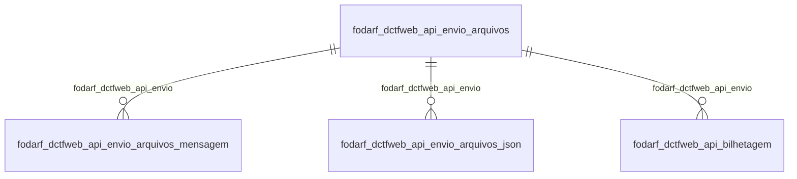

# Modelo — Pessoal - darf (rascunho em lote)

> Gerado por `src/model/gerar_docs_modelo.py` a partir de `src/model/modulos/pessoal_darf.yaml`, do catálogo e do perfil de colunas. **Não edite à mão.**

4 entidades. A coluna *Preench.* é o % de linhas com valor útil (nem nulo, nem em branco, nem zero, nem 1900-01-01; para colunas de código o zero conta como valor).

## Diagrama

## Entidades

| Entidade | Tabela | Linhas | Volume | Filtro obrigatório |
|---|---|---|---|---|
| [fodarf_dctfweb_api_envio_arquivos_mensagem](#fodarf_dctfweb_api_envio_arquivos_mensagem) | `FODARF_DCTFWEB_API_ENVIO_ARQUIVOS_MENSAGEM` | 91.719 | medio | empresa |
| [fodarf_dctfweb_api_envio_arquivos_json](#fodarf_dctfweb_api_envio_arquivos_json) | `FODARF_DCTFWEB_API_ENVIO_ARQUIVOS_JSON` | 74.924 | medio | empresa |
| [fodarf_dctfweb_api_envio_arquivos](#fodarf_dctfweb_api_envio_arquivos) | `FODARF_DCTFWEB_API_ENVIO_ARQUIVOS` | 38.378 | medio | empresa |
| [fodarf_dctfweb_api_bilhetagem](#fodarf_dctfweb_api_bilhetagem) | `FODARF_DCTFWEB_API_BILHETAGEM` | 38.378 | medio | empresa |

## fodarf_dctfweb_api_envio_arquivos_mensagem

**DARF DCTFWeb Api - Envio dos Arquivos - Retorno** — tabela `FODARF_DCTFWEB_API_ENVIO_ARQUIVOS_MENSAGEM` (91.719 linhas)

DARF DCTFWeb Api - Envio dos Arquivos - Retorno. 91.719 linhas no catálogo; chave: CODI_EMP, I_ENVIO, SEQUENCIAL_MENSAGEM.

- **Chave:** `CODI_EMP, I_ENVIO, SEQUENCIAL_MENSAGEM`
- **Empresa:** `CODI_EMP`
- **Período:** `—`
- **Ordem padrão:** `I_ENVIO asc`, `SEQUENCIAL_MENSAGEM asc`

**Regras de negócio validadas:**

- Medido em 2026-10-18: 91.873 linhas, 728 empresa(s).
- Vínculo fodarf_dctfweb_api_envio (FODARF_DCTFWEB_API_ENVIO_ARQUIVOS): 0 de 129 linhas sem registro relacionado (empresa 421).

| Campo | Coluna | Tipo | Preench. | Domínio | Descrição (banco) |
|---|---|---|---|---|---|
| codigo_da_empresa | `codi_emp` | integer(4) |  |  | Código da empresa |
| codigo_sequencial_de_envio_dos_arquivos | `i_envio` | integer(4) |  |  | Código sequencial de envio dos arquivos |
| codigo_sequencial | `sequencial_mensagem` | integer(4) |  |  | Código sequencial |
| codigo_da_mensagem_de_retorno | `codigo_mensagem` | integer(4) |  |  | Código da mensagem de retorno |
| titulo_da_mensagem_de_retorno | `titulo_mensagem` | varchar(100) |  |  | Titulo da mensagem de retorno |
| descricao_do_titulo | `descricao_mensagem` | varchar(500) |  |  | Descrição do titulo |

**Vínculos (LEFT JOIN, acrescentam colunas legíveis):**

- `fodarf_dctfweb_api_envio` → `FODARF_DCTFWEB_API_ENVIO_ARQUIVOS` por `codi_emp` = `codi_emp` e `i_envio` = `i_envio`; colunas: `fodarf_dctfweb_api_envio_nome`

**Filtros:** `codigo_sequencial_de_envio_dos_arquivos` (eq/in), `codigo_sequencial` (eq/in), `codigo_da_mensagem_de_retorno` (eq/in), `titulo_da_mensagem_de_retorno` (contem/prefixo), `descricao_do_titulo` (contem/prefixo)

## fodarf_dctfweb_api_envio_arquivos_json

**DAS Api - Envio dos Arquivos - JSON** — tabela `FODARF_DCTFWEB_API_ENVIO_ARQUIVOS_JSON` (74.924 linhas)

DAS Api - Envio dos Arquivos - JSON. 74.924 linhas no catálogo; chave: CODI_EMP, I_ENVIO, TIPO_ARQUIVO.

- **Chave:** `CODI_EMP, I_ENVIO, TIPO_ARQUIVO`
- **Empresa:** `CODI_EMP`
- **Período:** `—`
- **Ordem padrão:** `I_ENVIO asc`, `TIPO_ARQUIVO asc`

**Regras de negócio validadas:**

- Medido em 2026-10-18: 75.080 linhas, 728 empresa(s).
- tipo_do_arquivo_e_envio_r_resposta: todos os valores reais estão no comentário do banco (R=38.456, E=36.624).
- Vínculo fodarf_dctfweb_api_envio (FODARF_DCTFWEB_API_ENVIO_ARQUIVOS): 0 de 102 linhas sem registro relacionado (empresa 811).

| Campo | Coluna | Tipo | Preench. | Domínio | Descrição (banco) |
|---|---|---|---|---|---|
| codigo_da_empresa | `codi_emp` | integer(4) |  |  | Código da empresa |
| codigo_sequencial_de_envio_dos_arquivos | `i_envio` | integer(4) |  |  | Código sequencial de envio dos arquivos |
| tipo_do_arquivo_e_envio_r_resposta | `tipo_arquivo` | char(1) |  | fodarf_dctfweb_api_envio_arquivos_json_tipo_do_arquivo_e_ | Tipo do arquivo (E=Envio/R=Resposta) |

**Vínculos (LEFT JOIN, acrescentam colunas legíveis):**

- `fodarf_dctfweb_api_envio` → `FODARF_DCTFWEB_API_ENVIO_ARQUIVOS` por `codi_emp` = `codi_emp` e `i_envio` = `i_envio`; colunas: `fodarf_dctfweb_api_envio_nome`

**Filtros:** `codigo_sequencial_de_envio_dos_arquivos` (eq/in), `tipo_do_arquivo_e_envio_r_resposta` (eq/in)

## fodarf_dctfweb_api_envio_arquivos

**DARF DCTFWeb Api - Envio dos Arquivos** — tabela `FODARF_DCTFWEB_API_ENVIO_ARQUIVOS` (38.378 linhas)

DARF DCTFWeb Api - Envio dos Arquivos. 38.378 linhas no catálogo; chave: CODI_EMP, I_ENVIO.

- **Chave:** `CODI_EMP, I_ENVIO`
- **Empresa:** `CODI_EMP`
- **Período:** `DATA_ENVIO`
- **Ordem padrão:** `DATA_ENVIO desc`, `I_ENVIO asc`

**Regras de negócio validadas:**

- Medido em 2026-10-18: 38.456 linhas, 728 empresa(s), DATA_ENVIO de 2024-10-22 a 2026-10-16.
- tipo_de_envio_1_transmissao_mensal_2_ger: todos os valores reais estão no comentário do banco (4=13.063, 1=11.369, 5=7.102, 2=6.239, 3=683).
- situacao_processo_0_processando_1_sucess: todos os valores reais estão no comentário do banco (1=32.723, 2=3.732, 0=1.832, 3=169).
- tipo_do_processo_1_mensal_2_13o_salario: todos os valores reais estão no comentário do banco (1=38.124, 2=332).
- Vínculo geempre (geempre): 0 de 51 linhas sem registro relacionado (empresa 649).

| Campo | Coluna | Tipo | Preench. | Domínio | Descrição (banco) |
|---|---|---|---|---|---|
| codigo_da_empresa | `codi_emp` | integer(4) |  |  | Código da empresa |
| codigo_sequencial_de_envio_dos_arquivos | `i_envio` | integer(4) |  |  | Código sequencial de envio dos arquivos |
| competencia | `competencia` | date(4) |  |  | Competência |
| tipo_de_envio_1_transmissao_mensal_2_ger | `tipo_envio` | integer(4) |  | fodarf_dctfweb_api_envio_arquivos_tipo_de_envio_ | Tipo de envio (1=Transmissão Mensal/2=Gerar DCTFWeb/3=Relatório DCTFWeb/4=Consulta XML declaração/5=Gerar DCTFWeb Parcial) |
| situacao_processo_0_processando_1_sucess | `situacao` | integer(4) |  | fodarf_dctfweb_api_envio_arquivos_situacao_proce | Situação processo (0=Processando/1=Sucesso/2=Insucesso/3=Falha/4=Não autenticado) |
| tipo_do_processo_1_mensal_2_13o_salario 🔒 | `tipo_processo` | integer(4) |  | fodarf_dctfweb_api_envio_arquivos_tipo_do_proces | Tipo do processo (1=Mensal/2=13º Salário/3=Reclamatória trabalhista) |
| nome_do_arquivo | `nome_arquivo` | varchar(100) |  |  | Nome do arquivo |
| data_de_envio | `data_envio` | date(4) |  |  | Data de envio |
| hora_de_envio | `horario_envio` | time(8) |  |  | Hora de envio |
| numero_do_processo | `numero_processo` | char(20) |  |  | Número do processo |
| envio_de_guia_parcial_origem_dos_imposto | `origem_imposto` | char(20) |  |  | Envio de Guia Parcial - Origem dos impostos |

**Vínculos (LEFT JOIN, acrescentam colunas legíveis):**

- `geempre` → `geempre` por `codi_emp` = `codi_emp`; colunas: `geempre_nome`

**Filtros:** `codigo_sequencial_de_envio_dos_arquivos` (eq/in), `competencia` (entre/gte/lte), `data_de_envio` (entre/gte/lte), `tipo_de_envio_1_transmissao_mensal_2_ger` (eq/in), `situacao_processo_0_processando_1_sucess` (eq/in), `tipo_do_processo_1_mensal_2_13o_salario` (eq/in), `nome_do_arquivo` (contem/prefixo), `numero_do_processo` (eq/in), `envio_de_guia_parcial_origem_dos_imposto` (eq/in)

## fodarf_dctfweb_api_bilhetagem

**DARF DCTFWeb Api - Envio dos Arquivos - Bilhetagem de custos** — tabela `FODARF_DCTFWEB_API_BILHETAGEM` (38.378 linhas)

DARF DCTFWeb Api - Envio dos Arquivos - Bilhetagem de custos. 38.378 linhas no catálogo; chave: CODI_EMP, I_ENVIO, CODI_CON, SEQUENCIAL_BILHETAGEM.

- **Chave:** `CODI_EMP, I_ENVIO, CODI_CON, SEQUENCIAL_BILHETAGEM`
- **Empresa:** `CODI_EMP`
- **Período:** `—`
- **Ordem padrão:** `I_ENVIO asc`, `CODI_CON asc`

**Regras de negócio validadas:**

- Medido em 2026-10-18: 38.456 linhas, 728 empresa(s).
- tipo_de_servico_realizado_1_transmissao: todos os valores reais estão no comentário do banco (4=13.063, 1=11.369, 5=7.102, 2=6.239, 3=683).
- operacao_gerou_custo_s_sim_n_nao: todos os valores reais estão no comentário do banco (S=35.716, N=2.740).
- Vínculo fodarf_dctfweb_api_envio (FODARF_DCTFWEB_API_ENVIO_ARQUIVOS): 0 de 51 linhas sem registro relacionado (empresa 649).

| Campo | Coluna | Tipo | Preench. | Domínio | Descrição (banco) |
|---|---|---|---|---|---|
| codigo_da_empresa | `codi_emp` | integer(4) |  |  | Código da empresa |
| codigo_sequencial_de_envio_dos_arquivos | `i_envio` | integer(4) |  |  | Código sequencial de envio dos arquivos |
| codigo_do_contador | `codi_con` | integer(4) |  |  | Código do contador |
| codigo_sequencial | `sequencial_bilhetagem` | integer(4) |  |  | Código sequencial |
| tipo_de_servico_realizado_1_transmissao | `tipo_envio` | integer(4) |  | fodarf_dctfweb_api_bilhetagem_tipo_de_ser | Tipo de serviço realizado (1=Transmissão Mensal/2=Gerar DCTFWeb/3=Relatório DCTFWeb/4=Consulta XML declaração/5=Gerar DCTFWeb Parcial) |
| operacao_gerou_custo_s_sim_n_nao | `gerou_custo` | char(1) |  | fodarf_dctfweb_api_bilhetagem_operacao_ge | Operação gerou custo (S=Sim/N=Não) |

**Vínculos (LEFT JOIN, acrescentam colunas legíveis):**

- `fodarf_dctfweb_api_envio` → `FODARF_DCTFWEB_API_ENVIO_ARQUIVOS` por `codi_emp` = `codi_emp` e `i_envio` = `i_envio`; colunas: `fodarf_dctfweb_api_envio_nome`

**Filtros:** `codigo_sequencial_de_envio_dos_arquivos` (eq/in), `codigo_do_contador` (eq/in), `codigo_sequencial` (eq/in), `tipo_de_servico_realizado_1_transmissao` (eq/in), `operacao_gerou_custo_s_sim_n_nao` (eq/in)

## Domínios (significado dos códigos)

`confirmado`: **sim** = vem do comentário do banco e/ou foi conferido nos dados; **parcial** = parte dos valores; **não** = hipótese, não use como regra.

### status_empresa

Situação da empresa no cadastro (geempre.stat_emp)

Confirmado: sim

| Código | Significado |
|---|---|
| A | Ativa |
| I | Inativa |
| C | Em constituição |
| M | Ativo sem movimento |
| B | Em processo de baixa |
| E | Excluindo |

### motivo_inatividade

Motivo da inatividade (geempre.tipoi_emp). Só aparece em empresas inativas.

Confirmado: sim

| Código | Significado |
|---|---|
| 1 | Outros |
| 2 | Baixada |
| 3 | Transferida |
| 4 | Inadimplente |

### tipo_inscricao

Tipo da inscrição (CNPJ/CPF/CEI/CAEPF)

Confirmado: sim

| Código | Significado |
|---|---|
| 1 | CNPJ |
| 2 | CPF |
| 3 | CEI |
| 6 | CAEPF |

### regime_federal_empresa

Regime federal da folha (geempre.rfed_emp)

Confirmado: parcial

| Código | Significado |
|---|---|
| 1 | Normal |
| 2 | Microempresa |
| 3 | Empresa de pequeno porte |

### tipo_honorario_empresa

Como a empresa usa o módulo Honorários (geempre.honorario_tipo)

Confirmado: sim

| Código | Significado |
|---|---|
| E | Escritório (quem fatura) |
| C | Cliente |

### sim_nao_texto

Confirmado: sim

| Código | Significado |
|---|---|
| S | Sim |
| N | Não |

### sim_nao_numerico

Confirmado: sim

| Código | Significado |
|---|---|
| 1 | Sim |
| 0 | Não |

### fodarf_dctfweb_api_envio_arquivos_json_tipo_do_arquivo_e_

Confirmado: sim

> Todos os valores observados em FODARF_DCTFWEB_API_ENVIO_ARQUIVOS_JSON.TIPO_ARQUIVO estão no comentário do banco (2026-10-18). Distribuição: R=38.456, E=36.624.

| Código | Significado |
|---|---|
| E | Envio |
| R | Resposta |

### fodarf_dctfweb_api_envio_arquivos_tipo_de_envio_

Confirmado: sim

> Todos os valores observados em FODARF_DCTFWEB_API_ENVIO_ARQUIVOS.TIPO_ENVIO estão no comentário do banco (2026-10-18). Distribuição: 4=13.063, 1=11.369, 5=7.102, 2=6.239, 3=683.

| Código | Significado |
|---|---|
| 1 | Transmissão Mensal |
| 2 | Gerar DCTFWeb |
| 3 | Relatório DCTFWeb |
| 4 | Consulta XML declaração |
| 5 | Gerar DCTFWeb Parcial |

### fodarf_dctfweb_api_envio_arquivos_situacao_proce

Confirmado: sim

> Todos os valores observados em FODARF_DCTFWEB_API_ENVIO_ARQUIVOS.SITUACAO estão no comentário do banco (2026-10-18). Distribuição: 1=32.723, 2=3.732, 0=1.832, 3=169.

| Código | Significado |
|---|---|
| 0 | Processando |
| 1 | Sucesso |
| 2 | Insucesso |
| 3 | Falha |
| 4 | Não autenticado |

### fodarf_dctfweb_api_envio_arquivos_tipo_do_proces

Confirmado: sim

> Todos os valores observados em FODARF_DCTFWEB_API_ENVIO_ARQUIVOS.TIPO_PROCESSO estão no comentário do banco (2026-10-18). Distribuição: 1=38.124, 2=332.

| Código | Significado |
|---|---|
| 1 | Mensal |
| 2 | 13º Salário |
| 3 | Reclamatória trabalhista |

### fodarf_dctfweb_api_bilhetagem_tipo_de_ser

Confirmado: sim

> Todos os valores observados em FODARF_DCTFWEB_API_BILHETAGEM.TIPO_ENVIO estão no comentário do banco (2026-10-18). Distribuição: 4=13.063, 1=11.369, 5=7.102, 2=6.239, 3=683.

| Código | Significado |
|---|---|
| 1 | Transmissão Mensal |
| 2 | Gerar DCTFWeb |
| 3 | Relatório DCTFWeb |
| 4 | Consulta XML declaração |
| 5 | Gerar DCTFWeb Parcial |

### fodarf_dctfweb_api_bilhetagem_operacao_ge

Confirmado: sim

> Todos os valores observados em FODARF_DCTFWEB_API_BILHETAGEM.GEROU_CUSTO estão no comentário do banco (2026-10-18). Distribuição: S=35.716, N=2.740.

| Código | Significado |
|---|---|
| S | Sim |
| N | Não |

