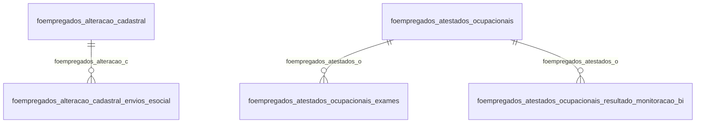

# Modelo — Pessoal - empregados (rascunho em lote)

> Gerado por `src/model/gerar_docs_modelo.py` a partir de `src/model/modulos/pessoal_empregados.yaml`, do catálogo e do perfil de colunas. **Não edite à mão.**

22 entidades. A coluna *Preench.* é o % de linhas com valor útil (nem nulo, nem em branco, nem zero, nem 1900-01-01; para colunas de código o zero conta como valor).

## Diagrama

## Entidades

| Entidade | Tabela | Linhas | Volume | Filtro obrigatório |
|---|---|---|---|---|
| [foempregados_envios_esocial](#foempregados_envios_esocial) | `FOEMPREGADOS_ENVIOS_ESOCIAL` | 295.590 | medio | empresa |
| [foempregados_alteracao_contratual_envios_esocial](#foempregados_alteracao_contratual_envios_esocial) | `FOEMPREGADOS_ALTERACAO_CONTRATUAL_ENVIOS_ESOCIAL` | 29.846 | medio | empresa |
| [foempregados_alteracao_outros_campos](#foempregados_alteracao_outros_campos) | `FOEMPREGADOS_ALTERACAO_OUTROS_CAMPOS` | 18.081 | medio | empresa |
| [foempregados_alteracao_cadastral](#foempregados_alteracao_cadastral) | `FOEMPREGADOS_ALTERACAO_CADASTRAL` | 12.680 | medio | empresa |
| [foempregados_alteracao_cadastral_envios_esocial](#foempregados_alteracao_cadastral_envios_esocial) | `FOEMPREGADOS_ALTERACAO_CADASTRAL_ENVIOS_ESOCIAL` | 12.339 | medio | empresa |
| [foempregados_plano_saude](#foempregados_plano_saude) | `FOEMPREGADOS_PLANO_SAUDE` | 3.501 | pequeno | empresa |
| [foempregados_atestados_ocupacionais](#foempregados_atestados_ocupacionais) | `FOEMPREGADOS_ATESTADOS_OCUPACIONAIS` | 2.297 | pequeno | empresa |
| [foempregados_estabilidade](#foempregados_estabilidade) | `FOEMPREGADOS_ESTABILIDADE` | 1.592 | pequeno | empresa |
| [foempregados_conselhos_regionais](#foempregados_conselhos_regionais) | `FOEMPREGADOS_CONSELHOS_REGIONAIS` | 936 | pequeno | empresa |
| [foempregados_dados_eventos_esocial](#foempregados_dados_eventos_esocial) | `FOEMPREGADOS_DADOS_EVENTOS_ESOCIAL` | 844 | pequeno | empresa |
| [foempregados_transf](#foempregados_transf) | `FOEMPREGADOS_TRANSF` | 427 | pequeno | empresa |
| [foempregados_conselhos_regionais_alteracao](#foempregados_conselhos_regionais_alteracao) | `FOEMPREGADOS_CONSELHOS_REGIONAIS_ALTERACAO` | 278 | pequeno | empresa |
| [foempregados_certidao_civil](#foempregados_certidao_civil) | `FOEMPREGADOS_CERTIDAO_CIVIL` | 140 | pequeno | empresa |
| [foempregados_vale_alimentacao_desconto](#foempregados_vale_alimentacao_desconto) | `FOEMPREGADOS_VALE_ALIMENTACAO_DESCONTO` | 89 | pequeno | empresa |
| [foempregados_vale_alimentacao](#foempregados_vale_alimentacao) | `FOEMPREGADOS_VALE_ALIMENTACAO` | 88 | pequeno | empresa |
| [foempregados_vinc](#foempregados_vinc) | `foempregados_vinc` | 82 | pequeno | empresa |
| [foempregados_chave_pix](#foempregados_chave_pix) | `FOEMPREGADOS_CHAVE_PIX` | 78 | pequeno | empresa |
| [foempregados_exames_toxicologicos](#foempregados_exames_toxicologicos) | `FOEMPREGADOS_EXAMES_TOXICOLOGICOS` | 13 | pequeno | empresa |
| [foempregados_atestados_ocupacionais_exames](#foempregados_atestados_ocupacionais_exames) | `FOEMPREGADOS_ATESTADOS_OCUPACIONAIS_EXAMES` | 8 | pequeno | empresa |
| [foempregados_atestados_ocupacionais_resultado_monitoracao_bi](#foempregados_atestados_ocupacionais_resultado_monitoracao_bi) | `FOEMPREGADOS_ATESTADOS_OCUPACIONAIS_RESULTADO_MONITORACAO_BIOLOGICA` | 4 | pequeno | empresa |
| [foempregados_chave_pix_alternativa](#foempregados_chave_pix_alternativa) | `FOEMPREGADOS_CHAVE_PIX_ALTERNATIVA` | 3 | pequeno | empresa |
| [foempregados_esocial_domestico](#foempregados_esocial_domestico) | `FOEMPREGADOS_ESOCIAL_DOMESTICO` | 2 | pequeno | empresa |

## foempregados_envios_esocial

**Envios de empregados ao eSocial** — tabela `FOEMPREGADOS_ENVIOS_ESOCIAL` (295.590 linhas)

Envios de empregados ao eSocial. 295.590 linhas no catálogo; chave: codi_emp, i_empregados, CODI_EMP_DADOS_EVENTOS, I_DADOS_EVENTOS.

- **Chave:** `codi_emp, i_empregados, CODI_EMP_DADOS_EVENTOS, I_DADOS_EVENTOS`
- **Empresa:** `codi_emp`
- **Período:** `—`
- **Ordem padrão:** `i_empregados asc`, `CODI_EMP_DADOS_EVENTOS asc`

**Regras de negócio validadas:**

- Medido em 2026-10-18: 295.671 linhas, 508 empresa(s).
- Vínculo foesocial_dados_eventos (FOESOCIAL_DADOS_EVENTOS): 0 de 80 linhas sem registro relacionado (empresa 824).
- Vínculo foempregados (foempregados): 0 de 80 linhas sem registro relacionado (empresa 824).

| Campo | Coluna | Tipo | Preench. | Domínio | Descrição (banco) |
|---|---|---|---|---|---|
| codigo_da_empresa | `codi_emp` | integer(4) |  |  | Código da empresa |
| codigo_do_empregado | `i_empregados` | integer(4) |  |  | Código do empregado |
| codigo_da_empresa_referente_a_foesocial | `codi_emp_dados_eventos` | integer(4) |  |  | Código da empresa referente a FOESOCIAL_DADOS_EVENTOS |
| codigo_do_evento_referente_a_foesocial_d | `i_dados_eventos` | integer(4) |  |  | Código do evento referente a FOESOCIAL_DADOS_EVENTOS |

**Vínculos (LEFT JOIN, acrescentam colunas legíveis):**

- `foesocial_dados_eventos` → `FOESOCIAL_DADOS_EVENTOS` por `codi_emp_dados_eventos` = `codi_emp` e `i_dados_eventos` = `i_dados_eventos`; colunas: `foesocial_dados_eventos_nome`
- `foempregados` → `foempregados` por `codi_emp` = `codi_emp` e `i_empregados` = `i_empregados`; colunas: `foempregados_nome`

**Filtros:** `codigo_do_empregado` (eq/in), `codigo_da_empresa_referente_a_foesocial` (eq/in), `codigo_do_evento_referente_a_foesocial_d` (eq/in)

## foempregados_alteracao_contratual_envios_esocial

**Envios das alterações contratuais ao eSocial** — tabela `FOEMPREGADOS_ALTERACAO_CONTRATUAL_ENVIOS_ESOCIAL` (29.846 linhas)

Envios das alterações contratuais ao eSocial. 29.846 linhas no catálogo; chave: CODI_EMP, I_EMPREGADOS, DATA_ALTERACAO, CODI_EMP_DADOS_EVENTOS, I_DADOS_EVENTOS.

- **Chave:** `CODI_EMP, I_EMPREGADOS, DATA_ALTERACAO, CODI_EMP_DADOS_EVENTOS, I_DADOS_EVENTOS`
- **Empresa:** `CODI_EMP`
- **Período:** `DATA_ALTERACAO`
- **Ordem padrão:** `DATA_ALTERACAO desc`, `I_EMPREGADOS asc`, `CODI_EMP_DADOS_EVENTOS asc`

**Regras de negócio validadas:**

- Medido em 2026-10-18: 29.911 linhas, 507 empresa(s), DATA_ALTERACAO de 1974-04-03 a 2026-10-20.
- Vínculo foesocial_dados_eventos (FOESOCIAL_DADOS_EVENTOS): 0 de 8 linhas sem registro relacionado (empresa 1698).
- Vínculo foempregados_alteracao_c (FOEMPREGADOS_ALTERACAO_CONTRATUAL): 0 de 8 linhas sem registro relacionado (empresa 1698).

| Campo | Coluna | Tipo | Preench. | Domínio | Descrição (banco) |
|---|---|---|---|---|---|
| codigo_da_empresa | `codi_emp` | integer(4) |  |  | Código da empresa |
| codigo_do_empregado | `i_empregados` | integer(4) |  |  | Código do empregado |
| data_da_alteracao 🔒 | `data_alteracao` | date(4) |  |  | Data da alteração |
| codigo_da_empresa_referente_a_foesocial | `codi_emp_dados_eventos` | integer(4) |  |  | Código da empresa referente a FOESOCIAL_DADOS_EVENTOS |
| codigo_do_evento_referente_a_foesocial_d | `i_dados_eventos` | integer(4) |  |  | Código do evento referente a FOESOCIAL_DADOS_EVENTOS |

**Vínculos (LEFT JOIN, acrescentam colunas legíveis):**

- `foesocial_dados_eventos` → `FOESOCIAL_DADOS_EVENTOS` por `codi_emp_dados_eventos` = `codi_emp` e `i_dados_eventos` = `i_dados_eventos`; colunas: `foesocial_dados_eventos_nome`
- `foempregados_alteracao_c` → `FOEMPREGADOS_ALTERACAO_CONTRATUAL` por `codi_emp` = `codi_emp` e `i_empregados` = `i_empregados` e `data_alteracao` = `data_alteracao`; colunas: `foempregados_alteracao_c_nome`

**Filtros:** `codigo_do_empregado` (eq/in), `data_da_alteracao` (eq/in), `codigo_da_empresa_referente_a_foesocial` (eq/in), `codigo_do_evento_referente_a_foesocial_d` (eq/in)

## foempregados_alteracao_outros_campos

**Registros de alteração contratual para envio ao eSocial.** — tabela `FOEMPREGADOS_ALTERACAO_OUTROS_CAMPOS` (18.081 linhas)

Registros de alteração contratual para envio ao eSocial.. 18.081 linhas no catálogo; chave: CODI_EMP, I_EMPREGADOS, DATA_ALTERACAO.

- **Chave:** `CODI_EMP, I_EMPREGADOS, DATA_ALTERACAO`
- **Empresa:** `CODI_EMP`
- **Período:** `DATA_ADMISSAO_EMPRESA_ORIGEM_DIRIGENTE_SINDICAL`
- **Ordem padrão:** `DATA_ADMISSAO_EMPRESA_ORIGEM_DIRIGENTE_SINDICAL desc`, `I_EMPREGADOS asc`, `DATA_ALTERACAO asc`

**Regras de negócio validadas:**

- Medido em 2026-10-18: 18.101 linhas, 977 empresa(s).
- Colunas expostas nulas em 100% das linhas (8): ddd_do_telefone, nome_da_empresa_de_origem_do_dirigente_s, categoria_de_origem_do_dirigente_sindica, data_de_admissao_na_empresa_de_origem_do, matricula_na_empresa_de_origem_do_dirige, responsavel_pela_remuneracao_do_dirigent, tipo_de_remuneracao_do_dirigente_sindica, data_de_inicio_do_pagamento_adicional_ao.
- forma_de_pagamento_1_por_mes_2_por_seman: todos os valores reais estão no comentário do banco (1=12.911, nulo=5.190).
- origem_do_registro_0_sistema_1_imp_tabel: todos os valores reais estão no comentário do banco (0=18.101).
- Vínculo foempregados (foempregados): 0 de 2 linhas sem registro relacionado (empresa 9135).
- Vínculo fobancos (fobancos): 0 de 2 linhas sem registro relacionado (empresa 9135).

| Campo | Coluna | Tipo | Preench. | Domínio | Descrição (banco) |
|---|---|---|---|---|---|
| codigo_da_empresa | `codi_emp` | integer(4) |  |  | Código da empresa. |
| codigo_do_empregado | `i_empregados` | integer(4) |  |  | Código do empregado. |
| data_da_alteracao 🔒 | `data_alteracao` | date(4) |  |  | Data da alteração. |
| codigo_do_departamento | `i_depto` | integer(4) |  |  | Código do departamento |
| codigo_do_centro_de_custos | `i_ccustos` | integer(4) |  |  | Código do centro de custos |
| simples_072007 | `simples_072007` | smallint(2) |  |  | Optante pelo Simples em 07/2007 |
| codigo_do_sindicato_piso | `i_sindpiso` | integer(4) |  |  | Código do sindicato piso |
| possui_residencia_propria | `residencia_propria` | smallint(2) |  |  | Possui residência própria |
| imovel_adquirido_com_recursos_do_fgts | `imovel_adquirido_recursos_fgts` | smallint(2) |  |  | Imóvel adquirido com recursos do FGTS |
| ddd_do_telefone 🔒 | `ddd_fone2` | varchar(3) |  |  | DDD do telefone |
| telefone 🔒 | `fone2` | varchar(15) |  |  | Telefone |
| naturalizado | `naturalizado` | char(1) |  |  | Naturalizado |
| numero_do_processo_no_mte | `numero_processo_mte` | varchar(30) |  |  | Número do processo no MTE |
| validade_da_carteira_de_trabalho_estrang | `validade_ctrab_estr` | date(4) |  |  | Validade da carteira de trabalho estrangeira |
| forma_de_pagamento_1_por_mes_2_por_seman | `forma_calculo` | smallint(2) |  | foempregados_alteracao_outros_campos_forma_de_pa | Forma de pagamento. (1=Por mês/2=Por semana/3=Por convocação) |
| calcular_inss_patronal | `calcular_inss_patronal` | smallint(2) |  |  | Calcular INSS patronal |
| dirigente_sindical | `dirigente_sindical` | smallint(2) |  |  | Dirigente sindical |
| cnpj_da_empresa_de_origem_do_dirigente_s 🔒 | `cnpj_empresa_origem_dirigente_sindical` | varchar(14) |  |  | CNPJ da empresa de origem do dirigente sindical |
| nome_da_empresa_de_origem_do_dirigente_s | `nome_empresa_origem_dirigente_sindical` | varchar(100) |  |  | Nome da empresa de origem do dirigente sindical |
| categoria_de_origem_do_dirigente_sindica | `categoria_origem_dirigente_sindical` | integer(4) |  |  | Categoria de origem do dirigente sindical |
| data_de_admissao_na_empresa_de_origem_do | `data_admissao_empresa_origem_dirigente_sindical` | date(4) |  |  | Data de admissão na empresa de origem do dirigente sindical |
| matricula_na_empresa_de_origem_do_dirige | `matricula_empresa_origem_dirigente_sindical` | varchar(30) |  |  | Matrícula na empresa de origem do dirigente sindical |
| responsavel_pela_remuneracao_do_dirigent | `responsavel_remuneracao_dirigente_sindical` | smallint(2) |  |  | Responsável pela remuneração do dirigente sindical |
| tipo_de_remuneracao_do_dirigente_sindica | `tipo_remuneracao_dirigente_sindical` | smallint(2) |  |  | Tipo de remuneração do dirigente sindical |
| data_de_inicio_do_pagamento_adicional_ao | `data_inicio_pagamento_adicional_dirigente_sindical` | date(4) |  |  | Data de início do pagamento adicional ao dirigente sindical |
| remuneracao_na_empresa_do_dirigente_sind 🔒 | `remuneracao_empresa_dirigente_sindical` | numeric(17) |  |  | Remuneração na empresa do dirigente sindical |
| remuneracao_no_sindicato_do_dirigente_si 🔒 | `remuneracao_sindicato_dirigente_sindical` | numeric(17) |  |  | Remuneração no sindicato do dirigente sindical |
| remuneracao_no_periodo_de_desligamento_r | `remuneracao_periodo_desligamento_reintegracao_pagas_juizo` | smallint(2) |  |  | Remuneração no período de desligamento/reintegração pagas por juízo |
| possui_vinculo_com_outra_empresa | `possui_vinc_out_emp` | char(1) |  |  | Possui vínculo com outra empresa |
| codigo_do_banco | `i_bancos` | integer(4) |  |  | Código do banco |
| agencia_para_pagamento | `agencia_conta_pagamento` | varchar(10) |  |  | Agência para pagamento |
| conta_corrente | `conta_corr` | char(15) |  |  | Conta corrente |
| digito_da_conta_para_pagamento | `digito_conta_pagamento` | char(3) |  |  | Dígito da conta para pagamento |
| tipo_de_conta_bancaria | `tipo_conta` | smallint(2) |  |  | Tipo de conta bancária |
| carga_horaria_variavel | `carga_horaria_variavel` | smallint(2) |  |  | Carga horária variável |
| codigo_da_filial | `i_filiais` | integer(4) |  |  | Código da filial |
| codigo_do_sindicato_piso_experiencia | `i_sindpiso_experiencia` | integer(4) |  |  | Código do sindicato piso experiência |
| ocorrencia_sefip | `oco_sefip` | integer(4) |  |  | Ocorrência SEFIP |
| tipo_de_servico | `tipo_servico` | char(1) |  |  | Tipo de serviço |
| horas_compensadas | `horas_compensadas` | numeric(5) |  |  | Horas compensadas |
| horas_trabalhadas_no_mes | `horas_mes` | numeric(5) |  |  | Horas trabalhadas no mês |
| horas_trabalhadas_por_dia | `horas_dia` | numeric(5) |  |  | Horas trabalhadas por dia |
| data_de_expedicao_da_carteira_de_trabalh | `data_expedicao_carteira_trabalho` | date(4) |  |  | Data de expedição da carteira de trabalho |
| orgao_emissor_da_cnh | `orgao_emissor_cnh` | varchar(20) |  |  | Órgão emissor da CNH |
| data_de_validade_do_rne | `data_validade_rne` | date(4) |  |  | Data de validade do RNE |
| data_de_opcao_pelo_fgts | `data_opcao_fgts` | date(4) |  |  | Data de opção pelo FGTS |
| codigo_do_coordenador_de_estagio | `i_coordenador_estagio` | integer(4) |  |  | Código do coordenador de estágio |
| forma_de_pagamento | `forma_pagamento` | varchar(255) |  |  | Forma de pagamento |
| codigo_do_municipio_do_ric | `codigo_municipio_ric` | integer(4) |  |  | Código do município do RIC |
| origem_do_registro_0_sistema_1_imp_tabel | `origem_registro` | smallint(2) |  | foempregados_alteracao_outros_campos_origem_do_r | Origem do registro. (0=Sistema/1=Imp. tabelas/2=Imp. layout/3=Imp. tabelas concorrentes) |
| codigo_esocial | `codigo_esocial` | varchar(30) |  |  | Código eSocial. |
| codigo_esocial_do_empregado_origem_quand | `codigo_esocial_empregado_origem` | varchar(30) |  |  | Código eSocial do empregado origem quando transferência, fusão ou sucessão. |
| codigo_operacao_pagamento | `codigo_operacao_pagamento` | smallint(2) |  |  | Código da operação de pagamento 0=Não/1=Sim |
| funcionario_sindicalizado | `sindicalizado` | smallint(2) |  |  | Funcionário sindicalizado |
| numero_do_pis | `pis` | char(11) |  |  | Número do PIS |
| codigo_do_municipio_de_nascimento | `municipio_nascimento` | integer(4) |  |  | Código do município de nascimento |
| uf_de_nascimento 🔒 | `uf_nascimento` | char(2) |  |  | UF de nascimento |
| nome_do_pai | `nome_pai` | varchar(70) |  |  | Nome do pai |
| nome_da_mae | `nome_mae` | varchar(70) |  |  | Nome da mãe |
| e_mail_alternativo 🔒 | `email_alternativo` | varchar(60) |  |  | E-mail alternativo |

**Vínculos (LEFT JOIN, acrescentam colunas legíveis):**

- `foempregados` → `foempregados` por `codi_emp` = `codi_emp` e `i_empregados` = `i_empregados`; colunas: `foempregados_nome`
- `fobancos` → `fobancos` por `i_bancos` = `i_bancos`; colunas: `fobancos_nome`

**Filtros:** `codigo_do_empregado` (eq/in), `data_da_alteracao` (eq/in), `validade_da_carteira_de_trabalho_estrang` (entre/gte/lte), `data_de_admissao_na_empresa_de_origem_do` (entre/gte/lte), `data_de_inicio_do_pagamento_adicional_ao` (entre/gte/lte), `data_de_expedicao_da_carteira_de_trabalh` (entre/gte/lte), `data_de_validade_do_rne` (entre/gte/lte), `data_de_opcao_pelo_fgts` (entre/gte/lte), `codigo_do_departamento` (eq/in), `codigo_do_centro_de_custos` (eq/in), `codigo_do_sindicato_piso` (eq/in), `ddd_do_telefone` (eq/in), `telefone` (eq/in), `naturalizado` (eq/in)

## foempregados_alteracao_cadastral

**Registros de alteração contratual para envio ao eSocial.** — tabela `FOEMPREGADOS_ALTERACAO_CADASTRAL` (12.680 linhas)

Registros de alteração contratual para envio ao eSocial.. 12.680 linhas no catálogo; chave: CODI_EMP, I_EMPREGADOS, DATA_ALTERACAO.

- **Chave:** `CODI_EMP, I_EMPREGADOS, DATA_ALTERACAO`
- **Empresa:** `CODI_EMP`
- **Período:** `DATA_NASCIMENTO`
- **Ordem padrão:** `DATA_NASCIMENTO desc`, `I_EMPREGADOS asc`, `DATA_ALTERACAO asc`

**Regras de negócio validadas:**

- Medido em 2026-10-18: 12.698 linhas, 977 empresa(s), DATA_NASCIMENTO de 1900-01-01 a 9966-01-01.
- Colunas expostas nulas em 100% das linhas (3): codigo_postal, ddd_do_telefone, ddd_do_celular.
- possui_deficiencia_0_nao_1_sim: todos os valores reais estão no comentário do banco (0=12.684, 1=14).
- possui_deficiencia_motora_0_nao_1_sim: todos os valores reais estão no comentário do banco (0=12.694, 1=4).
- possui_deficiencia_visual_0_nao_1_sim: todos os valores reais estão no comentário do banco (0=12.693, 1=5).
- possui_deficiencia_auditiva_0_nao_1_sim: todos os valores reais estão no comentário do banco (0=12.694, 1=4).
- possui_deficiencia_mental_0_nao_1_sim: todos os valores reais estão no comentário do banco (0=12.697, 1=1).
- possui_deficiencia_intelectual_0_nao_1_s: todos os valores reais estão no comentário do banco (0=12.698).
- possui_deficiencia_reabilitado_0_nao_1_s: todos os valores reais estão no comentário do banco (0=12.698).
- residente_ou_domiciliado_no_exterior_0_n: todos os valores reais estão no comentário do banco (0=12.696, 1=2).
- cota_de_deficiente_0_nao_1_sim: todos os valores reais estão no comentário do banco (0=12.690, 1=8).
- enviar_para_o_esocial_0_nao_1_sim: todos os valores reais estão no comentário do banco (0=9.696, 1=3.002).
- gerar_retificacao_esocial: todos os valores reais estão no comentário do banco (0=12.316, 1=382).
- marcacao_do_evento_para_gerar_o_evento_d: todos os valores reais estão no comentário do banco (0=12.698).
- enviar_evento_esocial_anterior_ao_inicio: todos os valores reais estão no comentário do banco (0=9.624, 1=3.074).
- Vínculo foempregados (foempregados): 0 de 2 linhas sem registro relacionado (empresa 908).

| Campo | Coluna | Tipo | Preench. | Domínio | Descrição (banco) |
|---|---|---|---|---|---|
| codigo_da_empresa | `codi_emp` | integer(4) |  |  | Código da empresa. |
| codigo_do_empregado | `i_empregados` | integer(4) |  |  | Código do empregado. |
| data_da_alteracao 🔒 | `data_alteracao` | date(4) |  |  | Data da alteração. |
| nome | `nome` | varchar(70) |  |  | Nome |
| pis | `pis` | char(11) |  |  | PIS |
| sexo | `sexo` | char(1) |  |  | Sexo |
| cor | `cor` | smallint(2) |  |  | Cor |
| estado_civil 🔒 | `estado_civil` | char(1) |  |  | Estado civil |
| grau_de_instrucao | `grau_instrucao` | smallint(2) |  |  | Grau de instrução |
| data_de_nascimento 🔒 | `data_nascimento` | date(4) |  |  | Data de nascimento |
| municipio_de_nascimento | `municipio_nascimento` | integer(4) |  |  | Município de nascimento |
| codigo_do_pais_de_nascimento | `pais_nascimento` | integer(4) |  |  | Código do país de nascimento |
| codigo_do_pais_da_nacionalidade | `pais_nacionalidade` | integer(4) |  |  | Código do país da nacionalidade |
| nome_no_esocial | `nome_social` | varchar(70) |  |  | Nome no eSocial |
| tipo_do_endereco | `tipo_endereco` | smallint(2) |  |  | Tipo do endereço |
| endereco 🔒 | `endereco` | varchar(100) |  |  | Endereço |
| numero_do_endereco | `numero_endereco` | integer(4) |  |  | Número do endereço |
| bairro 🔒 | `bairro` | varchar(90) |  |  | Bairro |
| complemento 🔒 | `complemento_endereco` | varchar(30) |  |  | Complemento |
| cep 🔒 | `cep_endereco` | varchar(8) |  |  | CEP |
| codigo_do_municipio_do_endereco | `municipio_endereco` | integer(4) |  |  | Código do município do endereço |
| uf_do_endereco 🔒 | `uf_endereco` | char(2) |  |  | UF do endereço |
| codigo_do_pais_do_endereco | `pais_endereco` | integer(4) |  |  | Código do país do endereço |
| codigo_postal | `codigo_postal` | varchar(10) |  |  | Código postal |
| ddd_do_telefone 🔒 | `ddd_fone` | varchar(3) |  |  | DDD do telefone |
| numero_de_telefone 🔒 | `fone` | varchar(15) |  |  | Número de Telefone |
| ddd_do_celular | `ddd_celular` | varchar(3) |  |  | DDD do celular |
| numero_de_celular | `celular` | varchar(15) |  |  | Número de celular |
| e_mail_principal 🔒 | `email_principal` | varchar(60) |  |  | E-mail principal |
| orgao_de_expedicao | `org_exped_ident` | varchar(10) |  |  | Órgão de expedição |
| tipo_de_visto_estrangeiro | `tipo_visto_estrangeiro` | smallint(2) |  |  | Tipo de visto estrangeiro |
| possui_deficiencia_0_nao_1_sim | `possui_deficiencia` | smallint(2) |  | foempregados_alteracao_cadastral_possui_defi | Possui deficiência (0=Não/1=Sim) |
| possui_deficiencia_motora_0_nao_1_sim | `possui_deficiencia_motora` | smallint(2) |  | foempregados_alteracao_cadastral_possui_defi | Possui deficiência motora (0=Não/1=Sim) |
| possui_deficiencia_visual_0_nao_1_sim | `possui_deficiencia_visual` | smallint(2) |  | foempregados_alteracao_cadastral_possui_defi | Possui deficiência visual (0=Não/1=Sim) |
| possui_deficiencia_auditiva_0_nao_1_sim | `possui_deficiencia_auditiva` | smallint(2) |  | foempregados_alteracao_cadastral_possui_defi | Possui deficiência auditiva(0=Não/1=Sim) |
| possui_deficiencia_mental_0_nao_1_sim | `possui_deficiencia_mental` | smallint(2) |  | foempregados_alteracao_cadastral_possui_defi | Possui deficiência mental(0=Não/1=Sim) |
| possui_deficiencia_intelectual_0_nao_1_s | `possui_deficiencia_intelectual` | smallint(2) |  | foempregados_alteracao_cadastral_possui_defi | Possui deficiência intelectual(0=Não/1=Sim) |
| possui_deficiencia_reabilitado_0_nao_1_s | `possui_deficiencia_reabilitado` | smallint(2) |  | foempregados_alteracao_cadastral_possui_defi | Possui deficiência reabilitado(0=Não/1=Sim) |
| residente_ou_domiciliado_no_exterior_0_n | `residente_exterior` | smallint(2) |  | foempregados_alteracao_cadastral_residente_o | Residente ou domiciliado no exterior (0=Não/1=Sim) |
| nome_do_municipio_para_residente_no_exte | `nome_municipio_residente_exterior` | varchar(255) |  |  | Nome do municipio para residente no exterior |
| cota_de_deficiente_0_nao_1_sim | `cota_deficiente` | smallint(2) |  | foempregados_alteracao_cadastral_cota_de_def | Cota de deficiente (0=Não/1=Sim) |
| observacao_da_deficiencia 🔒 | `observacao_deficiencia` | varchar(255) |  |  | Observação da deficiência |
| origem_do_registro_0_sistema_1_imp_tabel | `origem_registro` | smallint(2) |  |  | Origem do registro 0 - Sistema, 1 - Imp. Tabelas, 2 - Imp. Layout, 3- Imp. Tabelas Concorrentes, 4-Importação eSocial |
| enviar_para_o_esocial_0_nao_1_sim | `enviar_esocial` | smallint(2) |  | foempregados_alteracao_cadastral_enviar_para | Enviar para o eSocial. (0=Não/1=Sim) |
| gerar_retificacao_esocial | `gerar_retificacao_esocial` | smallint(2) |  | foempregados_alteracao_cadastral_gerar_retif | Gerar retificação para o eSocial. (0=Não/1=Sim) |
| marcacao_do_evento_para_gerar_o_evento_d | `processar_exclusao_esocial` | smallint(2) |  | foempregados_alteracao_cadastral_marcacao_do | Marcação do evento para gerar o evento de exclusão no eSocial. (0=Não/1=Sim) |
| numero_do_recibo_importado_do_esocial | `numero_recibo_esocial_validacao_automatica` | varchar(50) |  |  | Numero do recibo importado do eSocial |
| id_do_evento_importado_do_esocial | `id_esocial_validacao_automatica` | varchar(70) |  |  | ID do evento importado do eSocial |
| tempo_de_residencia_no_brasil | `tempo_residencia` | smallint(2) |  |  | Tempo de residência no Brasil. |
| enviar_evento_esocial_anterior_ao_inicio | `enviar_esocial_periodo_anterior_inicio_banco_contabil` | smallint(2) |  | foempregados_alteracao_cadastral_enviar_even | Enviar evento eSocial anterior ao início da utilização do banco de dados (0=Não/1=Sim) |
| enviar_esocial_manualmente | `enviar_esocial_manualmente` | integer(4) |  |  | Enviar eSocial Manualmente |

**Vínculos (LEFT JOIN, acrescentam colunas legíveis):**

- `foempregados` → `foempregados` por `codi_emp` = `codi_emp` e `i_empregados` = `i_empregados`; colunas: `foempregados_nome`

**Filtros:** `codigo_do_empregado` (eq/in), `data_da_alteracao` (eq/in), `data_de_nascimento` (entre/gte/lte), `nome` (contem/prefixo), `pis` (eq/in), `sexo` (eq/in), `estado_civil` (eq/in), `nome_no_esocial` (contem/prefixo), `tipo_do_endereco` (eq/in), `endereco` (contem/prefixo), `bairro` (contem/prefixo), `complemento` (contem/prefixo), `cep` (eq/in), `uf_do_endereco` (eq/in)

## foempregados_alteracao_cadastral_envios_esocial

**Envios das alterações cadastrais ao eSocial** — tabela `FOEMPREGADOS_ALTERACAO_CADASTRAL_ENVIOS_ESOCIAL` (12.339 linhas)

Envios das alterações cadastrais ao eSocial. 12.339 linhas no catálogo; chave: CODI_EMP, I_EMPREGADOS, DATA_ALTERACAO, CODI_EMP_DADOS_EVENTOS, I_DADOS_EVENTOS.

- **Chave:** `CODI_EMP, I_EMPREGADOS, DATA_ALTERACAO, CODI_EMP_DADOS_EVENTOS, I_DADOS_EVENTOS`
- **Empresa:** `CODI_EMP`
- **Período:** `DATA_ALTERACAO`
- **Ordem padrão:** `DATA_ALTERACAO desc`, `I_EMPREGADOS asc`, `CODI_EMP_DADOS_EVENTOS asc`

**Regras de negócio validadas:**

- Medido em 2026-10-18: 12.359 linhas, 507 empresa(s), DATA_ALTERACAO de 1974-04-03 a 2026-10-20.
- Vínculo foesocial_dados_eventos (FOESOCIAL_DADOS_EVENTOS): 0 de 3 linhas sem registro relacionado (empresa 1665).
- Vínculo foempregados_alteracao_c (FOEMPREGADOS_ALTERACAO_CADASTRAL): 0 de 3 linhas sem registro relacionado (empresa 1665).

| Campo | Coluna | Tipo | Preench. | Domínio | Descrição (banco) |
|---|---|---|---|---|---|
| codigo_da_empresa | `codi_emp` | integer(4) |  |  | Código da empresa |
| codigo_do_empregado | `i_empregados` | integer(4) |  |  | Código do empregado |
| data_da_alteracao 🔒 | `data_alteracao` | date(4) |  |  | Data da alteração |
| codigo_da_empresa_referente_a_foesocial | `codi_emp_dados_eventos` | integer(4) |  |  | Código da empresa referente a FOESOCIAL_DADOS_EVENTOS |
| codigo_do_evento_referente_a_foesocial_d | `i_dados_eventos` | integer(4) |  |  | Código do evento referente a FOESOCIAL_DADOS_EVENTOS |

**Vínculos (LEFT JOIN, acrescentam colunas legíveis):**

- `foesocial_dados_eventos` → `FOESOCIAL_DADOS_EVENTOS` por `codi_emp_dados_eventos` = `codi_emp` e `i_dados_eventos` = `i_dados_eventos`; colunas: `foesocial_dados_eventos_nome`
- `foempregados_alteracao_c` → `FOEMPREGADOS_ALTERACAO_CADASTRAL` por `codi_emp` = `codi_emp` e `i_empregados` = `i_empregados` e `data_alteracao` = `data_alteracao`; colunas: `foempregados_alteracao_c_nome`

**Filtros:** `codigo_do_empregado` (eq/in), `data_da_alteracao` (eq/in), `codigo_da_empresa_referente_a_foesocial` (eq/in), `codigo_do_evento_referente_a_foesocial_d` (eq/in)

## foempregados_plano_saude

**Cadastro de empregados - Plano de saúde** — tabela `FOEMPREGADOS_PLANO_SAUDE` (3.501 linhas)

Cadastro de empregados - Plano de saúde. 3.501 linhas no catálogo; chave: CODI_EMP, I_EMPREGADOS, I_OPERADORAPLANOSAUDE, DATA_INICIO.

- **Chave:** `CODI_EMP, I_EMPREGADOS, I_OPERADORAPLANOSAUDE, DATA_INICIO`
- **Empresa:** `CODI_EMP`
- **Período:** `DATA_FIM`
- **Ordem padrão:** `DATA_FIM desc`, `I_EMPREGADOS asc`, `I_OPERADORAPLANOSAUDE asc`

**Regras de negócio validadas:**

- Medido em 2026-10-18: 3.501 linhas, 87 empresa(s), DATA_FIM de 2017-02-01 a 2026-07-01.
- Colunas expostas nulas em 100% das linhas (1): codigo_da_faixa_etaria.
- enviar_para_o_esocial_0_nao_1_sim: todos os valores reais estão no comentário do banco (1=3.501).
- gerar_retificacao_esocial: todos os valores reais estão no comentário do banco (0=3.501).
- marcacao_do_evento_para_gerar_o_evento_d: todos os valores reais estão no comentário do banco (0=3.501).
- desconto_por_faixa_etaria_0_nao_1_sim: todos os valores reais estão no comentário do banco (0=3.501).
- Vínculo foempregados (foempregados): 0 de 7 linhas sem registro relacionado (empresa 978).
- Vínculo fooperadoraplanosaude (FOOPERADORAPLANOSAUDE): 0 de 7 linhas sem registro relacionado (empresa 978).
- Vínculo foplano_saude_faixa_etar (FOPLANO_SAUDE_FAIXA_ETARIA): 0 de 7 linhas sem registro relacionado (empresa 978).

| Campo | Coluna | Tipo | Preench. | Domínio | Descrição (banco) |
|---|---|---|---|---|---|
| codigo_da_empresa | `codi_emp` | integer(4) |  |  | Código da empresa |
| codigo_do_empregado | `i_empregados` | integer(4) |  |  | Código do empregado |
| codigo_da_operadora_de_plano_de_saude | `i_operadoraplanosaude` | integer(4) |  |  | Código da operadora de plano de saúde |
| data_inicio_periodo | `data_inicio` | date(4) |  |  | Data início período |
| data_fim_periodo | `data_fim` | date(4) |  |  | Data fim período |
| tipo_beneficiario | `tipo_beneficiario` | smallint(2) |  |  | Tipo de beneficiário: 1=Somente titular/2=Titular e dependentes/3=Somente dependentes |
| origem_do_registro_0_sistema_1_imp_tabel | `origem_reg` | smallint(2) |  |  | Origem do registro 0 - Sistema, 1 - Imp. Tabelas, 2 - Imp. Layout, 3- Imp. Tabelas Concorrentes |
| enviar_para_o_esocial_0_nao_1_sim | `enviar_esocial` | smallint(2) |  | foempregados_plano_saude_enviar_para_ | Enviar para o eSocial. (0=Não/1=Sim) |
| gerar_retificacao_esocial | `gerar_retificacao_esocial` | smallint(2) |  | foempregados_plano_saude_gerar_retifi | Gerar retificação para o eSocial. (0=Não/1=Sim) |
| marcacao_do_evento_para_gerar_o_evento_d | `processar_exclusao_esocial` | smallint(2) |  | foempregados_plano_saude_marcacao_do_ | Marcação do evento para gerar o evento de exclusão no eSocial. (0=Não/1=Sim) |
| endpoint_utilizado_para_a_exclusao_do_re | `endpoint_exclusao` | varchar(1024) |  |  | Endpoint utilizado para a exclusão do registro. |
| desconto_por_faixa_etaria_0_nao_1_sim | `possui_desconto_faixa_etaria` | smallint(2) |  | foempregados_plano_saude_desconto_por | Desconto por faixa etária (0=Não/1=Sim) |
| codigo_da_faixa_etaria | `i_plano_saude_faixa_etaria` | integer(4) |  |  | Código da faixa etária |

**Vínculos (LEFT JOIN, acrescentam colunas legíveis):**

- `foempregados` → `foempregados` por `codi_emp` = `codi_emp` e `i_empregados` = `i_empregados`; colunas: `foempregados_nome`
- `fooperadoraplanosaude` → `FOOPERADORAPLANOSAUDE` por `i_operadoraplanosaude` = `i_operadoraplanosaude`; colunas: `fooperadoraplanosaude_nome`
- `foplano_saude_faixa_etar` → `FOPLANO_SAUDE_FAIXA_ETARIA` por `i_plano_saude_faixa_etaria` = `i_plano_saude_faixa_etaria`; colunas: `foplano_saude_faixa_etar_nome`

**Filtros:** `codigo_do_empregado` (eq/in), `codigo_da_operadora_de_plano_de_saude` (eq/in), `data_inicio_periodo` (eq/in), `data_fim_periodo` (entre/gte/lte), `tipo_beneficiario` (eq/in), `endpoint_utilizado_para_a_exclusao_do_re` (contem/prefixo), `codigo_da_faixa_etaria` (eq/in)

## foempregados_atestados_ocupacionais

**Cadastro de Empregados - Atestados Ocupacionais** — tabela `FOEMPREGADOS_ATESTADOS_OCUPACIONAIS` (2.297 linhas)

Cadastro de Empregados - Atestados Ocupacionais. 2.297 linhas no catálogo; chave: CODI_EMP, I_EMPREGADOS, I_ATESTADO_OCUPACIONAL.

- **Chave:** `CODI_EMP, I_EMPREGADOS, I_ATESTADO_OCUPACIONAL`
- **Empresa:** `CODI_EMP`
- **Período:** `DATA`
- **Ordem padrão:** `DATA desc`, `I_EMPREGADOS asc`, `I_ATESTADO_OCUPACIONAL asc`

**Regras de negócio validadas:**

- Medido em 2026-10-18: 2.297 linhas, 135 empresa(s), DATA de 1201-01-30 a 2022-01-05.
- Colunas expostas nulas em 100% das linhas (1): nis_da_monitoracao_biologica.
- tipo_1_admissional_2_periodico_3_retorno: todos os valores reais estão no comentário do banco (1=1.928, 2=216, 5=99, 4=27, 3=27).
- resultado_1_apto_2_inapto: todos os valores reais estão no comentário do banco (1=2.295, nulo=2).
- indicacao_do_resultado_1_normal_2_altera: todos os valores reais estão no comentário do banco (1=2.297).
- tipo_de_resultado_alterado_0_na_1_estave: todos os valores reais estão no comentário do banco (0=2.297).
- tipo_do_agravamento_do_resultado_alterad: todos os valores reais estão no comentário do banco (0=2.297).
- origem_do_atestado_1_processo_de_cadastr: todos os valores reais estão no comentário do banco (1=1.916, 2=381).
- enviar_para_o_esocial_0_nao_1_sim: todos os valores reais estão no comentário do banco (1=2.297).
- gerar_retificacao_esocial: todos os valores reais estão no comentário do banco (0=2.297).
- marcacao_do_evento_para_gerar_o_evento_d: todos os valores reais estão no comentário do banco (0=2.297).
- Vínculo foempregados (foempregados): 0 de 3 linhas sem registro relacionado (empresa 887).
- Vínculo geestado (geestado): 0 de 3 linhas sem registro relacionado (empresa 887).
- Vínculo fomedicos (FOMEDICOS): 0 de 3 linhas sem registro relacionado (empresa 887).

| Campo | Coluna | Tipo | Preench. | Domínio | Descrição (banco) |
|---|---|---|---|---|---|
| codigo_da_empresa | `codi_emp` | integer(4) |  |  | Código da empresa |
| codigo_do_empregado | `i_empregados` | integer(4) |  |  | Código do empregado |
| codigo_do_atestado_ocupacional | `i_atestado_ocupacional` | integer(4) |  |  | Código do atestado ocupacional |
| data | `data` | date(4) |  |  | Data |
| tipo_1_admissional_2_periodico_3_retorno | `tipo` | smallint(2) |  | foempregados_atestados_ocupacionais_tipo_1_admi | Tipo: (1=Admissional/2=Periódico/3=Retorno ao trabalho/4=Mudança de função/5=Demissional/6=Monitorização pontual) |
| resultado_1_apto_2_inapto | `resultado` | smallint(2) |  | foempregados_atestados_ocupacionais_resultado_1 | Resultado. (1=Apto/2=Inapto) |
| data_de_vencimento | `data_vencimento` | date(4) |  |  | Data de vencimento |
| origem_do_registro_0_sistema_1_importaca | `origem_registro` | smallint(2) |  |  | Origem do registro: 0=Sistema/1=Importação de tabelas/2=Importação de leiaute/3=Conversão |
| exame_realizado_r_referencial_s_sequenci | `exame` | char(1) |  |  | Exame realizado(R-Referencial; S-Sequencial). |
| natureza_do_exame | `natureza` | varchar(50) |  |  | Natureza do exame. |
| indicacao_do_resultado_1_normal_2_altera | `resultado_alterado` | smallint(2) |  | foempregados_atestados_ocupacionais_indicacao_d | Indicação do resultado. (1=Normal/2=Alterado/3=Estável/4=Agravamento/5=Ocupacional/6=Não Ocupacional) |
| tipo_de_resultado_alterado_0_na_1_estave | `tipo_resultado_alterado` | smallint(2) |  | foempregados_atestados_ocupacionais_tipo_de_res | Tipo de resultado alterado. (0=NA/1=Estável/2=Agravamento). |
| tipo_do_agravamento_do_resultado_alterad | `tipo_agravamento_resultado_alterado` | smallint(2) |  | foempregados_atestados_ocupacionais_tipo_do_agr | Tipo do agravamento do resultado alterado. (0=NA/1=Ocupacional/2=Não ocupacional). |
| origem_do_atestado_1_processo_de_cadastr | `origem` | smallint(2) |  | foempregados_atestados_ocupacionais_origem_do_a | Origem do atestado. (1=Processo de cadastro de atestado ocupacional/2=Cadastro de empregados/3=Histórico PPP) |
| nis_da_monitoracao_biologica 🔒 | `nis_monitoracao_biologica` | varchar(11) |  |  | NIS da monitoração biológica |
| nome_da_monitoracao_biologica 🔒 | `nome_monitoracao_biologica` | varchar(60) |  |  | Nome da monitoração biológica |
| crm_do_responsavel_pela_monitoracao_biol 🔒 | `crm_monitoracao_biologica` | varchar(8) |  |  | CRM do responsável pela monitoração biológica |
| codigo_estado_monitoracao_biologica | `codigo_estado_monitoracao_biologica` | integer(4) |  |  |  |
| nome_do_servico_de_saude_responsavel | `nome_servico_saude_responsavel` | varchar(100) |  |  | Nome do serviço de saúde responsável. |
| codigo_cnes_do_servico_de_saude_responsa | `codigo_cnes_servico_saude_responsavel` | varchar(7) |  |  | Código CNES do serviço de saúde responsável. |
| forma_de_contato_com_o_servico_de_saude | `forma_contato_servico_saude_responsavel` | varchar(100) |  |  | Forma de contato com o serviço de saúde responsável. |
| e_mail_do_servico_de_saude_responsavel 🔒 | `email_servico_saude_responsavel` | varchar(60) |  |  | E-mail do serviço de saúde responsável. |
| codigo_do_medico_dentista | `i_medicos` | integer(4) |  |  | Código do médico/dentista. |
| enviar_para_o_esocial_0_nao_1_sim | `enviar_esocial` | smallint(2) |  | foempregados_atestados_ocupacionais_enviar_para | Enviar para o eSocial. (0=Não/1=Sim) |
| gerar_retificacao_esocial | `gerar_retificacao_esocial` | smallint(2) |  | foempregados_atestados_ocupacionais_gerar_retif | Gerar retificação para o eSocial. (0=Não/1=Sim) |
| marcacao_do_evento_para_gerar_o_evento_d | `processar_exclusao_esocial` | smallint(2) |  | foempregados_atestados_ocupacionais_marcacao_do | Marcação do evento para gerar o evento de exclusão no eSocial. (0=Não/1=Sim) |

**Vínculos (LEFT JOIN, acrescentam colunas legíveis):**

- `foempregados` → `foempregados` por `codi_emp` = `codi_emp` e `i_empregados` = `i_empregados`; colunas: `foempregados_nome`
- `geestado` → `geestado` por `codigo_estado_monitoracao_biologica` = `codigo_uf`; colunas: `geestado_nome`
- `fomedicos` → `FOMEDICOS` por `i_medicos` = `i_medicos`; colunas: `fomedicos_nome`

**Filtros:** `codigo_do_empregado` (eq/in), `codigo_do_atestado_ocupacional` (eq/in), `data` (entre/gte/lte), `data_de_vencimento` (entre/gte/lte), `tipo_1_admissional_2_periodico_3_retorno` (eq/in), `exame_realizado_r_referencial_s_sequenci` (eq/in), `natureza_do_exame` (contem/prefixo), `tipo_de_resultado_alterado_0_na_1_estave` (eq/in), `tipo_do_agravamento_do_resultado_alterad` (eq/in), `nis_da_monitoracao_biologica` (eq/in), `nome_da_monitoracao_biologica` (contem/prefixo), `crm_do_responsavel_pela_monitoracao_biol` (eq/in), `codigo_estado_monitoracao_biologica` (eq/in), `nome_do_servico_de_saude_responsavel` (contem/prefixo)

## foempregados_estabilidade

**Estabilidades do empregado.** — tabela `FOEMPREGADOS_ESTABILIDADE` (1.592 linhas)

Estabilidades do empregado.. 1.592 linhas no catálogo; chave: CODI_EMP, I_EMPREGADOS, I_ESTABILIDADE, SEQUENCIAL.

- **Chave:** `CODI_EMP, I_EMPREGADOS, I_ESTABILIDADE, SEQUENCIAL`
- **Empresa:** `CODI_EMP`
- **Período:** `DATA_INICIO`
- **Ordem padrão:** `DATA_INICIO desc`, `I_EMPREGADOS asc`, `I_ESTABILIDADE asc`

**Regras de negócio validadas:**

- Medido em 2026-10-18: 1.595 linhas, 102 empresa(s), DATA_INICIO de 2010-09-01 a 2026-12-08.
- Colunas expostas nulas em 100% das linhas (1): dias_de_ferias_a_ser_dilatado_na_estabil.
- enviar_para_o_esocial_0_nao_1_sim: todos os valores reais estão no comentário do banco (1=1.595).
- gerar_retificacao_esocial: todos os valores reais estão no comentário do banco (0=1.595).
- marcacao_do_evento_para_gerar_o_evento_d: todos os valores reais estão no comentário do banco (0=1.595).
- Vínculo foempregados (foempregados): 0 de 4 linhas sem registro relacionado (empresa 291).
- Vínculo foestabilidade_tipos (FOESTABILIDADE_TIPOS): 0 de 4 linhas sem registro relacionado (empresa 291).

| Campo | Coluna | Tipo | Preench. | Domínio | Descrição (banco) |
|---|---|---|---|---|---|
| codigo_da_empresa | `codi_emp` | integer(4) |  |  | Código da empresa. |
| codigo_do_empregado | `i_empregados` | integer(4) |  |  | Código do empregado. |
| codigo_do_tipo_de_estabilidade | `i_estabilidade` | integer(4) |  |  | Código do tipo de estabilidade. |
| codigo_sequencial | `sequencial` | integer(4) |  |  | Código sequencial. |
| data_de_inicio_da_estabilidade | `data_inicio` | date(4) |  |  | Data de início da estabilidade. |
| quantidade_de_dias_da_estabilidade | `quantidade_dias` | numeric(10) |  |  | Quantidade de dias da estabilidade. |
| data_do_fim_da_estabilidade | `data_fim` | date(4) |  |  | Data do fim da estabilidade. |
| origem_do_registro_0_sistema_1_imp_tabel | `origem_reg` | smallint(2) |  |  | Origem do registro 0 - Sistema, 1 - Imp. Tabelas, 2 - Imp. Layout, 3- Imp. Tabelas Concorrentes |
| dias_de_ferias_a_ser_dilatado_na_estabil | `dias_ferias_dilatar` | numeric(10) |  |  | Dias de férias a ser dilatado na estabilidade. |
| enviar_para_o_esocial_0_nao_1_sim | `enviar_esocial` | smallint(2) |  | foempregados_estabilidade_enviar_para_o_esocial_0 | Enviar para o eSocial. (0=Não/1=Sim) |
| gerar_retificacao_esocial | `gerar_retificacao_esocial` | smallint(2) |  | foempregados_estabilidade_gerar_retificacao_para_ | Gerar retificação para o eSocial. (0=Não/1=Sim) |
| marcacao_do_evento_para_gerar_o_evento_d | `processar_exclusao_esocial` | smallint(2) |  | foempregados_estabilidade_marcacao_do_evento_para | Marcação do evento para gerar o evento de exclusão no eSocial. (0=Não/1=Sim) |

**Vínculos (LEFT JOIN, acrescentam colunas legíveis):**

- `foempregados` → `foempregados` por `codi_emp` = `codi_emp` e `i_empregados` = `i_empregados`; colunas: `foempregados_nome`
- `foestabilidade_tipos` → `FOESTABILIDADE_TIPOS` por `i_estabilidade` = `i_estabilidade`; colunas: `foestabilidade_tipos_nome`

**Filtros:** `codigo_do_empregado` (eq/in), `codigo_do_tipo_de_estabilidade` (eq/in), `codigo_sequencial` (eq/in), `data_de_inicio_da_estabilidade` (entre/gte/lte), `data_do_fim_da_estabilidade` (entre/gte/lte)

## foempregados_conselhos_regionais

**Cadastro de Empregados - Conselhos Regionais** — tabela `FOEMPREGADOS_CONSELHOS_REGIONAIS` (936 linhas)

Cadastro de Empregados - Conselhos Regionais. 936 linhas no catálogo; chave: CODI_EMP, I_EMPREGADOS, I_CONSELHO_REGIONAL.

- **Chave:** `CODI_EMP, I_EMPREGADOS, I_CONSELHO_REGIONAL`
- **Empresa:** `CODI_EMP`
- **Período:** `DATA_EXPEDICAO`
- **Ordem padrão:** `DATA_EXPEDICAO desc`, `I_EMPREGADOS asc`, `I_CONSELHO_REGIONAL asc`

**Regras de negócio validadas:**

- Medido em 2026-10-18: 936 linhas, 106 empresa(s), DATA_EXPEDICAO de 1995-09-19 a 2026-08-10.
- enviar_para_o_esocial_0_nao_1_sim: todos os valores reais estão no comentário do banco (1=936).
- gerar_retificacao_esocial: todos os valores reais estão no comentário do banco (0=936).
- marcacao_do_evento_para_gerar_o_evento_d: todos os valores reais estão no comentário do banco (0=936).
- Vínculo foempregados (foempregados): 0 de 2 linhas sem registro relacionado (empresa 639).

| Campo | Coluna | Tipo | Preench. | Domínio | Descrição (banco) |
|---|---|---|---|---|---|
| codigo_da_empresa | `codi_emp` | integer(4) |  |  | Código da empresa |
| codigo_do_empregado | `i_empregados` | integer(4) |  |  | Código do empregado |
| codigo_do_conselho_regional | `i_conselho_regional` | integer(4) |  |  | Código do conselho regional |
| conselho | `conselho` | char(14) |  |  | Conselho |
| numero_do_registro | `numero_registro` | char(14) |  |  | Número do registro |
| regiao | `regiao` | char(14) |  |  | Região |
| data_de_expedicao | `data_expedicao` | date(4) |  |  | Data de expedição |
| data_de_validade | `data_validade` | date(4) |  |  | Data de validade |
| origem_do_registro_0_sistema_1_importaca | `origem_registro` | smallint(2) |  |  | Origem do registro: 0=Sistema/1=Importação de tabelas/2=Importação de leiaute/3=Conversão |
| enviar_para_o_esocial_0_nao_1_sim | `enviar_esocial` | smallint(2) |  | foempregados_conselhos_regionais_enviar_para | Enviar para o eSocial. (0=Não/1=Sim) |
| gerar_retificacao_esocial | `gerar_retificacao_esocial` | smallint(2) |  | foempregados_conselhos_regionais_gerar_retif | Gerar retificação para o eSocial. (0=Não/1=Sim) |
| codigo_da_uf | `codigo_uf` | integer(4) |  |  | Código da UF. |
| marcacao_do_evento_para_gerar_o_evento_d | `processar_exclusao_esocial` | smallint(2) |  | foempregados_conselhos_regionais_marcacao_do | Marcação do evento para gerar o evento de exclusão no eSocial. (0=Não/1=Sim) |

**Vínculos (LEFT JOIN, acrescentam colunas legíveis):**

- `foempregados` → `foempregados` por `codi_emp` = `codi_emp` e `i_empregados` = `i_empregados`; colunas: `foempregados_nome`

**Filtros:** `codigo_do_empregado` (eq/in), `codigo_do_conselho_regional` (eq/in), `data_de_expedicao` (entre/gte/lte), `data_de_validade` (entre/gte/lte), `conselho` (eq/in), `numero_do_registro` (eq/in), `regiao` (eq/in), `codigo_da_uf` (eq/in)

## foempregados_dados_eventos_esocial

**Tabela de relacionamento entre o cadastro de empregados e os registros de envio para o eSocial.** — tabela `FOEMPREGADOS_DADOS_EVENTOS_ESOCIAL` (844 linhas)

Tabela de relacionamento entre o cadastro de empregados e os registros de envio para o eSocial.. 844 linhas no catálogo; chave: CODI_EMP, I_EMPREGADOS, I_DADOS_EVENTOS.

- **Chave:** `CODI_EMP, I_EMPREGADOS, I_DADOS_EVENTOS`
- **Empresa:** `CODI_EMP`
- **Período:** `—`
- **Ordem padrão:** `I_EMPREGADOS asc`, `I_DADOS_EVENTOS asc`

**Regras de negócio validadas:**

- Medido em 2026-10-18: 844 linhas, 58 empresa(s).
- status_da_exclusao_dos_eventos_1_nao_env: todos os valores reais estão no comentário do banco (1=843, 4=1).
- Vínculo foempregados (foempregados): 0 de 4 linhas sem registro relacionado (empresa 556).
- Vínculo foesocial_dados_eventos (FOESOCIAL_DADOS_EVENTOS): 0 de 4 linhas sem registro relacionado (empresa 556).

| Campo | Coluna | Tipo | Preench. | Domínio | Descrição (banco) |
|---|---|---|---|---|---|
| codigo_da_empresa | `codi_emp` | integer(4) |  |  | Código da empresa. |
| codigo_do_empregado | `i_empregados` | integer(4) |  |  | Código do empregado. |
| codigo_do_registro_de_envio | `i_dados_eventos` | integer(4) |  |  | Código do registro de envio. |
| status_da_exclusao_dos_eventos_1_nao_env | `status_exclusao` | smallint(2) |  | foempregados_dados_eventos_esocial_status_da_e | Status da exclusao dos eventos. (1=Não enviado/2=Enviado/3=Em Processamento/4=Invalidado) |
| codigo_da_empresa_do_envio_do_evento | `codi_emp_envio` | integer(4) |  |  | Código da empresa do envio do evento. |
| codigo_do_empregado_do_envio_do_evento | `i_empregados_envio` | integer(4) |  |  | Código do empregado do envio do evento. |
| cria_uma_fila_com_o_evento_esocial_exclu | `reenviar_dados_eventos_exclusao` | smallint(2) |  |  | Cria uma fila com o evento eSocial excluído para que a informação seja reenviada. |

**Vínculos (LEFT JOIN, acrescentam colunas legíveis):**

- `foempregados` → `foempregados` por `codi_emp` = `codi_emp` e `i_empregados` = `i_empregados`; colunas: `foempregados_nome`
- `foesocial_dados_eventos` → `FOESOCIAL_DADOS_EVENTOS` por `codi_emp_envio` = `codi_emp` e `i_dados_eventos` = `i_dados_eventos`; colunas: `foesocial_dados_eventos_nome`

**Filtros:** `codigo_do_empregado` (eq/in), `codigo_do_registro_de_envio` (eq/in), `codigo_da_empresa_do_envio_do_evento` (eq/in), `codigo_do_empregado_do_envio_do_evento` (eq/in)

## foempregados_transf

**TABELA DE TRANSFERÊNCIA DE EMPREGADOS** — tabela `FOEMPREGADOS_TRANSF` (427 linhas)

TABELA DE TRANSFERÊNCIA DE EMPREGADOS. 427 linhas no catálogo; chave: CODI_EMP, I_EMPREGADOS, TRANSF_CODI_EMP, TRANSF_I_EMPREGADOS.

- **Chave:** `CODI_EMP, I_EMPREGADOS, TRANSF_CODI_EMP, TRANSF_I_EMPREGADOS`
- **Empresa:** `CODI_EMP`
- **Período:** `—`
- **Ordem padrão:** `I_EMPREGADOS asc`, `TRANSF_CODI_EMP asc`

**Regras de negócio validadas:**

- Medido em 2026-10-18: 427 linhas, 39 empresa(s).
- Vínculo foempregados (foempregados): 0 de 6 linhas sem registro relacionado (empresa 1161).

| Campo | Coluna | Tipo | Preench. | Domínio | Descrição (banco) |
|---|---|---|---|---|---|
| codigo_da_empresa | `codi_emp` | integer(4) |  |  | CÓDIGO DA EMPRESA |
| codigo_do_empregado | `i_empregados` | integer(4) |  |  | CÓDIGO DO EMPREGADO |
| codigo_da_empresa_de_origem | `transf_codi_emp` | integer(4) |  |  | CÓDIGO DA EMPRESA DE ORIGEM |
| codigo_do_empregado_de_origem | `transf_i_empregados` | integer(4) |  |  | CÓDIGO DO EMPREGADO DE ORIGEM |

**Vínculos (LEFT JOIN, acrescentam colunas legíveis):**

- `foempregados` → `foempregados` por `codi_emp` = `codi_emp` e `i_empregados` = `i_empregados`; colunas: `foempregados_nome`

**Filtros:** `codigo_do_empregado` (eq/in), `codigo_da_empresa_de_origem` (eq/in), `codigo_do_empregado_de_origem` (eq/in)

## foempregados_conselhos_regionais_alteracao

**Alterações das informações profissionais do empregado.** — tabela `FOEMPREGADOS_CONSELHOS_REGIONAIS_ALTERACAO` (278 linhas)

Alterações das informações profissionais do empregado.. 278 linhas no catálogo; chave: CODI_EMP, I_EMPREGADOS, I_CONSELHO_REGIONAL, CAMPO, DATA_ALTERACAO.

- **Chave:** `CODI_EMP, I_EMPREGADOS, I_CONSELHO_REGIONAL, CAMPO, DATA_ALTERACAO`
- **Empresa:** `CODI_EMP`
- **Período:** `DATA_GRAVACAO`
- **Ordem padrão:** `DATA_GRAVACAO desc`, `I_EMPREGADOS asc`, `I_CONSELHO_REGIONAL asc`

**Regras de negócio validadas:**

- Medido em 2026-10-18: 278 linhas, 22 empresa(s), DATA_GRAVACAO de 2016-03-08 a 2026-09-09.
- origem_do_registro_0_sistema_1_imp_tabel: todos os valores reais estão no comentário do banco (0=278).
- enviar_para_o_esocial_0_nao_1_sim: todos os valores reais estão no comentário do banco (1=278).
- gerar_retificacao_esocial: todos os valores reais estão no comentário do banco (0=278).
- marcacao_do_evento_para_gerar_o_evento_d: todos os valores reais estão no comentário do banco (0=278).
- Vínculo foempregados (foempregados): 0 de 4 linhas sem registro relacionado (empresa 734).

| Campo | Coluna | Tipo | Preench. | Domínio | Descrição (banco) |
|---|---|---|---|---|---|
| codigo_da_empresa | `codi_emp` | integer(4) |  |  | Código da empresa. |
| codigo_do_empregado | `i_empregados` | integer(4) |  |  | Código do empregado. |
| codigo_do_conselho_regional | `i_conselho_regional` | integer(4) |  |  | Código do conselho regional |
| campo_alterado | `campo` | smallint(2) |  |  | Campo alterado. |
| data_da_alteracao 🔒 | `data_alteracao` | date(4) |  |  | Data da alteração. |
| valor_anterior_a_alteracao | `de` | varchar(20) |  |  | Valor anterior a alteração. |
| valor_posterior_a_alteracao | `para` | varchar(20) |  |  | Valor posterior a alteração. |
| data_de_gravacao_da_alteracao | `data_gravacao` | date(4) |  |  | Data de gravação da alteração. |
| horario_de_gravacao_da_alteracao | `horario_gravacao` | time(8) |  |  | Horário de gravação da alteração. |
| origem_do_registro_0_sistema_1_imp_tabel | `origem_registro` | smallint(2) |  | foempregados_conselhos_regionais_alteracao_origem_do_r | Origem do registro (0=Sistema/ 1=Imp Tabelas/ 2=Imp Layout) |
| enviar_para_o_esocial_0_nao_1_sim | `enviar_esocial` | smallint(2) |  | foempregados_conselhos_regionais_alteracao_enviar_para | Enviar para o eSocial. (0=Não/1=Sim) |
| gerar_retificacao_esocial | `gerar_retificacao_esocial` | smallint(2) |  | foempregados_conselhos_regionais_alteracao_gerar_retif | Gerar retificação para o eSocial. (0=Não/1=Sim) |
| marcacao_do_evento_para_gerar_o_evento_d | `processar_exclusao_esocial` | smallint(2) |  | foempregados_conselhos_regionais_alteracao_marcacao_do | Marcação do evento para gerar o evento de exclusão no eSocial. (0=Não/1=Sim) |

**Vínculos (LEFT JOIN, acrescentam colunas legíveis):**

- `foempregados` → `foempregados` por `codi_emp` = `codi_emp` e `i_empregados` = `i_empregados`; colunas: `foempregados_nome`

**Filtros:** `codigo_do_empregado` (eq/in), `codigo_do_conselho_regional` (eq/in), `campo_alterado` (eq/in), `data_da_alteracao` (eq/in), `data_de_gravacao_da_alteracao` (entre/gte/lte), `valor_anterior_a_alteracao` (eq/in), `valor_posterior_a_alteracao` (eq/in)

## foempregados_certidao_civil

**Cadastro de certidão civil do empregado** — tabela `FOEMPREGADOS_CERTIDAO_CIVIL` (140 linhas)

Cadastro de certidão civil do empregado. 140 linhas no catálogo; chave: CODI_EMP, I_EMPREGADOS, TIPO, DATA_EMISSAO.

- **Chave:** `CODI_EMP, I_EMPREGADOS, TIPO, DATA_EMISSAO`
- **Empresa:** `CODI_EMP`
- **Período:** `DATA_EMISSAO`
- **Ordem padrão:** `DATA_EMISSAO desc`, `I_EMPREGADOS asc`, `TIPO asc`

**Regras de negócio validadas:**

- Medido em 2026-10-18: 140 linhas, 57 empresa(s), DATA_EMISSAO de 1911-08-02 a 2160-10-04.
- tipo_da_certidao_1_certidao_de_nasciment: todos os valores reais estão no comentário do banco (1=83, 2=57).
- emitir_documentos_0_nao_1_sim: todos os valores reais estão no comentário do banco (0=131, 1=9).
- Vínculo gemunicipio (gemunicipio): 0 de 1 linhas sem registro relacionado (empresa 234).
- Vínculo foempregados (foempregados): 0 de 1 linhas sem registro relacionado (empresa 234).

| Campo | Coluna | Tipo | Preench. | Domínio | Descrição (banco) |
|---|---|---|---|---|---|
| codigo_da_empresa | `codi_emp` | integer(4) |  |  | Código da empresa. |
| codigo_do_empregado | `i_empregados` | integer(4) |  |  | Código do empregado. |
| tipo_da_certidao_1_certidao_de_nasciment | `tipo` | smallint(2) |  | foempregados_certidao_civil_tipo_da_cer | Tipo da certidão. (1=Certidão de nascimento/2=Certidão de casamento/3=Certidão nascimento indígena4=Certidão de óbito/5=Certidão de emancipação) |
| data_de_emissao_da_certidao | `data_emissao` | date(4) |  |  | Data de emissão da certidão. |
| termo_matricula_da_certidao | `termo_matricula` | varchar(60) |  |  | Termo/Matrícula da certidão. |
| livro_de_registro_da_certidao | `livro` | varchar(10) |  |  | Livro de registro da certidão. |
| folha_de_registro_da_certidao | `folha` | varchar(20) |  |  | Folha de registro da certidão. |
| cartorio_de_registro_da_certidao | `cartorio` | varchar(40) |  |  | Cartório de registro da certidão. |
| codigo_do_municipio_do_cartorio | `codigo_municipio` | integer(4) |  |  | Código do município do cartório. |
| emitir_documentos_0_nao_1_sim | `emitir_documentos` | smallint(2) |  | foempregados_certidao_civil_emitir_docu | Emitir documentos. (0=Não/1=Sim) |
| origem_do_registro_0_sistema_1_imp_tabel | `origem_reg` | smallint(2) |  |  | Origem do registro 0 - Sistema, 1 - Imp. Tabelas, 2 - Imp. Layout, 3- Imp. Tabelas Concorrentes |

**Vínculos (LEFT JOIN, acrescentam colunas legíveis):**

- `gemunicipio` → `gemunicipio` por `codigo_municipio` = `codigo_municipio`; colunas: `gemunicipio_nome`
- `foempregados` → `foempregados` por `codi_emp` = `codi_emp` e `i_empregados` = `i_empregados`; colunas: `foempregados_nome`

**Filtros:** `codigo_do_empregado` (eq/in), `tipo_da_certidao_1_certidao_de_nasciment` (eq/in), `data_de_emissao_da_certidao` (eq/in), `termo_matricula_da_certidao` (contem/prefixo), `livro_de_registro_da_certidao` (eq/in), `folha_de_registro_da_certidao` (eq/in), `cartorio_de_registro_da_certidao` (contem/prefixo), `codigo_do_municipio_do_cartorio` (eq/in)

## foempregados_vale_alimentacao_desconto

**Vale alimentação - Desconto** — tabela `FOEMPREGADOS_VALE_ALIMENTACAO_DESCONTO` (89 linhas)

Vale alimentação - Desconto. 89 linhas no catálogo; chave: CODI_EMP, I_EMPREGADOS, COMPETENCIA, TIPO_PROCESSO, TIPO_LANCAMENTO, I_EVENTOS, SEQUENCIAL.

- **Chave:** `CODI_EMP, I_EMPREGADOS, COMPETENCIA, TIPO_PROCESSO, TIPO_LANCAMENTO, I_EVENTOS, SEQUENCIAL`
- **Empresa:** `CODI_EMP`
- **Período:** `COMPETENCIA`
- **Ordem padrão:** `COMPETENCIA desc`, `I_EMPREGADOS asc`, `TIPO_PROCESSO asc`

**Regras de negócio validadas:**

- Medido em 2026-10-18: 89 linhas, 1 empresa(s), COMPETENCIA de 2018-01-01 a 2021-05-01.
- forma_de_desconto_1_percentual_2_valor: todos os valores reais estão no comentário do banco (1=76, 2=13).
- base_de_calculo_para_o_desconto_1_salari: todos os valores reais estão no comentário do banco (4=76, 1=13).
- origem_do_registro_0_sistema_1_importaca: todos os valores reais estão no comentário do banco (0=89).
- Vínculo foempregados (foempregados): 0 de 89 linhas sem registro relacionado (empresa 275).

| Campo | Coluna | Tipo | Preench. | Domínio | Descrição (banco) |
|---|---|---|---|---|---|
| codigo_da_empresa | `codi_emp` | integer(4) |  |  | Código da empresa. |
| codigo_do_empregado | `i_empregados` | integer(4) |  |  | Código do empregado. |
| competencia | `competencia` | date(4) |  |  | Competência. |
| tipo_de_processo | `tipo_processo` | smallint(2) |  |  | Tipo de processo. |
| tipo_de_lancamento | `tipo_lancamento` | smallint(2) |  |  | Tipo de lançamento. |
| codigo_da_rubrica_de_desconto | `i_eventos` | integer(4) |  |  | Código da rubrica de desconto. |
| sequencial | `sequencial` | integer(4) |  |  | Sequencial. |
| forma_de_desconto_1_percentual_2_valor | `forma_desconto` | smallint(2) |  | foempregados_vale_alimentacao_desconto_forma_de_desconto_1_perc | Forma de desconto. (1=Percentual/2=Valor) |
| valor_para_desconto | `valor` | numeric(13) |  |  | Valor para desconto. |
| base_de_calculo_para_o_desconto_1_salari | `base_calculo` | smallint(2) |  | foempregados_vale_alimentacao_desconto_base_de_calculo_para_o_d | Base de cálculo para o desconto. (1=Salário base/2=Salário mínimo/3=Piso salarial/4=20% do valor de vale alimentação fornecido/5=% do valor de Vale Alimentação fornecido) |
| valor_do_desconto | `valor_descontar` | numeric(13) |  |  | Valor do desconto. |
| origem_do_registro_0_sistema_1_importaca | `origem_registro` | smallint(2) |  | foempregados_vale_alimentacao_desconto_origem_do_registro_0_sis | Origem do registro. (0=Sistema/1=Importação de tabelas/2=Importação de layout) |

**Vínculos (LEFT JOIN, acrescentam colunas legíveis):**

- `foempregados` → `foempregados` por `codi_emp` = `codi_emp` e `i_empregados` = `i_empregados`; colunas: `foempregados_nome`

**Filtros:** `codigo_do_empregado` (eq/in), `competencia` (eq/in), `tipo_de_processo` (eq/in), `tipo_de_lancamento` (eq/in), `codigo_da_rubrica_de_desconto` (eq/in), `sequencial` (eq/in)

## foempregados_vale_alimentacao

**Vale alimentação - Empregados** — tabela `FOEMPREGADOS_VALE_ALIMENTACAO` (88 linhas)

Vale alimentação - Empregados. 88 linhas no catálogo; chave: CODI_EMP, I_EMPREGADOS, I_VALE_ALIMENTACAO.

- **Chave:** `CODI_EMP, I_EMPREGADOS, I_VALE_ALIMENTACAO`
- **Empresa:** `CODI_EMP`
- **Período:** `—`
- **Ordem padrão:** `I_EMPREGADOS asc`, `I_VALE_ALIMENTACAO asc`

**Regras de negócio validadas:**

- Medido em 2026-10-18: 88 linhas, 5 empresa(s).
- tipo_lancamento: todos os valores reais estão no comentário do banco (1=84, 2=4).
- origem_do_registro_0_sistema_1_importaca: todos os valores reais estão no comentário do banco (0=88).
- Vínculo foempregados (foempregados): 0 de 17 linhas sem registro relacionado (empresa 1713).
- Vínculo fovale_alimentacao (FOVALE_ALIMENTACAO): 0 de 17 linhas sem registro relacionado (empresa 1713).

| Campo | Coluna | Tipo | Preench. | Domínio | Descrição (banco) |
|---|---|---|---|---|---|
| codigo_da_empresa | `codi_emp` | integer(4) |  |  | Código da empresa. |
| codigo_do_empregado | `i_empregados` | integer(4) |  |  | Código do empregado. |
| codigo_do_vale_alimentacao | `i_vale_alimentacao` | integer(4) |  |  | Código do vale alimentação. |
| tipo_lancamento | `tipo_lancamento` | smallint(2) |  | foempregados_vale_alimentacao_tipo_de_lancamento_1_d | Tipo de lançamento. (1=Diário/2=Semanal/3=Mensal) |
| quantidade_de_vales | `quantidade` | integer(4) |  |  | Quantidade de vales. |
| origem_do_registro_0_sistema_1_importaca | `origem_registro` | smallint(2) |  | foempregados_vale_alimentacao_origem_do_registro_0_s | Origem do registro. (0=Sistema/1=Importação de tabelas/2=Importação de layout) |

**Vínculos (LEFT JOIN, acrescentam colunas legíveis):**

- `foempregados` → `foempregados` por `codi_emp` = `codi_emp` e `i_empregados` = `i_empregados`; colunas: `foempregados_nome`
- `fovale_alimentacao` → `FOVALE_ALIMENTACAO` por `codi_emp` = `codi_emp` e `i_vale_alimentacao` = `i_vale_alimentacao`; colunas: `fovale_alimentacao_nome`

**Filtros:** `codigo_do_empregado` (eq/in), `codigo_do_vale_alimentacao` (eq/in), `tipo_lancamento` (eq/in)

## foempregados_vinc

**Empregados - Cadastro - Multiplos vinculos** — tabela `foempregados_vinc` (82 linhas)

Empregados - Cadastro - Multiplos vinculos. 82 linhas no catálogo; chave: codi_emp, i_empregados, codi_emp_vinc, i_empregados_vinc.

- **Chave:** `codi_emp, i_empregados, codi_emp_vinc, i_empregados_vinc`
- **Empresa:** `codi_emp`
- **Período:** `—`
- **Ordem padrão:** `i_empregados asc`, `codi_emp_vinc asc`

**Regras de negócio validadas:**

- Medido em 2026-10-18: 82 linhas, 19 empresa(s).
- Vínculo foempregados (foempregados): 0 de 1 linhas sem registro relacionado (empresa 668).

| Campo | Coluna | Tipo | Preench. | Domínio | Descrição (banco) |
|---|---|---|---|---|---|
| codigo_empresa | `codi_emp` | integer(4) |  |  | Codigo empresa |
| codigo_empregado | `i_empregados` | integer(4) |  |  | Codigo empregado |
| codi_emp_vinc | `codi_emp_vinc` | integer(4) |  |  | Codigo empresa |
| i_empregados_vinc | `i_empregados_vinc` | integer(4) |  |  | Codigo empregado |
| vinculo_com_ordem_de_calculo_menor | `ordem_menor` | smallint(2) |  |  | Vínculo com ordem de cálculo menor |

**Vínculos (LEFT JOIN, acrescentam colunas legíveis):**

- `foempregados` → `foempregados` por `codi_emp_vinc` = `codi_emp` e `i_empregados_vinc` = `i_empregados`; colunas: `foempregados_nome`

**Filtros:** `codigo_empregado` (eq/in), `codi_emp_vinc` (eq/in), `i_empregados_vinc` (eq/in)

## foempregados_chave_pix

**Cadastro de empregados - Chave Pix** — tabela `FOEMPREGADOS_CHAVE_PIX` (78 linhas)

Cadastro de empregados - Chave Pix. 78 linhas no catálogo; chave: CODI_EMP, I_EMPREGADOS, I_CHAVE_PIX.

- **Chave:** `CODI_EMP, I_EMPREGADOS, I_CHAVE_PIX`
- **Empresa:** `CODI_EMP`
- **Período:** `—`
- **Ordem padrão:** `I_EMPREGADOS asc`, `I_CHAVE_PIX asc`

**Regras de negócio validadas:**

- Medido em 2026-10-18: 79 linhas, 29 empresa(s).
- tipo_chave: todos os valores reais estão no comentário do banco (3=34, 1=31, 2=13, 4=1).
- Vínculo foempregados (foempregados): 0 de 1 linhas sem registro relacionado (empresa 1472).

| Campo | Coluna | Tipo | Preench. | Domínio | Descrição (banco) |
|---|---|---|---|---|---|
| empresa | `codi_emp` | integer(4) |  |  | Empresa |
| empregado | `i_empregados` | integer(4) |  |  | Empregado |
| sequencial | `i_chave_pix` | integer(4) |  |  | Sequencial |
| tipo_chave | `tipo_chave` | smallint(2) |  | foempregados_chave_pix_tipo_da_chave_1_c | Tipo da Chave (1=Celular/2=E-mail/3=CPF/4=Chave Aleatória) |
| valor_da_chave_pix | `chave_pix` | varchar(70) |  |  | Valor da chave Pix |
| chave_atual_pix_s_n | `chave_atual` | char(1) |  |  | Chave atual Pix (S/N) |

**Vínculos (LEFT JOIN, acrescentam colunas legíveis):**

- `foempregados` → `foempregados` por `codi_emp` = `codi_emp` e `i_empregados` = `i_empregados`; colunas: `foempregados_nome`

**Filtros:** `empregado` (eq/in), `sequencial` (eq/in), `tipo_chave` (eq/in), `valor_da_chave_pix` (contem/prefixo), `chave_atual_pix_s_n` (eq/in)

## foempregados_exames_toxicologicos

**Exames toxicológicos dos empregados** — tabela `FOEMPREGADOS_EXAMES_TOXICOLOGICOS` (13 linhas)

Exames toxicológicos dos empregados. 13 linhas no catálogo; chave: CODI_EMP, I_EMPREGADOS, TIPO, SEQUENCIAL.

- **Chave:** `CODI_EMP, I_EMPREGADOS, TIPO, SEQUENCIAL`
- **Empresa:** `CODI_EMP`
- **Período:** `DATA`
- **Ordem padrão:** `DATA desc`, `I_EMPREGADOS asc`, `TIPO asc`

**Regras de negócio validadas:**

- Medido em 2026-10-18: 13 linhas, 1 empresa(s), DATA de 2018-07-10 a 2019-05-09.
- tipo_do_exame_1_admissional_2_demissiona: todos os valores reais estão no comentário do banco (1=8, 2=5).
- origem_do_registro_0_sistema_1_importaca: todos os valores reais estão no comentário do banco (0=13).
- enviar_para_o_esocial_0_nao_1_sim: todos os valores reais estão no comentário do banco (1=13).
- gerar_retificacao_esocial: todos os valores reais estão no comentário do banco (0=13).
- marcacao_do_evento_para_gerar_o_evento_d: todos os valores reais estão no comentário do banco (0=13).
- enviar_evento_esocial_anterior_ao_inicio: todos os valores reais estão no comentário do banco (0=13).
- Vínculo foempregados (foempregados): 0 de 13 linhas sem registro relacionado (empresa 614).
- Vínculo fomedicos (FOMEDICOS): 0 de 13 linhas sem registro relacionado (empresa 614).

| Campo | Coluna | Tipo | Preench. | Domínio | Descrição (banco) |
|---|---|---|---|---|---|
| codigo_da_empresa | `codi_emp` | integer(4) |  |  | Código da empresa. |
| codigo_do_empregado | `i_empregados` | integer(4) |  |  | Código do empregado. |
| tipo_do_exame_1_admissional_2_demissiona | `tipo` | smallint(2) |  | foempregados_exames_toxicologicos_tipo_do_exame_ | Tipo do exame. (1=Admissional/2=Demissional/3=Periódico) |
| sequencial_para_exames_periodicos | `sequencial` | integer(4) |  |  | Sequencial para exames periódicos. |
| data_do_exame | `data` | date(4) |  |  | Data do exame. |
| codigo_do_exame | `codigo_exame` | varchar(17) |  |  | Codigo do exame |
| cnpj_do_laboratorio 🔒 | `cnpj_laboratorio` | varchar(14) |  |  | CNPJ do laboratório. |
| codigo_do_medico | `i_medicos` | integer(4) |  |  | Código do médico. |
| origem_do_registro_0_sistema_1_importaca | `origem_registro` | smallint(2) |  | foempregados_exames_toxicologicos_origem_do_regi | Origem do registro. (0=Sistema/1=Importação de tabelas/2=Importação de layout) |
| enviar_para_o_esocial_0_nao_1_sim | `enviar_esocial` | smallint(2) |  | foempregados_exames_toxicologicos_enviar_para_o_ | Enviar para o eSocial. (0=Não/1=Sim) |
| gerar_retificacao_esocial | `gerar_retificacao_esocial` | smallint(2) |  | foempregados_exames_toxicologicos_gerar_retifica | Gerar retificação para o eSocial. (0=Não/1=Sim) |
| marcacao_do_evento_para_gerar_o_evento_d | `processar_exclusao_esocial` | smallint(2) |  | foempregados_exames_toxicologicos_marcacao_do_ev | Marcação do evento para gerar o evento de exclusão no eSocial. (0=Não/1=Sim) |
| enviar_evento_esocial_anterior_ao_inicio | `enviar_esocial_periodo_anterior_inicio_banco_contabil` | smallint(2) |  | foempregados_exames_toxicologicos_enviar_evento_ | Enviar evento eSocial anterior ao início da utilização do banco de dados (0=Não/1=Sim) |

**Vínculos (LEFT JOIN, acrescentam colunas legíveis):**

- `foempregados` → `foempregados` por `codi_emp` = `codi_emp` e `i_empregados` = `i_empregados`; colunas: `foempregados_nome`
- `fomedicos` → `FOMEDICOS` por `i_medicos` = `i_medicos`; colunas: `fomedicos_nome`

**Filtros:** `codigo_do_empregado` (eq/in), `tipo_do_exame_1_admissional_2_demissiona` (eq/in), `sequencial_para_exames_periodicos` (eq/in), `data_do_exame` (entre/gte/lte), `codigo_do_exame` (eq/in), `cnpj_do_laboratorio` (eq/in), `codigo_do_medico` (eq/in)

## foempregados_atestados_ocupacionais_exames

**Cadastro de Empregados - Atestados Ocupacionais - Exames** — tabela `FOEMPREGADOS_ATESTADOS_OCUPACIONAIS_EXAMES` (8 linhas)

Cadastro de Empregados - Atestados Ocupacionais - Exames. 8 linhas no catálogo; chave: CODI_EMP, I_EMPREGADOS, I_ATESTADO_OCUPACIONAL, I_EXAME.

- **Chave:** `CODI_EMP, I_EMPREGADOS, I_ATESTADO_OCUPACIONAL, I_EXAME`
- **Empresa:** `CODI_EMP`
- **Período:** `DATA`
- **Ordem padrão:** `DATA desc`, `I_EMPREGADOS asc`, `I_ATESTADO_OCUPACIONAL asc`

**Regras de negócio validadas:**

- Medido em 2026-10-18: 8 linhas, 3 empresa(s), DATA de 2015-01-21 a 2021-12-08.
- enviar_para_o_esocial_0_nao_1_sim: todos os valores reais estão no comentário do banco (1=8).
- gerar_retificacao_esocial: todos os valores reais estão no comentário do banco (0=8).
- marcacao_do_evento_para_gerar_o_evento_d: todos os valores reais estão no comentário do banco (0=8).
- Vínculo foempregados_atestados_o (FOEMPREGADOS_ATESTADOS_OCUPACIONAIS): 0 de 3 linhas sem registro relacionado (empresa 603).
- Vínculo fotabela_tuss (FOTABELA_TUSS): 0 de 3 linhas sem registro relacionado (empresa 603).

| Campo | Coluna | Tipo | Preench. | Domínio | Descrição (banco) |
|---|---|---|---|---|---|
| codigo_da_empresa | `codi_emp` | integer(4) |  |  | Código da empresa |
| codigo_do_empregado | `i_empregados` | integer(4) |  |  | Código do empregado |
| codigo_do_atestado_ocupacional | `i_atestado_ocupacional` | integer(4) |  |  | Código do atestado ocupacional |
| codigo_do_exame | `i_exame` | integer(4) |  |  | Código do exame |
| data | `data` | date(4) |  |  | Data |
| descricao | `descricao` | char(550) |  |  | Descrição |
| origem_do_registro_0_sistema_1_importaca | `origem_registro` | smallint(2) |  |  | Origem do registro: 0=Sistema/1=Importação de tabelas/2=Importação de leiaute/3=Conversão |
| codigo_do_procedimento_na_tabela_tuss | `codigo_tuss` | varchar(8) |  |  | Código do procedimento na tabela TUSS. |
| enviar_para_o_esocial_0_nao_1_sim | `enviar_esocial` | smallint(2) |  | foempregados_atestados_ocupacionais_exames_enviar_para | Enviar para o eSocial. (0=Não/1=Sim) |
| gerar_retificacao_esocial | `gerar_retificacao_esocial` | smallint(2) |  | foempregados_atestados_ocupacionais_exames_gerar_retif | Gerar retificação para o eSocial. (0=Não/1=Sim) |
| marcacao_do_evento_para_gerar_o_evento_d | `processar_exclusao_esocial` | smallint(2) |  | foempregados_atestados_ocupacionais_exames_marcacao_do | Marcação do evento para gerar o evento de exclusão no eSocial. (0=Não/1=Sim) |

**Vínculos (LEFT JOIN, acrescentam colunas legíveis):**

- `foempregados_atestados_o` → `FOEMPREGADOS_ATESTADOS_OCUPACIONAIS` por `codi_emp` = `codi_emp` e `i_empregados` = `i_empregados` e `i_atestado_ocupacional` = `i_atestado_ocupacional`; colunas: `foempregados_atestados_o_nome`
- `fotabela_tuss` → `FOTABELA_TUSS` por `codigo_tuss` = `codigo`; colunas: `fotabela_tuss_nome`

**Filtros:** `codigo_do_empregado` (eq/in), `codigo_do_atestado_ocupacional` (eq/in), `codigo_do_exame` (eq/in), `data` (entre/gte/lte), `descricao` (contem/prefixo), `codigo_do_procedimento_na_tabela_tuss` (eq/in)

## foempregados_atestados_ocupacionais_resultado_monitoracao_bi

**Resultados da monitoração biológica.** — tabela `FOEMPREGADOS_ATESTADOS_OCUPACIONAIS_RESULTADO_MONITORACAO_BIOLOGICA` (4 linhas)

Resultados da monitoração biológica.. 4 linhas no catálogo; chave: CODI_EMP, I_EMPREGADOS, I_ATESTADO_OCUPACIONAL, I_RESULTADO_MONITORACAO_BIOLOGICA.

- **Chave:** `CODI_EMP, I_EMPREGADOS, I_ATESTADO_OCUPACIONAL, I_RESULTADO_MONITORACAO_BIOLOGICA`
- **Empresa:** `CODI_EMP`
- **Período:** `DATA_INICIO`
- **Ordem padrão:** `DATA_INICIO desc`, `I_EMPREGADOS asc`, `I_ATESTADO_OCUPACIONAL asc`

**Regras de negócio validadas:**

- Medido em 2026-10-18: 4 linhas, 1 empresa(s), DATA_INICIO de 2005-01-02 a 2005-01-25.
- Colunas expostas nulas em 100% das linhas (4): data_final_da_monitoracao_biologica, codigo_do_agente_quimico, codigo_da_analise_efetuada, natureza_do_exame.
- material_biologico_para_analise_1_urina: todos os valores reais estão no comentário do banco (1=4).
- exposicao_excessica_0_nao_1_sim: todos os valores reais estão no comentário do banco (0=4).
- ordem_do_exame_1_referencial_2_sequencia: todos os valores reais estão no comentário do banco (1=4).
- indicacao_do_resultado_1_normal_2_altera: todos os valores reais estão no comentário do banco (1=4).
- origem_do_registro_0_sistema_1_imp_layou: todos os valores reais estão no comentário do banco (3=4).
- interpretacao_do_exame_1_ee_2_sc_3_sc: todos os valores reais estão no comentário do banco (1=4).
- enviar_para_o_esocial_0_nao_1_sim: todos os valores reais estão no comentário do banco (1=4).
- gerar_retificacao_esocial: todos os valores reais estão no comentário do banco (0=4).
- marcacao_do_evento_para_gerar_o_evento_d: todos os valores reais estão no comentário do banco (0=4).
- Vínculo foempregados_atestados_o (FOEMPREGADOS_ATESTADOS_OCUPACIONAIS): 0 de 4 linhas sem registro relacionado (empresa 9999).
- Vínculo foagente_quimico (FOAGENTE_QUIMICO): 0 de 4 linhas sem registro relacionado (empresa 9999).
- Vínculo fomonitoracao_biologica (FOMONITORACAO_BIOLOGICA_ANALISE_EFETUADA): 0 de 4 linhas sem registro relacionado (empresa 9999).

| Campo | Coluna | Tipo | Preench. | Domínio | Descrição (banco) |
|---|---|---|---|---|---|
| codigo_da_empresa | `codi_emp` | integer(4) |  |  | Código da empresa. |
| codigo_do_empregado | `i_empregados` | integer(4) |  |  | Código do empregado. |
| codigo_sequencial_do_atestado_ocupaciona | `i_atestado_ocupacional` | integer(4) |  |  | Código sequencial do atestado ocupacional. |
| codigo_sequencial_do_resultado_da_monito | `i_resultado_monitoracao_biologica` | integer(4) |  |  | Código sequencial do resultado da monitoração biológica. |
| data_de_inicio_da_monitoracao_biologica | `data_inicio` | date(4) |  |  | Data de início da monitoração biológica |
| data_final_da_monitoracao_biologica | `data_fim` | date(4) |  |  | Data final da monitoração biológica |
| codigo_do_agente_quimico | `codigo_agente_quimico` | varchar(5) |  |  | Código do agente químico. |
| material_biologico_para_analise_1_urina | `material_biologico_analise` | smallint(2) |  | foempregados_atestados_ocupacionais_resultado_monitoracao_bi_material_biolo | Material biológico para análise. (1=Urina/2=Sangue) |
| codigo_da_analise_efetuada | `codigo_analise_efetuada` | varchar(5) |  |  | Código da análise efetuada. |
| exposicao_excessica_0_nao_1_sim | `exposicao_excessiva` | smallint(2) |  | foempregados_atestados_ocupacionais_resultado_monitoracao_bi_exposicao_exce | Exposição excessica. (0=Não/1=Sim) |
| ordem_do_exame_1_referencial_2_sequencia | `ordem_exame` | smallint(2) |  | foempregados_atestados_ocupacionais_resultado_monitoracao_bi_ordem_do_exame | Ordem do exame. (1=Referencial/2=Sequencial) |
| indicacao_do_resultado_1_normal_2_altera | `indicacao_resultado` | smallint(2) |  | foempregados_atestados_ocupacionais_resultado_monitoracao_bi_indicacao_do_r | Indicação do resultado. (1=Normal/2=Alterado/3=Estável/4=Agravamento/5=Ocupacional/6=Não ocupacional) |
| natureza_do_exame | `natureza_exame` | varchar(50) |  |  | Natureza do exame. |
| origem_do_registro_0_sistema_1_imp_layou | `origem_registro` | smallint(2) |  | foempregados_atestados_ocupacionais_resultado_monitoracao_bi_origem_do_regi | Origem do registro. (0=Sistema/1=Imp. layout/2=Imp. tabelas/3=Conversão) |
| interpretacao_do_exame_1_ee_2_sc_3_sc | `interpretacao_exame` | smallint(2) |  | foempregados_atestados_ocupacionais_resultado_monitoracao_bi_interpretacao_ | Interpretação do exame. (1=EE/2=SC/3=SC+) |
| enviar_para_o_esocial_0_nao_1_sim | `enviar_esocial` | smallint(2) |  | foempregados_atestados_ocupacionais_resultado_monitoracao_bi_enviar_para_o_ | Enviar para o eSocial. (0=Não/1=Sim) |
| gerar_retificacao_esocial | `gerar_retificacao_esocial` | smallint(2) |  | foempregados_atestados_ocupacionais_resultado_monitoracao_bi_gerar_retifica | Gerar retificação para o eSocial. (0=Não/1=Sim) |
| marcacao_do_evento_para_gerar_o_evento_d | `processar_exclusao_esocial` | smallint(2) |  | foempregados_atestados_ocupacionais_resultado_monitoracao_bi_marcacao_do_ev | Marcação do evento para gerar o evento de exclusão no eSocial. (0=Não/1=Sim) |

**Vínculos (LEFT JOIN, acrescentam colunas legíveis):**

- `foempregados_atestados_o` → `FOEMPREGADOS_ATESTADOS_OCUPACIONAIS` por `codi_emp` = `codi_emp` e `i_empregados` = `i_empregados` e `i_atestado_ocupacional` = `i_atestado_ocupacional`; colunas: `foempregados_atestados_o_nome`
- `foagente_quimico` → `FOAGENTE_QUIMICO` por `codigo_agente_quimico` = `codigo`; colunas: `foagente_quimico_nome`
- `fomonitoracao_biologica` → `FOMONITORACAO_BIOLOGICA_ANALISE_EFETUADA` por `codigo_analise_efetuada` = `codigo`; colunas: `fomonitoracao_biologica_nome`

**Filtros:** `codigo_do_empregado` (eq/in), `codigo_sequencial_do_atestado_ocupaciona` (eq/in), `codigo_sequencial_do_resultado_da_monito` (eq/in), `data_de_inicio_da_monitoracao_biologica` (entre/gte/lte), `data_final_da_monitoracao_biologica` (entre/gte/lte), `codigo_do_agente_quimico` (eq/in), `codigo_da_analise_efetuada` (eq/in), `natureza_do_exame` (contem/prefixo)

## foempregados_chave_pix_alternativa

**Cadastro de empregados - Chave Pix alternativa** — tabela `FOEMPREGADOS_CHAVE_PIX_ALTERNATIVA` (3 linhas)

Cadastro de empregados - Chave Pix alternativa. 3 linhas no catálogo; chave: CODI_EMP, I_EMPREGADOS, I_CHAVE_PIX.

- **Chave:** `CODI_EMP, I_EMPREGADOS, I_CHAVE_PIX`
- **Empresa:** `CODI_EMP`
- **Período:** `—`
- **Ordem padrão:** `I_EMPREGADOS asc`, `I_CHAVE_PIX asc`

**Regras de negócio validadas:**

- Medido em 2026-10-18: 3 linhas, 3 empresa(s).
- tipo_da_chave_alternativa_1_celular_2_e: todos os valores reais estão no comentário do banco (3=3).
- Vínculo foempregados (foempregados): 0 de 1 linhas sem registro relacionado (empresa 1139).

| Campo | Coluna | Tipo | Preench. | Domínio | Descrição (banco) |
|---|---|---|---|---|---|
| empresa | `codi_emp` | integer(4) |  |  | Empresa |
| empregado | `i_empregados` | integer(4) |  |  | Empregado |
| sequencial | `i_chave_pix` | integer(4) |  |  | Sequencial |
| tipo_da_chave_alternativa_1_celular_2_e | `tipo_chave` | smallint(2) |  | foempregados_chave_pix_alternativa_tipo_da_cha | Tipo da Chave alternativa (1=Celular/2=E-mail/3=CPF/4=Chave Aleatória) |
| valor_da_chave_pix_alternativa | `chave_pix` | varchar(70) |  |  | Valor da chave Pix alternativa |
| chave_pix_alternativa_atual_s_n | `chave_atual` | char(1) |  |  | Chave Pix alternativa atual (S/N) |

**Vínculos (LEFT JOIN, acrescentam colunas legíveis):**

- `foempregados` → `foempregados` por `codi_emp` = `codi_emp` e `i_empregados` = `i_empregados`; colunas: `foempregados_nome`

**Filtros:** `empregado` (eq/in), `sequencial` (eq/in), `tipo_da_chave_alternativa_1_celular_2_e` (eq/in), `valor_da_chave_pix_alternativa` (contem/prefixo), `chave_pix_alternativa_atual_s_n` (eq/in)

## foempregados_esocial_domestico

**Cadastro de Empregados Domésticos - eSocial Doméstico** — tabela `FOEMPREGADOS_ESOCIAL_DOMESTICO` (2 linhas)

Cadastro de Empregados Domésticos - eSocial Doméstico. 2 linhas no catálogo; chave: CODI_EMP, I_EMPREGADOS.

- **Chave:** `CODI_EMP, I_EMPREGADOS`
- **Empresa:** `CODI_EMP`
- **Período:** `—`
- **Ordem padrão:** `I_EMPREGADOS asc`

**Regras de negócio validadas:**

- Medido em 2026-10-18: 2 linhas, 1 empresa(s).
- Vínculo geempre (geempre): 0 de 2 linhas sem registro relacionado (empresa 9056).
- Vínculo foempregados (foempregados): 0 de 2 linhas sem registro relacionado (empresa 9056).

| Campo | Coluna | Tipo | Preench. | Domínio | Descrição (banco) |
|---|---|---|---|---|---|
| codigo_da_empresa | `codi_emp` | integer(4) |  |  | Código da empresa |
| codigo_do_empregado | `i_empregados` | integer(4) |  |  | Código do empregado |
| cadastrado_s_sim_n_nao | `cadastrado` | char(1) |  |  | Cadastrado (S - Sim, N - Não |

**Vínculos (LEFT JOIN, acrescentam colunas legíveis):**

- `geempre` → `geempre` por `codi_emp` = `codi_emp`; colunas: `geempre_nome`
- `foempregados` → `foempregados` por `codi_emp` = `codi_emp` e `i_empregados` = `i_empregados`; colunas: `foempregados_nome`

**Filtros:** `codigo_do_empregado` (eq/in), `cadastrado_s_sim_n_nao` (eq/in)

## Domínios (significado dos códigos)

`confirmado`: **sim** = vem do comentário do banco e/ou foi conferido nos dados; **parcial** = parte dos valores; **não** = hipótese, não use como regra.

### status_empresa

Situação da empresa no cadastro (geempre.stat_emp)

Confirmado: sim

| Código | Significado |
|---|---|
| A | Ativa |
| I | Inativa |
| C | Em constituição |
| M | Ativo sem movimento |
| B | Em processo de baixa |
| E | Excluindo |

### motivo_inatividade

Motivo da inatividade (geempre.tipoi_emp). Só aparece em empresas inativas.

Confirmado: sim

| Código | Significado |
|---|---|
| 1 | Outros |
| 2 | Baixada |
| 3 | Transferida |
| 4 | Inadimplente |

### tipo_inscricao

Tipo da inscrição (CNPJ/CPF/CEI/CAEPF)

Confirmado: sim

| Código | Significado |
|---|---|
| 1 | CNPJ |
| 2 | CPF |
| 3 | CEI |
| 6 | CAEPF |

### regime_federal_empresa

Regime federal da folha (geempre.rfed_emp)

Confirmado: parcial

| Código | Significado |
|---|---|
| 1 | Normal |
| 2 | Microempresa |
| 3 | Empresa de pequeno porte |

### tipo_honorario_empresa

Como a empresa usa o módulo Honorários (geempre.honorario_tipo)

Confirmado: sim

| Código | Significado |
|---|---|
| E | Escritório (quem fatura) |
| C | Cliente |

### sim_nao_texto

Confirmado: sim

| Código | Significado |
|---|---|
| S | Sim |
| N | Não |

### sim_nao_numerico

Confirmado: sim

| Código | Significado |
|---|---|
| 1 | Sim |
| 0 | Não |

### foempregados_alteracao_outros_campos_forma_de_pa

Confirmado: sim

> Todos os valores observados em FOEMPREGADOS_ALTERACAO_OUTROS_CAMPOS.FORMA_CALCULO estão no comentário do banco (2026-10-18). Distribuição: 1=12.911, nulo=5.190.

| Código | Significado |
|---|---|
| 1 | Por mês |
| 2 | Por semana |
| 3 | Por convocação |

### foempregados_alteracao_outros_campos_origem_do_r

Confirmado: sim

> Todos os valores observados em FOEMPREGADOS_ALTERACAO_OUTROS_CAMPOS.ORIGEM_REGISTRO estão no comentário do banco (2026-10-18). Distribuição: 0=18.101.

| Código | Significado |
|---|---|
| 0 | Sistema |
| 1 | Imp. tabelas |
| 2 | Imp. layout |
| 3 | Imp. tabelas concorrentes |

### foempregados_alteracao_cadastral_possui_defi

Confirmado: sim

> Todos os valores observados em FOEMPREGADOS_ALTERACAO_CADASTRAL.POSSUI_DEFICIENCIA_REABILITADO estão no comentário do banco (2026-10-18). Distribuição: 0=12.698.

| Código | Significado |
|---|---|
| 0 | Não |
| 1 | Sim |

### foempregados_alteracao_cadastral_residente_o

Confirmado: sim

> Todos os valores observados em FOEMPREGADOS_ALTERACAO_CADASTRAL.RESIDENTE_EXTERIOR estão no comentário do banco (2026-10-18). Distribuição: 0=12.696, 1=2.

| Código | Significado |
|---|---|
| 0 | Não |
| 1 | Sim |

### foempregados_alteracao_cadastral_cota_de_def

Confirmado: sim

> Todos os valores observados em FOEMPREGADOS_ALTERACAO_CADASTRAL.COTA_DEFICIENTE estão no comentário do banco (2026-10-18). Distribuição: 0=12.690, 1=8.

| Código | Significado |
|---|---|
| 0 | Não |
| 1 | Sim |

### foempregados_alteracao_cadastral_enviar_para

Confirmado: sim

> Todos os valores observados em FOEMPREGADOS_ALTERACAO_CADASTRAL.ENVIAR_ESOCIAL estão no comentário do banco (2026-10-18). Distribuição: 0=9.696, 1=3.002.

| Código | Significado |
|---|---|
| 0 | Não |
| 1 | Sim |

### foempregados_alteracao_cadastral_gerar_retif

Confirmado: sim

> Todos os valores observados em FOEMPREGADOS_ALTERACAO_CADASTRAL.GERAR_RETIFICACAO_ESOCIAL estão no comentário do banco (2026-10-18). Distribuição: 0=12.316, 1=382.

| Código | Significado |
|---|---|
| 0 | Não |
| 1 | Sim |

### foempregados_alteracao_cadastral_marcacao_do

Confirmado: sim

> Todos os valores observados em FOEMPREGADOS_ALTERACAO_CADASTRAL.PROCESSAR_EXCLUSAO_ESOCIAL estão no comentário do banco (2026-10-18). Distribuição: 0=12.698.

| Código | Significado |
|---|---|
| 0 | Não |
| 1 | Sim |

### foempregados_alteracao_cadastral_enviar_even

Confirmado: sim

> Todos os valores observados em FOEMPREGADOS_ALTERACAO_CADASTRAL.ENVIAR_ESOCIAL_PERIODO_ANTERIOR_INICIO_BANCO_CONTABIL estão no comentário do banco (2026-10-18). Distribuição: 0=9.624, 1=3.074.

| Código | Significado |
|---|---|
| 0 | Não |
| 1 | Sim |

### foempregados_plano_saude_enviar_para_

Confirmado: sim

> Todos os valores observados em FOEMPREGADOS_PLANO_SAUDE.ENVIAR_ESOCIAL estão no comentário do banco (2026-10-18). Distribuição: 1=3.501.

| Código | Significado |
|---|---|
| 0 | Não |
| 1 | Sim |

### foempregados_plano_saude_gerar_retifi

Confirmado: sim

> Todos os valores observados em FOEMPREGADOS_PLANO_SAUDE.GERAR_RETIFICACAO_ESOCIAL estão no comentário do banco (2026-10-18). Distribuição: 0=3.501.

| Código | Significado |
|---|---|
| 0 | Não |
| 1 | Sim |

### foempregados_plano_saude_marcacao_do_

Confirmado: sim

> Todos os valores observados em FOEMPREGADOS_PLANO_SAUDE.PROCESSAR_EXCLUSAO_ESOCIAL estão no comentário do banco (2026-10-18). Distribuição: 0=3.501.

| Código | Significado |
|---|---|
| 0 | Não |
| 1 | Sim |

### foempregados_plano_saude_desconto_por

Confirmado: sim

> Todos os valores observados em FOEMPREGADOS_PLANO_SAUDE.POSSUI_DESCONTO_FAIXA_ETARIA estão no comentário do banco (2026-10-18). Distribuição: 0=3.501.

| Código | Significado |
|---|---|
| 0 | Não |
| 1 | Sim |

### foempregados_atestados_ocupacionais_tipo_1_admi

Confirmado: sim

> Todos os valores observados em FOEMPREGADOS_ATESTADOS_OCUPACIONAIS.TIPO estão no comentário do banco (2026-10-18). Distribuição: 1=1.928, 2=216, 5=99, 4=27, 3=27.

| Código | Significado |
|---|---|
| 1 | Admissional |
| 2 | Periódico |
| 3 | Retorno ao trabalho |
| 4 | Mudança de função |
| 5 | Demissional |
| 6 | Monitorização pontual |

### foempregados_atestados_ocupacionais_resultado_1

Confirmado: sim

> Todos os valores observados em FOEMPREGADOS_ATESTADOS_OCUPACIONAIS.RESULTADO estão no comentário do banco (2026-10-18). Distribuição: 1=2.295, nulo=2.

| Código | Significado |
|---|---|
| 1 | Apto |
| 2 | Inapto |

### foempregados_atestados_ocupacionais_indicacao_d

Confirmado: sim

> Todos os valores observados em FOEMPREGADOS_ATESTADOS_OCUPACIONAIS.RESULTADO_ALTERADO estão no comentário do banco (2026-10-18). Distribuição: 1=2.297.

| Código | Significado |
|---|---|
| 1 | Normal |
| 2 | Alterado |
| 3 | Estável |
| 4 | Agravamento |
| 5 | Ocupacional |
| 6 | Não Ocupacional |

### foempregados_atestados_ocupacionais_tipo_de_res

Confirmado: sim

> Todos os valores observados em FOEMPREGADOS_ATESTADOS_OCUPACIONAIS.TIPO_RESULTADO_ALTERADO estão no comentário do banco (2026-10-18). Distribuição: 0=2.297.

| Código | Significado |
|---|---|
| 0 | NA |
| 1 | Estável |
| 2 | Agravamento |

### foempregados_atestados_ocupacionais_tipo_do_agr

Confirmado: sim

> Todos os valores observados em FOEMPREGADOS_ATESTADOS_OCUPACIONAIS.TIPO_AGRAVAMENTO_RESULTADO_ALTERADO estão no comentário do banco (2026-10-18). Distribuição: 0=2.297.

| Código | Significado |
|---|---|
| 0 | NA |
| 1 | Ocupacional |
| 2 | Não ocupacional |

### foempregados_atestados_ocupacionais_origem_do_a

Confirmado: sim

> Todos os valores observados em FOEMPREGADOS_ATESTADOS_OCUPACIONAIS.ORIGEM estão no comentário do banco (2026-10-18). Distribuição: 1=1.916, 2=381.

| Código | Significado |
|---|---|
| 1 | Processo de cadastro de atestado ocupacional |
| 2 | Cadastro de empregados |
| 3 | Histórico PPP |

### foempregados_atestados_ocupacionais_enviar_para

Confirmado: sim

> Todos os valores observados em FOEMPREGADOS_ATESTADOS_OCUPACIONAIS.ENVIAR_ESOCIAL estão no comentário do banco (2026-10-18). Distribuição: 1=2.297.

| Código | Significado |
|---|---|
| 0 | Não |
| 1 | Sim |

### foempregados_atestados_ocupacionais_gerar_retif

Confirmado: sim

> Todos os valores observados em FOEMPREGADOS_ATESTADOS_OCUPACIONAIS.GERAR_RETIFICACAO_ESOCIAL estão no comentário do banco (2026-10-18). Distribuição: 0=2.297.

| Código | Significado |
|---|---|
| 0 | Não |
| 1 | Sim |

### foempregados_atestados_ocupacionais_marcacao_do

Confirmado: sim

> Todos os valores observados em FOEMPREGADOS_ATESTADOS_OCUPACIONAIS.PROCESSAR_EXCLUSAO_ESOCIAL estão no comentário do banco (2026-10-18). Distribuição: 0=2.297.

| Código | Significado |
|---|---|
| 0 | Não |
| 1 | Sim |

### foempregados_estabilidade_enviar_para_o_esocial_0

Confirmado: sim

> Todos os valores observados em FOEMPREGADOS_ESTABILIDADE.ENVIAR_ESOCIAL estão no comentário do banco (2026-10-18). Distribuição: 1=1.595.

| Código | Significado |
|---|---|
| 0 | Não |
| 1 | Sim |

### foempregados_estabilidade_gerar_retificacao_para_

Confirmado: sim

> Todos os valores observados em FOEMPREGADOS_ESTABILIDADE.GERAR_RETIFICACAO_ESOCIAL estão no comentário do banco (2026-10-18). Distribuição: 0=1.595.

| Código | Significado |
|---|---|
| 0 | Não |
| 1 | Sim |

### foempregados_estabilidade_marcacao_do_evento_para

Confirmado: sim

> Todos os valores observados em FOEMPREGADOS_ESTABILIDADE.PROCESSAR_EXCLUSAO_ESOCIAL estão no comentário do banco (2026-10-18). Distribuição: 0=1.595.

| Código | Significado |
|---|---|
| 0 | Não |
| 1 | Sim |

### foempregados_conselhos_regionais_enviar_para

Confirmado: sim

> Todos os valores observados em FOEMPREGADOS_CONSELHOS_REGIONAIS.ENVIAR_ESOCIAL estão no comentário do banco (2026-10-18). Distribuição: 1=936.

| Código | Significado |
|---|---|
| 0 | Não |
| 1 | Sim |

### foempregados_conselhos_regionais_gerar_retif

Confirmado: sim

> Todos os valores observados em FOEMPREGADOS_CONSELHOS_REGIONAIS.GERAR_RETIFICACAO_ESOCIAL estão no comentário do banco (2026-10-18). Distribuição: 0=936.

| Código | Significado |
|---|---|
| 0 | Não |
| 1 | Sim |

### foempregados_conselhos_regionais_marcacao_do

Confirmado: sim

> Todos os valores observados em FOEMPREGADOS_CONSELHOS_REGIONAIS.PROCESSAR_EXCLUSAO_ESOCIAL estão no comentário do banco (2026-10-18). Distribuição: 0=936.

| Código | Significado |
|---|---|
| 0 | Não |
| 1 | Sim |

### foempregados_dados_eventos_esocial_status_da_e

Confirmado: sim

> Todos os valores observados em FOEMPREGADOS_DADOS_EVENTOS_ESOCIAL.STATUS_EXCLUSAO estão no comentário do banco (2026-10-18). Distribuição: 1=843, 4=1.

| Código | Significado |
|---|---|
| 1 | Não enviado |
| 2 | Enviado |
| 3 | Em Processamento |
| 4 | Invalidado |

### foempregados_conselhos_regionais_alteracao_origem_do_r

Confirmado: sim

> Todos os valores observados em FOEMPREGADOS_CONSELHOS_REGIONAIS_ALTERACAO.ORIGEM_REGISTRO estão no comentário do banco (2026-10-18). Distribuição: 0=278.

| Código | Significado |
|---|---|
| 0 | Sistema |
| 1 | Imp Tabelas |
| 2 | Imp Layout |

### foempregados_conselhos_regionais_alteracao_enviar_para

Confirmado: sim

> Todos os valores observados em FOEMPREGADOS_CONSELHOS_REGIONAIS_ALTERACAO.ENVIAR_ESOCIAL estão no comentário do banco (2026-10-18). Distribuição: 1=278.

| Código | Significado |
|---|---|
| 0 | Não |
| 1 | Sim |

### foempregados_conselhos_regionais_alteracao_gerar_retif

Confirmado: sim

> Todos os valores observados em FOEMPREGADOS_CONSELHOS_REGIONAIS_ALTERACAO.GERAR_RETIFICACAO_ESOCIAL estão no comentário do banco (2026-10-18). Distribuição: 0=278.

| Código | Significado |
|---|---|
| 0 | Não |
| 1 | Sim |

### foempregados_conselhos_regionais_alteracao_marcacao_do

Confirmado: sim

> Todos os valores observados em FOEMPREGADOS_CONSELHOS_REGIONAIS_ALTERACAO.PROCESSAR_EXCLUSAO_ESOCIAL estão no comentário do banco (2026-10-18). Distribuição: 0=278.

| Código | Significado |
|---|---|
| 0 | Não |
| 1 | Sim |

### foempregados_certidao_civil_tipo_da_cer

Confirmado: sim

> Todos os valores observados em FOEMPREGADOS_CERTIDAO_CIVIL.TIPO estão no comentário do banco (2026-10-18). Distribuição: 1=83, 2=57.

| Código | Significado |
|---|---|
| 1 | Certidão de nascimento |
| 2 | Certidão de casamento |
| 3 | Certidão nascimento indígena4=Certidão de óbito |
| 5 | Certidão de emancipação |

### foempregados_certidao_civil_emitir_docu

Confirmado: sim

> Todos os valores observados em FOEMPREGADOS_CERTIDAO_CIVIL.EMITIR_DOCUMENTOS estão no comentário do banco (2026-10-18). Distribuição: 0=131, 1=9.

| Código | Significado |
|---|---|
| 0 | Não |
| 1 | Sim |

### foempregados_vale_alimentacao_desconto_forma_de_desconto_1_perc

Confirmado: sim

> Todos os valores observados em FOEMPREGADOS_VALE_ALIMENTACAO_DESCONTO.FORMA_DESCONTO estão no comentário do banco (2026-10-18). Distribuição: 1=76, 2=13.

| Código | Significado |
|---|---|
| 1 | Percentual |
| 2 | Valor |

### foempregados_vale_alimentacao_desconto_base_de_calculo_para_o_d

Confirmado: sim

> Todos os valores observados em FOEMPREGADOS_VALE_ALIMENTACAO_DESCONTO.BASE_CALCULO estão no comentário do banco (2026-10-18). Distribuição: 4=76, 1=13.

| Código | Significado |
|---|---|
| 1 | Salário base |
| 2 | Salário mínimo |
| 3 | Piso salarial |
| 4 | 20% do valor de vale alimentação fornecido |
| 5 | % do valor de Vale Alimentação fornecido |

### foempregados_vale_alimentacao_desconto_origem_do_registro_0_sis

Confirmado: sim

> Todos os valores observados em FOEMPREGADOS_VALE_ALIMENTACAO_DESCONTO.ORIGEM_REGISTRO estão no comentário do banco (2026-10-18). Distribuição: 0=89.

| Código | Significado |
|---|---|
| 0 | Sistema |
| 1 | Importação de tabelas |
| 2 | Importação de layout |

### foempregados_vale_alimentacao_tipo_de_lancamento_1_d

Confirmado: sim

> Todos os valores observados em FOEMPREGADOS_VALE_ALIMENTACAO.TIPO_LANCAMENTO estão no comentário do banco (2026-10-18). Distribuição: 1=84, 2=4.

| Código | Significado |
|---|---|
| 1 | Diário |
| 2 | Semanal |
| 3 | Mensal |

### foempregados_vale_alimentacao_origem_do_registro_0_s

Confirmado: sim

> Todos os valores observados em FOEMPREGADOS_VALE_ALIMENTACAO.ORIGEM_REGISTRO estão no comentário do banco (2026-10-18). Distribuição: 0=88.

| Código | Significado |
|---|---|
| 0 | Sistema |
| 1 | Importação de tabelas |
| 2 | Importação de layout |

### foempregados_chave_pix_tipo_da_chave_1_c

Confirmado: sim

> Todos os valores observados em FOEMPREGADOS_CHAVE_PIX.TIPO_CHAVE estão no comentário do banco (2026-10-18). Distribuição: 3=34, 1=31, 2=13, 4=1.

| Código | Significado |
|---|---|
| 1 | Celular |
| 2 | E-mail |
| 3 | CPF |
| 4 | Chave Aleatória |

### foempregados_exames_toxicologicos_tipo_do_exame_

Confirmado: sim

> Todos os valores observados em FOEMPREGADOS_EXAMES_TOXICOLOGICOS.TIPO estão no comentário do banco (2026-10-18). Distribuição: 1=8, 2=5.

| Código | Significado |
|---|---|
| 1 | Admissional |
| 2 | Demissional |
| 3 | Periódico |

### foempregados_exames_toxicologicos_origem_do_regi

Confirmado: sim

> Todos os valores observados em FOEMPREGADOS_EXAMES_TOXICOLOGICOS.ORIGEM_REGISTRO estão no comentário do banco (2026-10-18). Distribuição: 0=13.

| Código | Significado |
|---|---|
| 0 | Sistema |
| 1 | Importação de tabelas |
| 2 | Importação de layout |

### foempregados_exames_toxicologicos_enviar_para_o_

Confirmado: sim

> Todos os valores observados em FOEMPREGADOS_EXAMES_TOXICOLOGICOS.ENVIAR_ESOCIAL estão no comentário do banco (2026-10-18). Distribuição: 1=13.

| Código | Significado |
|---|---|
| 0 | Não |
| 1 | Sim |

### foempregados_exames_toxicologicos_gerar_retifica

Confirmado: sim

> Todos os valores observados em FOEMPREGADOS_EXAMES_TOXICOLOGICOS.GERAR_RETIFICACAO_ESOCIAL estão no comentário do banco (2026-10-18). Distribuição: 0=13.

| Código | Significado |
|---|---|
| 0 | Não |
| 1 | Sim |

### foempregados_exames_toxicologicos_marcacao_do_ev

Confirmado: sim

> Todos os valores observados em FOEMPREGADOS_EXAMES_TOXICOLOGICOS.PROCESSAR_EXCLUSAO_ESOCIAL estão no comentário do banco (2026-10-18). Distribuição: 0=13.

| Código | Significado |
|---|---|
| 0 | Não |
| 1 | Sim |

### foempregados_exames_toxicologicos_enviar_evento_

Confirmado: sim

> Todos os valores observados em FOEMPREGADOS_EXAMES_TOXICOLOGICOS.ENVIAR_ESOCIAL_PERIODO_ANTERIOR_INICIO_BANCO_CONTABIL estão no comentário do banco (2026-10-18). Distribuição: 0=13.

| Código | Significado |
|---|---|
| 0 | Não |
| 1 | Sim |

### foempregados_atestados_ocupacionais_exames_enviar_para

Confirmado: sim

> Todos os valores observados em FOEMPREGADOS_ATESTADOS_OCUPACIONAIS_EXAMES.ENVIAR_ESOCIAL estão no comentário do banco (2026-10-18). Distribuição: 1=8.

| Código | Significado |
|---|---|
| 0 | Não |
| 1 | Sim |

### foempregados_atestados_ocupacionais_exames_gerar_retif

Confirmado: sim

> Todos os valores observados em FOEMPREGADOS_ATESTADOS_OCUPACIONAIS_EXAMES.GERAR_RETIFICACAO_ESOCIAL estão no comentário do banco (2026-10-18). Distribuição: 0=8.

| Código | Significado |
|---|---|
| 0 | Não |
| 1 | Sim |

### foempregados_atestados_ocupacionais_exames_marcacao_do

Confirmado: sim

> Todos os valores observados em FOEMPREGADOS_ATESTADOS_OCUPACIONAIS_EXAMES.PROCESSAR_EXCLUSAO_ESOCIAL estão no comentário do banco (2026-10-18). Distribuição: 0=8.

| Código | Significado |
|---|---|
| 0 | Não |
| 1 | Sim |

### foempregados_atestados_ocupacionais_resultado_monitoracao_bi_material_biolo

Confirmado: sim

> Todos os valores observados em FOEMPREGADOS_ATESTADOS_OCUPACIONAIS_RESULTADO_MONITORACAO_BIOLOGICA.MATERIAL_BIOLOGICO_ANALISE estão no comentário do banco (2026-10-18). Distribuição: 1=4.

| Código | Significado |
|---|---|
| 1 | Urina |
| 2 | Sangue |

### foempregados_atestados_ocupacionais_resultado_monitoracao_bi_exposicao_exce

Confirmado: sim

> Todos os valores observados em FOEMPREGADOS_ATESTADOS_OCUPACIONAIS_RESULTADO_MONITORACAO_BIOLOGICA.EXPOSICAO_EXCESSIVA estão no comentário do banco (2026-10-18). Distribuição: 0=4.

| Código | Significado |
|---|---|
| 0 | Não |
| 1 | Sim |

### foempregados_atestados_ocupacionais_resultado_monitoracao_bi_ordem_do_exame

Confirmado: sim

> Todos os valores observados em FOEMPREGADOS_ATESTADOS_OCUPACIONAIS_RESULTADO_MONITORACAO_BIOLOGICA.ORDEM_EXAME estão no comentário do banco (2026-10-18). Distribuição: 1=4.

| Código | Significado |
|---|---|
| 1 | Referencial |
| 2 | Sequencial |

### foempregados_atestados_ocupacionais_resultado_monitoracao_bi_indicacao_do_r

Confirmado: sim

> Todos os valores observados em FOEMPREGADOS_ATESTADOS_OCUPACIONAIS_RESULTADO_MONITORACAO_BIOLOGICA.INDICACAO_RESULTADO estão no comentário do banco (2026-10-18). Distribuição: 1=4.

| Código | Significado |
|---|---|
| 1 | Normal |
| 2 | Alterado |
| 3 | Estável |
| 4 | Agravamento |
| 5 | Ocupacional |
| 6 | Não ocupacional |

### foempregados_atestados_ocupacionais_resultado_monitoracao_bi_origem_do_regi

Confirmado: sim

> Todos os valores observados em FOEMPREGADOS_ATESTADOS_OCUPACIONAIS_RESULTADO_MONITORACAO_BIOLOGICA.ORIGEM_REGISTRO estão no comentário do banco (2026-10-18). Distribuição: 3=4.

| Código | Significado |
|---|---|
| 0 | Sistema |
| 1 | Imp. layout |
| 2 | Imp. tabelas |
| 3 | Conversão |

### foempregados_atestados_ocupacionais_resultado_monitoracao_bi_interpretacao_

Confirmado: sim

> Todos os valores observados em FOEMPREGADOS_ATESTADOS_OCUPACIONAIS_RESULTADO_MONITORACAO_BIOLOGICA.INTERPRETACAO_EXAME estão no comentário do banco (2026-10-18). Distribuição: 1=4.

| Código | Significado |
|---|---|
| 1 | EE |
| 2 | SC |
| 3 | SC+ |

### foempregados_atestados_ocupacionais_resultado_monitoracao_bi_enviar_para_o_

Confirmado: sim

> Todos os valores observados em FOEMPREGADOS_ATESTADOS_OCUPACIONAIS_RESULTADO_MONITORACAO_BIOLOGICA.ENVIAR_ESOCIAL estão no comentário do banco (2026-10-18). Distribuição: 1=4.

| Código | Significado |
|---|---|
| 0 | Não |
| 1 | Sim |

### foempregados_atestados_ocupacionais_resultado_monitoracao_bi_gerar_retifica

Confirmado: sim

> Todos os valores observados em FOEMPREGADOS_ATESTADOS_OCUPACIONAIS_RESULTADO_MONITORACAO_BIOLOGICA.GERAR_RETIFICACAO_ESOCIAL estão no comentário do banco (2026-10-18). Distribuição: 0=4.

| Código | Significado |
|---|---|
| 0 | Não |
| 1 | Sim |

### foempregados_atestados_ocupacionais_resultado_monitoracao_bi_marcacao_do_ev

Confirmado: sim

> Todos os valores observados em FOEMPREGADOS_ATESTADOS_OCUPACIONAIS_RESULTADO_MONITORACAO_BIOLOGICA.PROCESSAR_EXCLUSAO_ESOCIAL estão no comentário do banco (2026-10-18). Distribuição: 0=4.

| Código | Significado |
|---|---|
| 0 | Não |
| 1 | Sim |

### foempregados_chave_pix_alternativa_tipo_da_cha

Confirmado: sim

> Todos os valores observados em FOEMPREGADOS_CHAVE_PIX_ALTERNATIVA.TIPO_CHAVE estão no comentário do banco (2026-10-18). Distribuição: 3=3.

| Código | Significado |
|---|---|
| 1 | Celular |
| 2 | E-mail |
| 3 | CPF |
| 4 | Chave Aleatória |

