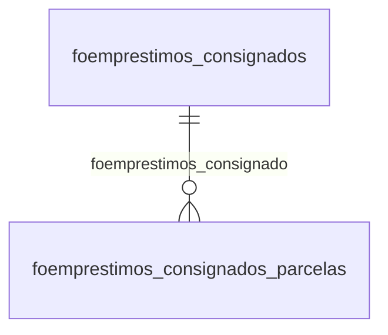

# Modelo — Pessoal - emprestimos (rascunho em lote)

> Gerado por `src/model/gerar_docs_modelo.py` a partir de `src/model/modulos/pessoal_emprestimos.yaml`, do catálogo e do perfil de colunas. **Não edite à mão.**

6 entidades. A coluna *Preench.* é o % de linhas com valor útil (nem nulo, nem em branco, nem zero, nem 1900-01-01; para colunas de código o zero conta como valor).

## Diagrama

## Entidades

| Entidade | Tabela | Linhas | Volume | Filtro obrigatório |
|---|---|---|---|---|
| [foemprestimos_consignados_parcelas](#foemprestimos_consignados_parcelas) | `FOEMPRESTIMOS_CONSIGNADOS_PARCELAS` | 4.435 | pequeno | empresa |
| [foemprestimos_consignados_importacao_erros](#foemprestimos_consignados_importacao_erros) | `FOEMPRESTIMOS_CONSIGNADOS_IMPORTACAO_ERROS` | 3.574 | pequeno | empresa |
| [foemprestimos_consignados_importacao](#foemprestimos_consignados_importacao) | `FOEMPRESTIMOS_CONSIGNADOS_IMPORTACAO` | 2.832 | pequeno | empresa |
| [foemprestimos_consignados](#foemprestimos_consignados) | `FOEMPRESTIMOS_CONSIGNADOS` | 757 | pequeno | empresa |
| [foemprestimos_cred_trab_rescisao_api_retorno](#foemprestimos_cred_trab_rescisao_api_retorno) | `FOEMPRESTIMOS_CRED_TRAB_RESCISAO_API_RETORNO` | 166 | pequeno | empresa |
| [foemprestimos_cred_trab_rescisao](#foemprestimos_cred_trab_rescisao) | `FOEMPRESTIMOS_CRED_TRAB_RESCISAO` | 57 | pequeno | empresa |

## foemprestimos_consignados_parcelas

**Parcelas dos empréstimos consignados.** — tabela `FOEMPRESTIMOS_CONSIGNADOS_PARCELAS` (4.435 linhas)

Parcelas dos empréstimos consignados.. 4.435 linhas no catálogo; chave: CODI_EMP, I_EMPREGADOS, I_EMPRESTIMO, PARCELA.

- **Chave:** `CODI_EMP, I_EMPREGADOS, I_EMPRESTIMO, PARCELA`
- **Empresa:** `CODI_EMP`
- **Período:** `COMPETENCIA_DESCONTO`
- **Ordem padrão:** `COMPETENCIA_DESCONTO desc`, `I_EMPREGADOS asc`, `I_EMPRESTIMO asc`

**Regras de negócio validadas:**

- Medido em 2026-10-18: 4.439 linhas, 100 empresa(s), COMPETENCIA_DESCONTO de 2017-07-01 a 2026-10-01.
- parcela_paga_0_nao_1_sim: todos os valores reais estão no comentário do banco (1=3.980, 0=459).
- origem_do_registro_0_sistema_1_importaca: todos os valores reais estão no comentário do banco (0=4.439).
- verifica_a_situacao_de_calculo_das_parce: todos os valores reais estão no comentário do banco (1=3.679, 0=760).
- Vínculo foemprestimos_consignado (FOEMPRESTIMOS_CONSIGNADOS): 0 de 20 linhas sem registro relacionado (empresa 666).

| Campo | Coluna | Tipo | Preench. | Domínio | Descrição (banco) |
|---|---|---|---|---|---|
| codigo_da_empresa | `codi_emp` | integer(4) |  |  | Código da empresa. |
| codigo_do_empregado | `i_empregados` | integer(4) |  |  | Código do empregado. |
| codigo_do_emprestimo | `i_emprestimo` | integer(4) |  |  | Código do empréstimo. |
| numero_da_parcela | `parcela` | smallint(2) |  |  | Número da parcela. |
| competencia_de_pagamento_da_parcela | `competencia_desconto` | date(4) |  |  | Competência de pagamento da parcela |
| valor_da_parcela | `valor` | numeric(13) |  |  | Valor da parcela. |
| parcela_paga_0_nao_1_sim | `pago` | smallint(2) |  | foemprestimos_consignados_parcelas_parcela_paga_ | Parcela paga. (0=Não/1=Sim) |
| codigo_do_calculo_que_pagou_a_parcela_re | `i_calculos_pagamento_old` | integer(4) |  |  | Código do cálculo que pagou a parcela - Renomeado |
| origem_do_registro_0_sistema_1_importaca | `origem_registro` | smallint(2) |  | foemprestimos_consignados_parcelas_origem_do_reg | Origem do registro. (0=Sistema/1=Importação de tabelas/2=Importação de layout) |
| valor_efetivamente_pago | `valor_pago` | numeric(13) |  |  | Valor efetivamente pago. |
| valor_restante_a_ser_pago_da_parcela | `valor_restante` | numeric(13) |  |  | Valor restante a ser pago da parcela. |
| verifica_a_situacao_de_calculo_das_parce | `calculo_parcelas` | smallint(2) |  | foemprestimos_consignados_parcelas_verifica_a_si | Verifica a situação de calculo das parcelas. (0=Não/1=Sim) |
| competencia_de_desconto_da_parcela | `competencia_desconto_informada` | date(4) |  |  | Competência de desconto da parcela |

**Vínculos (LEFT JOIN, acrescentam colunas legíveis):**

- `foemprestimos_consignado` → `FOEMPRESTIMOS_CONSIGNADOS` por `codi_emp` = `codi_emp` e `i_empregados` = `i_empregados` e `i_emprestimo` = `i_emprestimo`; colunas: `foemprestimos_consignado_nome`

**Filtros:** `codigo_do_empregado` (eq/in), `codigo_do_emprestimo` (eq/in), `numero_da_parcela` (eq/in), `competencia_de_pagamento_da_parcela` (entre/gte/lte), `competencia_de_desconto_da_parcela` (entre/gte/lte), `codigo_do_calculo_que_pagou_a_parcela_re` (eq/in)

## foemprestimos_consignados_importacao_erros

**Empréstimos consignados realizados pela importação de arquivos com erros** — tabela `FOEMPRESTIMOS_CONSIGNADOS_IMPORTACAO_ERROS` (3.574 linhas)

Empréstimos consignados realizados pela importação de arquivos com erros. 3.574 linhas no catálogo; chave: CODI_EMP, COMPETENCIA, SEQUENCIAL.

- **Chave:** `CODI_EMP, COMPETENCIA, SEQUENCIAL`
- **Empresa:** `CODI_EMP`
- **Período:** `COMPETENCIA`
- **Ordem padrão:** `COMPETENCIA desc`, `SEQUENCIAL asc`

**Regras de negócio validadas:**

- Medido em 2026-10-18: 3.579 linhas, 147 empresa(s), COMPETENCIA de 2025-06-01 a 2026-10-01.
- tipo_inscricao_da_empresa_importada_1_cn: todos os valores reais estão no comentário do banco (1=3.492, 2=87).
- Vínculo geempre (geempre): 0 de 5 linhas sem registro relacionado (empresa 680).

| Campo | Coluna | Tipo | Preench. | Domínio | Descrição (banco) |
|---|---|---|---|---|---|
| codigo_da_empresa_que_foi_realizada_a_im | `codi_emp` | integer(4) |  |  | Codigo da empresa que foi realizada a importação |
| competencia_de_desconto | `competencia` | date(4) |  |  | Competência de desconto |
| codigo_sequencial_da_tabela | `sequencial` | uniqueidentifier(16) |  |  | Código sequencial da tabela |
| cpf_do_colaborador 🔒 | `cpf_colaborador` | varchar(11) |  |  | CPF do colaborador |
| matricula | `matricula` | varchar(30) |  |  | Matrícula |
| tipo_da_folha | `categoria_esocial` | integer(4) |  |  | Tipo da folha |
| codigo_da_empresa_importada | `codi_emp_importada` | integer(4) |  |  | Código da empresa importada |
| inscricao_da_empresa_importada 🔒 | `inscricao_empresa_importada` | varchar(14) |  |  | Inscrição da empresa importada |
| tipo_inscricao_da_empresa_importada_1_cn 🔒 | `tipo_inscricao_empresa_importada` | integer(4) |  | foemprestimos_consignados_importacao_erros_tipo_inscri | Tipo inscrição da empresa importada (1-CNPJ/2-CPF/3-CEI) |
| mensagem_do_erro | `mensagem` | varchar(500) |  |  | Mensagem do erro |
| usuario_que_realizou_o_processo_de_impor | `i_usuario` | integer(4) |  |  | Usuário que realizou o processo de importação |
| arquivo_que_foi_processado_as_informacoe | `nome_arquivo` | varchar(255) |  |  | Arquivo que foi processado as informações |

**Vínculos (LEFT JOIN, acrescentam colunas legíveis):**

- `geempre` → `geempre` por `codi_emp` = `codi_emp`; colunas: `geempre_nome`

**Filtros:** `competencia_de_desconto` (eq/in), `codigo_sequencial_da_tabela` (eq/in), `cpf_do_colaborador` (eq/in), `matricula` (contem/prefixo), `codigo_da_empresa_importada` (eq/in), `inscricao_da_empresa_importada` (eq/in), `tipo_inscricao_da_empresa_importada_1_cn` (eq/in), `mensagem_do_erro` (contem/prefixo), `usuario_que_realizou_o_processo_de_impor` (eq/in), `arquivo_que_foi_processado_as_informacoe` (contem/prefixo)

## foemprestimos_consignados_importacao

**Empréstimos consignados realizados pela importação de arquivos.** — tabela `FOEMPRESTIMOS_CONSIGNADOS_IMPORTACAO` (2.832 linhas)

Empréstimos consignados realizados pela importação de arquivos.. 2.832 linhas no catálogo; chave: CODI_EMP, I_EMPREGADOS, I_BANCOS, COMPETENCIA_DESCONTO, NUMERO_CONTRATO.

- **Chave:** `CODI_EMP, I_EMPREGADOS, I_BANCOS, COMPETENCIA_DESCONTO, NUMERO_CONTRATO`
- **Empresa:** `CODI_EMP`
- **Período:** `DATA_INICIO_CONTRATO`
- **Ordem padrão:** `DATA_INICIO_CONTRATO desc`, `I_EMPREGADOS asc`, `I_BANCOS asc`

**Regras de negócio validadas:**

- Medido em 2026-10-18: 2.835 linhas, 64 empresa(s), DATA_INICIO_CONTRATO de 2023-07-13 a 2026-11-30.
- Vínculo geempre (geempre): 0 de 20 linhas sem registro relacionado (empresa 1372).
- Vínculo foempregados (foempregados): 0 de 20 linhas sem registro relacionado (empresa 1372).
- Vínculo fobancos (fobancos): 0 de 20 linhas sem registro relacionado (empresa 1372).

| Campo | Coluna | Tipo | Preench. | Domínio | Descrição (banco) |
|---|---|---|---|---|---|
| codigo_da_empresa | `codi_emp` | integer(4) |  |  | Código da empresa |
| codigo_do_empregado | `i_empregados` | integer(4) |  |  | Código do empregado. |
| codigo_do_banco | `i_bancos` | integer(4) |  |  | Código do banco. |
| competencia_de_desconto | `competencia_desconto` | date(4) |  |  | Competência de desconto. |
| numero_do_contrato | `numero_contrato` | varchar(15) |  |  | Número do contrato. |
| valor_da_parcela | `valor_parcela` | numeric(13) |  |  | Valor da parcela. |
| data_de_inicio_do_contrato | `data_inicio_contrato` | date(4) |  |  | Data de início do contrato. |
| data_de_termino_do_contrato | `data_fim_contrato` | date(4) |  |  | Data de término do contrato. |
| data_de_inicio_de_desconto_da_parcela | `data_inicio_desconto` | date(4) |  |  | Data de início de desconto da parcela. |
| numero_de_parcelas | `numero_parcelas` | smallint(2) |  |  | Número de parcelas. |
| valor_total_do_emprestimo | `valor_total` | numeric(13) |  |  | Valor total do empréstimo. |
| usuario_que_realizou_o_processo_de_impor | `i_usuario` | integer(4) |  |  | Usuário que realizou o processo de importação. |
| arquivo_que_foi_processado_as_informacoe | `nome_arquivo` | varchar(255) |  |  | Arquivo que foi processado as informações. |

**Vínculos (LEFT JOIN, acrescentam colunas legíveis):**

- `geempre` → `geempre` por `codi_emp` = `codi_emp`; colunas: `geempre_nome`
- `foempregados` → `foempregados` por `codi_emp` = `codi_emp` e `i_empregados` = `i_empregados`; colunas: `foempregados_nome`
- `fobancos` → `fobancos` por `i_bancos` = `i_bancos`; colunas: `fobancos_nome`

**Filtros:** `codigo_do_empregado` (eq/in), `codigo_do_banco` (eq/in), `competencia_de_desconto` (eq/in), `numero_do_contrato` (eq/in), `data_de_inicio_do_contrato` (entre/gte/lte), `data_de_termino_do_contrato` (entre/gte/lte), `data_de_inicio_de_desconto_da_parcela` (entre/gte/lte), `usuario_que_realizou_o_processo_de_impor` (eq/in), `arquivo_que_foi_processado_as_informacoe` (contem/prefixo)

## foemprestimos_consignados

**Empréstimos consignados.** — tabela `FOEMPRESTIMOS_CONSIGNADOS` (757 linhas)

Empréstimos consignados.. 757 linhas no catálogo; chave: CODI_EMP, I_EMPREGADOS, I_EMPRESTIMO.

- **Chave:** `CODI_EMP, I_EMPREGADOS, I_EMPRESTIMO`
- **Empresa:** `CODI_EMP`
- **Período:** `DATA_INICIO_CONTRATO`
- **Ordem padrão:** `DATA_INICIO_CONTRATO desc`, `I_EMPREGADOS asc`, `I_EMPRESTIMO asc`

**Regras de negócio validadas:**

- Medido em 2026-10-18: 759 linhas, 100 empresa(s), DATA_INICIO_CONTRATO de 2016-09-01 a 2026-11-30.
- descontar_durante_o_periodo_de_afastamen: todos os valores reais estão no comentário do banco (1=401, 0=358).
- descontar_no_calculo_de_ferias_0_nao_1_s: todos os valores reais estão no comentário do banco (1=605, 0=154).
- descontar_no_calculo_de_13o_integral_0_n: todos os valores reais estão no comentário do banco (0=748, 1=11).
- descontar_somente_a_parcela_mensal_na_re: todos os valores reais estão no comentário do banco (0=757, 1=2).
- descontar_o_valor_restante_de_emprestimo: todos os valores reais estão no comentário do banco (0=726, 1=33).
- origem_do_registro_0_sistema_1_importaca: todos os valores reais estão no comentário do banco (0=759).
- limitar_o_desconto_a_um_percentual_do_li: todos os valores reais estão no comentário do banco (1=614, 0=145).
- limitar_desconto_liquido_folha: todos os valores reais estão no comentário do banco (1=595, 0=164).
- nao_descontar_do_colaborador_a_diferenca: todos os valores reais estão no comentário do banco (1=595, 0=164).
- provisionar_o_valor_da_parcela_do_empres: todos os valores reais estão no comentário do banco (1=593, 0=166).
- provisionar_valor_parcela_ferias: todos os valores reais estão no comentário do banco (1=592, 0=167).
- Vínculo foempregados (foempregados): 0 de 3 linhas sem registro relacionado (empresa 954).
- Vínculo fobancos (fobancos): 0 de 3 linhas sem registro relacionado (empresa 954).

| Campo | Coluna | Tipo | Preench. | Domínio | Descrição (banco) |
|---|---|---|---|---|---|
| codigo_da_empresa | `codi_emp` | integer(4) |  |  | Código da empresa. |
| codigo_do_empregado | `i_empregados` | integer(4) |  |  | Código do empregado. |
| codigo_do_emprestimo | `i_emprestimo` | integer(4) |  |  | Código do empréstimo. |
| descricao | `descricao` | varchar(100) |  |  | Descrição. |
| data_de_inicio_do_contrato | `data_inicio_contrato` | date(4) |  |  | Data de início do contrato. |
| data_de_inicio_do_desconto_na_empresa | `data_inicio_desconto` | date(4) |  |  | Data de início do desconto na empresa |
| valor_do_emprestimo | `valor` | numeric(13) |  |  | Valor do empréstimo. |
| quantidade_de_parcelas_em_que_sera_pago | `quantidade_parcelas` | smallint(2) |  |  | Quantidade de parcelas em que será pago o desconto. |
| rubrica_para_desconto_do_emprestimo | `rubrica_desconto` | integer(4) |  |  | Rubrica para desconto do empréstimo. |
| rubrica_para_desconto_do_emprestimo_no_c | `rubrica_desconto_ferias` | integer(4) |  |  | Rubrica para desconto do empréstimo no cálculo de férias. |
| descontar_durante_o_periodo_de_afastamen | `descontar_calculo_afastamento` | smallint(2) |  | foemprestimos_consignados_descontar_durante_o_period | Descontar durante o período de afastamento. (0=Não/1=Sim) |
| afastamentos_que_descontam_o_emprestimo | `lista_afastamentos_descontar` | smallint(2) |  |  | Afastamentos que descontam o empréstimo. |
| descontar_no_calculo_de_ferias_0_nao_1_s | `descontar_calculo_ferias` | smallint(2) |  | foemprestimos_consignados_descontar_no_calculo_de_fe | Descontar no cálculo de férias. (0=Não/1=Sim) |
| descontar_no_calculo_de_13o_integral_0_n | `descontar_calculo_13_integral` | smallint(2) |  | foemprestimos_consignados_descontar_no_calculo_de_13 | Descontar no cálculo de 13º integral. (0=Não/1=Sim) |
| descontar_somente_a_parcela_mensal_na_re | `descontar_somente_parcela_mensal_rescisao` | smallint(2) |  | foemprestimos_consignados_descontar_somente_a_parcel | Descontar somente a parcela mensal na rescisão. (0=Não/1=Sim) |
| descontar_o_valor_restante_de_emprestimo | `descontar_restante_emprestimo_rescisao` | smallint(2) |  | foemprestimos_consignados_descontar_o_valor_restante | Descontar o valor restante de empréstimo na rescisão. (0=Não/1=Sim) |
| origem_do_registro_0_sistema_1_importaca | `origem_registro` | smallint(2) |  | foemprestimos_consignados_origem_do_registro_0_siste | Origem do registro. (0=Sistema/1=Importação de tabelas/2=Importação de layout) |
| tipo_de_desconto_na_folha_mensal_em_comp | `tipo_desconto_mensal_competencia_ferias` | smallint(2) |  |  | Tipo de desconto na folha mensal em competência com cálculo de férias. (0=Não descontar na folha mensal em competência com dias de férias/1=Descontar na competência de início das férias/2=Descontar na competência fim das férias/3=Descontar nas competência |
| limitar_o_desconto_a_um_percentual_do_li | `limitar_desconto_liquido_rescisao` | smallint(2) |  | foemprestimos_consignados_limitar_o_desconto_a_um_pe | Limitar o desconto a um percentual do líquido da rescisão. (0=Não/1=Sim) |
| percentual_para_limitar_o_desconto_ao_li 🔒 | `percentual_limitar_desconto_liquido_rescisao` | numeric(5) |  |  | Percentual para limitar o desconto ao líquido da rescisão. |
| limitar_desconto_liquido_folha | `limitar_desconto_liquido_folha` | smallint(2) |  | foemprestimos_consignados_limitar_o_desconto_a_um_pe | Limitar o desconto a um percentual do líquido da folha mensal. (0=Não/1=Sim). |
| percentual_limitar_desconto_liquido_folh 🔒 | `percentual_limitar_desconto_liquido_folha` | numeric(5) |  |  | Percentual para limitar o desconto ao líquido da folha mensal. |
| nao_descontar_do_colaborador_a_diferenca | `desconto_diferenca_parcela` | smallint(2) |  | foemprestimos_consignados_nao_descontar_do_colaborad | Não descontar do colaborador a diferença entre o valor da parcela e o efetivamente pago. (0=Não/1=Sim) |
| codigo_de_identificacao_do_banco_na_tabe | `i_bancos` | integer(4) |  |  | Codigo de identificacao do banco na tabela fobancos |
| numero_de_contrato_do_econsignado | `numero_contrato` | varchar(15) |  |  | Numero de contrato do eConsignado |
| c_1_credito_do_trabalhador_2_credito_con | `tipo_emprestimo` | smallint(2) |  |  | 1/Crédito do Trabalhador 2/Crédito Consignado |
| c_1_para_quitar_parcela_mensal_2_para_qu | `limitar_desconto_liquido_rescisao_parcelas` | smallint(2) |  |  | 1/Para quitar parcela mensal 2/Para quitar parcelas abertas |
| data_final_do_contrato_de_emprestimo | `data_fim_contrato` | date(4) |  |  | Data final do contrato de empréstimo |
| data_de_inicio_do_desconto_do_emprestimo | `data_inicio_desconto_emprestimo` | date(4) |  |  | Data de início do desconto do emprestímo |
| provisionar_o_valor_da_parcela_do_empres | `provisionar_valor_parcela_folha_adiantamento` | smallint(2) |  | foemprestimos_consignados_provisionar_o_valor_da_par | Provisionar o valor da parcela do empréstimo na Folha de Adiantamento (0=Não/1=Sim) |
| provisionar_valor_parcela_folha_adiantam | `provisionar_valor_parcela_folha_adiantamento_rubrica` | integer(4) |  |  | Provisionar o valor da parcela do empréstimo na Folha de Adiantamento - Rubrica |
| provisionar_valor_parcela_ferias | `provisionar_valor_parcela_ferias` | smallint(2) |  | foemprestimos_consignados_provisionar_o_valor_da_par | Provisionar o valor da parcela do empréstimo nas Férias (0=Não/1=Sim) |
| provisionar_valor_parcela_ferias_rubrica | `provisionar_valor_parcela_ferias_rubrica` | integer(4) |  |  | Provisionar o valor da parcela do empréstimo nas Férias - Rubrica |
| c_1_integral_independete_dos_dias_gozado | `forma_provisionar_valor_parcela_ferias` | smallint(2) |  |  | 1 - integral, independete dos dias gozados, 2 - proporcional aos dias gozados |
| percentual_da_garantia_ofertada_para_des 🔒 | `percentual_garantia_rescisao` | numeric(5) |  |  | Percentual da garantia ofertada para desconto na rescisao |
| saldo_devedor_da_garantia_ofertada_para 🔒 | `valor_saldo_devedor_garantia` | numeric(13) |  |  | Saldo devedor da garantia ofertada para desconto na rescisao |
| data_de_cadastro_do_emprestimo | `data_cadastro` | date(4) |  |  | Data de cadastro do emprestimo |

**Vínculos (LEFT JOIN, acrescentam colunas legíveis):**

- `foempregados` → `foempregados` por `codi_emp` = `codi_emp` e `i_empregados` = `i_empregados`; colunas: `foempregados_nome`
- `fobancos` → `fobancos` por `i_bancos` = `i_bancos`; colunas: `fobancos_nome`

**Filtros:** `codigo_do_empregado` (eq/in), `codigo_do_emprestimo` (eq/in), `data_de_inicio_do_contrato` (entre/gte/lte), `data_de_inicio_do_desconto_na_empresa` (entre/gte/lte), `data_final_do_contrato_de_emprestimo` (entre/gte/lte), `data_de_inicio_do_desconto_do_emprestimo` (entre/gte/lte), `data_de_cadastro_do_emprestimo` (entre/gte/lte), `descricao` (contem/prefixo), `tipo_de_desconto_na_folha_mensal_em_comp` (eq/in), `codigo_de_identificacao_do_banco_na_tabe` (eq/in), `numero_de_contrato_do_econsignado` (eq/in), `c_1_credito_do_trabalhador_2_credito_con` (eq/in)

## foemprestimos_cred_trab_rescisao_api_retorno

**Empréstimo Crédito do Trabalhador - Retorno Consulta API** — tabela `FOEMPRESTIMOS_CRED_TRAB_RESCISAO_API_RETORNO` (166 linhas)

Empréstimo Crédito do Trabalhador - Retorno Consulta API. 166 linhas no catálogo; chave: I_SEQUENCIAL.

- **Chave:** `I_SEQUENCIAL`
- **Empresa:** `CODI_EMP`
- **Período:** `COMPETENCIA`
- **Ordem padrão:** `COMPETENCIA desc`, `I_SEQUENCIAL asc`

**Regras de negócio validadas:**

- Medido em 2026-10-18: 170 linhas, 28 empresa(s), COMPETENCIA de 2026-07-01 a 2026-10-01.
- Vínculo geempre (geempre): 0 de 4 linhas sem registro relacionado (empresa 1372).

| Campo | Coluna | Tipo | Preench. | Domínio | Descrição (banco) |
|---|---|---|---|---|---|
| codigo_sequencial_da_tabela | `i_sequencial` | integer(4) |  |  | Código sequencial da tabela |
| codigo_da_empresa | `codi_emp` | integer(4) |  |  | Codigo da empresa |
| competencia_da_rescisao | `competencia` | date(4) |  |  | Competencia da rescisao |
| codigo_do_empregado | `i_empregados` | integer(4) |  |  | Codigo do empregado |
| mensagem | `mensagem` | varchar(1000) |  |  | Mensagem |

**Vínculos (LEFT JOIN, acrescentam colunas legíveis):**

- `geempre` → `geempre` por `codi_emp` = `codi_emp`; colunas: `geempre_nome`

**Filtros:** `codigo_sequencial_da_tabela` (eq/in), `competencia_da_rescisao` (entre/gte/lte), `codigo_do_empregado` (eq/in), `mensagem` (contem/prefixo)

## foemprestimos_cred_trab_rescisao

**Dados do ultimo calculo da rescisao para o Credito do Trabalhador** — tabela `FOEMPRESTIMOS_CRED_TRAB_RESCISAO` (57 linhas)

Dados do ultimo calculo da rescisao para o Credito do Trabalhador. 57 linhas no catálogo; chave: CODI_EMP, I_EMPREGADOS, COMPETENCIA_RESCISAO, NUMERO_CONTRATO.

- **Chave:** `CODI_EMP, I_EMPREGADOS, COMPETENCIA_RESCISAO, NUMERO_CONTRATO`
- **Empresa:** `CODI_EMP`
- **Período:** `DATA_INICIO_CONTRATO`
- **Ordem padrão:** `DATA_INICIO_CONTRATO desc`, `I_EMPREGADOS asc`, `COMPETENCIA_RESCISAO asc`

**Regras de negócio validadas:**

- Medido em 2026-10-18: 58 linhas, 17 empresa(s), DATA_INICIO_CONTRATO de 2023-07-13 a 2026-09-16.
- Colunas expostas nulas em 100% das linhas (2): codigo_da_instituicao_financeira_concess, descricao_da_instituicao_financeira_conc.
- Vínculo foempregados (foempregados): 0 de 2 linhas sem registro relacionado (empresa 680).

| Campo | Coluna | Tipo | Preench. | Domínio | Descrição (banco) |
|---|---|---|---|---|---|
| codigo_da_empresa | `codi_emp` | integer(4) |  |  | Codigo da empresa |
| codigo_do_empregado | `i_empregados` | integer(4) |  |  | Codigo do empregado |
| competencia_da_rescisao | `competencia_rescisao` | date(4) |  |  | Competencia da rescisao |
| numero_do_contrato | `numero_contrato` | varchar(15) |  |  | Numero do contrato |
| data_de_inicio_do_contrato | `data_inicio_contrato` | date(4) |  |  | Data de inicio do contrato |
| data_de_termino_do_contrato | `data_fim_contrato` | date(4) |  |  | Data de termino do contrato |
| valor_do_saldo_devedor | `valor_saldo_devedor` | numeric(13) |  |  | Valor do saldo devedor |
| percentual_da_garantia_ofertada_para_des 🔒 | `percentual_garantia` | numeric(5) |  |  | Percentual da garantia ofertada para desconto na rescisao |
| competencia_de_inicio_do_desconto | `competencia_inicio_desconto` | date(4) |  |  | Competencia de inicio do desconto |
| codigo_do_banco | `i_bancos` | integer(4) |  |  | Codigo do banco |
| codigo_da_instituicao_financeira_concess | `concessora_codigo` | integer(4) |  |  | Código da instituição financeira concessionária |
| descricao_da_instituicao_financeira_conc | `concessora_descricao` | varchar(40) |  |  | Descrição da instituição financeira concessionária |
| numero_de_parcelas | `numero_parcelas` | smallint(2) |  |  | Numero de parcelas |
| valor_total_do_emprestimo | `valor_total_emprestimo` | numeric(13) |  |  | Valor total do emprestimo |
| indica_se_ja_existia_parcela_na_competen | `existia_parcela_competencia` | smallint(2) |  |  | Indica se ja existia parcela na competencia da rescisao antes do calculo (0=Nao, 1=Sim) |
| valor_original_da_parcela_na_competencia 🔒 | `valor_parcela_original` | numeric(13) |  |  | Valor original da parcela na competencia antes do calculo da rescisao |
| codigo_do_emprestimo_consignado_vinculad | `i_emprestimo` | integer(4) |  |  | Codigo do emprestimo consignado vinculado a parcela da competencia |
| numero_da_parcela_na_competencia_antes_d 🔒 | `parcela` | integer(4) |  |  | Numero da parcela na competencia antes do calculo da rescisao |

**Vínculos (LEFT JOIN, acrescentam colunas legíveis):**

- `foempregados` → `foempregados` por `codi_emp` = `codi_emp` e `i_empregados` = `i_empregados`; colunas: `foempregados_nome`

**Filtros:** `codigo_do_empregado` (eq/in), `competencia_da_rescisao` (eq/in), `numero_do_contrato` (eq/in), `data_de_inicio_do_contrato` (entre/gte/lte), `data_de_termino_do_contrato` (entre/gte/lte), `competencia_de_inicio_do_desconto` (entre/gte/lte), `codigo_do_banco` (eq/in), `codigo_da_instituicao_financeira_concess` (eq/in), `descricao_da_instituicao_financeira_conc` (contem/prefixo), `codigo_do_emprestimo_consignado_vinculad` (eq/in)

## Domínios (significado dos códigos)

`confirmado`: **sim** = vem do comentário do banco e/ou foi conferido nos dados; **parcial** = parte dos valores; **não** = hipótese, não use como regra.

### status_empresa

Situação da empresa no cadastro (geempre.stat_emp)

Confirmado: sim

| Código | Significado |
|---|---|
| A | Ativa |
| I | Inativa |
| C | Em constituição |
| M | Ativo sem movimento |
| B | Em processo de baixa |
| E | Excluindo |

### motivo_inatividade

Motivo da inatividade (geempre.tipoi_emp). Só aparece em empresas inativas.

Confirmado: sim

| Código | Significado |
|---|---|
| 1 | Outros |
| 2 | Baixada |
| 3 | Transferida |
| 4 | Inadimplente |

### tipo_inscricao

Tipo da inscrição (CNPJ/CPF/CEI/CAEPF)

Confirmado: sim

| Código | Significado |
|---|---|
| 1 | CNPJ |
| 2 | CPF |
| 3 | CEI |
| 6 | CAEPF |

### regime_federal_empresa

Regime federal da folha (geempre.rfed_emp)

Confirmado: parcial

| Código | Significado |
|---|---|
| 1 | Normal |
| 2 | Microempresa |
| 3 | Empresa de pequeno porte |

### tipo_honorario_empresa

Como a empresa usa o módulo Honorários (geempre.honorario_tipo)

Confirmado: sim

| Código | Significado |
|---|---|
| E | Escritório (quem fatura) |
| C | Cliente |

### sim_nao_texto

Confirmado: sim

| Código | Significado |
|---|---|
| S | Sim |
| N | Não |

### sim_nao_numerico

Confirmado: sim

| Código | Significado |
|---|---|
| 1 | Sim |
| 0 | Não |

### foemprestimos_consignados_parcelas_parcela_paga_

Confirmado: sim

> Todos os valores observados em FOEMPRESTIMOS_CONSIGNADOS_PARCELAS.PAGO estão no comentário do banco (2026-10-18). Distribuição: 1=3.980, 0=459.

| Código | Significado |
|---|---|
| 0 | Não |
| 1 | Sim |

### foemprestimos_consignados_parcelas_origem_do_reg

Confirmado: sim

> Todos os valores observados em FOEMPRESTIMOS_CONSIGNADOS_PARCELAS.ORIGEM_REGISTRO estão no comentário do banco (2026-10-18). Distribuição: 0=4.439.

| Código | Significado |
|---|---|
| 0 | Sistema |
| 1 | Importação de tabelas |
| 2 | Importação de layout |

### foemprestimos_consignados_parcelas_verifica_a_si

Confirmado: sim

> Todos os valores observados em FOEMPRESTIMOS_CONSIGNADOS_PARCELAS.CALCULO_PARCELAS estão no comentário do banco (2026-10-18). Distribuição: 1=3.679, 0=760.

| Código | Significado |
|---|---|
| 0 | Não |
| 1 | Sim |

### foemprestimos_consignados_importacao_erros_tipo_inscri

Confirmado: sim

> Todos os valores observados em FOEMPRESTIMOS_CONSIGNADOS_IMPORTACAO_ERROS.TIPO_INSCRICAO_EMPRESA_IMPORTADA estão no comentário do banco (2026-10-18). Distribuição: 1=3.492, 2=87.

| Código | Significado |
|---|---|
| 1 | CNPJ |
| 2 | CPF |
| 3 | CEI |

### foemprestimos_consignados_descontar_durante_o_period

Confirmado: sim

> Todos os valores observados em FOEMPRESTIMOS_CONSIGNADOS.DESCONTAR_CALCULO_AFASTAMENTO estão no comentário do banco (2026-10-18). Distribuição: 1=401, 0=358.

| Código | Significado |
|---|---|
| 0 | Não |
| 1 | Sim |

### foemprestimos_consignados_descontar_no_calculo_de_fe

Confirmado: sim

> Todos os valores observados em FOEMPRESTIMOS_CONSIGNADOS.DESCONTAR_CALCULO_FERIAS estão no comentário do banco (2026-10-18). Distribuição: 1=605, 0=154.

| Código | Significado |
|---|---|
| 0 | Não |
| 1 | Sim |

### foemprestimos_consignados_descontar_no_calculo_de_13

Confirmado: sim

> Todos os valores observados em FOEMPRESTIMOS_CONSIGNADOS.DESCONTAR_CALCULO_13_INTEGRAL estão no comentário do banco (2026-10-18). Distribuição: 0=748, 1=11.

| Código | Significado |
|---|---|
| 0 | Não |
| 1 | Sim |

### foemprestimos_consignados_descontar_somente_a_parcel

Confirmado: sim

> Todos os valores observados em FOEMPRESTIMOS_CONSIGNADOS.DESCONTAR_SOMENTE_PARCELA_MENSAL_RESCISAO estão no comentário do banco (2026-10-18). Distribuição: 0=757, 1=2.

| Código | Significado |
|---|---|
| 0 | Não |
| 1 | Sim |

### foemprestimos_consignados_descontar_o_valor_restante

Confirmado: sim

> Todos os valores observados em FOEMPRESTIMOS_CONSIGNADOS.DESCONTAR_RESTANTE_EMPRESTIMO_RESCISAO estão no comentário do banco (2026-10-18). Distribuição: 0=726, 1=33.

| Código | Significado |
|---|---|
| 0 | Não |
| 1 | Sim |

### foemprestimos_consignados_origem_do_registro_0_siste

Confirmado: sim

> Todos os valores observados em FOEMPRESTIMOS_CONSIGNADOS.ORIGEM_REGISTRO estão no comentário do banco (2026-10-18). Distribuição: 0=759.

| Código | Significado |
|---|---|
| 0 | Sistema |
| 1 | Importação de tabelas |
| 2 | Importação de layout |

### foemprestimos_consignados_limitar_o_desconto_a_um_pe

Confirmado: sim

> Todos os valores observados em FOEMPRESTIMOS_CONSIGNADOS.LIMITAR_DESCONTO_LIQUIDO_FOLHA estão no comentário do banco (2026-10-18). Distribuição: 1=595, 0=164.

| Código | Significado |
|---|---|
| 0 | Não |
| 1 | Sim |

### foemprestimos_consignados_nao_descontar_do_colaborad

Confirmado: sim

> Todos os valores observados em FOEMPRESTIMOS_CONSIGNADOS.DESCONTO_DIFERENCA_PARCELA estão no comentário do banco (2026-10-18). Distribuição: 1=595, 0=164.

| Código | Significado |
|---|---|
| 0 | Não |
| 1 | Sim |

### foemprestimos_consignados_provisionar_o_valor_da_par

Confirmado: sim

> Todos os valores observados em FOEMPRESTIMOS_CONSIGNADOS.PROVISIONAR_VALOR_PARCELA_FERIAS estão no comentário do banco (2026-10-18). Distribuição: 1=592, 0=167.

| Código | Significado |
|---|---|
| 0 | Não |
| 1 | Sim |

