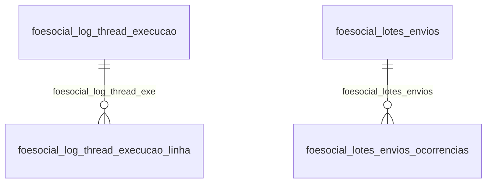

# Modelo — Pessoal - esocial (rascunho em lote)

> Gerado por `src/model/gerar_docs_modelo.py` a partir de `src/model/modulos/pessoal_esocial.yaml`, do catálogo e do perfil de colunas. **Não edite à mão.**

38 entidades. A coluna *Preench.* é o % de linhas com valor útil (nem nulo, nem em branco, nem zero, nem 1900-01-01; para colunas de código o zero conta como valor).

## Diagrama

## Entidades

| Entidade | Tabela | Linhas | Volume | Filtro obrigatório |
|---|---|---|---|---|
| [foesocial_dados_eventos_tabelas_relacionadas](#foesocial_dados_eventos_tabelas_relacionadas) | `FOESOCIAL_DADOS_EVENTOS_TABELAS_RELACIONADAS` | 531.591 | medio | empresa |
| [foesocial_importacoes_log](#foesocial_importacoes_log) | `FOESOCIAL_IMPORTACOES_LOG` | 490.432 | medio | empresa |
| [foesocial_log_thread_execucao_linha](#foesocial_log_thread_execucao_linha) | `FOESOCIAL_LOG_THREAD_EXECUCAO_LINHA` | 357.987 | medio | um de: identificador_unico_do_log_referente_a_f |
| [foesocial_log](#foesocial_log) | `FOESOCIAL_LOG` | 265.588 | medio | empresa; um de: identificador_unico_do_log |
| [foesocial_lotes_envios](#foesocial_lotes_envios) | `FOESOCIAL_LOTES_ENVIOS` | 210.737 | medio | empresa |
| [foesocial_arquivo_retorno_s_5002_categoria_valor](#foesocial_arquivo_retorno_s_5002_categoria_valor) | `FOESOCIAL_ARQUIVO_RETORNO_S_5002_CATEGORIA_VALOR` | 98.763 | medio | empresa |
| [foesocial_log_thread_execucao](#foesocial_log_thread_execucao) | `FOESOCIAL_LOG_THREAD_EXECUCAO` | 44.897 | medio | — |
| [foesocial_controle_periodos](#foesocial_controle_periodos) | `FOESOCIAL_CONTROLE_PERIODOS` | 40.958 | medio | empresa |
| [foesocial_arquivo_retorno_s_5002_categoria](#foesocial_arquivo_retorno_s_5002_categoria) | `FOESOCIAL_ARQUIVO_RETORNO_S_5002_CATEGORIA` | 31.123 | medio | empresa |
| [foesocial_controle_periodos_envios_esocial](#foesocial_controle_periodos_envios_esocial) | `FOESOCIAL_CONTROLE_PERIODOS_ENVIOS_ESOCIAL` | 30.943 | medio | empresa |
| [foesocial_avisos_vencimento_fechamento_periodo](#foesocial_avisos_vencimento_fechamento_periodo) | `FOESOCIAL_AVISOS_VENCIMENTO_FECHAMENTO_PERIODO` | 29.696 | medio | empresa |
| [foesocial_fila_eventos_gerar_rubricas](#foesocial_fila_eventos_gerar_rubricas) | `FOESOCIAL_FILA_EVENTOS_GERAR_RUBRICAS` | 27.137 | medio | empresa |
| [foesocial_fila_eventos_gerar](#foesocial_fila_eventos_gerar) | `FOESOCIAL_FILA_EVENTOS_GERAR` | 24.762 | medio | empresa |
| [foesocial_arquivo_retorno_s_5003_base_servicos_matricula](#foesocial_arquivo_retorno_s_5003_base_servicos_matricula) | `FOESOCIAL_ARQUIVO_RETORNO_S_5003_BASE_SERVICOS_MATRICULA` | 22.426 | medio | empresa |
| [foesocial_arquivo_retorno_s_5003_base_servicos](#foesocial_arquivo_retorno_s_5003_base_servicos) | `FOESOCIAL_ARQUIVO_RETORNO_S_5003_BASE_SERVICOS` | 22.398 | medio | empresa |
| [foesocial_arquivo_retorno_s_5003_matricula](#foesocial_arquivo_retorno_s_5003_matricula) | `FOESOCIAL_ARQUIVO_RETORNO_S_5003_MATRICULA` | 22.395 | medio | empresa |
| [foesocial_arquivo_retorno_s_5003](#foesocial_arquivo_retorno_s_5003) | `FOESOCIAL_ARQUIVO_RETORNO_S_5003` | 21.991 | medio | empresa |
| [foesocial_arquivo_retorno_s_5002](#foesocial_arquivo_retorno_s_5002) | `FOESOCIAL_ARQUIVO_RETORNO_S_5002` | 21.485 | medio | empresa |
| [foesocial_arquivo_retorno_s_5003_base_servicos_matricula_val](#foesocial_arquivo_retorno_s_5003_base_servicos_matricula_val) | `FOESOCIAL_ARQUIVO_RETORNO_S_5003_BASE_SERVICOS_MATRICULA_VALOR` | 19.091 | medio | empresa |
| [foesocial_arquivo_retorno_s_5003_matricula_valor](#foesocial_arquivo_retorno_s_5003_matricula_valor) | `FOESOCIAL_ARQUIVO_RETORNO_S_5003_MATRICULA_VALOR` | 19.091 | medio | empresa |
| [foesocial_log_thread_linha_detalhe](#foesocial_log_thread_linha_detalhe) | `FOESOCIAL_LOG_THREAD_LINHA_DETALHE` | 5.261 | pequeno | — |
| [foesocial_lotes_envios_ocorrencias](#foesocial_lotes_envios_ocorrencias) | `FOESOCIAL_LOTES_ENVIOS_OCORRENCIAS` | 3.582 | pequeno | empresa |
| [foesocial_ingestao_eventos](#foesocial_ingestao_eventos) | `FOESOCIAL_INGESTAO_EVENTOS` | 3.521 | pequeno | empresa |
| [foesocial_importacoes_mensagens](#foesocial_importacoes_mensagens) | `FOESOCIAL_IMPORTACOES_MENSAGENS` | 3.080 | pequeno | empresa |
| [foesocial_arquivo_retorno_s_5002_dependente](#foesocial_arquivo_retorno_s_5002_dependente) | `FOESOCIAL_ARQUIVO_RETORNO_S_5002_DEPENDENTE` | 3.055 | pequeno | empresa |
| [foesocial_dados_eventos_validados_manualmente](#foesocial_dados_eventos_validados_manualmente) | `FOESOCIAL_DADOS_EVENTOS_VALIDADOS_MANUALMENTE` | 1.963 | pequeno | empresa |
| [foesocial_importacoes_colaboradores_log](#foesocial_importacoes_colaboradores_log) | `FOESOCIAL_IMPORTACOES_COLABORADORES_LOG` | 1.251 | pequeno | empresa |
| [foesocial_importacoes_colaboradores](#foesocial_importacoes_colaboradores) | `FOESOCIAL_IMPORTACOES_COLABORADORES` | 536 | pequeno | empresa |
| [foesocial_ingestao_carga](#foesocial_ingestao_carga) | `FOESOCIAL_INGESTAO_CARGA` | 287 | pequeno | empresa |
| [foesocial_fila_eventos_gerar_selecao_1200](#foesocial_fila_eventos_gerar_selecao_1200) | `FOESOCIAL_FILA_EVENTOS_GERAR_SELECAO_1200` | 256 | pequeno | empresa |
| [foesocial_controle_periodos_dados_eventos](#foesocial_controle_periodos_dados_eventos) | `FOESOCIAL_CONTROLE_PERIODOS_DADOS_EVENTOS` | 227 | pequeno | empresa |
| [foesocial_importacao_sst_log](#foesocial_importacao_sst_log) | `FOESOCIAL_IMPORTACAO_SST_LOG` | 143 | pequeno | empresa |
| [foesocial_importacoes](#foesocial_importacoes) | `FOESOCIAL_IMPORTACOES` | 97 | pequeno | empresa |
| [foesocial_eventos_antecessores](#foesocial_eventos_antecessores) | `FOESOCIAL_EVENTOS_ANTECESSORES` | 65 | pequeno | — |
| [foesocial_tabelas_controle](#foesocial_tabelas_controle) | `FOESOCIAL_TABELAS_CONTROLE` | 46 | pequeno | — |
| [foesocial_erros_validacao_xml](#foesocial_erros_validacao_xml) | `FOESOCIAL_ERROS_VALIDACAO_XML` | 9 | pequeno | empresa |
| [foesocial_configuracao_agente](#foesocial_configuracao_agente) | `FOESOCIAL_CONFIGURACAO_AGENTE` | 1 | pequeno | — |
| [foesocial_controle_versao](#foesocial_controle_versao) | `FOESOCIAL_CONTROLE_VERSAO` | 1 | pequeno | — |

## foesocial_dados_eventos_tabelas_relacionadas

**Tabelas de dados auxiliares do evento.** — tabela `FOESOCIAL_DADOS_EVENTOS_TABELAS_RELACIONADAS` (531.591 linhas)

Tabelas de dados auxiliares do evento.. 531.591 linhas no catálogo; chave: CODI_EMP, I_DADOS_EVENTOS, SEQUENCIAL.

- **Chave:** `CODI_EMP, I_DADOS_EVENTOS, SEQUENCIAL`
- **Empresa:** `CODI_EMP`
- **Período:** `—`
- **Ordem padrão:** `I_DADOS_EVENTOS asc`, `SEQUENCIAL asc`

**Regras de negócio validadas:**

- Medido em 2026-10-18: 531.701 linhas, 878 empresa(s).
- Vínculo foesocial_dados_eventos (FOESOCIAL_DADOS_EVENTOS): 0 de 10 linhas sem registro relacionado (empresa 964).

| Campo | Coluna | Tipo | Preench. | Domínio | Descrição (banco) |
|---|---|---|---|---|---|
| codigo_da_empresa | `codi_emp` | integer(4) |  |  | Código da empresa. |
| codigo_do_registro_de_envio | `i_dados_eventos` | integer(4) |  |  | Código do registro de envio. |
| sequencial | `sequencial` | smallint(2) |  |  | Sequencial. |
| nome_da_tabela_de_dados_que_gerou_o_regi | `tabela_dados` | varchar(128) |  |  | Nome da tabela de dados que gerou o registro. |
| chave_do_registro_da_tabela_de_dados | `chave_tabela_dados` | varchar(256) |  |  | Chave do registro da tabela de dados. |

**Vínculos (LEFT JOIN, acrescentam colunas legíveis):**

- `foesocial_dados_eventos` → `FOESOCIAL_DADOS_EVENTOS` por `codi_emp` = `codi_emp` e `i_dados_eventos` = `i_dados_eventos`; colunas: `foesocial_dados_eventos_nome`

**Filtros:** `codigo_do_registro_de_envio` (eq/in), `sequencial` (eq/in), `nome_da_tabela_de_dados_que_gerou_o_regi` (contem/prefixo), `chave_do_registro_da_tabela_de_dados` (contem/prefixo)

## foesocial_importacoes_log

**Log da última importação de dados do site do eSocial.** — tabela `FOESOCIAL_IMPORTACOES_LOG` (490.432 linhas)

Log da última importação de dados do site do eSocial.. 490.432 linhas no catálogo; chave: CODI_EMP, I_LOG.

- **Chave:** `CODI_EMP, I_LOG`
- **Empresa:** `CODI_EMP`
- **Período:** `—`
- **Ordem padrão:** `I_LOG asc`

**Regras de negócio validadas:**

- Medido em 2026-10-18: 497.608 linhas, 94 empresa(s).

| Campo | Coluna | Tipo | Preench. | Domínio | Descrição (banco) |
|---|---|---|---|---|---|
| codigo_da_empresa | `codi_emp` | integer(4) |  |  | Código da empresa. |
| codigo_do_log | `i_log` | integer(4) |  |  | Código do log. |
| titulo_do_texto | `titulo` | varchar(2048) |  |  | Título do texto. |
| texto | `texto` | varchar(8192) |  |  | Texto. |

**Filtros:** `codigo_do_log` (eq/in), `titulo_do_texto` (contem/prefixo), `texto` (contem/prefixo)

## foesocial_log_thread_execucao_linha

**Tabela de log das threads relacionadas com o eSocial** — tabela `FOESOCIAL_LOG_THREAD_EXECUCAO_LINHA` (357.987 linhas)

Tabela de log das threads relacionadas com o eSocial. 357.987 linhas no catálogo; chave: ID_LOG_THREAD_EXECUCAO, SEQUENCIAL_LINHA.

- **Chave:** `ID_LOG_THREAD_EXECUCAO, SEQUENCIAL_LINHA`
- **Empresa:** `não se aplica (tabela global)`
- **Período:** `—` · exige um de: `identificador_unico_do_log_referente_a_f`
- **Ordem padrão:** `ID_LOG_THREAD_EXECUCAO asc`, `SEQUENCIAL_LINHA asc`

**Regras de negócio validadas:**

- Medido em 2026-10-18: 284.045 linhas.
- Vínculo foesocial_log_thread_exe (FOESOCIAL_LOG_THREAD_EXECUCAO): 0 de 284.045 linhas sem registro relacionado.

| Campo | Coluna | Tipo | Preench. | Domínio | Descrição (banco) |
|---|---|---|---|---|---|
| identificador_unico_do_log_referente_a_f | `id_log_thread_execucao` | uniqueidentifier(16) |  |  | Identificador único do log referente a FOESOCIAL_LOG_THREAD_EXECUCAO |
| codigo_sequencial_da_linha | `sequencial_linha` | integer(4) |  |  | Código sequencial da linha |
| tipo_de_registro | `tipo_registro` | integer(4) |  |  | Tipo de registro |
| mensagem | `mensagem` | varchar(200) |  |  | Mensagem |

**Vínculos (LEFT JOIN, acrescentam colunas legíveis):**

- `foesocial_log_thread_exe` → `FOESOCIAL_LOG_THREAD_EXECUCAO` por `id_log_thread_execucao` = `id_log_thread_execucao`; colunas: `foesocial_log_thread_exe_nome`

**Filtros:** `identificador_unico_do_log_referente_a_f` (eq/in), `codigo_sequencial_da_linha` (eq/in), `tipo_de_registro` (eq/in), `mensagem` (contem/prefixo)

## foesocial_log

**Tabela de LOG do esocial** — tabela `FOESOCIAL_LOG` (265.588 linhas)

Tabela de LOG do esocial. 265.588 linhas no catálogo; chave: GUID_LOG.

- **Chave:** `GUID_LOG`
- **Empresa:** `CODI_EMP`
- **Período:** `—` · exige um de: `identificador_unico_do_log`
- **Ordem padrão:** `GUID_LOG asc`

**Regras de negócio validadas:**

- Medido em 2026-10-18: 210.031 linhas, 41 empresa(s).
- Colunas expostas nulas em 100% das linhas (1): codigo_sequencial.
- tipo_do_log_1_lote_2_evento_3_geral: todos os valores reais estão no comentário do banco (3=152.907, 1=56.732, 2=392).

| Campo | Coluna | Tipo | Preench. | Domínio | Descrição (banco) |
|---|---|---|---|---|---|
| identificador_unico_do_log | `guid_log` | uniqueidentifier(16) |  |  | Identificador único do LOG. |
| codigo_sequencial | `sequencial` | integer(4) |  |  | Código sequencial |
| tipo_do_log_1_lote_2_evento_3_geral | `tipo` | integer(4) |  | foesocial_log_tipo_do_log_1_lote_2_even | Tipo do log (1=Lote/2=Evento/3=Geral) |
| codigo_da_empresa | `codi_emp` | integer(4) |  |  | Código da empresa |
| codigo_do_lote | `i_lote` | integer(4) |  |  | Código do lote |
| codigo_do_evento | `i_dados_evento` | integer(4) |  |  | Código do evento |
| descricao | `descricao` | varchar(1000) |  |  | Descrição |
| ciclo | `ciclo` | integer(4) |  |  | Ciclo |

**Filtros:** `identificador_unico_do_log` (eq/in), `tipo_do_log_1_lote_2_evento_3_geral` (eq/in), `codigo_do_lote` (eq/in), `codigo_do_evento` (eq/in), `descricao` (contem/prefixo)

## foesocial_lotes_envios

**Registros de envio do lote do e-Social** — tabela `FOESOCIAL_LOTES_ENVIOS` (210.737 linhas)

Registros de envio do lote do e-Social. 210.737 linhas no catálogo; chave: CODI_EMP, I_LOTE, SEQUENCIAL.

- **Chave:** `CODI_EMP, I_LOTE, SEQUENCIAL`
- **Empresa:** `CODI_EMP`
- **Período:** `—`
- **Ordem padrão:** `I_LOTE asc`, `SEQUENCIAL asc`

**Regras de negócio validadas:**

- Medido em 2026-10-18: 210.827 linhas, 916 empresa(s).

| Campo | Coluna | Tipo | Preench. | Domínio | Descrição (banco) |
|---|---|---|---|---|---|
| codigo_da_empresa | `codi_emp` | integer(4) |  |  | Código da empresa |
| codigo_do_lote | `i_lote` | integer(4) |  |  | Código do lote |
| sequencial_de_envio | `sequencial` | smallint(2) |  |  | Sequencial de envio |
| codigo_de_resposta_do_envio | `i_resposta_envio` | integer(4) |  |  | Código de resposta do envio |
| descricao_da_resposta_do_envio | `descricao_resposta_envio` | varchar(1000) |  |  | Descrição da resposta do envio |
| numero_do_protocolo | `numero_protocolo` | varchar(30) |  |  | Número do protocolo |
| codigo_de_resposta_da_consulta | `i_resposta_consulta` | integer(4) |  |  | Código de resposta da consulta |
| descricao_da_resposta_da_consulta | `descricao_resposta_consulta` | varchar(1000) |  |  | Descrição da resposta da consulta |
| versao_do_sistema_no_momento_da_insercao | `versao_sistema` | varchar(50) |  |  | Versão do sistema no momento da inserção/alteração do registro. |

**Filtros:** `codigo_do_lote` (eq/in), `sequencial_de_envio` (eq/in), `codigo_de_resposta_do_envio` (eq/in), `descricao_da_resposta_do_envio` (contem/prefixo), `numero_do_protocolo` (contem/prefixo), `codigo_de_resposta_da_consulta` (eq/in), `descricao_da_resposta_da_consulta` (contem/prefixo), `versao_do_sistema_no_momento_da_insercao` (contem/prefixo)

## foesocial_arquivo_retorno_s_5002_categoria_valor

**Informações sobre IRRF do retorno do eSocial no arquivo S-5002.** — tabela `FOESOCIAL_ARQUIVO_RETORNO_S_5002_CATEGORIA_VALOR` (98.763 linhas)

Informações sobre IRRF do retorno do eSocial no arquivo S-5002.. 98.763 linhas no catálogo; chave: CODI_EMP, I_DADOS_EVENTOS, CODCATEG, TPVALOR, TPPGTO, FONTE.

- **Chave:** `CODI_EMP, I_DADOS_EVENTOS, CODCATEG, TPVALOR, TPPGTO, FONTE`
- **Empresa:** `CODI_EMP`
- **Período:** `—`
- **Ordem padrão:** `I_DADOS_EVENTOS asc`, `CODCATEG asc`

**Regras de negócio validadas:**

- Medido em 2026-10-18: 98.763 linhas, 224 empresa(s).
- Vínculo foesocial_dados_eventos (FOESOCIAL_DADOS_EVENTOS): 0 de 88 linhas sem registro relacionado (empresa 912).

| Campo | Coluna | Tipo | Preench. | Domínio | Descrição (banco) |
|---|---|---|---|---|---|
| codigo_da_empresa | `codi_emp` | integer(4) |  |  | Código da empresa |
| codigo_do_evento_referente_a_foesocial_d | `i_dados_eventos` | integer(4) |  |  | Código do evento referente a FOESOCIAL_DADOS_EVENTOS |
| codigo_da_categoria | `codcateg` | integer(4) |  |  | Código da categoria |
| tipo_do_valor | `tpvalor` | integer(4) |  |  | Tipo do valor |
| tipo_do_pagamento | `tppgto` | integer(4) |  |  | Tipo do pagamento |
| fonte | `fonte` | varchar(250) |  |  | Fonte |
| valor | `valor` | numeric(30) |  |  | Valor |

**Vínculos (LEFT JOIN, acrescentam colunas legíveis):**

- `foesocial_dados_eventos` → `FOESOCIAL_DADOS_EVENTOS` por `codi_emp` = `codi_emp` e `i_dados_eventos` = `i_dados_eventos`; colunas: `foesocial_dados_eventos_nome`

**Filtros:** `codigo_do_evento_referente_a_foesocial_d` (eq/in), `codigo_da_categoria` (eq/in), `tipo_do_valor` (eq/in), `tipo_do_pagamento` (eq/in), `fonte` (eq/in)

## foesocial_log_thread_execucao

**Tabela de log das threads relacionadas com o eSocial** — tabela `FOESOCIAL_LOG_THREAD_EXECUCAO` (44.897 linhas)

Tabela de log das threads relacionadas com o eSocial. 44.897 linhas no catálogo; chave: ID_LOG_THREAD_EXECUCAO.

- **Chave:** `ID_LOG_THREAD_EXECUCAO`
- **Empresa:** `não se aplica (tabela global)`
- **Período:** `—`
- **Ordem padrão:** `ID_LOG_THREAD_EXECUCAO asc`

**Regras de negócio validadas:**

- Medido em 2026-10-18: 35.653 linhas.

| Campo | Coluna | Tipo | Preench. | Domínio | Descrição (banco) |
|---|---|---|---|---|---|
| identificador_unico_do_log | `id_log_thread_execucao` | uniqueidentifier(16) |  |  | Identificador único do log |
| sequencial_de_execucao_da_thread | `sequencial_execucao_thread` | integer(4) |  |  | Sequencial de execução da thread |
| id_da_conexao | `id_conexao` | integer(4) |  |  | ID da conexão |
| usuario_da_conexao | `user_conexao` | varchar(80) |  |  | Usuário da conexão |
| nome_da_conexao | `name_conexao` | varchar(80) |  |  | Nome da conexão |
| usuario_do_contabil | `user_contabil` | varchar(80) |  |  | Usuário do contábil |

**Filtros:** `identificador_unico_do_log` (eq/in), `usuario_da_conexao` (contem/prefixo), `nome_da_conexao` (contem/prefixo), `usuario_do_contabil` (contem/prefixo)

## foesocial_controle_periodos

**Controle de envio de reabertura e fechamento de período da empresa no eSocial.** — tabela `FOESOCIAL_CONTROLE_PERIODOS` (40.958 linhas)

Controle de envio de reabertura e fechamento de período da empresa no eSocial.. 40.958 linhas no catálogo; chave: CODI_EMP, COMPETENCIA, TIPO_PROCESSO.

- **Chave:** `CODI_EMP, COMPETENCIA, TIPO_PROCESSO`
- **Empresa:** `CODI_EMP`
- **Período:** `COMPETENCIA`
- **Ordem padrão:** `COMPETENCIA desc`, `TIPO_PROCESSO asc`

**Regras de negócio validadas:**

- Medido em 2026-10-18: 40.962 linhas, 1.147 empresa(s), COMPETENCIA de 2013-01-01 a 2026-12-01.
- origem_do_registro_0_sistema_1_imp_tabel: todos os valores reais estão no comentário do banco (0=40.962).
- enviar_para_o_esocial_0_nao_1_sim: todos os valores reais estão no comentário do banco (1=37.247, 0=3.715).
- gerar_retificacao_esocial: todos os valores reais estão no comentário do banco (0=40.962).
- marcacao_do_evento_para_gerar_o_evento_d: todos os valores reais estão no comentário do banco (0=40.962).
- Vínculo geempre (geempre): 0 de 20 linhas sem registro relacionado (empresa 1197).

| Campo | Coluna | Tipo | Preench. | Domínio | Descrição (banco) |
|---|---|---|---|---|---|
| codigo_da_empresa | `codi_emp` | integer(4) |  |  | Código da empresa. |
| competencia | `competencia` | date(4) |  |  | Competência. |
| tipo_processo_enviar_para_o_esocial | `tipo_processo` | integer(4) |  |  | Tipo processo enviar para o eSocial |
| origem_do_registro_0_sistema_1_imp_tabel | `origem_registro` | smallint(2) |  | foesocial_controle_periodos_origem_do_r | Origem do registro. (0=Sistema/1=Imp. tabelas/2=Imp. layout/3=Imp. tabelas concorrentes) |
| enviar_para_o_esocial_0_nao_1_sim | `enviar_esocial` | smallint(2) |  | foesocial_controle_periodos_enviar_para | Enviar para o eSocial. (0=Não/1=Sim) |
| gerar_retificacao_esocial | `gerar_retificacao_esocial` | smallint(2) |  | foesocial_controle_periodos_gerar_retif | Gerar retificação para o eSocial. (0=Não/1=Sim) |
| marcacao_do_evento_para_gerar_o_evento_d | `processar_exclusao_esocial` | smallint(2) |  | foesocial_controle_periodos_marcacao_do | Marcação do evento para gerar o evento de exclusão no eSocial. (0=Não/1=Sim) |

**Vínculos (LEFT JOIN, acrescentam colunas legíveis):**

- `geempre` → `geempre` por `codi_emp` = `codi_emp`; colunas: `geempre_nome`

**Filtros:** `competencia` (eq/in), `tipo_processo_enviar_para_o_esocial` (eq/in)

## foesocial_arquivo_retorno_s_5002_categoria

**Informações sobre IRRF do retorno do eSocial no arquivo S-5002.** — tabela `FOESOCIAL_ARQUIVO_RETORNO_S_5002_CATEGORIA` (31.123 linhas)

Informações sobre IRRF do retorno do eSocial no arquivo S-5002.. 31.123 linhas no catálogo; chave: CODI_EMP, I_DADOS_EVENTOS, CODCATEG, INDRESBR, FONTE.

- **Chave:** `CODI_EMP, I_DADOS_EVENTOS, CODCATEG, INDRESBR, FONTE`
- **Empresa:** `CODI_EMP`
- **Período:** `—`
- **Ordem padrão:** `I_DADOS_EVENTOS asc`, `CODCATEG asc`

**Regras de negócio validadas:**

- Medido em 2026-10-18: 31.123 linhas, 224 empresa(s).
- Vínculo foesocial_dados_eventos (FOESOCIAL_DADOS_EVENTOS): 0 de 28 linhas sem registro relacionado (empresa 1733).

| Campo | Coluna | Tipo | Preench. | Domínio | Descrição (banco) |
|---|---|---|---|---|---|
| codigo_da_empresa | `codi_emp` | integer(4) |  |  | Código da empresa |
| codigo_do_evento_referente_a_foesocial_d | `i_dados_eventos` | integer(4) |  |  | Código do evento referente a FOESOCIAL_DADOS_EVENTOS |
| codigo_da_categoria | `codcateg` | integer(4) |  |  | Código da categoria |
| residencial_brasil | `indresbr` | char(250) |  |  | Residencial Brasil |
| fonte | `fonte` | varchar(250) |  |  | Fonte |

**Vínculos (LEFT JOIN, acrescentam colunas legíveis):**

- `foesocial_dados_eventos` → `FOESOCIAL_DADOS_EVENTOS` por `codi_emp` = `codi_emp` e `i_dados_eventos` = `i_dados_eventos`; colunas: `foesocial_dados_eventos_nome`

**Filtros:** `codigo_do_evento_referente_a_foesocial_d` (eq/in), `codigo_da_categoria` (eq/in), `residencial_brasil` (eq/in), `fonte` (eq/in)

## foesocial_controle_periodos_envios_esocial

**Envios do controle de envio e reabertura/fechamento de período da empresa ao eSocial** — tabela `FOESOCIAL_CONTROLE_PERIODOS_ENVIOS_ESOCIAL` (30.943 linhas)

Envios do controle de envio e reabertura/fechamento de período da empresa ao eSocial. 30.943 linhas no catálogo; chave: CODI_EMP, COMPETENCIA, TIPO_PROCESSO, CODI_EMP_DADOS_EVENTOS, I_DADOS_EVENTOS.

- **Chave:** `CODI_EMP, COMPETENCIA, TIPO_PROCESSO, CODI_EMP_DADOS_EVENTOS, I_DADOS_EVENTOS`
- **Empresa:** `CODI_EMP`
- **Período:** `COMPETENCIA`
- **Ordem padrão:** `COMPETENCIA desc`, `TIPO_PROCESSO asc`, `CODI_EMP_DADOS_EVENTOS asc`

**Regras de negócio validadas:**

- Medido em 2026-10-18: 30.944 linhas, 803 empresa(s), COMPETENCIA de 2019-01-01 a 2026-10-01.
- Vínculo foesocial_dados_eventos (FOESOCIAL_DADOS_EVENTOS): 0 de 20 linhas sem registro relacionado (empresa 755).

| Campo | Coluna | Tipo | Preench. | Domínio | Descrição (banco) |
|---|---|---|---|---|---|
| codigo_da_empresa | `codi_emp` | integer(4) |  |  | Código da empresa |
| competencia | `competencia` | date(4) |  |  | Competência |
| tipo_da_folha | `tipo_processo` | integer(4) |  |  | Tipo da folha |
| codigo_da_empresa_referente_a_foesocial | `codi_emp_dados_eventos` | integer(4) |  |  | Código da empresa referente a FOESOCIAL_DADOS_EVENTOS |
| codigo_do_evento_referente_a_foesocial_d | `i_dados_eventos` | integer(4) |  |  | Código do evento referente a FOESOCIAL_DADOS_EVENTOS |

**Vínculos (LEFT JOIN, acrescentam colunas legíveis):**

- `foesocial_dados_eventos` → `FOESOCIAL_DADOS_EVENTOS` por `codi_emp_dados_eventos` = `codi_emp` e `i_dados_eventos` = `i_dados_eventos`; colunas: `foesocial_dados_eventos_nome`

**Filtros:** `competencia` (eq/in), `tipo_da_folha` (eq/in), `codigo_da_empresa_referente_a_foesocial` (eq/in), `codigo_do_evento_referente_a_foesocial_d` (eq/in)

## foesocial_avisos_vencimento_fechamento_periodo

**Armazena os avisos de vencimentos para os períodos sem fechamentos no eSocial** — tabela `FOESOCIAL_AVISOS_VENCIMENTO_FECHAMENTO_PERIODO` (29.696 linhas)

Armazena os avisos de vencimentos para os períodos sem fechamentos no eSocial. 29.696 linhas no catálogo; chave: CODI_EMP, COMPETENCIA, TIPO.

- **Chave:** `CODI_EMP, COMPETENCIA, TIPO`
- **Empresa:** `CODI_EMP`
- **Período:** `COMPETENCIA`
- **Ordem padrão:** `COMPETENCIA desc`, `TIPO asc`

**Regras de negócio validadas:**

- Medido em 2026-10-18: 29.696 linhas, 232 empresa(s), COMPETENCIA de 2017-03-01 a 2026-12-01.
- tipo_de_calculo_0_mensal_1_anual: todos os valores reais estão no comentário do banco (0=27.376, 1=2.320).
- situacao_0_aberto_1_fechado: todos os valores reais estão no comentário do banco (0=27.560, 1=2.136).
- Vínculo geempre (geempre): 0 de 128 linhas sem registro relacionado (empresa 1136).

| Campo | Coluna | Tipo | Preench. | Domínio | Descrição (banco) |
|---|---|---|---|---|---|
| codigo_da_empresa | `codi_emp` | integer(4) |  |  | Código da empresa. |
| competencia | `competencia` | date(4) |  |  | Competência |
| tipo_de_calculo_0_mensal_1_anual | `tipo` | smallint(2) |  | foesocial_avisos_vencimento_fechamento_periodo_tipo_de_cal | Tipo de cálculo. (0=Mensal/1=Anual) |
| situacao_0_aberto_1_fechado | `situacao` | smallint(2) |  | foesocial_avisos_vencimento_fechamento_periodo_situacao_0_ | Situação. (0=Aberto/1=Fechado) |

**Vínculos (LEFT JOIN, acrescentam colunas legíveis):**

- `geempre` → `geempre` por `codi_emp` = `codi_emp`; colunas: `geempre_nome`

**Filtros:** `competencia` (eq/in), `tipo_de_calculo_0_mensal_1_anual` (eq/in), `situacao_0_aberto_1_fechado` (eq/in)

## foesocial_fila_eventos_gerar_rubricas

**Tabela de rubricas para gerar para o eSocial.** — tabela `FOESOCIAL_FILA_EVENTOS_GERAR_RUBRICAS` (27.137 linhas)

Tabela de rubricas para gerar para o eSocial.. 27.137 linhas no catálogo; chave: CODI_EMP, I_EVENTO_ESOCIAL, SEQUENCIAL, I_EVENTOS.

- **Chave:** `CODI_EMP, I_EVENTO_ESOCIAL, SEQUENCIAL, I_EVENTOS`
- **Empresa:** `CODI_EMP`
- **Período:** `—`
- **Ordem padrão:** `I_EVENTO_ESOCIAL asc`, `SEQUENCIAL asc`

**Regras de negócio validadas:**

- Medido em 2026-10-18: 27.145 linhas, 623 empresa(s).

| Campo | Coluna | Tipo | Preench. | Domínio | Descrição (banco) |
|---|---|---|---|---|---|
| codigo_da_empresa | `codi_emp` | integer(4) |  |  | Código da empresa. |
| codigo_do_evento_esocial | `i_evento_esocial` | integer(4) |  |  | Código do evento eSocial. |
| sequencial | `sequencial` | integer(4) |  |  | Sequencial. |
| codigo_da_rubrica | `i_eventos` | integer(4) |  |  | Código da rubrica. |

**Filtros:** `codigo_do_evento_esocial` (eq/in), `sequencial` (eq/in), `codigo_da_rubrica` (eq/in)

## foesocial_fila_eventos_gerar

**Fila de eventos para gerar o XML do eSocial.** — tabela `FOESOCIAL_FILA_EVENTOS_GERAR` (24.762 linhas)

Fila de eventos para gerar o XML do eSocial.. 24.762 linhas no catálogo; chave: CODI_EMP, I_EVENTO_ESOCIAL, SEQUENCIAL.

- **Chave:** `CODI_EMP, I_EVENTO_ESOCIAL, SEQUENCIAL`
- **Empresa:** `CODI_EMP`
- **Período:** `DATA_EXECUCAO_EVENTO`
- **Ordem padrão:** `DATA_EXECUCAO_EVENTO desc`, `I_EVENTO_ESOCIAL asc`, `SEQUENCIAL asc`

**Regras de negócio validadas:**

- Medido em 2026-10-18: 24.350 linhas, 634 empresa(s), DATA_EXECUCAO_EVENTO de 1900-01-01 a 2200-06-01.
- Colunas expostas nulas em 100% das linhas (1): responsavel_pelo_envio_do_fechamento.
- status_1_pendente_2_em_processamento_3_c: todos os valores reais estão no comentário do banco (3=23.965, 1=385).
- cadastramento_inicial_0_nao_1_sim: todos os valores reais estão no comentário do banco (0=24.339, 1=11).
- existe_movimentacao_no_periodo_0_nao_1_s: todos os valores reais estão no comentário do banco (0=14.817, 1=9.533).
- existe_envio_de_aquisicao_rural_no_perio: todos os valores reais estão no comentário do banco (0=24.350).
- existe_envio_de_comercializacao_rural_no: todos os valores reais estão no comentário do banco (0=24.350).
- identifica_se_o_registro_de_fila_foi_ger: todos os valores reais estão no comentário do banco (0=24.283, 1=67).
- existe_envio_remuneracao: todos os valores reais estão no comentário do banco (0=24.350).
- existe_envio_de_pagamento_no_periodo_0_n: todos os valores reais estão no comentário do banco (0=24.350).
- existe_envio_de_contratacao_de_trabalhad: todos os valores reais estão no comentário do banco (0=24.350).
- reenviar_o_evento_automaticamente_0_nao: todos os valores reais estão no comentário do banco (0=24.348, 1=2).
- enviar_o_evento_antes_do_inicio_do_esoci: todos os valores reais estão no comentário do banco (0=24.350).
- Vínculo foesocial_eventos (FOESOCIAL_EVENTOS): 0 de 5 linhas sem registro relacionado (empresa 886).
- Vínculo geempre (geempre): 0 de 5 linhas sem registro relacionado (empresa 886).
- Vínculo geresponsavel (geresponsavel): 0 de 5 linhas sem registro relacionado (empresa 886).

| Campo | Coluna | Tipo | Preench. | Domínio | Descrição (banco) |
|---|---|---|---|---|---|
| codigo_da_empresa | `codi_emp` | integer(4) |  |  | Código da empresa. |
| codigo_do_evento_do_esocial | `i_evento_esocial` | integer(4) |  |  | Código do evento do eSocial. |
| sequencial | `sequencial` | integer(4) |  |  | Sequencial. |
| status_1_pendente_2_em_processamento_3_c | `status` | smallint(2) |  | foesocial_fila_eventos_gerar_status_1_pe | Status. (1=Pendente/2=Em processamento/3=Concluído/4=Em espera) |
| gerar_evento_de_exclusao | `gerar_evento_exclusao` | smallint(2) |  |  | Gerar evento de exclusão. |
| cadastramento_inicial_0_nao_1_sim | `cadastramento_inicial` | smallint(2) |  | foesocial_fila_eventos_gerar_cadastramen | Cadastramento inicial. (0=Não/1=Sim) |
| preencher_com_a_data_que_o_evento_deve_s | `data_execucao_evento` | date(4) |  |  | Preencher com a data que o evento deve ser executado, para casos como o aviso prévio que pode ser cadastrado em data futura, mas não pode ser enviado em data futura. |
| competencia_para_gerar_os_dados_do_calcu | `competencia_calculo` | date(4) |  |  | Competência para gerar os dados do cálculo. |
| gerar_os_dados_do_evento | `gerar_remuneracao_13_salario` | smallint(2) |  |  | Gerar os dados do evento. |
| responsavel_pelo_envio_do_fechamento | `i_responsavel` | integer(4) |  |  | Responsável pelo envio do fechamento. |
| existe_movimentacao_no_periodo_0_nao_1_s | `existe_movimentacao_periodo` | smallint(2) |  | foesocial_fila_eventos_gerar_existe_movi | Existe movimentação no período. (0=Não/1=Sim) |
| versao_do_sistema_no_momento_da_insercao | `versao_sistema` | varchar(50) |  |  | Versão do sistema no momento da inserção/alteração do registro. |
| competencia_reenviar_calculo_apos_valida | `competencia_reenviar_calculo_apos_validacao` | date(4) |  |  | Competência pra reenviar os eventos 1200 e 1210 após validação dos eventos criados nessa fila. |
| gerar_limpeza_de_dados_no_esocial | `gerar_limpeza_dados_esocial` | smallint(2) |  |  | Gerar limpeza de dados no eSocial. |
| existe_envio_de_aquisicao_rural_no_perio | `existe_envio_aquisicao_rural` | smallint(2) |  | foesocial_fila_eventos_gerar_existe_envi | Existe envio de aquisição rural no período. (0=Não/1=Sim) |
| existe_envio_de_comercializacao_rural_no | `existe_envio_comercializacao_rural` | smallint(2) |  | foesocial_fila_eventos_gerar_existe_envi | Existe envio de comercialização rural no período. (0=Não/1=Sim) |
| identifica_se_o_registro_de_fila_foi_ger | `utilitario_conversao_registros_enviados_outro_banco` | smallint(2) |  | foesocial_fila_eventos_gerar_identifica_ | Identifica se o registro de fila foi gerado pelo utilitário de conversão de outros bancos. (0=Não/1=Sim) |
| numero_da_conexao_que_esta_processando_a | `i_conexao` | integer(4) |  |  | Número da conexão que está processando a fila na thread. |
| atualizar_o_historico_contratual_dos_emp | `atualizar_historico_contratual` | integer(4) |  |  | Atualizar o historico contratual dos empregados na data da execucao |
| existe_envio_remuneracao | `existe_envio_remuneracao` | smallint(2) |  | foesocial_fila_eventos_gerar_existe_envi | Existe envio de remuneracao no período. (0=Não/1=Sim) |
| existe_envio_de_pagamento_no_periodo_0_n | `existe_envio_pagamento` | smallint(2) |  | foesocial_fila_eventos_gerar_existe_envi | Existe envio de pagamento no período. (0=Não/1=Sim) |
| existe_envio_de_contratacao_de_trabalhad | `existe_envio_contratacao_trabalhadores_avulsos_nao_portuarios` | smallint(2) |  | foesocial_fila_eventos_gerar_existe_envi | Existe envio de contratação de trabalhadores avulsos não portuários no período. (0=Não/1=Sim) |
| codigo_da_empresa_que_sera_enviado_o_eve | `empresa_envio_fechamento_s_1299` | integer(4) |  |  | Código da empresa que sera enviado o evento S-1299 |
| efetuar_a_transmissao_imediata_da_dctf_n | `efetuar_transmissao_imediata_dctfweb` | smallint(2) |  |  | Efetuar a transmissão imediata da DCTF no 1299 para MEI. |
| reenviar_o_evento_automaticamente_0_nao | `reenviar_evento_automaticamente` | smallint(2) |  | foesocial_fila_eventos_gerar_reenviar_o_ | Reenviar o evento automaticamente. (0=Não/1=Sim) |
| enviar_o_evento_antes_do_inicio_do_esoci | `envio_forcado_antes_inicio_esocial` | smallint(2) |  | foesocial_fila_eventos_gerar_enviar_o_ev | Enviar o evento antes do início do eSocial. (0=Não/1=Reclamatória) |
| evento_com_selecao_0_nao_1_sim | `existe_selecao_evento` | smallint(2) |  |  | Evento com seleção(0=Não/1=Sim |
| evento_excluido | `i_evento_esocial_excluido_s_3000` | integer(4) |  |  | Evento excluido |
| indica_que_o_s_1210_tem_retificacao_para | `gerar_retificacao_info_ir_complemem_s_1210_ant` | bit(1) |  |  | Indica que o S-1210 tem retificação para ser feita. (0=Não/1=Sim) |

**Vínculos (LEFT JOIN, acrescentam colunas legíveis):**

- `foesocial_eventos` → `FOESOCIAL_EVENTOS` por `i_evento_esocial` = `i_evento_esocial`; colunas: `foesocial_eventos_nome`
- `geempre` → `geempre` por `codi_emp` = `codi_emp`; colunas: `geempre_nome`
- `geresponsavel` → `geresponsavel` por `empresa_envio_fechamento_s_1299` = `codi_emp` e `i_responsavel` = `i_responsavel`; colunas: `geresponsavel_nome`

**Filtros:** `codigo_do_evento_do_esocial` (eq/in), `sequencial` (eq/in), `preencher_com_a_data_que_o_evento_deve_s` (entre/gte/lte), `competencia_para_gerar_os_dados_do_calcu` (entre/gte/lte), `competencia_reenviar_calculo_apos_valida` (entre/gte/lte), `responsavel_pelo_envio_do_fechamento` (eq/in), `versao_do_sistema_no_momento_da_insercao` (contem/prefixo), `numero_da_conexao_que_esta_processando_a` (eq/in), `evento_excluido` (eq/in)

## foesocial_arquivo_retorno_s_5003_base_servicos_matricula

**Informações sobre FGTS do retorno do eSocial no arquivo S-5003.** — tabela `FOESOCIAL_ARQUIVO_RETORNO_S_5003_BASE_SERVICOS_MATRICULA` (22.426 linhas)

Informações sobre FGTS do retorno do eSocial no arquivo S-5003.. 22.426 linhas no catálogo; chave: CODI_EMP, I_DADOS_EVENTOS, I_SERVICOS, MATRICULA, CODI_EMP_SERVICO, SEQUENCIAL.

- **Chave:** `CODI_EMP, I_DADOS_EVENTOS, I_SERVICOS, MATRICULA, CODI_EMP_SERVICO, SEQUENCIAL`
- **Empresa:** `CODI_EMP`
- **Período:** `—`
- **Ordem padrão:** `I_DADOS_EVENTOS asc`, `I_SERVICOS asc`

**Regras de negócio validadas:**

- Medido em 2026-10-18: 22.426 linhas, 259 empresa(s).
- Vínculo foesocial_dados_eventos (FOESOCIAL_DADOS_EVENTOS): 0 de 18 linhas sem registro relacionado (empresa 1665).
- Vínculo foservicos (foservicos): 0 de 18 linhas sem registro relacionado (empresa 1665).

| Campo | Coluna | Tipo | Preench. | Domínio | Descrição (banco) |
|---|---|---|---|---|---|
| codigo_da_empresa | `codi_emp` | integer(4) |  |  | Código da empresa |
| codigo_do_evento_referente_a_foesocial_d | `i_dados_eventos` | integer(4) |  |  | Código do evento referente a FOESOCIAL_DADOS_EVENTOS |
| codigo_do_servico_referente_a_foservicos | `i_servicos` | integer(4) |  |  | Código do serviço referente a FOSERVICOS |
| matricula | `matricula` | varchar(30) |  |  | Matrícula |
| codigo_da_empresa_do_servico_referente_a | `codi_emp_servico` | integer(4) |  |  | Código da empresa do serviço referente a FOSERVICOS |
| sequencial_para_registros_repetidos | `sequencial` | integer(4) |  |  | Sequencial para registros repetidos |
| codigo_da_categoria | `codcateg` | integer(4) |  |  | Código da categoria |

**Vínculos (LEFT JOIN, acrescentam colunas legíveis):**

- `foesocial_dados_eventos` → `FOESOCIAL_DADOS_EVENTOS` por `codi_emp` = `codi_emp` e `i_dados_eventos` = `i_dados_eventos`; colunas: `foesocial_dados_eventos_nome`
- `foservicos` → `foservicos` por `codi_emp_servico` = `codi_emp` e `i_servicos` = `i_servicos`; colunas: `foservicos_nome`

**Filtros:** `codigo_do_evento_referente_a_foesocial_d` (eq/in), `codigo_do_servico_referente_a_foservicos` (eq/in), `matricula` (eq/in), `codigo_da_empresa_do_servico_referente_a` (eq/in), `sequencial_para_registros_repetidos` (eq/in), `codigo_da_categoria` (eq/in)

## foesocial_arquivo_retorno_s_5003_base_servicos

**Informações sobre FGTS do retorno do eSocial no arquivo S-5003.** — tabela `FOESOCIAL_ARQUIVO_RETORNO_S_5003_BASE_SERVICOS` (22.398 linhas)

Informações sobre FGTS do retorno do eSocial no arquivo S-5003.. 22.398 linhas no catálogo; chave: CODI_EMP, I_DADOS_EVENTOS, I_SERVICOS, CODI_EMP_SERVICO.

- **Chave:** `CODI_EMP, I_DADOS_EVENTOS, I_SERVICOS, CODI_EMP_SERVICO`
- **Empresa:** `CODI_EMP`
- **Período:** `—`
- **Ordem padrão:** `I_DADOS_EVENTOS asc`, `I_SERVICOS asc`

**Regras de negócio validadas:**

- Medido em 2026-10-18: 22.398 linhas, 259 empresa(s).
- Vínculo foesocial_dados_eventos (FOESOCIAL_DADOS_EVENTOS): 0 de 18 linhas sem registro relacionado (empresa 1665).
- Vínculo foservicos (foservicos): 0 de 18 linhas sem registro relacionado (empresa 1665).

| Campo | Coluna | Tipo | Preench. | Domínio | Descrição (banco) |
|---|---|---|---|---|---|
| codigo_da_empresa | `codi_emp` | integer(4) |  |  | Código da empresa |
| codigo_do_evento_referente_a_foesocial_d | `i_dados_eventos` | integer(4) |  |  | Código do evento referente a FOESOCIAL_DADOS_EVENTOS |
| codigo_do_servico_referente_a_foservicos | `i_servicos` | integer(4) |  |  | Código do serviço referente a FOSERVICOS |
| codigo_da_empresa_do_servico_referente_a | `codi_emp_servico` | integer(4) |  |  | Código da empresa do serviço referente a FOSERVICOS |
| codigo_da_lotacao | `codlotacao` | varchar(30) |  |  | Código da lotação |

**Vínculos (LEFT JOIN, acrescentam colunas legíveis):**

- `foesocial_dados_eventos` → `FOESOCIAL_DADOS_EVENTOS` por `codi_emp` = `codi_emp` e `i_dados_eventos` = `i_dados_eventos`; colunas: `foesocial_dados_eventos_nome`
- `foservicos` → `foservicos` por `codi_emp_servico` = `codi_emp` e `i_servicos` = `i_servicos`; colunas: `foservicos_nome`

**Filtros:** `codigo_do_evento_referente_a_foesocial_d` (eq/in), `codigo_do_servico_referente_a_foservicos` (eq/in), `codigo_da_empresa_do_servico_referente_a` (eq/in), `codigo_da_lotacao` (contem/prefixo)

## foesocial_arquivo_retorno_s_5003_matricula

**Informações sobre FGTS do retorno do eSocial no arquivo S-5003.** — tabela `FOESOCIAL_ARQUIVO_RETORNO_S_5003_MATRICULA` (22.395 linhas)

Informações sobre FGTS do retorno do eSocial no arquivo S-5003.. 22.395 linhas no catálogo; chave: CODI_EMP, I_DADOS_EVENTOS, MATRICULA.

- **Chave:** `CODI_EMP, I_DADOS_EVENTOS, MATRICULA`
- **Empresa:** `CODI_EMP`
- **Período:** `—`
- **Ordem padrão:** `I_DADOS_EVENTOS asc`, `MATRICULA asc`

**Regras de negócio validadas:**

- Medido em 2026-10-18: 22.395 linhas, 259 empresa(s).
- Vínculo foesocial_dados_eventos (FOESOCIAL_DADOS_EVENTOS): 0 de 18 linhas sem registro relacionado (empresa 1665).

| Campo | Coluna | Tipo | Preench. | Domínio | Descrição (banco) |
|---|---|---|---|---|---|
| codigo_da_empresa | `codi_emp` | integer(4) |  |  | Código da empresa |
| codigo_do_evento_referente_a_foesocial_d | `i_dados_eventos` | integer(4) |  |  | Código do evento referente a FOESOCIAL_DADOS_EVENTOS |
| matricula | `matricula` | varchar(30) |  |  | Matrícula |
| codigo_da_categoria | `codcateg` | integer(4) |  |  | Código da categoria |

**Vínculos (LEFT JOIN, acrescentam colunas legíveis):**

- `foesocial_dados_eventos` → `FOESOCIAL_DADOS_EVENTOS` por `codi_emp` = `codi_emp` e `i_dados_eventos` = `i_dados_eventos`; colunas: `foesocial_dados_eventos_nome`

**Filtros:** `codigo_do_evento_referente_a_foesocial_d` (eq/in), `matricula` (eq/in), `codigo_da_categoria` (eq/in)

## foesocial_arquivo_retorno_s_5003

**Informações sobre FGTS do retorno do eSocial no arquivo S-5003.** — tabela `FOESOCIAL_ARQUIVO_RETORNO_S_5003` (21.991 linhas)

Informações sobre FGTS do retorno do eSocial no arquivo S-5003.. 21.991 linhas no catálogo; chave: CODI_EMP, I_DADOS_EVENTOS.

- **Chave:** `CODI_EMP, I_DADOS_EVENTOS`
- **Empresa:** `CODI_EMP`
- **Período:** `DTVENC`
- **Ordem padrão:** `DTVENC desc`, `I_DADOS_EVENTOS asc`

**Regras de negócio validadas:**

- Medido em 2026-10-18: 21.991 linhas, 256 empresa(s), DTVENC de 1900-01-01 a 2024-01-05.
- Vínculo foesocial_dados_eventos (FOESOCIAL_DADOS_EVENTOS): 0 de 19 linhas sem registro relacionado (empresa 1033).

| Campo | Coluna | Tipo | Preench. | Domínio | Descrição (banco) |
|---|---|---|---|---|---|
| codigo_da_empresa | `codi_emp` | integer(4) |  |  | Código da empresa |
| codigo_do_evento_referente_a_foesocial_d | `i_dados_eventos` | integer(4) |  |  | Código do evento referente a FOESOCIAL_DADOS_EVENTOS |
| cpf 🔒 | `cpf` | varchar(11) |  |  | CPF |
| data_de_vencimento | `dtvenc` | date(4) |  |  | Data de vencimento |
| versao_do_xml | `versao_xml` | varchar(50) |  |  | Versão do XML |

**Vínculos (LEFT JOIN, acrescentam colunas legíveis):**

- `foesocial_dados_eventos` → `FOESOCIAL_DADOS_EVENTOS` por `codi_emp` = `codi_emp` e `i_dados_eventos` = `i_dados_eventos`; colunas: `foesocial_dados_eventos_nome`

**Filtros:** `codigo_do_evento_referente_a_foesocial_d` (eq/in), `data_de_vencimento` (entre/gte/lte), `cpf` (eq/in), `versao_do_xml` (contem/prefixo)

## foesocial_arquivo_retorno_s_5002

**Informações sobre IRRF do retorno do eSocial no arquivo S-5002.** — tabela `FOESOCIAL_ARQUIVO_RETORNO_S_5002` (21.485 linhas)

Informações sobre IRRF do retorno do eSocial no arquivo S-5002.. 21.485 linhas no catálogo; chave: CODI_EMP, I_DADOS_EVENTOS.

- **Chave:** `CODI_EMP, I_DADOS_EVENTOS`
- **Empresa:** `CODI_EMP`
- **Período:** `—`
- **Ordem padrão:** `I_DADOS_EVENTOS asc`

**Regras de negócio validadas:**

- Medido em 2026-10-18: 21.485 linhas, 224 empresa(s).
- Vínculo foesocial_dados_eventos (FOESOCIAL_DADOS_EVENTOS): 0 de 21 linhas sem registro relacionado (empresa 171).

| Campo | Coluna | Tipo | Preench. | Domínio | Descrição (banco) |
|---|---|---|---|---|---|
| codigo_da_empresa | `codi_emp` | integer(4) |  |  | Código da empresa |
| codigo_do_evento_referente_a_foesocial_d | `i_dados_eventos` | integer(4) |  |  | Código do evento referente a FOESOCIAL_DADOS_EVENTOS |
| cpf 🔒 | `cpf` | varchar(11) |  |  | CPF |
| valor_deducao_dependente | `vrdeddep` | numeric(30) |  |  | Valor dedução dependente |

**Vínculos (LEFT JOIN, acrescentam colunas legíveis):**

- `foesocial_dados_eventos` → `FOESOCIAL_DADOS_EVENTOS` por `codi_emp` = `codi_emp` e `i_dados_eventos` = `i_dados_eventos`; colunas: `foesocial_dados_eventos_nome`

**Filtros:** `codigo_do_evento_referente_a_foesocial_d` (eq/in), `cpf` (eq/in)

## foesocial_arquivo_retorno_s_5003_base_servicos_matricula_val

**Informações sobre FGTS do retorno do eSocial no arquivo S-5003.** — tabela `FOESOCIAL_ARQUIVO_RETORNO_S_5003_BASE_SERVICOS_MATRICULA_VALOR` (19.091 linhas)

Informações sobre FGTS do retorno do eSocial no arquivo S-5003.. 19.091 linhas no catálogo; chave: CODI_EMP, I_DADOS_EVENTOS, I_SERVICOS, MATRICULA, TPVALOR, CODI_EMP_SERVICO.

- **Chave:** `CODI_EMP, I_DADOS_EVENTOS, I_SERVICOS, MATRICULA, TPVALOR, CODI_EMP_SERVICO`
- **Empresa:** `CODI_EMP`
- **Período:** `—`
- **Ordem padrão:** `I_DADOS_EVENTOS asc`, `I_SERVICOS asc`

**Regras de negócio validadas:**

- Medido em 2026-10-18: 19.091 linhas, 179 empresa(s).
- Vínculo foesocial_dados_eventos (FOESOCIAL_DADOS_EVENTOS): 0 de 33 linhas sem registro relacionado (empresa 696).
- Vínculo foservicos (foservicos): 0 de 33 linhas sem registro relacionado (empresa 696).

| Campo | Coluna | Tipo | Preench. | Domínio | Descrição (banco) |
|---|---|---|---|---|---|
| codigo_da_empresa | `codi_emp` | integer(4) |  |  | Código da empresa |
| codigo_do_evento_referente_a_foesocial_d | `i_dados_eventos` | integer(4) |  |  | Código do evento referente a FOESOCIAL_DADOS_EVENTOS |
| codigo_do_servico_referente_a_foservicos | `i_servicos` | integer(4) |  |  | Código do serviço referente a FOSERVICOS |
| matricula | `matricula` | varchar(30) |  |  | Matrícula |
| tipo_do_valor | `tpvalor` | integer(4) |  |  | Tipo do valor |
| codigo_da_empresa_do_servico_referente_a | `codi_emp_servico` | integer(4) |  |  | Código da empresa do serviço referente a FOSERVICOS |
| codigo_da_categoria | `codcateg` | integer(4) |  |  | Código da categoria |
| valor_de_remuneracao_fgts 🔒 | `remfgts` | numeric(30) |  |  | Valor de remuneração FGTS |

**Vínculos (LEFT JOIN, acrescentam colunas legíveis):**

- `foesocial_dados_eventos` → `FOESOCIAL_DADOS_EVENTOS` por `codi_emp` = `codi_emp` e `i_dados_eventos` = `i_dados_eventos`; colunas: `foesocial_dados_eventos_nome`
- `foservicos` → `foservicos` por `codi_emp_servico` = `codi_emp` e `i_servicos` = `i_servicos`; colunas: `foservicos_nome`

**Filtros:** `codigo_do_evento_referente_a_foesocial_d` (eq/in), `codigo_do_servico_referente_a_foservicos` (eq/in), `matricula` (eq/in), `tipo_do_valor` (eq/in), `codigo_da_empresa_do_servico_referente_a` (eq/in), `codigo_da_categoria` (eq/in)

## foesocial_arquivo_retorno_s_5003_matricula_valor

**Informações sobre FGTS do retorno do eSocial no arquivo S-5003.** — tabela `FOESOCIAL_ARQUIVO_RETORNO_S_5003_MATRICULA_VALOR` (19.091 linhas)

Informações sobre FGTS do retorno do eSocial no arquivo S-5003.. 19.091 linhas no catálogo; chave: CODI_EMP, I_DADOS_EVENTOS, MATRICULA, CODCATEG, TPDPS.

- **Chave:** `CODI_EMP, I_DADOS_EVENTOS, MATRICULA, CODCATEG, TPDPS`
- **Empresa:** `CODI_EMP`
- **Período:** `—`
- **Ordem padrão:** `I_DADOS_EVENTOS asc`, `MATRICULA asc`

**Regras de negócio validadas:**

- Medido em 2026-10-18: 19.091 linhas, 179 empresa(s).
- Vínculo foesocial_dados_eventos (FOESOCIAL_DADOS_EVENTOS): 0 de 33 linhas sem registro relacionado (empresa 696).

| Campo | Coluna | Tipo | Preench. | Domínio | Descrição (banco) |
|---|---|---|---|---|---|
| codigo_da_empresa | `codi_emp` | integer(4) |  |  | Código da empresa |
| codigo_do_evento_referente_a_foesocial_d | `i_dados_eventos` | integer(4) |  |  | Código do evento referente a FOESOCIAL_DADOS_EVENTOS |
| matricula | `matricula` | varchar(30) |  |  | Matrícula |
| codigo_da_categoria | `codcateg` | integer(4) |  |  | Código da categoria |
| tipo_de_deposito_de_fgts | `tpdps` | integer(4) |  |  | Tipo de depósito de FGTS |
| valor_de_deposito_de_fgts | `dpsfgts` | numeric(30) |  |  | Valor de Depósito de FGTS |

**Vínculos (LEFT JOIN, acrescentam colunas legíveis):**

- `foesocial_dados_eventos` → `FOESOCIAL_DADOS_EVENTOS` por `codi_emp` = `codi_emp` e `i_dados_eventos` = `i_dados_eventos`; colunas: `foesocial_dados_eventos_nome`

**Filtros:** `codigo_do_evento_referente_a_foesocial_d` (eq/in), `matricula` (eq/in), `codigo_da_categoria` (eq/in), `tipo_de_deposito_de_fgts` (eq/in)

## foesocial_log_thread_linha_detalhe

**Tabela de log das threads relacionadas com o eSocial** — tabela `FOESOCIAL_LOG_THREAD_LINHA_DETALHE` (5.261 linhas)

Tabela de log das threads relacionadas com o eSocial. 5.261 linhas no catálogo; chave: ID_LOG_THREAD_EXECUCAO, SEQUENCIAL_LINHA, SEQUENCIAL_DETALHE.

- **Chave:** `ID_LOG_THREAD_EXECUCAO, SEQUENCIAL_LINHA, SEQUENCIAL_DETALHE`
- **Empresa:** `não se aplica (tabela global)`
- **Período:** `—`
- **Ordem padrão:** `ID_LOG_THREAD_EXECUCAO asc`, `SEQUENCIAL_LINHA asc`

**Regras de negócio validadas:**

- Medido em 2026-10-18: 2.722 linhas.

| Campo | Coluna | Tipo | Preench. | Domínio | Descrição (banco) |
|---|---|---|---|---|---|
| identificador_unico_do_log_referente_a_f | `id_log_thread_execucao` | uniqueidentifier(16) |  |  | Identificador único do log referente a FOESOCIAL_LOG_THREAD_EXECUCAO_LINHA |
| codigo_sequencial_da_linha_referente_a_f | `sequencial_linha` | integer(4) |  |  | Código sequencial da linha referente a FOESOCIAL_LOG_THREAD_EXECUCAO_LINHA |
| codigo_sequencial_do_detalhe | `sequencial_detalhe` | integer(4) |  |  | Código sequencial do detalhe |
| mensagem | `mensagem` | varchar(200) |  |  | Mensagem |

**Filtros:** `identificador_unico_do_log_referente_a_f` (eq/in), `codigo_sequencial_da_linha_referente_a_f` (eq/in), `codigo_sequencial_do_detalhe` (eq/in), `mensagem` (contem/prefixo)

## foesocial_lotes_envios_ocorrencias

**Ocorrências do lote de envio** — tabela `FOESOCIAL_LOTES_ENVIOS_OCORRENCIAS` (3.582 linhas)

Ocorrências do lote de envio. 3.582 linhas no catálogo; chave: CODI_EMP, I_LOTE, SEQUENCIAL, TIPO, SEQUENCIAL_OCORRENCIAS.

- **Chave:** `CODI_EMP, I_LOTE, SEQUENCIAL, TIPO, SEQUENCIAL_OCORRENCIAS`
- **Empresa:** `CODI_EMP`
- **Período:** `—`
- **Ordem padrão:** `I_LOTE asc`, `SEQUENCIAL asc`

**Regras de negócio validadas:**

- Medido em 2026-10-18: 3.582 linhas, 379 empresa(s).
- tipo_de_ocorrencia_1_envio_2_consulta: todos os valores reais estão no comentário do banco (2=3.326, 1=256).
- Vínculo foesocial_lotes_envios (FOESOCIAL_LOTES_ENVIOS): 0 de 3 linhas sem registro relacionado (empresa 941).

| Campo | Coluna | Tipo | Preench. | Domínio | Descrição (banco) |
|---|---|---|---|---|---|
| codigo_da_empresa | `codi_emp` | integer(4) |  |  | Código da empresa |
| codigo_do_lote | `i_lote` | integer(4) |  |  | Código do lote |
| sequencial_de_envio | `sequencial` | smallint(2) |  |  | Sequencial de envio |
| tipo_de_ocorrencia_1_envio_2_consulta | `tipo` | smallint(2) |  | foesocial_lotes_envios_ocorrencias_tipo_de_ocorrencia_1_ | Tipo de ocorrência. (1=Envio/2=Consulta) |
| sequencial_de_ocorrencia | `sequencial_ocorrencias` | integer(4) |  |  | Sequencial de ocorrência. |
| codigo_de_resposta | `i_resposta` | integer(4) |  |  | Código de resposta |
| descricao_da_resposta | `descricao_resposta` | varchar(1000) |  |  | Descrição da resposta |
| localizacao_da_ocorrencia | `localizacao` | varchar(128) |  |  | Localização da ocorrência |

**Vínculos (LEFT JOIN, acrescentam colunas legíveis):**

- `foesocial_lotes_envios` → `FOESOCIAL_LOTES_ENVIOS` por `codi_emp` = `codi_emp` e `i_lote` = `i_lote` e `sequencial` = `sequencial`; colunas: `foesocial_lotes_envios_nome`

**Filtros:** `codigo_do_lote` (eq/in), `sequencial_de_envio` (eq/in), `tipo_de_ocorrencia_1_envio_2_consulta` (eq/in), `sequencial_de_ocorrencia` (eq/in), `codigo_de_resposta` (eq/in), `descricao_da_resposta` (contem/prefixo), `localizacao_da_ocorrencia` (contem/prefixo)

## foesocial_ingestao_eventos

**Controle de eventos eSocial enviados para a API de ingestão (imediato e noturno)** — tabela `FOESOCIAL_INGESTAO_EVENTOS` (3.521 linhas)

Controle de eventos eSocial enviados para a API de ingestão (imediato e noturno). 3.521 linhas no catálogo; chave: GUID_EVENTO.

- **Chave:** `GUID_EVENTO`
- **Empresa:** `CODI_EMP`
- **Período:** `DATA_EVENTO`
- **Ordem padrão:** `DATA_EVENTO desc`, `GUID_EVENTO asc`

**Regras de negócio validadas:**

- Medido em 2026-10-18: 3.619 linhas, 258 empresa(s), DATA_EVENTO de 2026-04-01 a 2026-10-16.
- Vínculo geempre (geempre): 0 de 3 linhas sem registro relacionado (empresa 710).

| Campo | Coluna | Tipo | Preench. | Domínio | Descrição (banco) |
|---|---|---|---|---|---|
| identificador_unico_do_evento_eventid_uu | `guid_evento` | uniqueidentifier(16) |  |  | Identificador único do evento (eventId / UUID) |
| ordem_sequencial_de_criacao_do_evento_fi | `sequencial` | integer(4) |  |  | Ordem sequencial de criação do evento (FIFO da fila) |
| codigo_da_empresa_accountinginfo_company | `codi_emp` | integer(4) |  |  | Código da empresa (accountingInfo.companyCode / agrupador noturno) |
| sequencial_do_empregado_join_dedup_arrep | `i_empregados` | integer(4) |  |  | Sequencial do empregado (join/dedup/arrependimento) |
| vinculo_com_foesocial_dados_eventos | `i_dados_eventos` | integer(4) |  |  | Vínculo com FOESOCIAL_DADOS_EVENTOS |
| eventtype_admission_registered_terminati | `tipo_evento` | varchar(40) |  |  | eventType: ADMISSION_REGISTERED, TERMINATION_REGISTERED, ADMISSION_CANCELLED |
| janela_de_envio_1_imediato_esocial_event | `modo_envio` | smallint(2) |  |  | Janela de envio: 1 Imediato (/esocial-event) / 2 Noturno (/status) |
| data_de_referencia_do_evento_dedup | `data_evento` | date(4) |  |  | Data de referência do evento (dedup) |
| origem_do_registro_0_sistema_1_importaca | `origem_validacao` | smallint(2) |  |  | Origem do registro: 0 Sistema / 1 Importação de tabelas / 2 Importação de leiaute / 3 Conversão |
| origem_carga | `origem_carga` | smallint(2) |  |  | Origem do evento: 0 Incremental (trigger) / 1 Carga inicial (dia zero) |
| hiringentity_documenttype_cnpj_cpf 🔒 | `empresa_tipo_inscricao` | varchar(4) |  |  | hiringEntity.documentType (CNPJ/CPF) |
| hiringentity_documentvalue_inscricao_da 🔒 | `empresa_inscricao` | varchar(14) |  |  | hiringEntity.documentValue (inscrição da empresa) |
| hiringentity_name_razao_social 🔒 | `empresa_nome` | varchar(150) |  |  | hiringEntity.name (razão social) |
| employee_documentvalue_cpf_documenttype 🔒 | `empregado_cpf` | varchar(11) |  |  | employee.documentValue (CPF; documentType fixo CPF) |
| employee_name_nome_do_colaborador | `empregado_nome` | varchar(120) |  |  | employee.name (nome do colaborador) |
| employee_employeetype_empregado_estagiar | `tipo_colaborador` | varchar(15) |  |  | employee.employeeType: EMPREGADO/ESTAGIARIO/CONTRIBUINTE |
| additionaldata_receiptnumber_recibo_esoc | `numero_recibo` | varchar(40) |  |  | additionalData.receiptNumber (recibo eSocial) |
| additionaldata_admissiondate | `data_admissao` | date(4) |  |  | additionalData.admissionDate |
| additionaldata_contractualsalary_salario 🔒 | `salario_contratual` | numeric(15) |  |  | additionalData.contractualSalary (salário/bolsa/pró-labore) |
| codigo_do_motivo_esocial_tabela_19_audit | `motivo_esocial_codigo` | smallint(2) |  |  | Código do motivo eSocial (Tabela 19 - auditoria; exceção motivo 6/27) |
| additionaldata_esocialreason_texto_descr | `motivo_esocial_texto` | varchar(200) |  |  | additionalData.eSocialReason (texto descritivo do motivo) |
| additionaldata_terminationdate_demitido | `data_demissao` | date(4) |  |  | additionalData.terminationDate (Demitido em) |
| additionaldata_noticeperiodtype_trabalha | `tipo_aviso_previo` | varchar(20) |  |  | additionalData.noticePeriodType: TRABALHADO/INDENIZADO/AUSENCIA_DISPENSA |
| additionaldata_paymentdate | `data_pagamento` | date(4) |  |  | additionalData.paymentDate |
| statuses_esocialemploymentstatus_active | `esocial_employment_status` | varchar(20) |  |  | statuses.esocialEmploymentStatus (ACTIVE/TERMINATED) |
| statuses_tremploymentstatus_active_notic | `tr_employment_status` | varchar(25) |  |  | statuses.trEmploymentStatus (ACTIVE/NOTICE_PERIOD/TERMINATION_REGISTERED) |
| statuses_trstatus_working_on_leave | `tr_status` | varchar(15) |  |  | statuses.trStatus (WORKING/ON_LEAVE) |
| situacao_0_pendente_1_enviado_2_erro_3_r | `situacao_envio` | smallint(2) |  |  | Situação: 0 Pendente / 1 Enviado / 2 Erro / 3 Retido (aguarda S-3000) / 4 Cancelado (arrependimento) |
| numero_de_tentativas_de_envio_do_evento | `tentativas` | integer(4) |  |  | Número de tentativas de envio do evento |
| ultimo_status_http_retornado_pela_api | `status_envio` | integer(4) |  |  | último status HTTP retornado pela API |
| mensagem_de_erro_da_ultima_tentativa | `mensagem_erro` | varchar(2048) |  |  | Mensagem de erro da última tentativa |

**Vínculos (LEFT JOIN, acrescentam colunas legíveis):**

- `geempre` → `geempre` por `codi_emp` = `codi_emp`; colunas: `geempre_nome`

**Filtros:** `identificador_unico_do_evento_eventid_uu` (eq/in), `data_de_referencia_do_evento_dedup` (entre/gte/lte), `additionaldata_admissiondate` (entre/gte/lte), `additionaldata_terminationdate_demitido` (entre/gte/lte), `additionaldata_paymentdate` (entre/gte/lte), `sequencial_do_empregado_join_dedup_arrep` (eq/in), `vinculo_com_foesocial_dados_eventos` (eq/in), `eventtype_admission_registered_terminati` (contem/prefixo), `hiringentity_documenttype_cnpj_cpf` (eq/in), `hiringentity_documentvalue_inscricao_da` (eq/in), `hiringentity_name_razao_social` (contem/prefixo), `employee_documentvalue_cpf_documenttype` (eq/in), `employee_name_nome_do_colaborador` (contem/prefixo), `employee_employeetype_empregado_estagiar` (eq/in)

## foesocial_importacoes_mensagens

**Mensagens e validações provenientes de telas de cadastros e outros processos do contábil à importação do eSocial.** — tabela `FOESOCIAL_IMPORTACOES_MENSAGENS` (3.080 linhas)

Mensagens e validações provenientes de telas de cadastros e outros processos do contábil à importação do eSocial.. 3.080 linhas no catálogo; chave: CODI_EMP, I_MENSAGENS.

- **Chave:** `CODI_EMP, I_MENSAGENS`
- **Empresa:** `CODI_EMP`
- **Período:** `—`
- **Ordem padrão:** `I_MENSAGENS asc`

**Regras de negócio validadas:**

- Medido em 2026-10-18: 3.125 linhas, 83 empresa(s).
- tipo_da_mensagem_1_aviso_2_alerta_3_erro: todos os valores reais estão no comentário do banco (1=1.846, 4=815, 2=464).
- opcao_selecionada_1_ok_2_sim_3_nao_4_can: todos os valores reais estão no comentário do banco (1=2.310, 3=646, 2=169).
- acao_a_importacao_1_ignorar_2_bloquear: todos os valores reais estão no comentário do banco (1=2.635, 2=490).
- indica_se_a_mensagem_foi_verificada_pelo: todos os valores reais estão no comentário do banco (0=3.111, 1=14).

| Campo | Coluna | Tipo | Preench. | Domínio | Descrição (banco) |
|---|---|---|---|---|---|
| codigo_da_empresa | `codi_emp` | integer(4) |  |  | Código da empresa. |
| codigo_da_mensagem | `i_mensagens` | integer(4) |  |  | Código da mensagem. |
| a_tela_ou_processo_que_originou_a_mensag | `origem` | smallint(2) |  |  | A tela ou processo que originou a mensagem. |
| tabela_do_sistema_contabil_representado | `tabela_dados` | varchar(128) |  |  | Tabela do sistema Contábil representado pela origem. |
| chave_da_tabela_do_sistema_contabil_repr | `chave_tabela_dados` | varchar(1024) |  |  | Chave da tabela do sistema Contábil representado pela origem. |
| chave_do_registro_a_ser_importado_do_eso | `chave_tabela_dados_importacao` | varchar(1024) |  |  | Chave do registro a ser importado do eSocial. |
| titulo_da_mensagem | `titulo` | varchar(64) |  |  | Título da mensagem. |
| mensagem | `mensagem` | varchar(1024) |  |  | Mensagem. |
| tipo_da_mensagem_1_aviso_2_alerta_3_erro | `tipo` | smallint(2) |  | foesocial_importacoes_mensagens_tipo_da_men | Tipo da mensagem. (1=Aviso/2=Alerta/3=Erro/4=Pergunta) |
| opcao_selecionada_1_ok_2_sim_3_nao_4_can | `opcao_selecionada` | smallint(2) |  | foesocial_importacoes_mensagens_opcao_selec | Opção selecionada. (1=Ok/2=Sim/3=Não/4=Cancelar) |
| acao_a_importacao_1_ignorar_2_bloquear | `acao` | smallint(2) |  | foesocial_importacoes_mensagens_acao_a_impo | Ação à importação. (1=Ignorar/2=Bloquear) |
| indica_se_a_mensagem_foi_verificada_pelo | `verificado` | smallint(2) |  | foesocial_importacoes_mensagens_indica_se_a | Indica se a mensagem foi verificada pelo usuário. (0=Não/1=Sim) |
| codigo_da_solucao_se_a_mensagem_carrega | `codigo_solucao` | varchar(4) |  |  | Código da solução se a mensagem carregá-la consigo. |

**Filtros:** `codigo_da_mensagem` (eq/in), `tabela_do_sistema_contabil_representado` (contem/prefixo), `chave_da_tabela_do_sistema_contabil_repr` (contem/prefixo), `chave_do_registro_a_ser_importado_do_eso` (contem/prefixo), `titulo_da_mensagem` (contem/prefixo), `mensagem` (contem/prefixo), `tipo_da_mensagem_1_aviso_2_alerta_3_erro` (eq/in), `codigo_da_solucao_se_a_mensagem_carrega` (eq/in)

## foesocial_arquivo_retorno_s_5002_dependente

**Informações sobre IRRF do retorno do eSocial no arquivo S-5002.** — tabela `FOESOCIAL_ARQUIVO_RETORNO_S_5002_DEPENDENTE` (3.055 linhas)

Informações sobre IRRF do retorno do eSocial no arquivo S-5002.. 3.055 linhas no catálogo; chave: CODI_EMP, I_DADOS_EVENTOS, CPF, TPVALOR.

- **Chave:** `CODI_EMP, I_DADOS_EVENTOS, CPF, TPVALOR`
- **Empresa:** `CODI_EMP`
- **Período:** `—`
- **Ordem padrão:** `I_DADOS_EVENTOS asc`, `CPF asc`

**Regras de negócio validadas:**

- Medido em 2026-10-18: 3.055 linhas, 63 empresa(s).
- Vínculo foesocial_dados_eventos (FOESOCIAL_DADOS_EVENTOS): 0 de 23 linhas sem registro relacionado (empresa 1733).

| Campo | Coluna | Tipo | Preench. | Domínio | Descrição (banco) |
|---|---|---|---|---|---|
| codigo_da_empresa | `codi_emp` | integer(4) |  |  | Código da empresa |
| codigo_do_evento_referente_a_foesocial_d | `i_dados_eventos` | integer(4) |  |  | Código do evento referente a FOESOCIAL_DADOS_EVENTOS |
| cpf 🔒 | `cpf` | varchar(11) |  |  | CPF |
| tipo_do_valor | `tpvalor` | integer(4) |  |  | Tipo do valor |
| valor | `valor` | numeric(30) |  |  | Valor |

**Vínculos (LEFT JOIN, acrescentam colunas legíveis):**

- `foesocial_dados_eventos` → `FOESOCIAL_DADOS_EVENTOS` por `codi_emp` = `codi_emp` e `i_dados_eventos` = `i_dados_eventos`; colunas: `foesocial_dados_eventos_nome`

**Filtros:** `codigo_do_evento_referente_a_foesocial_d` (eq/in), `cpf` (eq/in), `tipo_do_valor` (eq/in)

## foesocial_dados_eventos_validados_manualmente

**Tabela com eventos que foram validados manualmente pelo sistema.** — tabela `FOESOCIAL_DADOS_EVENTOS_VALIDADOS_MANUALMENTE` (1.963 linhas)

Tabela com eventos que foram validados manualmente pelo sistema.. 1.963 linhas no catálogo; chave: CODI_EMP, I_DADOS_EVENTOS.

- **Chave:** `CODI_EMP, I_DADOS_EVENTOS`
- **Empresa:** `CODI_EMP`
- **Período:** `DATA_VALIDADO`
- **Ordem padrão:** `DATA_VALIDADO desc`, `I_DADOS_EVENTOS asc`

**Regras de negócio validadas:**

- Medido em 2026-10-18: 1.963 linhas, 380 empresa(s), DATA_VALIDADO de 2017-08-01 a 2026-10-06.
- Vínculo foesocial_dados_eventos (FOESOCIAL_DADOS_EVENTOS): 0 de 1 linhas sem registro relacionado (empresa 473).

| Campo | Coluna | Tipo | Preench. | Domínio | Descrição (banco) |
|---|---|---|---|---|---|
| codigo_da_empresa | `codi_emp` | integer(4) |  |  | Código da empresa. |
| codigo_do_dado_evento_da_tabela_foesocia | `i_dados_eventos` | integer(4) |  |  | Código do dado evento da tabela FOESOCIAL_DADOS_EVENTOS. |
| data_da_validacao | `data_validado` | date(4) |  |  | Data da validação. |
| numero_de_recibo_validado | `numero_recibo` | varchar(64) |  |  | Número de Recibo validado. |
| status_do_processamento_1_pendente_2_con | `status` | integer(4) |  |  | Status do processamento: 1 - Pendente, 2 - Concluido |
| nome_do_usuario_que_validou_manualmente | `usuario` | varchar(16) |  |  | Nome do usuário que validou manualmente. |

**Vínculos (LEFT JOIN, acrescentam colunas legíveis):**

- `foesocial_dados_eventos` → `FOESOCIAL_DADOS_EVENTOS` por `codi_emp` = `codi_emp` e `i_dados_eventos` = `i_dados_eventos`; colunas: `foesocial_dados_eventos_nome`

**Filtros:** `codigo_do_dado_evento_da_tabela_foesocia` (eq/in), `data_da_validacao` (entre/gte/lte), `numero_de_recibo_validado` (contem/prefixo), `nome_do_usuario_que_validou_manualmente` (eq/in)

## foesocial_importacoes_colaboradores_log

**Log dos colaboradores que foram importados do site do eSocial.** — tabela `FOESOCIAL_IMPORTACOES_COLABORADORES_LOG` (1.251 linhas)

Log dos colaboradores que foram importados do site do eSocial.. 1.251 linhas no catálogo; chave: CODI_EMP, I_EVENTO_ESOCIAL, DATA_CRIACAO, I_COLABORADORES.

- **Chave:** `CODI_EMP, I_EVENTO_ESOCIAL, DATA_CRIACAO, I_COLABORADORES`
- **Empresa:** `CODI_EMP`
- **Período:** `DATA_CRIACAO`
- **Ordem padrão:** `DATA_CRIACAO desc`, `I_EVENTO_ESOCIAL asc`, `I_COLABORADORES asc`

**Regras de negócio validadas:**

- Medido em 2026-10-18: 1.310 linhas, 68 empresa(s), DATA_CRIACAO de 1989-05-22 a 2026-09-17.
- Vínculo foesocial_eventos (FOESOCIAL_EVENTOS): 0 de 5 linhas sem registro relacionado (empresa 1618).

| Campo | Coluna | Tipo | Preench. | Domínio | Descrição (banco) |
|---|---|---|---|---|---|
| codigo_da_empresa | `codi_emp` | integer(4) |  |  | Código da empresa. |
| codigo_do_evento_esocial | `i_evento_esocial` | integer(4) |  |  | Código do evento eSocial. |
| data_de_criacao_do_evento_esocial_trata | `data_criacao` | date(4) |  |  | Data de criação do evento eSocial: trata-se da data de admissão ao 2200 e 2300 ou data de alteração dos demais eventos eSocial desse log. |
| codigo_do_colaborador | `i_colaboradores` | integer(4) |  |  | Código do colaborador. |

**Vínculos (LEFT JOIN, acrescentam colunas legíveis):**

- `foesocial_eventos` → `FOESOCIAL_EVENTOS` por `i_evento_esocial` = `i_evento_esocial`; colunas: `foesocial_eventos_nome`

**Filtros:** `codigo_do_evento_esocial` (eq/in), `data_de_criacao_do_evento_esocial_trata` (eq/in), `codigo_do_colaborador` (eq/in)

## foesocial_importacoes_colaboradores

**Colaboradores a serem importados do site do eSocial.** — tabela `FOESOCIAL_IMPORTACOES_COLABORADORES` (536 linhas)

Colaboradores a serem importados do site do eSocial.. 536 linhas no catálogo; chave: CODI_EMP, I_COLABORADORES.

- **Chave:** `CODI_EMP, I_COLABORADORES`
- **Empresa:** `CODI_EMP`
- **Período:** `DATA_ADMISSAO`
- **Ordem padrão:** `DATA_ADMISSAO desc`, `I_COLABORADORES asc`

**Regras de negócio validadas:**

- Medido em 2026-10-18: 550 linhas, 73 empresa(s), DATA_ADMISSAO de 1989-05-22 a 2026-09-08.
- tipo_do_colaborador_1_empregado_2_estagi: todos os valores reais estão no comentário do banco (1=380, 2=96, 3=74).
- colaborador_importado_0_nao_1_sim: todos os valores reais estão no comentário do banco (1=462, 0=88).

| Campo | Coluna | Tipo | Preench. | Domínio | Descrição (banco) |
|---|---|---|---|---|---|
| codigo_da_empresa | `codi_emp` | integer(4) |  |  | Código da empresa. |
| codigo_do_colaborador | `i_colaboradores` | integer(4) |  |  | Código do colaborador. |
| cpf_do_colaborador 🔒 | `cpf` | varchar(11) |  |  | CPF do colaborador. |
| data_de_admissao_do_colaborador | `data_admissao` | date(4) |  |  | Data de admissão do colaborador. |
| tipo_do_colaborador_1_empregado_2_estagi | `tipo_colaborador` | smallint(2) |  | foesocial_importacoes_colaboradores_tipo_do_col | Tipo do colaborador. (1=Empregado/2=Estagiário/3=Contribuinte) |
| colaborador_importado_0_nao_1_sim | `importado` | smallint(2) |  | foesocial_importacoes_colaboradores_colaborador | Colaborador importado. (0=Não/1=Sim) |
| codigo_da_categoria_esocial | `categoria_esocial` | integer(4) |  |  | Código da categoria eSocial. |

**Filtros:** `codigo_do_colaborador` (eq/in), `data_de_admissao_do_colaborador` (entre/gte/lte), `cpf_do_colaborador` (eq/in), `tipo_do_colaborador_1_empregado_2_estagi` (eq/in)

## foesocial_ingestao_carga

**Controle da carga inicial (dia zero) da ingestão eSocial, por empresa** — tabela `FOESOCIAL_INGESTAO_CARGA` (287 linhas)

Controle da carga inicial (dia zero) da ingestão eSocial, por empresa. 287 linhas no catálogo; chave: CODI_EMP.

- **Chave:** `CODI_EMP`
- **Empresa:** `CODI_EMP`
- **Período:** `—`
- **Ordem padrão:** 

**Regras de negócio validadas:**

- Medido em 2026-10-18: 289 linhas, 289 empresa(s).
- situacao_0_pendente_1_em_andamento_2_con: todos os valores reais estão no comentário do banco (2=289).
- Vínculo geempre (geempre): 0 de 1 linhas sem registro relacionado (empresa 1676).

| Campo | Coluna | Tipo | Preench. | Domínio | Descrição (banco) |
|---|---|---|---|---|---|
| codigo_da_empresa | `codi_emp` | integer(4) |  |  | Código da empresa |
| situacao_0_pendente_1_em_andamento_2_con | `situacao` | smallint(2) |  | foesocial_ingestao_carga_situacao_0_p | Situação (0-Pendente/1-Em andamento/2-Concluída/3-Esgotada) |
| quantidade_de_noites_em_que_a_carga_da_e | `noites_tentadas` | integer(4) |  |  | Quantidade de noites em que a carga da empresa foi tentada |
| mensagem_observacao_do_ultimo_ciclo | `mensagem` | varchar(2048) |  |  | Mensagem/observação do último ciclo |

**Vínculos (LEFT JOIN, acrescentam colunas legíveis):**

- `geempre` → `geempre` por `codi_emp` = `codi_emp`; colunas: `geempre_nome`

**Filtros:** `situacao_0_pendente_1_em_andamento_2_con` (eq/in), `mensagem_observacao_do_ultimo_ciclo` (contem/prefixo)

## foesocial_fila_eventos_gerar_selecao_1200

**Fila de eventos para gerar o XML do eSocial da seleção do evento 1200.** — tabela `FOESOCIAL_FILA_EVENTOS_GERAR_SELECAO_1200` (256 linhas)

Fila de eventos para gerar o XML do eSocial da seleção do evento 1200.. 256 linhas no catálogo; chave: CODI_EMP, I_EVENTO_ESOCIAL, SEQUENCIAL, CPF.

- **Chave:** `CODI_EMP, I_EVENTO_ESOCIAL, SEQUENCIAL, CPF`
- **Empresa:** `CODI_EMP`
- **Período:** `—`
- **Ordem padrão:** `I_EVENTO_ESOCIAL asc`, `SEQUENCIAL asc`

**Regras de negócio validadas:**

- Medido em 2026-10-18: 256 linhas, 19 empresa(s).

| Campo | Coluna | Tipo | Preench. | Domínio | Descrição (banco) |
|---|---|---|---|---|---|
| codigo_da_empresa | `codi_emp` | integer(4) |  |  | Código da empresa. |
| codigo_do_evento_do_esocial | `i_evento_esocial` | integer(4) |  |  | Código do evento do eSocial. |
| sequencial | `sequencial` | integer(4) |  |  | Sequencial. |
| cpf 🔒 | `cpf` | varchar(11) |  |  | CPF |

**Filtros:** `codigo_do_evento_do_esocial` (eq/in), `sequencial` (eq/in), `cpf` (eq/in)

## foesocial_controle_periodos_dados_eventos

**Lista de envios de abertura/fechamento do período para o eSocial.** — tabela `FOESOCIAL_CONTROLE_PERIODOS_DADOS_EVENTOS` (227 linhas)

Lista de envios de abertura/fechamento do período para o eSocial.. 227 linhas no catálogo; chave: CODI_EMP, COMPETENCIA, I_DADOS_EVENTOS.

- **Chave:** `CODI_EMP, COMPETENCIA, I_DADOS_EVENTOS`
- **Empresa:** `CODI_EMP`
- **Período:** `COMPETENCIA`
- **Ordem padrão:** `COMPETENCIA desc`, `I_DADOS_EVENTOS asc`

**Regras de negócio validadas:**

- Medido em 2026-10-18: 227 linhas, 169 empresa(s), COMPETENCIA de 2019-01-01 a 2019-02-01.
- origem_do_registro_0_sistema_1_imp_tabel: todos os valores reais estão no comentário do banco (0=227).

| Campo | Coluna | Tipo | Preench. | Domínio | Descrição (banco) |
|---|---|---|---|---|---|
| codigo_da_empresa | `codi_emp` | integer(4) |  |  | Código da empresa. |
| competencia | `competencia` | date(4) |  |  | Competência. |
| sequencial_de_envio_ao_esocial | `i_dados_eventos` | integer(4) |  |  | Sequencial de envio ao eSocial. |
| origem_do_registro_0_sistema_1_imp_tabel | `origem_registro` | smallint(2) |  | foesocial_controle_periodos_dados_eventos_origem_do_r | Origem do registro. (0=Sistema/1=Imp. tabelas/2=Imp. layout/3=Imp. tabelas concorrentes) |

**Filtros:** `competencia` (eq/in), `sequencial_de_envio_ao_esocial` (eq/in)

## foesocial_importacao_sst_log

**Log de importações da FOESOCIAL_IMPORTACAO_SST** — tabela `FOESOCIAL_IMPORTACAO_SST_LOG` (143 linhas)

Log de importações da FOESOCIAL_IMPORTACAO_SST. 143 linhas no catálogo; chave: CODI_EMP, I_LOG.

- **Chave:** `CODI_EMP, I_LOG`
- **Empresa:** `CODI_EMP`
- **Período:** `—`
- **Ordem padrão:** `I_LOG asc`

**Regras de negócio validadas:**

- Medido em 2026-10-18: 143 linhas, 2 empresa(s).
- Vínculo geempre (geempre): 0 de 136 linhas sem registro relacionado (empresa 1).

| Campo | Coluna | Tipo | Preench. | Domínio | Descrição (banco) |
|---|---|---|---|---|---|
| codigo_da_empresa | `codi_emp` | integer(4) |  |  | Código da empresa |
| codigo_sequencial_do_log | `i_log` | integer(4) |  |  | Código sequencial do Log |
| titulo | `titulo` | varchar(2048) |  |  | Título |
| texto | `texto` | varchar(8192) |  |  | Texto |
| arquivo | `arquivo` | varchar(256) |  |  | Arquivo |

**Vínculos (LEFT JOIN, acrescentam colunas legíveis):**

- `geempre` → `geempre` por `codi_emp` = `codi_emp`; colunas: `geempre_nome`

**Filtros:** `codigo_sequencial_do_log` (eq/in), `titulo` (contem/prefixo), `texto` (contem/prefixo), `arquivo` (contem/prefixo)

## foesocial_importacoes

**Importação de dados do site do eSocial.** — tabela `FOESOCIAL_IMPORTACOES` (97 linhas)

Importação de dados do site do eSocial.. 97 linhas no catálogo; chave: CODI_EMP.

- **Chave:** `CODI_EMP`
- **Empresa:** `CODI_EMP`
- **Período:** `AGENDAMENTO_DATA`
- **Ordem padrão:** `AGENDAMENTO_DATA desc`

**Regras de negócio validadas:**

- Medido em 2026-10-18: 98 linhas, 98 empresa(s).
- Colunas expostas nulas em 100% das linhas (1): data_da_importacao_agendada.
- tipo_de_acesso_2_certificado_propria_emp: todos os valores reais estão no comentário do banco (3=90, 2=8).
- importar_todas_as_alteracoes_do_cadastro: todos os valores reais estão no comentário do banco (0=52, 1=46).
- tipo_de_importacao_1_somente_servicos_e: todos os valores reais estão no comentário do banco (2=54, 1=44).
- importacao_agendada_0_nao_agendada_1_age: todos os valores reais estão no comentário do banco (1=97, 0=1).
- Vínculo geempre (geempre): 0 de 1 linhas sem registro relacionado (empresa 1170).

| Campo | Coluna | Tipo | Preench. | Domínio | Descrição (banco) |
|---|---|---|---|---|---|
| codigo_da_empresa | `codi_emp` | integer(4) |  |  | Código da empresa. |
| competencia_de_inicio_de_utilizacao | `competencia` | date(4) |  |  | Competência de início de utilização. |
| tipo_de_acesso_2_certificado_propria_emp | `tipo_acesso` | smallint(2) |  | foesocial_importacoes_tipo_de_ace | Tipo de acesso. (2=Certificado própria empresa/3=Certificado procuração) |
| importar_todas_as_alteracoes_do_cadastro | `importar_todas_alteracoes_cadastro_colaborador` | smallint(2) |  | foesocial_importacoes_importar_to | Importar todas as alterações do cadastro do colaborador. (0=Não/1=Sim) |
| versao_do_sistema_no_momento_da_realizac | `versao_sistema_importacao` | varchar(50) |  |  | Versão do sistema no momento da realização da importação. |
| tipo_de_importacao_1_somente_servicos_e | `tipo_importacao` | smallint(2) |  | foesocial_importacoes_tipo_de_imp | Tipo de importação. (1=Somente serviços e filiais/2=Somente colaboradores) |
| c_0_importar_sem_recibo_1_importar_com_r | `importar_recibo` | smallint(2) |  |  | 0 - IMPORTAR SEM RECIBO, 1 - IMPORTAR COM RECIBO |
| importacao_agendada_0_nao_agendada_1_age | `agendamento` | smallint(2) |  | foesocial_importacoes_importacao_ | Importação agendada. (0=Não agendada/1=Agendada) |
| data_da_importacao_agendada | `agendamento_data` | date(4) |  |  | Data da importação agendada |
| hora_da_importacao_agendada | `agendamento_hora` | time(8) |  |  | Hora da importação agendada |

**Vínculos (LEFT JOIN, acrescentam colunas legíveis):**

- `geempre` → `geempre` por `codi_emp` = `codi_emp`; colunas: `geempre_nome`

**Filtros:** `competencia_de_inicio_de_utilizacao` (entre/gte/lte), `data_da_importacao_agendada` (entre/gte/lte), `tipo_de_acesso_2_certificado_propria_emp` (eq/in), `versao_do_sistema_no_momento_da_realizac` (contem/prefixo), `tipo_de_importacao_1_somente_servicos_e` (eq/in)

## foesocial_eventos_antecessores

**Lista de eventos que devem sem enviados antes.** — tabela `FOESOCIAL_EVENTOS_ANTECESSORES` (65 linhas)

Lista de eventos que devem sem enviados antes.. 65 linhas no catálogo; chave: I_EVENTO_ESOCIAL, I_EVENTO_ESOCIAL_ANTECESSOR.

- **Chave:** `I_EVENTO_ESOCIAL, I_EVENTO_ESOCIAL_ANTECESSOR`
- **Empresa:** `não se aplica (tabela global)`
- **Período:** `—`
- **Ordem padrão:** `I_EVENTO_ESOCIAL asc`, `I_EVENTO_ESOCIAL_ANTECESSOR asc`

**Regras de negócio validadas:**

- Medido em 2026-10-18: 65 linhas.
- Vínculo foesocial_eventos (FOESOCIAL_EVENTOS): 0 de 65 linhas sem registro relacionado.

| Campo | Coluna | Tipo | Preench. | Domínio | Descrição (banco) |
|---|---|---|---|---|---|
| codigo_do_evento_do_esocial | `i_evento_esocial` | integer(4) |  |  | Código do evento do eSocial |
| codigo_do_evento_do_esocial_antecessor | `i_evento_esocial_antecessor` | integer(4) |  |  | Código do evento do eSocial Antecessor |

**Vínculos (LEFT JOIN, acrescentam colunas legíveis):**

- `foesocial_eventos` → `FOESOCIAL_EVENTOS` por `i_evento_esocial` = `i_evento_esocial`; colunas: `foesocial_eventos_nome`

**Filtros:** `codigo_do_evento_do_esocial` (eq/in), `codigo_do_evento_do_esocial_antecessor` (eq/in)

## foesocial_tabelas_controle

**Tabelas que possuem as colunas de controle do eSocial.** — tabela `FOESOCIAL_TABELAS_CONTROLE` (46 linhas)

Tabelas que possuem as colunas de controle do eSocial.. 46 linhas no catálogo; chave: NOME_TABELA.

- **Chave:** `NOME_TABELA`
- **Empresa:** `não se aplica (tabela global)`
- **Período:** `—`
- **Ordem padrão:** `NOME_TABELA asc`

**Regras de negócio validadas:**

- Medido em 2026-10-18: 46 linhas.

| Campo | Coluna | Tipo | Preench. | Domínio | Descrição (banco) |
|---|---|---|---|---|---|
| nome_da_tabela | `nome_tabela` | varchar(128) |  |  | Nome da tabela. |

**Filtros:** `nome_da_tabela` (eq/in)

## foesocial_erros_validacao_xml

**Erros de validação do XML (XSD)** — tabela `FOESOCIAL_ERROS_VALIDACAO_XML` (9 linhas)

Erros de validação do XML (XSD). 9 linhas no catálogo; chave: CODI_EMP, SEQUENCIAL.

- **Chave:** `CODI_EMP, SEQUENCIAL`
- **Empresa:** `CODI_EMP`
- **Período:** `—`
- **Ordem padrão:** `SEQUENCIAL asc`

**Regras de negócio validadas:**

- Medido em 2026-10-18: 9 linhas, 3 empresa(s).
- evento_marcado_para_reenviar_0_nao_1_sim: todos os valores reais estão no comentário do banco (0=9).
- Vínculo geempre (geempre): 0 de 2 linhas sem registro relacionado (empresa 9130).
- Vínculo foesocial_eventos (FOESOCIAL_EVENTOS): 0 de 2 linhas sem registro relacionado (empresa 9130).
- Vínculo foesocial_dados_eventos (FOESOCIAL_DADOS_EVENTOS): 0 de 2 linhas sem registro relacionado (empresa 9130).

| Campo | Coluna | Tipo | Preench. | Domínio | Descrição (banco) |
|---|---|---|---|---|---|
| codigo_da_empresa_dos_eventos | `codi_emp` | integer(4) |  |  | Código da empresa dos eventos. |
| sequencial_de_erros_do_registro | `sequencial` | integer(4) |  |  | Sequencial de erros do registro. |
| codigo_do_evento_do_esocial | `i_evento_esocial` | integer(4) |  |  | Código do evento do eSocial. |
| codigo_esocial_do_registro | `codigo_esocial` | varchar(30) |  |  | Código eSocial do registro. |
| codigo_do_erro | `codigo_erro` | integer(4) |  |  | Código do erro. |
| mensagem_de_erro | `mensagem_erro` | varchar(1024) |  |  | Mensagem de erro. |
| tabela_do_registro | `tabela_chave` | varchar(128) |  |  | Tabela do registro. |
| chave_da_tabela_do_registro | `chave` | varchar(256) |  |  | Chave da tabela do registro. |
| versao_do_sistema_no_momento_da_insercao | `versao_sistema` | varchar(50) |  |  | Versão do sistema no momento da inserção/alteração do registro. |
| codigo_do_dados_eventos_esocial | `i_dados_eventos_esocial` | integer(4) |  |  | Código do dados eventos eSocial |
| gerar_os_dados_do_evento | `gerar_remuneracao_13_salario` | smallint(2) |  |  | Gerar os dados do evento. |
| evento_marcado_para_reenviar_0_nao_1_sim | `reenviar` | smallint(2) |  | foesocial_erros_validacao_xml_evento_marcado_para_ | Evento marcado para reenviar. (0=Não/1=Sim) |
| gerar_limpeza_de_dados_no_esocial | `gerar_limpeza_dados_esocial` | smallint(2) |  |  | Gerar limpeza de dados no eSocial. |

**Vínculos (LEFT JOIN, acrescentam colunas legíveis):**

- `geempre` → `geempre` por `codi_emp` = `codi_emp`; colunas: `geempre_nome`
- `foesocial_eventos` → `FOESOCIAL_EVENTOS` por `i_evento_esocial` = `i_evento_esocial`; colunas: `foesocial_eventos_nome`
- `foesocial_dados_eventos` → `FOESOCIAL_DADOS_EVENTOS` por `codi_emp` = `codi_emp` e `i_dados_eventos_esocial` = `i_dados_eventos`; colunas: `foesocial_dados_eventos_nome`

**Filtros:** `sequencial_de_erros_do_registro` (eq/in), `codigo_do_evento_do_esocial` (eq/in), `codigo_esocial_do_registro` (contem/prefixo), `codigo_do_erro` (eq/in), `mensagem_de_erro` (contem/prefixo), `tabela_do_registro` (contem/prefixo), `chave_da_tabela_do_registro` (contem/prefixo), `versao_do_sistema_no_momento_da_insercao` (contem/prefixo), `codigo_do_dados_eventos_esocial` (eq/in)

## foesocial_configuracao_agente

**Configurações do eSocial no Agente de Comunicação.** — tabela `FOESOCIAL_CONFIGURACAO_AGENTE` (1 linhas)

Configurações do eSocial no Agente de Comunicação.. 1 linhas no catálogo; chave: EXPORTAR_XML, CAMINHO_XML, ESPACO_GB_MINIMO_EXIGIDO.

- **Chave:** `EXPORTAR_XML, CAMINHO_XML, ESPACO_GB_MINIMO_EXIGIDO`
- **Empresa:** `não se aplica (tabela global)`
- **Período:** `—`
- **Ordem padrão:** `EXPORTAR_XML asc`

**Regras de negócio validadas:**

- Medido em 2026-10-18: 1 linhas.

| Campo | Coluna | Tipo | Preench. | Domínio | Descrição (banco) |
|---|---|---|---|---|---|
| exportar_xml_1_sim_0_nao | `exportar_xml` | integer(4) |  |  | Exportar XML. 1=Sim 0=Não |
| caminho_para_salvar_os_xmls_do_esocial | `caminho_xml` | varchar(2048) |  |  | Caminho para salvar os XMLs do eSocial. |
| espaco_minimo_exigido_para_que_seja_salv | `espaco_gb_minimo_exigido` | integer(4) |  |  | Espaço minimo exigido para que seja salvo o XML do eSocial no disco. |

**Filtros:** `exportar_xml_1_sim_0_nao` (eq/in), `caminho_para_salvar_os_xmls_do_esocial` (contem/prefixo)

## foesocial_controle_versao

**Controle da versão do eSocial.** — tabela `FOESOCIAL_CONTROLE_VERSAO` (1 linhas)

Controle da versão do eSocial.. 1 linhas no catálogo; chave: DATA_ULTIMA_CONSULTA.

- **Chave:** `DATA_ULTIMA_CONSULTA`
- **Empresa:** `não se aplica (tabela global)`
- **Período:** `DATA_ULTIMA_CONSULTA`
- **Ordem padrão:** `DATA_ULTIMA_CONSULTA desc`

**Regras de negócio validadas:**

- Medido em 2026-10-18: 1 linhas, DATA_ULTIMA_CONSULTA de 2023-08-28 a 2023-08-28.

| Campo | Coluna | Tipo | Preench. | Domínio | Descrição (banco) |
|---|---|---|---|---|---|
| data_da_ultima_consulta_de_versoes | `data_ultima_consulta` | date(4) |  |  | Data da ultima consulta de versões. |
| hora_da_ultima_consulta_de_versoes | `hora_ultima_consulta` | time(8) |  |  | Hora da ultima consulta de versões. |
| versao_do_ambiente_oficial | `versao_ambiente_oficial` | char(15) |  |  | Versão do ambiente oficial. |
| versao_do_ambiente_restrito | `versao_ambiente_restrito` | char(15) |  |  | Versão do ambiente restrito. |

**Filtros:** `data_da_ultima_consulta_de_versoes` (eq/in), `versao_do_ambiente_oficial` (eq/in), `versao_do_ambiente_restrito` (eq/in)

## Domínios (significado dos códigos)

`confirmado`: **sim** = vem do comentário do banco e/ou foi conferido nos dados; **parcial** = parte dos valores; **não** = hipótese, não use como regra.

### status_empresa

Situação da empresa no cadastro (geempre.stat_emp)

Confirmado: sim

| Código | Significado |
|---|---|
| A | Ativa |
| I | Inativa |
| C | Em constituição |
| M | Ativo sem movimento |
| B | Em processo de baixa |
| E | Excluindo |

### motivo_inatividade

Motivo da inatividade (geempre.tipoi_emp). Só aparece em empresas inativas.

Confirmado: sim

| Código | Significado |
|---|---|
| 1 | Outros |
| 2 | Baixada |
| 3 | Transferida |
| 4 | Inadimplente |

### tipo_inscricao

Tipo da inscrição (CNPJ/CPF/CEI/CAEPF)

Confirmado: sim

| Código | Significado |
|---|---|
| 1 | CNPJ |
| 2 | CPF |
| 3 | CEI |
| 6 | CAEPF |

### regime_federal_empresa

Regime federal da folha (geempre.rfed_emp)

Confirmado: parcial

| Código | Significado |
|---|---|
| 1 | Normal |
| 2 | Microempresa |
| 3 | Empresa de pequeno porte |

### tipo_honorario_empresa

Como a empresa usa o módulo Honorários (geempre.honorario_tipo)

Confirmado: sim

| Código | Significado |
|---|---|
| E | Escritório (quem fatura) |
| C | Cliente |

### sim_nao_texto

Confirmado: sim

| Código | Significado |
|---|---|
| S | Sim |
| N | Não |

### sim_nao_numerico

Confirmado: sim

| Código | Significado |
|---|---|
| 1 | Sim |
| 0 | Não |

### foesocial_log_tipo_do_log_1_lote_2_even

Confirmado: sim

> Todos os valores observados em FOESOCIAL_LOG.TIPO estão no comentário do banco (2026-10-18). Distribuição: 3=152.907, 1=56.732, 2=392.

| Código | Significado |
|---|---|
| 1 | Lote |
| 2 | Evento |
| 3 | Geral |

### foesocial_controle_periodos_origem_do_r

Confirmado: sim

> Todos os valores observados em FOESOCIAL_CONTROLE_PERIODOS.ORIGEM_REGISTRO estão no comentário do banco (2026-10-18). Distribuição: 0=40.962.

| Código | Significado |
|---|---|
| 0 | Sistema |
| 1 | Imp. tabelas |
| 2 | Imp. layout |
| 3 | Imp. tabelas concorrentes |

### foesocial_controle_periodos_enviar_para

Confirmado: sim

> Todos os valores observados em FOESOCIAL_CONTROLE_PERIODOS.ENVIAR_ESOCIAL estão no comentário do banco (2026-10-18). Distribuição: 1=37.247, 0=3.715.

| Código | Significado |
|---|---|
| 0 | Não |
| 1 | Sim |

### foesocial_controle_periodos_gerar_retif

Confirmado: sim

> Todos os valores observados em FOESOCIAL_CONTROLE_PERIODOS.GERAR_RETIFICACAO_ESOCIAL estão no comentário do banco (2026-10-18). Distribuição: 0=40.962.

| Código | Significado |
|---|---|
| 0 | Não |
| 1 | Sim |

### foesocial_controle_periodos_marcacao_do

Confirmado: sim

> Todos os valores observados em FOESOCIAL_CONTROLE_PERIODOS.PROCESSAR_EXCLUSAO_ESOCIAL estão no comentário do banco (2026-10-18). Distribuição: 0=40.962.

| Código | Significado |
|---|---|
| 0 | Não |
| 1 | Sim |

### foesocial_avisos_vencimento_fechamento_periodo_tipo_de_cal

Confirmado: sim

> Todos os valores observados em FOESOCIAL_AVISOS_VENCIMENTO_FECHAMENTO_PERIODO.TIPO estão no comentário do banco (2026-10-18). Distribuição: 0=27.376, 1=2.320.

| Código | Significado |
|---|---|
| 0 | Mensal |
| 1 | Anual |

### foesocial_avisos_vencimento_fechamento_periodo_situacao_0_

Confirmado: sim

> Todos os valores observados em FOESOCIAL_AVISOS_VENCIMENTO_FECHAMENTO_PERIODO.SITUACAO estão no comentário do banco (2026-10-18). Distribuição: 0=27.560, 1=2.136.

| Código | Significado |
|---|---|
| 0 | Aberto |
| 1 | Fechado |

### foesocial_fila_eventos_gerar_status_1_pe

Confirmado: sim

> Todos os valores observados em FOESOCIAL_FILA_EVENTOS_GERAR.STATUS estão no comentário do banco (2026-10-18). Distribuição: 3=23.965, 1=385.

| Código | Significado |
|---|---|
| 1 | Pendente |
| 2 | Em processamento |
| 3 | Concluído |
| 4 | Em espera |

### foesocial_fila_eventos_gerar_cadastramen

Confirmado: sim

> Todos os valores observados em FOESOCIAL_FILA_EVENTOS_GERAR.CADASTRAMENTO_INICIAL estão no comentário do banco (2026-10-18). Distribuição: 0=24.339, 1=11.

| Código | Significado |
|---|---|
| 0 | Não |
| 1 | Sim |

### foesocial_fila_eventos_gerar_existe_movi

Confirmado: sim

> Todos os valores observados em FOESOCIAL_FILA_EVENTOS_GERAR.EXISTE_MOVIMENTACAO_PERIODO estão no comentário do banco (2026-10-18). Distribuição: 0=14.817, 1=9.533.

| Código | Significado |
|---|---|
| 0 | Não |
| 1 | Sim |

### foesocial_fila_eventos_gerar_existe_envi

Confirmado: sim

> Todos os valores observados em FOESOCIAL_FILA_EVENTOS_GERAR.EXISTE_ENVIO_CONTRATACAO_TRABALHADORES_AVULSOS_NAO_PORTUARIOS estão no comentário do banco (2026-10-18). Distribuição: 0=24.350.

| Código | Significado |
|---|---|
| 0 | Não |
| 1 | Sim |

### foesocial_fila_eventos_gerar_identifica_

Confirmado: sim

> Todos os valores observados em FOESOCIAL_FILA_EVENTOS_GERAR.UTILITARIO_CONVERSAO_REGISTROS_ENVIADOS_OUTRO_BANCO estão no comentário do banco (2026-10-18). Distribuição: 0=24.283, 1=67.

| Código | Significado |
|---|---|
| 0 | Não |
| 1 | Sim |

### foesocial_fila_eventos_gerar_reenviar_o_

Confirmado: sim

> Todos os valores observados em FOESOCIAL_FILA_EVENTOS_GERAR.REENVIAR_EVENTO_AUTOMATICAMENTE estão no comentário do banco (2026-10-18). Distribuição: 0=24.348, 1=2.

| Código | Significado |
|---|---|
| 0 | Não |
| 1 | Sim |

### foesocial_fila_eventos_gerar_enviar_o_ev

Confirmado: sim

> Todos os valores observados em FOESOCIAL_FILA_EVENTOS_GERAR.ENVIO_FORCADO_ANTES_INICIO_ESOCIAL estão no comentário do banco (2026-10-18). Distribuição: 0=24.350.

| Código | Significado |
|---|---|
| 0 | Não |
| 1 | Reclamatória |

### foesocial_lotes_envios_ocorrencias_tipo_de_ocorrencia_1_

Confirmado: sim

> Todos os valores observados em FOESOCIAL_LOTES_ENVIOS_OCORRENCIAS.TIPO estão no comentário do banco (2026-10-18). Distribuição: 2=3.326, 1=256.

| Código | Significado |
|---|---|
| 1 | Envio |
| 2 | Consulta |

### foesocial_importacoes_mensagens_tipo_da_men

Confirmado: sim

> Todos os valores observados em FOESOCIAL_IMPORTACOES_MENSAGENS.TIPO estão no comentário do banco (2026-10-18). Distribuição: 1=1.846, 4=815, 2=464.

| Código | Significado |
|---|---|
| 1 | Aviso |
| 2 | Alerta |
| 3 | Erro |
| 4 | Pergunta |

### foesocial_importacoes_mensagens_opcao_selec

Confirmado: sim

> Todos os valores observados em FOESOCIAL_IMPORTACOES_MENSAGENS.OPCAO_SELECIONADA estão no comentário do banco (2026-10-18). Distribuição: 1=2.310, 3=646, 2=169.

| Código | Significado |
|---|---|
| 1 | Ok |
| 2 | Sim |
| 3 | Não |
| 4 | Cancelar |

### foesocial_importacoes_mensagens_acao_a_impo

Confirmado: sim

> Todos os valores observados em FOESOCIAL_IMPORTACOES_MENSAGENS.ACAO estão no comentário do banco (2026-10-18). Distribuição: 1=2.635, 2=490.

| Código | Significado |
|---|---|
| 1 | Ignorar |
| 2 | Bloquear |

### foesocial_importacoes_mensagens_indica_se_a

Confirmado: sim

> Todos os valores observados em FOESOCIAL_IMPORTACOES_MENSAGENS.VERIFICADO estão no comentário do banco (2026-10-18). Distribuição: 0=3.111, 1=14.

| Código | Significado |
|---|---|
| 0 | Não |
| 1 | Sim |

### foesocial_importacoes_colaboradores_tipo_do_col

Confirmado: sim

> Todos os valores observados em FOESOCIAL_IMPORTACOES_COLABORADORES.TIPO_COLABORADOR estão no comentário do banco (2026-10-18). Distribuição: 1=380, 2=96, 3=74.

| Código | Significado |
|---|---|
| 1 | Empregado |
| 2 | Estagiário |
| 3 | Contribuinte |

### foesocial_importacoes_colaboradores_colaborador

Confirmado: sim

> Todos os valores observados em FOESOCIAL_IMPORTACOES_COLABORADORES.IMPORTADO estão no comentário do banco (2026-10-18). Distribuição: 1=462, 0=88.

| Código | Significado |
|---|---|
| 0 | Não |
| 1 | Sim |

### foesocial_ingestao_carga_situacao_0_p

Confirmado: sim

> Todos os valores observados em FOESOCIAL_INGESTAO_CARGA.SITUACAO estão no comentário do banco (2026-10-18). Distribuição: 2=289.

| Código | Significado |
|---|---|
| 0 | Pendente |
| 1 | Em andamento |
| 2 | Concluída |
| 3 | Esgotada |

### foesocial_controle_periodos_dados_eventos_origem_do_r

Confirmado: sim

> Todos os valores observados em FOESOCIAL_CONTROLE_PERIODOS_DADOS_EVENTOS.ORIGEM_REGISTRO estão no comentário do banco (2026-10-18). Distribuição: 0=227.

| Código | Significado |
|---|---|
| 0 | Sistema |
| 1 | Imp. tabelas |
| 2 | Imp. layout |
| 3 | Imp. tabelas concorrentes |

### foesocial_importacoes_tipo_de_ace

Confirmado: sim

> Todos os valores observados em FOESOCIAL_IMPORTACOES.TIPO_ACESSO estão no comentário do banco (2026-10-18). Distribuição: 3=90, 2=8.

| Código | Significado |
|---|---|
| 2 | Certificado própria empresa |
| 3 | Certificado procuração |

### foesocial_importacoes_importar_to

Confirmado: sim

> Todos os valores observados em FOESOCIAL_IMPORTACOES.IMPORTAR_TODAS_ALTERACOES_CADASTRO_COLABORADOR estão no comentário do banco (2026-10-18). Distribuição: 0=52, 1=46.

| Código | Significado |
|---|---|
| 0 | Não |
| 1 | Sim |

### foesocial_importacoes_tipo_de_imp

Confirmado: sim

> Todos os valores observados em FOESOCIAL_IMPORTACOES.TIPO_IMPORTACAO estão no comentário do banco (2026-10-18). Distribuição: 2=54, 1=44.

| Código | Significado |
|---|---|
| 1 | Somente serviços e filiais |
| 2 | Somente colaboradores |

### foesocial_importacoes_importacao_

Confirmado: sim

> Todos os valores observados em FOESOCIAL_IMPORTACOES.AGENDAMENTO estão no comentário do banco (2026-10-18). Distribuição: 1=97, 0=1.

| Código | Significado |
|---|---|
| 0 | Não agendada |
| 1 | Agendada |

### foesocial_erros_validacao_xml_evento_marcado_para_

Confirmado: sim

> Todos os valores observados em FOESOCIAL_ERROS_VALIDACAO_XML.REENVIAR estão no comentário do banco (2026-10-18). Distribuição: 0=9.

| Código | Significado |
|---|---|
| 0 | Não |
| 1 | Sim |

